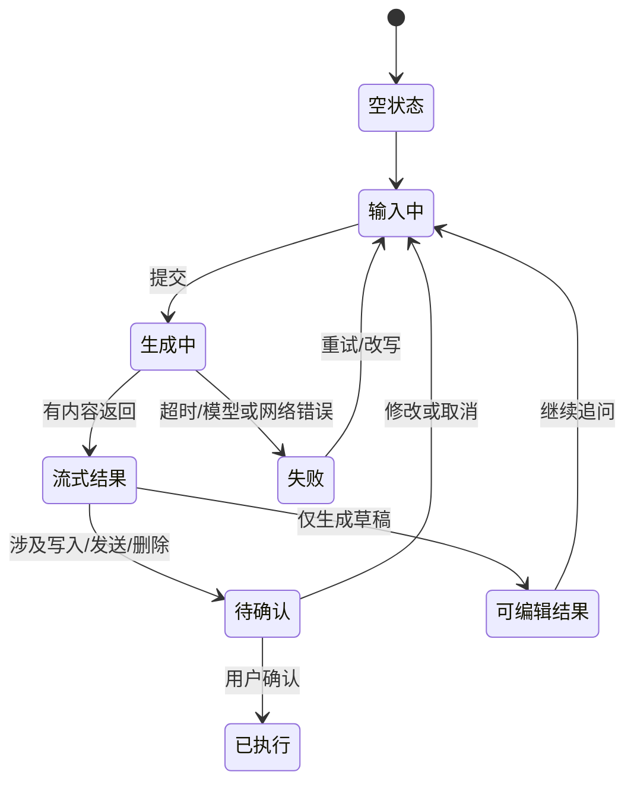

# AI 开发中的前端设计：从“能生成”到“能交付”

> 适合：有基础 HTML/CSS/React（或 Vue）知识的开发者、产品同学。  
> 建议时长：90 分钟（可压缩为 45 分钟）。  
> 本讲的核心结论：AI 不会替代前端设计；它把前端的重点从“画出界面”转移到“定义约束、设计交互状态、验证结果”。

---

## 一、开场（5 分钟）

### 开场问题

让学生看两个提问：

1. “帮我做一个数据看板。”
2. “为门店经理做一个移动优先的销售异常看板：早晨站会时在手机上快速定位异常；只展示本周数据；红/黄/绿区分紧急程度；最多三列；高对比度；必须有加载、空数据和错误状态。”

提问：为什么第二句话通常得到更好的页面？

**答案：** 生成式工具会补全未说出的内容；设计者的工作是减少错误的“补全空间”。Vercel 的 v0 官方提示词指南也将“使用者、使用时刻、要做的决定”以及设备、布局、状态等约束作为有效提示的关键输入。

### 本课目标

下课后，学生能：

1. 用一张“AI 前端需求卡”写清页面，而不是只说“做得好看”；
2. 为 AI 功能补齐关键 UI 状态：输入、生成、结果、校验、失败、反馈；
3. 用“先骨架、再行为、后细节”的方式与 AI 工具迭代；
4. 用一份检查表评审 AI 生成的界面和代码。

---

## 二、先区分两类问题（10 分钟）

| 方向 | 你在设计什么 | 典型工具/产出 | 最容易犯的错 |
| --- | --- | --- | --- |
| **AI 辅助前端开发** | 用 AI 生成/修改页面与代码 | Figma Make、v0、AI Studio、代码助手 | 只给一句模糊需求，拿到“漂亮但不适用”的界面 |
| **AI 原生产品前端** | 用户与模型、知识库、工具调用共同完成任务的体验 | 智能问答、AI 表单、报告生成、Agent 工作台 | 把 AI 能力塞进聊天框，却没有控制、校验和兜底 |

课堂要同时讲这两条线：**前者解决“如何更快做”，后者解决“做出来是否可信、可用”。**

---

## 三、AI 辅助设计的标准工作流（20 分钟）

### 1. 从“提示词”升级为“设计规格”

先写一页需求卡，再交给任何生成工具。不要直接从视觉风格开始。

```text
【任务】做什么页面/组件？核心动作是什么？
【用户】谁在什么场景、用什么设备、时间有多紧？
【信息】页面必须呈现哪些数据？其来源、刷新频率和敏感等级？
【行为】用户点击、编辑、确认后发生什么？
【状态】加载、空数据、权限不足、网络失败、成功分别长什么样？
【约束】技术栈、已有组件库/设计 token、响应式断点、可访问性、禁用项。
【验收】三条可测试的成功标准。
```

**示例验收条件：**

- 手机 375px 宽度下，核心任务不需要横向滚动；
- 主操作在首屏可见；
- 列表接口失败时，用户知道发生什么、能重试、不会丢失已填写内容。

### 2. 三轮迭代法


- **第 1 轮只定结构**：导航、层级、信息密度、主任务；不要急着要炫酷动画。
- **第 2 轮补行为**：筛选、编辑、提交、撤销、加载、错误、手机布局。
- **第 3 轮才做精修**：颜色、间距、字体、文案、空状态、可访问性。

Figma 官方也建议：先聚焦布局，再逐步补功能；用任务、上下文、约束组织提示；有设计稿时优先附 Figma frame，而不只是截图。v0 的指南同样强调，对布局和状态给出具体约束比“让首页更好看”有效。

### 3. 可直接投屏的提示词模板

```text
你是资深产品设计师和前端工程师。
请先用不超过 8 条列出信息架构和假设；确认后再生成界面。

产品：{产品/业务}
用户与场景：{谁，在何时何地，用什么设备，想完成什么决定}
页面任务：{一个最重要的用户任务}
内容与数据：{字段、示例数据、优先级}
交互：{点击、编辑、确认、撤销、权限}
必须呈现的状态：加载、空数据、错误、成功、无权限
视觉约束：{品牌色/token、密度、参考风格；禁止什么}
技术约束：{React/Vue、组件库、TypeScript、响应式断点}
质量约束：语义化 HTML；键盘可操作；表单有 label；颜色不作为唯一提示。
验收：{3 条可测试标准}
```

### 4. 工具如何选择（只讲定位，不讲“谁最好”）

| 任务 | 合适工具形态 | 课堂提醒 |
| --- | --- | --- |
| 快速探索多个版式 | Figma AI / 线框工具 | 产出是候选方案，不是最终设计系统 |
| 从设计稿得到可交互原型 | Figma Make | 给它 frame、组件和明确约束；不要贴密钥或隐私数据 |
| 从自然语言生成可运行前端 | v0 / AI Studio / 编程 Agent | 先生成骨架，逐轮变更；每轮在手机端检查 |
| 在现有项目中改组件 | IDE/代码 Agent | 提供组件 API、token、现有代码和测试命令 |

注意：工具会变化，但**“明确上下文 + 复用设计系统 + 小步验证”**不会过时。

---

## 四、为 AI 功能设计前端：不是一个聊天框就够了（25 分钟）

AI 输出具有概率性，且可能耗时、引用外部资料、调用工具、出错。因此页面应把用户从“等待答案”转为“看得懂、改得动、敢确认”。

### 1. 五条设计原则

1. **先说明能力边界**：用户第一次使用时，说明它能做什么、不能做什么、会使用哪些数据。
2. **让不确定性可见**：不要用“100% 正确”的语气；关键结论给来源、时间或置信依据。
3. **让人始终能接管**：生成内容可编辑；高风险动作须确认；要有撤销或回退。
4. **把过程变成可理解的状态**：例如“正在检索订单数据”“已生成草稿，待你确认”，而非假装思考过程。
5. **失败时给出出路**：解释失败原因、保留用户输入、允许重试、改写请求或转人工流程。

这些原则对应 Google PAIR 的“价值判断、解释与信任、优雅失败、反馈”模式，以及 Microsoft HAX 覆盖首次使用、交互中、系统出错和长期使用的 18 条人机协作指南。

### 2. AI 功能的状态机：讲代码前先讲界面



**教师追问：** 你的页面有没有这些状态？如果接口 20 秒才返回、回答为空、调用了外部工具、用户想停止生成，界面分别如何表现？

### 3. 生成式 AI UI 的最小组件清单

| 组件 | 为什么需要 | 课堂中可强调的细节 |
| --- | --- | --- |
| 示例任务/输入引导 | 降低首次使用门槛 | 用真实任务示例，不只写“有什么可以帮你？” |
| 进度与停止按钮 | 延迟不可避免 | 显示当前阶段；允许停止；停止后保留已生成内容 |
| 结果卡片 | 让输出可扫描、可操作 | 标题、结论、来源/时间、复制、编辑、重新生成 |
| 工具调用确认 | 避免 AI 越权 | 明确动作、对象、影响；高风险操作二次确认 |
| 证据与引用区域 | 帮助核验 | 可展开查看来源，标示是否来自实时/内部数据 |
| 反馈与纠错 | 让系统可改进 | 👍/👎 只是入口；提供“事实错误/不相关/格式不对”等原因 |
| 历史、撤销、版本 | 支持回看和恢复 | 区分用户输入、AI 草稿和已执行动作 |

### 4. 一页判断题（互动 5 分钟）

让学生判断并说明理由：

- “AI 已帮你提交退款”只显示 toast。——**不合格**：高影响动作至少应在执行前展示金额、订单、后果和确认入口。
- “AI 生成文案”允许直接在结果中编辑。——**合格**：AI 是草稿，用户保有最终控制权。
- “正在思考 47 秒”但没有停止、也没有阶段说明。——**不充分**：应提示可理解进度、取消入口与超时兜底。
- 只用绿色表示“通过”。——**不合格**：颜色不是唯一信息通道，还需文字/图标并考虑对比度。

---

## 五、从模型输出到稳定 UI：前端实现要点（15 分钟）

### 1. 把自由文本变成可渲染数据

对于要渲染为卡片、表格、表单的结果，不要依赖模型随意输出 Markdown，再用脆弱的字符串切割。让后端/模型按固定 JSON Schema 返回结构化字段；前端只渲染白名单字段，并对缺失字段有默认状态。

```ts
type Report = {
  title: string
  summary: string
  findings: Array<{
    severity: "high" | "medium" | "low"
    text: string
    source?: { label: string; url: string; updatedAt?: string }
  }>
  nextActions: Array<{ label: string; action: "open" | "draft" }>
}
```

**前端规则：**

- 先校验 JSON / schema，再进入视图；
- 未知字段不直接显示；外链、HTML、文件名一律按不可信输入处理；
- `severity` 映射为文字 + 图标 + 颜色，而非只用颜色；
- 每项行动都由前端决定可执行权限，不能只因模型说“可以”就放行。

主流模型 API 都提供结构化输出或工具调用能力；这适合用来稳定 UI 契约。工具调用时，模型只提出“要做什么”，真正的权限校验、数据写入和审计仍在你的服务端完成。

### 2. 流式响应的 UI 原则

- 把已到达内容当作“草稿”，不要过早显示“完成”；
- 滚动遵循用户意图：用户正在阅读旧内容时，不要强行拉回底部；
- 提供停止、重试、复制；断流时保留已有内容并说明状态；
- 需要工具调用时，显示阶段和可理解名称，例如“正在查询库存”，不要暴露内部函数名。

### 3. 安全与隐私一句话

**密钥永远不放浏览器；用户上传/粘贴的内容、模型文本、工具返回值都属于不可信输入。**

---

## 六、课堂实战（15 分钟）

### 题目：为“销售异常分析助手”设计一个页面

分 3—4 人一组，选择桌面或手机端。目标：帮助门店经理发现异常并决定“跟进哪一家门店”。

**给定条件：**

- 用户：非技术人员，早晨站会前 3 分钟查看手机；
- 数据：昨日销售额、环比、库存预警、AI 原因摘要；
- AI 可能返回无结果、低置信度原因、或因数据延迟失败；
- 用户可以“查看证据”“修正原因”“生成跟进消息”，但发送前必须确认。

**小组交付（10 分钟）：**

1. 写一张需求卡；
2. 画一个低保真页面（纸上或生成工具）；
3. 至少画出：正常结果、加载、失败、发送前确认 4 个状态；
4. 写出一次生成提示词。

**互评（5 分钟）：**

- 一眼能看出用户下一步该做什么吗？
- AI 的结论能被核验或纠正吗？
- 如果 AI 错了或慢了，用户会卡住吗？
- 是否存在“AI 看起来替用户作了决定”的越权设计？

---

## 七、下课前的评审清单（可作最后一页）（5 分钟）

### 需求与信息

- [ ] 我能一句话说清用户、场景、主任务和成功标准。
- [ ] 主操作和最重要信息在对应设备的首屏清晰可见。
- [ ] 页面既有真实数据，也定义了加载、空、错、无权限状态。

### AI 体验

- [ ] 已说明能力、数据范围和关键限制；不承诺它做不到的事。
- [ ] 结论能追溯来源/时间，用户能编辑、纠正或拒绝。
- [ ] 高影响操作有明确确认；已执行操作可回看，尽可能可撤销。
- [ ] 有停止、重试、改写请求或人工替代路径。

### 前端质量

- [ ] 用结构化契约渲染内容，不靠解析随机自然语言。
- [ ] 响应式、键盘、焦点、label、对比度已检查。
- [ ] 不在浏览器暴露密钥；模型输出和外部内容均被当作不可信数据处理。

---

## 八、讲师备用：45 分钟压缩版

| 时间 | 内容 | 讲法 |
| --- | --- | --- |
| 0–5 | 两条模糊/具体提示词对比 | 提问导入 |
| 5–15 | 需求卡 + 三轮迭代 | 现场把模糊需求改写成规格 |
| 15–28 | AI 产品的五原则 + 状态机 | 让学生补“失败”和“确认”状态 |
| 28–40 | 小组实战 | 画销售异常助手的四个状态 |
| 40–45 | 清单互评与总结 | 每组说一个要删掉的“伪智能”设计 |

---

## 参考资料（可给学生课后阅读）

1. [Google PAIR：People + AI Guidebook](https://pair.withgoogle.com/guidebook-v2/)：面向以人为中心的 AI 设计模式，涵盖价值判断、解释、信任、反馈与失败处理。
2. [Microsoft HAX：Guidelines for Human-AI Interaction](https://www.microsoft.com/en-us/haxtoolkit/ai-guidelines/)：18 条人机协作设计指南，按首次使用、交互中、出错时和长期使用组织。
3. [Figma Make：创建交互原型或 Web App](https://help.figma.com/hc/en-us/articles/31304485164695-Create-and-edit-a-functional-prototype-or-web-app)：官方提示词建议包括明确任务/上下文/约束、优先附设计 frame、先布局后功能，以及不提交敏感信息。
4. [Vercel：How to prompt v0](https://vercel.com/blog/how-to-prompt-v0)：用用户、时刻、决策和视觉/响应式约束提升生成结果，并区分结构性改动和视觉微调。
5. [OpenAI API Quickstart](https://platform.openai.com/docs/quickstart/make-your-first-api-request)：模型调用、工具扩展等基础入口。实际接入请查阅当前版本的结构化输出与工具调用文档。
6. [Google Gemini Prompt Design Strategies](https://ai.google.dev/gemini-api/docs/prompting-strategies)：清晰具体的指令、迭代和结构化输出的实践建议。
7. [Anthropic：Building Effective Agents](https://www.anthropic.com/engineering/building-effective-agents)：何时采用可预测的工作流、何时采用自主 Agent；提醒在复杂度、延迟、成本与效果之间权衡。

---

## 讲师备注

- 不建议把课讲成工具清单或“提示词魔法”。工具可快速变，但需求澄清、状态设计、可验证性和可访问性是长期能力。
- 若学生只会做普通页面，重点讲第三、四、七部分；若学生已有全栈基础，增加第五部分的结构化输出、服务端权限和审计。
- 演示时故意先用一句模糊提示词生成，再用需求卡重做一次；这种前后对比比展示完美成品更有教学效果。
