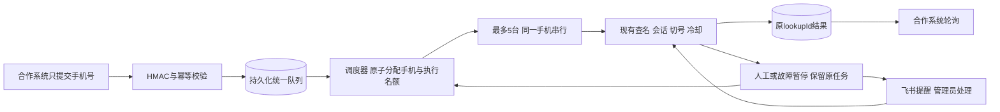

# 支付宝查名：统一设备池与5台并发设计

日期：2026-10-13。状态：**设计候选，未实现、未迁移、未上线**。任务记录：[LOOKUP_POOL_TASK_20261013.json](LOOKUP_POOL_TASK_20261013.json)。权威现状与发布记录以[项目主文档](PROJECT_DEVELOPMENT.md)为准。

用户目标：其他系统提交手机号，Phone Cloud自行选择手机、准备账户、查名、处理异常并保存结果。调用方不再管理设备、会话、切号或结束手机。初版支持最多5台同时自动执行，更多号码进入统一队列。

## 1. 与现有链路的关系

延续D-061的HMAC认证、专用用户、租户隔离、幂等和脱敏结果，延续D-060/D-062/D-063、13.5/13.6的设备锁、账号证明、自动切号、8小时冷却、普通异常恢复、飞书人工提醒和原结果接续。替换的是新接入方式中“调用方选择deviceId、创建/结束长会话”的责任；已有7个单设备接口继续兼容。

上一次已记录生产基线是lookup-realname-prompt-20261012-deployed.1：云端业务7f695507，文档integration rc.3，Windows实际查名脚本24a9429c。本轮只读已提交快照，4个核心云文件与上次部署哈希一致；未连接生产，不将10月12日的在线数量当成今日状态，不把仓根旧业务代码作为实现起点。

代码确认的现状：

- 现有查询队列归属于一台手机的session，不是跨设备总队列；队首人工/恢复/账号耗尽会阻塞该session。
- 设备列表的available只检查上架、在线、占用；不足以证明账户、冷却、人工状态和执行器可用。
- 当前客户端配置包含专用username、精确deviceIds，启动时加载；没有动态查名设备池管理。
- 会话结果公开返回最新500项；新业务任务必须独立查询，不能靠这个数组保存全部结果。
- Agent已有按serial排除、跨设备任务并发、终态outbox、Poco容量管理。源码默认ADB任务上限15、每设备1、常驻Poco上限8；这是源码默认值，不是本轮生产容量验收。
- 当前查名任务ACK不确定时仍可能执行；不能仅在云端加一层轮询就宣称有可靠的跨设备故障迁移。

新增的是云端队列和调度层，复用单机执行器；冻结投屏、媒体、控制映射、共享ADB/USB/PnP恢复行为不变。共享任务准入/ACK若需修改，只对新managed协议生效，并执行既有投屏与Agent回归。

## 2. 设备池和管理员页面

图片为8行、49个不同手机编号。仅转录设备编号，不转录人员姓名；人员分组作为管理备注，不自动转成用户权限。候选分组如下：

| 分组 | 手机编号 |
|---|---|
| G01 | 51、52、54、55、87、138、152 |
| G02 | 188、172、156、155、115、60、58 |
| G03 | 164、163、154、6、57、10、183 |
| G04 | 82、86、121、146、149、153、181、182 |
| G05 | 162、161、142、74、78、79、118、130 |
| G06 | 157、147、101、107 |
| G07 | 165、112、67、53、128、158、143 |
| G08 | 148 |

161在此名单内，177不在；旧177/161测试白名单保持，不自动把177加进新池。130此前存在短暂传输消失证据，其容错候选未发布，不能直接标为已验收可用。49台都只是拟纳管清单，逐台状态尚未核对。

管理员新增“支付宝查名设备池”页面，复用平台管理员登录。提供：

- 编号导入预览→精确映射稳定deviceId/ADB serial→确认加入；不存在、重名或多映射显示错误，禁止猜测绑定。今后编号改名不改变绑定；换物理手机需管理员重新确认。
- 每台启用/暂停/排空，负责人备注、所属Agent、当前任务、上次查名结果、最近心跳、不可用原因、账号冷却最早到期、人工提醒状态。
- 分别展示“登记49台、可调度N台、自动执行N/5、等待人工N台、未知状态N台、待查号码N个”，不能把49台都展示成可查。
- 修改全局并发、队列容量、等待期限；首版并发上限5，降低上限时让已有任务完成，不强杀。提高到5以上属于后续容量验收，不在本方案默认范围。
- 调整池成员在线生效并审计，不为每次增删设备重建业务容器。暂停/移除只禁止新派发，当前任务排空后释放；强制取消走独立任务取消流程。
- 内部任务明细关联lookupId、尝试、session/query/job/task、设备编号和失败证据；人工入口仍使用平台既有实时控制。

候选筛选要求同时满足：池启用、客户端有该池权限、设备绑定唯一、上架、ADB和所属Agent心跳新鲜、所需执行器/协议可用、无冲突设备锁/控屏/扫码/发布/恢复、无未知在途执行、非人工阻塞/故障隔离，且不存在已证明的全部账户冷却。没有账户信息的设备只能作为“需准备”候选，占用名额进行首次准备，不能预称ready。

## 3. 对外API：只传号码，异步取得结果

以下都是**拟新增接口**，当前线上不能调用。路径继续放在HMAC命名空间；HTTP地址沿用现有部署，不改变现有签名规则。业务调用不提供管理员Token。

| 方法/路径 | 用途 | 语义 |
|---|---|---|
| POST `/api/v1/open/name-lookups/queries` | 提交一个号码 | 成功持久化后202；同键同参数200且同lookupId |
| GET `/api/v1/open/name-lookups/queries/{lookupId}` | 查询单任务 | 200；非本客户端资源统一404 |
| GET `/api/v1/open/name-lookups/queries` | 分页查本客户端任务 | 200；支持clientReference/status和游标，limit默认50、最高100 |
| POST `/api/v1/open/name-lookups/queries/{lookupId}/cancel` | 取消 | 未派发可200取消；在执行则202/cancelling，确认停止后终态 |

最简请求体只有`phoneNumber`。HMAC头和`Idempotency-Key`仍必需，调用方重试同一业务必须复用该键。phoneNumber使用现有合法号码规范；文档示例使用`<已授权手机号>`占位，不保存测试手机号。

`clientReference`可选；不传时生成可追溯引用，但不代替调用方稳定幂等键。保留`consentReference`可选覆盖；只传号码时使用管理员预先登记、真实有效的客户端授权/用途引用。未配置该引用返回403 `lookup_authorization_profile_missing`，不编造“已授权”。这只是新managed接口的简化，旧接口仍要求原有两个引用字段。

每个客户端必须显式绑定一个默认查名池和专用普通用户。新池授权是独立、可审计的授权关系，不能简单忽略旧deviceIds检查、自动扩大所有客户权限。旧客户端未授予managed模式时，新入口返回403；旧7接口的deviceIds不变。多个池无明确默认时拒绝，不随机选择。

幂等指纹按调用方规范化参数计算；自动生成的clientReference不参与重新计算。首次受理固定默认池、授权引用与配置版本；相同键重放复用该快照和原lookupId，配置变化不能使同一请求变成另一个任务。权限撤销后禁止新受理/新派发；排队任务明确结束为permission_revoked，已开始任务安全收尾，历史读取仍按当前客户端身份隔离。取消同样要求幂等键，重复取消不新建第二个stop任务。

新任务返回lookupId，独立于内部sessionId/queryId。号码换设备、原任务恢复或切号，lookupId不变；成功字段沿用maskedName/nameTailCharacter，不承诺完整姓名。

```json
{
  "ok": true,
  "idempotent": false,
  "lookup": {
    "lookupId": "<业务任务ID>",
    "status": "queued",
    "clientReference": "<业务引用>",
    "stage": "等待平台分配手机",
    "maskedName": "",
    "nameTailCharacter": "",
    "retryAfterSeconds": 3
  }
}
```

结果GET保持相同对象，增加createdAt/updatedAt/completedAt、reason、error和可选expiresAt。对外不要求识别手机，也不返回内部账号、人员姓名、设备serial或失败截图。管理员界面显示真实手机编号，方便处理拼图。

接入顺序：提交→保留lookupId→按retryAfterSeconds轮询（建议3秒、缓慢退避至10秒）→读取终态。调用方收到202不代表查到姓名；请求超时先用原键重放或原ID对账，不换键补单。初版采用轮询，批量文件导入、结果Webhook作为后续扩展，不增加本轮外发和投递故障面。

主要错误：400参数错误；401沿用签名失败；403未授权池/授权引用；404资源不存在或不属于当前客户端；409同幂等键不同参数；429队列满且带Retry-After；503池停用或持久化不可用。无空闲手机但池仍正常时受理202/等待设备，不谎报查询失败；全池不可用的请求也受等待期限限制。

## 4. 调度与并发边界



最后一条边表示其他待查号码可继续调度，不表示被暂停的号码自动换机。

1. 按客户端轮转领取，客户端内部按提交顺序；并发结果允许乱序，以lookupId关联。某客户海量请求不能永久饿死其他客户。
2. 优先同客户端已有ready/账户已确认的空闲session，其次近期健康且未准备的手机；同档按最近使用时间轮换，避免永远耗用第一台。无已准备设备才创建新session，先确认账户一次。
3. 统一队列不提前把大量号码分到各手机；每台只下发当前一个号码，余下号码留在云端。设备异常不会绑住一整批未开始的号码。
4. managed自动化总名额最高5，包含首次start、query、切号、恢复、stop；自动人工接续也必须从统一名额准入，不能从旧observer旁路再多启动第6台。单设备最多一个写UI任务。
5. 同时受Agent现有空闲任务槽/Poco容量限制；5是上限，不是资源不足时的最低保证。不提高常驻worker/ADB任务上限，不预热49台，不改变其他业务优先级。
6. ready空闲session可短时复用，初始建议120秒无任务后按已有stop流程释放锁；这只是新池会话的空闲租期，不改变旧长会话或Poco保温策略。跨客户端不能复用session/结果。
7. 拼图暂停的手机保留锁和原任务，自动执行名额仅在已确认没有执行中Windows任务后释放，允许用其他可用手机处理新号码。初始额外人工保留上限5台，达到后不继续制造更多人工等待；自动执行最多5、人工保留最多5不等于10台同时自动执行。
8. 设备故障隔离采用与账号冷却分开的有界退避，例如30/60/120秒。隔离结束先只读核对健康，再等待正常任务准备，不以重启ADB/USB恢复。

初始候选配置：全局等待队列1000条、单客户端200条、未开始等待15分钟、人工等待30分钟、managed幂等/任务索引保留至少7天。均为建议值，在实现中配置化并记录最终值；排队容量不包括终态历史，限流不是原D-061的每日查名次数配额。单机执行预算继续使用现有已提交策略，不擅自缩短切号或普通恢复。超过等待期限仅未开始任务可直接expired；已执行任务需要停止/对账，不能定时释放设备再派另一条。

## 5. 结果状态与异常处理

| 状态 | 调用方含义 | 内部动作 |
|---|---|---|
| queued / waiting_device | 已受理，等待执行/设备 | 在总队列，不创建重复查名 |
| preparing / running / switching / retrying | 平台正在处理 | 占自动名额；首次识别或沿用已证明账户 |
| waiting_human | 需要平台人员处理 | 飞书显示具体编号；保留设备/session/query/challenge |
| needs_recovery | 自动有界恢复用尽 | 不派后续号码到该手机；管理员按原任务恢复或停止 |
| reconciling / unknown | 执行事实尚未确定 | 查原任务/outbox/Agent状态；隔离设备，禁止自动换机重查 |
| cancelling | 已收到取消，仍在停止 | 尚不能释放正在操作的手机 |
| succeeded / not_found | 查到掩码名/明确无结果 | 终态，保存一次结果，不把not_found当系统故障重试 |
| failed / cancelled / expired | 已确定失败/停止/未开始过期 | 保留尝试历史与原因；设备仅在确认安全后释放 |

首次准备识别当前账号；同会话普通异常恢复仍走搜索快路径，不再次无故导航账户。会话新建、登录变化或明确账户证明失效时才重新验证。限制/切号后的证明按原链路严格检查。

账号限制先由单机既有策略确认、记录同设备账户8小时冷却并切换可用账号；不按固定次数切号，不为扩大吞吐绕过限制。全部账号冷却时该手机不再接新号码，等待最早冷却时间并重新验证资格。冷却到期只恢复调度资格，不代表原paused查询可以无证据续跑。同名脱敏账号不能跨手机合并冷却。

跨手机迁移需证明**原尝试已停止且不会再执行，号码未输入/查询未开始**，或者只有start失败而未下发query。保留attempt记录，在同lookupId下最多尝试另1台。查询已开始、限制发生在输入之后、拼图、outbox待回执、任务超时或任何未知状态均不能仅凭failed/TTL盲目转移；先原机恢复/原ID对账，必要时unknown交人工。单机原有普通恢复有界且记录计数；外层不能再无限循环放大重试。

每个新challenge仍由原飞书去重链路发出“XX号手机出现拼图，请人工介入到云手机平台实时控制完成拼图”。人工不由合作系统操作；平台按既有只读证据和正常控屏结束接回原号码。通知失败单独重试/展示，不把通知失败变成查名任务失败，不另建号码任务。

取消：未派发即cancelled；执行中先cancelling→Agent停止确认→结算结果→释放锁。已成功结果不被后来的取消覆盖。取消请求先提交且结果已发生时，保留真实result/evidence并注明完成与取消的先后，不假称手机从未查询。TTL、池禁用、部署排空同样不等于确认执行停止。

## 6. 持久化、原子领取与恢复

使用现有PostgreSQL作为事实源，Redis只承担唤醒/状态缓存；初版不引入另一个消息队列。拟新增结构：

| 数据 | 关键字段与约束 |
|---|---|
| lookup_pools / pool_devices / client_pool_grants | 管理配置版本、并发、暂停；稳定deviceId唯一绑定、默认池与显式授权、审计 |
| managed_lookup_requests | lookupId、clientId、手机号、引用、幂等键、fingerprint、状态/结果/期限；`UNIQUE(clientId, operation, idempotencyKey)` |
| managed_lookup_attempts | lookupId、attemptNo、deviceId、sessionId、queryId、jobId、windowsTaskId、阶段证据、leaseGeneration；每次尝试可追溯 |
| managed_lookup_slots / device_reservations | 5个自动执行槽、同deviceId唯一预约、generation/到期/停止证明；与现有设备锁共同准入 |
| managed_lookup_events | 阶段/操作者/原因/关联ID；不复制明文手机号、密钥或截图到普通日志 |

DDL和表名是候选，不是现有Schema；上线前新增表迁移需用隔离PG验证旧版本共存、事务回滚和数据保留。手机号只进入已有授权数据路径和必要任务表，按原平台保护/备份策略存储；外部响应脱敏，日志以lookupId关联。初版不共享跨客户号码缓存，也不因手机号相同自动合并不同业务请求。

受理事务先写幂等/请求/入队，再返回202；失败不返回虚假受理。调度在短事务内锁定候选请求、名额和设备，复核权限与当前状态，写attempt、现有session/job/task/设备锁关联，提交后才允许Agent领取。请求与attempt/dispatch必须在同一PG事务落地，不能“先发任务，后补入队状态”。锁顺序固定且遇竞争跳过候选，避免死锁和重复分配。PostgreSQL官方明确`SKIP LOCKED`适合多个消费者领取队列，但不用于要求一致全量快照的普通查询：[SELECT锁定子句](https://www.postgresql.org/docs/16/sql-select.html#SQL-FOR-UPDATE-SHARE)、[显式锁](https://www.postgresql.org/docs/16/explicit-locking.html)。

**既有锁接入是必做项**：当前锁检查先读内存、再异步持久化，不能把新增reservation表当作扫码/控屏/旧查名天然尊重的锁。所有冲突占用的相关入口必须共同参与设备准入临界区/PG行锁，并同步现有内存/Redis状态；否则两个请求可同时认领。保留D-060指定同发起者/管理员在人工状态叠加控屏的合法例外，只改锁准入，不改控屏传输/控制行为。初版维持当前单业务进程拓扑；未完成状态缓存多实例一致性前不宣称可横向扩容。

**Agent新managed协议是必做项**：仅managed任务要求明确lease/generation/ACK确认才执行，旧Agent不宣告能力时禁止分配池任务；不能复用当前“查名ACK不确定也执行”的路径。Agent串行设备保留、取消/终态outbox复用，generation绑定每条报告；必要时增加开始/输入已开始/停止确认的可靠阶段事实。断线旧执行不能靠数据库令牌凭空撤销，收到过期generation的结果仅保留审计，旧任务未确认停止前设备继续隔离，绝不自动释放去执行新号码。

调度由受理/终态/设备健康恢复/冷却到期事件唤醒，并有短周期有界扫描兜底，不能依赖合作系统GET才驱动。新GET纯读持久化状态。平台启动先重建请求、预约、slot和attempt关系，与已有job/task/outbox对账后再派发；Agent离线或心跳过期冻结新派发，未领取任务可在可靠撤销确认后重新排队，已执行未知任务进入reconciling。终态以CAS/version幂等写入，迟到状态不能覆盖新结果或已经确认的取消/停止。

## 7. 可观测、验证与上线顺序

需观测：受理/拒绝/重放数，队列长度与等待p95，自动执行与人工保留数，按原因不可用数量，单机start/query/stop耗时，系统失败与not_found分别计数，切号/冷却/拼图/飞书发送状态，重复派发、过期租约、unknown、outbox积压、PG保存失败及Agent容量。没有逐号人工真值时，不把succeeded率称为姓名准确率。

实施拆成可独立审查的阶段，均形成新commit/annotated rc标签：

1. 云端任务模型/4接口/PG受理与幂等，fake Agent做全部状态模拟；旧7接口契约回归不变。
2. 设备池管理/动态授权/准入锁/调度，跨租户、扫码/发布/控屏竞争及数据库并发测试。
3. managed Agent ACK/generation和自动人工恢复名额接入、取消/迟到/outbox对账；Agent与投屏完整回归，证实冻结源码/参数保持。
4. 更新公开API文档/OpenAPI/接入包，标清新managed模式与旧session模式，不把设计提前当已上线功能。
5. 按实际生产ACTIVE和文件哈希组装候选，保留24a9429c Windows补丁，准备新增表迁移、配套组件与回退。先单机→两机→五机灰度，真实号码/手机/次数与发布窗口另行明确授权。

必须验收的反例：20个并发提交最多5执行、同机1、两调度器抢同任务/设备、同键HTTP丢回执无重复、同键异参409、跨客户404、无可用手机/全部冷却等待、不靠GET派发、单机拼图不堵其他手机且不重复原号码、人工接续不越过5名额、查询未开始迁移与已开始unknown区分、派发后平台/Agent强杀重启、ACK丢失不执行、任务停止确认前不释放、迟到报告不覆写、运行中池成员移除排空、普通恢复不重复账户识别、冷却事件重放不延长、云/Agent混版拒绝新managed任务、取消与成功竞态、部署回退保留请求和冷却。

真实5台验收不只看5个HTTP202：保存同窗5条实际执行证据、同设备不重叠、CPU/内存/Poco和ADB负载、现有投屏/短信/其他自动化影响、故障回收与可用队列下降；任一共享容量或冻结基线异常停止扩大。不用离线测试替代真机。

回退：managed入口停止受理、调度排空，保留GET历史；未开始任务等待或按策略过期，执行/人工/未知任务原ID保留并对账。旧7接口仍兼容，但保留池预约直到确认执行停止。旧应用不能安全识别新managed在途锁时，不直接切回旧版抢占设备；先完成排空或保留新版准入组件。新增表不做破坏性降级，不删除任务/冷却/飞书回执。媒体宿主机D-075发布前后只读live，常规业务发布不重启媒体/ADB/USB。

## 8. 本轮边界与待办

已完成49个唯一编号转录、既有代码/发布哈希对照、API/调度/人工/异常/持久化/迁移回退设计。当前只有设计文档和版本记录，没有业务实现、真实设备映射、生产配置变更或查询；旧177/161开放范围未改变。主文档记录“设计阶段开始”，不将本方案写成生产能力。

实现前继续核实49台稳定映射/账号准备和现有锁的PG事务边界、managed ACK可落实的阶段证据；实施阶段再确定建议阈值及完成专项回归。首次上线先小范围配置，49台逐步纳管，不能在未经机型/容量验证前一键全部启用。
