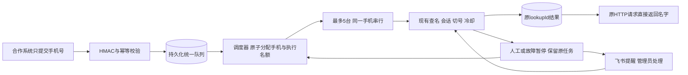

# 支付宝查名：统一设备池与5台并发设计

日期：2026-10-13。版本：lookup-pool-20261013-rc.1。状态：**本地实现与隔离验证完成，未迁移生产、未上线**。任务记录：[LOOKUP_POOL_TASK_20261013.json](LOOKUP_POOL_TASK_20261013.json)。权威现状与发布记录以[项目主文档](PROJECT_DEVELOPMENT.md)为准。下方设计建议的最终落实方式以第9节为准。

用户目标：其他系统提交手机号，Phone Cloud自行选择手机、准备账户、查名、处理异常并保存结果。调用方不再管理设备、会话、切号或结束手机。初版支持最多5台同时自动执行，更多号码进入内部统一队列。用户随后明确对外必须一次调用传号码并直接返回名字，因此rc.2替换rc.1外部任务ID/轮询方案；任务和调度仍由平台内部管理。

## 1. 与现有链路的关系

延续D-061的HMAC认证、专用用户、租户隔离、幂等和脱敏结果，延续D-060/D-062/D-063、13.5/13.6的设备锁、账号证明、自动切号、8小时冷却、普通异常恢复、飞书人工提醒和原结果接续。替换的是新接入方式中“调用方选择deviceId、创建/结束长会话”的责任；已有7个单设备接口继续兼容。

上一次已记录生产基线是lookup-realname-prompt-20261012-deployed.1：云端业务7f695507，文档integration rc.3，Windows实际查名脚本24a9429c。本轮只读已提交快照，4个核心云文件与上次部署哈希一致；未连接生产，不将10月12日的在线数量当成今日状态，不把仓根旧业务代码作为实现起点。

代码确认的现状：

- 现有查询队列归属于一台手机的session，不是跨设备总队列；队首人工/恢复/账号耗尽会阻塞该session。
- 设备列表的available只检查上架、在线、占用；不足以证明账户、冷却、人工状态和执行器可用。
- 当前客户端配置包含专用username、精确deviceIds，启动时加载；没有动态查名设备池管理。
- 会话结果公开返回最新500项；新业务任务必须独立查询，不能靠这个数组保存全部结果。
- Agent已有按serial排除、跨设备任务并发、终态outbox、Poco容量管理。源码默认ADB任务上限15、每设备1、常驻Poco上限8；这是源码默认值，不是本轮生产容量验收。
- 当前查名任务ACK不确定时仍可能执行；不能仅在云端加一层轮询就宣称有可靠的跨设备故障迁移。

新增的是云端队列和调度层，复用单机执行器；冻结投屏、媒体、控制映射、共享ADB/USB/PnP恢复行为不变。共享任务准入/ACK若需修改，只对新managed协议生效，并执行既有投屏与Agent回归。

## 2. 设备池和管理员页面

图片为8行、49个不同手机编号。仅转录设备编号，不转录人员姓名；人员分组作为管理备注，不自动转成用户权限。候选分组如下：

| 分组 | 手机编号 |
|---|---|
| G01 | 51、52、54、55、87、138、152 |
| G02 | 188、172、156、155、115、60、58 |
| G03 | 164、163、154、6、57、10、183 |
| G04 | 82、86、121、146、149、153、181、182 |
| G05 | 162、161、142、74、78、79、118、130 |
| G06 | 157、147、101、107 |
| G07 | 165、112、67、53、128、158、143 |
| G08 | 148 |

161在此名单内，177不在；旧177/161测试白名单保持，不自动把177加进新池。130此前存在短暂传输消失证据，其容错候选未发布，不能直接标为已验收可用。49台都只是拟纳管清单，逐台状态尚未核对。

管理员新增“支付宝查名设备池”页面，复用平台管理员登录。提供：

- 编号导入预览→精确映射稳定deviceId/ADB serial→确认加入；不存在、重名或多映射显示错误，禁止猜测绑定。今后编号改名不改变绑定；换物理手机需管理员重新确认。
- 每台启用/暂停/排空，负责人备注、所属Agent、当前任务、上次查名结果、最近心跳、不可用原因、账号冷却最早到期、人工提醒状态。
- 分别展示“登记49台、可调度N台、自动执行N/5、等待人工N台、未知状态N台、待查号码N个”，不能把49台都展示成可查。
- 修改全局并发、队列容量、等待期限；首版并发上限5，降低上限时让已有任务完成，不强杀。提高到5以上属于后续容量验收，不在本方案默认范围。
- 调整池成员在线生效并审计，不为每次增删设备重建业务容器。暂停/移除只禁止新派发，当前任务排空后释放；强制取消走独立任务取消流程。
- 内部任务明细关联lookupId、尝试、session/query/job/task、设备编号和失败证据；人工入口仍使用平台既有实时控制。

候选筛选要求同时满足：池启用、客户端有该池权限、设备绑定唯一、上架、ADB和所属Agent心跳新鲜、所需执行器/协议可用、无冲突设备锁/控屏/扫码/发布/恢复、无未知在途执行、非人工阻塞/故障隔离，且不存在已证明的全部账户冷却。没有账户信息的设备只能作为“需准备”候选，占用名额进行首次准备，不能预称ready。

## 3. 对外API：一次传号码，直接返回名字

**用户确认的接入方式**：一个同步接口，成功时同一个HTTP请求直接返回名字。调用方不选手机、不建session、不获取任务ID、不轮询、不结束设备。内部仍使用持久化队列与任务；同步仅表示外部HTTP等待结果，不表示把队列、PG事务或服务事件循环阻塞住。

拟新增唯一托管入口：`POST /api/v1/open/name-lookups/query`。当前线上未实现；已有7个单设备接口保持原样。继续使用现有HTTP地址与HMAC签名，业务请求体必填字段仅`phoneNumber`。

```json
{"phoneNumber": "<已授权手机号>"}
```

正常查询完成返回HTTP200：

```json
{"ok": true, "name": "张*"}
```

`name`映射现有查名结果的maskedName/页面实际展示名；仅有尾字时不得拼成完整实名，不承诺突破支付宝脱敏。现有SDK的nameTailCharacter等数据仍内部保留，不让合作方解析单机结果结构。

明确未查到名字返回HTTP200，区别于执行失败：

```json
{"ok": true, "name": "", "code": "not_found"}
```

未完成或系统错误返回相应非200，不用空name伪装正常无结果。例如超过HTTP等待期限：

```json
{"ok": false, "name": "", "code": "lookup_timeout"}
```

签名、客户端专用用户/默认池权限和授权引用由一次性接入配置及SDK封装。提供`lookupName(phoneNumber)`方法：生成请求签名和一个稳定Idempotency-Key，在同一次逻辑调用的网络重试中复用业务键、生成新nonce；调用者只传号码。直接调用HTTP时仍须签名和Idempotency-Key头，不能为简单接入取消认证或依手机号全局合并。SDK生成键只覆盖该次调用及其重试；两次独立调用同号码可能是两个真实业务请求，不能宣称天然去重。

客户端必须显式授权设备池和专用普通用户；只传号码时使用管理员预先登记的授权/用途引用，未配置返回403 `managed_lookup_not_authorized`。本地实现只消费phoneNumber，内部业务引用由lookupId生成，用途引用来自管理员grant；不接受外部覆盖。旧接口字段要求保持。旧客户未授予managed模式则403，旧deviceIds权限不自动扩展。本轮只有一个池。

内部生成lookupId并关联session/query/job/task与各次attempt，外部成功体不返回这些内部ID或状态。幂等指纹使用规范化输入，自动引用不参与重算；首次固定默认池/授权/配置快照，同键异参409。同键已有结果直接200返回原name；同键执行中等待同一任务，不创建第二条、不要求GET轮询。权限撤销禁止新受理/新派发，已执行安全收尾、历史仍按客户端隔离。

### 同步等待与异常边界

- 候选HTTP等待上限120秒，覆盖排队、首次准备、查询和有界恢复；这是建议值，发布前以实测定值。接入SDK读取超时必须略长，例如130秒；Nginx/调用系统网关超时需覆盖整个等待，例如150秒。先核对实际HTTP链路，不能只改服务端就声称长请求可达。
- 请求先短事务持久化入队，提交后异步订阅/等待内部终态；不跨等待时间持有PG事务/设备行锁。终态落库后再回应name。连接等待器与单机5名额分开限量：候选每客户端最多20条等待连接、同业务键最多3个等待连接，超限429，防止重复重连耗尽服务资源。
- HTTP断开只移除连接等待器，不直接释放设备或盲目取消执行。平台重启后连接不能恢复，但原任务保留；客户端/SDK带原键重试同一入口，接回原执行或已保存结果，无需额外查询接口。
- 未开始任务超过首次受理的120秒同步期限停止新派发，记lookup_queue_timeout，保留幂等历史。已开始任务超过HTTP期限返回lookup_timeout，内部继续按既有预算确认结果/停止/unknown并保存；不因HTTP超时换机补查或释放在途锁。相同键再次请求可取得迟到终态或等待原任务，不能把重试当新查号。
- 全部手机暂不可用可在期限内等待；期限到返回503 `lookup_temporarily_unavailable`。已明确等待人工且期限到返回503 `lookup_manual_action_pending`，飞书和人工处理全在内部。已执行且事实未知返回503 `lookup_outcome_unknown`，内部对账，禁止SDK换新键自动补查。这些都不是not_found。
- 其他错误：400参数非法，401签名失败，403未授权池/缺授权引用，409同键异参，429队列或等待连接满（Retry-After），503池停用/PG不可用，504等待超时。调用方只处理name或明确错误，不承担设备调度。
- managed任务取消、列表、人工恢复和排空进入管理员内部页面/服务；本轮不新增对外任务管理、Webhook或轮询协议。具体内部取消仍须幂等并确认停止；旧7接口的结束/恢复功能保持。

## 4. 调度与并发边界



最后一条边表示其他待查号码可继续调度，不表示被暂停的号码自动换机。

1. 按客户端轮转领取，客户端内部按提交顺序；并发结果允许乱序，由内部lookupId绑定到各自等待的HTTP请求。某客户海量请求不能永久饿死其他客户。
2. 优先同客户端已有ready/账户已确认的空闲session，其次近期健康且未准备的手机；同档按最近使用时间轮换，避免永远耗用第一台。无已准备设备才创建新session，先确认账户一次。
3. 统一队列不提前把大量号码分到各手机；每台只下发当前一个号码，余下号码留在云端。设备异常不会绑住一整批未开始的号码。
4. managed自动化总名额最高5，包含首次start、query、切号、恢复、stop；自动人工接续也必须从统一名额准入，不能从旧observer旁路再多启动第6台。单设备最多一个写UI任务。
5. 同时受Agent现有空闲任务槽/Poco容量限制；5是上限，不是资源不足时的最低保证。不提高常驻worker/ADB任务上限，不预热49台，不改变其他业务优先级。
6. ready空闲session可短时复用，初始建议120秒无任务后按已有stop流程释放锁；这只是新池会话的空闲租期，不改变旧长会话或Poco保温策略。跨客户端不能复用session/结果。
7. 拼图暂停的手机保留锁和原任务，自动执行名额仅在已确认没有执行中Windows任务后释放，允许用其他可用手机处理新号码。初始额外人工保留上限5台，达到后不继续制造更多人工等待；自动执行最多5、人工保留最多5不等于10台同时自动执行。
8. 设备故障隔离采用与账号冷却分开的有界退避，例如30/60/120秒。隔离结束先只读核对健康，再等待正常任务准备，不以重启ADB/USB恢复。

初始候选配置：全局等待队列1000条、单客户端200条、未开始等待最多120秒（与同步受理期限一致）、人工等待30分钟、managed幂等/任务索引保留至少7天。均为建议值，在实现中配置化并记录最终值；排队容量不包括终态历史，限流不是原D-061的每日查名次数配额。单机执行预算继续使用现有已提交策略，不擅自缩短切号或普通恢复。超过等待期限仅未开始任务可直接expired；已执行任务需要停止/对账，不能定时释放设备再派另一条。

## 5. 内部结果状态与异常处理

| 内部状态 | 平台含义 | 内部动作 |
|---|---|---|
| queued / waiting_device | 已受理，等待执行/设备 | 在总队列，不创建重复查名 |
| preparing / running / switching / retrying | 平台正在处理 | 占自动名额；首次识别或沿用已证明账户 |
| waiting_human | 需要平台人员处理 | 飞书显示具体编号；保留设备/session/query/challenge |
| needs_recovery | 自动有界恢复用尽 | 不派后续号码到该手机；管理员按原任务恢复或停止 |
| reconciling / unknown | 执行事实尚未确定 | 查原任务/outbox/Agent状态；隔离设备，禁止自动换机重查 |
| cancelling | 已收到取消，仍在停止 | 尚不能释放正在操作的手机 |
| succeeded / not_found | 查到掩码名/明确无结果 | 终态，保存一次结果，不把not_found当系统故障重试 |
| failed / cancelled / expired | 已确定失败/停止/未开始过期 | 保留尝试历史与原因；设备仅在确认安全后释放 |

首次准备识别当前账号；同会话普通异常恢复仍走搜索快路径，不再次无故导航账户。会话新建、登录变化或明确账户证明失效时才重新验证。限制/切号后的证明按原链路严格检查。

账号限制先由单机既有策略确认、记录同设备账户8小时冷却并切换可用账号；不按固定次数切号，不为扩大吞吐绕过限制。全部账号冷却时该手机不再接新号码，等待最早冷却时间并重新验证资格。冷却到期只恢复调度资格，不代表原paused查询可以无证据续跑。同名脱敏账号不能跨手机合并冷却。

跨手机迁移需证明**原尝试已停止且不会再执行，号码未输入/查询未开始**，或者只有start失败而未下发query。保留attempt记录，在同lookupId下最多尝试另1台。查询已开始、限制发生在输入之后、拼图、outbox待回执、任务超时或任何未知状态均不能仅凭failed/TTL盲目转移；先原机恢复/原ID对账，必要时unknown交人工。单机原有普通恢复有界且记录计数；外层不能再无限循环放大重试。

每个新challenge仍由原飞书去重链路发出“XX号手机出现拼图，请人工介入到云手机平台实时控制完成拼图”。人工不由合作系统操作；平台按既有只读证据和正常控屏结束接回原号码。通知失败单独重试/展示，不把通知失败变成查名任务失败，不另建号码任务。

取消：未派发即cancelled；执行中先cancelling→Agent停止确认→结算结果→释放锁。已成功结果不被后来的取消覆盖。取消请求先提交且结果已发生时，保留真实result/evidence并注明完成与取消的先后，不假称手机从未查询。TTL、池禁用、部署排空同样不等于确认执行停止。

## 6. 持久化、原子领取与恢复

使用现有PostgreSQL作为事实源，Redis只承担唤醒/状态缓存；初版不引入另一个消息队列。拟新增结构：

| 数据 | 关键字段与约束 |
|---|---|
| lookup_pools / pool_devices / client_pool_grants | 管理配置版本、并发、暂停；稳定deviceId唯一绑定、默认池与显式授权、审计 |
| managed_lookup_requests | lookupId、clientId、手机号、引用、幂等键、fingerprint、状态/结果/期限；`UNIQUE(clientId, operation, idempotencyKey)` |
| managed_lookup_attempts | lookupId、attemptNo、deviceId、sessionId、queryId、jobId、windowsTaskId、阶段证据、leaseGeneration；每次尝试可追溯 |
| managed_lookup_slots / device_reservations | 5个自动执行槽、同deviceId唯一预约、generation/到期/停止证明；与现有设备锁共同准入 |
| managed_lookup_events | 阶段/操作者/原因/关联ID；不复制明文手机号、密钥或截图到普通日志 |

DDL和表名是候选，不是现有Schema；上线前新增表迁移需用隔离PG验证旧版本共存、事务回滚和数据保留。手机号只进入已有授权数据路径和必要任务表，按原平台保护/备份策略存储；外部响应脱敏，日志以lookupId关联。初版不共享跨客户号码缓存，也不因手机号相同自动合并不同业务请求。

受理事务先写幂等/请求/入队，提交后进入同步等待，终态持久化后返回name或明确错误；不向新接口返回202或内部任务DTO，持久化失败不返回虚假成功。调度在短事务内锁定候选请求、名额和设备，复核权限与当前状态，写attempt、现有session/job/task/设备锁关联，提交后才允许Agent领取。请求与attempt/dispatch必须在同一PG事务落地，不能“先发任务，后补入队状态”。锁顺序固定且遇竞争跳过候选，避免死锁和重复分配。PostgreSQL官方明确`SKIP LOCKED`适合多个消费者领取队列，但不用于要求一致全量快照的普通查询：[SELECT锁定子句](https://www.postgresql.org/docs/16/sql-select.html#SQL-FOR-UPDATE-SHARE)、[显式锁](https://www.postgresql.org/docs/16/explicit-locking.html)。

**既有锁接入是必做项**：当前锁检查先读内存、再异步持久化，不能把新增reservation表当作扫码/控屏/旧查名天然尊重的锁。所有冲突占用的相关入口必须共同参与设备准入临界区/PG行锁，并同步现有内存/Redis状态；否则两个请求可同时认领。保留D-060指定同发起者/管理员在人工状态叠加控屏的合法例外，只改锁准入，不改控屏传输/控制行为。初版维持当前单业务进程拓扑；未完成状态缓存多实例一致性前不宣称可横向扩容。

**Agent新managed协议是必做项**：仅managed任务要求明确lease/generation/ACK确认才执行，旧Agent不宣告能力时禁止分配池任务；不能复用当前“查名ACK不确定也执行”的路径。Agent串行设备保留、取消/终态outbox复用，generation绑定每条报告；必要时增加开始/输入已开始/停止确认的可靠阶段事实。断线旧执行不能靠数据库令牌凭空撤销，收到过期generation的结果仅保留审计，旧任务未确认停止前设备继续隔离，绝不自动释放去执行新号码。

调度由受理/终态/设备健康恢复/冷却到期事件唤醒，并有短周期有界扫描兜底，不能依赖合作系统轮询才驱动。内部管理读取不能作为执行的唯一触发点。平台启动先重建请求、预约、slot和attempt关系，与已有job/task/outbox对账后再派发；Agent离线或心跳过期冻结新派发，未领取任务可在可靠撤销确认后重新排队，已执行未知任务进入reconciling。终态以CAS/version幂等写入，迟到状态不能覆盖新结果或已经确认的取消/停止。

## 7. 可观测、验证与上线顺序

需观测：受理/拒绝/重放数，队列长度与等待p95，自动执行与人工保留数，按原因不可用数量，单机start/query/stop耗时，系统失败与not_found分别计数，切号/冷却/拼图/飞书发送状态，重复派发、过期租约、unknown、outbox积压、PG保存失败及Agent容量。没有逐号人工真值时，不把succeeded率称为姓名准确率。

实施拆成可独立审查的阶段，均形成新commit/annotated rc标签：

1. 云端任务模型/唯一同步入口/等待器/PG受理与幂等，fake Agent做全部状态模拟；旧7接口契约回归不变。
2. 设备池管理/动态授权/准入锁/调度，跨租户、扫码/发布/控屏竞争及数据库并发测试。
3. managed Agent ACK/generation和自动人工恢复名额接入、取消/迟到/outbox对账；Agent与投屏完整回归，证实冻结源码/参数保持。
4. 更新公开API文档/OpenAPI/接入包，标清新managed同步模式与旧session模式，不把设计提前当已上线功能。
5. 按实际生产ACTIVE和文件哈希组装候选，保留24a9429c Windows补丁，准备新增表迁移、配套组件与回退。先单机→两机→五机灰度，真实号码/手机/次数与发布窗口另行明确授权。

必须验收的反例：同步成功直接name/明确not_found、无外部202/轮询/任务ID、20个并发提交最多5执行/同机1、长请求Nginx与SDK超时匹配、等待器取消不释放设备、PG终态写失败不返回成功、同键迟到结果重试直接name、两调度器抢同任务/设备、同键HTTP丢回执无重复、同键异参409、跨客户404、无可用手机/全部冷却等待、不靠GET派发、单机拼图不堵其他手机且不重复原号码、人工接续不越过5名额、查询未开始迁移与已开始unknown区分、派发后平台/Agent强杀重启、ACK丢失不执行、任务停止确认前不释放、迟到报告不覆写、运行中池成员移除排空、普通恢复不重复账户识别、冷却事件重放不延长、云/Agent混版拒绝新managed任务、取消与成功竞态、部署回退保留请求和冷却。

真实5台验收需同时核对内部执行证据与最终HTTP结果：保存同窗5条实际执行证据、同设备不重叠、CPU/内存/Poco和ADB负载、现有投屏/短信/其他自动化影响、故障回收与可用队列下降；任一共享容量或冻结基线异常停止扩大。不用离线测试替代真机。

回退：managed入口停止受理、调度排空，保留内部历史和原键结果返回；未开始任务等待或按策略过期，执行/人工/未知任务原ID保留并对账。旧7接口仍兼容，但保留池预约直到确认执行停止。旧应用不能安全识别新managed在途锁时，不直接切回旧版抢占设备；先完成排空或保留新版准入组件。新增表不做破坏性降级，不删除任务/冷却/飞书回执。媒体宿主机D-075发布前后只读live，常规业务发布不重启媒体/ADB/USB。

## 8. 本轮边界与待办

已完成49个唯一编号转录、发布哈希对照及本地同步API、调度、管理页、managed Agent协议和接入包实现。设计rc.1外部任务轮询方案已被用户明确要求替换，历史标签保留。未建立真实49台映射，未改变生产配置或执行真实查询；旧177/161线上开放范围保持。主文档记录本地实现完成，不能称生产能力。

首次上线前继续核实49台稳定映射/账号准备、真实共享容量和部署基线。首次先小范围配置，49台逐步纳管，不能在未经机型/容量验证前一键全部启用。

## 9. 本地实现结果（2026-10-13）

- 物理存储收敛为`phone_cloud_managed_lookup`单状态行（配置、设备、授权、请求、通道、审计）及`phone_cloud_managed_lookup_results`独立终态归档两张新增表；上面的五类表为逻辑分类。PG advisory owner与短行锁事务确保每个state-key仅一个协调器，沿用单业务进程，不实现多进程SKIP LOCKED调度，不引入Redis队列。
- 每次受理、单台手机调度与其对应session/job/task/lock写入同一PG短事务；2026-10-13异步rc.3起不同手机分别提交（见10.3），不再共享整轮事务；新任务提交前用进程内保护阻止领取。提交成功才允许Agent拿任务，失败精确撤销本轮新记录；数据库回滚及同步创建中途锁失败已有测试。人工接续沿用原持久化pending准入。
- 实际默认：并发5、等待120秒（最多180秒）、空闲120秒、总队列1000/单客户200、等待连接20/同键3、人工保留最多5台/30分钟。SDK新同步方法190秒，代理建议210秒，替换上文130/150秒建议；真实代理尚未验收。准备失败按30/60/120秒退避，未开始查号允许跨机1次；保存配置不重置退避。
- 未开始且没有可用手机时到期返回504 `lookup_queue_timeout`，替换上文503建议。已开始或执行未知保留原任务和执行预算，不盲目迁移。授权撤销禁止新受理、派发和人工恢复；执行中安全收尾，同键旧结果读取仍要求客户端当前有授权。
- PG终态当前不自动删除，持续保留；至少7天是最低要求，维护周期待发布时明确。JSON只用于开发，不承诺跨文件原子事务。
- 管理页完成唯一编号预览、绑定/启停、并发/等待配置、客户端授权及用途引用、最近30任务、取消/恢复原任务、配置CAS防覆盖、草稿保护和5秒只读刷新。高级p95/吞吐报表、负责人备注和归档分页不是本轮已实现功能。
- 隔离HTTP、临时PG、既有全量回归和浏览器通过。未连接生产、未操作真实手机或飞书；自然切号/8小时到期、真实五台同窗、OEM、真实代理与生产迁移仍待灰度。平台强杀和晚回执有隔离覆盖，真实Windows Agent重启验收尚待执行。
- 原7接口契约保持，新增第8个HMAC操作；门户总40接口。SDK封装签名和网络异常最多1次同键新Nonce重试；跨调用的业务键须调用方持久保存。文档和ZIP标明本地候选，默认总开关关闭。


## 10. 异步对接与超时重试（2026-10-13，本地候选已实施，未上线）

**当前状态**：用户已授权实施，异步rc.1已完成本地开发与隔离验证；详见10.2。以下design.1/design.2段落保留原设计过程，其中“未实施/待验证”是设计阶段记录，不代表最新实施状态。

用户提供[私信查姓名对接文档](https://ncisb4cgbz.feishu.cn/wiki/L1iZwtQqqiXBqqkN1Ysc0RXEnRd)，Chrome已登录页只读核对：对方提交定时任务不持续等待姓名，另一个定时任务获取结果；随后用户明确要求考虑超时重试避免重复查。本节是基于该需求的设计候选，拟补充13.7，不把外部文档中的事项当作修改权限、正式字段或已上线事实。第3节/第9节及rc.4当前同步入口仍为既有实现；新增异步入口复用内部受理/队列/49名单/最多5名额/原任务/冷却/锁，保留同步入口及原7接口兼容。此轮只修改设计、主文档和回执，没有新增运行接口、迁移、真机调用或上线。

### 对外两个拟新增接口

| 用途 | 拟定方法/路径 | 业务字段 | 返回与性质 |
|---|---|---|---|
| 提交查名 | POST /api/v1/open/name-lookups/tasks | JSON仅phoneNumber；稳定业务键在Idempotency-Key请求头 | PG受理/入队提交后才返回lookupId及公开status；首次新受理202，同键已有记录200且lookupId不变 |
| 获取结果 | GET /api/v1/open/name-lookups/tasks/{lookupId} | 原业务lookupId | 200返回status/name/code；仅读取原记录，不输入号码、不创建或唤醒新的查询任务 |

路径和字段是候选，尚未加入OpenAPI/SDK/服务端。两接口继续沿用客户端HMAC与明确池授权；lookupId不能代替鉴权，结果按clientId隔离。批量结果读取本轮不设计为必需入口；首版单ID读取，明确不支持批量，后续按量再评估。姓名为页面实际脱敏展示，不补全完整实名。

公开状态拟收敛queued（等待）、processing（处理中）、succeeded（有姓名）、not_found（证据明确的无姓名）、failed（已确认失败/未开始过期/停止完成）。内部拼图、切号和有界恢复归processing，仍由平台人员处理。内部unknown不能因HTTP超时被改为failed或not_found，可公开processing/code=lookup_outcome_unknown并交内部对账；接口503、鉴权失败或读取超时只是本次HTTP失败，不改业务状态。已完成的空结果必须带not_found；无法读准姓名属于错误/待核对，不能用空字符串冒充无姓名。

### 稳定业务键是防重前提

业务JSON仍只含手机号，但必须有能识别同一次提交的Idempotency-Key。对方在首次HTTP发送前创建并持久保存此键，以及关联线索；网络重试、进程重启后的定时重试继续使用同一键。可使用一次业务查询的UUID，不能每次请求重新生成，也不能直接以手机号作全局去重键。同手机号不同业务提交仍可保留各自提交关系；拟新增异步入口依第10.1节把同一客户的在途查名和近期成功结果复用为同一lookupId，不因换键再次操作手机。不同客户互相隔离，不全局共享结果；两个数据池或多线索归属由对方映射。

现有同步SDK只在同一次lookupName调用内重用键；下一轮定时任务重新调用若不显式传回保存的键，目前会生成新业务请求。拟新增异步接口再叠加第10.1节服务端在途合并，不能把尚未实现的这层保护说成现有同步行为。本次异步SDK应提供“创建键并由调用方保存、提交时显式使用保存键”的入口和例子，不能宣称SDK自动管理对方数据库。HMAC时间戳/Nonce每次HTTP更新，Idempotency-Key始终保持；认证不因简化接入而取消。

服务端复用(clientId,Idempotency-Key)受理身份及规范化手机号指纹：

- 同键同号码，返回原lookupId/原状态；不重复入队、不重开手机会话。
- 同键改号码，409 idempotency_conflict；拒绝覆写原业务。
- 缺少键，400 idempotency_key_required；不能默认为每次新查号。
- 同时到达的同键请求经现有PG短事务状态行锁串行判重；只提交一条业务。独立终态归档已有(state_key,client_id,idempotency_key)唯一约束，完成后同键仍可找回原结果；不只用进程内缓存。

### 超时、重试与迟到结果

| 场景 | 对方动作 | 平台动作 |
|---|---|---|
| 首次提交超时、连接断开、响应丢失 | 保留预先保存的键，按原键/原号码重试提交 | 未落库则正常受理一次；已落库则返回原lookupId，即使第一条仍在跑或已完成 |
| 提交同时重试多次 | 复用同键；每次签名Nonce更新 | 只认原业务，拒绝同键异参，不扩大执行名额 |
| 已拿到lookupId后获取结果超时 | 下个定时任务按原lookupId再次GET | 只读原状态/结果，不重新查手机号 |
| 手机执行、人工拼图或等待切号超过HTTP时间 | 对方只读原业务结果，不换新键重新提交 | 保留原手机号/lookupId/attempt及设备预约；内部有界恢复/对账；HTTP断开不取消执行或释放锁 |
| 对方重试时原任务刚完成 | 取原lookupId的已保存结果 | 同键重放和重复GET读取同一结果，终态落库后公开；迟到阶段报告不得回退/覆盖终态 |
| 平台重启、Agent离线或回执暂未知 | 保留键和lookupId，下一轮继续读取 | 从PG/原任务/outbox重建和对账；已开始或未知执行不盲目换手机补查 |
| 已明确failed/not_found/expired | 对方按终态结束本次记录；真正新查询显式建立新业务 | 同键保持原终态，重放不重跑；内部执行未知不得仅靠TTL判为已停止 |
| 未来历史结果超过公布保留期 | 返回明确过期并交业务处理 | 结果过期不等于可重新执行；删除姓名后仍须保留足够的去重标记/原指纹，禁止旧键重建任务 |

去重不是手机“恰好执行一次”的承诺：同业务网络重复不新增业务任务；原任务内部仍可能按已有有界恢复策略再次操作，必须记录attempt并保留原结果关联。跨设备转移仍只允许已确认原尝试不会执行且尚未输入查询；正在执行/未知的任务先核对，不能靠过期令牌自动释放设备。

### 时效和对方定时任务要求

- GET推荐初始5秒间隔并加轻微随机错开，429遵循Retry-After；每轮读取本轮待处理ID后结束，网络异常按原ID下轮继续，不建立无限等待线程。
- 重试/GET不会延长首次入队期限、人工期限或8小时账户冷却。现有同步核心未开始等待120秒/最多180秒、人工作业30分钟是当前事实；异步队列/业务最长处理期限须实施时单独明确并验证，不能把HTTP超时等同任务到期或沿用原值宣称异步SLA已完成。
- 复用PG终态归档，候选仍无自动清理；对外结果/去重可重放窗口至少7天，后续清理必须同时定结果期限与去重标记期限。过期返回410的清理方案为待实施，当前没有生产过期API。
- 对方须在本地先保存业务键，再POST；受理成功后保存lookupId并标记待获取。GET终态后先按他们自己的回填前条件复核记录，成功回填才关闭该记录；回填失败继续使用原保存结果，不能通过再次提交号码来重做回填。

### 实施前必须验证的反例

丢失受理响应后原键重放；同键并发提交；同键异号409；缺键400；两个客户同键互不串结果；完成及超过256缓存归档后的原键重放；GET重复/断网不产生task；持久化回滚/提交结果不确定后的重放；平台重启/Agent断线原任务对账；原执行超时且迟到成功不补查；人工等待不堵其他手机；终态/取消/过期竞态；过期标记拒绝旧键再建任务；轮询限流不改变任务；SDK跨定时轮次保存键和Nonce更新；回填失败只重读结果。这些是本次新增异步验收计划，未运行；不能沿用同步历史通过数宣称全部通过。


### 10.1 对方等待2分钟后“重新查询”的服务端兜底（design.2，未实施）

用户进一步明确：对方设置获取结果超时2分钟，没拿到名字就重新提交同一个手机号，可能生成不同请求号。仅要求对方复用Idempotency-Key不足以兜住这种行为。本节延续既有同键去重，替换新增异步方案中“不同键必然新增手机查询”的部分；只对拟新增异步入口设计，不改变现有同步接口/旧7接口，也不做跨客户或永久按手机号合并。

采用两层身份：提交关系为(clientId,Idempotency-Key,号码指纹)，实际查名合并范围为同一个clientId和规范化phoneNumber。多个提交键可指向同一canonical lookupId，对方的多条线索仍可分别保存该ID、独立回填；平台只执行一条实际查名。编号、手机、session/query/job及attempt全部内部保留。

- 原请求仍queued/preparing/running/switching/waiting_human/needs_recovery/unknown/cancelling，或者其手机尝试尚未确认停止：新的同客户同号码提交即使换键，也保存指向原lookupId的提交别名，返回原状态，不新增队列任务/手机操作、不占另一个执行名额。
- 同号码不同键同时首次到达：在同一PG准入短事务中判重、建立号码在途绑定与提交别名，仅一个canonical业务入队。不能用“先检查内存，再异步写入”的方式避免竞态；别名也必须持久化，与受理一同提交后才回应。
- 对方的2分钟只约束其本次结果获取，不改变平台原任务状态，不释放在途绑定、不延长原队列/人工期限和冷却。旧任务事实未知时继续原任务对账，不能因客户端换键或平台TTL让两台手机同时重查。
- 原任务刚完成时也需避免竞态补查：设计建议对证据明确的succeeded/not_found复用原完成结果10分钟，范围仍为同一客户/号码。窗口固定从原completedAt计算；GET或再次提交不会滚动延长。终态与近期结果索引同事务公开，提交复核在途绑定和近期结果后才能建新查询。10分钟是候选参数，尚未实现或测定，不是结果保留期。
- 有效期外的新键，仅在确认原尝试结束后允许创建新的canonical查询；原键/别名在约定幂等保留期内继续指向原结果，不因10分钟结束改变历史请求身份。真正需要主动刷新时必须显式约定新业务，仍不能绕过在途未知执行保护。
- failed/expired不冒充可复用姓名结果；未开始过期且确实未输入时，可按新业务/正常退避再受理。执行后的失败/取消先核对原尝试已停止，未确认就保留在途绑定。完成缓存仅succeeded/not_found，故障不能借“没结果”被重新包装成另一次自动查询。
- 别名包含clientId、提交键、输入指纹、canonical lookupId、受理时间，保留与归档周期一致；同别名键改号码仍409。客户端权限校验先于共享/命中，GET也按clientId隔离。重复别名有独立限流/容量限制，不能无限累积；取结果和回填失败不增加提交关系。

示例：同客户在00:00提交号码X，得到lookupId=L；02:00还在查，他换了请求号再提交X，仍返回L/processing。若02:01首次结果落库，后续GET读取原结果；10分钟有效期内的新键提交仍返回L，再按L读取结果，不再启动手机。首次任务失败或事实未知按上面的安全停止规则处理，不承诺任何失败均可无限自动重试。

新增必须验证的7类反例：不同键同客户同号码并发只入队一次；120秒外部等待后换键仍原lookupId；两个客户相同号码不串结果；在途unknown/cancelling不释放或补查；完成与新提交竞态及固定10分钟边界；别名PG归档/重启后原键仍可读且同键异号409；过期未输入与执行失败未停止的资格区分。连同design.1的16类共23类计划，全部异步新增场景尚未运行，不拿旧同步通过数代替。


### 10.2 实施与本地验证（lookup-async-20261013-rc.1）

本轮落实10/10.1及主文档13.7：新增POST tasks与GET tasks/{lookupId}，Node/Python对应提交/读取方法，旧同步和7接口兼容。新键只新增持久别名；同客户/号码在途或停止未确认归原lookupId，近期成功/not_found固定600秒复用，原键永久身份与近期窗口分开，不跨租户。PG新增独立alias表/近期结果索引，别名与受理在既有状态行锁事务中提交；归档缓存保留channel引用的终态任务，避免停止未确认绑定丢失。JSON仅开发。

实施默认：未开始队列30分钟、首次受理起总体执行预算60分钟、人工30分钟、冷却8小时、近期600秒、每任务50新别名；预算到期请求停止，未知或离线保留预约直到证明停止，不承诺固定时间内必有姓名。原键/GET/新别名不延长时限；SDK即时请求30秒，网络错误最多重试1次原键/新Nonce，HTTP业务失败不自动换键。GET建议5秒轮询，独立GET限流尚未实现；结果/别名无自动清理，410/去重墓碑清理仍未实施。

本地实际HTTP/SDK/临时PG并以模拟Agent执行：121秒后8新键仍原lookupId、1云端query/0真机查询；受理响应被调用侧丢弃后同键重放、GET只读/租户隔离、重启重扫描/原query不重下发、迟到原结果、近期及旧同步同键兼容。真实PG另验回滚、300终态/256缓存归档、归档外近期命中、重开别名、固定600秒边界、两租户同号码不同canonical、state-key/owner排他，以及停止未确认跨归档仍合并。单元覆盖未知/人工/恢复/期限/同键异参/撤权/alias容量等；不是23类生产或全部真机验收。轮询单独限流、真实断线恢复及对方回填系统未测。

门户42平台/10HMAC操作，原40契约不变，OpenAPI/SDK ZIP哈希一致且生成可重现。完整Node618通过；SDK Node6/Python3通过，计数与Node重叠。隔离烟测/语法及具体回执见[实施回执](evidence/LOOKUP_ASYNC_API_LOCAL_20261013.json)。审查为自审，非双人或生产授权。根236既有条目和旧版本保留，线上0连接/变更/通知/推送，Agent及媒体控制冻结hash不变；真实五机、自然触限成功完整切号/8h到期、Windows OCR及此前无人观察缺worker等缺口继续待验。


### 10.3 按手机独立提交（异步rc.3，本地候选）

用户要求“查到哪个哪个返回”。此项延续第9节单owner/状态行短锁、统一队列、最多5名额和同机原任务，仅替换“整轮设备循环与全部派发共用一次事务”的实现。每台的结果和状态独立提交成功即可GET；另外每次新派发也独立短事务，实时重核容量与已提交预约。仍是单业务进程顺序执行短事务，真机查询并行；不会等待其他手机查询结束后才公开姓名。

离线空闲设备不尝试stop，保留会话预约；可归属单机的适配器异常只回滚本台并在本tick跳过，其他台继续，最终保留异常报告。已知数据库持久化/事务提交/owner失效是全局存储故障，应停止新派发，已经提交结果保持；不能将数据库错误伪装为手机离线。未确认停止/执行未知继续保留原绑定，不跨机补查。未变化的普通busy、idle和停止等待跳过写库。

局部事务仍把对应session/job/task/lock与managed状态放在同一提交里，任务提交前禁止Agent领取，失败走原回滚钩子；没有表结构或协议变更，rc.2 SDK补丁继续保留。F2首次派发撤权检查与F3取消/到期结果竞态、F5旧同步推荐不在本轮修复范围。

本地全量630通过含12项新隔离；PG验证1→2→3→4→5独立持久、别机stop等待时已完成姓名可读、数据库后续失败保留前序结果、重开/owner锁；已有HTTP/归档/防重/清理通过。真机与生产均0操作，测试准备失败及时间/覆盖边界详见[设备隔离回执](evidence/LOOKUP_DEVICE_ISOLATION_20261013.json)。候选仍待其余缺陷修复及真实灰度，不作生产全量验收。
