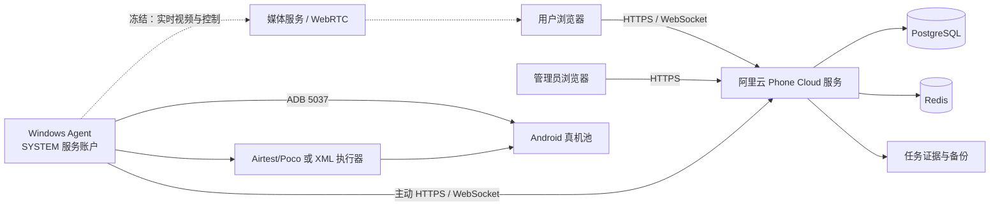
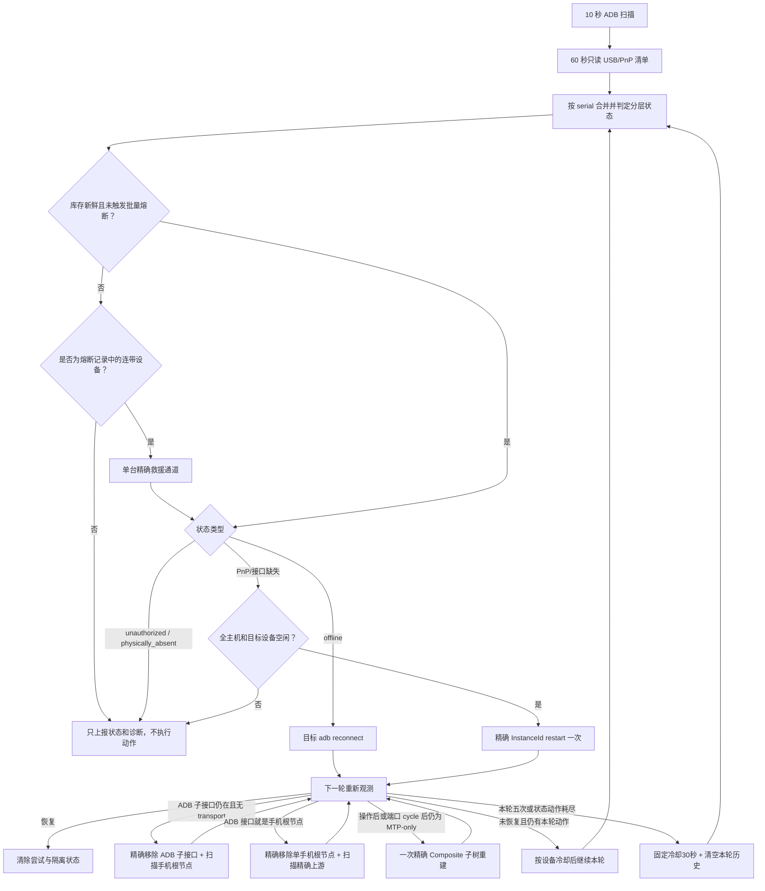
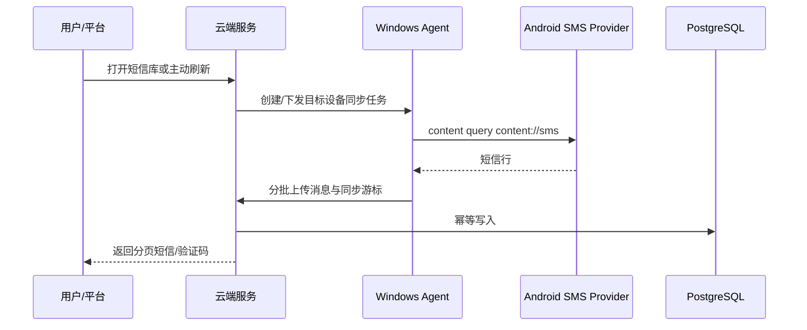

# Phone Cloud 项目开发主文档

- 文档状态：现行、必须维护
- 首次建立：2026-08-11
- 最后更新：2026-08-27
适用范围：云端服务、Web 前端、Windows Agent、Android 辅助组件、短信同步、小红书自动化、设备恢复和部署运维

> 本文是 Phone Cloud 项目的唯一事实来源（Single Source of Truth）。以后开始任何开发、排障或优化前，必须先阅读本文；完成重要变更后必须更新本文。专题文档用于补充细节，不能替代本文中的现状、决策和路线图。

---

## 1. 文档使用规则

### 1.1 信息分级

本文使用以下标签，避免把推断写成事实：

- **已验证事实**：有代码、数据库、日志或实际设备测试支持。
- **当前决策**：已经由项目负责人确认，后续开发必须遵守。
- **待验证假设**：存在迹象但尚无足够证据，不能直接据此修改生产环境。
- **历史信息**：曾经有效，但当前不再作为实现依据。

### 1.2 文档优先级

发生冲突时按以下顺序处理：

1. 当前生产运行证据与数据库事实。
2. 当前代码和实际部署配置。
3. 本文的现状、决策与不变量。
4. 专题设计、API、部署和上线文档。
5. 历史聊天记录、历史方案和归档审查。

发现本文与代码或生产事实不一致时，不得静默绕过；必须先记录差异，再更新本文。

### 1.3 方案连续性要求

提出新方案时必须回答：

1. 它解决本文中的哪个已知问题？
2. 它延续、替换还是否决了哪个既有决策？
3. 有什么新证据支持变化？
4. 如何本地验证、灰度、观测和回滚？

没有新证据时，不得因为换了一次对话就重新设计整个链路。

---

## 2. 项目目标与当前业务范围

Phone Cloud 是“云端平台 + Windows 设备管理器 + Android 真机”的设备业务平台。

当前核心能力：

- Windows Agent 通过 ADB 发现、维护和上报 Android 真机。
- 管理员完成设备命名、SIM、账号槽位和上架配置。
- 用户查询设备短信库并获取验证码。
- 用户提交二维码，小红书 App 在真机上完成扫码登录流程。
- 用户按需建立实时投屏和控制会话。
- 系统保存任务状态、操作轨迹、失败截图和元素树。

当前规模基线：

- 一台 Windows 主机可连接数十台 Android 设备。
- 历史全量短信核对覆盖 104 台可查询设备。
- 小红书自动化需要覆盖不同品牌、系统版本、单开和双开环境。
- 投屏生产会话上限已于 2026-08-13 从 7 台提升到 15 台；该变更只扩展会话/媒体槽位容量，不代表 15 路媒体性能已经完成压力验收。

不在当前主路线中的内容：

- iOS WDA/MJPEG 仍位于实验目录，不属于 Android 生产主链路。
- 旧 Android Agent APK 只作为兼容能力，不是设备管理主入口。
- Appium 不是当前小红书自动化主执行器。

---

## 3. 当前不可违反的决策

### D-001：实时投屏与控制链路冻结

状态：**当前决策，生效中**
确认日期：2026-08-11

当前实时控制总体可用，为避免重新引入历史卡死、断连、首帧和坐标问题，未经项目负责人明确解除冻结，不得修改：

- scrcpy server、视频源生命周期和控制通道。
- 分辨率、帧率、编码码率、编码模式、IDR 间隔。
- WHIP、WHEP、direct WebRTC、MediaMTX 和 ICE 逻辑。
- RTP 分包、pacing、实时队列和丢帧恢复策略。
- 浏览器播放器、首帧、断线重连、呈现看门狗。
- 点击、滑动、旋转和坐标映射。

2026-08-27 项目负责人仅解除以下两个窄范围的冻结：53号（`10AF7J261500DUS`）和35号（`9b9297d1`）可灰度验证 WHIP RTP 每次连续写包上限由8降为2；其余设备仍为8。该授权不包含编码、队列、关键帧、播放器、控制或全量设备调整，详见 D-044。

允许但需回归验证的外围修改：

- 日志轮转和日志采样。
- 版本号与构建信息上报。
- 非投屏任务的合并和错峰。
- 明确排除正在投屏设备的 PnP、短信和自动化任务。

冻结不代表现有链路完美，只表示当前阶段不继续改变它。

### D-002：小红书自动化采用 Poco 主路径、XML 专用路径

状态：**当前决策，生效中**

- 默认设备使用 Airtest/Poco。
- 151 号等已确认 Poco 长时间卡住的设备使用 XML UIAutomator 专用路径。
- PocoService 与 UIAutomator 不得同时控制同一设备。
- 正常路径优先查找目标元素；只有目标缺失时才检查弹窗。
- 每次任务冷启动小红书，避免继承上次残留页面。
- 默认前提是手机内小红书账号已登录；账号掉线不属于当前自动化覆盖范围。
- 能使用元素定位的步骤必须使用元素定位，不以固定坐标作为主路径。

### D-003：设备恢复只允许精确到目标设备

状态：**当前决策，生效中**

- 不重启 USB Hub，不允许为了恢复一台手机导致同 Hub 其他手机掉线。
- 不在设备被投屏、扫码或执行用户主动短信刷新时恢复它。
- Windows Agent 的常驻 ADB daemon 由服务账户统一管理，不能临时以另一个 Windows 账户启动第二套 ADB 会话。
- 全局 ADB 重启和全局 PnP 扫描只能作为明确授权的维护动作，不能作为普通自动恢复手段。

### D-004：生产数据变更必须可恢复

状态：**当前决策，生效中**

- 不直接删除生产数据。
- 迁移前必须备份并生成影响预览。
- 数据清理、批量删除、不可逆迁移必须取得明确授权。
- 回填任务只能写入服务器确认缺失的数据，不能盲目全量重放。

### D-008：Windows DeviceInstall 是整机共享资源，自动恢复必须熔断

状态：**历史决策；并发度与重试次数已由 D-011 更新**
确认日期：2026-08-12

- `pnputil`/DrvInst/PnP 重挂载在同一 Windows 主机上只允许一个动作，不再按不同 Hub 并发。
- 自动恢复只允许精确目标动作；禁止自动 `remove-device`、上游 Hub 扫描、全局 PnP 扫描和全局 ADB 重启。
- 同时出现 4 台异常，或小设备池中至少 2 台且异常比例达到 8%，立即熔断；此前在线设备同时丢失 4 台也立即熔断。
- PnP 超时打开 3 分钟整机熔断；普通目标命令失败按 D-009 继续有界重试，不再一次失败就隔离。
- 全主机每小时最多 20 次自动恢复动作，所有动作仍严格串行。
- USB 物理清单失败或陈旧时禁止恢复，不能依据旧拓扑执行 PnP 动作。

### D-009：单设备自动恢复最多重试五次

状态：**历史决策；重试次数已由 D-011 更新**
确认日期：2026-08-12

- 同一恢复周期最多执行 5 次真实恢复动作；普通失败不能在第一次就放弃设备。
- 重试间隔依次约为 30 秒、60 秒、120 秒、240 秒，最终上限为 300 秒；通常在首次确认异常后的约 8 分钟内完成五次尝试。
- 每轮都重新读取当前状态：`offline` 使用目标 ADB reconnect，PnP/接口缺失使用当前精确 InstanceId restart。
- 没有精确 InstanceId 时不消耗五次动作额度，只每 60 秒重新读取物理清单。
- 手机真实拔出后清空本轮计数；重新插入视为新的恢复周期。
- 第五次仍未恢复才进入隔离；隔离仅停止破坏性动作，监测和自动上线判断继续运行。
- 批量掉线、库存失效、设备忙碌或 Windows DeviceInstall 未结束时，安全熔断仍优先于单设备重试。

### D-010：恢复机制必须提供逐设备可解释遥测

状态：**当前决策，已于 2026-08-12 发布**
确认日期：2026-08-12

- 管理界面不能只展示“在线/离线”或聚合异常数；必须展示设备卡在哪一层、当前动作、已用尝试次数、下一次复查时间和最后失败证据。
- Windows Agent 保存有界恢复事件记录，至少覆盖异常发现、状态变化、动作开始、动作完成、动作失败、安全暂缓、熔断开关、恢复验证和最终隔离。
- “动作完成”不等于“设备已恢复”；只有后续重新观测到 `adb_device` 才能标记为恢复成功。
- 隔离只停止自动破坏性动作，管理页仍持续显示设备和后续状态变化。
- 第一版管理控制台保持只读，不提供手工强制 PnP/Hub/全局 ADB 操作，避免可视化页面绕过 D-003 和 D-008 的安全边界。

### D-011：精确恢复采用最多八路并发和八次有界重试

状态：**历史决策；单设备动作预算已由 D-012 更新**
确认日期：2026-08-12

- 经用户明确接受同一 Windows 共享 USB/PnP 栈可能影响其他设备的风险，精确恢复从整机串行调整为每批最多 8 台并发；仍禁止 Hub reset、全局 PnP 扫描、自动全局 ADB 重建和 `remove-device`。
- 连续 2 轮只读清单确认物理存在但 ADB 异常后进入首批恢复；扫描周期为 30 秒，因此首批目标约 1 分钟内开始。
- 同一设备最多执行 8 次真实动作，退避为 30、60、120 秒并封顶 120 秒；第 8 次仍失败才停止破坏性动作并进入隔离，监测与自动上线判断继续。
- 投屏中或前台自动化任务占用的目标设备从恢复候选中排除；其他设备被占用不再阻塞本机其余精确目标。
- 每批动作结束等待 5 秒重新采集 ADB；若批外原在线设备消失，立即打开突发丢失熔断，停止下一批。
- 生产首批 8 台在约 0.8 秒内全部发起、5 秒后完成验证，ADB 在线数前后均为 103，`collateralLosses=[]`；第二批 4 台结果相同。该证据只证明并发调度和批外保护正常，不代表异常手机已经恢复。

### D-012：按故障层级执行有界动作，不以八次重复命令充数

状态：**历史决策；精确重建阶梯已由 D-014 更新**
确认日期：2026-08-12

- 先识别真实 ADB/WinUSB 子接口；通用 WinUSB ADB 签名也必须进入 ADB 子接口路径，不能误判为 MTP-only。
- `adb_offline` 最多 3 次目标 reconnect，必要时再执行 2 次精确 ADB 子接口 restart；ADB 子接口存在但 transport 缺失时最多执行 5 次精确子接口 restart。
- `usb_root_pnp_error` 最多 2 次精确根节点 restart、2 次精确下游端口 cycle；健康根节点但只暴露 MTP/File-CD 时不再 restart 根节点，只允许最多 3 次精确端口 cycle。
- 单设备总动作预算回到 5 次，30/60/120 秒退避并封顶 120 秒；命令执行失败不算“动作已完成”，保留该安全动作的后续重试资格。
- 每次动作后必须重新观察 ADB；重新出现后持续至少 90 秒且至少 3 次扫描，才从恢复状态删除。
- 精确端口/子接口映射暂时不可用时每 60 秒只读复查，不消耗动作次数；旧生产配置中的 1800 秒等待不再生效。
- 自动动作中禁止 `remove-device`、根节点 disable/enable、Hub reset、全局 PnP 扫描和全局 ADB restart；终态遥测不能占住可运行设备的调度位置。
- 精确 ADB 子接口 restart 可最多 8 台并发；下游端口 cycle 每批最多 1 台，批外 ADB 丢失立即熔断。

### D-013：投屏生产会话上限提升为十五路

状态：**当前决策，已于 2026-08-13 发布**
确认日期：2026-08-13

- 阿里云服务端 `SCREEN_MAX_CONCURRENT_SESSIONS` 与 `SCREEN_MEDIA_SLOT_COUNT` 同步从 7 调整为 15，Windows Agent 的 `screenMaxConcurrentSessions` 同步从 7 调整为 15，防止任一侧继续形成较小上限。
- 本次只调整准入容量和固定媒体槽位数；不修改 scrcpy、分辨率、40fps、1Mbps、编码器、WHIP/WebRTC、RTP、队列、播放器和控制逻辑，D-001 的媒体链路冻结继续生效。
- 15 是会话准入上限，不等同于已经证明 15 路在所有画面动态程度下都满足稳定帧率；后续只读观察 Windows、云端和单路播放指标，出现问题先收集证据，不自动改媒体参数。
- 回滚方式：将云端两个环境变量和 Windows Agent 配置同时恢复为 7，并分别最小重启 `phone-cloud` 服务和 `PhoneCloud Windows Agent` 计划任务。

### D-014：把生产实测有效的精确重建纳入自动恢复阶梯

状态：**当前决策，已于 2026-08-13 发布**
确认日期：2026-08-13

- ADB/WinUSB 子接口存在但 transport 缺失时，先执行 1 次精确子接口 restart；仍未恢复则最多 2 次精确 remove 该 ADB 子接口，并只扫描它所属的手机 USB 根节点。
- 只有同一恢复周期已经观察并操作过 ADB 子接口、随后退化为 MTP/Composite-only 时，才允许 1 次精确 remove 该手机 Composite 根节点子树，并只扫描它的精确上游节点；长期纯 MTP 设备不能直接进入此动作。
- 普通精确子接口动作仍可每批最多 8 台；Composite 根节点重建属于高级动作，每批最多 1 台。任何动作前重新读取 ADB，投屏/前台任务占用目标继续排除，动作后检查批外在线集合，出现连带掉线立即熔断。
- 继续禁止 Hub reset、Hub remove、全局 PnP scan、自动全局 ADB restart 和无法证明目标/父子关系的 `remove-device`；D-014 只放开有精确目标、精确扫描父节点和有界次数的单手机重建。
- 策略状态升级为 v3：只折叠 v2 中同一 ADB 子接口的重复 restart 历史并解除由此造成的旧隔离，端口循环、人工条件和其他恢复历史全部保留，不进行全局状态清空。
- 人工生产验证：109、163 通过“移除精确 ADB 子接口 + 扫描手机根节点”恢复，111 在子接口消失后通过“移除精确手机 Composite 子树 + 扫描精确上游”恢复；三次均未重置 Hub。
- 自动生产验证：99（`10AEBX38XB00719`）和 112（`10AF541TGN00BTR`）在同一批次执行精确 ADB 子接口重建，ADB `onlineBefore=116`、`onlineAfter=118`、`collateralLosses=[]`；两台随后均通过 90 秒、5 次扫描稳定确认。此前 116→114 的变化已确认来自人工插拔，不计为恢复动作副作用。

### D-017：小红书账号以 ID 为稳定身份，名称只用于展示

状态：**当前决策，已随 D-022 大版本发布并完成生产迁移**
确认日期：2026-08-13

- 每个已配置的小红书槽位必须同时保存 `xhsId` 和 `accountName`；`xhsId` 是稳定身份，`accountName` 可以随业务改名。
- 同一个 `xhsId` 不允许绑定到同一手机的两个槽位，也不允许跨手机重复绑定；改名不能绕过唯一性校验。
- 扫码任务创建时同时快照账号 ID、名称、槽位和设备，保证历史任务在账号改名后仍可准确追溯。
- 生产发布前必须先按最新账号表生成迁移预览，要求所有现网已配置槽位无遗漏、无歧义、无重复 ID；迁移与代码发布必须共用可回滚维护窗口。

### D-018：熔断保留单台救援通道，并补齐根节点型 ADB 与纯 MTP 恢复

状态：**当前决策，已随 `20260817-recovery-occupancy-v1` 发布；后续安全补强见 D-021**
确认日期：2026-08-14

- D-014 的精确目标、忙碌设备排除、批外在线集合校验以及 Hub/global 禁令继续生效；本决策只补齐生产实测暴露的状态机缺口，不恢复宽泛或全局操作。
- `mass_outage`/`burst_outage` 熔断期间，普通恢复队列继续停止；但若熔断记录的批外连带掉线设备本身成为可恢复异常，允许其中一台进入“连带设备救援通道”。该通道仍要求库存新鲜、目标空闲、精确拓扑、DeviceInstall 空闲和小时预算可用，并在动作后重新比较全量 ADB 在线集合。
- ADB/WinUSB 接口与手机 USB 根节点是同一个 InstanceId 时，先精确 restart 一次；仍无 transport 且可证明精确上游节点时，允许一次精确 remove 该单手机根节点并扫描精确上游。不能再因为“接口等于根节点、无法移除子接口”直接进入永久人工隔离。
- 长期只暴露 MTP/Composite、没有 ADB 子接口的设备，精确端口 cycle 一次仍无效后，若手机根节点、精确上游和端口映射均完整，允许一次精确 Composite 子树重建；仍未暴露 ADB 才进入 `usb_gadget_adb_not_exposed`。该变化替代 D-014 中“长期纯 MTP 设备禁止直接重建 Composite”的限制。
- 普通 ADB 子接口动作仍可每批最多 8 台；根节点、Composite 和端口 cycle 属于高级动作，同一精确上游每批最多 1 台，不同上游可在总并发 8 台内执行。未知上游统一进入一个保守通道。
- 恢复批次必须区分“选入批次、实际动作、延期、跳过、失败”。`attempted` 只统计已经开始执行命令的目标；批外连带掉线集合只排除真实执行过动作的 serial，不能再把选中但被熔断拦截的设备计为“已尝试”。
- 隔离不是停止观察。设备以任何方式重新进入 `adb_device` 后继续执行 90 秒/至少 3 次扫描的稳定验证，成功后清除隔离、尝试次数和动作历史。

### D-019：全量设备短信库采用 Provider 主源与默认短信应用通知补全

状态：**当前决策，已随 D-022 大版本发布；通知补全已于 2026-08-19 全设备启用**
确认日期：2026-08-14

- 所有在线 Android 设备使用同一套双源框架，不按 OPPO、vivo 或具体型号写死分支：标准 `content://sms` 仍是可恢复历史、卡槽和稳定 `_id` 的主数据源；默认短信应用的活动通知与通知历史只补齐 Provider 没有暴露的新短信。
- Windows Agent 先从 `dumpsys role` 的 `android.app.role.SMS` holder 发现默认短信包，旧系统回退到 `settings get secure sms_default_application`。152 实机已证明 ColorOS 13 的 `cmd role` 没有查询 holder 子命令，不能依赖不存在的 `cmd role holders`。通知读取必须使用包级过滤 `dumpsys notification --noredact --package <package>`，禁止无差别保存或上传系统全部通知。
- 通知正文只在 Agent 进程内解析 `android.messages`、`android.bigText`、`android.text` 和 `android.title`；原始通知 dump 不落盘、不写日志、不上传。云端只接收结构化短信候选，并继续遵守短信正文现有访问权限和审计边界。
- 第一阶段全量空闲设备采用 30 秒、全局并发 2 的错峰低频采集；2026-08-20 用户要求将通知补全调整为 D-025 的十路连续整池轮询。用户主动刷新仍立即执行一次 Provider 全量对账和通知补全；通知轮询仍不能占用前台自动化、投屏或精确 PnP 目标。
- Provider 与通知候选必须做跨源语义去重：标准化正文和发件人一致时使用设备与两分钟时间窗；ColorOS 等 ROM 压缩通知正文/发件人时，只允许“同设备、跨源、30 秒内、双方都只有一个且验证码一致”的记录按最近时间合并。不同验证码、任一侧含多个验证码、超过 30 秒或同源 Provider 行不得走该降级规则。Provider 后到时补齐 `_id`、卡槽和时间等权威字段，但保持既有平台消息 ID 稳定。通知中没有可信卡槽时保持未知，禁止猜测 SIM1/SIM2。
- 无默认短信包、通知无正文、ROM 不支持包级过滤或 ADB 短暂失败时，只把通知补全标记为不可用/退化，不能让 Provider 同步失败；单设备能力和耗时必须可观测。
- 152号双卡实测证明平台管理员号码数据与手机实时订阅映射可以分别陈旧：手机实时 `sub_id=1 → SIM1`、`sub_id=2 → SIM2`，17:22新短信为公开Provider `sms:148/sub_id=2`；生产平台却仍把两个号码按相反卡槽保存，并保留旧订阅ID 0/1。号码字段必须由管理员按实体卡槽纠正，短信卡槽必须由D-015的实时 `dumpsys isub` 映射决定，不能用旧号码数组推断。此前按用户口述“154号”查询未见新增属于查错设备，不得作为154不可观测证据。
- 第一阶段以 152 序列号白名单完成生产灰度；2026-08-19 因 96 号手机存在“手机可见验证码、Provider 未及时补齐且通知路径未进入白名单”的生产缺口，用户明确要求全设备覆盖，生产配置已显式设置 `smsNotificationFallbackAllDevices=true`。Agent 最小重启前后 ADB 在线数保持 116，96 号随后留下 `enabled=true/status=ok/packageName=com.android.mms` 的真实通知同步日志。首轮 116 台探测暴露 2 台 `unsupported`：一台是瞬时角色查询空结果被缓存十分钟，另一台 ROM 的 `dumpsys role` 省略角色名称；生产热修增加标准 `SENDTO smsto:` 默认处理器发现路径，并只缓存成功包名。热修后当前 Agent 启动周期内 115 台空闲设备全部 `ok`、0 `skipped`，剩余 1 台因正在投屏按调度不变量跳过，结束占用后自动进入下一轮。通知已被清除时仍不能恢复过去的活动通知，Provider 主源与主动全量对账继续保留。基线回退点为 Git 提交 `c776694`，生产配置和两个热修源码文件均有重启前备份。
- 恢复队列只能阻止恢复目标本身参与后台 ADB 读取，不能以 `recoveryPending` 暂停整台 Windows 上所有正常手机的短信同步；PnP 动作真正开始前只中止目标序列号的在途短信读取。152第三次实测在通知约1.12秒命中但平台未入库，日志证明旧全局门禁持续输出 `recoveryPending=true`，该门禁已在统一候选中移除并有回归测试保护。D-033 进一步取消“任意自动化任务/任意 PnP 跟随扫描暂停全机短信”的间接门禁。

### D-020：普通用户可查看设备当前使用者

状态：**当前决策，已随 `20260817-recovery-occupancy-v1` 发布**
确认日期：2026-08-14

- 设备占用不是管理员专属信息。所有已登录用户在用户工作台的设备卡片和设备详情中，都能看到当前使用者、占用类型和开始时间，以便在多人共用设备池时判断应该等待还是选择其他手机。
- 当前用户占用时显示“你”；其他普通用户优先显示其平台显示名，缺少显示名时回退到登录名；管理员占用显示“管理员”，系统任务显示“系统任务”，无法关联到现有账号时显示“未知用户”。
- 普通用户只获得用于协作判断的显示标签，不新增手机号、Token、密码、邮箱或其他账号资料；本变化只调整占用身份可见性，不改变设备锁、任务权限、短信权限、投屏控制权和管理员权限。
- `screen_control`、`xhs_qr`、`sms_wait` 和通用设备任务使用同一套占用者解析规则，避免不同任务入口显示不一致。

### D-021：PnP 动作后持续观察延迟连带掉线

状态：**当前决策，已随 D-022 大版本发布；180 秒配置与跨重启持久化已生效**
确认日期：2026-08-17

- 生产时间线显示，精确 PnP 命令退出并不代表 Windows USB/DeviceInstall 已经稳定；批外手机可能在数十秒后掉线。一次人工精确动作约 143 秒后出现另一台手机短暂掉线，时间相关性不能单独证明因果，但足以证明原 5 秒动作后校验存在盲区。
- 每批真实 PnP 动作结束后，以动作前 ADB 在线集合减去本批实际动作目标作为基线，默认持续观察 180 秒；观察窗口和基线持久化，Agent 重启不能绕过。窗口内允许无 PnP 的目标 ADB reconnect，但不再开始下一批 PnP 变更。
- 正在投屏或执行前台任务的手机继续排除出恢复候选，绝不对其执行 PnP；但它们不能排除出掉线检测。观察期内任一基线在线手机掉出 ADB，立即并入 `collateralLosses` 并打开熔断，避免把真实用户掉线隐藏成“忙碌设备已忽略”。
- 后续命令失败只能合并、不能覆盖已经记录的连带设备证据。控制台区分“达到五次预算”和“当前状态已经没有安全动作”，并展示动作后连带观察期，避免把零动作或状态阶梯结束误报为“五次已用尽”。
- 本决策只修改 USB/PnP 恢复安全状态机、健康遥测和只读控制台文案；不修改 scrcpy、WebRTC、触控、媒体参数、短信生产开关或线上数据。生产发布前仍需受控维护窗口验证，禁止拿正在使用的手机做 PnP 灰度。

### D-022：D-015、D-017、D-019、D-021 合并为一个大版本

状态：**当前决策，已于 2026-08-17 作为统一大版本发布**
确认日期：2026-08-17

- 用户明确要求四项候选使用同一个 releaseId、同一个维护窗口和同一个整体回滚，不拆成多个线上版本。内部功能开关只作为误配置保护，不代表拆分发布。
- 大版本必须包含短信业务唯一键迁移及回滚、小红书 ID 数据迁移、云端/前端、Windows Agent 和恢复安全状态机；任一模块未通过硬门槛，整个版本都不上线。
- 生产短信表只读预检为 162296 行、90134 条逻辑短信、70018 个重复组和 72162 条待归档重复行。迁移先完整归档重复行，再建立 `(device_id, message_key)` 唯一索引；云端仓储和启动 overlay 同时改用该业务键。
- 最新小红书预演覆盖 139/139 个已配置槽位，`unresolved=0`、`ambiguous=0`、`duplicateIds=0`；其中表格145号“驰电车讯”当前在生产185号，按全表唯一账号别名迁移并单独标记 `deviceMoved`，不能静默忽略设备移动。
- 小红书迁移不能只生成报告；统一候选增加默认 dry-run、仅显式 `--apply` 写入的事务执行器。执行器锁定设备结构化表，逐槽校验预演时的设备、槽位和名称仍一致，写入后再检查全部已配置槽位都有 ID 且全局唯一，任何变化或冲突均整体回滚。
- 统一验收命令为 `npm run test:big-release`；发布与整体回滚顺序以 `docs/BIG_RELEASE_RC.md` 为准。D-021 的真实 PnP 动作仍必须在隔离 Windows 或明确维护窗口完成，生产用户使用期间不得补测。

### D-023：扫码前半程保留 Poco 精确定位，跨 Activity 后切换有界 XML

状态：**当前决策，已于 2026-08-17 完成生产实机验证；Windows Agent 最终切换见变更记录**
确认日期：2026-08-17

- 正常设备仍使用 Poco 进行小红书冷启动、弹窗按需处理、进入“我”、打开扫一扫和进入相册；不得退回坐标驱动，也不得在正常路径做全页面弹窗扫描。151 等已登记专用设备继续走完整 XML 路径。
- Poco HRPC 单次调用默认限制为 2 秒且最多 5 秒；全量控件扫描必须先 `freeze()` 一次再在本地筛选。元素已经由 Poco 定位后，只允许用有界 ADB tap 执行，不得在 ADB 失败后退回可能再次卡住的 `node.click()`。
- 相册打开后不再让 Poco 与命令行 UIAutomator 同时占用 Android 的 UiAutomation 通道：只终止该手机的 PocoService，把缩略图选择、照片权限、扫码结果识别和确认按钮切换到 8 秒有界的 `uiautomator dump /dev/tty` + ADB 点击；XML 只截取 `<hierarchy>` 节点，失败证据也使用同一有界读取器。
- 常驻 worker 启动前只清理本机序列号对应的残留 Poco instrumentation，不重启 ADB、不影响其他手机。Agent 冷启动后，前台扫码任务先在 10 秒内创建并探测该设备 worker，失败才进入可修复的完整环境预检；后台预检不能再让前台任务固定等待 60 秒。
- 152号真实生产验收使用无害测试二维码，三轮从云端创建到受控结束均约 49.1 秒；实机完成小红书冷启动、元素定位、扫一扫、相册、首张二维码选择，并进入扫码结果识别阶段。最终“未进入登录确认页”是测试二维码并非真实登录码的预期业务结果，不是执行器卡死；任务全程未触发 180 秒 watchdog。

### D-024：异常设备采用持续恢复轮次，不再隔离或熔断停止

状态：**当前决策，已于 2026-08-20 发布并开始生产持续验证**
确认日期：2026-08-18

- 用户明确要求恢复器持续尝试，主机异常数、动作后观察、小时动作数和单轮动作耗尽均不得再停止恢复队列。`mass_outage`、`burst_outage`、PnP 超时熔断、180 秒动作后阻断、小时动作预算和永久隔离从生产运行路径移除。
- 每台设备仍按已验证的分层动作链执行；当前链跑完或单轮五次失败后不写 `quarantinedAt`，而是进入固定 30 秒设备级冷却。冷却结束清空本轮动作历史并从当前实时拓扑重新开始下一轮，直到稳定观测到 `adb_device`。
- 策略状态升级到 v5。首次读取 v4 及更旧状态时清除历史隔离；旧动作历史先用于完成当前动作链，随后自动进入冷却和下一轮，不要求人工清理状态文件或重启 Agent。
- “持续恢复”不等于宽泛操作：只允许当前精确手机节点和端口动作；继续禁止 Hub reset、Hub remove、全局 PnP scan 和自动全局 ADB restart。正在投屏或执行前台任务的目标手机继续跳过；物理清单不可用、Windows DeviceInstall 正在执行或精确目标缺失时只等待条件恢复，不伪造动作次数。
- 恢复控制台改为展示“持续恢复/轮次冷却”，小时动作只做统计、不再显示预算；人工项只保留 ADB RSA 未授权等真实人工前置条件。
- 本决策替代 D-018/D-021 中“熔断停止普通队列、单台救援、180 秒观察期阻断”和 D-012 中“动作耗尽后隔离”的运行行为；D-014/D-018 已验证的精确动作阶梯继续保留。实时投屏与控制仍按 D-001 冻结。

### D-025：短信通知补全采用十路连续整池轮询

状态：**当前决策，已于 2026-08-20 发布并开始生产持续验证**
确认日期：2026-08-20

- 在线设备按当前稳定清单顺序组成一轮，每轮同一设备最多读取一次默认短信应用通知；全局最多 10 台并发。整轮结束后不再等待设备扫描或固定 30 秒间隔，立即从清单首台开始下一轮。
- 正在投屏、扫码、主动短信刷新或执行精确 PnP 的目标设备跳过当前轮；占用释放后自动进入后续轮次。D-033 已把 PnP 抢占收窄到精确目标序列号，其他手机的通知轮询不再因主机上存在 PnP lease 而整体暂停。
- 只有当前没有任何可读取设备时才等待 1 秒，避免空列表忙循环。每轮输出目标数、成功、不支持、失败、抢占、通知数、上传数、去重数、耗时和并发汇总；普通成功且零新增不再逐设备打印，避免百台连续轮询打爆日志。
- 连续轮询通过显式 `smsNotificationContinuousScanEnabled=true` 启用；并发配置 `smsNotificationBackgroundConcurrency` 上限从 4 放宽到 10。关闭连续开关时仍保留原有按设备最短 30 秒调度，便于快速回滚。
- 连续轮询仍是通知快照采集，不是 Android 事件监听；最坏发现时延约等于一轮整池耗时。该决策替代 D-019 的“30 秒、并发 2”后台通知调度基线，但不改变 Provider 主源、通知解析、跨源去重、短信权限、投屏算法和 USB/PnP 恢复动作。

### D-026：双开小红书的系统相册权限窗只在目标缺失时切换 XML 处理

状态：**当前决策，已于 2026-08-20 热更新 Windows 扫码脚本**
确认日期：2026-08-20

- 生产失败设备 `10HFB8F9ZB000R3` 选择双开小红书后运行在 Android 用户 `u999`。旧预授权命令只作用于主用户 `u0`；设备证据显示 `u0` 的 `READ_MEDIA_IMAGES` 已授权，而 `u999` 仍未授权，扫码页前台因此变为 `com.android.permissioncontroller/.permission.ui.GrantPermissionsActivity`，Poco 看不到系统权限元素并误报“未找到相册入口”。
- 正常路径仍只查“相册”目标元素，不增加每页全量弹窗扫描。只有扫码页相册目标缺失且前台明确为 `GrantPermissionsActivity`/`permissioncontroller` 时，才停止该手机的 Poco UIAutomation、用 8 秒有界 XML 读取器按文字元素点击“允许访问全部/允许访问所有照片/允许”，然后按“相册”文字、描述或 `:id/llMyPhoto` 元素继续。
- 禁止固定坐标点击权限按钮，也不静默给所有 Android 用户开放相册。登录确认按钮仍不属于通用弹窗，不能在此分支点击。
- 脚本可热更新；为确保指定手机立即加载新代码，只重建其空闲 Poco worker，不重启 Windows Agent、ADB daemon、USB/PnP 或投屏链路。

### D-027：厂商双开系统界面采用证据驱动 XML 接管，慢 PackageManager 不得误报未安装

状态：**扫码 Python v10 已于 2026-08-20 热更新并完成真实登录二维码多机回归；PackageManager 防误报候选已完成本地回归，待安全窗口重启 Agent 激活**
确认日期：2026-08-20

- OPPO `com.android.intentresolver/.ChooserActivityLauncher` 与 vivo `DoubleAppResolverActivity` 是已经由前台 Activity 证明的系统双开界面。只有命中这些精确界面时，允许释放该手机 Poco，使用 8 秒有界 UIAutomator XML 按双开卡片元素选择目标；不能把普通“小红书元素暂时缺失”泛化成整条 XML 路径。
- 153 号生产证据显示：XML 已在 7.9 秒选中双开卡片，Poco 随后在 14.0 秒进入“我”页；前两次“扫一扫”查询分别返回未命中，第三次 Poco RPC 从 19.3 秒一直卡到 220 秒 worker watchdog。元素树同时证明“扫一扫”真实存在于 `content-desc="扫一扫"`。因此，当本任务已经通过厂商双开 XML 分支时，进入“我”后继续释放该手机 Poco，并按精确“扫一扫”元素、搜索页精确“取消”元素和 `:id/llMyPhoto` 相册元素完成有界 XML 过渡；仍禁止坐标猜测。
- vivo 双开选择器上的 `com.bbk.updater` 系统更新提示只在底层前台仍是 `com.android.intentresolver` 时处理：先返回，精确提示仍存在才停止 `com.bbk.updater`；不能把厂商系统应用的普通前台页面当成弹窗强制关闭。双开选择耗时导致设备再次锁屏时，只在 keyguard 证据为真后重新唤醒并重建该手机 Poco。
- Android Permission Controller 兼容 `permission_allow_all_button`、`permission_allow_foreground_only_button`、`permission_allow_button`、`permission_allow_one_time_button`，并兼容“允许访问全部/使用应用时允许/仅在使用中允许/本次使用时允许”等中英文元素；仍只在明确权限 Activity 前台时执行。Android 14 在进入相册后才弹权限页时，缩略图首次缺失不再立即判失败，而是允许全部后按 XML 缩略图重试；若 ROM 返回扫码页，再按真实相册元素重新进入一次。
- 151 号专用 XML 路径同样执行证据驱动的 vivo resolver 浮层处理：只有 `DoubleAppResolverActivity` 已存在且上层精确为 `com.bbk.updater` 或 `VivoUsbDialog` 时才返回；返回无效时只停止已证明的 `com.bbk.updater`，不触碰其他系统应用、ADB 或 USB。
- Android PackageManager 在部分 OPPO 上的 `pm path com.xingin.xhs` 实测约 18 秒才返回 APK 路径。旧 Agent 5 秒超时后吞错为空串，错误显示“未安装小红书”。候选实现把主查询限制为 25 秒，增加 12 秒 `cmd package path` 兜底；两个查询都因 transport/PackageManager 失败时返回 `package_manager_unresponsive`，只有查询成功且无路径时才判定未安装。该 Node 变更需要 Agent 重启，当前未为此中断线上设备。
- v8 无害图片生产回归覆盖 153、184、43、108：四台均完成冷启动、双开/普通入口、“我”、扫一扫、相册和图片选择，选图阶段分别约 28.9、25.0、33.0、38.3 秒。最终在约 59 至 72 秒返回“选中二维码后未进入登录确认页”，是 1×1 非二维码测试图片触发的预期结果；它证明兼容链路不再卡死，不等同于真实登录二维码的最终确认成功率验收。
- v10 使用当天已经成功过的小红书真实登录二维码，覆盖 153、184、43、80、101、119、130、139、163、182、151 共 11 台，包含 vivo/OPPO/HUAWEI、主应用、双开和 151 专用 XML。本轮累计 13 次完整成功和 2 次有证据的兼容失败；11 台首个成功任务平台总耗时为 32–67 秒，9/11 在 60 秒内。139 首次暴露 Android 14 `permission_allow_all_button` 后修复，随后 67 秒和 51 秒连续成功；151 首次暴露系统更新浮层覆盖 resolver 后修复，随后 39 秒和 36 秒连续成功。两次失败都有前台 Activity 和元素树证据，不扩张为通用坐标点击。
- v10 后续隔离 dry-run 又捕获两种精确系统表面：32 号 MIUI/HyperOS 的双开选择器为 `android/com.android.internal.app.ResolverActivity`，旧 XML 专用路径未进入选择分支；43 号 vivo 双开弹出 `com.vivo.pushservice type=2038` 通知授权浮层，旧标记不包含“发送通知”。候选只增加这两个精确证据：前者仍按“小红书/Ⅱ·小红书”元素选择，后者只取消通知授权，不点击泛化“确认”。修复后 32 Poco、43 Poco、151 XML 分别在 27.27、29.36、16.60 秒进入相册。146 OPPO 也完成相册路径，但冷 PocoService 初始化独占约 66 秒、总耗时 84.49 秒，属于 worker 预热/健康问题而非页面元素缺失；51 未安装小红书、43 双开账号已退出，按既定测试前提排除。

### D-031：SmsRelay 升级为可独立使用的默认文字短信应用

状态：**当前决策，本地候选已安装单台测试机，尚未部署生产**
确认日期：2026-08-21

- `android-agent/SmsRelay` 不再只是验证码上报配置页；候选 APK 提供会话列表、号码/正文搜索、未读数、会话详情、复制、删除、新建、回复、双卡选择、系统通知和默认短信角色申请。原中台配置、心跳、短信库同步、更新和扫码辅助能力保留在设置页。
- 产品模式确定为由 SmsRelay 接管唯一默认短信角色，不再把“原短信应用继续作为默认”作为生产方案。APK 首次启动在短信权限满足后主动拉起系统角色确认页；Android 安全模型仍要求用户在手机上确认一次，代码不得伪造为可静默切换。切换前记录原默认短信包用于诊断和人工回退，但生产正常路径只认 SmsRelay 为默认 holder。
- SmsRelay 持有默认角色时必须关闭 APK 内既有的旧短信应用通知兜底解析，并显式排除自身通知包，防止自己发布的新短信通知被再次当成验证码入队；D-019/D-025 的 Windows 侧通知补全由灰度范围控制，在 APK 接管设备上只作为迁移期观测，最终以 Receiver/Provider 业务键去重结果为准。
- 默认短信角色收到 `SMS_DELIVER` 后，必须先在同一 SQLite 事务中写入永久 `local_messages` 和上传 outbox `pending_sms`，再分叉执行系统 `content://sms` 镜像、本机通知和中台上报。`local_messages` 是手机端源真值；Provider 或网络任一失败都不能阻止手机查看短信，也不能删除源记录。发送短信成功后仍写系统 Sent Provider，并由既有 Provider 同步补齐中台。
- Provider 镜像与云端 outbox 独立恢复。Provider 写入前按发件人、正文和接收时间检查精确重复，覆盖“Provider 已写成功但状态回写前进程退出”的崩溃窗口；云端只有返回已持久化的 `event.eventId` 才算 ACK，ACK 只删除 outbox，不删除永久消息。
- 所有触发入口共用单航班上传 drain；`SmsQueueStore` 事件指纹继续承担跨 `SMS_DELIVER`/`SMS_RECEIVED` 去重。每条 outbox 独立指数退避（2 秒起、最高 5 分钟并带抖动），单次最多处理 20 条且单条失败不阻塞后续记录；持久化 `JobScheduler` 在网络恢复、重启和覆盖升级后继续补传。
- APK 提供受 `android.permission.DUMP` 保护的健康查询和无界面 `RecoveryActivity`。Windows Agent 候选已实现每分钟一次、最多 10 台并发的空闲设备健康巡检，上报永久消息数、待上传数、Provider 失败数、最老积压和下次重试；仅在 APK 已安装、仍为默认短信应用、RECEIVE_SMS 已授权而服务不存活时，启动该目标包的恢复 Activity。Honor Android 15 实测 force-stop 后显式广播即使带 `--include-stopped-packages` 也不会创建进程，而受保护 Activity 可恢复进程、前台服务、上传任务和 Provider 镜像且不抢占当前前台页面。不得为恢复 APK 重启全局 ADB、Hub 或其他手机，日志不得包含短信正文。
- APK 是否安装是 Windows 短信采集的唯一切换边界：健康探针确认 `installed=true` 后，该设备标记为 `health_only`，后台 Provider 同步、连续通知轮询和用户主动刷新均禁止由 Windows 读取短信内容；正在运行的旧读取按精确序列号立即中止。用户主动刷新改为发送包级命令，让 APK 自身同步并返回健康状态。即使 APK 尚未成为默认短信应用，也只上报角色/权限/服务异常并等待人工完成角色确认，不允许为了“暂时可用”回退旧 Windows 采集。只有明确 `not_installed` 的设备继续 D-019/D-025 兼容路径。
- 服务端把实时 `sms-event`、Provider 与通知分为三个来源：实时事件优先于通知，后到 Provider 以权威字段补齐同一平台记录而不更换既有消息 ID。Windows 与手机心跳的部分健康字段采用合并更新，避免任一路上报覆盖另一条路径已有的队列指标。
- Android force-stop 会停止普通广播投递，单靠 APK 无法自我解除；Windows watchdog 必须识别 stopped/健康超时后显式恢复。省电白名单、开机接收、前台服务和 JobScheduler 是正常休眠/进程回收保障，不能宣称能绕过用户或系统 force-stop。
- v109 将常驻前台服务从 `dataSync` 改为用途匹配的 `remoteMessaging`。target 35 在 Android 15+ 上会对 `dataSync` 施加每24小时最多6小时的运行上限，并禁止其由 `BOOT_COMPLETED` 拉起；旧类型会形成“短测通过、数小时后失活”的假兼容。API 34+ 显式以 `FOREGROUND_SERVICE_TYPE_REMOTE_MESSAGING` 启动，旧系统继续使用两参数 `startForeground`；启动失败和系统超时进入无正文健康诊断。
- 2026-08-21 对当时在线的122台完成无安装只读兼容预检：Android 10/11/12/13/14/15/16 分别15/10/9/6/76/5/1台，vivo/Xiaomi/OPPO/HUAWEI/HONOR/Tianyi 分别82/19/12/6/2/1台，`arm64-v8a` 110台、`armeabi-v7a` 12台，共31种机型/系统组合；122/122具备电话能力、短信角色入口和至少32MiB `/data` 可用空间，0项能力失败。10台提示已安装旧包，只是升级签名/版本检查对象，不是兼容失败。该结论是安装前能力证据，不等于122台已实装收信。
- 兼容门禁固定为三级：全机只读能力、构建/清单/Lint 产物、指定测试机真实短信业务。禁止为了“全机验证”擅自安装正式包或隔离探针；当前用户已明确禁止在线手机安装，v109 只保留本地构建产物。以后统一安装前必须重新跑全量预检、确认 `versionCode>=109`、签名证书 SHA-256 `6624f72a94bb26d7a81f4945460e8a04cc342a2ebef64a5ca01a7e2f04e5e32d` 连续，并在指定测试机补齐 v109 实装门禁。
- 当前候选完整支持文字短信。为满足默认短信角色资格已声明 `WAP_PUSH_DELIVER`，但彩信只提示、不下载正文；在 MMS 下载、附件存储、会话展示和实机验收完成前，禁止把彩信描述为受支持能力。
- D-019/D-025 的 Windows Provider 主源和默认短信应用通知补全继续作为未安装/未切换 SmsRelay 设备的生产路径；新 APK 灰度后仍需服务器跨源业务键去重。禁止一次性批量替换百台默认短信应用，必须先在一台指定测试机完成断网、双卡、进程回收、重启和回退验收。

### D-033：验证码订单等待期间采用绑定设备定向采集

状态：**已于 2026-08-24 发布生产**
确认日期：2026-08-24

- 2026-08-24 “小云爱聊车”实证：订单 10:35:12 创建，手机 10:35:28 已收到验证码；订单 10:38:14 超时取消，用户 10:38:17 主动刷新后 Provider 才在 10:38:20–21 入库。期间恢复跟随扫描持续记录 `skipSms=true`，且任意自动化任务会让整机后台短信调度停止；通知快照没有当前验证码。因此故障是采集调度错过订单窗口，不是短信到达慢。
- 每个等待中的验证码订单在创建时立即为其绑定的 `deviceId/agentId/adbSerial` 建立 `sms_code_probe`。Open API 状态轮询按 2.5 秒设备级节流继续补采；服务端 10 秒维护周期作为客户端停止轮询时的兜底。订单收到、取消或过期后立即停止创建新探针。
- 探针只执行增量 Provider 查询与该设备默认短信应用通知补全，不清空增量游标、不做用户主动刷新的全量历史对账。同一设备已有 `sms_code_probe` 或 `sms_sync_now` 时不重复排队；投屏在领取前通过序列号排除，领取后仍可精确抢占该探针，保持 D-001 的投屏优先级。
- Provider 与通知在探针内独立降级：一源失败仍执行另一源，两个来源均关闭才判任务失败。已安装 SmsRelay 的设备不回读系统库或通知，只精确唤醒 APK 并依赖其可靠 outbox。
- 任意一台扫码/自动化任务不再暂停其他手机的 Provider 和通知后台采集；PnP 跟随扫描允许健康手机继续调度，真正 PnP 动作只中止目标序列号的在途读取。禁止为短信订单重启全局 ADB、Hub、Windows Agent 或投屏媒体链路。

### D-034：浏览器投屏会话采用三分钟无操作释放提示

状态：**已发布生产**
确认日期：2026-08-25

- 投屏会话创建成功后启动浏览器端无操作守卫。只有实时控制工作区内用户真实触发的点击/触摸、键盘和滚轮操作可以续期；鼠标悬停、视频帧、指标刷新、服务端轮询和脚本生成事件均不算操作，避免无人值守会话被被动数据永久续期。
- 连续 3 分钟没有真实操作时，在浏览器视口中央显示不可由背景点击或 Escape 静默关闭的会话保护弹窗。弹窗提供“继续控制”和“立即断开”两个明确动作，并显示 10 秒环形与横向倒计时。
- 倒计时期间工作区背景事件不能自动续期；只有用户明确点击“继续控制”才关闭弹窗并重新开始完整 3 分钟计时。点击“立即断开”或 10 秒不选择均复用现有 `stopUserScreenSession()` 和 `DELETE /api/v1/screen-sessions/:id` 释放会话，默认选择为断开。
- 计时器使用绝对截止时间而不是累计 tick；浏览器后台标签页节流后，在计时回调、窗口重新获得焦点或页面可见性变化时立即对账截止时间，不能因倒计时 UI 少刷新几次而延长设备占用。
- 会话失败、关闭、用户主动结束和页面退出都会停止守卫并移除弹窗。弹窗使用 `alertdialog`、焦点循环、键盘可达按钮、窄屏布局和 `prefers-reduced-motion` 降级。
- 本决策属于 D-001 允许的浏览器外围会话占用治理；未修改 `screen-client/` 播放器、scrcpy、WHIP/WebRTC、RTP、编码参数、首帧、重连、控制指令或坐标映射。
- 2026-08-25 随 `20260825-d034-d035-automation-center-v1` 发布；生产静态资源和空闲守卫哈希已核对，现有投屏 `config.json` 哈希前后不变；服务端 `screen-quality/screen-relay` 与 Windows `screen-stream/screen-webrtc-publisher` 均和当前代码哈希一致。Agent 重启后当前活动会话重新完成 scrcpy 视频、控制、首个 H.264 包和发布器启动阶段。

### D-044：两包 RTP 微突发治理全量发布，并将无操作提示延长到十分钟

状态：**已全量发布生产**
确认日期：2026-08-27

- 生产证据显示 Windows→MediaMTX 无丢包、发布队列无持续积压、服务端转发无丢帧，但浏览器方向在单秒大帧密集发送时出现 RTP 丢包、NACK/RTX 放大和呈现冻结。现有发布器按10Mbps节拍计算字节预算，却每次连续写8个约1200字节RTP包，形成约9.6KB微突发；本轮只验证把每组降为2包后，是否减少公网UDP瞬时丢包。
- 首轮以53号 `10AF7J261500DUS` 和35号 `9b9297d1` 作为设备级灰度目标，保留 `screenDeviceProfiles.<serial>.transportPacketsPerBurst` 的1–8包独立覆盖能力。53真实会话命中 `max_packets_per_burst=2` 后，发送队列延迟约1ms、源端 `droppedFrames=0`；同时间8包普通会话约6–7ms，用户实际操作确认“两包明显更好”后，明确要求扩大到全设备。生产全局 `screenTransportPacketsPerBurst` 因此改为2，设备级配置只作为以后有证据时的精确回退开关。
- 不修改1080上限、40fps、1.5Mbps编码目标、10Mbps RTP pacing、400ms实时队列、1秒IDR、CBR模式、scrcpy、MediaMTX、WHEP、浏览器播放器或控制坐标。两包组会增加定时唤醒和系统调用频率，因此先比较首帧、Windows发送FPS/队列、浏览器解码/呈现FPS、丢包、NACK和冻结，再决定是否扩大。
- D-034 的无操作守卫从3分钟改为10分钟；真实操作定义、中央提示弹窗、10秒倒计时、默认断开、绝对截止时间及页面退出释放规则全部不变。缓存号同时更新，避免长期浏览器标签继续运行旧的3分钟模块。
- 回滚分两层：Windows 将全局 `screenTransportPacketsPerBurst` 恢复8并重启一次Agent；前端将 `SCREEN_IDLE_TIMEOUT_MS` 从600000恢复180000并还原提示文字。两项互不依赖，可分别回滚；设备级1–8包覆盖仍可用于单机对照，不需要修改发布器。
- 本地门禁：定向Node/Go测试92/92、`npm run check`、沙箱外全仓510/510、Go `go test ./...` 和 Windows amd64交叉编译均通过。十分钟前端按 `20260827-d044-screen-canary-v1` 热替换，源目录/容器哈希一致、外网资源实测为600000ms且 `/readyz` 正常；Windows候选代码和发布器哈希一致。全量阶段按用户明确授权中断现有投屏后，只重启PhoneCloud Windows Agent，ADB在线数122→122，未重启ADB、USB、PnP或手机，配置备份位于 `D:\PhoneCloud\agent\backups\20260827-d044-global-two-v1`。重连后的三个非灰度序列号 `10AECD2DDL007MR`、`VAUBB23A13003126`、`10AEBX0N040070P` 均实测 `max_packets_per_burst=2`、队列延迟约1ms；其中动态会话达到24fps且源端0丢帧，证明全局配置已实际进入普通手机发布进程。

### D-035：扫码、一键发布和支付宝查名字统一为自动化中心

状态：**已发布生产**
确认日期：2026-08-25

- 用户端“自动化”下保留扫码任务，并增加“一键发布”和“查名字”两个并列模块。一键发布接收 1–5 张图片、标题、正文和小红书 I/II；服务端建立一次性任务与设备/应用槽位锁，Windows 使用 Poco 元素执行器完成真实图库选图和发布。
- 支付宝查名字采用开始、连续查询、结束的长会话。正常查询复用当前搜索页；异常时最多完整恢复 2 次；累计成功 200 次后切换支付宝账户。Poco 只有同时命中精确验证标题和滑动动作时才按真实滑轨边界执行最多 3 次拖动，通过后自动重放同一号码最多 2 次；证据不足或有界尝试仍失败时才保留会话并请求人工处理。
- 自动化任务、会话和设备锁进入 PostgreSQL 结构化仓储；Windows 仅增量增加四种任务调度和两个执行器，没有整文件覆盖既有 USB、短信、PnP 与投屏热修复。
- 2026-08-25 随 `20260825-d034-d035-automation-center-v1` 发布。云端自动建表成功，新接口匿名请求返回 401、登录用户请求返回 200；Windows Agent PID 更新为 177288，ADB 在线 123→123，投屏参数配置哈希保持不变。
- 177 首次生产启动查名字会话实证：08:59:33 创建、08:59:52 成功进入 `ready`，Windows 返回 `search_session_ready`，后台没有卡死；旧页面仍保留“启动任务已提交”提示，造成卡住错觉。前端热修增加启动等待秒数和 `ready/querying/failed/ended` 明确反馈并更新缓存版本；16/16 专项通过，静态文件热替换且未重启服务。用户随后 09:07:43 主动结束，09:07:44 正常返回 `session_stopped`。
- 2026-08-27 生产压力测试确认，Poco 核心普通查询约 1.7–3.3 秒，但旧 Agent 在每条查名字任务完成后强制执行约 124 台设备的 `scanAndSync(force=true)`，使下一条查询额外排队 8–23 秒。`alipay_name_start/query/stop` 现在按“设备库存未变化”跳过该次即时全量扫描，其他任务和正常周期扫描不变。
- 生产手工查询 `185****6007` 证明“无姓名结果”被错误归类为 Poco 异常：Poco 11.633 秒未见姓名后切 XML，而支付宝 Cube 搜索结果的 XML 只有容器、没有姓名文字，兜底又耗时约 61 秒，任务总计 73.72 秒。当前规则只提交一次搜索并持续观察稳定搜索页；worker 内部无姓名预算为 4.4 秒，为 Agent 调度与结果持久化预留约 0.6 秒，使用户可见结果接近 5 秒。只有 Poco RPC、元素、输入回读或页面状态异常才切 XML；无姓名号码同样计入每账号 200 次额度。前端查名字使用独立 1 秒刷新并展示服务器阶段和耗时。
- 新版本在 177 上通过真实平台接口连续完成 201/201 次查询、0 失败：普通 199 次中位数 2.174 秒、平均 2.225 秒、P95 2.949 秒；首次真实滑块第 1 次拖动通过并继续查询；第 201 次在成功数达到 200 后切换到 `198******73`，返回 `accountSwitched=true` 并完成查询，会话最终为 `ended`。切号任务耗时 97.636 秒，首次滑块恢复耗时 48.504 秒，仍作为后续时延优化样本保留。
- 2026-08-27 最终 5 秒版生产验收：177 热 worker 的有姓名查询为 1.752–2.052 秒；定向回收 177 worker 以加载新模块后，首条有姓名查询因一次性冷建 worker 为 18.027 秒。随后 `185****6007` 在 worker 内 4.619 秒、平台任务 4.866 秒、接口端到端 5.152 秒返回 `not_found`，会话保持 `ready`、成功额度正常增加并最终 `ended`。日志确认 `submitAttempts=1`，没有二次提交、`poco_fast_path_failed`、`xml_uiautomator` 或 XML worker；Agent 未重启，177 ADB 保持 `device`。

### D-041：查名字页面以服务端状态为准，并自动恢复仍在运行的旧前端

状态：**已发布生产**
确认日期：2026-08-27

- 生产事件时间线证明执行链路没有卡住：会话启动接口在 03:41:59 用 5ms 接收，Windows 在 03:42:05 完成并把会话置为 `ready`；查询接口在 03:44:43 用 3ms 接收，Windows 在 03:44:45 完成，任务耗时 1.819 秒且会话重新为 `ready`。数据库没有 `querying` 残留任务，页面却仍长时间显示启动/查询中。
- Chrome 只读检查确认故障标签仍运行 `app.js?v=20260826-lookup-row-stable-v4`，而生产静态文件已是 `20260827-inventory-stable-v6`。`Cache-Control: no-store` 只能保证下一次加载使用新资源，不能替换一个长期不刷新的标签页中已经执行的旧 JavaScript。
- 查名字一秒轮询改为 single-flight：前一次请求未结束时不再启动下一次，消除慢网络或主线程拥堵时“新请求不断递增序号、所有旧响应都被丢弃”的饥饿窗口。启动、查询、结束操作完成或超时后均立即强制读取一次服务端会话，服务器已接收但浏览器丢失 POST 响应时也能自动对账。
- 新前端每 15 秒读取一次无缓存首页版本；只有查名字长会话正在活动时发现版本变化才自动重新加载，后台会话和结果从服务器恢复。没有活动查名会话时不自动刷新，避免清空用户尚未提交的一键发布表单。
- 2026-08-27 以 `20260827-lookup-reconcile-v1` 热替换 `app.js/index.html`，没有重启容器、Windows Agent、ADB、USB/PnP、手机或投屏；本地专项 12/12、语法检查和全仓回归 506/506 通过。生产源目录、运行容器和实时 HTTP 文件哈希一致，旧标签刷新后加载新版本且控制台无错误；回滚备份为 `/opt/phone-cloud-platform/backups/20260827-lookup-reconcile-v1`。

### D-042：用户库存独立加载，自动化历史按当前模块按需刷新

状态：**已发布生产**
确认日期：2026-08-27

- 生产证据确认 `/api/v1/user/xhs/qr-scan-tasks` 响应已超过 1 MB，旧 `loadAll()` 又把库存、手机号、短信订单、扫码历史、发布历史和查名会话放在同一个 `Promise.all` 中；任一辅助响应截断或 JSON 解析失败，都会把一次正常库存请求表现成“手机库存暂时无法加载”。
- 设备库存现在先独立请求、校验和渲染；辅助模块使用 `Promise.allSettled`，单个失败只保留该模块已有快照，不再撤销库存、退出当前手机详情或把页面清成 0。扫码历史只在用户实际打开“自动化 → 扫码任务”时请求，发布和查名继续使用各自状态源；扫码刷新增加 single-flight，慢响应期间不再叠加下一轮请求。
- 查名字结果区同时增加有界滚动、滚动位置保持和姓名尾字一键复制；复制失败会给出明确提示，不能把 UI 的“已复制”当成后台任务成功信号。
- `20260827-complete-workbench-sms-scan-v1` 把本决策与 D-032、D-037、D-038 及 D-033 生产文件一致性修复作为同一完整版本发布。前端专项 115/115、Python 行为 16/16、全仓 507/507、本地端到端烟测通过。
- 生产验收中页面刷新后加载 `app.js?v=20260827-workbench-independent-load-v1` 与 `styles.css?v=20260827-lookup-results-v2`，30 秒独立刷新周期后仍为总数 123、ADB 在线 122，未出现库存错误且控制台 0 错误；177 的 9 条查名结果真实渲染，复制按钮进入“已复制”，结果区 `clientHeight=430`、`scrollHeight=631`、`overflow-y:auto`。
- 本发布未修改 `screen-client/`、scrcpy、WHIP/WebRTC、RTP、编码、播放器、触控、坐标映射、重连策略、ADB daemon 或 USB/PnP。云端和 Windows 回滚备份均为 `20260827-complete-workbench-sms-scan-v1`。

### D-043：支付宝访问被拒绝立即切换账号并重试当前号码

状态：**本地候选，未发布**
确认日期：2026-08-27

- 177 号两次生产查名任务分别在约 68 秒和 70 秒后失败，失败截图明确显示“访问被拒绝，请检查是否使用了代理软件或 VPN”；手机系统代理、常驻 VPN 配置均为空且当前网络具备 `NOT_VPN`，Windows 查名脚本哈希与已验收版本一致。该证据否决“输入框写入不稳定”的旧分类，确认实际页面状态是支付宝访问拒绝。
- 只有元素树/Poco 同时命中精确标题“访问被拒绝”和包含“代理软件”及“VPN”的提示时，才触发账号受限分支；普通无姓名、搜索框缺失、Poco RPC 异常和其他提示不得触发换号。
- 命中后立即结束普通页面恢复，释放 Poco 快路径并复用既有 XML 账号切换链路；账号切换验证成功后自动重新查询同一个手机号。该失败本身不增加成功计数，也不消耗“每 200 个成功查询切换账号”的正常额度。
- 单次查询最多因访问拒绝切换一次。新账号仍出现同一精确页面时返回 `alipay_access_denied_after_account_switch`，提示更换手机网络，不允许在两个账号之间来回切换。成功和失败结果均保留 `accountSwitched/currentAccount/accountSwitchReason`，便于会话和日志解释真实账号状态。
- 本候选只修改支付宝执行器、Windows 自动化任务结果映射、服务端查名结果字段和专项测试；不修改实时投屏、ADB daemon、USB/PnP、短信采集、小红书扫码或发布链路。发布前必须先完成本地全量回归，再在一台明确空闲测试机验证真实拒绝页、切号和同号码重放。

---

### D-079：小红书手机端最近 30 天列表采集与草稿保存兼容

- 2026-10-20的132/app1候选复测在30滑后仅到09-24、71篇，512秒后正确标不完整；本次审核中状态已不再出现，因此只证明列表可读，原审核状态分支仍仅现场回放验证。默认专用扫描上限30→60，达到日期边界仍立即结束；保留显式最多100、停滞保护和现有20分钟消费器超时，并分别标记`scroll_budget_exhausted/list_stagnant`。增加默认入口超过30滑且第31滑才到旧帖的完整性回归，以及显式小预算保留不完整数据的反例；未发布。

- 2026-10-20的144候选复测已越过平铺页签，但实际扁平列表把“到底了”直接排列在最后六字段之后，旧分组把它算第七字段而漏掉最后完整行。新增仅对同包TextView、完整六字段之后且几何位于整行下方的精确末尾标记排除；同名帖子标题保留，错位/其它包/未知第七字段继续拒绝。脱敏原生夹具复现，候选待单机复测，未发布。

- 2026-10-20全槽位扩测新增176：实际为OriginOS `com.vivo.frameworkui` 的USB模式选择窗，旧分支仅认android包和按钮text，导致明确取消按钮被拒绝。新增精确同包六标签/原生父子关系/按钮身份和几何/前台证明后取消、再读元素确认消失；不选模式、不涉及USB调试授权。原生夹具与错误包名/重复按钮/错误前台/授权文案/取消不消失反例已加入，候选真机待复测，未发布。

状态：**自动化模块已上线并完成本轮全清单核对；仍有失败与前置跳过，未接入 Web 数据库或周期同步**
确认日期：2026-10-13

- 2026-10-20当前用户要求：新候选仅使用原生元素，取消OCR/截图备用。全清单91台145个绑定槽位，实际78台127槽/136次；82完整、26账号或服务条件停止、19采集/设备/干扰阻塞，另18槽离线/占用/按要求保留未测。18保持现状，152持续跳过；最终清单无遗漏的可执行槽位。rc.14仅本地候选，生产未更新，历史图像路径不代表当前候选。后续rc.15仅复测这19槽：10完整、7仍阻塞、2账号/离线跳过，仍未发布；详见本章末尾rc.14/rc.15及逐槽回执。

- 本候选从共享工作区导入此前已验证的独立列表采集器，导入前 SHA-256 为 `8427ad0bec695539460b83a4ae3688981f541bc3bb26679b2fc4425e05eaa21a`，原专项测试 SHA-256 为 `3a1b4bc9c4d8fcca8d73f95032ef455497fa05f40feb6876ea4131dca545e1c4`；仅导入这两个文件，不将其他未提交工作混入候选。基线 HEAD 为 `6811aef632eeaaacd6d6ce1effc4afa64bf6d363`；本 worktree 的旧主文档仅新增本节和对应日志，不代表其余旧生产事实已重新核验。当前共享工作区完整主文档仍是现行项目事实来源。
- 延续 D-079 作品列表采集：只读标题、日期、状态、观看、点赞、评论，从最新列表开始，按上海日期采最近 30 个自然日；看到列表末尾或顺序有效的窗口外旧笔记才标为完整。生成本地 schema 3 JSON，无 Web 数据库写入、账号或稳定笔记 ID 导入。
- 102 号本次最初被“继续编辑图文笔记吗？”弹窗阻断，Android Back 后同一弹窗仍存在；用户明确要求以后每次遇到它都点击“存草稿”。此授权替换该采集器原 Back-only 处理，保留已有未完成内容后继续采集。只在小红书前景、可见精确问题文案与唯一启用的可点击“存草稿”元素/父元素可证明时操作；点击后重新读 XML，弹窗仍在就失败。不选择“去编辑”，不修改扫码或发布执行器。
- 23/23 本地专项测试与语法检查通过；102 号 app1 实机记录 `draft_saved_before_collection`，采集 12 篇、滑动 2 次、`complete=true/list_end_visible`，观看合计 353、点赞 1、评论 0。当天 74 号旧同基线脚本采到 1 篇、观看 12/点赞 1/评论 0、列表末尾完整。两份输出范围均 2026-09-14 至 2026-10-13。
- 候选脚本 SHA-256 为 `85964946854dfc2b2f4d9e41eeb1b61eca16c19af57947740d4901a465d04866`。仅用于 Windows staging 独立运行；未修改 Agent、共享 ADB、冻结媒体/控制链路、服务或生产任务。旧 staging 脚本备份 `D:\PhoneCloud\staging\xhs-sync-draft-20261013\collector-before.py` 可回退，本地分支 `codex/xhs-sync-draft-20261013`、候选标签 `xhs-sync-20261013-rc.1`，详细回执见 `docs/XHS_SYNC_DRAFT_RC_20261013.md`。

#### 2026-10-19：107成长中心弹窗兼容收尾（10月16日单机实测，本地候选）

- 用户指出107应兼容并确认实时控制是本人只观看；重新取证发现，成长中心弹窗下方同时暴露“账号异常/开通数据权限/创作中心”，旧采集器在调用既有弹窗恢复前提前退出。延续D-079精确“稍后再看”按钮和关闭回读，补该已证弹窗优先恢复后再判断新页面；没有取消账号异常/权限保护。
- 10月16日107分身、Android用户999的staging单页导航实测记录`growth_center_deferred`，弹窗由存在变为不存在；新页面仍显示账号异常和开通数据权限、无最新笔记，因此安全停止。仅弹窗分支通过，未完成整次采集，也不计为0篇或新增采集成功。原45项21通过/19跳过/5阻塞的数量不变；107由历史跳过补为本次实际核对。74/81/188/152继续跳过。
- 候选`xhs-compat-20261019-rc.3`基于`7068f25ffa0ac09f4af84522e1458fb685a20436`/rc.2，专用采集器仅增加7行；保存脱敏静态弹窗夹具与3项回归，旧rc.2可复现未关闭即退出。Python217/217、消费器11/11、根check/diff通过；原45项报告增加107复核附录与独立机器证据。共享Agent/ADB/投屏代码、身份、密钥、环境、启动入口及生产文件未写入，无发布/推送/数据库写入。真机导航结果已保存；之后SSH会话失效，退出后8文件指纹、Agent身份和全局待恢复记录最终复核未完成，不能复用rc.2历史收尾证明当前状态。仅自审，无独立审查或新全池/生产队列验收，既有工作保留。

#### 2026-10-16：原45项兼容修复与复测（本地候选，仍有阻塞）

- 延续 D-079：仅最近30个上海自然日的作品外层列表、正确Android槽位、精确存草稿与占用停止。用户要求修复原45项中的脚本兼容；账号异常/服务端错误/占用跳过，152双槽位始终排除；74/81/188按后续明确要求跳过，不处理USB调试授权。
- 候选分支 `codex/xhs-compatibility-fix-20261015`，标签 `xhs-compat-20261016-rc.2`；首阶段 `91b3d3e0ae623197f45747136017e17710a51183` / rc.1保留，起点 `99b4151bdf65d8e1ca4354594f01434fe60eab57`。生产Windows8文件实际SHA未变，无发布/推送/数据库迁移/Web导入；不能把候选当作线上版本。
- 本轮原45项 **21完整通过/19跳过/5阻塞**，逐项槽位/已测阶段/日期/边界见 `docs/XHS_COMPATIBILITY_RETEST_20261015.md` 及机器证据（独立候选工作区内）。20主应用73篇/18滑、127主应用59篇/11滑完整；75分身v14/v15为29篇/6滑，旧26篇漏受限卡、旧30条含截断/重复伪卡，均不作为最终准确性结果。20历史76篇不带入今天。
- 候选修复包含：受限状态卡遗漏；Vivo精确弹窗、浏览器返回/精确定位权限覆盖HOME重开及无密码锁屏策略延迟；HUAWEI既有分身、精确登录态停止；TTY超时新文件读取、陈旧筛选面板及严格图像首页导航；720字形/万单位、完整重复计数、日期静态上下文与原像素成对证明；标题拆分/彩色emoji干扰与底部日期裁切延期补读。页头识别失败最多6帧，仍需连续两张新画面证明全部字段；计数与日期冲突保持停止，不猜值/填0。显示万/亿仅是近似值，OCR标题存在误字/应用省略与emoji差异，无稳定笔记ID。
- Creator加载备选已否决进入交付：严格两帧无正文占位/用户证明后的无参公开导航、及补齐实际菜单固定fullscreen/tabs/source参数的试验，均未使13/154呈现可证列表，最终v28移除这段无效试验并保留原菜单路径。18/32本在官方数据页仍加载；系统网络验证有效、标准化错误标记未命中，根因仍未确认，空白不作0篇。途中唤醒复用已有无密码锁屏校验，但不能据此证明加载故障由锁屏造成。75末轮另证浏览器定位权限覆盖阻断，启动解析仍指向XHS，已否定解析到浏览器的假设；仅对该已证Vivo精确对话框HOME一次再按原用户启动XHS，不点击权限按钮。
- 本地Python214/214、消费器11/11、根check与diff检查通过；Windows v25保存画面21数据帧+1预期筛选提示通过；v27移除试验后保留读取函数AST一致；v28补精确浏览器定位权限覆盖并75最终真机再验，3占位图仅属已排除试验；5张旧样本27日期/81计数不变。单机后双机，分阶段真机结果不冒充所有目标均最终v28验收；34图像首页备选只有真实保存画面+模拟反例，本次实机走XML未触发；75新增浏览器权限分支在v28也未触发，只有实际v27 XML+4模拟正反例证据，不称该分支真机验收。75最终v28为31篇/6滑，较早29篇新增2条10月16日笔记，已核日期分布及无重复/伪标题。
- 123短暂上线后ADB closed，首次设置回读失败触发双机取消；127已恢复，123恢复连接后只读核对原值1800000/null一致，0手机写入并关闭staging账本，123双槽按连接不稳定跳过。最终本任务无运行进程，生产及staging待恢复记录0。采集并发最多两台；一次13只读诊断与双机启动并行发出，按QA计划偏差保留，已记QA例外并停止额外设备探针，未超两台采集任务。每个ADB客户端先确认同一SYSTEM server/精确二进制/5037，Agent也保持SYSTEM；未修改身份/key/环境/启动入口、共享调度/生命周期/冻结链路，未重启Agent/ADB/Windows/USB/媒体，D-075保留。
- 这是专用采集器/OCR/字形与回归用例候选，已有工作区改动保留；没有全量投屏或生产队列/PG验收宣称，实测限制与自审记录保留，发布需另行绑定具体提交授权。

#### 2026-10-15：已上线模块全量生产核对

- 延续 D-079 的最近 30 个自然日、外层列表、精确存草稿与占用规则；用户确认已上线并要求全量测试，本轮替换“平台队列/真实持久化尚未验收”的当前状态，不替换历史 rc.1～rc.5 当时未发布的事实。清单为 125 台/250 启用槽位，152 两槽位始终排除。通过 **90 个槽位**，涉及 **60 台手机**，读取 **1336 条手机槽位笔记记录**；前置/占用/离线跳过 **113**，失败或阻塞 **45**，152 号两槽位排除 **2**。
- 本轮窗口 2026-09-16～10-15；通过结果均为今天真机任务，不合并旧 9/13 或 9/14 快照。202 个实际生产任务全部终态，90 份成功快照由真实 PostgreSQL 回读一致，活动本轮锁/待恢复设置记录均为 0；前置安装检查不等于采集通过。185 真实浏览器创建、28 篇结果、下载及刷新通过；没有导入 Web 库或安排周期任务。
- 开始版本 deployed.1；外部发布期间曾重建云业务容器，暂停/健康恢复后继续，最终 `lookup-readiness-20261015-deployed.8-agent.1`，实际镜像 `sha256:a34bcdbbd7059b391d2dd104d5c02f4e48fd47db1ebb47e309ef2eb0a2802320`。采集相关云六文件/Windows 八文件指纹一致、原 Agent/ADB 进程未变；本任务未部署、修改业务代码、重启或改变冻结/D-075。114 两槽位按原值恢复，其余符合条件的账本只验证关闭；ADB 根因未定，失败保留。102 分身安装探针初查包含隐私空间 666；按既有 999 分身规则成功查询后证实未安装，修正 QA 分类并保留旧证据。
- 本轮隔离 Node 21/21、Python 152/152，测试工具守卫 6+3 通过；根/Agent 全量未重跑，不沿用上轮数字。账号实际身份映射、稳定笔记 ID、OCR 标题准确性及缩写近似值限制保留。详情与逐槽位见 `docs/XHS_PRODUCTION_FULL_TEST_20261015.md`、`docs/evidence/xhs-production-full-test-20261015.json`；本地验收记录分支 `codex/xhs-production-full-test-20261015`，不是新业务发布。

#### 2026-10-13：自动化模块“小红书数据采集”本地候选

状态：**本地候选，待发布授权**。延续 D-079 最近 30 个自然日的作品外层列表和精确保存草稿策略，扩展为 Phone Cloud 自动化中心的新模块；替换仅独立调用脚本的候选限制，仍不导入 Web 数据库或建立稳定笔记 ID。

- 入口：手机详情 → 自动化 → 小红书数据采集。选择启用 app1/app2 槽位，一键创建任务，展示标题、发布日期、状态、观看/点赞/评论及合计、完整性、历史快照、取消、JSON 下载；未绑定测试槽位可采集。仅到可靠日期边界或列表末尾才标记完整，部分结果保留且任务失败。没有创建周期计划。
- 新任务 `xhs_data_collect` 复用现有 automationJobs/windowsTasks 持久化和设备锁；GET/POST `/api/v1/user/automation/xhs-data-tasks`、GET `/:jobId`、POST `/:jobId/cancel` 仅允许登录用户读取消自己的任务。列表最多 30 次摘要，详情提供作品；无数据库 Schema 迁移。旧 Agent 缺能力时拒绝创建，不把 Poco 预检作为新 XML 任务准入。
- 新 Agent 能力为 `xhs_data_collect_v1`，独立配置 `xhsDataCollectionRunnerPath`；Python 仅接受匹配 kind/job/slot 的自身锁，仍拒绝其他任务/实时控制。新任务 20 分钟执行预算、21 分钟任务/锁期限；取消通过任务独立 marker 有界退出，外层 finally 恢复目标原设置。新任务不触发全机 post_task 扫描，已有任务调度/全局 ADB/投屏函数及媒体配置没有修改。
- 本轮根语法、完整回归 524/524、Agent 检查 273/273、Python 25/25 通过；HTTP 隔离测试覆盖权限、旧 Agent、占用、非法/部分结果、取消迟到回执及临时 JSON 重启持久化。loopback 浏览器以 fake Agent 和当天 102 已有快照完成创建、结果、取消、JSON 下载，控制台 0 error；此浏览器证据不是再次真机采集。平台队列→真机、真实 PG、取消真机恢复和生产最小合并均未验收。
- 候选分支 `codex/xhs-data-automation-20261013`、annotated tag `xhs-data-automation-20261013-rc.1`。父提交 `ff8a64a88792897da11bebc2055a4bf370725ac2` 的业务入口基于旧祖先，不是当前生产；正式发布必须对实际线上文件/镜像哈希最小合并，禁止整文件/整仓覆盖生产，保留 D-075 与后续已发布修复。当前未发布、未推送、未重启 Agent/媒体/ADB，既有未提交文件保留。
- 完整范围、文件 hash、审查及回退计划见 `docs/XHS_DATA_AUTOMATION_RC_20261013.md`。

#### 2026-10-13：rc.2 修正快手录入遗漏

- 用户指出 rc.1 预览仅四模块；本轮只读当前线上静态资源确认原有“扫码任务/一键发布/快手录入/查名字”。原因是初始候选前端基线较旧，遗漏现有快手 UI，不是线上快手被删除。延续 D-079 数据采集扩展，替换 rc.1 不完整的模块预览；最新候选为 `xhs-data-automation-20261013-rc.2`。
- 仅从已上线页面最小导入快手面板、状态、间隔、启动/停止与历史刷新；现有渲染/处理段字节 hash 保留。模块顺序 **扫码任务、一键发布、快手录入、小红书数据采集、查名字**，桌面五列。后端/Agent/执行器及冻结函数相对 rc.1 无变化，没有真实录入、飞书访问、重启或发布；原未提交工作保留。
- 根 check、UI 定向47/47、完整回归529/529通过；浏览器五模块切换、快手模拟 start/stop、记录和已有采集结果共存通过，控制台error0。模拟快手API来自临时loopback代理，不是真实快手验收；Agent/Python本轮未重跑，不将前轮273/25当新增实测。
- 这次只修前端兼容，不将旧候选服务端视作当前生产版本；部署仍需基于实际线上保留快手路由/心跳/锁续期及 D-075，再最小合入采集协议。原 rc.1 标签和历史回执不移动；rc.2 详情与文件 hash 见候选回执及新 manifest。

#### 2026-10-14：rc.5 备用图像读取与 30 日边界验证完成

- 延续 D-079、rc.4 的外层列表、槽位、占用守卫、已授权存草稿及 30 日规则，完成此前 OCR 备选验证。导航仍先读 XML；正常可读列表保持 XML。目标小红书 WebView 无层级/超时，或实际作品可见而 XML 仅有已证明页头时，使用本机 Windows 中文 OCR 与已核对的字形/图标读取。每次均核对设备、前台 Android 用户、作品分析选中状态、全部笔记与字段位置，并用两个新截图复核；不进入单帖详情、抓包、登录、开数据权限或安装应用。
- 图像路径先核对日期；窗口内作品仍须完整计数证明，窗口外旧帖仅作日期边界，其计数留空且不进入输出，禁止伪造零。底部被截断的卡片继续滑动补读，有末尾标记时不允许以缺字段卡片宣称完整。XML 转图像会回最新页并清空此前记录。页面动态计数不作为帖子身份，重复可见帖采用最后一次已校验读数；同屏无法区分的重复外观停止。
- 日期白字主处理须一致，至少两种处理匹配；彩色封面与锯齿放大只作缺少第二主结果时的补充，主处理冲突仍停止。计数灰度/二值字形须一致；匹配不足但候选无歧义时，还须本机 OCR 两种处理与字形结果一致。单字计数只复制原字形供 OCR 核对，并验证精确重复值，不把副本算入数据。已实测“2.4万”等展示单位：前缀与单位字形均须验证、OCR 再核对，Decimal 避免换算少 1，结果注明近似值。万已实测；亿与其它未观察格式不作已适配保证。
- 最终确切源版本在 Windows staging 双机通过：185 主应用 **24 篇/6 次滑动**、13 分身 **25 篇/6 次滑动**，均到达窗口外日期；165 分身正常 XML **6 篇/1 次滑动**。窗口为 **2026-09-15～10-14**。原 71 项现为 **17 恢复 / 45 前置跳过 / 9 仍阻塞**；45 为登录26、权限10（含异常且无入口3）、首次协议6、未安装/分身缺失3。152 始终排除，124 无权限另记跳过。
- 最新通过 **112 槽位/77 手机/1586 手机槽位记录**：100 槽位仍为 9/14～10/13 历史成功快照，12 槽位为 9/15～10/14，不是今天全池重采，也不是跨账号去重。剩余 18/32 持续加载、27 服务器错误、34 异常账号空白、154 层级/骨架页、141 两槽位输入/层级超时、127 两槽位 ADB 消失均保留失败证据，不以零代替。
- 本阶段新增20条授权终态回执（含一次日期校验失败后合作取消），此前2条误启动取消仍保留并排除授权结论；一个仅取现页的诊断探针不算采集通过，已按同一消费器核对设置还原。只读 WMI 计划检查曾超时，未创建计划或操作手机；后改为只查询 node.exe。所有已结束任务及探针待恢复记录 **0**；67/79 首次旧原值缺口继续保留。
- 根 check、投屏/业务模拟 **536/536**、Agent **278/278**、Python **152/152**、编译/diff 通过；Windows 内置 OCR 10 张原图的 **53 日期/159计数**逐项核对通过。自审范围与失败隔离通过，未冒充双人审查、生产队列/持久化或浏览器真机投屏验收。截图标题可能截断/识别有误，封面指纹非稳定作品 ID；同日同标题同封面等完全重复外观不能可靠区分，不能用作数据库唯一键。
- 分支 `codex/xhs-data-automation-20261013`；父提交 `bac14c4ebea433bff1c0c3a30de6f73b9b5e6e63`；不可变 annotated tag `xhs-data-automation-20261013-rc.5`（完整提交按标签解析）。新增/修改仅专属采集器、OCR 附件、专属消费器输出模式、数据结果提示及测试/文档。生产 Agent 入口仍为 `0d6a0aa177f38873b6999e18bba24fdecb865469924bc91efe396e91e2bd883b`；冻结/D-075、五模块及其它执行器保留；无部署、推送、数据库写入或 Windows/ADB/媒体/USB 全局重启。候选旧入口仍不能整仓覆盖线上，正式集成须实际生产基线最小合入并另行验收/授权。详见候选回执、rc.5 manifest 与脱敏逐槽位证据。

#### 2026-10-14：rc.4 兼容复测与仍有的环境阻塞

- 延续 D-079 最近 30 个上海自然日、外层作品列表、精确保存草稿和设备守卫；按用户要求跳过登录/未开数据权限，152 继续明确排除。原 71 个失败或阻塞中 **15 个槽位恢复完整采集、45 个按前置条件跳过、11 个仍失败或阻塞**。前置条件为 26 登录、10 未开权限（含异常账号且无数据入口）、6 首次协议、3 未安装/分身缺失；没有接受协议、登录、开权限或安装小红书。124 从占用变为空闲后确认无数据权限，另记跳过。
- 本轮 65 条授权 staging 终态回执，另保留 2 条误启动后取消回执；与旧回执合并后最新 **110 个槽位 / 75 台完整通过，1537 条手机槽位记录**。这是不同版本/采集日期的最新成功快照，不能称今天全池重采或跨账号去重。10/14 新运行窗口为 9/15–10/14，10/13 历史快照仍为 9/14–10/13；实际窗口逐条保留。
- 专属 Python 兼容 Vivo 999 应用分身（排除 666 空间）、已恢复 AI 页的唯一关闭控件、严格首页五个零坐标页签的截图字形识别与选中后复核、阅读/赞藏里程碑及周年弹窗、159 的首页通知关闭图标、WebView 错报不可滚动、已有新卡片时不再反复展开筛选、无密码锁屏唤醒时序和有界服务器刷新。所有新点击均基于已观察布局或严格截图位置验证，不发送消息、不进入帖子详情；没有改变实时控制映射。
- 140 主应用 **47 篇 / 12 滑**、分身 **40 篇 / 11 滑**；165 分身 **6 篇 / 1 滑**；79 两槽位 **18 / 12 篇**、59 两槽位 **14 / 0 篇**、91 分身 **26 篇**。零篇仍须可靠末尾或有序窗口外日期。188 解开同名选择器后证明 u0，但实际已退出登录；189 解开无密码锁屏后看到首次协议；159 关掉通知后确认无数据权限，均继续跳过。
- 仍有：18/32 作品页持续加载、27 刷新一次后服务器错误、34 异常账号空白列表、154/13/141分身/185 层级读取失败或超时，141 主应用输入超时，127 两槽位 ADB 掉线。185 的实际作品可见，但系统原生读取进程会被终止；压缩/32位读法未取得 XML，根因未确认，不能称已适配。Windows 自带中文文字识别仅通过中文能力只读预检，截图字段验证/接入待进行，不把预检当修复。
- 接入电脑变化先按目录/设备清单/生产源码哈希识别原宿主；没有在无 Agent 的新接入电脑操作手机。79/123/127 断线恢复均按持久原值逐项读回；127 v29/v32 再次掉线但重新连接后核对 1800000，通过恢复。最终 **0 待恢复记录**；67/79 最早旧任务原值缺口仍保留。
- QA 工具目标清单类型处理错误时意外使用默认清单，仅 47/150 进入任务便合作取消，前后设置一致；152 未执行。这 2 条取消回执保留、排除授权采集结论。已改为显式清单必需，缺失/空/152/重复/未知槽位/串号六种反例均在任务计划前退出；后续每次上传/计划失败不再启动。
- 根语法、**533/533** 投屏及业务模拟、**277/277** Agent、**117/117** Python、编译/diff 均通过；最终 d4c85dd0… 版本 140/165 双机复测通过，独立通读 diff 自审明确仍有上述未解决项。只改专属采集器、其测试与文档/脱敏证据，消费器/共享 Agent/前端/服务端/冻结链路不改，生产 Agent 入口 SHA-256 仍为 `0d6a0aa177f38873b6999e18bba24fdecb865469924bc91efe396e91e2bd883b`。
- 本地分支 `codex/xhs-data-automation-20261013`，父提交 `dc52422b9cd44c05c6eb4dca09b1aed0d12f5eb9`，不可变候选标签 `xhs-data-automation-20261013-rc.4`。未推送、未部署、未重启共享服务、未写数据库；旧候选入口不能整仓发布，生产队列/数据库/浏览器真机验收仍未完成。回退仅使用父提交的本轮专属文件，staging 历史版本保留。

#### 2026-10-13：rc.3 多机实测与采集器兼容

- 延续 D-079 最近 30 个上海自然日、作品外层列表、精确保存草稿与失败停止；替换 rc.2 未做当前全池实测的状态。初始 131 台缓存中 121 台在线且标记安装小红书，按已启用/绑定槽位与未绑定主应用拆为 168 项；255 次有界尝试及复测后，最新 **95 个槽位通过、涉及 67 台手机、1371 条手机槽位笔记记录，71 项失败或阻塞、2 项占用跳过**。记录不是跨设备/账号去重后的帖子数。152 用户确认是他人控屏而跳过；124 补测时占用。10 台初始离线/未授权设备未恢复到可确认安装的在线状态，不猜测未安装。
- 仅在独立 Windows staging 运行实际专属消费器、Python 与 ADB；新缓存每次核验手机身份/占用，同手机串行。没有走生产平台队列/取得云端生产租约，不代表自动化模块完整端到端验收，也不能宣称整池兼容。仍有登录、数据权限、首次协议、账号异常、XML/ADB、入口/聊天页恢复、非目标应用/权限、选择器及锁屏阻塞，逐槽位脱敏证据见候选 `docs/evidence/xhs-data-automation-20261013-rc3-fleet.json`。
- 修复荣耀/小米/OPPO 分身用户及前台用户核对、MIUI/OPPO 精确选择器，拒绝 app2 无槽位证明的快照；新增创作中心/更多笔记别名、新版概览到作品分析、WebView 标签包装/平铺作品/页头离屏读取、空 TTY XML 的唯一临时文件读取。精确处理目标小红书通知拒绝/返回、系统/应用更新延后、USB 取消、成长中心非 clickable 文字的唯一父按钮、有界聊天页返回；仍未退出的 AI 聊天页失败，不称已解决。只滑作品外层，不进入详情或更改筛选。
- 消费器在执行前原子落盘两个原设置，断线/恢复写入未生效时保留记录并阻止同机新基线；写回后再次读取核对。114/120/123/124/127 重连原值回执保留，结束待恢复记录 **0**。初始旧适配器 67/79 首次原值未落盘；79 的临时 10 分钟按持久默认值恢复 5 分钟并核对，**首次实际原值仍未证实**；后续设置核对不冒充首次恢复证明。四机并行期间出现传输掉线，根因未确认；仅排空/取消自有测试并降为最多两机，未全局恢复或重启共享服务。
- 最终根 check、投屏/业务模拟回归 **533/533**、Agent check **277/277**、Python **86/86**、Python 编译及差异检查通过。真机阶段修正后 35 主应用 12 条/2 滑、181 主应用 5 条/1 滑，74 主应用 1 条、102 主应用 13 条；这些是不同版本/时刻的快照，均保留来源指纹。仅专属采集器、消费器、测试与文档变化；生产 Agent 入口 SHA-256 保持 `0d6a0aa177f38873b6999e18bba24fdecb865469924bc91efe396e91e2bd883b`。
- 分支 `codex/xhs-data-automation-20261013`，父提交 `6193a77922db93403efc1d2c3fd09a7b9651b61e`，不可变 annotated tag `xhs-data-automation-20261013-rc.3`；本地候选无推送/生产发布/数据库写入，冻结与 D-075 保留。旧候选入口仍不是当前生产整仓可部署包；正式集成须基于实际线上最小合入并另行验收。回执及 manifest 位于候选文档，原始作品/XML/截图仅在共享仓忽略目录。

## 4. 系统架构



### 4.1 云端服务

主要目录：

- `server/index.mjs`：HTTP API、鉴权、任务、设备状态和兼容持久化入口。
- `server/postgres-repositories.mjs`：结构化 PostgreSQL 写入与 overlay 加载。
- `server/screen-relay.mjs`：实时控制信令和浏览器/Agent 会话转发，当前冻结。
- `server/realtime-metrics.mjs`：实时会话指标，当前只允许外围观测修改。
- `public/`：用户端和管理端静态前端。
- `screen-client/`：投屏播放和控制客户端，当前冻结。

云端职责：

- 用户、管理员和机器身份鉴权。
- 设备目录、上架状态和设备锁。
- Windows 任务与小红书任务状态机。
- 短信库、验证码订单和匹配。
- 证据存储、审计、诊断和运维接口。
- 投屏会话的授权与信令；不在服务端解码手机画面。
- 用户工作台的设备清单使用“最近一次已验证有效响应”作为页面状态。成功状态但 JSON 缺失/损坏的响应必须视为刷新失败；已经展示非空设备池时，单轮空清单还必须二次读取并跨刷新轮次确认，不能立即清空缓存、退出当前短信详情或把顶部统计变成全 0。刷新异常时保留当前设备和短信页面，并明确提示正在展示上次有效清单。

### 4.2 Windows Agent

主要目录：

- `windows-agent/src/index.mjs`：设备扫描、心跳、任务领取、短信同步、自动化编排和恢复协调。
- `windows-agent/src/config.mjs`：配置解析、默认值和设备 profile。
- `windows-agent/src/device-actor.mjs`：设备级任务串行化基础。
- `windows-agent/src/adb-priority-queue.mjs`：ADB 优先级执行基础。
- `windows-agent/src/pnp-missing-device-recovery.mjs`：物理存在但 ADB 缺失的恢复计划。
- `windows-agent/scripts/xhs_airtest_poco.py`：Poco 主执行器。
- `windows-agent/scripts/xhs_xml_uiautomator.py`：XML UIAutomator 专用执行器。
- `windows-agent/src/screen-stream.mjs`、`windows-agent/whip-publisher/`：投屏链路，当前冻结。

Windows Agent 职责：

- 使用固定 ADB 二进制和单一 ADB daemon 管理设备。
- 扫描设备、读取静态信息、电池、SIM 和自动化能力。
- 领取属于本 Agent 的任务并串行操作目标设备。
- 读取系统短信 Provider 并批量同步。
- 运行 Poco 或 XML 自动化并回传证据。
- 在设备空闲时执行安全的目标设备 PnP 恢复。

### 4.3 Android 侧

Android 侧包含：

- 系统 ADB USB 接口。
- `content://sms` 系统短信 Provider。
- 小红书主应用和可能存在的厂商双开入口。
- PocoService，仅在 Poco 路径使用。
- scrcpy server 与唤醒辅助组件，属于冻结链路。
- `android-agent/SmsRelay` 正在按 D-031 升级为可独立使用的默认文字短信应用；生产尚未切换，Windows Provider/通知双源仍是当前线上来源。

---

## 5. 部署拓扑与配置来源

### 5.1 生产角色

- 阿里云 ECS：Nginx、Phone Cloud Node 服务、PostgreSQL、Redis、备份任务。
- Windows 设备主机：Windows Agent、ADB、Python、Airtest/Poco、XML 执行器和 Android 工具。
- Android 设备：通过 USB/Hub/PCIe USB 控制器连接 Windows。

真实 IP、密码、Token、Cookie 和私钥不得写入本文或提交 Git。它们应保存在受控密码管理器和生产环境变量中。

### 5.2 配置优先级

云端：

1. 生产 `.env`。
2. `docker-compose.yml` 显式环境变量。
3. `.env.example` 默认示例。

Windows Agent：

1. 生产 `windows-agent/config.json`。
2. 代码中的配置默认值。
3. `windows-agent/config.example.json` 示例。

注意：示例配置不代表当前生产实际值。排障前必须读取运行时配置，但输出时需要脱敏。

### 5.3 版本基线缺口

**已验证事实**：当前包版本和 Agent 心跳长期使用固定 `0.1.0`，无法识别实际部署代码。

目标版本标识必须包含：

- `releaseId`
- Git commit SHA
- 构建时间
- 配置哈希（不包含密钥）
- 数据库 schema 版本
- 自动化 workflow 版本
- Windows Agent、Poco/XML 执行器版本
- 投屏组件版本（只记录，不在冻结期修改）

---

## 6. 共享资源与任务优先级

所有 Windows 侧能力共享以下有限资源：

- ADB server 5037。
- USB Host Controller、Hub 和物理链路。
- 单台手机的 shell、文件传输、系统 Provider 和 UI 焦点。
- Windows CPU、内存、磁盘和进程句柄。

非投屏任务的目标优先级：

```text
用户主动短信刷新
> 正在执行的小红书扫码
> 后台短信增量同步
> 自动化预热
> 空闲设备 PnP 恢复
```

投屏设备继续由现有逻辑排除其他破坏性任务；冻结期内不重构投屏调度。

核心不变量：

- 同一设备同一时刻只允许一个会改变 UI 或连接状态的任务。
- 后台任务必须可合并，同一设备只保留一个待执行后台同步。
- 用户主动任务不能被后台刷新占用。
- 全局 ADB/PnP 动作不能在任一真实用户任务期间自动执行。

---

## 7. 设备发现、上线与恢复链路

### 7.1 标准状态模型

设备不能只表示为在线/离线。目标状态机：

```text
inventory_unavailable
physically_absent
usb_present_mtp_only
usb_composite_no_adb_interface
usb_root_pnp_error
adb_interface_pnp_error
adb_interface_ready_transport_missing
adb_unauthorized
adb_offline
adb_device
```

每个状态必须保存：

- 首次进入时间和最后更新时间。
- Windows PnP InstanceId、ContainerId、LocationPath。
- 最近一次已知 ADB serial 和平台设备 ID。
- PnP problem code、ADB state 和最后恢复动作。
- 下一次允许恢复时间、尝试次数和退避原因。

当前实现把平台上报视为状态的传播结果，不再把 `platform_reported` 当作 USB/ADB 层状态。状态判定顺序为：ADB transport 状态优先，其次是 Windows ADB 子接口、USB 根节点、MTP/File-CD，最后才是物理缺失。ADB serial 与平台设备匹配必须忽略大小写。

### 7.2 已知故障模式

- 手机显示“文件传输”，但 Windows 只枚举 MTP/File-CD，没有 ADB `MI_xx` 子接口。
- Windows 已出现 Android ADB 接口，但处于 PnP 异常或即将移除状态，`adb devices` 不显示。
- 设备先是 `unauthorized`，用户授权后因另一账户的 ADB daemon 被终止而消失。
- USB Hub 断电重上后，多台手机保留充电/MTP但 ADB 子接口没有恢复。
- 手机重启后暂时恢复，下一次插拔再次失效。

### 7.3 当前恢复原则

- 优先读取证据，不把 Hub、数据线、手机或 Windows 单独武断定为根因。
- ADB `offline` 只执行目标 transport 的 `adb -s <serial> reconnect`，不动 PnP。
- ADB `unauthorized` 只提示手机确认 SYSTEM 账户对应的 RSA 授权，不执行自动 PnP。
- ADB 子接口已存在时先重启一次该精确子接口；仍无 transport 时按 D-014 移除该子接口并扫描精确手机根节点。
- ADB/WinUSB 接口本身就是手机 USB 根节点时，按 D-018 在一次精确 restart 后升级为“移除该单手机根节点 + 扫描精确上游”，不能把无法执行子接口重建误判为只能人工维护。
- 纯 MTP/Composite 设备按 D-018 先执行一次精确端口 cycle；仍无 ADB 且精确根节点、上游和端口映射完整时，允许一次单手机 Composite 子树重建。
- 不重启 Hub。
- 只允许 D-014 定义的精确单手机 `remove-device` 和精确父节点扫描；禁止 Hub/控制器 remove、宽泛父节点扫描、全局 PnP 扫描或全局 ADB restart。
- 投屏或前台自动化占用的目标手机不进入恢复动作；其他手机被占用不再阻塞本机剩余精确目标。后台短信同步在存在恢复候选时让路。
- 自动动作按每批最多 8 台并发；单设备每轮最多 5 次状态化动作。本轮动作链耗尽或五次失败后固定冷却 30 秒，再按当前拓扑开启下一轮，不隔离设备。
- 批量异常、动作超时、小时动作数和动作后观察只保留诊断记录，不再熔断或阻止普通恢复队列；恢复一直持续到设备稳定进入 `adb_device`。
- 平台要展示“物理存在但 ADB 未通”，不能把它误报成简单离线。

### 7.4 2026-08-12 生产证据与根因

**已验证事实**：

- 最近 120,005 行 Agent 日志中，目标恢复成功动作 197 次、失败 17 次；其中 63 次 restart、84 次 remove/re-enumerate，另有 19 次错误地针对了 `unauthorized` 设备。
- 101 个物理异常候选样本的中位数为 4 台、P95 为 16 台、最大 17 台；52 个样本至少 4 台，说明异常经常是批量事件而不是独立单机事件。
- 一次精确手机端口动作之后，同一 `VID_1A40` 设备组有 17 台从 ADB 同时消失。日志未发现 Hub reset 命令，但后续串行 `restart-device` 和 `remove + parent scan` 放大了 Windows DeviceInstall/DrvInst 积压，在线数从 109 降到 95，随后只恢复到约 99。
- `unauthorized`/`offline` 过去因“只有 `device` 才算在线”而进入缺失恢复队列，导致错误地修改 PnP。
- 原定“同 Hub 串行、跨 Hub 并发”仍会竞争 Windows 全局 DeviceInstall；`pnputil` 超时后底层 DrvInst 可能继续运行，旧 interval guard 又会释放，下一轮继续叠加动作。
- 服务端 serial 匹配曾区分大小写，可能把同一设备的大小写形式当成两条记录。

结论：主要缺陷不是恢复速度太慢，而是缺少准确分层、共享资源互斥、批量故障熔断和失败隔离。盲目增加并发会把单机问题升级为整组掉线。

### 7.5 本地实现的完整闭环



实现要点：

- `device-recovery-state.mjs` 统一状态判定；物理在线但 ADB 未通的设备也随心跳上报到平台。
- `pnp-recovery-safety.mjs` 在持续恢复模式只提供批量故障、突发丢失和小时动作诊断；这些指标不再阻止恢复动作。
- 恢复器不再创建单台熔断救援通道；所有空闲且具有精确目标的异常设备都按正常并发队列持续运行。
- `pnp-screen-coordinator.mjs` 提供 8 个精确目标通道，并对同 serial、投屏/前台自动化目标和全局维护动作互斥；不修改 scrcpy/WebRTC/控制代码。
- `guarded-task-runner.mjs` 在逻辑超时后继续持有 single-flight，直到真实底层任务结束，防止定时扫描重入。
- PnP 恢复状态持久化到 `data/pnp-recovery-state.json`；Agent 重启保留当前轮次和冷却时间，但 v5 会清除旧版本永久隔离与熔断状态。
- Agent 健康信息上报物理数、ADB 在线数、各异常数、库存新鲜度、小时动作数和持续恢复状态；设备 API 暴露 `connectionState`。
- 执行 PnP 前先清理已经离线设备的闲置 Poco/ADB worker，再确认 Windows 中没有仍在运行的 `pnputil.exe`/`drvinst.exe`。

自动动作决策表：

| 状态 | 自动动作 | 上限/结果 |
|---|---|---|
| `adb_device` | 无 | 正常上报 |
| `adb_unauthorized` | 无 | 提示手机确认 RSA 授权 |
| `adb_offline` | 目标 reconnect；仍失败且有 ADB 子接口时按子接口阶梯恢复 | 单轮 reconnect 最多 3 次，子接口 restart 1 次、精确重建 1 次；单轮完成后冷却并重新开始 |
| `adb_interface_ready_transport_missing` | 精确 ADB/WinUSB 子接口 restart 1 次；独立子接口仍失败则 remove 子接口并扫描手机根节点；接口即根节点时 remove 单手机根节点并扫描精确上游 | 单轮子接口精确重建最多 2 次、根节点型 ADB 重建最多 1 次；未恢复则冷却后开启下一轮 |
| `adb_interface_pnp_error` | 精确 ADB/WinUSB 子接口 restart 1 次；独立子接口仍失败则 remove 子接口并扫描手机根节点；接口即根节点时 remove 单手机根节点并扫描精确上游 | 单轮子接口精确重建最多 2 次、根节点型 ADB 重建最多 1 次；未恢复则冷却后开启下一轮 |
| `usb_root_pnp_error` | 精确手机 USB 根节点 restart，再做精确端口 cycle | 单轮最多 2 + 2 次；未恢复则冷却后重新读取当前拓扑 |
| `usb_present_mtp_only` / `usb_composite_no_adb_interface` | 精确下游端口 cycle 1 次；仍无 ADB 且根节点、上游、端口映射完整时执行一次精确 Composite 子树重建 | 同一上游每批最多 1 个高级动作；无精确映射不消耗次数；重建后仍无 ADB 则冷却并开启下一轮 |
| `physically_absent` / `inventory_unavailable` | 无 | 等待插入或恢复只读探测 |

当前仍需持续验证的边界：Windows 能否在五次状态化动作预算内稳定重新暴露 OEM 的 ADB 子接口。软件机制可以保证有界重试、不盲目升级动作、批外连带掉线熔断和可诊断，不能对损坏的数据线、供电、Hub/控制器、手机未暴露 ADB 功能或 OEM 固件问题承诺 100% 自动恢复。

### 7.6 管理端恢复控制台

Windows 管理页增加只读的“USB · ADB 恢复控制台”，信息分为四层：

1. 主机态势：物理 USB 数、ADB 在线数、恢复队列、需人工数、小时动作预算和主机熔断状态。
2. 逐设备队列：数字名称、ADB serial、当前链路断点、尝试 `n/5`、精确动作类型、下一次复查倒计时和 PnP/命令失败证据。
3. 恢复飞行记录：按时间展示状态变化、自动动作、安全暂缓、熔断、验证恢复和隔离。
4. 状态解释：明确区分自动处理、安全等待和必须人工处理，避免把 `unauthorized`、物理拔出和自动恢复失败混为同一种离线。

遥测由 Windows Agent 随心跳上报：`deviceRecovery.queue` 最多 200 台，`deviceRecovery.recentEvents` 最多 80 条；Agent 本地 `pnp-recovery-state.json` 保存最近 160 条事件和设备状态，因此 Agent 重启后仍可解释上一次恢复过程。云端只接收经过长度、类型和数量约束的字段。事件记录采用去重窗口，设备状态不变化时不重复刷屏。

管理页支持 `?page=windows` 深链接，并每 30 秒刷新服务端状态；下一次动作倒计时由浏览器每秒更新，不额外请求服务器。此控制台未修改任何 scrcpy、WebRTC、投屏或控制链路。

### 7.7 2026-08-12 生产恢复事故复盘

**已验证事实**：

- 恢复控制台第一版上线后，Windows 的物理清单命令持续超过 30 秒，Agent 将大量历史设备标记为 `inventory_unavailable`；根因是清单实现对大量 PnP 节点逐项查询父节点属性，不能承受当前百台规模。
- 一次人工加速脚本复用了先前生成的 18 个候选，没有在每个动作前再次检查 serial 是否已经恢复为 `device`。这些设备当时多数已经在线，脚本仍连续执行精确 PnP restart；ADB 日志在同一时间记录对应 transport 的 `read failed` / `connection terminated`，在线数随后下降。
- 受控重建 SYSTEM ADB server 后，5037 的进程身份和密钥目录均正确，但稳定结果仍只有 67 台 `device`、1 台 `offline`、1 台 `unauthorized`；物理清单约 106 至 108 台，证明剩余缺口不在云端 TTL 或 Agent 上报层。
- 对一台当前确实缺失的设备依次验证精确 ADB 子接口 restart、精确手机 USB 根节点 restart、根节点 disable/enable，Windows 均返回成功，但 ADB 仍为 missing。继续重复同类 PnP 动作不能恢复当前批次，只会增加 USB 抖动风险。
- 旧版 PowerShell 清单把多段条件用 `; ` 拼接成 `}; elseif`，PowerShell 会把 `elseif` 当成命令，导致 ADB 子接口分支根本没有执行；通用 WinUSB ADB 设备因此长期被误报为 MTP-only。
- 一次自动根节点 disable/enable 后，批外在线设备 `10AF2G1GY7009QL` 和 `ORNB65LBA6IRXCIF` 短时掉出 ADB；熔断及时停止了后续动作，两台随后恢复。该生产证据确认根节点 disable/enable 不能进入自动策略。
- D-012 最终生产验证中，`4TBBB25730100808` 经一次精确 WinUSB ADB 子接口 restart 恢复，并通过 90 秒、4 次扫描的稳定窗口；`10HG1RF4NB000X7`、`AGQV023324018902`、`VEG0220A29011444` 跑完各自状态化预算后仍未出现 ADB，所有安全动作的 `collateralLosses=[]`，ADB 在线基线保持 107。
- D-014 生产验证中，人工先用精确子接口重建恢复 109、163，用精确手机 Composite 子树重建恢复 111；随后自动策略对 99、112 执行 `recreate_adb_interface`，5 秒验证窗口内 ADB 从 116 回到 118，`collateralLosses=[]`，两台又通过 90 秒、5 次扫描稳定确认。这证明重复 restart 应升级为精确重建，而不是继续消耗同一动作预算。
- `10AF4L05T900BDB` 在只读物理清单中反复出现、持续消失超过 120 秒后又出现，属于 USB 根节点本身不稳定；恢复器会在真实重新插入后开启新周期，但不会把物理消失伪装成 Windows 命令恢复成功。
- `20260812-recovery-console-v1-pnp-batch-hotfix` 已把物理清单改为批量 PnP 属性查询。上线后的首轮清单成功返回约 107 台物理设备、67 台 ADB device 和 40 个异常候选，不再把整批设备显示为 `inventory_unavailable`。

**事故结论和约束**：

- 任何人工或自动恢复波次都必须在执行动作的最后一刻重新读取 `adb devices`；已经恢复为 `device` 的 serial 必须跳过，禁止执行基于旧快照的 PnP 动作。
- 大规模异常时熔断本身是必要保护，不能为了让进度条移动而继续逐台重启。界面应把持续批量异常解释为“需要主机级维护”，而不是伪装成仍在推进的普通单机恢复。
- 当前批次已经超出普通目标 PnP 恢复能力；下一步维护选择是重启 Windows USB 主机栈，或逐台物理重插/重启手机。整机重启仍必须取得明确授权并确认正在运行的投屏、扫码和自动化任务会被中断。

### 7.8 2026-08-12 实测恢复方法矩阵

本节汇总同一台生产 Windows 上已经实际验证过的恢复动作。结论只按“故障状态 + 动作 + 持续验证”成立，不能把某台设备的一次成功泛化为所有 ADB 缺失状态。

| 故障状态 | 已验证动作 | 实测结果 | 自动化定位 |
|---|---|---|---|
| `adb_offline`，transport 仍在 | `adb -s <serial> reconnect` 后重新读取状态 | 只对真正的 `offline` 有意义；物理组合中已经没有 ADB 接口时无效 | 普通自动恢复一级动作 |
| Windows 已有明确 ADB 子接口，但 transport 缺失 | 精确重启该 ADB 子接口，再扫描手机 USB 根节点子树 | 对明确 ADB 子接口可恢复；必须验证重新出现 `adb_device` | 普通自动恢复一级动作 |
| Windows 已有通用 WinUSB 子接口，尚未显示为 `ADB Interface` | 识别 `Subclass_42&Prot_01`、`Class_ff&SubClass_42&Prot_01` 或 `USB\MS_COMP_WINUSB`，精确重启该 WinUSB 子接口，再扫描手机根节点 | `4TBBB25730100808` 在约 10 秒内从 ADB 缺失恢复为 `device`；子接口随后规范化为 `MI_02 / ADB Interface`，连续 4 分钟、8 次采样稳定。原 Agent 因只识别 AndroidUsbDeviceClass/名称含 ADB 而把它误判成 MTP-only | 必须补入普通自动恢复；优先级高于重启 USB 根节点 |
| ADB/WinUSB 节点存在，但被 `adb.exe` 持有导致移除失败 | 停 Agent，停止 SYSTEM ADB daemon，确认旧句柄退出，精确 remove 目标节点，扫描精确父节点，重新以 SYSTEM 启动 ADB 和 Agent | `NNC6HI65HUAQWKNF` 经该顺序恢复为 `device`；Kernel-PnP Event 225 曾明确记录 `adb.exe` 阻止移除 | 主机维护动作；多个目标合并成一次维护波次，禁止逐台反复停全局 ADB |
| ADB 子接口存在且状态正常，但 transport 缺失 | 精确 remove ADB 子接口并扫描手机根节点 | 人工恢复 109、163；自动恢复 99、112，自动批次 ADB 从 116 回到 118 且 `collateralLosses=[]` | D-014 普通自动恢复二级动作；必须经过稳定窗口，不能把瞬时上线记为最终成功 |
| ADB 子接口操作后退化为 MTP/Composite-only，且可证明精确手机根节点和上游 | 精确 remove 手机 Composite 根节点 `/subtree`，扫描精确上游节点 | 人工恢复 111，未重置 Hub、未发现批外掉线 | D-014/D-018 有条件高级动作；同一精确上游每批最多 1 台 |
| 手机 USB 根节点存在，但只暴露 MTP/存储，完全没有 ADB/WinUSB/HDB 子接口 | 先对目标 Hub 下游端口执行一次 `IOCTL_USB_HUB_CYCLE_PORT`；仍无 ADB 时精确重建单手机 Composite 子树并扫描上游 | 多轮端口 cycle 本身安全但常不恢复；142 在端口 cycle 无效后通过 Composite 重建恢复，ADB 118→119，`lost=[]` | D-018：端口 cycle 1 次后允许 Composite 重建 1 次；仍失败才升级到手机/OEM 侧 |
| 多台接口均存在但 SYSTEM ADB transport 大面积缺失或句柄陈旧 | 停 Agent，终止单一 SYSTEM ADB daemon，以计划任务身份重建 5037，再启动 Agent并等待 60–120 秒 | 历史上可恢复一批 transport；短时间内不一定全部返回 | 明确授权的整机维护动作，不是普通自动恢复 |
| 手机只暴露 MTP，Windows 从未枚举 ADB 函数 | 重启手机、切换 USB 调试/默认 USB 配置，或通过 OEM/HDB/预装高权限组件重建 `mtp,adb` USB gadget 组合 | 历史上手机重启曾恢复 120、176 等设备；能否由 Windows 侧无感触发取决于 OEM 是否仍暴露厂商管理接口 | 手机/OEM 侧恢复；标准 APK 无权直接重启 `adbd` 或修改 `sys.usb.config` |
| `unauthorized` | 在手机上确认 SYSTEM ADB 对应 RSA 授权 | 授权后可上线；用 Administrator 启动另一套 ADB 会因密钥/daemon 身份不同造成设备再次消失 | 人工前置条件，不执行 PnP |
| 平台离线但 `adb devices` 已为 `device` | 重新触发 Agent 扫描、心跳和平台上报 | 只修复上报层，不动 USB/PnP | 平台同步动作 |

已验证无效或有风险的做法：

- 对同一个手机 USB 根节点连续执行 8 次相同 `restart-device`，不能解决“手机未暴露 ADB USB 函数”，只会制造 DeviceInstall/DrvInst 压力。
- 对没有 ADB 子接口的设备反复执行 `adb reconnect`，不会创建 Windows 根本没有枚举到的接口。
- 以 Administrator 临时启动 ADB、而生产 Agent 继续以 SYSTEM 运行，会产生两套 daemon/RSA 身份；手机授权后设备可能立即从生产 ADB 列表消失。
- `remove-device` 返回需要重启 Windows 时必须停止升级，不得把命令返回成功或短时上线当成稳定恢复。
- 精确下游端口 cycle 不等于 Hub reset；前者已验证不会连带中断同 Hub ADB，但它仍不能替手机决定是否暴露 `adb` gadget function。

### 7.9 2026-08-13 恢复时延优化候选（本地完成，未发布）

183（`AGQV023324018902`）的生产时间轴表明：从首次端口动作到恢复为 `unauthorized` 约 12 分钟，实际 PnP 命令只占数秒；其余时间主要来自 Windows `drvinst.exe` 的真实安装过程、按设备总尝试数继承的 60/120 秒退避，以及安装器退出后等待下一轮 30 秒 Agent 扫描和 60 秒物理清单。

本地候选实现：

- 退避改为按“当前动作类型的已完成次数”计算；从端口 cycle 升级到 ADB 子接口 restart/recreate 时，新层级从 30 秒开始，不继承旧层级的 120 秒等待。同一动作的有界 30/60/120 秒退避和单设备五次总预算仍保留。
- PnP 动作完成 10 秒后安排一次只读验证；若下一动作尚未到期，再按持久化 `nextRetryAt` 精确唤醒，不等待固定 30 秒扫描碰巧到达。
- 检测到 `pnputil.exe`/`drvinst.exe` 时，每 5 秒只读取一次进程列表，不执行百台 USB 清单、不叠加 PnP；安装器一退出，立即触发一次强制只读拓扑刷新和受保护扫描。
- 多个设备的唤醒请求合并为整机最早一个定时器；如果已有扫描在运行，1 秒后再试。投屏/任务目标排除、精确目标校验、DeviceInstall single-flight、批外掉线熔断、Hub/global 禁令均未改变。

该候选只能消除软件空等，不能缩短 Windows/OEM 驱动本身正在运行的安装时间，也不能绕过手机 RSA 授权。当前只存在本地工作区，未复制到 Windows、未重启 Agent、未改变线上恢复行为；需要后续选择空闲窗口灰度。

以下是 2026-08-13 时的候选阶梯，已被 D-018 的 2026-08-14 生产证据更新；当前实现以 7.10 和 D-018 为准：

```text
只读确认两轮
→ offline：目标 adb reconnect
→ 明确 ADB/通用 WinUSB 子接口：精确子接口 restart
→ 子接口被 adb.exe 持有：合并进入一次 SYSTEM ADB 维护波次
→ 只有 MTP：目标端口 cycle 最多一次
→ 仍无 ADB 子接口：标记 usb_gadget_adb_not_exposed，进入 OEM/手机侧组合恢复
→ 每一步均重新采集；稳定观察通过后才记恢复成功
```

因此，D-011 的“最多八次”是历史总动作预算，不应再解释为“同一命令重复八次”。当前单设备采用 D-012/D-018 的五次状态化总预算；控制台必须以真实命令开始数显示尝试次数。

### 7.10 2026-08-14 熔断自锁与三类精确恢复实测

**已验证事实**：

- Windows 物理清单为 119 台、SYSTEM ADB 为 108 台，11 台属于可恢复异常；熔断状态仍为 `mass_outage`，其截止时间已经过去，但 `automaticActionsLastHour=0`。
- 熔断详情把 164（`10HFC6F1SU000T4`）记录为批外 `collateralLoss`，关闭条件要求所有连带设备先回到 ADB 并连续稳定扫描；与此同时 `recoverSelectedTarget()` 对所有 `circuitOpen` 目标直接返回。164 自身需要 PnP 恢复，却被熔断禁止恢复，形成“连带设备不上线就不关熔断、熔断不关就不能救连带设备”的循环等待。
- 控制台和日志中的 `attempted=7/8` 当时来自批次选中数量，不代表真实 PnP 命令；持久化小时动作数仍为 0。该指标会把安全拦截误报为恢复动作，掩盖队列没有推进的事实。
- 人工只对 164 的精确 ADB 子接口执行 restart，仍未进入 ADB；随后精确 remove 该子接口并扫描其手机根节点，ADB 108→109。连续稳定扫描后熔断关闭，现有自动阶梯继续恢复到 116，所有批次 `collateralLosses=[]`。
- 57（`10AEAQ1D7P00583`）和 67（`10AEAD2BRB00476`）的 `adbInterfaceInstanceId === rootInstanceId`。旧策略只能 restart 一次，因无法执行“移除子接口、扫描同一个根节点”而进入 `system_adb_maintenance_required`。逐台精确 remove 该单手机根节点并扫描各自精确上游后，ADB 116→117→118；每步集合校验均为 `lost=[]`。
- 142（`GYCIW4HEFAL7EAD6`）持续只暴露 MTP，三次精确端口 cycle 均未恢复；精确 remove 其 USB Composite 根节点 `/subtree` 并扫描精确上游后，ADB 118→119，仍为 `lost=[]`。
- 最终 Agent 健康为 `physicalCount=119`、`adbDeviceCount=119`、`actionableCount=0`、`circuitOpen=false`、`unauthorizedCount=0`。

**根因结论**：

1. 安全熔断缺少“只救回熔断自身连带设备”的窄通道，导致正确的保护条件与恢复前置条件互相锁死。
2. D-014 只覆盖“ADB 是 Composite 下的独立子接口”，没有覆盖部分 vivo 设备“ADB 接口本身就是 USB 根节点”的拓扑。
3. 长期纯 MTP 设备即使具备完整精确拓扑，也只能重复端口 cycle，不能升级到已经实测有效的单手机 Composite 重建。
4. 批次遥测把 selected 当成 attempted，无法判断命令是否真实执行。

**目标机制与回滚边界**：

- 熔断救援只允许 `circuit.detail.unresolvedCollateral` 中仍为自动恢复状态的单台设备；库存失效、DeviceInstall 忙、目标忙、小时预算耗尽或拓扑不精确时仍禁止动作。
- 根节点型 ADB 和纯 MTP 的升级动作都必须验证 `target !== scanParent`，只允许 `USB\\...` 精确 InstanceId；不允许 Hub remove/reset、全局 scan 或全局 ADB restart。
- 高级动作按精确上游隔离，同一上游每批最多一个；动作后以真实执行 serial 为批内集合，对比动作前后全量 ADB，出现任一批外 `lost` 立即熔断。
- 本轮只修改 Windows 设备恢复模块和恢复遥测；实时投屏与控制继续按 D-001 冻结。

### 7.11 SIM 号码字段所有权

2026-08-13 对 180 号设备的生产审计确认：管理员在 13:48、14:00、14:01 多次保存 SIM 号码，保存接口均成功；14:03 的 Windows 设备同步又把 Agent 缓存中的旧号码写回平台。该 vivo 设备的 ADB shell 无权读取 `SIMINFO`，Agent 因此更容易回退到本地扫描缓存。原服务端 `mergeAdbSims()` 使用“上报的非空号码优先”，且没有记录号码来源，所以把定时设备发现错误地当成了主数据写入。

SIM 数据必须采用字段级所有权，不能整体覆盖：

- 管理员保存的 `phoneNumber` 是权威值；Windows ADB 扫描和手机 Agent 只能填充平台当前为空且未被管理员锁定的号码。
- 管理员主动清空号码也必须保留，不能被旧缓存重新填回。
- `carrierName`、`subscriptionId`、卡槽等可观测元数据仍允许随设备上报刷新，不应因为号码锁定而全部停止更新。
- 历史非空号码没有来源标记时，兼容迁移为管理员所有，避免发布后的第一次同步再次改变现有资料。
- 真正更换 SIM 后，由管理员确认新号码；自动发现不能无提示替换业务主数据。
- 每个卡槽保存 `phoneNumberSource` 和 `phoneNumberUpdatedAt`，后续故障可区分管理员修改、ADB 填充和手机 Agent 填充。

服务端字段所有权规则已通过 `sim180-authority-20260813` 热修发布；管理页一次保存 SIM 时重复调用两个写接口的去重仍保留在本地工作区，未进入该最小热修。该修复不涉及 USB/ADB 恢复策略，也不涉及投屏链路。

---

### 2026-10-19 剩余5项采集兼容定向复测

- 154出现新的点赞纪念字幕“分享喜悦，获得更多人的关注💗”，在既有精确弹窗白名单补原文，保留5节点、包名、关闭图标位置及关闭回读，不点发布/未知字幕。219项Python、11消费器、根check/diff通过并自审；候选`xhs-compat-20261019-rc.4`，采集器SHA`7c0aaa75…`，未整体发布。
- v32实测最近30个上海自然日（9月20日至10月19日）：13分身17篇/3滑，154主14篇/2滑、分身19篇/4滑均完整。154分身实际命中新字幕并关闭；主应用这次未触发。13先前导航失败原因未确认，不归因于154修复。32本次已退出登录，按用户要求跳过；18新鲜扫描为`adb_interface_ready_transport_missing`，跳过采集，未做PnP/驱动恢复。原5项中的脚本可测3项已通过，登录/传输2项保留，不将历史全45统计当今日全量结论。
- 四次设置均回读恢复，生产及本轮staging待恢复0、QA采集进程0；SYSTEM Agent650400/ADB634172不变，生产采集器仍只发布107最小热修`e4ee2e…`，另外7文件SHA不变。152/74/81/188继续排除。完整阶段表与机器证据在候选工作区`docs/XHS_COMPATIBILITY_RETEST_20261015.md`及`docs/evidence/XHS_COMPATIBILITY_RETEST_20261019.json`；不进入帖子详情、不做Web入库或扩大权限。既有改动保留，无远端推送。

### 2026-10-19 新增小红书兼容修复rc.4已发布

- 用户明确要求上线新增兼容修复，绑定`4078fe238fce5f735be07ea2ebddb63081eefef9` / `xhs-compat-20261019-rc.4`，已发布标识`xhs-compat-20261019-deployed.1`。从当前生产107最小热修基线出发，只替换Windows `scripts/小红书数据同步.py`（`7c0aaa75…`）、`xhs_list_ocr.py`（`2fc9b71a…`）、`xhs_ocr_digits.png`（`da0c0a42…`）3文件；既有Native OCR桥接、消费器和其余5份核对运行文件不变，云端代码/镜像/前端不变。
- 包含此前候选中有证据的Vivo/双开/无密码锁屏/筛选层兼容、受限卡片、标题与720字形/日期计数的图像读取，以及154新的点赞纪念字幕；未知弹窗/字段冲突仍停止。延续外层列表、最近30个上海自然日、已授权存草稿、槽位和占用守卫，不登录/开权限、不进入帖子详情、抓包或写Web业务库。
- 发布前重新验证219项Python、11消费器、根check/diff并自审；v33使用无额外导航截图的既有守卫包装，先单154主应用，再双机13/154分身：154主应用14篇/3滑；154分身19篇/4滑；13分身16篇/3滑，全部完整，设置恢复。实际替换前核对云端采集锁、无本地采集进程/待恢复、8文件SHA与SYSTEM身份，先备份及预写3临时文件，再一次本机调用完成3次rename；现有消费器没有部署锁，不把此空闲检查宣称为绝对调度屏障。
- 13号v32原17条与本次v33的16条，均为16个不同标题日期组合；v32有2条标题/日期/三项计数完全一致的记录，本轮只有1条，没有少掉其他标题日期组合。缺稳定作品ID，不能证明此前两条必定同一帖子，也不把16/17宣称为确定的不同作品总数；保留原始记录，不改旧快照或直接按标题全局去重。此限制随发布证据明确保留。
- 发布后走正式平台队列在13分身创建一次任务`d595a596-084e-4073-9972-dd45ffb6b574`，`succeeded/complete=true`、16篇/4滑、窗口2026-09-20至2026-10-19，终止原因`older_than_window_visible`，设置回读一致、锁释放、生产/本轮staging待恢复0、QA进程0。新SYSTEM ADB1086632在本次开始前已存在（先前634172仅历史），本轮前后ADB1086632及Agent650400均不变；无共享服务/Windows/ADB/媒体/USB重启、密钥/环境/启动入口或冻结链路修改。媒体宿主机D-075前后live通过，PID2503525/8Mbps/2包保持。
- 回退材料`D:\PhoneCloud\backups\xhs-compat-20261019-deployed.1`含3份原文件、前后SHA、带守卫rollback.py（语法通过，未执行）及部署回执；只能在空闲并确认后置SHA一致时恢复这3文件，不回退已发布前端或共享组件。候选工作区机器证据`docs/evidence/XHS_COMPATIBILITY_RELEASE_20261019.json`，版本/逐项表保留；未重新全池测试，不宣称长期全机型/PG故障验收。32未登录、18传输缺失仍为前置跳过，152/74/81/188继续排除。原237条工作区状态保留，无远端推送。

### 2026-10-19 上线后继续复验与43号本地兼容候选

- 用户要求继续，延续原45项范围，排除已知登录/权限/异常/服务端错误/占用及152/74/81/188后计划20槽位/17手机；13/107/154的4条当日早先回执单列沿用，不冒充本轮复测。先单123主应用，再每次最多两台、同手机两槽串行，全部走正式队列及已发布`4078fe2`/`xhs-compat-20261019-deployed.1`。
- 本轮实际创建11任务：7完整通过（14分身0、20主66、28分身0、34主0、61主6、80主0、98主11，共83手机槽位列表记录），123主已退出登录跳过，43/47主兼容失败；这些10次设置均读回一致且锁释放。109分身在宿主失联后stalled，已仅取消这条自有任务并得到云端cancelled；设备端设置恢复未能确认，不能称0待恢复。另9槽位没有创建任务（含98分身的连接前置守卫失败），尚未完成计划，不写成20项通过或全池完成。
- 43失败后保存的XML为精确u0 Vivo DoubleAppResolverActivity，主/分身标签存在；源码在一次浏览器返回重开后只接受已进入u0小红书，缺已知选择器回交。`xhs-compat-20261019-rc.5`只在该现有函数补精确u0选择器分支，重读并复用现有元素选主应用，记录请求用户0且仍等待真实前台用户证明；陌生/非0选择器继续停止。保存现场晚于抛错，抛错瞬时焦点未记录，修复本次故障的实际因果仍待真机重放，不能宣称已关闭问题或已上线。
- 43候选222项Python、11消费器、根check/diff通过并自审；新增真实脱敏选择器XML及3项测试（首次2条夹具预期与既有前台/只读电源行为不符，纠正测试后通过，未改业务迎合错误预期）。47错误为数字字形不确定，保存JPEG确实有作品卡片；仍缺原PNG/具体行字段证据，不降低识别阈值、不猜数、不把失败当0。后续网络恢复先核对109原值1800000/null及持久恢复账本，再完成43单机/双机和47原PNG诊断。
- 手机宿主100.93.121.88的Tailscale已离线，平台最后观察心跳为北京时间11:36:05；SSH22超时。已用原授权另一台100.92.172.42只读核对为DESKTOP-8V8N4PE/192.168.10.107、无Agent文件，从该机到旧192.168.20.123及100.93的22端口均不通，没有在该机运行ADB或手机命令。已请求用户恢复手机宿主网络/提供新SSH。云端11任务均终态；运行期间Windows的8文件/SYSTEM身份守卫通过，断线后无法最终读回，媒体/控制/密钥/环境/启动/驱动/PnP及服务重启均未由本任务修改或执行。
- 证据在候选工作区`docs/evidence/XHS_COMPATIBILITY_CONTINUATION_20261019.json`，7通过数不计此前4条或21前置跳过。仅新本地43候选，生产保持deployed.1，未推送；根工作区237条原状态保留。恢复后以持久任务ID核对，未知结果不重新POST。候选回退源为`3aa37a4`，现网3文件备份仍是原deployed.1目录，不能对本轮未发布候选执行生产回滚。

### 2026-10-19 新手机宿主接续与47号字形候选（rc.6，未发布）

- 用户提供192.168.20.139后确认新宿主PC-20261015BZYS承载同一注册Agent和原计划20槽位的全部序列号；SYSTEM Agent14508、指定SDK SYSTEM ADB8988/5037均先只读证明。LAN随后经本机VPN路由无法SSH握手，从本机Tailscale发现新宿主100.100.177.27在线，使用与LAN相同主机密钥连接。原BF宿主离线，迁移过程未验证；未修改网络、身份、密钥、环境、启动或服务。
- 新宿主实际采集源码为107最小补丁`e4ee2e8`，OCR/atlas也早于前轮rc.4发布回执的3文件；前轮发布是历史事实，不能将它当作新宿主当前版本。此次只在staging测试，未覆盖生产文件。109旧任务已取消，原1800000/null设置现已读回一致、无恢复账本且0写入，先前恢复未确认项在此关闭。
- rc.5单机43主应用完整通过（近30天0篇，见到早于窗口的卡片），本轮未触发浏览器返回选择器分支，不能宣称该分支真机已重现。两机47/98分身回执虽因SSH断线未即时返回，重连后读取原回执：98分身10篇完整，47字形失败，均设置恢复、无遗留测试进程/账本，未重复启动未知任务。
- 47取得原1080×2340 PNG，第四完整行83的3最高相关0.871875/0.857897低于既有候选下限；先补3后暴露203的原生复核分歧，保留失败证据，再仅补0/2/9各双色字形，总共8模板。所有新样本均来自原PNG并有独立Windows识别/人工画面核对；0用二值/对比上下文、2用彩色/二值重复墨迹、3用83双色上下文、9用93双色上下文证明；没有从不一致203/205读取学习3，也未降低任何阈值或跳过现有复核。
- rc.6在两张不同原PNG上完整离线读出各5张卡片，223Python、11消费器、根check/diff通过并自审；只改atlas计数/SHA及样本/回归，生产逻辑阈值不变。新数字3在93中的字形作为独立验证。47新候选真机尚待现有两机阶段完成后执行；141主应用5篇因标题双读未证明停止，仍不完整，需继续取原图。114分身被他人控制跳过；152/74/81/188继续排除。当前不是全池验收完成，候选未发布/未推送。
- 详见候选证据`docs/evidence/XHS_COMPATIBILITY_NETWORK_RECOVERY_20261019.json`。此记录延续D-079，替代此前“109恢复未确认/仍无47原PNG/只能等待旧宿主”的接续状态，不替代原始历史回执；实时控制与D-075基线继续冻结。

### 2026-10-19 47后续画面与141标题兼容（本地代码阶段，未发布）

- rc.6首屏字形修复后，47在后续96出现6字形差异、接着24篇/5滑动时因标题分段停止；保留真实失败，不将局部通过当完整。新代码累计相对rc.4只补16个原图数字变体、2个万字单位变体；数值阈值/差值/原生复核规则不变，所有原atlas样本保留。1.9万继续强制原生复核，二值/对比完整读数一致才接受，彩色中点无效读数不擅自改成小数点；按既有展示单位语义保留近似值，不称精确浏览数。
- 730的原生重复二值错读750仍记失败，不作为标签。7有双色7777证明；3的彩色图像与既有可信3相关0.990831（并非逐像素相同），原生整行730/独立最近邻730730及人工原图一致，仅补对应二值变体。0/1858/18/195/2原生复核实际可通过，未顺带放宽或全部添加字体样本。样本仅来自原PNG，未用压缩JPEG学习。
- 141同一视觉行标题被表情间隔分成两条原生OCR结果：只接受最多两片段在精确3倍裁剪尺寸内、词位置有效、不越界、横向不重叠、字号/基线一致且文本等于本段词序时合并；仍要求彩色/二值两次完整归一化读数一致、包含原标题前缀。真正换行/重叠/越界/三片段/单读/内容矛盾继续停止。脱敏实际几何夹具和正反例已加；141主应用v42真机完整17篇/3滑动、设置恢复，替代先前5篇不完整结果。47也出现相同标题问题，新分段修复后其原失败画面已完整离线读取。
- 227Python、11消费器、根check/diff通过，自审确认AST仅UNIT_GLYPHS/DIGIT_COUNTS/DIGIT_ATLAS_SHA256/resolve_title_crop变化，所有既有字形/其他OCR函数与原生桥接均保持。新组合候选的47/141分身/155分身真机复测待执行，仍每次最多2台。186后续单独完整0篇，155掉线时批次已停止；恢复在线后原设置读回一致、仅归档自有原值账本、0设置写入。114分身他人占用跳过，152/74/81/188排除不变。
- 此阶段延续D-079，仅为本地代码与staging候选；没有更新新Windows的生产3资产、没有重启/发布/推送。证据`docs/evidence/XHS_COMPATIBILITY_OCR_REPAIR_20261019.json`，各次失败与版本不能混算最终全池结果。最终可交付候选在真机回执整理后另用不可变rc标签绑定。

### 2026-10-19 155整页标题单汉字误读与连接补测（本地候选，未发布）

- 47在`6ffb7d7`组合候选v44完整通过30篇/6滑动，窗口2026-09-20至10-19且设置恢复；此前24篇不完整不能替代此终态。155连接恢复后v44读取6篇但标题失败，原PNG证明整页OCR把“敲定”识成“訕定”，彩色/二值完整裁剪都正确读“敲定”。新增有界例外替代该场景原“完整标题必须包含整页原前缀”的限制：两次完整裁剪共识不变，长前缀至少10字且仅一个汉字替换，所有ASCII/数字一致，原标题框在所请求裁剪内，裁剪尺寸/词位置都证明后才采信；其余前缀仍严格包含，两个汉字、短前缀、品牌数字差异、位置/尺寸异常和双读分歧均拒绝。
- 新正例先在旧源码失败；230Python及原始失败PNG的6卡片完整Windows离线读取通过，自审确认只改`resolve_title_crop`，数字阈值、字形库、原生读取和ADB客户端等待均未改。v48真机在标题读取前18秒因155短时device not found停止，设置读回一致；这是连接阻塞，不冒充OCR修复真机通过。保留原值账本核对规则，不启动新基线覆盖未恢复设置。
- 141分身先发生7秒输入/10秒截图超时，v46诊断还出现7秒电源键超时。v47仅QA包装器给输入/截图最多20秒、记录耗时，完整10篇/2滑动且设置恢复；161命令中没有任何一次超过原7/10秒预算，最长输入6.891秒。因此不能据此宣称延长时限修复根因，本轮生产/候选执行器没有加长超时，待原预算再次复验。没有重启SYSTEM ADB或切换身份。
- 新宿主只读元数据确认原45范围的18主、88分身、180主、183主已在线空闲且序列号与旧记录一致，因此补测；这是设备状态变化，不宣称本任务修好了USB。75分身他人占用、127两槽物理缺席继续跳过；152/74/81/188始终排除，既有登录/权限/账号/服务端错误跳过不变。所有后续最多2台同时执行。
- 证据`docs/evidence/XHS_COMPATIBILITY_PREFIX_20261019.json`。此阶段仅本地代码候选、未发布/未推送；新宿主生产8文件仍按只读实际哈希核对，3原文件备份已准备，但不能从备份目录名推断已上线。


### 2026-10-19 接续最终候选rc.7与剩余18加载阻塞（未发布）

- 原45项同日最近证据汇总25完整/19跳过/1加载阻塞，152范围外继续排除；包含BF生产、4项当日沿用及新宿主多阶段staging，不能当最终版本全池重跑。47主30篇、141主17篇/分身原时限10篇、155分身13篇、180主12篇完整；最终资产155单机→18/180两机，2完整/18持续加载，均恢复设置。18白底红色加载、13节点0文字，无卡片，原因未确认，不记0或服务端定论。
- 延续D-079仅外层列表30日采集。专属脚本增加精确目标短时not found的只读命令最多3次/1和2秒间隔，不重发输入/写入/超时；实际窗口/XML故障各约1.09秒恢复。仅页头歧义最多12次捕获/20秒重试截止/1秒间隔，清空失败帧对并保留连续双新帧证明；180最终12篇没有重触发通知，通知消退分支只回归验证。141原预算通过，未扩大命令超时。
- 替换原“所有主日期冲突均拒绝”的低分辨率子规则：无有效全尺寸二值/对比时，1倍/2倍冲突须两个完整上下文+两种五字形成对掩模全部一致、至少一弱读支持；同掩模原读/上下文只算一票，有效分歧拒绝，完整二值/对比冲突仍停止。DATE仅加静态上下文且排除原像素ROI外文字，不生成日期数字。155原帧5卡离线、真机13篇/5滑完整。
- v49 QA前置失败未检查即派发的偏差已保留：只取消自有141分身/18，均恢复，余4未启；155旧原值账本0写入核对归档，私有双派发器增加跨阶段账本/停止/hash守卫。停止标记负例通过，已结束任务的待恢复负例断言失败不冒充通过；仅QA工具，无生产新门禁。最终生产及23个staging目录0待恢复、0自有采集进程，109旧云端任务取消且0锁。
- 242Python/11消费器/根check/diff与自审通过；源码新增只限独立采集/图像读取和测试夹具，生产8文件不变，SYSTEM Agent14508/SDK ADB8988未换，原237工作区条目保留。分支`codex/xhs-compatibility-fix-20261015`，不可变候选`xhs-compat-20261019-rc.7`；未推送/未发布。新宿主备份保持原manifest不改，新的具体3文件发布/隔离回退预览绑定最终提交，按共同流程第7节等待版本/目标授权。见候选`docs/evidence/XHS_COMPATIBILITY_FINAL_20261019.json`及`XHS_COMPATIBILITY_RC7_RELEASE_PREVIEW_20261019.json`。


### 2026-10-19 rc.7试发布后按单机失败条件回滚（当前生产已恢复旧基线）

- 用户明确“上线 rc.7”后，仅将源`eb1dc7f8f2d8b75b3c312a1a378c6b0528bfa985`的专属采集器/OCR/字形图试发布为`xhs-compat-20261019-deployed.2`；SYSTEM身份、空闲、8文件基线/备份/候选、Windows编译及实际D-075 live预检均通过。其他5文件不变，无服务重启。
- 155分身正式任务`0ecfe7bf-c5f2-4336-9f20-201024966592`约59秒失败：ADB滑动255空stderr，随后设置恢复回读目标not found。没有collection，不记0或成功；原设置账本仍在触发单机验收停止，47/180双机未创建。此前25完整/19跳过/1加载和155的13篇均是此前多阶段证据，不当成本次正式通过。
- 155自然重新在线后，按同正式Windows任务首次账本/执行前原值1800000/null及终态/空闲/SYSTEM身份核对，一致且额外设置写入0次；原账本逐字节另存并重命名自有cache记录，没有删数据或猜新基线。按已批准失败方案只回退3文件，最终8生产hash精确等于本次新宿主发布前旧107基线，不套用原BF已发布身份。
- 最终生产+23staging目录0待恢复、0自有采集进程、0该任务活动锁；health/ready200、Agent心跳正常。SYSTEM Agent14508/SDK ADB8988、媒体PID2503525/自定义binary/8Mbps/2包均保持，实际媒体机发布前/后/回滚后live均通过。无ADB/驱动/Hub/PnP/密钥/环境/启动/媒体控制修改，输入不盲重发。155掉线/255根因未定，18加载未解；本轮状态已回滚，rc.7只保留候选，不宣称生产通过。
- 回执与回退材料在`docs/evidence/XHS_COMPATIBILITY_RELEASE_RC7_20261019.json`及Windows同名deployed.2备份。仅追加文档/回执本地提交与不可变`xhs-compat-20261019-rolledback.2`，候选源码/rc.7标签保持，原237条状态保留，未推送。242/11/check为前阶段同源码实测，不伪造本轮新跑；发布助手首次本地模板编译错误在生产写入前拦截并修正。


### 2026-10-19 同源rc.7重试再回滚与47原图根因（兼容修复中）

- 延续用户“重新检查再继续推进”和既有rc.7具体授权：12次只读正常，旧版155正式对照止于点赞图标；同源eb1dc7f原图6卡通过后，以deployed.3新意图/备份重发3文件。155正式13篇/5滑，180两次正式各12篇/5滑完整；47首次被QA取消，第二次真实失败，故三文件已再次回退，8hash回旧新宿主基线。无服务/ADB/驱动/Hub/密钥/环境/启动/媒体控制修改，SYSTEM与实际D-075 live保持。
- 首次双机的QA只等6轮/轮间2秒，未覆盖约30秒缓存刷新，180成功被误判未清理并取消47。之后对180原值/账本/锁/结果补充确认；仅私有QA改90秒观察截止、3秒间隔、逐次记录，仍不清账本/不写设置/不越过外来占用，6项纯模拟通过。旧逐次缓存未记录，不补造；生产门禁未改变。新双机180通过、47报筛选入口未证明；本轮6正式任务3成功/2失败/1QA取消，均保留。
- v57同资产加观测158秒复现，Awake/u0WebView/可见作品列表，29节点空XML；实际原生计数row1观看387冲突后被导航吞掉，回退空XML才报筛选入口。PNG SHA见回执；3/8匹配既有可信模板约1.0，7两图0.9886/0.9722需原生复核，二值错读587587，原对比/最近邻与额外上下文对比/最近邻均387387。延续D-079静态已证字形与严格质量：仅新增7样本、保留全部门槛旧样本，并让已激活图像读数错误进入既有partial保留路径，修复尚未实现/验证，不直接宣称新候选可发布。
- 证据`docs/evidence/XHS_COMPATIBILITY_RECHECK_RC7_20261019.json`；三文件回退时及v57结束后0待恢复/0自有采集（24staging），原237状态保留、未推送。155此前255/掉线根因未定，18加载未解，152/74/81/188继续排除。后续新代码阶段须独立提交、递增rc与具体发布授权，不移动rc.7/旧回执。

### 2026-10-19 rc.8已证字形、真实图像错误与短暂空列表（候选，未发布）

- 延续D-079最近30日外层列表和双新帧证明；47原帧已确认观看数387的7为弱模板、原生二值误读587587，导航随后吞掉计数错误并误报筛选入口。仅追加原像素已证7的灰度/二值样本，旧可信模板逐像素保持，数字/日期阈值、原生冲突拒绝及单位规则不变；已激活图像读取的真实错误进入既有不完整结果保留路径。
- 首版v58单机80秒失败，重新打开列表时出现可见页头/空白正文，设置60000/1已回读恢复；不记0。新增仅对精确“没有完整卡片或末尾标记”错误复用现有20秒/12帧上限，失败清空配对，仍须之后连续2新帧全部字段一致；持续空白或数字分歧仍停止。v59已备但未派发，失败材料保留。
- 最终v60单47完整30篇/6滑/199秒，17次图像读取含一次空白后恢复，最后双帧见09-18，30日窗口09-20..10-19已证明；v61双机155分身在首次OCR前点击255并短暂device not found，180随之取消；同期独立Agent短信只读命令也失败（未保留具体stderr，同因未证），155自然在线后两次原值1800000/null一致、额外写入0次、自有原账本保留归档。155不算通过；只读uptime约7.5天、adbd运行/midi,adb及当前PnP正常，不证明失败瞬间原因；系统事件查询未得到有效证据，驱动事件日志原为禁用且未启用。链路原因未定。随后同3资产v62双机47主应用30篇/6滑、180主应用12篇/5滑完整。3次成功设置原值/回读与账本均闭合，字段及槽位核对通过；这是独立staging采集，不当作正式SYSTEM Agent队列/PG生产验收。
- 本地250/250 Python、11/11消费器、根check/diff通过；旧源2项真实回归先失败后通过，自审确认仅采集器2函数、OCR模板计数/hash及字形图改变。首轮组合测试漏PYTHONPATH的导入错误已纠正；无为测试改业务规则。生产8hash仍为三文件回滚后的新宿主旧基线，29个staging及生产0待恢复/0自有采集，云端0非终态采集/0采集锁，health/ready200；SYSTEM Agent14508/SDK ADB8988和实际D-075 live保持。
- 分支`codex/xhs-compatibility-fix-20261015`，候选`xhs-compat-20261019-rc.8`，新增8项回归与3个脱敏夹具；原237条工作区状态保留，无共享调度/身份/密钥/环境/启动/媒体/控制修改、无重启或Web写入。18主应用持续加载根因仍未知，155此前255/掉线根因仍未知；152/74/81/188继续排除。25完整/19跳过/1加载仅是先前多版本同日汇总，不冒充最终rc.8全量通过。证据`docs/evidence/XHS_COMPATIBILITY_RC8_20261019.json`；候选源提交`ece70a3b2c47a4d2eb17fbf7e46152e9bb93335a`已绑定不可变rc.8标签；proposal.4仅从Git导出3文件，实际线上8hash/原备份逐字节复核、隔离目录3文件rename恢复演练通过，生产文件未变。预览`docs/evidence/XHS_COMPATIBILITY_RC8_RELEASE_PREVIEW_20261019.json`记录155/18未解及单47→双47/180正式验收/失败仅退3文件方案；按共同流程第7节及AGENTS版本绑定等待具体上线授权，未发布/推送。

### 2026-10-19 rc.8首次试发布已回退，正式任务未创建（deployed.4）

- 用户明确“上线rc.8”后预备仅发布已提交ece70a3的3文件。180预检为physically_absent，但本地shell顺序未在前一Python断言失败后停止，后续apply仍完成；实际8hash/SYSTEM/0采集/0待恢复及备份守卫通过，未操作手机、未创建正式任务。该编排偏差保留，不写成验收成功。
- 计划的本阶段新D-075前检未执行；较早同一实际宿主的rc.8候选结束live在发布前，发布后同PID/自定义二进制/8Mbps/2包及回退后live均通过。回退首次在30秒新鲜度守卫前停止，Windows比本机慢约25..84ms导致本机epoch为负age，未写文件；随后以Windows时钟锚在真实云端空闲检查前取值，保留20秒本地协调和原30秒守卫，未改时钟/脚本/门槛，三文件回退成功。
- 当前8hash精确回旧新宿主基线，SYSTEM Agent14508/SDK ADB8988、29个staging及生产0待恢复/0采集、D-075均保持，无服务/ADB/驱动/Hub/身份/密钥/环境/启动/媒体控制修改。原237条状态保留。证据`docs/evidence/XHS_COMPATIBILITY_RELEASE_RC8_ATTEMPT4_20261019.json`；不重用已有意图/备份/回执，后续同源重试须先核对目标/live并在异常时停止。180物理缺席不强制恢复，改用原已授权兼容测试池141主应用，与47做单→双机；源码和3文件范围保持。

### 2026-10-19 rc.8同源正式灰度失败后已回退（deployed.5，当前旧基线）

- 用户批准rc.8后，保留deployed.4偏差及回退记录；同源ece70a3新proposal.5/备份/回执，私有异常即停止编排3项通过，先完成47/141目标/新鲜缓存/SYSTEM/8hash/备份/实际D-075 live，再只替换3文件。180物理缺席，未强制恢复；141为原已授权兼容测试池，未扩账号/权限或写Web。Windows时钟锚在真实云端空闲检查前读取，原20/30秒门槛保留。
- 正式单47任务282f11ef-fd8a-4765-866a-5929cb829976完整30篇/6滑、设置恢复/锁释放。双机141任务d4de5251-97f4-443a-8784-483dc7daf8e8在采集前keyevent82超时7秒；47任务ac44b821-dc04-45d3-aada-1d93c09401d3随后由QA取消，无collection，不算0或成功。3任务为1成功/1失败/1取消，全部终态/原设置回读/锁释放已验证。
- 141原防误触开关1，失败诊断前台u0 ScreenOnProximitySensorGuide、后台u999 XHS WebView；代码main初始wake可能在关闭防误触之前调用无密码解锁，存在可疑顺序，精确首次key82前现场仍待复现。不凭超时推定ADB身份问题，不盲重发输入或增加超时，也不把之前staging通过算本次正式通过。
- 按失败预案只回退3文件，8hash精确回旧新宿主基线，生产及29staging为0待恢复/0采集；SYSTEM Agent14508/SDK ADB8988、实际D-075发布前/后/回退后同PID/自定义binary/8Mbps/2包保持。无Agent/ADB/媒体重启或共享调度/驱动/Hub/身份/密钥/环境/启动/投屏控制变更。回执`docs/evidence/XHS_COMPATIBILITY_RELEASE_RC8_20261019.json`，不可变`xhs-compat-20261019-rolledback.5`；原237条保留，未推送。rc.8只保留候选，141兼容继续复现；新增源码须递增候选并具体授权，155/18/180和显式排除保持。

### 2026-10-19 rc.9防误触恢复顺序与半遮挡重复行（候选，未发布）

- rc.8正式双机失败后3文件保持回退旧基线，当前没有rc.9正式任务或部署。原样v63只加观测、额外ADB命令0，证实main→wake→dismiss在防误触1/Guide窗口下发送82；该轮22篇完成、未再次超时，不把顺序证据写成确定的7秒阻塞因果。
- 仅防误触预备阶段显式暂缓无密码解锁，先清既有Guide，再由原start_xhs执行正常锁屏/槽位检查；其他wake调用默认与原来相同，原时限和输入不重发。v64真实Asleep→Dozing→Awake、Guide清除/82调用0，原设置恢复；随后因两新帧字段变化停止，不算通过，未保存的两帧具体差异保留未知。4项新增测试覆盖默认行为/先后顺序/异常恢复/安全锁屏仍需手工。
- 后续v66原型单141为22篇，v65原型双141为23篇，不能仅凭complete/字段齐全当准确性通过。核对原PNG证实09-23同一笔记2991/7/6被记两次：固定页头遮住第一行标题上边缘，原生框左侧220而真实起点约194，title与封面hint均变化，原去重3bit/.94门槛拒绝合并。最初只检测框左漏读字形仍不充分：v69单14122篇，v70双141又报23篇（准确性不通过，47则30篇/9滑完整），原图证实同帖原生框起点仍194、上缘却被遮住。最终删除前缀墨迹helper与小图夹具，仅用第一行标题距固定页头小于画面宽度5%的几何裁切判定，复用leadingClip跳过半遮挡行；保留上一屏完整记录，不放宽任何数字/日期/原生/去重门槛。首屏最新条目仍不允许裁切，避免漏数。v65和v70两份23条结果均判为准确性不通过并保留。
- v67两次完整字段的差异由保存原帧证实为封面延迟加载：第一帧四个封面hint为零，第二帧封面出现；标题/日期/计数/状态及裁切标记一致。该轮按严格校验停止并恢复设置，不算通过。保持原12帧/开始20秒内决定再读的有界预算，差异后只留最新已验证帧，再要求下一张新截图完全一致；不拼接非连续帧、不重试未证明的数字。原结果离线模拟第三帧验证与5个有界/冲突用例通过；v68仅备好未启动。
- Windows原PNG离线：完整画面5卡/该条保留，半遮挡画面4卡/leadingClip=true、其余卡保留；仅几何proof入库，不提交原帖截图、标题或文字像素。最终v71单141 22篇/4滑；同资产v72双141 22篇/4滑、47 30篇/6滑完整，09-20..10-19、设置恢复；两轮141日期直方图一致、09-23三条且已证同帖（原2991/7/6）仅一条，当前两轮三项值分别[[2993, 7, 6], [2993, 7, 6]]，不把实时增长误当重复。它们是独立staging，不当作正式SYSTEM队列/PG验收。
- 两轮141的22条记录中21条标题按既有.94阈值一一对应；另1条09-30英文车型词为U丨tra/Ua，两张原图目视复核（自审）为同封面/日期/376观看/1赞/1评、实际显示Ultra，封面hint完全相同。此条严格标题对账未通过；已有放大彩色/二值标题裁剪仍彼此冲突，因此保留原始OCR输出与识别来源警告，不猜词、不放宽生产去重或数字/日期门槛。**英文标题字符精度仍未解决，不能宣称所有标题逐字准确**，此限制进入候选验收和待确认范围。
- 262Python/11消费器/根check/diff通过，新增12用例；自审只动独立采集器wake/main/双图稳定等待、OCR几何/prepare及测试夹具，字形图仍rc.8同hash。当前生产8hash保持旧基线，39staging及生产0待恢复/0自有采集，云端0非终态采集/0采集锁，health/ready200；SYSTEM Agent14508/SDK ADB8988及实际D-075 PID/自定义binary/8Mbps/2包保持。原237条状态保留，未推送/发布、未动共享ADB/身份/密钥/环境/启动/驱动/Hub/媒体/控制或Web。
- 候选分支`codex/xhs-compatibility-fix-20261015`，源码`8a1e1fae4ca350edf9074c9c436368dad86aaf9a`、不可变`xhs-compat-20261019-rc.9`。已从该提交导出proposal.6三文件发布包，核对实际生产8hash及原三文件备份，隔离目录内候选→旧版逐文件rename恢复/哈希复核通过，生产未变；原备份manifest保持。预览`docs/evidence/XHS_COMPATIBILITY_RC9_RELEASE_PREVIEW_20261019.json`和验收`XHS_COMPATIBILITY_RC9_20261019.json`保留1条英文标题精度限制；按AGENTS版本绑定/共同流程7，待确认当前Windows主机三文件、单141→双47/141正式验收及失败三文件回退，不重启Agent/ADB/媒体。155失联、18加载、180缺席及152/74/81/188排除保留，不声称最终版全池通过。

### 2026-10-20 按实际账号槽位重新核验（仅QA，未发布）

- 用户指出6号没有对应小红书，要求有对应app1/app2才执行。当前API/Windows缓存确认6号两个默认启用槽位都没有账号名称或稳定ID；整机xhsInstalled=true不证明任一槽位有账号。原QA显式全槽位计划没有强制绑定条件，此前把6号继续列为“无数据权限”不成立。今天未对6号运行采集或发起本轮ADB客户端，旧原始记录保留，当前问题清单移除此项。27号两槽同样无配置；13/app1、43/app2、123/app1等空槽也剔除，不继续算登录/兼容失败。
- 延续D-079近30日外层列表/槽位/占用和存草稿授权，替换“沿用旧失败槽位直接复测”的QA方法：对应槽位须唯一启用且稳定ID非空，云端和新鲜Windows缓存的设备/绑定一致，再按Android用户0或已证克隆用户检查确切小红书包；未安装、证明不足、离线或占用都在设置/采集前停止。新增本地只读计划器及5项回归，通过6号空槽、13仅app2、43仅app1、禁用/重名、离线/占用/排除等边界。未修改生产UI/API中历史明确授权的未绑定单机试验能力，也不宣称这个QA规则已作为生产门禁部署。
- 重核上轮列出的21台/42槽，17槽进入安装核验，18/app2虽有配置但用户999未安装包，采集启动0/临时设置写入0；实际16次采集尝试，7完整、4登录后停止、1账号异常后停止、4采集未完成。只有13/app2、43/app1、114/app2、165/app1/app2、180/app1/app2通过；日期均09-21..10-20，字段/槽位/停止边界核对，合计33条记录。它们是独立staging，不是生产SYSTEM队列/PG验收或全池通过。
- 真实未解决项为18/app1持续白底红色加载（根因未知）、123/app2层级读取失败（结束后黑屏/空焦点不推断首次现场）、141/app1音量键24超时7秒及141/app2点击超时7秒。输入未盲重发、原时限未放宽。25/app2、32/app1、130/app1/app2未登录；114/app1账号异常。不能把这些账号问题或空槽位归为脚本兼容失败。rc.9在本日已有真实失败，先前47/141通过不代表当前可发布，暂停rc.9上线建议；英文标题精度旧限制保留。
- 初始10空槽、8个既有明确排除槽（74/81/152/188）、5个未接入槽（75双槽/116app1/127双槽）、155两槽实时控制占用均未运行。复测结束后再次核对155仍被占用；其ADB当前在线，今日只能列占用未验，不能沿用昨天失联当作今日故障。152继续排除；180已恢复在线且app1为12篇/app2为0篇完整，不再列“未接入”。
- 16次尝试原屏幕/感应设置全部恢复，生产及新旧staging0待恢复、自有采集进程0；SYSTEM Agent14508/SDK ADB8988同进程、实际生产8hash未变，实际媒体机D-075 live同PID2503525/自定义二进制/8Mbps/2包。最大两台实体手机且同机槽位串行；未修改生产文件、账号绑定、共享ADB身份/密钥/环境/启动、USB/驱动/Hub或媒体控制，未重启/推送/写Web。采集源保持8a1e1fa/rc.9，QA分支codex/xhs-slot-retest-20261020，计划器提交27320f8；根237条既有改动保留。
- 逐槽证据：`docs/evidence/XHS_SLOT_RETEST_20261020.json`。旧全量及25/19/1汇总保留为历史，不当作当前可运行槽位或最终版本全池通过；当前rc.9发布预览补记“最新复测阻塞”，不覆盖Windows旧准备包或移动候选标签。

### 2026-10-20 rc.10 槽位兼容修复与定向复测（候选，未发布）

- 延续D-079外层近30天、精确app槽位/克隆用户、占用跳过、两新帧及原设置恢复；本轮仅18/app1、123/app2、141/app1/app2，不回到全机/全槽位派发。152及74/81/188继续排除，未登录/账号异常/外部占用不强行继续，6号无本轮ADB或采集。
- 141：原图证实完整屏OCR遗漏标题及状态横坐标左移，新增原像素彩色/二值185局部裁剪双读，标题/状态/几何/身份须相符；页头遮挡标题仍按leadingClip跳过，避免重复或误配。最终单机v12与双机v13的141/app2均15篇、3次滑动，确认09-08早于09-21边界；日期顺序相同，1处标题赢/贏差异仍未解决；3处观看量增长已分别核对原图，不写成两次值完全一致。141/app1最终21篇、4次滑动。观看/点赞/评论均有数值，但万单位仍是页面近似值，英文型号词OCR精度旧限制及本轮汉字字形差异保留。
- 123/app2最终0篇、0次滑动，已证明最新可见日期早于09-21，不是“无数据权限”。新增空焦点且系统Awake但物理display0未亮时的一次224与正向亮屏确认；基于保留的真实dumpsys及反例验证，本轮完整采集未触发这个分支。141先前7秒输入超时本轮后续未重现；关防误触后先观察是否已经消失再决定音量键，未增加输入时限、盲重发或改cmdinput。
- 18/app1两条原有数据入口仍持续加载；仅有WebView83是待验证疑点，未确认根因。已只读备份旧APK，但用户明确“18号先保留现状”，此后v12/v13仅123/141，无18后续手机UI动作、商店打开或系统组件安装/更新。此项保留未解决，不能写零篇或全部适配。
- 本轮保留v4/v6/v8/v10全部失败/部分结果；最终源码bd2c32c87425cadbe23e8859d3a349767c789573，单→双机3槽验收均完整，10次累计尝试原设置均恢复。276项Python、11项消费器、5项槽位计划器与根check通过；零待恢复/零自有采集进程，实际生产8hash、SYSTEM Agent14508/SDK ADB8988与实际媒体D-075 live保持。未修改生产文件、共享ADB/身份/密钥/环境/启动、媒体控制、USB或驱动，未重启/推送/写Web。
- 版本分支codex/xhs-compatibility-fix-20261020，本地候选标签xhs-compat-20261020-rc.10；本轮仅独立staging验收，未上线，也不是生产SYSTEM队列或全池验收。源码、阶段失败/恢复、哈希和限制见`docs/evidence/XHS_COMPATIBILITY_RC10_20261020.json`。本轮自审，未使用独立代理审查。原237条工作区状态保留。

### 2026-10-20 rc.11 仅元素采集（候选，141两个槽位仍阻塞）

- 用户明确“不要OCR，就只要元素”。延续D-079我的→菜单→创作者中心→更多→作品分析外层列表、最近30个上海自然日、精确槽位/占用/保存草稿与原设置恢复；新候选替换rc.10的图像备用读取，采集器删除全部OCR/截图读取/图像导航分支与识别依赖导入。历史图像库及记录保留，不再由新采集器调用。生产尚未更新，不能宣称线上已停用OCR。
- 纠正此前“141拿不到元素”的笼统解释：保留的原生XML有195节点/119文本，可解析5条完整卡片；此前还受选中标签缺失及图像分支影响。新候选仅在原生数据中心/其它标签/全部笔记及筛选几何与完整字段共同证明时兼容缺失选中标签；拒绝合成图像树，要求连续两次新元素一致、最新页起点与滑页标题/日期重叠证明。缺标题/日期/状态/观看/点赞/评论不猜值；初始读不到则失败，途中读不到保留已证记录并标记不完整。
- 原生转储按有界TTY→唯一新文件→一次compressed读取；无截图命令。最终采集逻辑源268f65e0cedb1416de3d464ae79d899cea46d61b，主脚本SHA256为d73c18bd098fcedf3ee11ade69e930b952d53724d4412fcad2c85aabd7b5e5fa。123/app2单机及双机重复完整0篇/0滑：最新可见08-31早于09-21窗口边界，窗口09-21～10-20。该0篇有日期证明；本轮没有窗口内非零列表滚动的真机验收。
- 141/app1与app2在最新采集逻辑下仍失败；受控失败现场为正确XHS用户/前台、物理屏已亮且Awake、临时超时尚未恢复，原生转储异常退出/Killed。不是零篇，也不能证明141永久不支持元素。额外仅141/app1借用已安装的原生元素服务做两次只读层级诊断，持续连接10帧均71节点且没有帖子字段，仅数据中心外壳；未安装、改权限或使用框架自动安装器。该帮助器未集成采集器、未进入拟发布包；自有服务/子进程/54003与50712转发均已清理。WebView、内存或其它根因未确认，不将恢复原超时后的睡眠帧当作能力证据。
- 六次staging采集验收尝试为2完整/4失败，另有两次诊断会话；八次原设置均恢复，六个staging均0截图/0识别资产。始终最多两台物理手机、同机槽位串行。18按用户保持现状，无进一步手机UI或系统组件操作；152及74/81/188继续跳过，6号与123/app1无调用；未登录/账号异常/外部占用先跳过。不是三槽全部适配、全池或生产SYSTEM队列验收。
- 最终279项Python（含17项仅诊断帮助器测试与保留的历史库回归）、11项消费器/5项槽位计划器、根check与diff通过；自审，无独立代理审查。生产8文件、SYSTEM Agent14508/SDK ADB8988与实际D-075 live不变，0待恢复/0自有采集进程。未修改共享Agent/ADB/身份/密钥/环境/启动及媒体控制，无全局重启/USB/驱动/Web库写入或推送。原237条工作区状态保留。
- 分支codex/xhs-elements-only-20261020；源码阶段25cf796368ede220c69fd39ad462ffbfc03ffa02；候选标签xhs-compat-20261020-rc.11，未上线。拟发布包仅一个主脚本，无诊断帮助器/识别资产；141两槽位仍阻塞，18仍保留现状。逐次结果、实际基线/文件哈希/清理回执与限制见`docs/evidence/XHS_ELEMENTS_ONLY_RC11_20261020.json`。

### 2026-10-20 rc.13 纯元素稳定性与跨品牌复测（本地候选，3槽仍阻塞）

- 延续D-079及rc.11仅原生元素、最近30个上海自然日外层列表、对应绑定槽位/Android用户、占用/草稿及恢复规则；本轮9台/12槽，最后9完整/3阻塞，共22次有界尝试11完整/11失败或不完整。不是全池或生产SYSTEM队列验收。18保持现状，152及74/81/188跳过，6与123/app1无调用，155初始占用跳过。
- 确认47的旧元素裁切子集被误判为新页、长滑动跨过未刷新的行；只在出现新标题/日期时省略刷新，并按完整原生行高缩短专用脚本滑动。47由10/20篇不完整变为两次25篇/11滑完整，六字段与顺序全部一致。其它完整槽位：154主16/分18、102主10、181主5、123分0、183主/分0、165分0；0篇均有窗口外日期证明，165两次在前一源码阶段，不冒充最终源码非零滚动。
- 新增完整可见行缺状态与同页标题/日期重复歧义检查；新增精确Vivo应用更新页返回及最后一帧已证概览→作品标签处理。后两精确分支仅原生失败夹具/本地回归覆盖，后续真机成功未证明它们再次触发；183分身里程碑关闭是真机实际命中。
- 13/app2及141两槽仍未修好：两机crash确认系统NAF空子节点崩溃；无安装的临时原生读取器绕过NAF后仍缺普通View子节点，刷新根节点三读亦失败。不能舍弃未知子树或记0；原生子节点缺失的更深原因未定，不认定WebView旧或内存为根因。临时读取器未接入采集器/发布包，5次唯一临时JAR均清理。13初始筛选刷新试验6b25cd0实测无效，已d982628撤回。
- 最终294Python/13Java诊断/16Node/根check/范围diff通过，自审；403原生XML、0截图/图片，22次原设置恢复、0待恢复/自有采集进程。生产8hash、SYSTEM Agent14508/指定SDK ADB8988及实际D-075 live保持，无共享/冻结链路、密钥、环境、组件安装或数据库变更。原237条工作区状态保留。
- rc.13仅纠正rc.12回执的根目录状态计数：原237条保持，两份自有报告因evidence目录原已合并显示，只新增一条状态，最终238；采集器和真机结果不变，旧标签保留不移动。
- 分支codex/xhs-elements-stability-20261020，代码d98262848d1a533ecd0bf9e7f6d0ea06948b2086，主要逻辑f306385，候选标签xhs-compat-20261020-rc.13，未发布/推送。主脚本SHA256=2af4806b07fff577b617a2e79cb9869a78ffddc1996d84d9b34826961c64ea46，拟发布只含该文件，真实旧生产字节已校验保存；详细矩阵与失败/回退材料见`docs/XHS_ELEMENTS_STABILITY_RC13_20261020.md`及`docs/evidence/XHS_ELEMENTS_STABILITY_RC13_20261020.json`。

### 2026-10-20 纯元素全账号复测阶段记录（历史阶段，最终结论见rc.14）

- 用户要求将同一纯元素方式扩到所有已配置小红书账号的对应槽位。初始清单91台145个启用绑定槽位，其中76台124槽在线空闲可测；4槽明确保留/排除、5槽占用、12槽离线。18/152/74/81/188保持跳过，6无绑定不调用；每批重新核对账号/占用及目标Android用户安装，最多2台物理机、同机槽位串行。本轮是独立staging真机测试，不是生产任务队列验收，不部署或改共享ADB/媒体。
- 初轮固定rc.13（77d370b）及采集器SHA256 `2af4806b07fff577b617a2e79cb9869a78ffddc1996d84d9b34826961c64ea46`。20槽阶段13完整、1不完整、6失败，设置均恢复；包括47=25篇/11滑、62=48/21、78分=55/25、71分=54/23。全量尚未结束，此计数不是最终结论。
- 79/app2原生帧确认一条09-22笔记的标题节点暴露444字完整文本；旧180字上限把该完整行拒绝，等待恢复后返回列表顶部，最终7篇不完整、日期顺序未证明。现有元素完整性保护避免了把漏行误报完整。延续D-079，仅把结构式/平铺式标题上限调整为4096字符并保留原文；六字段、日期顺序、双帧、重叠及缺行门槛不变，超限继续拒绝，不截断或猜值。
- 脱敏原生几何夹具/长文本平铺回归在旧码2项失败，修后118项采集专项及297项Python回归通过；源码差异自审及diff检查通过。长文本候选真机尚未验证，正在运行的初轮保持rc.13不可变。34号原生元素显示账号异常，不能将笼统列表错误算作兼容根因；13层级缺失、14/20零坐标待后续分类。原始私人证据存于忽略维护目录，公开夹具已去除账号/标题/图片签名。

- 后续82/app2真实原生弹窗保持原五子节点与右上关闭元素结构，但副标题为“去记录在小红书留下的每一步👣”，旧精确文案集合未覆盖。仅加入这一实证副标题，不放宽标题/包/结构/坐标/占用及关闭后复核；原生夹具先在旧码失败，修后119项专项通过，真机待验。79/app2原始帧还出现账号异常标记，后续按用户要求不重试该账号；长文本缺陷本地复现与修复仍成立，不把账号异常和兼容原因混为一项。

- 94/app1初轮17篇/6滑因元素完整性等待返回顶部，前后页连续性检查正确停止。离线确认直接触发原因为原生09-25行真实顶边312、筛选下沿314，仅裁切2像素；其它行状态间距的中位数却将该行估成314，误报完整可见行缺字段。候选仅以已解析齐六字段、包归属有效的原生行边界证明边缘裁切，再保留对其它行的缺状态/标题/日期/计数检查；不放宽双帧、顺序或重叠。脱敏原生夹具旧码失败，修后300项Python通过；94无账号异常标记，可在初轮完成后单机验证。仍未部署。

- 按用户持续要求“账号异常先跳过”，候选把创作中心精确“账号异常”判断从“缺最新笔记且有开通权限”扩为直接停止，不再尝试更多入口；107已证明的成长弹窗仍先精确关闭、重读新页，避免沿用被遮挡提示。79已显示异常的账号不用于修复复测。修改后的两项异常页回归在旧码失败，301项Python通过；原始初轮仍保留rc.13实际回执，不把候选提前退出冒充已在初轮生效。

- 132/app2原生14节点完整显示“工程薯正在努力抢修，你还可以:”及“返回上一页/刷新试试”，确认是服务端报错，不能归为无笔记或元素兼容；按用户要求不重试此槽。候选仅在同包完整精确错误页、非作品列表时立即停止导航/等待，不点击刷新/返回。原生夹具旧码两项流程断言失败，修后304项Python通过，缺动作/其它包反例不匹配。132/app1另为可见日期行字段未齐，两槽原因分别保留；新提前退出只作本地候选，不冒充初轮已执行。

- 132/app1进一步确认当日笔记行日期/标题/三项0计数均完整，但原生状态是“笔记审核中”，旧状态集合未包含，因而被缺状态检查拒绝；这与132/app2服务端错误不同。候选仅加入这一精确原生状态，保留原文、不把审核中当成发布成功；三项0来自实际元素，未推测缺值。脱敏原生夹具旧码无该行、修后305项Python通过；132/app1没有已观测账号异常标记，可在初轮结束后定向复测，仍未发布。

- 144/app1原生数据中心四页签是WebView的直接TextView子节点，y291～342且顺序/坐标完整；旧实现将WebView整体2202高度当页签容器高度，误报“页头范围外”。候选只在唯一同包WebView、四个唯一启用直系文本标签、左到右不重叠且上下沿误差≤6像素时，用实际标签行高度证明页头；仍点击原生“作品分析”标签中心，未改共享触控映射。脱敏原生几何夹具旧码失败，修后307项Python通过，错位/其它包/重复标签反例不点击。144真机待初轮结束后验证，未部署。

### 2026-10-20 rc.14 纯元素全绑定槽位测试完成（本地候选，仍有阻塞）

- 延续D-079纯元素、对应app1/app2绑定和最近30天列表范围：2026-09-21～2026-10-20。初末清单均91台145槽；实际78台127槽136次，82完整/948条记录，26因未登录14、账号异常9、无数据权限2、服务端错误1停止，19采集/设备/前台干扰问题。另12离线、2占用、4按要求保留未测；18未动，152/74/81/188排除，6无绑定未调用。两物理机上限、同机串行，最终无符合条件却未尝试的槽位。
- 原rc.13首轮证据促成10项最小修复：长标题、纪念弹窗副标题、裁切行边界、账号异常停止、服务端抢修页停止、审核中状态、平铺页签、OriginOS USB模式取消、扁平末尾字段与默认扫描预算30→60。仅专用采集器、两测试模块、8脱敏夹具及文档变更。132/app1最终78篇/34滑完整，94/app1为18篇/6滑；144和176均完整0篇，具有旧日期/末尾证据。82离线未候选复测，审核中与长标题等部分分支仅原帧/本地验证，不冒充全部真机验收。
- 未解决：13/app2、111双槽、141双槽原生层级缺失；14/app2、20/app1、140双槽、182/app1坐标为零；82/app2弹窗候选待联网验收；88/app1浏览器协议；95/app1与119/app2目标前台未证明；155/app1、185/app1 ADB失联；173/app2重复标题日期身份歧义；93/app2非预期详情导航；113/app1企业微信弹窗覆盖。逐槽清单见回执，不将账号异常下的原始0篇通过计入正常适配。
- 93/app2在“我”已选中的原生主页点击明确菜单元素后意外进入帖子详情，原因未确认；随后无输入、未点赞/评论/发布、无列表输出。最终空闲核验并证明精确u999详情Activity和无编辑框后，仅一次Back退出主界面，停止重复采集。不能声称本轮未进入详情。113/app1的外部弹窗未点击，干扰发起来源未确认。
- 185两次掉线分别保留原失败日志；恢复在线后只读核对原设置一致，0写入，补充恢复证据并归档账本；187取消后已补测通过。136次设置恢复已核验（含这两次补充证明），2380份采集XML、0截图，另2份93清理XML；0待恢复账本、0自有采集进程。生产8文件哈希、SYSTEM指定SDK ADB/Agent身份与进程、D-075实际live基线保持，无共享服务重启、Web写入或冻结链路修改。
- 315项Python、16项Node、根check、范围diff通过；独立staging消费器真机测试不等于生产SYSTEM队列验收或长期稳定性证明，未跑共享Agent/投屏全回归。自审完成，无独立第二审查者。云端标题摘要180字符上限未改。
- 分支`codex/xhs-elements-fleet-20261020`；代码`5c9ac9d0f197e61f0794bc9f424719906e1d2c3f`；候选标签`xhs-compat-20261020-rc.14`。采集器SHA256 `e88b8e239623b0a4b4f2497bbe7d1e24d718276182fae53576bd515d7378fcf4`，实际生产仍为`e4ee2e856a41c9346e88c205b99f9faec371fe869752f0c492454016ffd639c5`。候选/旧生产只保存审阅及回退副本，未上线/推送；后续发布需具体版本授权和新基线核验。
- 完整回执：`docs/XHS_ELEMENTS_FLEET_RC14_20261020.md`，脱敏证据：`docs/evidence/XHS_ELEMENTS_FLEET_RC14_20261020.json`。原有238条工作区状态及源码保留，根目录仅追加本轮文档；候选在独立工作树提交。

### 2026-10-20 rc.14剩余19槽纯元素兼容推进（rc.15本地候选，未发布）

- 用户明确要求继续修复并复测19槽；仅对应绑定/安装槽位，账号异常和占用跳过，18保持现状，152等既有排除保持。基线2269736，独立分支codex/xhs-elements-remaining-20261020。当前95/app1占用、82/app2离线；113/app1复测中出现占用，已停止且设置恢复。
- 14/20/140/182原生主页的五项页脚坐标为零，但左上角菜单仍有唯一有效ImageView。延续仅元素，使用原生首页菜单进入同一创作者中心抽屉：重新读取菜单/主页标签、核验槽位前台与菜单坐标稳定，再点击并证明抽屉两项标签；不推算底部我坐标。原生脱敏夹具旧码失败，新定向137项通过；后续14真机否决该路径，已撤回（见下）。

- 14/app2单机51c7923实际点到“点点”介绍页，未发送内容，设置已恢复；该原生菜单坐标方案被实证否决并撤回，不能宣称适配通过。继续隔离验证原生AccessibilityNodeInfo的profile/menu两个限定动作；不安装APK、不使用图像或猜测坐标。
- 173/app2的原生重复标题全在08-28、窗口之外：稳定性签名保留全部行，收集阶段仅对窗口内重复身份报错；窗口外记录只用于旧日期边界，不写入帖子。新旧日期/缺字段反例本地验证，真机待验。

- 173/app2已单机完整0篇/0滑，以08-28旧日期证明窗口终点。14的原生动作首试遇到无关内容子节点为空，在任何点击前停止；原生导航诊断现改为查询精确“我”与完整五项页脚，菜单仅限已选中个人主页。数据读取诊断仅查询唯一数据中心WebView，仍要求它内部全部子节点完整，不丢弃未知帖子子树。16项导航Java、17项读取Java通过；两项工具均仅staging诊断，尚未集成采集器。

- 88/app1上轮误入Vivo浏览器首次使用页：新增精确包名、欢迎标题、隐私说明、同意/不同意标签联合证明后仅Home→显式重新打开原XHS槽位，不点击协议按钮，不改权限，限一次；136项采集测试通过，真机待验。111/app1本轮fc59b91完整14篇/5滑，13/app2仍元素树失败，均设置恢复。

- 14第二次原生诊断已成功执行profile动作并回读确认“我”选中；随后menu阶段根节点尚未返回，未点击菜单而停止。新增连接后等待原生空闲及最多3次根节点重读（只读），18项Java通过，下一次在新的完整采集任务中验证该初始化分支，不重放未知结果动作。诊断动作仍未接入生产采集器。

- 14/app2在v35确认原生profile与menu动作均成功、临时文件均清理，并实际进入创作者中心；随后原生显示账号异常，按要求不再复测。该槽位导航兼容已证明，账号条件未通过。零坐标页脚使用原生profile；Vivo菜单使用原生menu及抽屉回读，其他品牌原路径保留。加入专用`xhs_native_navigation.py`与固定哈希`native/xhs-native-navigation.jar`，源为`NativeNavigationAction.java`；无APK安装、服务注册或权限变化。拟发布范围因此为采集器、此模块及JAR共3文件，仍未发布。
- 完整326项Python通过（第一次全量发现旧严格签名反例，已保留默认严格，仅显式窗口感知调用放行旧帖重复，修正后重跑）；18项导航Java、17项读取诊断Java通过。88实际触发浏览器返回及槽位重开后完整0；119分完整0；111分完整10篇/3滑；13按标题查询WebView仍为空，诊断未接入采集器。集成源码0689a6f，20/app1单机待验。
- 新增扫描前“更多”元素不可读的受限恢复：必须有本轮从创作中心点击更多的证据，返回后重新证明创作中心、最新笔记、更多与观看入口，再通过观看→笔记进入；仅一次，扫描开始后禁用，账号异常或未知页面停止。329项Python、16项Node与根check通过；13/141真机效果待验，不能宣称已解决。
- 20/app1在0689a6f单机完整78篇/39滑，读到旧日期终点且设置恢复。13/app2在5eef4ae已返回已证创作中心并打开观看入口，但第一帧为空壳、未等页签即停止；新增最多6次只读等待，入口不重复点击，143项采集专项通过，后续单机待验。93/app2与140/app1正在双机验证。
- 5eef4ae双机93/app2完整0、140/app1完整40篇/21滑；93实际原生menu动作通过。13在5b2755b已等到页签并进入作品分析，但稳定读取阶段仍原生树失败，保持未解决，不继续重复尝试。182首轮原生profile动作成功但第一帧为空，新增最多4次回读选中“我”，不重放点击、离开Index即停止，145专项通过，重测待验。
- 140/app2完整15篇/7滑。cd58537的182主页与作品页导航已通过，但仍列表元素树失败，不能算完整；141两个槽位同样原生树失败。95运行后前台只读确认为企业微信，来源未确认，停止重复操作；113菜单动作后出现已支持的免流量升级，新增菜单回读调用既有“稍后再说”一次并再次证明抽屉，不点击安装。147专项通过，113待单机复测。
- 最终代码源b4dce5753bf64d7e56f553e86c4c4d7a180f84d2，候选xhs-compat-20261020-rc.15。实际15台18槽32次；19槽最新为10完整/222条、7仍阻塞、2账号异常或离线停止/跳过。完整槽为20主、88主、93分、111两槽、113主、119分、140两槽、173分；逐槽保留实际源码，不将中间版本当最终版本全量验收。
- 13分、141两槽、182主仍原生树缺失；155主、185主仍ADB中断；95主前台企业微信干扰。14分导航后账号异常，82分末次仍离线。119最终b4dce57通过，但同源曾在菜单前因前台不符停止一次，根因未证。113最终65篇/28滑；成功运行未再出现升级弹窗，该新增分支仅真实夹具/本地测试覆盖。
- 335Python、16Node、18导航Java、17读取诊断Java、根check通过；575份XML、0截图、20个临时JAR清理确认。32次设置核验完成，155/185原失败记录保留，另附恢复在线后的0写入回读证明；最终0待恢复/0自有进程。生产8hash、SYSTEM Agent/指定SDK ADB及D-075实际live保持；18/152等排除机0调用。
- 拟发布仅采集器、xhs_native_navigation.py及native/xhs-native-navigation.jar三文件；生产未替换，原根239条工作状态及源码保留。自审完成，无独立第二审查者；现有生产备份、候选哈希和回退方案已保存。详见[rc.15报告](XHS_ELEMENTS_REMAINING_RC15_20261020.md)及[机器证据](evidence/XHS_ELEMENTS_REMAINING_RC15_20261020.json)。

### 2026-10-20 4个原生元素失败槽位追加调查（上一阶段，后续修复见rc.16）

- 用户明确：13/app2、141/app1、141/app2、182/app1继续按采集兼容问题处理；155/app1、185/app1的ADB问题暂不处理。18保持现状、152继续跳过，纯元素和精确绑定槽位要求不变。
- 95先前“企业微信前台干扰”应理解为采集失败后发现前台已是企业微信；切换发起者及因果关系未确认，不将其当成已证实根因。本轮未操作95。
- 4槽原流程均再次失败。13可见9个列表容器，各缺2个子节点；141两槽各缺4个子节点；182原位缺7个节点，重进后仍存在整个子容器不可读。原生ID直接重读未补回；等待与根刷新也未证明有效。根因尚未确定，不归为账号异常或已完成适配。
- 仅新增受限Java诊断。182另外2次持续连接诊断在作品页签点击前校验失败，尚未验证到持续连接加载阶段。6次流程设置恢复；77份XML、0图像；12个临时JAR清理核对；最终0待恢复/0自有采集进程，生产8hash、SYSTEM进程与D-075 live保持。
- 本轮17读取/4审计/18导航/8页签Java测试通过，最后页签变更重跑8项。没有业务采集器变更或新增可上线修复；只形成诊断候选`xhs-native-diagnostics-20261020-rc.1`。原仓240条既有工作状态保持。详见[追加调查](XHS_NATIVE_FOUR_DIAGNOSTICS_20261020.md)及[脱敏证据](evidence/XHS_NATIVE_FOUR_DIAGNOSTICS_20261020.json)。

### 2026-10-20 4槽当前窗口原生读取修复 rc.16（本地候选，未发布）

- 延续D-079纯元素、对应绑定槽位和30天外层列表；本轮替代上一阶段“4槽根因未定/未修复”的状态。182实证WebView节点沿用旧窗口ID，按当前根窗口、相同原生连接及宿主视图重新读取后，38节点/17缺口变154节点/0缺口；141日志另确认系统NAF检查的空指针。
- 新增受限原生窗口读取器及桥接，所有旧窗口字段重新读取，子节点缺失、根/前台身份变化和清理未证实仍停止；沿用双帧、完整六字段、翻页衔接和窗口边界。没有OCR、截图、详情页或系统组件更新。
- 最新4槽全部完整：182/app1 0篇/0滑; 141/app1 21篇/8滑; 13/app2 21篇/9滑; 141/app2 15篇/6滑。182最新08-28，故30日内0篇有原生日期依据。13实测24c96ae；最终0b1774d仅追加精确ANR等待分支，141主单机→141分/182双机通过。141首次ANR原因未证，后续复测通过；等待分支仅真实夹具/本地验证，后续现场为通知栏未点击，不宣称ANR根因已修复。
- 347 Python、29读取Java、10诊断Java、11消费器Node、根check通过；6次流程全部设置恢复，137 XML/0图片、63临时JAR清理；最终0待恢复/0自有进程，生产8hash/SYSTEM进程/D-075 live保持。155/185暂停、18现状、152跳过及其他既有排除均保持。
- `xhs-compat-20261020-rc.16`为5运行文件候选，备份/哈希/隔离回退演练已备；未上线或推送，非生产队列/全池验收。原仓240条既有工作保留。详见[rc.16报告](XHS_NATIVE_WINDOW_RC16_20261020.md)及[脱敏证据](evidence/XHS_NATIVE_WINDOW_RC16_20261020.json)。

### 2026-10-21 登录后指定11槽复测（rc.16源码未变，未发布）

- 用户指定8台11槽，仅对应已绑定小红书槽位，纯元素与30天列表要求保持。实际10次流程，最新5槽完整、165条；逐槽结果见[复测报告](XHS_RELOGIN_RETEST_20261021.md)。
- 25分仍页签元素无法唯一确认；32主显示账号异常；90主设备登录失效、分身通过。113分/130分首轮因清单短暂停刷停止并恢复设置；清单恢复后113被占用未重试、130仅重试一次。158两槽最终占用，未执行。
- 279 XML/0图像，7临时JAR清理，全部设置恢复、0待恢复/0本轮进程；SYSTEM身份及生产8hash前后保持。18/152/155/185等非本次目标均未操作。无源码修复、无部署，不能将本轮通过当全池rc.16验收。

### 2026-10-22 数据中心时间等待与入口重试 rc.17（本地候选，未发布）

- 延续D-079纯元素、绑定槽位及近30天外层列表；替代加载中间帧缺少作品页签即失败和部分旧次数等待。每轮45秒、读取间隔2秒，完整六字段两帧稳定即继续；扫描前整任务最多重入2次，旧备用恢复共享预算，扫描开始后禁止重入。原生读取自身超时/清理另计，不承诺严格135秒总耗时。
- 25旧帧证实标签暂缺，不能推断重名或网络根因；本轮已进入列表并滑动6次，随后实时控制占用中止。86/app2完整41条/18滑，130/app2完整36条/15滑；130实际经历加载超时→一次重入→恢复。3次设置恢复，133 XML/0图片、15临时JAR清理，0待恢复/自有进程，SYSTEM及生产8hash保持。
- 加载实测源82d3bb2；最终09a113b仅补充同名帖子标题避免误报账号异常，本地回归覆盖，未宣称最终调整真机触发。362Python、11Node和根check通过；5运行文件候选/备份/隔离回退已备，未发布/推送，非全池验收。18/152/155/185边界及原仓240条状态保持。
- 详见[rc.17报告](XHS_LOADING_RETRY_RC17_20261022.md)与[脱敏证据](evidence/XHS_LOADING_RETRY_RC17_20261022.json)。25完整复测、第二次重入真机覆盖及最终源码正式灰度仍待进行。

### 2026-10-22 rc.17最终源码继续复测（未发布）

- 使用09a113b原样候选，单机86/app2完整41条/18滑，随后113/app2与130/app2双机完整60条/26滑、36条/15滑，共137条；补齐上一阶段最终源码完整流程待验，但未触发同名标题或加载重入分支，不冒称全池验收。
- 25/app2本轮为WelcomeActivity未登录，替代上午占用作为当前状态。158/app1在读取原设置时断线、未启动采集；首次同批113被取消后已补测通过。158短暂在线时只读确认原设置一致，重试前再次离线，app2未启动；连接根因未明，不改共享恢复。
- 6次流程3通过/2失败/1取消；5次立即确认设置、158由延迟只读回查补齐。162 XML/0图像、3临时JAR清理，收尾0待恢复/自有进程，SYSTEM进程及生产8hash保持；原240条工作保留。源码/rc.17标签未改，仅报告追加，无部署或重复历史单测计数；详见[rc.17报告](XHS_LOADING_RETRY_RC17_20261022.md)。

## 8. 短信同步与验证码链路

### 8.1 当前标准流程



### 8.2 业务不变量

- 手机上的短信 `_id` 在同一设备内作为稳定业务键，标准化为 `messageKey=sms:<id>`。
- 云端逻辑唯一键必须是 `(device_id, message_key)`，不能使用随机 `message_id` 判断同一条短信。
- 游标只用于加速，不能作为完整性证明。
- 主动刷新必须能发现历史缺口，而不只是新增大 ID。
- 回填只发送云端缺少的短信。
- 平台展示数量必须按逻辑唯一短信计算。

### 8.3 已验证生产事实

2026-08-10 至 2026-08-11 全量检查：

- 104/104 台可查询设备完成手机端与云端 SMS ID 集合比对。
- 在关闭更多 OEM“验证码安全保护/智能信息识别”开关并回填后，当次检查没有剩余缺失 ID。
- 只有 6 台 OPPO 在关闭保护后明显暴露了历史验证码：146（+88）、55（+64）、149（+49）、152（+36）、51（+19）、52（+13）。154 此前已单独回填。
- 本轮共修复约 304 条历史验证码记录。
- 2026-08-13 对 152 号 OPPO PHJ110 实机核对：标准 `content://sms` 可读取 143 条，云端按 `messageKey` 去重后也是 143 条，最新一条为 2026-08-12 17:49；当天标准 Provider 只暴露 2 条且均未识别出验证码。手机短信应用中另外可见的验证码不在标准 Provider 中。
- 152 的 ColorOS 私有短信 Provider `mms-sms-local`、`message-external` 需要签名权限 `oppo.permission.OPPO_COMPONENT_SAFE`，其余消息 Provider 未导出；普通 ADB shell 无权直接查询。当前无 APK、无 root 路线不能用另一条 `content query` 绕过该访问控制。
- 2026-08-13 对 152 新到的小红书验证码做无 APK 单机探针：动态 shell 接收器已以 UID 2000 注册 `SMS_RECEIVED`，但没有收到事件，且同一时间窗口标准 `content://sms` 没有新行；ColorOS 短信应用却创建了带“复制验证码”动作的通知。Windows 内存内脱敏解析确认该通知的 `android.text` 与 `android.bigText` 内容长度均为 23、哈希一致并匹配 4 至 8 位验证码形态，未输出或落盘正文/验证码。这证明 152 的该类短信绕过公开 Provider/广播，但可由活动通知作为新到验证码兜底；通知会被清除或合并，因此不能据此承诺恢复全部历史私有短信。
- 同日第二条独立小红书验证码使用 152 专用常驻脱敏监听验证：监听器先记录现有通知基线，新通知创建后约 887ms 被识别，正文长度 23、验证码长度 6、带“复制验证码”动作，正文和验证码只在 Windows 进程内存中参与解析，对外仅输出哈希。该样本证明单设备 1 秒轮询可以实时捕获新的私有验证码通知；尚未接入生产 Agent，也未验证多设备调度、通知快速清除、通知合并和长期资源开销。
- 152 的真实订阅映射为 `subId 1 -> slot 0`、`subId 2 -> slot 1`；平台旧资料为 `0 -> slot 0`、`1 -> slot 1`。这会让 `sub_id=2` 的短信没有卡槽，并使 SIM1 筛选错误返回 0。
- 2026-08-20 对近期 12 个失败或取消的主验证码订单复盘：8 个订单对应的小红书短信已在发码后 11 至 74 秒进入同一实体手机，但订单保存的 `subscriptionId/slotIndex` 与短信实时字段不一致，导致短信已采集却没有回填订单；另 4 个订单在有效窗口内 Provider 与默认短信应用通知均没有小红书短信，Windows 连续通知轮询保持 `enabled=true/status=ok/received=0`，不能归因于采集器停止。
- 2026-08-20 进一步按用户给出的 21 个“验证码等待超时”和 6 个“验证码请求过期”账号逐个对齐 Web 运行、验证码订单、Provider 与通知记录：27 个失败中 7 个验证码实际在 11 至 163 秒内到达手机但没有被旧订单消费（等待超时 4 个、请求过期 3 个），20 个在各自有效窗口内两种来源均没有小红书短信（等待超时 17 个、请求过期 3 个）。因此不能把全部失败归咎于短信采集；必须同时修订单匹配和发码后未送达恢复。
- 2026-08-24 对 130 号 vivo V2357A 核对：完整小红书验证码 `102287`、`101826` 已分别由标准 Provider 先进入平台，约 12 秒后 `com.android.mms.service` 的通知快照才以 `******` 再次出现。星号不包含可逆信息，不能从通知本身恢复真实数字；平台必须保留 Provider 原文，并在同设备、同模板、30 秒内只有一条完整权威候选时隐藏脱敏通知副本。候选不唯一时不得猜码或改写数据。
- 同一实体手机可能同时承载双 SIM 和两个小红书应用槽位。按浏览器环境或手机号并发登录，会让两个有效验证码在时间窗口内互相竞争；验证码登录必须以实体 `deviceId` 为串行资源，不同手机仍允许并发。

### 8.4 当前已确认缺陷

#### 游标不能发现中间缺口

Windows Agent 当前主要查询 `_id > lastSmsId`。游标只在云端数量极小时重置，因此 OEM 重新暴露的低 ID 历史短信不会自动出现。

本地候选修复把用户主动刷新定义为全量对账，不再沿用增量游标；后台同步仍保持增量。候选同时从 `dumpsys isub` 读取真实 `subscriptionId -> slotIndex`，覆盖服务器上可能过期的 SIM 订阅编号，并在切换设备时清空网页端遗留的搜索、SIM 和“仅验证码”筛选。该候选尚未发布，需在 152 空闲后单机验证。

#### 数据库双唯一约束的写入冲突

- D-022 已完成历史重复归档并建立 `(device_id, message_key)` 业务唯一约束；表仍保留 `message_id` 主键，用于保持平台消息身份稳定。
- 2026-08-20 生产日志确认：通知记录后到 Provider 时，内存合并会保留原 `messageId`、把 `messageKey` 升级为 Provider 的 `sms:<id>`。旧仓储只处理业务键冲突，因此同一主键携带新业务键写入时触发 `phone_cloud_sms_messages_pkey`，批量接口返回 500。
- D-030 已把仓储改为同一事务内的双约束幂等写入：先以 `ON CONFLICT DO NOTHING` 接住任一唯一冲突，再按主键或业务键执行集合式规范化更新。主键命中且新业务键未占用时升级为 Provider 键；业务键已存在时保留数据库规范 `messageId/messageKey`，并把 JSON 数据同步到相同身份。
- 修复不删除数据、不迁移表结构。真实 PostgreSQL 事务回滚测试覆盖“同主键换业务键”和“不同随机主键命中同业务键”两种冲突；上线后首批 27 次短信批量写入全部 200，未再出现主键重复或结构化持久化失败。

#### 验证码订单与实时 SIM 元数据漂移

- 创建验证码订单时记录的是平台配置中的 SIM 卡槽和订阅 ID；手机重启、换卡或系统重建订阅后，实时 `subscriptionId` 可能变化，通知来源还可能没有可靠 `slotIndex`。
- 精确 SIM 字段一致时仍以精确匹配为最高优先级；字段不一致时，只有同一设备、同一时间窗、同一平台且全部候选都属于同一逻辑目标，才允许设备级回退。
- 同设备存在两个不同手机号或不同逻辑目标的等待订单时不得猜测归属，保持未匹配并输出歧义证据。
- 同一逻辑目标重复发起时选择最新等待订单，避免旧订单先消费新验证码。
- Web 登录流程必须先把手机号唯一解析到实体 `deviceId`，再以 Redis 分布式租约覆盖首次短信、二维码和可能的后置短信；Redis 不可用时只降级为单进程锁并记录告警。

#### 普通小红书通知误消费验证码订单

- 2026-08-27 生产记录确认，零跑情报局的等待订单曾被“聚光平台提醒”等普通小红书通知消费；该记录没有验证码，旧的 `first_new_sms` 分支却绕过平台语义校验并把订单提前置为已收到，后续真正验证码无法再命中。
- 验证码订单的最终消费门禁固定为同时满足：订单仍在有效窗口、设备和安全 SIM/唯一目标规则成立、消息来源规范化为“小红书”、正文或上游解析结果存在 `4–8` 位纯数字验证码。缺任一项都返回未匹配，订单继续等待。
- 普通通知、营销提醒、年份/数量等无验证码数字、字母数字混合码、其他平台验证码和无法识别来源的验证码都不能改变订单状态；不得先把订单标为 `received` 再补验验证码。
- 消费订单时只写入安全匹配器已经校验过的验证码，禁止在状态迁移后再次调用宽松提取器生成另一份结果。

### 8.5 目标实现

1. 保留快速增量查询。
2. 增加周期性 SMS ID 清单或分块哈希对账。
3. 云端计算差集并下发缺失 ID。
4. Windows Agent 只查询并上传缺失记录。
5. 数据库迁移到 `(device_id, message_key)` 唯一。
6. 所有仓储使用相同冲突键 UPSERT。
7. 数据迁移完成后再经授权清理历史重复。

#### 全量双源短信库候选

```text
标准 Provider ──稳定 ID/历史/卡槽──┐
                                  ├─ 语义去重与权威字段合并 ─> 平台短信库
默认短信应用通知 ──新短信补全──────┘
```

实施顺序：

1. Agent 按设备发现并缓存默认短信应用包名，只对该包执行过滤后的通知快照。
2. 解析活动通知和通知历史中的标准文本字段，生成不依赖短信订单的短信库候选；没有验证码也允许入库，短信订单只是后续消费者。
3. 空闲设备每 30 秒错峰采集，默认并发 2、配置上限 4；用户主动刷新立即采集一次。通知路径异常不阻塞 Provider 主路径。
4. 云端先按 `messageKey` 幂等，再按“设备 + 发件人 + 正文 + 两分钟时间窗”跨源合并；若 OEM 通知压缩文本，则仅在 30 秒内以双方唯一且相同的验证码降级匹配最近记录。若通知把验证码替换为星号，Agent 不上传该无信息副本；历史副本仅在同设备、同模板、30 秒内存在唯一完整 Provider/事件原文时从读取结果中隐藏，候选不唯一时绝不推断数字。Provider 字段优先，通知只补缺失值。
5. 网页可区分“系统短信”和“通知补全”，但不重复显示同一条消息；通知来源没有可靠 SIM 信息时显示未知卡槽。
6. 先以关闭的功能开关合入并完成单元/全量本地回归，再对 152 做独立只读验证；未取得发布授权前不替换线上 Agent。

### 8.6 验收标准

- 手机 ID 集合与云端 distinct ID 集合一致率 100%。
- 相同数据连续同步 10 次，数据库逻辑行数和物理行数均不增加。
- 关闭 OEM 保护后，无需清空全部云端数据即可补齐历史短信。
- 同一短信先由通知补全、后由 Provider 暴露时，平台始终只显示一条，且最终拥有 Provider 的 `_id` 与卡槽字段。
- 一台设备通知解析失败时，该设备 Provider 同步和其他设备同步不受影响；百台空闲设备不会形成永久 1 秒轮询。
- 用户主动刷新 P95 目标 3 至 5 秒。
- 任何失败可定位到设备、查询、上传、持久化或读取阶段。

---

## 9. 小红书扫码自动化

### 9.1 业务前提

- 手机上的小红书账号保持登录。
- 任务开始时冷启动小红书。
- 二维码图片合法且已经成功导入目标手机相册。
- 单开/双开目标槽位由平台配置明确指定。
- 目标时间是控制在 60 秒内，不是超过 60 秒立即判定业务错误。

### 9.2 标准路径

```text
任务领取
→ 设备/执行器预检
→ 冷启动小红书
→ 必要时选择双开入口
→ 进入“我”或扫码入口
→ 打开扫一扫
→ 进入相册
→ 选择任务二维码
→ 识别二维码
→ 点击确认登录
→ 回传成功和完整阶段耗时
```

### 9.3 弹窗策略

- 正常路径不做全量弹窗扫描。
- 目标元素存在时立即执行。
- 目标元素缺失时才检查已知弹窗。
- 账号重新登录场景不覆盖。
- “继续编辑图文笔记吗/存草稿/去编辑”已在 2026-08-21 生产失败截图中确认会遮挡底部“我”入口。正常路径仍先查目标元素；只有目标缺失且同时命中该问题文案和“存草稿/去编辑”动作之一时，才按返回关闭，禁止点击“存草稿”或“去编辑”。Poco 与 XML 路径必须遵守同一规则。
- 新增弹窗规则必须有失败截图和元素树证据。

### 9.4 执行器策略

- Poco 是默认路径，适合常驻 worker 和应用内元素树。
- XML UIAutomator 是专用替代路径，必须复用相同业务步骤和弹窗规则。
- 不能因为一次页面目标缺失就随意从 Poco 切 XML；只有执行器健康失败或设备 profile 明确指定时切换。
- 设备 profile 应保存执行器、品牌、Android 版本、双开模式、最近成功版本和失败分类。
- Android `dumpsys` 会把同包组件输出成完整形式 `package/package.Activity` 或缩写形式 `package/.Activity`；厂商双开 resolver 的证据匹配必须同时覆盖两种扁平化表示。153 号 2026-08-27 失败正是 `com.android.intentresolver/.ChooserActivityLauncher` 未命中只写了完整类名的守卫，随后在 OPPO OTA 覆盖层下误入 Poco selector RPC 并卡到外层 watchdog。
- 已确认的 resolver 系统覆盖层只按精确包处理：vivo 为 `com.bbk.updater`，OPPO 为 `com.oplus.ota`。先发送一次 Back，覆盖层仍存在时才只停止该精确更新包；底层必须仍是 `com.android.intentresolver`。随后立即释放 Poco 并交给有界 XML 双开卡片选择，禁止继续对不可见的系统层做 Poco 文本查询。

### 9.5 失败证据包

第一次失败时必须保存：

- 任务 ID、设备 ID、ADB serial、workflow 版本和执行器版本。
- 每个阶段开始、完成和耗时。
- 当前 package/activity。
- 屏幕截图。
- XML 元素树。
- Poco selector 探针和 forward 状态（Poco 路径）。
- ADB 命令耗时和最后错误。
- 已执行弹窗规则和匹配结果。

不得在缺少证据时对同一设备持续盲测。

### 9.6 验收标准

- 登录状态正常的支持设备任务成功率达到约定门槛。
- P95 完整流程控制在 60 秒内。
- 至少 33 台设备逐台验证，而不是只验证少数样机。
- 每个失败都能归入页面状态、执行器、ADB、相册、账号前提或任务状态之一。

### 9.7 账号身份与改名规则

- 设备账号槽位包含：`appSlot`、`xhsId`、`accountName`、`label`、`enabled`。
- `xhsId` 用于唯一匹配、重复检测、任务快照和表格对账；`accountName` 只作为当前显示名称。
- 管理员保存时，名称与 ID 必须同时有值或同时为空。改名只修改 `accountName`，不改变原 `xhsId`。
- 管理页、用户设备详情、账号选择器和扫码任务记录都要显示 ID；设备搜索支持按 ID 查找。
- 历史无 ID 数据不能直接依赖名称长期运行，必须通过经过校验的迁移清单补齐。

---

## 10. 实时投屏与控制（冻结，仅记录现状）

本节只用于保持上下文，不授权修改。

当前链路概念：

```text
浏览器创建会话
→ 云端授权并下发 Windows Agent
→ Agent 启动 scrcpy 视频/控制通道
→ H.264 经发布器进入 WebRTC/媒体链路
→ 浏览器解码并呈现
→ 点击/滑动经控制通道回到 scrcpy
```

最近约 4.2 天日志抽样事实：

- 约 344 个投屏会话、90 个不同 serial。
- 发布队列延迟 P95 约 7ms。
- pacing 窗口 P95 约 59ms。
- Windows 到媒体服务 RTT P95 约 21.7ms。
- 抽样中常规 `queue_drop` 很少，不能把普通卡顿统一归因为队列积压。
- 输入注入到 Agent 收到下一 H.264 帧的 P95 约 85ms。
- 浏览器存在“已解码但未正常呈现”的历史现象；隐藏标签页会污染冻结统计。
- PLI 日志数量很大，但当前代码主要记录并等待源端 IDR，不能直接认定 PLI 会重启编码器。

这些结论保留用于未来解除冻结后的基线比较，不在当前路线图实施修改。

### 10.1 2026-08-11 五路并发只读诊断

诊断时平台存在 5 个活跃发布器，对应设备 6、91、115、125、147。本次只读取运行指标，没有改变投屏配置或代码。

已验证事实：

- Windows 总 CPU 五次采样约 3.2% 至 14.5%，可用内存约 28GB。
- Windows 网卡总流量约 0.08MB/s 至 0.67MB/s（约 0.65Mbps 至 5.4Mbps）。
- 云端 Phone Cloud 容器内存约 127MB/7GB；CPU 大部分约 2% 至 7%，短时采样峰值约 30%，没有持续饱和。
- 活跃流的 WHIP RTT 约 10ms 至 22ms，`discarded_packets=0`。
- RTP queue delay 约 6ms 至 7ms，未观察到该时段的 `queue_drop`；Agent relay buffer 通常为百字节至数KB。
- 当前多路源端 `capturedFps` 约 10 至 11fps，设备有连续画面变化时可升到约 23 至 27fps。
- 控制输入到 Agent 下一 H.264 帧多数约 2ms 至 91ms；样本中的控制到浏览器呈现约 54ms 至 124ms。

结论：当前证据不支持“5台并发触及Windows、云端CPU、内存、网卡或发布队列容量阈值”。卡顿更接近单路源端低帧率或浏览器页面呈现状态差异；是否存在具体代码缺陷仍需指定设备在连续滑动窗口内做源帧与呈现帧对比后才能确认。冻结期内不据此调整实时控制链路。

---

## 11. 数据存储与一致性

### 11.1 存储角色

- PostgreSQL：用户、会话、设备、短信、任务、锁和审计的持久事实。
- Redis：在线 TTL、短期锁、限流和实时状态，不作为长期事实来源。
- JSON snapshot/overlay：历史兼容与灾难恢复过渡，不应继续扩展为主查询模型。
- 文件系统：证据、发布包和备份。

### 11.2 数据不变量

- 所有业务实体必须有稳定业务唯一键。
- API 幂等、内存去重和数据库唯一约束必须使用相同的键。
- 任务终态不可被迟到回写覆盖。
- 设备锁必须可追溯到用户、任务、创建时间、过期时间和释放原因。
- 备份成功不等于可恢复；必须定期做恢复演练。

### 11.3 Schema 管理目标

当前缺少统一 schema 版本和迁移执行记录。目标：

- 新增 `schema_migrations` 表。
- 每个迁移有编号、校验和、执行时间和回滚说明。
- 服务启动时只执行明确允许的向前兼容迁移。
- 破坏性迁移独立运行，不在普通应用启动时自动执行。
- 迁移前后执行数量、唯一性、外键和业务抽样校验。

---

## 12. 日志、指标与故障分类

### 12.1 已验证问题

- Windows `agent.log` 曾增长到约 747MB，且为单文件。
- 日志实现对每条消息执行一次 `appendFile`。
- 最近 256MB 抽样约 89.8 万行。
- 高频内容包括关键帧请求、短信同步成功、发布器数据、投屏统计、完整设备列表和 PnP 推迟。
- 云端存在旧 Agent/客户端使用失效凭据持续产生 401 的情况。

### 12.2 目标日志规则

- Windows 日志轮转：建议 100MB × 5，旧文件压缩。
- 云端容器继续保留 Docker 日志轮转。
- 状态未变化时不重复打印完整设备列表。
- 高频成功事件改为分钟级聚合计数。
- 同签名错误在窗口内限流，但保留首次、最后一次和 suppressed 数量。
- 失败日志必须带 `requestId/taskId/sessionId/deviceId/adbSerial/releaseId` 中适用的关联键。
- 日志不得包含密码、Token、Cookie、完整短信正文、二维码 data URL 和签名密钥。

### 12.3 统一错误分类

错误不能只返回“失败”或“超时”，至少按以下领域分类：

- `auth_*`
- `device_usb_*`
- `device_adb_*`
- `sms_query_*`
- `sms_persist_*`
- `automation_runtime_*`
- `automation_page_*`
- `automation_account_precondition_*`
- `task_state_*`
- `storage_*`
- `deployment_version_*`
- `screen_*`（冻结期只记录）

---

## 13. 开发与变更流程

### 13.1 开始前

1. 阅读本文和相关专题文档。
2. 查看 `git status`，保护用户已有修改。
3. 确认当前生产 releaseId、代码版本和运行配置。
4. 收集与问题对应的日志、数据库和设备证据。
5. 写出本次变更范围及明确不改的范围。

### 13.2 实现中

- 小步修改，每次只解决一个有证据的问题。
- 配置变化必须有默认值、校验和兼容策略。
- 所有恢复逻辑必须幂等、有退避、有上限。
- 共享 ADB/USB 代码必须验证不会干扰忙碌设备。
- 新错误场景先补测试和证据分类，再实现恢复。

### 13.3 上线顺序

```text
静态检查与单元测试
→ 本地模拟
→ 单台空闲测试设备
→ 两台灰度
→ 观察 24 至 48 小时
→ 扩大到目标设备池
```

不得把正在被真实用户使用的设备作为首轮实验对象。

### 13.4 回滚要求

每次发布前必须准备：

- 上一版本完整安装包或容器镜像。
- Windows Agent 目录和配置备份。
- 数据库迁移前备份。
- 设备在线数、短信 distinct 数、任务成功率基线。
- 明确的回滚触发条件。

服务器、Windows Agent、自动化脚本和数据库有兼容依赖时，必须作为一个 release manifest 管理，不能只回退其中一部分。

---

## 14. 测试策略与验收矩阵

### 14.1 本地自动测试

基础命令：

```bash
npm run check
npm run test:smoke
```

实时控制测试在冻结期只作为共享代码变更后的回归保护，不用于调整参数：

```bash
npm run test:screen
```

### 14.2 短信测试

- 空库首次全量同步。
- 增量新增短信。
- 中间 ID 缺失后的定向补齐。
- OEM 保护关闭后历史短信重新可见。
- 同一批消息重复同步 10 次。
- 多 SIM、空正文、特殊字符和大短信。
- 手机查询成功但服务器写入失败时游标不能前进。

### 14.3 设备恢复测试

- 物理拔出和重新插入。
- MTP 存在但 ADB 接口缺失。
- ADB unauthorized、offline 和 device 状态变化。
- ADB `offline` 仅触发目标 reconnect，`unauthorized` 不触发 PnP。
- PnP 异常接口只重启精确 InstanceId，禁止 remove、父节点扫描和全局 scan。
- 正在扫码/短信任务的设备不得恢复。
- 恢复目标设备时其他设备保持在线。
- 同时异常 4 台或此前在线集中掉线时仍记录批量故障诊断，但持续恢复模式不得打开熔断或停止精确目标动作。
- 单轮动作链耗尽和单轮五次失败均进入固定冷却，不产生 `quarantinedAt`；冷却后自动开始下一轮。
- ADB 接口等于手机根节点时执行一次根节点重建并扫描精确上游；不允许把 scan target 与 remove target 设为同一节点。
- 纯 MTP 设备一次精确端口 cycle 后仍无 ADB 时，允许一次精确 Composite 子树重建；缺少精确根节点或上游时只读等待。
- 同一上游的高级动作不得并发；不同上游可在总并发预算内执行。
- 批次 `attempted` 必须等于真实开始命令数，选中但延期、熔断拦截或最后一刻已在线的设备分别计数。
- PnP 超时后 interval guard 继续占用，直到真实子进程结束。
- Agent 重启后保留当前恢复轮次与冷却时间；v4 及更旧的隔离、熔断和观察窗口在 v5 首次采样时清除。

### 14.4 自动化测试

- Poco 单开。
- Poco 双开选择器。
- XML 专用设备。
- 相册权限、扫一扫权限和常见已知弹窗。
- 目标缺失后弹窗恢复。
- 任务取消、超时、设备掉线和迟到回写。
- 33 台逐台真实流程回归并输出阶段耗时分布。

---

## 15. 当前优化路线图（实时控制除外）

### 阶段 A：文档、日志和版本治理

状态：**规划中**

- 建立本文和仓库协作规则。
- Windows 日志轮转、聚合和脱敏。
- 真实 releaseId/Git SHA/配置哈希上报。
- 401 客户端停止高频轮询，502 指数退避。

完成标准：能从一次故障准确找到运行版本，24 小时日志增长受控，不影响投屏。

### 阶段 B：短信正确性

状态：**D-015/D-019 与数据库业务唯一键修复已随 D-022 发布；生产迁移完成，通知补全已扩展到全设备**

- SMS ID 清单/哈希对账。
- 缺失 ID 定向回填。
- 全设备默认短信应用通知补全，独立于验证码订单，并与 Provider 跨源去重。
- `(device_id, message_key)` 唯一迁移。
- 仓储和 overlay 使用统一业务键。
- 经授权后清理历史重复。

### 阶段 C：非投屏任务调度

状态：**规划中**

- 合并同设备后台短信任务。
- 主动刷新优先于后台同步。
- 自动化期间暂停该设备后台任务。
- 空闲设备才能进入 PnP 恢复。

### 阶段 D：设备状态和安全恢复

状态：**D-024 持续恢复模式已于 2026-08-20 发布，生产持续验证中**

- 已完成分层状态模型、目标 transport/PnP 单轮五次状态化动作、每批最多八台、持久化和健康上报。
- D-024 已取消永久隔离、熔断阻断、180秒阻断和小时预算阻断；本轮完成后固定冷却30秒并持续下一轮。根节点型 ADB、纯 MTP 单手机 Composite 升级和精确目标约束继续保留。
- 2026-08-20 发布后首轮从117台 ADB、5台物理异常开始并发恢复；精确动作批次 `collateralLosses=[]`，随后 ADB 达到123台，0未授权、0 offline。小时动作数仅作观测，不再作为停止条件。
- 继续观察异常目标的长期恢复率和 `pnputil`/DrvInst 残留叠加；不得据此放宽 Hub/global 禁令。
- ContainerId/LocationPath 的长期稳定映射仍需作为后续增强；当前使用精确 InstanceId 和 serial。

### 阶段 E：扫码能力画像与全量回归

状态：**D-023/D-027 有界 Poco/XML 混合路径已完成 11 台真实登录二维码生产实机验收；继续扩展长期样本**

- 设备自动化 profile。
- 标准失败证据包。
- 阶段耗时和 60 秒目标。
- 33 台逐台回归和异常分类。

### 明确不在本轮范围

- 所有实时投屏和控制链路优化。
- 全局 Hub 重置。
- 未备份、未预览的生产数据删除。
- 没有失败证据支持的弹窗规则扩张。

---

## 16. 常见排障入口

### 设备插着但平台离线

按顺序检查：

1. Windows 是否物理枚举该 USB 设备。
2. 是否只有 MTP/File-CD。
3. 是否出现 Android Composite/ADB `MI_xx` 接口。
4. PnP problem code。
5. `adb devices -l` 状态。
6. ADB daemon 的账户、PID 和二进制路径。
7. Agent 最近一次扫描和上报结果。
8. 云端设备 TTL 和 agentId 归属。

### 手机有短信但平台没有

按顺序检查：

1. `content://sms` 是否能查询到该短信 ID。
2. 是否启用了 OEM 验证码保护。
3. ID 是否小于本地同步游标。
4. Windows 是否上传了该 ID。
5. 云端是否持久化失败。
6. 数据库 distinct `(device_id,message_key)` 是否存在。
7. API 查询是否被分页、过滤或设备 ID 映射影响。

### 扫码卡住

按顺序检查：

1. 任务使用 Poco 还是 XML profile。
2. 当前 package/activity。
3. 目标元素是否存在。
4. 只有目标缺失时再检查弹窗。
5. Poco selector probe/forward 或 XML dump 是否正常。
6. 失败截图、元素树和阶段耗时。
7. 账号是否满足“已登录”的业务前提。

### 投屏问题

实时控制当前冻结。先收集 sessionId、设备、时间和日志，不修改参数或链路；只有项目负责人明确解除冻结后才进入专项方案。

---

## 17. 相关文档索引

- `README.md`：项目入口和快速启动。
- `docs/API.md`：平台 API。
- `docs/OPEN_SMS_API.md`：第三方短信验证码 API。
- `docs/ALIYUN_DEPLOYMENT.md`：阿里云部署。
- `docs/LAUNCH_READINESS.md`：上线门禁。
- `docs/IMPLEMENTATION.md`：历史实施清单，其中部分现状可能已过期，以本文为准。
- `docs/PROJECT_OPTIMIZATION_AUDIT_2026-06-27.md`：历史 Appium 时期审查，仅作为归档。
- `docs/superpowers/specs/`：专题设计。
- `docs/superpowers/plans/`：历史实施计划。

---

## 18. 决策日志

| 日期 | 编号 | 决策 | 原因 | 状态 |
|---|---|---|---|---|
| 2026-10-22 | D-079 / rc.17最终源码继续复测 | 延续同源单机→双机、元素与占用/离线排除；158原设置延迟只读核对，不重启共享链路，重试预检再次离线即停 | 用户继续测试；补齐最终源码验收，保留25新未登录、158断线及113取消记录 | 86/113/130完整137条；162 XML/0图、恢复核对齐，生产/SYSTEM保持；源码未变未发布，25/158待验 |
| 2026-10-22 | D-079 / rc.17加载时间预算 | 每轮45秒/读取间隔2秒，扫描前共享最多2次重入，扫描中只读等待；替代部分次数等待和缺标签即失败 | 25实证加载帧标签暂缺；用户要求时间与重试，保留纯元素及占用排除 | 86/130完整77条，130一次超时重入恢复；25中途占用；362Python/11Node/check，最终条件补充仅本地覆盖，候选未发布 |
| 2026-10-21 | D-079 / 登录后11槽复测 | 延续纯元素、精确槽位及占用排除；清单过期先停，恢复新鲜后只重试一次，不扩大恢复权限 | 用户已登录后的定向验证；不能沿用10月20日未登录分类 | 5槽完整/165条；25兼容、32异常、90主失效、113中止后占用、158占用；源码未变未发布 |
| 2026-10-20 | D-079 / rc.16当前窗口原生读取 | 延续纯元素及完整性拒绝，按已证同连接/宿主/节点ID请求当前窗口，替代4槽未修复状态；155/185/18/152边界保持 | WebView旧窗口导致子节点缺失，182对照恢复98节点；4槽完整流程验证 | 4槽通过；347Python/29读取Java/10诊断Java/11Node/check，5文件候选未发布；141 ANR根因与等待分支真机覆盖仍有限 |
| 2026-10-20 | D-079 / 4槽原生读取追加调查 | 延续纯元素；4槽保留为兼容未解决；新增暂停155/185，18/152等既有边界保持；95前台切换不视为已证实因果 | 4槽原生节点确实缺失，等待及直接重读未恢复；2次持续连接诊断在点击前停止，不能据此排除该假设 | 仅诊断候选；47项分组Java测试通过，6次流程设置恢复；生产未变，无可上线采集修复 |
| 2026-10-20 | D-079 / rc.15剩余19槽元素复测 | 延续纯元素、30天窗口、精确绑定槽位；引入限定原生节点动作和受限加载/弹窗恢复；18/152等排除保持 | 15台18槽32次，10完整、7阻塞、2账号/离线；不将不可读页面计0或中间版本冒充生产验收 | 源b4dce57，335Python/16Node/18导航Java/17诊断Java/check；本地候选未发布，生产与D-075保持 |
| 2026-10-20 | D-079 / 原生菜单回读中的已知升级弹窗 | 仅精确UpdateDialogActivity及已知标题/按钮才调用既有稍后再说，随后重新证明抽屉；不重放菜单动作 | 113菜单后立即出现免流量升级，新回读门槛阻断了旧弹窗兼容 | 147专项通过，原帧无私人内容夹具，单机待验，未发布 |
| 2026-10-20 | D-079 / 原生主页动作后回读 | 延续一次原生动作，最多4次原生读取等待主页选中状态，不重放动作；页面变化停止 | 182成功动作后的第一帧为空，其他品牌已有完整采集证据 | 145专项通过，182重测待验；13另一入口仍缺元素，保留阻塞 |
| 2026-10-20 | D-079 / 备用概览的加载等待 | 延续一次入口动作，首帧为空时最多6次原生读取等待真实页签，未知前台和账号异常停止 | 13的v39原生回执证明观看入口首帧为空壳，原判断过早 | 143专项通过，单机待验，未发布 |
| 2026-10-20 | D-079 / 更多元素缺失的受限恢复 | 延续纯元素，扫描前有已知入口才允许一次返回创作中心并进入观看→笔记；扫描中不切入口 | 13/141原生树缺失，原生WebView查询仍为空，需验证既有另一数据入口 | 329Python/16Node/check通过，真机待验，未发布 |
| 2026-10-20 | D-079 / 原生节点动作候选 | 零坐标页脚与Vivo菜单坐标失配使用限定profile/menu原生节点动作；临时JAR不安装且必须清理 | 14原生profile、menu及抽屉回读均实际成功，进入后账号异常则停止 | 326Python/18Java通过；3文件候选待20单机和双机验收，不扩大部署授权 |
| 2026-10-20 | D-079 / 浏览器首次使用跳转 | 延续已有浏览器恢复，精确首次使用页仅Home后重开原XHS，不接受或拒绝协议 | 88原生欢迎/隐私/双按钮证据，非XHS登录故障 | 136项本地测试通过；仅一次重开，真机待验 |
| 2026-10-20 | D-079 / 零坐标页脚的原生菜单入口（否决） | 51c7923坐标路线已撤回，改用后续原生节点动作候选 | 14实测进入点点介绍，坐标稳定未证明语义正确；未发送内容 | 本地137项不能替代真机，失败证据保留，未发布 |
| 2026-10-20 | D-079 / rc.14全绑定槽位纯元素测试 | 延续纯元素和精确槽位，完成可执行清单并按证据最小兼容；不将缺字段/账号异常当成功 | 145槽清单实际测127槽；82完整、26账号服务、19采集设备干扰、18未测；93意外详情已退出且原因未明 | 10项本地修复，132/94/144/176复测通过；315Python/16Node/check；未部署，后续阻塞逐项处理 |
| 2026-10-20 | D-079 / 132长列表预算 | 延续30天日期为完成条件，专用默认上限30→60，保留停滞/100上限/20分钟超时 | 实测71篇30滑仍到09-24且无旧日期，非完整同步 | 本地候选待复测；预算耗尽不伪造完成 |
| 2026-10-20 | D-079 / 144扁平列表末尾 | 延续六字段与几何完整性，只排除已证明的行外末尾标记 | 新复测原生XML的第七字段为到底了，造成最后完整行遗漏 | 本地候选待复测；不把旧帖或空白直接当0 |
| 2026-10-20 | D-079 / 176 USB模式弹窗 | 延续精确取消和原生回读，补OriginOS框架包/子标签结构；不选择模式或调试授权 | 实际XML同包六标签及唯一取消按钮；旧代码包名不匹配 | 本地阶段待真机，生产与共享ADB不变 |
| 2026-10-20 | D-079 / 144平铺页签 | 通过四个直系原生标签的唯一性、归属及同一行几何证明页头高度 | 华为WebView省略页签容器，旧码将整页高度当页头 | 307 Python通过；反例不点击、真机待验，未发布 |
| 2026-10-20 | D-079 / 审核中笔记状态 | 接受原生“笔记审核中”精确状态，原文及六字段保留，不当作发布成功 | 132主应用当日行完整但状态集合漏项，导致全页失败 | 旧码失败、305 Python通过；真机待验、未发布 |
| 2026-10-20 | D-079 / 精确服务端错误跳过 | 按既有用户要求识别“工程薯抢修”完整页面后停止，不刷新/返回重试 | 132分身14节点明确服务端错误，旧等待报成元素不稳定 | 304 Python通过；真实错误账号不重试，候选未发布 |
| 2026-10-20 | D-079 / 账号异常提前跳过 | 延续用户既有跳过规则；有最新笔记或无权限按钮的异常中心也立即停止；成长覆盖层重读保留 | 34泛化列表错误和79异常徽标证明旧条件不足 | 旧码2失败、301 Python通过；初轮仍rc.13，候选未上线 |
| 2026-10-20 | D-079 / 原生行边界取整兼容 | 完整六字段原生行的真实裁切边界优先于其它行的间距估算；缺字段仍拒绝 | 94顶边312/筛选314/估算314误判，等待回顶后连续性停止 | 300 Python通过，真实字段缺失反例仍拒绝；真机待验、未发布 |
| 2026-10-20 | D-079 / 82里程碑精确文案 | 只新增已观测的10赞收藏里程碑副标题，关闭元素结构与后验不变 | 82分身原生五子节点完整，文案未覆盖导致安全停止 | 旧码失败、119专项通过；真机待验，79异常账号不重试，未发布 |
| 2026-10-20 | D-079 / 全账号元素复测、长文本候选 | 延续纯元素、精确槽位、30日列表；允许原生标题完整文本至4096字，缺行/字段门槛不变 | 79分身444字真实节点被180字上限拒绝并返回顶部；34原生明确账号异常 | 297 Python通过；初轮仍固定rc.13，候选真机待验，未发布 |
| 2026-10-20 | D-079 / rc.13纯元素稳定性 | 延续仅元素与精确槽位；修复旧子集刷新/短滑重叠及缺字段检查；不丢弃未知原生子树 | 47前后证据及重复25篇一致；13/141确认NAF崩溃且直接原生读仍缺节点；初始筛选试验无效撤回 | 9台12槽：9完整/3阻塞；294Python/13Java/16Node/check；22次恢复，未上线 |
| 2026-10-20 | D-079 / rc.11仅元素要求 | 用户明确仅元素，替换新候选的图像备用；保留30日/外层/精确槽位/草稿及失败停止 | 加载不全或字段缺失不能靠OCR或猜零补齐；旧141原生帧能读但当前层级不可用 | 279Python/16Node/check；123app2重复完整0、141两槽失败；8次恢复/临时服务转发清理，18保持，候选未上线 |
| 2026-10-20 | D-079 / rc.10定向兼容 | 延续外层30日、精确槽位与严格图像证据；局部双读补完整可见标题，页头遮挡不补；18按用户保持现状 | 141原图漏字/左移、123物理默认屏未亮；18双入口持续加载，旧WebView因果未证 | 276Python/16Node/check；单141app2及双123/141三槽完整，10次设置恢复；仍有汉字/英文字符精度及18加载，候选未上线 |
| 2026-10-20 | D-079 / 对应账号槽位复验 | 延续外层30日与占用边界，替换旧失败表直接全槽位派发；先证明对应绑定及Android用户安装 | 6等空槽被误列当前故障，18app2配置与安装不一致；141出现新输入超时 | QA5项通过；16尝试7完整/5账号/4未完成，1未安装不启动，0待恢复；rc.9暂不具备上线条件，生产不变 |
| 2026-10-19 | D-079 / rc.9顺序与半遮挡质量 | 延续既有恢复/安全锁屏/两新帧/严格身份门槛；先关防误触再走正常解锁，跳过已证页头半遮挡首行 | 141 82在Guide下发送已证；原型23比22多一条，经原PNG确认为同帖重复，不以complete冒充准确 | 262/11/check、原帧离线与最终单→双机列表/计数通过、1英文标题差异未解决；源8a1e1fa/rc.9、proposal.6备份/隔离回退通过，待版本确认，rc.8保持回退，全部失败历史保留 |
| 2026-10-19 | D-079 / rc.8正式双机失败回退 | 同源新意图三文件发布；单47通过，双141输入超时后取消47并只回退3文件 | 141失败诊断为防误触窗口，初始唤醒/解锁早于其恢复存在顺序假设，待首次现场复现 | deployed.5已回退，1成功/1失败/1取消全恢复；继续独立兼容候选，不动共享ADB/冻结 |
| 2026-10-19 | D-079 / rc.8首次试发布回退 | 180物理缺席的预检失败未阻断本地编排，停止后续并仅回退3文件；后续采用异常即停止的顺序执行 | 实际3文件替换后已回原8hash，0正式任务；新鲜度跨时钟守卫失败后改用同Windows时钟锚，不放宽门槛 | deployed.4已回退；同源重试改用原池47/141，保留全部偏差，未改共享资源/冻结 |
| 2026-10-19 | D-079 / rc.8已证7与空白重读 | 延续严格字体/双新帧；保留真实图像错误，精确空白正文仅复用有界重读 | 47原387证明与v58短暂空白；最终单47和双47/180完整，155失联及180取消保留 | 250/11/check通过，旧样本/阈值不变；候选源ece70a3/rc.8及proposal.4已备/隔离回退通过；待版本授权，18加载/155掉线原因未定 |
| 2026-10-19 | D-079 / 同源rc.7重试与47原图 | 既有授权同源重发，真实47兼容失败后只回退3文件；私有QA等待修正；延续已证字体与图像错误保留路径继续修复 | 155/180正式完整；47 Awake现场证实原生计数冲突被吞后空XML降级；7弱样本已有独立387证明 | 当前已回滚；新7字体/异常透传待实现验证，不放宽阈值，不把QA取消或部分通过算整体成功 |
| 2026-10-19 | D-079 / rc.7试发布单机门禁与回滚 | 执行已批准3文件上线；155正式任务输入失败/恢复回读not found后停止双机，原设置核对归档再只回退3文件 | 1正式任务失败，无collection；47/180未创建；8hash回原基线、0待恢复/锁/采集、D-075 live保持 | 当前已回滚；不以staging13篇覆盖正式失败，传输与255原因未定，不改共享恢复/密钥/身份/冻结 |
| 2026-10-19 | D-079 / rc.7只读传输、页头与弱日期证明 | 延续双新帧/30日列表；只读not found有限重试；仅无全尺寸日期时用双上下文+双独立掩模处理1/2倍冲突，强读冲突仍拒绝 | 155原帧与13篇真机、180主12篇；141原时限10篇；242/11/check通过 | 25完整/19跳过/18加载未解；不是最终版本全量通过；QA误启动已取消恢复/补私有门禁，生产8文件不变，候选未发布 |
| 2026-10-19 | D-079 / 155标题单汉字共识校正 | 原严格前缀包含仅对同裁剪框/双读共识/长前缀一个汉字误读开放有界例外；品牌数字差异仍拒绝 | 原图双裁剪敲与整页訕冲突；230回归与6卡离线通过；47已完整30篇 | 155真机连接仍阻塞；141诊断10篇但超时因果未证，保持原等待时限；补测新恢复在线4槽 |
| 2026-10-19 | D-079 / 47后续字体与141标题分段候选 | 延续严格双图/原生复核；以原图静态字体补样本，合并仅同基线的两段OCR标题 | 47已到24篇但未完整，141标题根因已由原图/真机17篇验证 | 227/11/check及原始失败帧离线通过，组合候选真机继续；不降低阈值、不发布或写Web |
| 2026-10-19 | D-079 / 新宿主接续与47字形rc.6 | 延续严格识别与两机上限，以新宿主实际8文件hash替代旧发布身份推断；补原PNG证明的8个字形模板 | 109原值已核对；43/98分身通过；47两帧离线完整；141标题仍待兼容 | 223Python/11消费器/check通过，47候选真机待验、未发布；保留未知任务回查与占用跳过 |
| 2026-10-19 | D-079 / 上线后复验与43候选 | 延续一次Vivo浏览器重开和严格槽位证明，补已知u0选择器回交；不放宽47不确定字形 | 原45计划20项，11真实任务中7完整/1登录/2兼容/1失联取消；抛错瞬时焦点尚未证明 | 43 rc.5仅本地222/11/check通过待真机；47待原PNG；109设置恢复未验，主机离线暂停，不新增发布授权 |
| 2026-10-19 | D-079 / 兼容rc.4发布 | 按用户明确授权上线已提交的3采集运行文件，保持30日外层列表/权限/槽位及冻结边界 | 已完成单机、双机灰度；正式队列13分身完整回执验证 | xhs-compat-20261019-deployed.1；219/11/check通过、设置与锁闭合、SYSTEM与云/媒体不变量保持；回退3文件已备份 |
| 2026-10-19 | D-079 / 剩余5项复测rc.4 | 延续列表/30日/槽位边界，补154实际点赞纪念新字幕，不放宽未知弹窗 | 154实证原白名单拒绝；分身真机关闭并完整19篇 | 13分身17、154主14/分身19完整；32未登录及18传输缺失跳过；219/11通过，仅候选，未整体上线 |
| 2026-10-19 | D-079 / 107成长中心弹窗 | 延续精确稍后再看及关闭回读，已证弹窗先恢复再判账号；其余异常/权限停止保留 | 10月16日107实证弹窗下的账号标签使旧代码提前退出，用户要求兼容 | rc.3本地候选，弹窗实测关闭后仍异常/未开权限；217/11通过，未采集/上线；SSH失效后的最终环境复核未完成 |
| 2026-10-16 | D-079 / Creator加载页导航备选 | 延续只读作品列表，对公开入口做受限两帧验证后试验；两种参数方案均无恢复，最终移除 | 无参及实际固定界面参数均未呈现可读列表，无账号/权限变更 | 否决备选进入交付；保留原UI路径，加载根因未确认，空白不作0，未发布 |
| 2026-10-16 | D-079 / 原45项兼容修复 | 延续30日列表与严格槽位/字段证明，修复受限卡片、日期/字形/标题/导航兼容 | 用户要求处理原45项兼容；纠正75旧26/30与20历史76的准确性结论 | rc.2本地候选；21通过/19跳过/5阻塞；214 Python/11消费器与分阶段真机、0待恢复；未发布 |
| 2026-10-15 | D-079 / 上线全量验收 | 延续列表/30日/存草稿，补生产任务、PG、浏览器与全槽位证据；失败/跳过保留 | 用户确认上线并要求全量测试，旧 staging 证据不能代替线上验收 | 125台250槽；90通过/113跳过/45失败阻塞/152两槽排除；1336记录；全部任务终态/本轮锁与恢复记录0；本轮无发布 |
| 2026-10-14 | D-079 / 图像备用读取 rc.5 | 完成备选并延续列表/30日/槽位/占用；日期先行，旧帖不验证计数，近期低证据停止；图像及近似值显式标记 | 13/185 实际列表可见而 XML 缺失或仅页头；原生终止根因仍未知；单位、日期锯齿及底部截断有原图证据 | 17恢复/45前置跳过/9阻塞；112槽位1586记录；最终双机及XML对照通过，10图53日期159计数、536/278/152、0待恢复；仅本地候选，不宣称全池/生产通过 |
| 2026-10-14 | D-079 / 本机截图 OCR 备选验证 | 扩展读取来源，XML仍优先；仅目标作品列表的截图文字和图标位置，日期/计数两处理一致，缺证据停止 | 13/185实际列表可见而系统层级读取失败；185原生读取进程被终止，根因未知；已有Windows中文OCR和六日期核对证据 | 启动时进行中，后续由 rc.5 完成；当时完整字段/真机/停止边界待验，不替代 rc.4 未通过结论；无安装/外部上传/发布/共享链路改动 |
| 2026-10-14 | D-079 / 兼容复测 rc.4 | 延续 30 日外层列表与保存草稿，补已观察槽位/AI/零坐标/庆祝/通知/锁屏/滚动兼容；登录/权限跳过，152 排除 | 用户要求继续处理原 71 项；真机证明部分是脚本入口差异，部分为服务端、账号、原生 XML 或 ADB 阻塞，根因不一 | 原71项15恢复/45前置跳过/11未通过；最新110槽位1537记录；533/277/117及最终双机通过、0待恢复，QA误启动2项已取消核对并排除；本地候选，无发布或全池通过宣称 |
| 2026-10-13 | D-079 / 多机列表采集与断线恢复 | 延续 30 日外层列表与保存草稿；补分身证明、页面/弹窗兼容及执行前设置原值记录/恢复回读；替换未做全池实测状态 | 用户要求现有小红书手机全部测试；实证存在串槽风险、新版页面与目标 ADB 掉线，掉线根因未确认 | rc.3 本地候选，168项最新95通过/71失败阻塞/2占用；1371手机槽位记录，533/277/86通过；67/79首次原值缺口保留，79按持久默认恢复；0待恢复，未上线或生产队列验收 |
| 2026-10-13 | D-079 / 保留快手录入 | 从已上线页面最小补回快手 UI/原协议交互，与小红书采集并列五模块；替换 rc.1 四模块预览 | 用户指出遗漏，当前线上静态源码确认已有快手功能，初始候选基线较旧 | rc.2 本地候选；47专项/529全量及模拟浏览器通过，未上线或真实录入 |
| 2026-10-13 | D-079 / 自动化数据采集 | 延续已验证 30 日外层列表与保存草稿，将独立脚本扩为自动化中心任务、私有快照及下载；未绑定槽位也可采集 | 用户要求成熟脚本加入自动化模块；仍无 Web 账号映射与稳定笔记 ID | 本地候选 `xhs-data-automation-20261013-rc.1`；524/273/25 项通过及本地浏览器验收，真实集成灰度与发布待授权 |
| 2026-10-13 | D-079 / 保留未完成草稿 | 采集器精确确认未完成笔记弹窗后点击唯一启用的“存草稿”，重新读取页面并继续列表采集；替换原 Back-only 恢复 | 102 实机 Back 后弹窗仍在；用户明确持续授权每次遇到该弹窗保存草稿 | 23 项本地测试、102 真机草稿恢复及 12 篇列表末尾验证通过；独立候选，无 Web 写入或生产任务发布 |
| 2026-08-11 | D-001 | 冻结实时投屏与控制链路 | 当前总体稳定，继续改动的回归风险高 | 生效 |
| 2026-08-11 | D-002 | Poco 默认、XML 专用设备分流 | Poco 在少量设备长期卡住，XML 已验证可作为专用路径 | 生效 |
| 2026-08-11 | D-003 | PnP 恢复只操作目标设备，不重启 Hub | Hub 级操作会让大量正常手机一起掉线 | 生效 |
| 2026-08-11 | D-004 | 生产数据删除必须备份、预览和明确授权 | 历史短信已有重复，直接删除存在不可逆风险 | 生效 |
| 2026-08-11 | D-005 | 短信完整性采用增量游标加集合对账 | 单纯最大 ID 游标无法发现 OEM 重新暴露的历史缺口 | 规划 |
| 2026-08-11 | D-006 | 本文作为项目唯一事实来源 | 避免不同对话重复提出互相冲突的新方案 | 生效 |
| 2026-08-11 | D-007 | 目标 PnP 恢复采用“同 Hub 串行、跨 Hub 有界并发” | 大批物理设备仍在但 ADB 缺失时，原全局串行恢复吞吐不足；同时必须避免同 Hub 并发导致整组波动 | 已被 D-008 替代，未发布 |
| 2026-08-12 | D-008 | PnP 改为整机串行，并增加批量熔断、一次尝试和失败隔离 | 生产证据表明不同 Hub 仍竞争全局 DeviceInstall，超时和 remove/parent scan 会放大批量掉线 | 生效；替代 D-007，已发布 |
| 2026-08-12 | D-009 | 单设备改为最多五次分级退避重试，第五次失败才隔离 | 一次失败即隔离恢复率不足；精确目标、全机串行和批量熔断可以限制多次重试的影响范围 | 生效；更新 D-008 的单设备次数，已发布 |
| 2026-08-12 | D-010 | 自动恢复必须在管理页提供逐设备队列和可解释事件记录 | 原有心跳只有聚合数字，尝试次数、下一动作和失败证据散落在 Windows 日志中，线上恢复过程不可见 | 已发布 |
| 2026-08-12 | D-011 | 同一 Windows 改为每批最多八台精确恢复，单设备最多八次 | 用户明确接受共享 USB/PnP 栈可能影响其他在线设备的风险，并要求提高恢复吞吐；用投屏/任务目标排除和批外掉线校验限制风险 | 生效；替代 D-008 的整机串行与 D-009 的五次上限，已发布 |
| 2026-08-12 | D-012 | 把八次动作上限改为五次状态化总预算，允许安全动作有界复试，禁止自动 remove/disable/Hub/global 动作 | 实测发现通用 WinUSB ADB 子接口被误判为 MTP-only；精确重启正确子接口可以恢复，而根节点 disable/enable 会导致批外设备掉线，MTP-only 端口 cycle 也不能替手机暴露 ADB function | 生效；已发布 |
| 2026-08-13 | D-013 | 投屏生产会话上限由 7 提升为 15 | 线上多人同时使用需要扩展会话准入；服务端槽位和 Agent 能力必须同步，避免单边配置继续限流 | 生效；已发布，媒体链路仍按 D-001 冻结 |
| 2026-08-13 | D-014 | 将精确 ADB 子接口 remove+手机根节点 scan，以及条件式单手机 Composite 子树重建纳入有界自动恢复 | 生产实测证明重复 restart 无效，而精确重建可恢复 109、111、163、99、112；以精确拓扑、单次高级动作、批外掉线熔断限制风险 | 生效；更新 D-012 的自动 remove 禁令，已发布 |
| 2026-08-13 | D-015 | 用户主动短信刷新执行全量对账，后台继续增量；短信卡槽优先采用 `dumpsys isub` 的实时映射 | 152 实测证明 OEM 重新暴露历史短信无法由最大 ID 游标发现，且过期 subscriptionId 会把真实短信过滤成 0 | 生效；已随 D-022 发布并完成主动全量刷新验收 |
| 2026-08-13 | D-016 | SIM 号码采用管理员优先的字段级所有权，设备上报只填空不覆盖 | 180 的生产审计证明保存成功后被 Windows 旧缓存反向覆盖；原合并规则没有来源和优先级 | 生效；已发布并完成 180 连续同步验证 |
| 2026-08-13 | D-017 | 小红书账号以 `xhsId` 为稳定身份、名称只用于展示 | 名称会变更，仅靠名称无法持续对应表格、设备槽位和历史任务 | 生效；139/139 已迁移，0 缺失、0 重复 |
| 2026-08-14 | D-018 | 熔断保留单台连带设备救援通道；补齐根节点型 ADB 和纯 MTP 的精确单机重建；批次只统计真实动作 | 119/108 事故证明熔断与连带恢复形成自锁；57、67、142 的逐台精确重建实测恢复到 119/119，三次均 `lost=[]` | 生效；已随 `20260817-recovery-occupancy-v1` 发布 |
| 2026-08-14 | D-019 | 全量设备短信库采用标准 Provider 主源与默认短信应用通知补全，通知独立于短信订单入库并跨源去重 | 152 两次实测证明 ColorOS 可让验证码同时绕过公开 Provider 和 shell 广播，但默认短信应用通知可在约 887ms 捕获；同类 OEM 行为不能靠机型白名单完整覆盖 | 生效；已随 D-022 发布，2026-08-19 从152白名单扩展为全设备启用 |
| 2026-08-14 | D-020 | 普通用户可查看共享设备当前使用者、占用类型和开始时间 | 现有接口故意把其他普通用户脱敏成“其他用户”，多人设备池无法判断具体由谁使用；服务端已经有统一占用模型和显示名，可在不扩大控制权限的前提下提供协作信息 | 生效；已随 `20260817-recovery-occupancy-v1` 发布 |
| 2026-08-17 | D-021 | PnP 动作后持续观察延迟连带掉线，忙碌设备只排除动作、不排除掉线观测 | 生产时间线证明 5 秒校验看不到数十秒至约 143 秒后的异常；旧逻辑还会隐藏正在投屏设备的掉线并可能覆盖已有连带证据 | 生效；已随 D-022 发布，180秒配置与状态持久化已核对 |
| 2026-08-17 | D-022 | D-015、D-017、D-019、D-021 作为一个大版本一次发布、一次验收、整体回滚 | 用户要求避免拆成多个版本，同时必须保证发布前所有候选统一测试；数据迁移、云端和 Windows Agent 必须保持原子顺序 | 已发布；短信迁移、139账号迁移、云端与Agent验收通过 |
| 2026-08-17 | D-023 | 扫码前半程使用有界 Poco 精确定位，进入相册后释放 Poco 并切换有界 UIAutomator XML；前台任务优先探测常驻 worker | 生产实测发现 Poco HRPC、跨 Activity hierarchy 和冷启动预检分别可造成150秒卡死、`Killed`冲突和固定60秒等待 | 生效；152无害二维码全链路三轮均约49.1秒，冷 worker 3.4秒内探活，专项8/8、总回归415/415 |
| 2026-08-18 | D-024 | 设备恢复改为无限轮次、固定30秒冷却，不再因隔离、熔断、180秒观察或小时预算停止 | 生产状态文件证明多台设备在旧动作历史、mass_outage 与动作后观察之间长期等待；用户明确要求只保留冷却并持续恢复 | 已于2026-08-20发布；精确目标、忙碌设备跳过和Hub/global禁令继续生效，首轮ADB 117→123且无批外连带掉线 |
| 2026-08-20 | D-025 | 全设备短信通知补全改为十路连续整池轮询，整轮结束立即从首台开始下一轮 | 原实现受30秒设备扫描触发且配置硬上限为4，不能形成用户要求的持续扫描；百台设备需要提高整池周转速度，同时保留前台任务与精确PnP抢占 | 已于2026-08-20发布；首轮114台约3.4秒、后续约2.3–2.8秒一轮，Provider、去重和投屏控制不变 |
| 2026-08-20 | D-026 | 双开小红书相册权限窗只在相册目标缺失且系统权限 Activity 前台时切换有界 XML 处理 | `10HFB8F9ZB000R3` 的双开应用运行于 `u999`，旧命令只授权 `u0`；Poco 无法读取系统 permission controller，导致相册入口误报缺失 | 已热更新扫码脚本；专项7/7、Windows Agent 226/226，通过同机双开实测到相册页56.97秒；未重启Agent或修改投屏 |
| 2026-08-20 | D-027 | 厂商双开系统界面使用有界 XML 接管后续系统/扫一扫过渡；慢 PackageManager 查询不得误报未安装 | 153 的“扫一扫”元素真实存在，但第三次 Poco RPC 从约19秒卡到220秒；同机 `pm path` 又实测约18秒才返回，旧5秒超时错误转成“未安装” | Python 路径已继续热更新 MIUI 框架 resolver 与 vivo 精确通知浮层，生产脚本哈希已核对且 Agent 未重启；PackageManager Node 候选仍待安全窗口激活；未修改投屏、ADB或PnP |
| 2026-08-20 | D-028 | 验证码订单采用“精确实时 SIM 优先、过期 SIM 的唯一设备目标回退”，并按实体手机串行完整登录流程 | 近期 12 个失败/取消主订单中 8 个短信已采集但被过期卡槽元数据拒绝；双 SIM、双应用槽位并发还会让验证码互相竞争 | PhoneCloud 安全匹配器已发布；Web 实体设备租约仍为本地候选且本次明确未部署；PhoneCloud 专项9/9、完整回归441/441通过 |
| 2026-08-20 | D-029 | 首条验证码采用两次上限的隔离发码：每次独立建单并等待180秒，首次双源均无短信才取消旧单并补发一次；倒计时检测失败时保留已挂接监听，以真实短信为准 | 27个明确失败中20个在订单窗口内没有任何小红书短信；旧逻辑既不会补发，又会在倒计时UI误判时立即撤销监听，可能丢弃已经真实发出的短信 | 本地候选；与D-028共同持有实体设备锁；不无限重发、不并发重发；Web短信登录回归107/107通过；不修改Windows Agent、ADB、PnP或投屏链路 |
| 2026-08-20 | D-030 | 短信结构化仓储同时兼容 `message_id` 主键和 `(device_id,message_key)` 业务唯一键 | 跨源合并保留平台消息 ID、升级 Provider 业务键时会命中主键而非业务键；只写一个 `ON CONFLICT` 目标会让已采集短信批量入库 500 | 已发布；真实 PostgreSQL 回滚验证两类冲突通过，上线后27/27批量写入200且0主键冲突；无数据删除和Schema迁移 |
| 2026-08-21 | D-031 | SmsRelay 升级为可独立使用的默认文字短信应用，先落永久本地库，再独立镜像 Provider 与可靠上传 | Windows 轮询默认短信应用通知仍有快照空窗，用户还必须能在手机正常查看/发送短信；默认短信角色可取得实时事件但必须保证 Provider 或网络失败均不影响本地短信 | v108 本地候选已在 Honor ANN-AN00（Android 15）完成真实短信验收：断开中台时永久库 4→5、outbox 0→1，恢复通道后永久库保持 5、outbox 自动清零、Provider 失败 0；服务端只新增 1 条，重复恢复后仍为 6 个事件/6 个唯一 ID，短信库 19 条/19 个唯一键；手机首页可正常查看新短信，原配置已恢复；生产未发布，彩信正文下载未完成 |
| 2026-08-24 | D-032 | OEM 脱敏验证码通知不得作为可用短信入库；完整 Provider/事件原文优先，历史脱敏副本只按唯一证据隐藏 | 130 的完整验证码先到 Provider，约 12 秒后 vivo 通知才变成 `******`；星号不可逆，旧跨源规则因无法比较验证码而重复展示无用记录 | 已随 `20260827-complete-workbench-sms-scan-v1` 发布；生产运行模块内存探针为脱敏 0 条、受信短信服务完整通知 1 条，服务端唯一权威合并后只保留完整记录；不删除历史数据、不猜测隐藏数字 |
| 2026-08-24 | D-033 | 验证码订单等待期间为绑定设备创建轻量增量探针；自动化和 PnP 只避让冲突序列号，不再全局暂停短信采集 | “小云爱聊车”手机收码后约166秒仍未入库，订单取消后用户全量刷新3–4秒即补齐；日志同期持续出现全机 `skipSms`/自动化门禁 | 已发布 `20260824-d033-sms-targeted-probe-v1`；定向决策9/9、全量回归459项直接通过，沙箱外投屏中继15/15；生产无真实短信探针4.448秒完成创建、入队、领取、采集与取消，Agent单实例、ADB在线122台、云端healthy；未修改投屏媒体与控制代码 |
| 2026-08-25 | D-034 | 投屏会话 3 分钟无真实操作后提示，10 秒未选择默认断开 | 长期占用手机但没有操作会降低共享设备池可用性；视频帧和后台刷新不能代表用户仍在使用 | 已发布 `20260825-d034-d035-automation-center-v1`；复用现有结束控制入口，媒体、播放器和控制算法继续冻结；生产静态资源可达，投屏参数配置哈希不变，活动会话重连成功 |
| 2026-08-25 | D-035 | 扫码、一键发布、支付宝查名字合并为同一自动化中心；发布采用一次性任务，查名字采用持有设备锁的长会话 | 发布有明确一次性终点，而查名字必须在开始后复用支付宝搜索页；把两者都做成普通短任务会导致重复冷启动、无法可靠控制连续查询和设备占用 | 已发布 `20260825-d034-d035-automation-center-v1`；PostgreSQL 自动建表、新接口和登录用户轮询正常；Windows Agent 增量更新后单实例运行，ADB 123→123；未修改投屏参数、播放器、触控、ADB daemon 或 USB/PnP |
| 2026-08-27 | D-036 | 支付宝精确滑块使用有界 Poco 拖动与查询重放；查名字长会话任务完成后不强制全量设备扫描 | 177 实证滑块可由精确标题、动作和滑轨边界稳定识别；旧 `post_task` 全量扫描占用任务 serial，导致下一条查询排队 8–23 秒，而三类长会话命令不会改变设备库存 | 已发布 `20260827-alipay-poco-scan-v3`；201/201 成功、普通查询 P95 2.949 秒、第 201 次自动切号并查询成功；周期扫描、其他任务扫描、投屏、ADB daemon、USB/PnP 均不变 |
| 2026-08-27 | D-039 | 无姓名结果由 Poco 直接返回，XML 只处理执行器或页面状态异常；查名字使用独立 1 秒刷新 | `185****6007` 的 Poco 快路径未返回姓名，但 XML 无法读取支付宝 Cube 结果，旧通用兜底把业务无结果放大为 73.72 秒失败；通用自动化轮询又把查名字状态与扫码/发布请求耦合 | 已发布 `20260827-alipay-no-name-v5-five-seconds`；177 最终验收无姓名平台任务 4.866 秒、接口端到端 5.152 秒，单次提交、会话可复用且无 XML；热 worker 有姓名查询保持约 1.752–2.052 秒 |
| 2026-08-27 | D-037 | 验证码订单只消费“小红书来源 + 4–8 位纯数字验证码”，普通通知保持订单等待 | 生产普通“聚光平台提醒”被 `first_new_sms` 错误消费，真正验证码到达时订单已不再等待 | 已随 `20260827-complete-workbench-sms-scan-v1` 发布；生产运行模块内存探针验证有效验证码命中、普通提醒和银行验证码均不消费订单；不修改采集、ADB或投屏 |
| 2026-08-27 | D-038 | 厂商双开 resolver 同时识别完整/缩写组件名，精确处理 OPPO OTA 覆盖层后转有界 XML | 153 失败日志同时出现 `com.android.intentresolver/.ChooserActivityLauncher` 与 `com.oplus.ota`；旧守卫只认完整类名，导致 Poco RPC 卡到174秒后由外层终止 | 已随 `20260827-complete-workbench-sms-scan-v1` 发布；Python 行为16/16、语法检查、生产脚本哈希及 Agent 重启加载通过；发布时未抢占忙碌手机执行真实扫码 |
| 2026-08-27 | D-040 | 用户设备库存采用最后有效快照；损坏响应和未确认的瞬时空清单不得清空页面或退出短信详情 | 生产页面只读监测复现 `123→0→123`：空清单持续一个30秒自动刷新周期，手机并未物理掉线；前端同时存在把 JSON 解析失败静默转成 `{}`、再由 `devices || []` 覆盖库存的确定缺陷 | 已发布 `20260827-d040-inventory-stable-v1`；增加响应结构校验、空清单复核和两轮确认；前端专项8/8、全仓回归505/505、语法检查通过；生产两个30秒自动刷新周期均保持总数123、在线121，容器未重启；未修改服务端设备状态、Windows Agent、ADB、PnP或投屏 |
| 2026-08-27 | D-041 | 查名字轮询采用 single-flight 和操作后服务端对账；活动查名页发现前端版本变化时自动恢复 | 后台实证启动约6秒、查询约2秒完成，但用户标签仍运行昨日旧脚本并长期显示转圈；长期标签不会因静态资源 `no-store` 自动替换已执行的 JavaScript | 已发布 `20260827-lookup-reconcile-v1`；专项12/12、全仓506/506；仅热替换前端两个文件且无服务重启，生产标签加载新版本、控制台无错误 |
| 2026-08-27 | D-042 | 用户库存先独立加载；扫码历史只在扫码模块打开时请求，并对扫码刷新做 single-flight | 超过1 MB的扫码历史响应偶发截断时，旧统一 `Promise.all` 会把正常库存一起判为失败；所有页面每3秒轮询扫码历史还会放大带宽和解析压力 | 已发布 `20260827-complete-workbench-sms-scan-v1`；专项115/115、Python16/16、全仓507/507、端到端烟测；生产30秒周期保持123台总数/122台在线，控制台0错误 |
| 2026-08-27 | D-043 | 精确识别支付宝“访问被拒绝 + 代理软件/VPN”后立即切换账号，并重试当前手机号一次 | 177 两次失败证据均停在支付宝访问拒绝页，系统代理/VPN为空且脚本哈希未变化；旧逻辑误报输入框不稳定并浪费约70秒 | 本地候选；精确双条件门禁，最多切换一次，第二账号仍受限时返回专用错误；失败不增加成功计数，正常200次轮换规则保留；待空闲测试机灰度 |
| 2026-08-27 | D-044 | 仅53/35把WHIP RTP连续写包上限从8降为2；浏览器无操作提示从3分钟延长到10分钟 | 服务端无丢包/丢帧而浏览器方向在大帧密集发送时丢包、NACK/RTX和冻结，需隔离验证UDP微突发；3分钟占用提示又过于频繁 | 十分钟前端已发布且10秒默认断开不变；全局仍8包，设备profile显式灰度2包；RTP候选定向92/92、全仓510/510、Go测试和Windows构建通过，因生产持续2–4路投屏尚未重启Agent |

## 19. 变更记录

| 日期 | 变更人 | releaseId/提交 | 变更内容 | 验证结果 |
|---|---|---|---|---|
| 2026-10-22 | Codex | 复用09a113b / rc.17，未发布 | 追加最终源码单机/双机与未登录、连接中断、延迟设置回查记录；仅3份文档证据 | 3槽137条完整；6次流程3通过/2失败/1取消，158重试预检拦截；162 XML/3临时JAR/0图，0待恢复，生产8hash及SYSTEM保持 |
| 2026-10-22 | Codex | 09a113b / xhs-compat-20261022-rc.17，未发布 | 数据中心时间等待、共享入口重试预算、原生夹具/测试及报告 | 真机源82d3bb2，2完整77条/1占用中止，3次设置恢复；362Python/11Node/check，133 XML/0图，生产8hash及SYSTEM保持；最终同名标题条件仅本地验证 |
| 2026-10-21 | Codex | 复用0b1774d / rc.16，未发布 | 指定11槽登录后元素复测记录与状态修正，无业务代码修改 | 5完整/165条；10次流程设置恢复，279 XML/0图像，0待恢复；SYSTEM及生产8hash保持 |
| 2026-10-20 | Codex | 0b1774d / xhs-compat-20261020-rc.16，未发布 | 完整原生窗口读取器、守卫桥接、一次ANR等待及夹具/测试/版本证据 | 4槽最新完整57条；6尝试均恢复设置，347/29/10/11/check通过；0待恢复，生产/SYSTEM/D-075及原240条保持 |
| 2026-10-20 | Codex | 6d6d461诊断源 / xhs-native-diagnostics-20261020-rc.1，未发布 | 新增缺口审计及受限同连接页签诊断；澄清95前台证据与155/185暂停范围 | 4槽仍失败；6次流程全部设置恢复，77 XML/0图片、12临时JAR清理；47项分组Java测试，生产/SYSTEM/D-075保持 |
| 2026-10-20 | Codex | xhs-compat-20261020-rc.15，未发布 | 原生节点导航、已知升级弹窗衔接、加载回读、浏览器首次使用恢复、窗口外重复行；3文件候选及逐槽证据 | 10槽完整222条，7阻塞2跳过；335Python/16Node/18导航Java/17诊断Java/check，0待恢复；生产/SYSTEM/D-075保持 |
| 2026-10-20 | Codex | 菜单升级弹窗兼容阶段 | 复用既有稍后再说并回读抽屉，附113实际无私人字段夹具 | 147专项通过；141两槽/182元素仍失败，95企业微信前台干扰；113新候选待验，未发布 |
| 2026-10-20 | Codex | 主页原生动作回读等待阶段 | 182首帧空壳最多4次回读选中我，动作不重放 | 145专项通过；93/140主双机完整，13稳定元素仍失败；182重测待验，未发布 |
| 2026-10-20 | Codex | 备用概览加载等待阶段 | 首帧空壳最多6次读取，入口不重复点击 | 143专项通过；20原生导航单机78篇完整，13新等待待验，未发布 |
| 2026-10-20 | Codex | 更多入口恢复本地阶段 | 扫描前一次受限返回并证明创作中心与观看入口，缺失或异常仍停止 | 329Python/16Node/check通过；真机待验，未发布 |
| 2026-10-20 | Codex | 0689a6f原生导航集成本地阶段 | 采集器接入专用模块/JAR，保留非Vivo路径；默认签名仍拒绝重复，窗口内重复仍失败 | 326Python/18导航Java；14导航走通但账号异常，88/119/111分通过；集成版本真机待验，未发布 |
| 2026-10-20 | Codex | 剩余槽位浏览器兼容本地阶段 | 精确识别Vivo浏览器首次使用页并留存原状态，复用一次Home/重开 | 136项采集测试；173完整0，111主完整14；13仍失败，未发布 |
| 2026-10-20 | Codex | 零坐标原生菜单本地阶段 | 专用脚本增加稳定菜单重读与抽屉回读，新增脱敏夹具和反例 | 137项定向通过；旧码正例失败；113占用停止并恢复，未发布 |
| 2026-10-20 | Codex | xhs-compat-20261020-rc.14 / 源5c9ac9d，未发布 | 10项专用元素兼容、8脱敏夹具、全145槽结果和恢复/范围例外证据；根既有工作保留 | 78台127槽136次，82完整948记录；315Python/16Node/check；136设置核验、0待恢复；SYSTEM/8hash/D-075保持；19阻塞未解决 |
| 2026-10-20 | Codex | 132长列表预算本地阶段，未发布 | 调整默认上限并显式终止原因，增加CLI到元素扫描31滑的完整性回归 | 315项Python、范围diff通过；最终真机待验证 |
| 2026-10-20 | Codex | 144扁平末尾本地阶段，未发布 | 专用解析器、脱敏原生夹具及错位/跨包/标题同名反例 | 313项Python、范围diff通过；最终真机待验证 |
| 2026-10-20 | Codex | 176 USB模式弹窗本地阶段，未发布 | 专用采集器精确取消、无账号字段的系统XML夹具与安全反例 | 310项Python与范围diff通过；候选真机待验证 |
| 2026-10-20 | Codex | 144平铺页签本地阶段，未发布 | 兼容WebView直系四页签，增加脱敏几何夹具与反例；原元素点击和冻结链路不变 | 307 Python、范围diff通过；初轮rc.13继续，候选未真机验证 |
| 2026-10-20 | Codex | 审核中状态本地阶段，未发布 | 一条精确状态枚举、脱敏原生夹具及完整六字段回归 | 305 Python、范围diff通过；初轮固定rc.13继续 |
| 2026-10-20 | Codex | 服务端报错分类本地阶段，未发布 | 增加精确同包抢修页提前退出、原生夹具及正反例 | 304 Python、范围diff通过；初轮rc.13仍继续，候选待单机/双机 |
| 2026-10-20 | Codex | 账号异常守卫本地阶段，未发布 | 收紧异常中心入口、修订旧惯性点击测试并补现代页面反例 | 301 Python、范围diff通过；不对已知异常账号重复验证 |
| 2026-10-20 | Codex | 94原生裁切边界本地阶段，未发布 | 修复2像素取整差导致完整性误报；增加真实脱敏夹具与缺状态反例 | 300 Python及范围diff通过；初轮固定rc.13继续，候选未真机验证 |
| 2026-10-20 | Codex | 82里程碑本地阶段，未发布 | 一条精确副标题、原生无私人字段夹具和回归 | 119采集专项通过；初轮rc.13扩测继续，新增候选未用于真机 |
| 2026-10-20 | Codex | 纯元素全账号复测/长文本本地阶段，未发布 | 增加长文本标题最小兼容、脱敏原生夹具及3项回归；记录初始145槽/124可测 | 118采集专项、297 Python及范围diff通过；20槽阶段13完整/1不完整/6失败，真机扩测进行中 |
| 2026-10-20 | Codex | xhs-compat-20261020-rc.13 / 源d982628，未发布 | 专用采集器原生刷新/行高滑动/缺字段和两项精确导航兼容；诊断源码不集成；撤回无效试验 | 47重复25篇六字段一致；9台12槽9完整，13分/141双槽阻塞；22恢复/403XML/0截图；SYSTEM/8hash/D-075保持 |
| 2026-10-20 | Codex | xhs-compat-20261020-rc.11 / 源25cf796，未发布 | 采集器去除OCR/截图/图像导航，原生字段/双帧/起点/重叠门槛及compressed有界读取；诊断帮助器不集成交付 | 123app2完整0、141两槽原生读取阻塞；279Python/16Node/check、8次恢复、0识别截图/待恢复，生产8hash/SYSTEM/D-075不变 |
| 2026-10-20 | Codex | xhs-compat-20261020-rc.10 / 源bd2c32c，未发布 | 141原像素标题双读及半遮挡门槛、防误触观察、默认屏正向唤醒；保留18现状 | 123app2=0、141app1=21/app2=15，最终3槽完整；276Python/16Node/check、10次恢复，生产8hash/SYSTEM/D-075不变 |
| 2026-10-20 | Codex | xhs-slot-retest-20261020-rc.1 / 槽位QA，未发布 | 按对应app1/app2绑定和安装核验纠正清单，保存17槽实测与rc.9最新阻塞 | 7完整、5账号停止、4采集未完成、1未安装前置跳过；6无ADB/采集；16原设置恢复，SYSTEM/D-075/生产8hash保持 |
| 2026-10-19 | Codex | rc.9源8a1e1fa/proposal.6，未发布 | 防误触顺序及页头半遮挡重复行修复，追加原型失败/准确性与封面稳定校验及最终灰度 | 262Python/11消费器/check；单14122、双14122/4730完整一致，3文件包/备份/隔离回退通过、1英文标题差异保留、原帖仅私有，生产8hash/SYSTEM/D-075不变、0待恢复 |
| 2026-10-19 | Codex | rc.8 deployed.5已回退 / 源ece70a3 | 记录正式单→双机与141防误触/解锁超时、合作取消及三文件回退 | 单47 30篇完整；141失败/47取消，3任务原值/锁闭合；8hash回基线、SYSTEM/D-075不变，0待恢复/采集 |
| 2026-10-19 | Codex | rc.8 deployed.4已回退 | 记录180物理缺席、发布编排偏差与三文件回退、新鲜度时钟取值校正 | 0手机任务/0待恢复/0采集，8hash回旧基线，SYSTEM与实际D-075不变；原237条保留 |
| 2026-10-19 | Codex | rc.8候选ece70a3/proposal.4，未发布 | 修复47字形/错误降级及重开空白时序，追加原始失败/最终单机与双机证据及155失联 | 250Python/11消费器/check/diff；单47 30篇、双47/180完整；155失联未通过；生产8hash/SYSTEM/D-075不变，0待恢复，原237条保留 |
| 2026-10-19 | Codex | deployed.3同源重试已回滚，47修复中 | 保留6正式任务/QA误判与修正/回退；v57原图与空XML链路复现 | 正式3成功/2失败/1QA取消；6私有等待测试；8hash回基线、0待恢复/采集、24staging，同SYSTEM/D-075，未推送 |
| 2026-10-19 | Codex | rc.7试发布后已回滚 / deployed.2 | 已批准源eb1dc7f三文件热更，155正式单机失败，核对原设置并执行三文件回退；记录完整回执 | 8hash回原新宿主基线，0待恢复/锁/采集，同SYSTEM进程与D-075；47/180未派发，未推送/重启，候选标签保留 |
| 2026-10-19 | Codex | 接续最终候选rc.7，待发布授权 | 有限只读重试、页头等待及弱日期四证据共识；最终清单/QA偏差与闭环 | 242Python/11消费器/check/diff、自审，155单→18/180双机2完整1加载；25/19/1多阶段同日汇总，0待恢复/残留，未发布/推送 |
| 2026-10-19 | Codex | 155标题前缀单汉字校正，本地候选 | 同源裁剪双读与原标题框几何证明，新增脱敏夹具和严格反例 | 230Python/原图6卡通过；47组合候选真机30篇恢复；155连接待复验，141时限因果未证；4硬件状态恢复槽补测中，未部署 |
| 2026-10-19 | Codex | 小红书后续字形/同视觉行标题，本地代码阶段 | 补6/1/9/7/3及万单位原图样本，双标题片段几何证明；保留全部原样本与数值门槛 | 227Python/11消费器/check/diff通过；141主17篇完整恢复，47待组合候选实测；155原设置0写入核对，生产未覆盖 |
| 2026-10-19 | Codex | xhs-compat-20261019-rc.6本地候选 | 恢复新宿主SSH，核对109设置，补47原PNG字形并保留识别阈值 | 223/11/check/diff及两帧Windows离线识别通过；43与98分身真机通过；141标题与剩余真机继续，不冒充全量或已部署 |
| 2026-10-19 | Codex | xhs-compat-20261019-rc.5本地候选 / 继续复验中断 | 43浏览器返回已知选择器回交，保存失败现场/回执与网络中断接续 | 7完整83槽位记录，1登录跳过、2兼容失败、109仅云端取消、9未派发；43本地222/11/check/diff通过，真机/新发布未执行，109恢复未确认；原改动保留 |
| 2026-10-19 | Codex | xhs-compat-20261019-deployed.1 | 发布4078fe2的主采集器/OCR/字形，保留107修复及现有原生桥接/消费器 | 单154主→双13/154分身均完整，生产13分身完整；219Python+11消费器/check/diff；0待恢复/QA进程，无服务/身份/媒体修改，前端保持已发布版本 |
| 2026-10-19 | Codex | xhs-compat-20261019-rc.4 | 修复154精确纪念字幕，原5阻塞定向再测并保留阶段证据 | 3完整/1登录跳过/1传输跳过；219Python+11消费器/check/diff；4设置恢复、0待恢复/QA进程，SYSTEM与7不变量文件不变；候选未整体发布 |
| 2026-10-19 | Codex | xhs-compat-20261019-rc.3 | 专用采集器补107已证成长中心优先恢复、脱敏XML与3项回归；追加单机证据和主文档 | 10月16日107分身弹窗关闭通过，后续账号/权限停止；217/11与根check/diff通过，无新增采集成功；未发布/推送/改共享或冻结，最终远程环境复核受SSH失效阻塞，既有改动保留 |
| 2026-10-16 | Codex | D-079 / 加载页备选验证 | 记录受限无参/固定界面参数公开导航均无恢复，移除试验保留原UI路径 | 3保存占位图与13/154实测保留为试验证据，未携带账号/会话，无账号/权限/缓存变更，未将空白作0 |
| 2026-10-16 | Codex | xhs-compat-20261016-rc.2 | 完成已证专用采集器/OCR兼容候选、45项处置清单、纠错、指纹与回退材料 | 214/11、根check/diff与21+1/3保存画面通过；21完整/19跳过/5阻塞；123掉线后原设置只读核对关闭账本、最终0待恢复，QA诊断并发例外保留；未发布/推送/改共享或冻结，既有改动保留 |
| 2026-10-15 | Codex | D-079 / 生产全量验收记录 | 核实实际版本/文件指纹，完成真机清单、前置安装、浏览器下载、只读PG对账与设置恢复证据；只改文档 | 90槽通过/113跳过/45未通过/152排除2；202真实任务均终态，90成功快照回读一致；21/152及6+3守卫通过，无全量通过或新发布宣称，既有改动保留 |
| 2026-10-14 | Codex | D-079 / `xhs-data-automation-20261013-rc.5` | 接入本机备用图像读取，日期优先/窗口外边界、单位近似/精确换算、底部补读、动态图像去重与质量提示，补测试/证据/版本回执 | 185主24篇/6滑、13分身25篇/6滑、165分身XML6篇/1滑；536/278/152及10图53日期159计数通过；112槽位/77机/1586记录，0待恢复；旧限制及失败保留，未部署/推送/触碰冻结，已有修改保留 |
| 2026-10-14 | Codex | D-079 / OCR 只读验证启动（历史，后续 rc.5 完成） | 记录本机原生OCR备选范围、已验能力与待验字段/灰度计划 | Windows中文能力可用、185六日期彩色/二值核对一致；完整字段与真机待验，无手机软件/依赖安装或发布 |
| 2026-10-14 | Codex | D-079 / `xhs-data-automation-20261013-rc.4` | 专属列表采集器兼容 Vivo 分身、AI/零坐标/庆祝/通知/锁屏与 WebView；追加测试、复测证据及回执 | 根check、533/533、277/277、117/117、编译/diff及140/165双机通过；原71项15恢复/45前置跳过/11未通过，110槽位1537记录；0待恢复，旧67/79限制保留，2项QA误启动取消恢复/排除；未发布/推送/改冻结，既有改动保留 |
| 2026-10-13 | Codex | D-079 / `xhs-data-automation-20261013-rc.3` | 专属采集器/消费器兼容及原设置持久记录、回读校验；多机脱敏证据、主文档与回执 | 根check、533/533投屏及业务模拟、277/277 Agent、86/86 Python、语法/diff通过；121台168项255尝试，95通过/1371记录、71失败阻塞、124/152占用跳过，0待恢复。67/79首次原值缺口保留；staging真机不等于生产队列验收，未发布/推送/重启或改冻结；既有改动保留 |
| 2026-10-13 | Codex | D-079 / `xhs-data-automation-20261013-rc.2` | 修正预览遗漏快手录入：最小导入已上线面板/状态/按钮/历史并改五列；新增保留及协议测试、证据与回执 | 根check、47/47专项、529/529全量；浏览器五模块及快手模拟启停通过，控制台error0；真实快手/飞书/真机未执行，线上仅GET静态源码，后端/Agent/冻结不改，既有改动保留 |
| 2026-10-13 | Codex | D-079 / `xhs-data-automation-20261013-rc.1` | 独立分支新增自动化数据采集 UI/API/Agent 协议、自身锁、取消及目标设置恢复；更新主文档与候选回执 | 根语法、完整回归524/524、Agent273/273、Python25/25；浏览器创建/查看/取消/下载通过，fake Agent展示102已有快照；未做生产集成/PG验收，未上线/推送/重启，未知既有改动保留 |
| 2026-10-13 | Codex | D-079 草稿保存兼容 / xhs-sync-20261013-rc.1 | 独立分支仅导入既有列表采集器及测试，增加精确“存草稿”恢复、按钮反例与弹窗未消失时停止；同步本节与回执 | 23/23 测试和 Python 语法通过；102 app1 实机 12 篇、2 次滑动、保存草稿事件、末尾完整，三项计数齐全。旧 staging 文件已备份，候选用于独立暂存脚本；不接入 Web/Agent，不重启共享服务或改冻结链路 |
| 2026-08-11 | Codex | 文档变更，未发布 | 建立项目开发主文档；整理架构、现状、冻结范围、已知问题和非投屏路线图 | 文档结构、相对链接、敏感信息和变更范围检查通过 |
| 2026-08-11 | Codex | 只读诊断，未发布 | 记录5路实时控制并发容量和单路帧率证据；未修改实时控制 | Windows、云端、队列、RTT和浏览器样本已核对 |
| 2026-08-11 | Codex | 本地变更，未发布 | 增加 Hub 感知的目标 PnP 恢复波次：每 Hub 一台、跨 Hub 最多三路、未知拓扑退回串行；未修改 scrcpy/WebRTC | 专项语法检查和19项 PnP/投屏协调单元测试通过；全量投屏回归的 socket/relay 用例通过，仅保留一个既有前端静态版本号断言不一致（测试期望 20260805、页面仍为 20260804），与本次恢复代码无关 |
| 2026-08-12 | Codex | 本地变更，未发布 | 建立 USB/PnP/ADB 分层状态与熔断式恢复：禁用自动全局 scan、remove/parent scan、全局 ADB restart 和跨 Hub 并发；`offline` 走目标 reconnect，`unauthorized` 不动作；状态与安全预算持久化并上报平台；未修改 scrcpy/WebRTC/控制链路 | `npm run check` 通过；32 项恢复专项测试通过；15 项 relay 端口回归通过；全量投屏测试仅保留 1 个既有静态版本断言不一致（期望 20260805、页面 20260804），与本次变更无关 |
| 2026-08-12 | Codex | 本地变更，未发布 | 按 D-009 将单设备恢复调整为五次重试；30/60/120/240 秒逐级退避、上限300秒，普通失败继续、PnP超时短时熔断、第五次失败隔离，真实拔插重置周期 | `npm run check` 和32项恢复专项测试通过；完整投屏回归的 relay/协调用例通过，仅保留既有静态资源版本断言不一致 |
| 2026-08-12 | Codex | 本地变更，未发布 | 增加恢复可观测遥测与 Windows 管理页恢复控制台：主机态势、逐设备 5 次尝试轨道、下一复查倒计时、人工/等待筛选和持久化恢复事件记录；保持只读，未修改实时投屏控制 | `npm run check` 通过；完整 `test:screen` 299 项全部通过；本地注入 96 台物理/92 台 ADB/4 台异常样本完成浏览器视觉验收 |
| 2026-08-12 | Codex | `20260812-recovery-console-v1` | 发布恢复状态机、整机串行熔断、五次有界重试、恢复遥测与只读管理控制台；未修改实时投屏控制链路 | 云端和 Windows Agent 启动正常；生产暴露百台规模 PnP 清单超时，随后进入热修 |
| 2026-08-12 | Codex | `20260812-recovery-console-v1-pnp-batch-hotfix` | 将 Windows 物理 USB/PnP 父节点查询改为批量读取，消除逐节点清单超时；记录人工旧候选恢复波次导致 transport 终止的事故根因 | `npm run check` 与完整 `test:screen` 299/299 通过；生产首轮返回约 107 物理、67 ADB device、40 异常候选，未修改或重启投屏链路与 Hub |
| 2026-08-12 | Codex | `20260812-recovery-8way-v2` | 将精确目标恢复提高到每批最多 8 台、每设备最多 8 次，首次确认缩短为两轮，30/60/120 秒退避并封顶 120 秒；仅排除正在投屏或执行前台任务的目标；管理页同步展示并发状态 | `npm run check` 与完整 `test:screen` 307/307 通过；生产首批 8 台和次批 4 台完成并发调度，ADB 在线前后均为 103，未检测到批外设备连带丢失；异常目标恢复率继续线上观察 |
| 2026-08-12 | Codex | 只读诊断与单设备验证，未发布 | 汇总状态驱动恢复矩阵；确认通用 WinUSB ADB 子接口漏检、SYSTEM ADB 句柄阻塞和手机未暴露 ADB gadget function 是三种不同断点；未修改实时投屏控制和生产恢复代码 | `4TBBB25730100808` 精确重启通用 WinUSB 子接口后约 10 秒恢复并连续 4 分钟稳定；两台 MTP-only 设备精确端口 cycle 均无连带掉线但未恢复，证明该状态需要升级到手机/OEM USB 组合恢复 |
| 2026-08-12 | Codex | `recovery-v2b-20260812-204550` | 发布 D-012：修复 PowerShell `}; elseif` 导致 ADB 子接口漏判；成功动作才计入动作历史；终态设备不再阻塞可运行队列；瞬时拓扑空窗每 60 秒复查且不计次数；ADB 子接口最多 5 次、MTP-only 精确端口最多 3 次；移除自动 remove 和根节点 disable/enable；未修改实时投屏控制 | `npm run check` 与完整 `test:screen` 324/324 通过；生产 `4TBBB25730100808` 经一次精确 WinUSB 子接口 restart 恢复并通过 90 秒/4 扫描稳定验证；`10HG1RF4NB000X7`、`AGQV023324018902`、`VEG0220A29011444` 跑完预算仍未暴露 ADB；全部后续安全动作 `collateralLosses=[]`，ADB 基线稳定 107 |
| 2026-08-13 | Codex | 生产配置 `screen-capacity-15` | 将阿里云会话/媒体槽位和 Windows Agent 并发能力从 7 同步提升到 15；未修改实时媒体或控制参数 | 云端容器 healthy、`/readyz` 正常且两个环境变量均为 15；Windows Agent 任务正常、单实例重新连接且配置为 15；容量/槽位相关单测 6/6 通过；已有用户会话重连后产生首个 H.264 包 |
| 2026-08-13 | Codex | `20260813-exact-reenumerate-v3` | 发布 D-014：ADB 子接口一次 restart 后升级为精确 remove+手机根节点 scan；仅在本周期观察过 ADB 子接口后允许一次精确手机 Composite 子树重建；加入 v2→v3 精确状态迁移和批外连带掉线持续熔断；未修改实时投屏链路 | `npm run check` 175/175、恢复专项 36/36、完整 `test:screen` 332/332 通过；生产自动恢复 99、112，ADB 116→118，`collateralLosses=[]`，两台均通过 90 秒/5 扫描稳定确认，Agent 单实例运行 |
| 2026-08-13 | Codex | 本地恢复时延候选，未发布 | 根据 183 的 12 分钟恢复时间轴，将退避改为动作层级内计算；增加 10 秒只读动作验证、按 `nextRetryAt` 精确唤醒、DeviceInstall 忙时 5 秒轻量进程探测和空闲后强制只读拓扑刷新；未修改线上 Windows、服务器或实时投屏链路 | Windows Agent `npm run check` 180/180、恢复时序专项 41/41、完整 `test:screen` 339/339 通过；尚未做生产灰度 |
| 2026-08-13 | Codex | 152 短信完整性候选，未发布 | 主动刷新改为强制全量；从 `dumpsys isub` 修正短信 `sub_id` 到物理卡槽映射；切换设备时清空遗留短信筛选；未使用或部署 APK，未修改投屏链路 | 152 只读实测确认 Provider/数据库均为 143 条、私有 Provider 被签名权限拒绝、真实映射为 1→槽0/2→槽1；完整 `test:screen` 342/342 通过；152 正在被用户实时控制，未进行前台设置或生产灰度 |
| 2026-08-13 | Codex | 152 通知兜底探针，未发布 | 新增无 APK 的 shell 广播与通知脱敏探针；仅在 Windows 内存中过滤 `com.android.mms`，输出字段长度、哈希和验证码形态，不输出正文；未接入 Agent、未修改投屏或共享 ADB | 152 新到小红书验证码未进入 `content://sms`，已注册的 `SMS_RECEIVED` shell 接收器也未收到事件；同一时刻 ColorOS 通知带“复制验证码”，`android.text`/`android.bigText` 长度 23、哈希一致且匹配验证码形态，确认活动通知可作为新到验证码兜底但不覆盖历史短信 |
| 2026-08-13 | Codex | `sim180-authority-20260813` | 发布服务端 SIM 字段所有权：管理员号码写入 `admin` 来源，ADB/手机 Agent 只填充未锁定空值并继续刷新卡槽元数据；将 180 的 SIM2 从旧值精确更新为用户确认的新值；前端重复写请求去重仍为本地候选；未修改投屏、Windows Agent 和设备恢复 | 发布前专项 6/6、`npm run check`、完整 `test:screen` 348/348 通过；生产数据库精确更新 1 行，三次连续同步观察均保持新值且 `updatedAt` 继续变化；容器、PostgreSQL、Redis 和 `/readyz` 健康；源码、旧镜像和设备表备份可回滚 |
| 2026-08-13 | Codex | 小红书账号稳定 ID，本地候选 | 设备账号槽位新增 `xhsId`；名称和 ID 成对校验；ID 跨手机唯一；扫码任务与 Windows 任务快照 ID；管理页可编辑/展示/搜索 ID；增加最新表格到现网绑定的可重复迁移校验脚本；未修改投屏、Windows Agent、恢复和短信链路 | `npm run check` 通过、完整 `test:screen` 359/359 通过；现网只读预演覆盖 139/139 个已配置槽位，0 未解析、0 歧义、0 重复 ID；尚未写生产数据或发布 |
| 2026-08-14 | Codex | D-018 文档与本地实现，未发布 | 记录 119/108 熔断自锁和 164、57、67、142 的生产证据；实现单台连带设备救援、根节点型 ADB 重建、纯 MTP Composite 升级、按上游隔离并发、真实动作统计和控制台可视化；未修改实时投屏控制 | 生产人工精确恢复已达到 119/119 且逐步集合校验 `lost=[]`；恢复专项 45/45、`npm run check`、完整 `test:screen` 367/367 通过 |
| 2026-08-14 | Codex | `c776694` 后续本地候选，未发布 | 先保存平台基线检查点，再按 D-019 开发全量双源短信库；只允许修改短信解析、同步、去重、配置、测试与本文，不改投屏、控制或 USB/PnP | 基线已提交到 `codex/sms-notification-library`；后续实现已独立完成，可回退到 `c776694` |
| 2026-08-14 | Codex | D-019 本地候选，未发布 | 全设备发现默认短信包，按包读取活动/历史通知并独立写入短信库；Provider/通知按正文、发件人和两分钟时间窗跨源合并；默认关闭、30 秒错峰、并发 2，投屏/自动化/PnP 优先；灰度增加设备序列号白名单；修正本地烟测缺失签名密钥和既有 `xhsId` 测试数据 | `npm run check`、短信专项与白名单 11/11、完整 `test:screen` 379/379、`test:smoke` 通过；额外验证通知先到再命中 Provider 只保留一条、两条一分钟内正文完全相同的真实短信仍保留两条、通知合并到时间最近的 Provider 记录；152 只读确认 ADB 在线且 `dumpsys role` 返回 `android.app.role.SMS -> com.android.mms`；未替换 Agent、未写生产短信库、未发布 |
| 2026-08-14 | Codex | D-020 本地候选，未发布 | 普通用户设备接口不再把其他占用者统一脱敏为“其他用户”；设备卡片和详情展示使用者、占用类型和开始时间；管理员和系统任务使用角色标签，未知历史账号保持“未知用户”；不改变设备锁或控制权限 | 占用模型与 UI 专项 29/29、`npm run check`、完整 `test:screen` 382/382 通过；未部署线上 |
| 2026-08-17 | Codex | `20260817-recovery-occupancy-v1` | 选择性发布 D-018 恢复补强和 D-020 普通用户占用可见性；D-019 短信通知补全保持关闭且未发布 | 生产 releaseId 已核对；Windows 的 D-018 关键文件与当时本地发布候选哈希一致，服务端占用模型和前端标记已生效 |
| 2026-08-17 | Codex | D-021 本地候选，未发布 | 修复忙碌手机掉线被排除在熔断观测之外、5 秒后校验看不到延迟连带掉线、后续失败覆盖连带证据和隔离文案误报；动作后基线观察默认 180 秒并跨 Agent 重启持久化；未修改或部署实时控制链路 | `npm run check`、完整 `test:screen` 388/388、短信定向 15/15、`test:smoke` 全部通过；生产仅只读核对，未部署、未重启、未执行 PnP/ADB 写动作；152 Provider `_id` 查询 146/146，活动短信通知样本为 0，通知实时补全仍待新短信样本验证 |
| 2026-08-17 | Codex | D-022 统一大版本候选，未发布 | 将 D-015/D-017/D-019/D-021 纳入一个 release；短信通知灰度改为默认拒绝并取消空通知写入；仓储/overlay 改用 `(device_id,message_key)`；增加重复归档迁移、回滚和统一验收命令；小红书迁移支持全表唯一别名的跨设备移动审计 | 生产只读预检短信162296行→90134逻辑行，拟归档72162行；真实 PostgreSQL 16 临时表迁移/回滚成功；最新小红书预演139/139、1条设备移动、0异常；`npm run test:big-release` 完整396/396并烟测通过；未部署、未改生产表、未操作线上USB/PnP |
| 2026-08-17 | Codex | 54号短信真实样本修正，未发布 | 54号 ColorOS 12 实测通知在 Provider 后约2.0秒出现，但通知正文/发件人分别由50/15字压缩为23/3字；原“正文+发件人完全相同”会导致跨源重复，增加30秒内双方唯一验证码一致的窄降级合并规则，并把压缩样本纳入烟测 | 真实样本只读确认 Provider `sms:631` 与通知验证码一致，正式通知解析器命中；生产仅由既有 Provider 同步写入，未启用通知候选、未改生产库、未部署；统一大版本回归399/399、烟测通过；真实短信矩阵当前1/10 |
| 2026-08-17 | Codex | 152号短信真实样本复验，未发布 | 152号 ColorOS 13 实测 Provider `sms:147` 后约4.03秒出现短信通知；通知正文由50字压缩为23字、发件人保持一致，使用54号样本修正后的候选去重函数直接校验真实两源数据 | 正式通知解析器命中，双方唯一验证码一致，`candidateWouldMerge=true`；现有 Provider 到生产平台写入约111.7秒；生产通知补全仍关闭、未产生通知写入或重复行；真实短信矩阵累计2/10 |
| 2026-08-17 | Codex | 152号双卡映射定位，未发布 | 用户指出平台SIM1号码在实体短信中显示为SIM2；按号码反查发现本轮实际设备为152而非口述154，再核对152 Provider、实时订阅映射和平台SIM数组 | 17:22短信为 `sms:148/sub_id=2`，实时映射确认其属于SIM2；上一条 `sms:147/sub_id=1` 属于SIM1。平台号码与订阅ID均陈旧/写反，需精确更正152数据；已撤销错误的154不可观测结论，未部署、未写生产数据 |
| 2026-08-17 | Codex | D-022 上线前补强，未发布 | 152第三次验证码只进入ColorOS通知，约1.12秒捕获，公开Provider十分钟后仍无新增；同时发现3台恢复异常使旧 `recoveryPending` 全局暂停117台正常手机的Provider与通知后台同步；移除全局短信门禁，保留设备占用跳过和PnP动作前抢占；增加小红书ID事务迁移执行器 | 短信/配置/迁移专项24/24通过；生产保持只读，152号码按用户决定不修改；统一大版本需重新完成全量回归后发布 |
| 2026-08-17 | Codex | `f0d9150..17c4237` / D-022、D-023 生产发布 | 一次发布稳定ID迁移、短信主动全量与通知补全、180秒PnP延迟连带观察、普通用户占用可见性和有界Poco/XML扫码；短信通知增加进程内已上传键抑制，后台不再重复提交相同活动通知，主动刷新仍强制回放对账；实时投屏与控制算法未改 | Agent最终单实例，115台ADB/118台物理基线稳定；152主动刷新2.48秒并留下`scanned=149/incremental=false`证据，后台通知首轮3条、后续`sent=0/replaySkipped=3`，数据库91042逻辑行、0空键、0重复；139/139账号有稳定ID且0重复；扫码三轮均约49.1秒，冷worker约3.4秒探活；投屏2.39秒live、6个控制确认、图库导入0.64秒；普通用户真实登录可见“芬芬”占用51号；`npm run test:big-release` 415/415及smoke通过 |
| 2026-08-18 | Codex | D-024 本地候选，未发布 | 恢复策略 v5：默认持续恢复；清除旧隔离/熔断/观察窗口；每台动作链耗尽或单轮失败后固定冷却30秒并开启下一轮；持久化冷却时间，Agent 重启也不会提前动作；管理页展示持续恢复与轮次冷却；未修改投屏、短信或扫码链路 | 恢复专项84/84、`npm run check`、完整`test:screen` 421/421及`test:smoke`全部通过；未连接或修改线上设备 |
| 2026-08-19 | Codex | 生产配置 `sms-notification-all-devices` | 将短信通知补全从 152 序列号白名单显式扩展为所有在线设备；只修改 Windows Agent 配置并最小重启计划任务，未修改短信解析/去重代码、ADB daemon、USB/PnP 或投屏控制算法 | 配置已备份；Agent 单实例 PID 更新，ADB `device` 116→116，随后为117；96号通知同步 `enabled=true/status=ok`；本轮116台全部探测，114台 `ok`、2台 `unsupported`；重启前4路投屏按用户授权结束并需客户端重连 |
| 2026-08-19 | Codex | 生产热修 `sms-default-package-resolver` | 对全量启用后暴露的2台 `unsupported` 增加标准 `SENDTO smsto:` 默认短信应用发现，并取消空结果10分钟负缓存；只修改短信通知源和Agent发现调用，不改短信正文解析/去重、ADB daemon、USB/PnP或投屏算法 | 专项7/7、`npm run check`、完整`test:screen` 421/421通过；生产源码锚点校验、备份和语法检查通过；重启前后ADB 116→116；当前周期115台空闲设备全部`ok`、0跳过错误，96及原2台异常均识别`com.android.mms`，另1台正在投屏按规则暂不读取 |
| 2026-08-20 | Codex | D-025 本地候选，未发布 | 通知补全增加显式连续整池循环；并发上限提升到10；每轮结束立即从首台重扫；忙碌设备和精确PnP目标按轮跳过；加入轮次汇总并抑制无新增的逐设备成功日志；连续后台不再永久阻止安全的SYSTEM ADB start-server恢复；未修改投屏、控制、通知解析、去重或PnP动作 | Windows Agent `npm run check` 225/225；完整 `npm run test:screen` 422/422；配置专项验证连续开关默认关闭、显式10路生效且超限钳制到10；尚未部署或重启生产Agent |
| 2026-08-20 | Codex | `20260820-d024-d025` | 发布D-024持续恢复与D-025十路连续通知轮询；Windows Agent仅重启一次，管理页静态文件热替换，未修改scrcpy/WHIP/WebRTC/触控参数 | Agent PID 3944稳定，ADB 117→123、0未授权、0 offline；首批精确恢复无批外掉线；通知首轮114台3.4秒并补传17条，后续整池约2.3–2.8秒；云端`/readyz`正常，源码与配置均有独立备份 |
| 2026-08-20 | Codex | `20260820-xhs-clone-media-permission-v1` | 修复双开小红书运行于`u999`时系统照片权限窗遮挡扫码相册入口：只在目标缺失且前台为GrantPermissionsActivity时释放该手机Poco，使用有界XML按元素允许并继续点击相册；只重建失败手机的空闲worker | Python语法通过；Poco/XML专项7/7、Windows Agent完整226/226；生产脚本哈希一致；`10HFB8F9ZB000R3`双开无害实测成功进入相册，56.97秒且未执行二维码选择/登录确认；Agent未重启 |
| 2026-08-20 | Codex | `20260820-xhs-compat-v8` / D-027 | 热修 vivo/OPPO 厂商双开兼容：精确处理 resolver 上的系统更新提示、XML 选择双开卡片、选择后 keyguard、Permission Controller 文案和 profile 搜索页；已通过厂商 resolver 的任务在进入“我”后继续用有界 XML 按“扫一扫/取消/相册”元素过渡，避免 Poco 缺失查询卡死；本地另修复慢 PackageManager 被误报成未安装 | Python语法、专项10/10、Windows Agent完整231/231、全仓投屏保护回归428/428通过；生产Python SHA256 `625155EDF5AD1725F09B82274A9070608E93419895C72A9BD779FB551805337E`；153/184/43/108均在约25.0–38.3秒完成选图，非二维码测试图按预期终止；Agent/ADB/PnP/投屏未重启或修改，Node慢查询修复尚未激活 |
| 2026-08-20 | Codex | `20260820-xhs-login-qr-compat-v10` / D-027 | 用真实小红书登录二维码扩展 11 台生产回归；修复 Android 14 双开相册的 `permission_allow_all_button` 以及“缩略图缺失后才出现权限页”的恢复顺序；把 vivo resolver 精确系统浮层处理同步到 151 专用 XML 路径 | 本轮累计13次完整成功、2次失败均有元素树证据并已修复；11台首个成功耗时32–67秒、9/11在60秒内；139修复后连续67/51秒成功，151修复后连续39/36秒成功；Python语法、专项13/13、Windows Agent 232/232；生产脚本哈希与本地一致，Agent/ADB/PnP/投屏均未重启或修改，Node慢PackageManager候选仍未激活 |
| 2026-08-20 | Codex | D-028 本地候选，未发布 | PhoneCloud 验证码订单增加安全选择器：精确实时 SIM 优先，过期 SIM 仅在同设备唯一逻辑目标时回退，重试取最新订单，多目标歧义不猜；Web 登录按实体手机建立 Redis 分布式租约，覆盖首次短信、扫码、后置短信和最终登录确认，并保留同设备全 SIM 的唯一验证码兜底 | 历史样本复盘确认 8/12 为“短信已到但 SIM 元数据漂移未匹配”、4/12 为有效窗口内双源均无短信；PhoneCloud 专项9/9与语法检查通过，Web专项105/105通过，投屏中继保护回归15/15通过；未修改或部署 Windows Agent、ADB、PnP、投屏链路 |
| 2026-08-20 | Codex | D-029 本地候选，未发布 | Web 首条验证码增加最多两次的隔离发码；每次独立订单等待180秒，首次无短信才取消并补发；倒计时检测假阴性继续监听真实短信；进度和日志区分首次等待、受控补发与最终未送达 | 用户给出的27个失败逐项复盘为7个“已到未消费”和20个“双源未到”；新增受控补发与倒计时假阴性专项测试，Web短信登录回归107/107通过；未触发真实发码、未部署生产 |
| 2026-08-20 | Codex | D-027 后续兼容候选，未发布 | XML 专用路径补充 MIUI 框架 `ResolverActivity` 精确双开元素分支；Poco/XML 按精确 `com.vivo.pushservice type=2038` 证据取消 vivo 通知授权浮层；不增加坐标猜测或全页面弹窗扫描 | 实机32 Poco 27.27秒、43 Poco 29.36秒、151 XML 16.60秒进入相册；146 OPPO路径成功但冷Poco初始化66秒导致总耗时84.49秒；专项16/16通过；仅上传cache候选测试，生产脚本与Agent未替换 |
| 2026-08-20 | Codex | `20260820-phonecloud-sms-match-scan-v1` / D-027、D-028、D-030 | 仅发布云手机平台：PhoneCloud 上线安全验证码订单匹配器与双唯一键短信幂等仓储；Windows 热更新 MIUI/vivo 精确扫码兼容脚本。Web 项目候选已撤回且运行容器未重启；Windows Agent、ADB/PnP、scrcpy/WHIP/WebRTC/触控参数均未修改或重启 | 本地 `npm run check`、完整回归441/441；生产镜像仓储专项10/10；真实PostgreSQL事务回滚验证两类唯一冲突；容器healthy、直连`/readyz` 200、代理首页200；上线后27次短信批量写入全为200且0主键冲突；Agent仍为PID 3944，生产扫码脚本哈希已核对 |
| 2026-08-21 | Codex | D-031 本地 APK 候选，未发布 | SmsRelay 增加文字短信首页/搜索/未读/会话/验证码复制/正文复制/删除/新建/回复/双卡/系统通知/默认角色；接收先写 Provider 再异步上报；上传 drain 单航班化并增加持久化 JobScheduler、健康 Provider 和精确恢复广播；接管后关闭旧通知兜底并排除自身通知；未修改 Windows Agent、云端、ADB/PnP 或实时投屏控制 | `clean assembleDebug --offline` 通过；Honor ANN-AN00（Android 15）实装 versionCode 105、versionName 0.2.0，角色 holder、短信/电话/通知权限、前台服务及健康 Provider 均通过；修正 WAP 资格权限为 `BROADCAST_WAP_PUSH`，并以 RoleManager 作为 Android 10+ 默认角色真值，避免荣耀 ROM 的旧 Secure/Telephony 字段为空造成健康误报；本机中继地址仍为测试默认值，真实收发、断网补传、进程回收、重启和回退等待人工实测；Gradle Lint 因 Google Maven TLS 握手失败未完成；MMS正文下载明确未实现 |
| 2026-08-21 | Codex | D-031 v107 可靠短信候选，未发布 | 接收顺序改为 SQLite 永久消息与 outbox 原子落库后，再独立镜像 Provider 和上传中台；服务器 ACK 后只删 outbox；逐行指数退避和 20 条有界 drain 防止坏记录阻塞；服务端新增实时事件/Provider/通知三源合并；Windows 增加每分钟十路无正文健康巡检与目标 APK 精确拉起，并把完整健康指标透传到设备记录；APK 安装后硬切 `health_only`，禁止后台、连续通知和主动刷新三条 Windows 内容采集路径 | Android `clean assembleDebug --offline` 通过；分流修正后 Windows Agent 239/239、全仓回归448/448通过；Honor ANN-AN00 实装 versionCode107/versionName0.3.1，v106→v107 后默认角色与四项短信权限保持，4条永久消息及4条离线outbox无损，Provider失败0，离线重试产生约2.9秒下一次退避；本机中继仍为127.0.0.1，尚未验证真实新短信和平台ACK；生产未部署，投屏、扫码和USB/PnP逻辑未修改 |
| 2026-08-21 | Codex | D-031 v108 实机验收候选，未发布 | 修复 force-stop 后普通/显式广播不能解除 stopped 状态的问题：新增受 `android.permission.DUMP` 保护、无界面且立即退出的 `RecoveryActivity`，只恢复目标 APK 的前台服务、上传任务、Provider 镜像和短信库同步；Windows 精确恢复改为启动该 Activity；未修改投屏、扫码或 USB/PnP 路径 | Android `clean assembleDebug --offline`、Windows Agent 239/239、全仓回归448/448通过；Honor ANN-AN00 实装 versionCode108/versionName0.3.2-durable-sms，真实短信在断开本地中台时永久库4→5、outbox0→1，恢复后outbox清零且Provider失败0；服务端事件5→6，重复恢复仍6条/6个唯一ID，聚合短信库19条/19个唯一键；手机短信首页显示新短信；测试后恢复原配置、移除ADB reverse并停止隔离服务，生产未部署 |
| 2026-08-21 | Codex | D-031 v109 全机型兼容候选，未发布 | 常驻前台服务由受 Android 15/16 限时且禁止开机拉起的 `dataSync` 改为短信用途的 `remoteMessaging`；补齐 OEM RoleManager、Provider `sub_id`、SIM 订阅读取降级和接收卡槽键兼容；新增无安装全机预检和隔离 `compatProbe` 构建类型；未修改实时投屏控制、扫码、USB/PnP或生产运行文件 | 当时在线122台、31种机型/系统组合只读预检122/122通过，覆盖Android10–16、110台arm64及12台armv7；正式/探针clean build通过，独立Android Lint兼容专项0问题，Windows Agent 246/246；APK无原生库，合并清单minSdk23/target35及默认短信角色四类组件齐全；10台旧包与候选签名连续；按用户要求未向任何Windows线上手机安装，v109指定机真实短信验收仍是统一安装前硬门禁 |
| 2026-08-21 | Codex | `20260821-xhs-popup-v1` | 生产失败截图确认“继续编辑图文笔记吗/存草稿/去编辑”会遮挡底部“我”，同时厂商双开 XML 过渡会绕过 Poco 已有的“累计赞和收藏/去发布”处理；Poco 与 XML 均改为先查目标，仅在完整业务弹窗证据存在时按返回关闭，不点击任何草稿或发布动作 | Python AST 解析通过，扫码/Poco/XML 专项17/17、Windows Agent完整247/247通过；两份脚本已备份并无重启热更新，生产 SHA256 分别为 `039E3E91...1061D1`、`3B27F4C3...17DFB`；Agent/ADB/PnP未重启，实时投屏控制链路未修改 |
| 2026-08-24 | Codex | D-032 本地候选，未发布 | 130 实证驱动的脱敏通知治理：Windows 通知解析拒绝上传 `******` 验证码；服务端写入时仅向唯一同模板完整权威记录合并，用户与管理员短信库读取时隐藏已有的可证明脱敏副本；不删除数据库记录、不修改投屏/控制/ADB/PnP | 130 两组真实时间样本已固化；定向测试 22/22，通过双完整候选歧义反例；`npm run check` 与全量回归 462/462 通过 |
| 2026-08-24 | Codex | `20260824-d033-sms-targeted-probe-v1` / D-033 | 新增订单绑定设备的 `sms_code_probe` 轻量增量采集；Open API 轮询2.5秒节流、服务端10秒兜底；同设备去重；Provider/通知独立降级；自动化与PnP短信避让由全机收窄到精确序列号；实时投屏媒体和控制代码未修改 | `npm run check`通过；定向9/9；全量459项直接通过，沙箱外投屏中继15/15；生产6号空闲机无真实短信探针4.448秒完成，任务`succeeded`并成功取消订单；云端healthy、Agent单实例、ADB在线122台、近500行无相关fatal |
| 2026-08-25 | Codex | `20260825-d034-d035-automation-center-v1` / D-034、D-035 | 上线 3 分钟投屏无操作释放提示和统一自动化中心；云端新增发布/查名字 API、结构化任务/会话仓储及前端三模块；Windows 只对当前生产 Agent 增量加入发布/查名字调度和两个元素执行器，保留既有短信、USB/PnP及投屏热修复 | 发布前 `npm run check`、Node 专项20/20、Python执行器4/4通过；云端8个文件哈希一致、容器healthy、两张自动化表已创建、登录用户新接口200；Windows Agent PID 177288、ADB 123→123，`config.json` 哈希 `4D963C4D...FF82` 前后不变，活动投屏重新完成 scrcpy/控制/首包/发布器启动；云端回滚镜像`rollback-20260825-d034-d035`及文件/数据库备份、Windows `backups\\20260825-d034-d035`均已保留 |
| 2026-08-25 | Codex | `20260825-d035-lookup-status-v2` | 修复查名字会话后台已经成功但页面仍保留提交提示的问题：启动阶段显示真实等待秒数，服务端切换到 ready/querying/failed/ended 时同步更新提示和输入状态，并提升 `app.js` 缓存版本 | 177 实证启动约19秒成功、结束约1秒成功；前端专项16/16、语法与差异检查通过；运行容器与源目录哈希一致、`/readyz` healthy；仅热替换 `app.js/index.html`，未重启云端、Windows、ADB或投屏 |
| 2026-08-27 | Codex | `20260827-alipay-poco-scan-v3` / D-036 | 支付宝查名字增加精确 Poco 滑块有界拖动和查询重放；修复三类长会话命令完成后强制扫描百台设备造成的排队；其他任务仍保留完成后扫描 | Python 13/13、Windows Agent 262/262、全仓投屏保护 499/499；生产 177 通过平台接口 201/201、0 失败，普通 199 次平均 2.225 秒/P95 2.949 秒，第 201 次切到 `198******73` 后查询成功；Agent PID 14144 单实例、177 ADB 在线、0 offline；备份 `backups\\20260826-before-alipay-post-task-scan-fix` |
| 2026-08-27 | Codex | `20260827-alipay-no-name-v4` / D-039 | 将稳定搜索页未出现姓名定义为正常 `not_found`；Poco 只有 RPC、元素、输入回读或页面状态异常才进 XML；补齐 Python→Agent 状态压缩→云端的 `notFound` 字段，并把查名字从通用 3 秒轮询拆为独立 1 秒轮询 | Python 16/16、Windows Agent 264/264、全仓 505/505；177 最终真实验收有姓名 1.726 秒、无姓名 9.117 秒，后者 Windows 任务 `succeeded/notFound=true`、用户结果 `not_found`、无 XML 事件；云端 healthy、Agent PID 141664、177 ADB 在线；备份 `/opt/phone-cloud-platform/backups/20260827-before-alipay-no-name-v4-minimal` 与 `D:\\PhoneCloud\\agent\\backups\\20260827-before-alipay-no-name-v4.1` |
| 2026-08-27 | Codex | `20260827-alipay-no-name-v5-five-seconds` / D-039 | 无姓名改为从 Poco 查询开始计时的单次提交与 4.4 秒内部稳定观察，为平台调度预留时间，使用户端接近 5 秒；有姓名仍立即返回，只有真实 Poco/页面异常才走 XML。只热替换支付宝脚本并精确回收 177 的空闲 Poco worker，未重启 Agent、ADB、USB/PnP 或投屏 | Python专项16/16、`npm run check`、沙箱外全仓505/505；177 最终无姓名 worker 4.619 秒、平台4.866秒、接口5.152秒，`submitAttempts=1`且无XML；热 worker 有姓名1.752–2.052秒。Windows脚本SHA256 `A8C60FE8...9C27C0`，回滚副本 `D:\\PhoneCloud\\agent\\backups\\20260827-before-alipay-no-name-v5-five-seconds` |
| 2026-08-27 | Codex | D-037、D-038 本地候选，未发布 | 收紧短信订单消费语义；修复153双开选择器缩写组件名和OPPO OTA精确覆盖层导致的Poco卡死。只改订单匹配、扫码执行器及测试，实时投屏控制继续冻结 | `npm run check`通过；短信/扫码Node专项25/25、Python行为专项15/15、Python语法检查、沙箱外全仓回归502/502通过；生产仅只读核对日志与脚本哈希，未部署、未操作手机、未重启服务 |
| 2026-08-27 | Codex | `20260827-d040-inventory-stable-v1` / D-040 | 修复用户在单机短信库中被30秒自动刷新踢回设备库且库存全0：API成功响应不再吞掉JSON解析错误；非空库存遇到空清单时立即复核，仍为空则保留最后有效清单，只有后续独立刷新周期再次确认才接受真实全空；页面展示过期数据提示 | Chrome生产页只读复现123→0并约30秒后恢复123；本地前端专项8/8、`npm run check`、全仓回归505/505通过；仅热替换 `app.js`、`index.html`、`user-device-inventory.js`，生产两轮自动刷新均保持123台总数/121台在线且控制台0错误；容器ID、启动时间、PID未变，`RestartCount=0`；回滚备份 `/opt/phone-cloud-platform/backups/20260827-d040-inventory-stable-v1`；未刷新手机短信、未修改设备/投屏/恢复链路 |
| 2026-08-27 | Codex | `20260827-lookup-reconcile-v1` / D-041 | 修复查名字后台已经完成但旧标签仍转圈：轮询改为single-flight，启动/查询/结束后强制服务端对账，活动查名页每15秒检测前端版本并在变化后自动恢复 | 生产任务实证启动6.322秒、查询1.819秒；故障Chrome标签仍运行`20260826-lookup-row-stable-v4`而生产已更新；专项12/12、`npm run check`、沙箱外全仓506/506；仅热替换`app.js/index.html`，容器未重启，线上哈希一致且刷新后控制台0错误；备份`/opt/phone-cloud-platform/backups/20260827-lookup-reconcile-v1` |
| 2026-08-27 | Codex | `20260827-complete-workbench-sms-scan-v1` / D-032、D-037、D-038、D-042 | 完整发布库存独立加载、扫码历史按需刷新与single-flight、查名字尾字复制/有界滚动、脱敏验证码通知治理、验证码订单严格语义、153厂商双开/OPPO OTA/相册权限有界XML兼容；同时把D-033“只避让冲突序列号”的生产遗漏文件校正到当前基线 | 前端/短信/扫码专项115/115、Python16/16、`npm run check`、全仓507/507、本地端到端烟测；云端6文件源目录/容器哈希一致且readyz healthy；Windows Agent 141664→95024、ADB server PID保持177932、ADB在线120→122、通知116/116成功；生产运行探针严格匹配与脱敏治理符合预期；浏览器30秒周期保持123总数/122在线、177复制按钮实测“已复制”、控制台0错误；回滚备份为云端与Windows同名目录，实时投屏链路未修改 |
| 2026-08-27 | Codex | D-043 本地候选，未发布 | 将支付宝访问拒绝从输入框异常中独立分类；Poco/XML 精确识别后复用已验证账号切换链路并重查同一号码，最多切换一次；任务结果保留切号原因和账号状态 | Python行为20/20、Node自动化专项30/30与语法检查通过；尚未操作177或部署生产，投屏、ADB daemon、USB/PnP、短信、小红书链路未修改 |
| 2026-08-27 | Codex | `20260827-d044-screen-canary-v1`、`20260827-d044-global-two-v1` / D-044 | 增加全局与设备级1–8包WHIP写包参数；53/35先以2包灰度，用户确认改善后将全局默认扩大为2包；无操作守卫由3分钟改为10分钟且保留10秒默认断开；增加发布器实值日志与独立回滚 | 发布前定向Node/Go 92/92、`npm run check`、沙箱外全仓510/510、Go、Vite与Windows构建通过；53两包实测队列约1ms、源端0丢帧；全量切换只重启Agent，ADB 122→122，三个非灰度序列号均真实命中2包且队列约1ms；前端外网600000ms、服务healthy；云端和Windows回滚备份均保留 |

## 20. 后续更新模板

每次重要开发完成后，在“变更记录”新增一行，并在相关章节更新：

```text
日期：
需求/故障：
已验证证据：
修改范围：
明确未修改范围：
代码与配置变化：
数据迁移：
本地测试：
灰度设备：
生产指标：
回滚方式：
最终结论：
```
