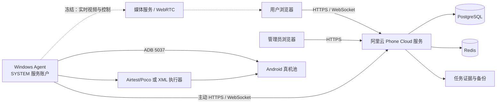
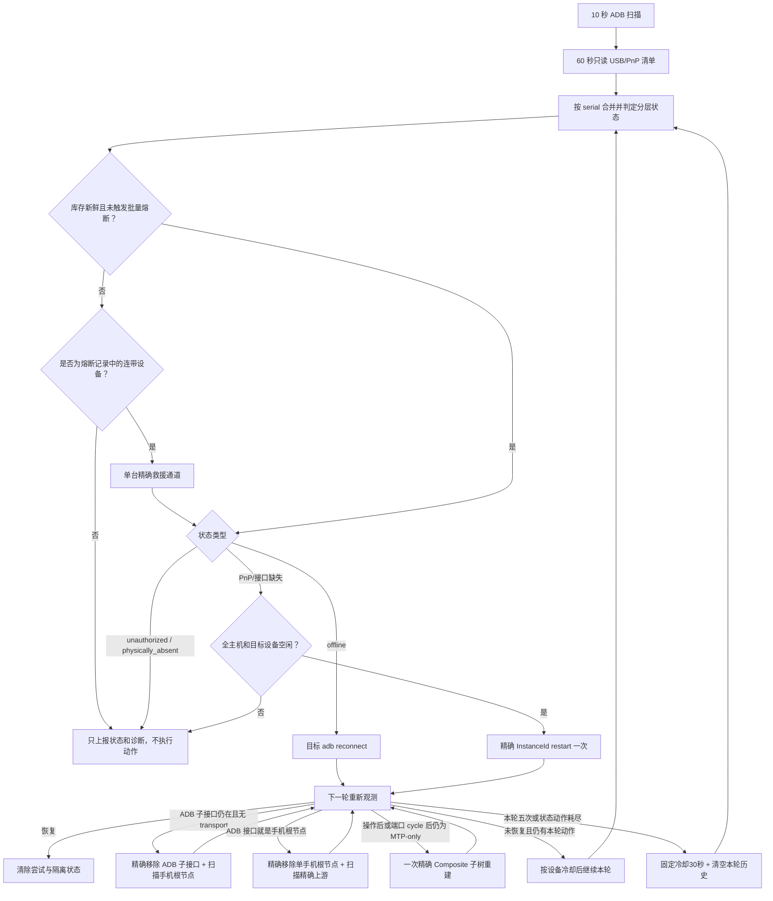
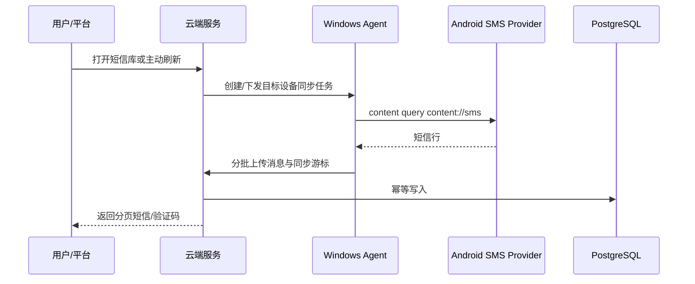

# Phone Cloud 项目开发主文档

- 文档状态：现行、必须维护
- 首次建立：2026-08-11
- 最后更新：2026-10-13
适用范围：云端服务、Web 前端、Windows Agent、Android 辅助组件、短信同步、小红书自动化、设备恢复和部署运维

> 本文是 Phone Cloud 项目的唯一事实来源（Single Source of Truth）。以后开始任何开发、排障或优化前，必须先阅读本文；完成重要变更后必须更新本文。专题文档用于补充细节，不能替代本文中的现状、决策和路线图。

---

## 1. 文档使用规则

### 1.1 信息分级

本文使用以下标签，避免把推断写成事实：

- **已验证事实**：有代码、数据库、日志或实际设备测试支持。
- **当前决策**：已经由项目负责人确认，后续开发必须遵守。
- **待验证假设**：存在迹象但尚无足够证据，不能直接据此修改生产环境。
- **历史信息**：曾经有效，但当前不再作为实现依据。

### 1.2 文档优先级

发生冲突时按以下顺序处理：

1. 当前生产运行证据与数据库事实。
2. 当前代码和实际部署配置。
3. 本文的现状、决策与不变量。
4. 专题设计、API、部署和上线文档。
5. 历史聊天记录、历史方案和归档审查。

发现本文与代码或生产事实不一致时，不得静默绕过；必须先记录差异，再更新本文。

### 1.3 方案连续性要求

提出新方案时必须回答：

1. 它解决本文中的哪个已知问题？
2. 它延续、替换还是否决了哪个既有决策？
3. 有什么新证据支持变化？
4. 如何本地验证、灰度、观测和回滚？

没有新证据时，不得因为换了一次对话就重新设计整个链路。

---

## 2. 项目目标与当前业务范围

Phone Cloud 是“云端平台 + Windows 设备管理器 + Android 真机”的设备业务平台。

当前核心能力：

- Windows Agent 通过 ADB 发现、维护和上报 Android 真机。
- 管理员完成设备命名、SIM、账号槽位和上架配置。
- 用户查询设备短信库并获取验证码。
- 用户提交二维码，小红书 App 在真机上完成扫码登录流程。
- 用户按需建立实时投屏和控制会话。
- 系统保存任务状态、操作轨迹、失败截图和元素树。

当前规模基线：

- 一台 Windows 主机可连接数十台 Android 设备。
- 历史全量短信核对覆盖 104 台可查询设备。
- 小红书自动化需要覆盖不同品牌、系统版本、单开和双开环境。
- 投屏生产会话上限已于 2026-08-13 从 7 台提升到 15 台；该变更只扩展会话/媒体槽位容量，不代表 15 路媒体性能已经完成压力验收。

不在当前主路线中的内容：

- iOS WDA/MJPEG 仍位于实验目录，不属于 Android 生产主链路。
- 旧 Android Agent APK 只作为兼容能力，不是设备管理主入口。
- Appium 不是当前小红书自动化主执行器。

---

## 3. 当前不可违反的决策

### D-001：实时投屏与控制链路冻结

状态：**当前决策，生效中**
确认日期：2026-08-11

当前实时控制总体可用，为避免重新引入历史卡死、断连、首帧和坐标问题，未经项目负责人明确解除冻结，不得修改：

- scrcpy server、视频源生命周期和控制通道。
- 分辨率、帧率、编码码率、编码模式、IDR 间隔。
- WHIP、WHEP、direct WebRTC、MediaMTX 和 ICE 逻辑。
- RTP 分包、pacing、实时队列和丢帧恢复策略。
- 浏览器播放器、首帧、断线重连、呈现看门狗。
- 点击、滑动、旋转和坐标映射。

2026-08-27 项目负责人仅解除以下两个窄范围的冻结：53号（`10AF7J261500DUS`）和35号（`9b9297d1`）可灰度验证 WHIP RTP 每次连续写包上限由8降为2；其余设备仍为8。该授权不包含编码、队列、关键帧、播放器、控制或全量设备调整，详见 D-044。

2026-09-10 用户在10/129手动体验反馈流畅度明显提高后，明确要求将**云端→浏览器的平滑发送**扩展到全部手机；仅为此解除该发送调度环节的冻结，见 D-075。Windows、源端编码、清晰度、ADB/USB/PnP、控制和业务服务仍不在本次改动范围。用户随后明确“上线吧”，原生全局配置于10:16:25 UTC生效；配置全覆盖不等于全部机型/线路已逐一动态验收。

2026-09-24 用户仅允许为控制 ACK 多秒延迟增加逐跳诊断，不授权调整控制动作、排队策略、编码或媒体发送。诊断候选把浏览器发送→ACK 与云端收到控制→Agent ACK、Agent 单设备队列等待及执行耗时按同一序号对齐；跨浏览器/云端与云端/Agent 的剩余时间都属于双向传输及事件循环合计，不能仅凭差值断言某个单向网络节点。候选已完成本地专项验证，生产当时仍有 6 路观看，用户选择全部空闲后再启用；在此之前生产链路未修改或重启。

2026-09-29 用户明确允许立即把 7.13 已取证的 ADB transport owner 释放补丁最小合入 Windows Agent，并接受当前投屏中断；本次仅解除该连接资源生命周期的冻结，不包含视频源策略、编码、控制行为、媒体或浏览器改动。发布和实机验收见 7.14。

允许但需回归验证的外围修改：

- 日志轮转和日志采样。
- 版本号与构建信息上报。
- 非投屏任务的合并和错峰。
- 明确排除正在投屏设备的 PnP、短信和自动化任务。

冻结不代表现有链路完美，只表示当前阶段不继续改变它。

### D-002：小红书自动化采用 Poco 主路径、XML 专用路径

状态：**当前决策，生效中**

- 默认设备使用 Airtest/Poco。
- 151 号等已确认 Poco 长时间卡住的设备使用 XML UIAutomator 专用路径。
- PocoService 与 UIAutomator 不得同时控制同一设备。
- 正常路径优先查找目标元素；只有目标缺失时才检查弹窗。
- 每次任务冷启动小红书，避免继承上次残留页面。
- 默认前提是手机内小红书账号已登录；账号掉线不属于当前自动化覆盖范围。
- 能使用元素定位的步骤必须使用元素定位，不以固定坐标作为主路径。

### D-003：设备恢复只允许精确到目标设备

状态：**当前决策，生效中**

- 不重启 USB Hub，不允许为了恢复一台手机导致同 Hub 其他手机掉线。
- 不在设备被投屏、扫码或执行用户主动短信刷新时恢复它。
- Windows Agent 的常驻 ADB daemon 由服务账户统一管理，不能临时以另一个 Windows 账户启动第二套 ADB 会话。
- 全局 ADB 重启和全局 PnP 扫描只能作为明确授权的维护动作，不能作为普通自动恢复手段。

### D-004：生产数据变更必须可恢复

状态：**当前决策，生效中**

- 不直接删除生产数据。
- 迁移前必须备份并生成影响预览。
- 数据清理、批量删除、不可逆迁移必须取得明确授权。
- 回填任务只能写入服务器确认缺失的数据，不能盲目全量重放。

### D-008：Windows DeviceInstall 是整机共享资源，自动恢复必须熔断

状态：**历史决策；并发度与重试次数已由 D-011 更新**
确认日期：2026-08-12

- `pnputil`/DrvInst/PnP 重挂载在同一 Windows 主机上只允许一个动作，不再按不同 Hub 并发。
- 自动恢复只允许精确目标动作；禁止自动 `remove-device`、上游 Hub 扫描、全局 PnP 扫描和全局 ADB 重启。
- 同时出现 4 台异常，或小设备池中至少 2 台且异常比例达到 8%，立即熔断；此前在线设备同时丢失 4 台也立即熔断。
- PnP 超时打开 3 分钟整机熔断；普通目标命令失败按 D-009 继续有界重试，不再一次失败就隔离。
- 全主机每小时最多 20 次自动恢复动作，所有动作仍严格串行。
- USB 物理清单失败或陈旧时禁止恢复，不能依据旧拓扑执行 PnP 动作。

### D-009：单设备自动恢复最多重试五次

状态：**历史决策；重试次数已由 D-011 更新**
确认日期：2026-08-12

- 同一恢复周期最多执行 5 次真实恢复动作；普通失败不能在第一次就放弃设备。
- 重试间隔依次约为 30 秒、60 秒、120 秒、240 秒，最终上限为 300 秒；通常在首次确认异常后的约 8 分钟内完成五次尝试。
- 每轮都重新读取当前状态：`offline` 使用目标 ADB reconnect，PnP/接口缺失使用当前精确 InstanceId restart。
- 没有精确 InstanceId 时不消耗五次动作额度，只每 60 秒重新读取物理清单。
- 手机真实拔出后清空本轮计数；重新插入视为新的恢复周期。
- 第五次仍未恢复才进入隔离；隔离仅停止破坏性动作，监测和自动上线判断继续运行。
- 批量掉线、库存失效、设备忙碌或 Windows DeviceInstall 未结束时，安全熔断仍优先于单设备重试。

### D-010：恢复机制必须提供逐设备可解释遥测

状态：**当前决策，已于 2026-08-12 发布**
确认日期：2026-08-12

- 管理界面不能只展示“在线/离线”或聚合异常数；必须展示设备卡在哪一层、当前动作、已用尝试次数、下一次复查时间和最后失败证据。
- Windows Agent 保存有界恢复事件记录，至少覆盖异常发现、状态变化、动作开始、动作完成、动作失败、安全暂缓、熔断开关、恢复验证和最终隔离。
- “动作完成”不等于“设备已恢复”；只有后续重新观测到 `adb_device` 才能标记为恢复成功。
- 隔离只停止自动破坏性动作，管理页仍持续显示设备和后续状态变化。
- 第一版管理控制台保持只读，不提供手工强制 PnP/Hub/全局 ADB 操作，避免可视化页面绕过 D-003 和 D-008 的安全边界。

### D-011：精确恢复采用最多八路并发和八次有界重试

状态：**历史决策；单设备动作预算已由 D-012 更新**
确认日期：2026-08-12

- 经用户明确接受同一 Windows 共享 USB/PnP 栈可能影响其他设备的风险，精确恢复从整机串行调整为每批最多 8 台并发；仍禁止 Hub reset、全局 PnP 扫描、自动全局 ADB 重建和 `remove-device`。
- 连续 2 轮只读清单确认物理存在但 ADB 异常后进入首批恢复；扫描周期为 30 秒，因此首批目标约 1 分钟内开始。
- 同一设备最多执行 8 次真实动作，退避为 30、60、120 秒并封顶 120 秒；第 8 次仍失败才停止破坏性动作并进入隔离，监测与自动上线判断继续。
- 投屏中或前台自动化任务占用的目标设备从恢复候选中排除；其他设备被占用不再阻塞本机其余精确目标。
- 每批动作结束等待 5 秒重新采集 ADB；若批外原在线设备消失，立即打开突发丢失熔断，停止下一批。
- 生产首批 8 台在约 0.8 秒内全部发起、5 秒后完成验证，ADB 在线数前后均为 103，`collateralLosses=[]`；第二批 4 台结果相同。该证据只证明并发调度和批外保护正常，不代表异常手机已经恢复。

### D-012：按故障层级执行有界动作，不以八次重复命令充数

状态：**历史决策；精确重建阶梯已由 D-014 更新**
确认日期：2026-08-12

- 先识别真实 ADB/WinUSB 子接口；通用 WinUSB ADB 签名也必须进入 ADB 子接口路径，不能误判为 MTP-only。
- `adb_offline` 最多 3 次目标 reconnect，必要时再执行 2 次精确 ADB 子接口 restart；ADB 子接口存在但 transport 缺失时最多执行 5 次精确子接口 restart。
- `usb_root_pnp_error` 最多 2 次精确根节点 restart、2 次精确下游端口 cycle；健康根节点但只暴露 MTP/File-CD 时不再 restart 根节点，只允许最多 3 次精确端口 cycle。
- 单设备总动作预算回到 5 次，30/60/120 秒退避并封顶 120 秒；命令执行失败不算“动作已完成”，保留该安全动作的后续重试资格。
- 每次动作后必须重新观察 ADB；重新出现后持续至少 90 秒且至少 3 次扫描，才从恢复状态删除。
- 精确端口/子接口映射暂时不可用时每 60 秒只读复查，不消耗动作次数；旧生产配置中的 1800 秒等待不再生效。
- 自动动作中禁止 `remove-device`、根节点 disable/enable、Hub reset、全局 PnP 扫描和全局 ADB restart；终态遥测不能占住可运行设备的调度位置。
- 精确 ADB 子接口 restart 可最多 8 台并发；下游端口 cycle 每批最多 1 台，批外 ADB 丢失立即熔断。

### D-013：投屏生产会话上限提升为十五路

状态：**当前决策，已于 2026-08-13 发布**
确认日期：2026-08-13

- 阿里云服务端 `SCREEN_MAX_CONCURRENT_SESSIONS` 与 `SCREEN_MEDIA_SLOT_COUNT` 同步从 7 调整为 15，Windows Agent 的 `screenMaxConcurrentSessions` 同步从 7 调整为 15，防止任一侧继续形成较小上限。
- 本次只调整准入容量和固定媒体槽位数；不修改 scrcpy、分辨率、40fps、1Mbps、编码器、WHIP/WebRTC、RTP、队列、播放器和控制逻辑，D-001 的媒体链路冻结继续生效。
- 15 是会话准入上限，不等同于已经证明 15 路在所有画面动态程度下都满足稳定帧率；后续只读观察 Windows、云端和单路播放指标，出现问题先收集证据，不自动改媒体参数。
- 回滚方式：将云端两个环境变量和 Windows Agent 配置同时恢复为 7，并分别最小重启 `phone-cloud` 服务和 `PhoneCloud Windows Agent` 计划任务。

### D-014：把生产实测有效的精确重建纳入自动恢复阶梯

状态：**当前决策，已于 2026-08-13 发布**
确认日期：2026-08-13

- ADB/WinUSB 子接口存在但 transport 缺失时，先执行 1 次精确子接口 restart；仍未恢复则最多 2 次精确 remove 该 ADB 子接口，并只扫描它所属的手机 USB 根节点。
- 只有同一恢复周期已经观察并操作过 ADB 子接口、随后退化为 MTP/Composite-only 时，才允许 1 次精确 remove 该手机 Composite 根节点子树，并只扫描它的精确上游节点；长期纯 MTP 设备不能直接进入此动作。
- 普通精确子接口动作仍可每批最多 8 台；Composite 根节点重建属于高级动作，每批最多 1 台。任何动作前重新读取 ADB，投屏/前台任务占用目标继续排除，动作后检查批外在线集合，出现连带掉线立即熔断。
- 继续禁止 Hub reset、Hub remove、全局 PnP scan、自动全局 ADB restart 和无法证明目标/父子关系的 `remove-device`；D-014 只放开有精确目标、精确扫描父节点和有界次数的单手机重建。
- 策略状态升级为 v3：只折叠 v2 中同一 ADB 子接口的重复 restart 历史并解除由此造成的旧隔离，端口循环、人工条件和其他恢复历史全部保留，不进行全局状态清空。
- 人工生产验证：109、163 通过“移除精确 ADB 子接口 + 扫描手机根节点”恢复，111 在子接口消失后通过“移除精确手机 Composite 子树 + 扫描精确上游”恢复；三次均未重置 Hub。
- 自动生产验证：99（`10AEBX38XB00719`）和 112（`10AF541TGN00BTR`）在同一批次执行精确 ADB 子接口重建，ADB `onlineBefore=116`、`onlineAfter=118`、`collateralLosses=[]`；两台随后均通过 90 秒、5 次扫描稳定确认。此前 116→114 的变化已确认来自人工插拔，不计为恢复动作副作用。

### D-017：小红书账号以 ID 为稳定身份，名称只用于展示

状态：**当前决策，已随 D-022 大版本发布并完成生产迁移**
确认日期：2026-08-13

- 每个已配置的小红书槽位必须同时保存 `xhsId` 和 `accountName`；`xhsId` 是稳定身份，`accountName` 可以随业务改名。
- 同一个 `xhsId` 不允许绑定到同一手机的两个槽位，也不允许跨手机重复绑定；改名不能绕过唯一性校验。
- 扫码任务创建时同时快照账号 ID、名称、槽位和设备，保证历史任务在账号改名后仍可准确追溯。
- 生产发布前必须先按最新账号表生成迁移预览，要求所有现网已配置槽位无遗漏、无歧义、无重复 ID；迁移与代码发布必须共用可回滚维护窗口。

### D-018：熔断保留单台救援通道，并补齐根节点型 ADB 与纯 MTP 恢复

状态：**当前决策，已随 `20260817-recovery-occupancy-v1` 发布；后续安全补强见 D-021**
确认日期：2026-08-14

- D-014 的精确目标、忙碌设备排除、批外在线集合校验以及 Hub/global 禁令继续生效；本决策只补齐生产实测暴露的状态机缺口，不恢复宽泛或全局操作。
- `mass_outage`/`burst_outage` 熔断期间，普通恢复队列继续停止；但若熔断记录的批外连带掉线设备本身成为可恢复异常，允许其中一台进入“连带设备救援通道”。该通道仍要求库存新鲜、目标空闲、精确拓扑、DeviceInstall 空闲和小时预算可用，并在动作后重新比较全量 ADB 在线集合。
- ADB/WinUSB 接口与手机 USB 根节点是同一个 InstanceId 时，先精确 restart 一次；仍无 transport 且可证明精确上游节点时，允许一次精确 remove 该单手机根节点并扫描精确上游。不能再因为“接口等于根节点、无法移除子接口”直接进入永久人工隔离。
- 长期只暴露 MTP/Composite、没有 ADB 子接口的设备，精确端口 cycle 一次仍无效后，若手机根节点、精确上游和端口映射均完整，允许一次精确 Composite 子树重建；仍未暴露 ADB 才进入 `usb_gadget_adb_not_exposed`。该变化替代 D-014 中“长期纯 MTP 设备禁止直接重建 Composite”的限制。
- 普通 ADB 子接口动作仍可每批最多 8 台；根节点、Composite 和端口 cycle 属于高级动作，同一精确上游每批最多 1 台，不同上游可在总并发 8 台内执行。未知上游统一进入一个保守通道。
- 恢复批次必须区分“选入批次、实际动作、延期、跳过、失败”。`attempted` 只统计已经开始执行命令的目标；批外连带掉线集合只排除真实执行过动作的 serial，不能再把选中但被熔断拦截的设备计为“已尝试”。
- 隔离不是停止观察。设备以任何方式重新进入 `adb_device` 后继续执行 90 秒/至少 3 次扫描的稳定验证，成功后清除隔离、尝试次数和动作历史。

### D-019：全量设备短信库采用 Provider 主源与默认短信应用通知补全

状态：**当前决策，已随 D-022 大版本发布；通知补全已于 2026-08-19 全设备启用**
确认日期：2026-08-14

- 所有在线 Android 设备使用同一套双源框架，不按 OPPO、vivo 或具体型号写死分支：标准 `content://sms` 仍是可恢复历史、卡槽和稳定 `_id` 的主数据源；默认短信应用的活动通知与通知历史只补齐 Provider 没有暴露的新短信。
- Windows Agent 先从 `dumpsys role` 的 `android.app.role.SMS` holder 发现默认短信包，旧系统回退到 `settings get secure sms_default_application`。152 实机已证明 ColorOS 13 的 `cmd role` 没有查询 holder 子命令，不能依赖不存在的 `cmd role holders`。通知读取必须使用包级过滤 `dumpsys notification --noredact --package <package>`，禁止无差别保存或上传系统全部通知。
- 通知正文只在 Agent 进程内解析 `android.messages`、`android.bigText`、`android.text` 和 `android.title`；原始通知 dump 不落盘、不写日志、不上传。云端只接收结构化短信候选，并继续遵守短信正文现有访问权限和审计边界。
- 第一阶段全量空闲设备采用 30 秒、全局并发 2 的错峰低频采集；2026-08-20 用户要求将通知补全调整为 D-025 的十路连续整池轮询。用户主动刷新仍立即执行一次 Provider 全量对账和通知补全；通知轮询仍不能占用前台自动化、投屏或精确 PnP 目标。
- Provider 与通知候选必须做跨源语义去重：标准化正文和发件人一致时使用设备与两分钟时间窗；ColorOS 等 ROM 压缩通知正文/发件人时，只允许“同设备、跨源、30 秒内、双方都只有一个且验证码一致”的记录按最近时间合并。不同验证码、任一侧含多个验证码、超过 30 秒或同源 Provider 行不得走该降级规则。Provider 后到时补齐 `_id`、卡槽和时间等权威字段，但保持既有平台消息 ID 稳定。通知中没有可信卡槽时保持未知，禁止猜测 SIM1/SIM2。
- 无默认短信包、通知无正文、ROM 不支持包级过滤或 ADB 短暂失败时，只把通知补全标记为不可用/退化，不能让 Provider 同步失败；单设备能力和耗时必须可观测。
- 152号双卡实测证明平台管理员号码数据与手机实时订阅映射可以分别陈旧：手机实时 `sub_id=1 → SIM1`、`sub_id=2 → SIM2`，17:22新短信为公开Provider `sms:148/sub_id=2`；生产平台却仍把两个号码按相反卡槽保存，并保留旧订阅ID 0/1。号码字段必须由管理员按实体卡槽纠正，短信卡槽必须由D-015的实时 `dumpsys isub` 映射决定，不能用旧号码数组推断。此前按用户口述“154号”查询未见新增属于查错设备，不得作为154不可观测证据。
- 第一阶段以 152 序列号白名单完成生产灰度；2026-08-19 因 96 号手机存在“手机可见验证码、Provider 未及时补齐且通知路径未进入白名单”的生产缺口，用户明确要求全设备覆盖，生产配置已显式设置 `smsNotificationFallbackAllDevices=true`。Agent 最小重启前后 ADB 在线数保持 116，96 号随后留下 `enabled=true/status=ok/packageName=com.android.mms` 的真实通知同步日志。首轮 116 台探测暴露 2 台 `unsupported`：一台是瞬时角色查询空结果被缓存十分钟，另一台 ROM 的 `dumpsys role` 省略角色名称；生产热修增加标准 `SENDTO smsto:` 默认处理器发现路径，并只缓存成功包名。热修后当前 Agent 启动周期内 115 台空闲设备全部 `ok`、0 `skipped`，剩余 1 台因正在投屏按调度不变量跳过，结束占用后自动进入下一轮。通知已被清除时仍不能恢复过去的活动通知，Provider 主源与主动全量对账继续保留。基线回退点为 Git 提交 `c776694`，生产配置和两个热修源码文件均有重启前备份。
- 恢复队列只能阻止恢复目标本身参与后台 ADB 读取，不能以 `recoveryPending` 暂停整台 Windows 上所有正常手机的短信同步；PnP 动作真正开始前只中止目标序列号的在途短信读取。152第三次实测在通知约1.12秒命中但平台未入库，日志证明旧全局门禁持续输出 `recoveryPending=true`，该门禁已在统一候选中移除并有回归测试保护。D-033 进一步取消“任意自动化任务/任意 PnP 跟随扫描暂停全机短信”的间接门禁。

### D-020：普通用户可查看设备当前使用者

状态：**当前决策，已随 `20260817-recovery-occupancy-v1` 发布**
确认日期：2026-08-14

- 设备占用不是管理员专属信息。所有已登录用户在用户工作台的设备卡片和设备详情中，都能看到当前使用者、占用类型和开始时间，以便在多人共用设备池时判断应该等待还是选择其他手机。
- 当前用户占用时显示“你”；其他普通用户优先显示其平台显示名，缺少显示名时回退到登录名；管理员占用显示“管理员”，系统任务显示“系统任务”，无法关联到现有账号时显示“未知用户”。
- 普通用户只获得用于协作判断的显示标签，不新增手机号、Token、密码、邮箱或其他账号资料；本变化只调整占用身份可见性，不改变设备锁、任务权限、短信权限、投屏控制权和管理员权限。
- `screen_control`、`xhs_qr`、`sms_wait` 和通用设备任务使用同一套占用者解析规则，避免不同任务入口显示不一致。

### D-021：PnP 动作后持续观察延迟连带掉线

状态：**当前决策，已随 D-022 大版本发布；180 秒配置与跨重启持久化已生效**
确认日期：2026-08-17

- 生产时间线显示，精确 PnP 命令退出并不代表 Windows USB/DeviceInstall 已经稳定；批外手机可能在数十秒后掉线。一次人工精确动作约 143 秒后出现另一台手机短暂掉线，时间相关性不能单独证明因果，但足以证明原 5 秒动作后校验存在盲区。
- 每批真实 PnP 动作结束后，以动作前 ADB 在线集合减去本批实际动作目标作为基线，默认持续观察 180 秒；观察窗口和基线持久化，Agent 重启不能绕过。窗口内允许无 PnP 的目标 ADB reconnect，但不再开始下一批 PnP 变更。
- 正在投屏或执行前台任务的手机继续排除出恢复候选，绝不对其执行 PnP；但它们不能排除出掉线检测。观察期内任一基线在线手机掉出 ADB，立即并入 `collateralLosses` 并打开熔断，避免把真实用户掉线隐藏成“忙碌设备已忽略”。
- 后续命令失败只能合并、不能覆盖已经记录的连带设备证据。控制台区分“达到五次预算”和“当前状态已经没有安全动作”，并展示动作后连带观察期，避免把零动作或状态阶梯结束误报为“五次已用尽”。
- 本决策只修改 USB/PnP 恢复安全状态机、健康遥测和只读控制台文案；不修改 scrcpy、WebRTC、触控、媒体参数、短信生产开关或线上数据。生产发布前仍需受控维护窗口验证，禁止拿正在使用的手机做 PnP 灰度。

### D-022：D-015、D-017、D-019、D-021 合并为一个大版本

状态：**当前决策，已于 2026-08-17 作为统一大版本发布**
确认日期：2026-08-17

- 用户明确要求四项候选使用同一个 releaseId、同一个维护窗口和同一个整体回滚，不拆成多个线上版本。内部功能开关只作为误配置保护，不代表拆分发布。
- 大版本必须包含短信业务唯一键迁移及回滚、小红书 ID 数据迁移、云端/前端、Windows Agent 和恢复安全状态机；任一模块未通过硬门槛，整个版本都不上线。
- 生产短信表只读预检为 162296 行、90134 条逻辑短信、70018 个重复组和 72162 条待归档重复行。迁移先完整归档重复行，再建立 `(device_id, message_key)` 唯一索引；云端仓储和启动 overlay 同时改用该业务键。
- 最新小红书预演覆盖 139/139 个已配置槽位，`unresolved=0`、`ambiguous=0`、`duplicateIds=0`；其中表格145号“驰电车讯”当前在生产185号，按全表唯一账号别名迁移并单独标记 `deviceMoved`，不能静默忽略设备移动。
- 小红书迁移不能只生成报告；统一候选增加默认 dry-run、仅显式 `--apply` 写入的事务执行器。执行器锁定设备结构化表，逐槽校验预演时的设备、槽位和名称仍一致，写入后再检查全部已配置槽位都有 ID 且全局唯一，任何变化或冲突均整体回滚。
- 统一验收命令为 `npm run test:big-release`；发布与整体回滚顺序以 `docs/BIG_RELEASE_RC.md` 为准。D-021 的真实 PnP 动作仍必须在隔离 Windows 或明确维护窗口完成，生产用户使用期间不得补测。

### D-023：扫码前半程保留 Poco 精确定位，跨 Activity 后切换有界 XML

状态：**当前决策，已于 2026-08-17 完成生产实机验证；Windows Agent 最终切换见变更记录**
确认日期：2026-08-17

- 正常设备仍使用 Poco 进行小红书冷启动、弹窗按需处理、进入“我”、打开扫一扫和进入相册；不得退回坐标驱动，也不得在正常路径做全页面弹窗扫描。151 等已登记专用设备继续走完整 XML 路径。
- Poco HRPC 单次调用默认限制为 2 秒且最多 5 秒；全量控件扫描必须先 `freeze()` 一次再在本地筛选。元素已经由 Poco 定位后，只允许用有界 ADB tap 执行，不得在 ADB 失败后退回可能再次卡住的 `node.click()`。
- 相册打开后不再让 Poco 与命令行 UIAutomator 同时占用 Android 的 UiAutomation 通道：只终止该手机的 PocoService，把缩略图选择、照片权限、扫码结果识别和确认按钮切换到 8 秒有界的 `uiautomator dump /dev/tty` + ADB 点击；XML 只截取 `<hierarchy>` 节点，失败证据也使用同一有界读取器。
- 常驻 worker 启动前只清理本机序列号对应的残留 Poco instrumentation，不重启 ADB、不影响其他手机。Agent 冷启动后，前台扫码任务先在 10 秒内创建并探测该设备 worker，失败才进入可修复的完整环境预检；后台预检不能再让前台任务固定等待 60 秒。
- 152号真实生产验收使用无害测试二维码，三轮从云端创建到受控结束均约 49.1 秒；实机完成小红书冷启动、元素定位、扫一扫、相册、首张二维码选择，并进入扫码结果识别阶段。最终“未进入登录确认页”是测试二维码并非真实登录码的预期业务结果，不是执行器卡死；任务全程未触发 180 秒 watchdog。

### D-024：异常设备采用持续恢复轮次，不再隔离或熔断停止

状态：**当前决策，已于 2026-08-20 发布并开始生产持续验证**
确认日期：2026-08-18

- 用户明确要求恢复器持续尝试，主机异常数、动作后观察、小时动作数和单轮动作耗尽均不得再停止恢复队列。`mass_outage`、`burst_outage`、PnP 超时熔断、180 秒动作后阻断、小时动作预算和永久隔离从生产运行路径移除。
- 每台设备仍按已验证的分层动作链执行；当前链跑完或单轮五次失败后不写 `quarantinedAt`，而是进入固定 30 秒设备级冷却。冷却结束清空本轮动作历史并从当前实时拓扑重新开始下一轮，直到稳定观测到 `adb_device`。
- 策略状态升级到 v5。首次读取 v4 及更旧状态时清除历史隔离；旧动作历史先用于完成当前动作链，随后自动进入冷却和下一轮，不要求人工清理状态文件或重启 Agent。
- “持续恢复”不等于宽泛操作：只允许当前精确手机节点和端口动作；继续禁止 Hub reset、Hub remove、全局 PnP scan 和自动全局 ADB restart。正在投屏或执行前台任务的目标手机继续跳过；物理清单不可用、Windows DeviceInstall 正在执行或精确目标缺失时只等待条件恢复，不伪造动作次数。
- 恢复控制台改为展示“持续恢复/轮次冷却”，小时动作只做统计、不再显示预算；人工项只保留 ADB RSA 未授权等真实人工前置条件。
- 本决策替代 D-018/D-021 中“熔断停止普通队列、单台救援、180 秒观察期阻断”和 D-012 中“动作耗尽后隔离”的运行行为；D-014/D-018 已验证的精确动作阶梯继续保留。实时投屏与控制仍按 D-001 冻结。

2026-10-14 用户明确批准**单台手动暂停自动恢复**作为D-024的窄范围例外：仅被管理员暂停的目标停止新自动恢复动作，持续发现与其他手机调度保留；已执行动作自然收尾。暂停可审计/持久化并可明确解除，不恢复旧全局熔断或按失败次数永久隔离。实现为本地候选`device-recovery-pause-20261014-rc.1`，未上线，生产当前D-024行为未变；见7.15.2。

### D-025：短信通知补全采用十路连续整池轮询

状态：**当前决策，已于 2026-08-20 发布并开始生产持续验证**
确认日期：2026-08-20

- 在线设备按当前稳定清单顺序组成一轮，每轮同一设备最多读取一次默认短信应用通知；全局最多 10 台并发。整轮结束后不再等待设备扫描或固定 30 秒间隔，立即从清单首台开始下一轮。
- 正在投屏、扫码、主动短信刷新或执行精确 PnP 的目标设备跳过当前轮；占用释放后自动进入后续轮次。D-033 已把 PnP 抢占收窄到精确目标序列号，其他手机的通知轮询不再因主机上存在 PnP lease 而整体暂停。
- 只有当前没有任何可读取设备时才等待 1 秒，避免空列表忙循环。每轮输出目标数、成功、不支持、失败、抢占、通知数、上传数、去重数、耗时和并发汇总；普通成功且零新增不再逐设备打印，避免百台连续轮询打爆日志。
- 连续轮询通过显式 `smsNotificationContinuousScanEnabled=true` 启用；并发配置 `smsNotificationBackgroundConcurrency` 上限从 4 放宽到 10。关闭连续开关时仍保留原有按设备最短 30 秒调度，便于快速回滚。
- 连续轮询仍是通知快照采集，不是 Android 事件监听；最坏发现时延约等于一轮整池耗时。该决策替代 D-019 的“30 秒、并发 2”后台通知调度基线，但不改变 Provider 主源、通知解析、跨源去重、短信权限、投屏算法和 USB/PnP 恢复动作。

### D-026：双开小红书的系统相册权限窗只在目标缺失时切换 XML 处理

状态：**当前决策，已于 2026-08-20 热更新 Windows 扫码脚本**
确认日期：2026-08-20

- 生产失败设备 `10HFB8F9ZB000R3` 选择双开小红书后运行在 Android 用户 `u999`。旧预授权命令只作用于主用户 `u0`；设备证据显示 `u0` 的 `READ_MEDIA_IMAGES` 已授权，而 `u999` 仍未授权，扫码页前台因此变为 `com.android.permissioncontroller/.permission.ui.GrantPermissionsActivity`，Poco 看不到系统权限元素并误报“未找到相册入口”。
- 正常路径仍只查“相册”目标元素，不增加每页全量弹窗扫描。只有扫码页相册目标缺失且前台明确为 `GrantPermissionsActivity`/`permissioncontroller` 时，才停止该手机的 Poco UIAutomation、用 8 秒有界 XML 读取器按文字元素点击“允许访问全部/允许访问所有照片/允许”，然后按“相册”文字、描述或 `:id/llMyPhoto` 元素继续。
- 禁止固定坐标点击权限按钮，也不静默给所有 Android 用户开放相册。登录确认按钮仍不属于通用弹窗，不能在此分支点击。
- 脚本可热更新；为确保指定手机立即加载新代码，只重建其空闲 Poco worker，不重启 Windows Agent、ADB daemon、USB/PnP 或投屏链路。

### D-027：厂商双开系统界面采用证据驱动 XML 接管，慢 PackageManager 不得误报未安装

状态：**扫码 Python v10 已于 2026-08-20 热更新并完成真实登录二维码多机回归；PackageManager 防误报候选已完成本地回归，待安全窗口重启 Agent 激活**
确认日期：2026-08-20

- OPPO `com.android.intentresolver/.ChooserActivityLauncher` 与 vivo `DoubleAppResolverActivity` 是已经由前台 Activity 证明的系统双开界面。只有命中这些精确界面时，允许释放该手机 Poco，使用 8 秒有界 UIAutomator XML 按双开卡片元素选择目标；不能把普通“小红书元素暂时缺失”泛化成整条 XML 路径。
- 153 号生产证据显示：XML 已在 7.9 秒选中双开卡片，Poco 随后在 14.0 秒进入“我”页；前两次“扫一扫”查询分别返回未命中，第三次 Poco RPC 从 19.3 秒一直卡到 220 秒 worker watchdog。元素树同时证明“扫一扫”真实存在于 `content-desc="扫一扫"`。因此，当本任务已经通过厂商双开 XML 分支时，进入“我”后继续释放该手机 Poco，并按精确“扫一扫”元素、搜索页精确“取消”元素和 `:id/llMyPhoto` 相册元素完成有界 XML 过渡；仍禁止坐标猜测。
- vivo 双开选择器上的 `com.bbk.updater` 系统更新提示只在底层前台仍是 `com.android.intentresolver` 时处理：先返回，精确提示仍存在才停止 `com.bbk.updater`；不能把厂商系统应用的普通前台页面当成弹窗强制关闭。双开选择耗时导致设备再次锁屏时，只在 keyguard 证据为真后重新唤醒并重建该手机 Poco。
- Android Permission Controller 兼容 `permission_allow_all_button`、`permission_allow_foreground_only_button`、`permission_allow_button`、`permission_allow_one_time_button`，并兼容“允许访问全部/使用应用时允许/仅在使用中允许/本次使用时允许”等中英文元素；仍只在明确权限 Activity 前台时执行。Android 14 在进入相册后才弹权限页时，缩略图首次缺失不再立即判失败，而是允许全部后按 XML 缩略图重试；若 ROM 返回扫码页，再按真实相册元素重新进入一次。
- 151 号专用 XML 路径同样执行证据驱动的 vivo resolver 浮层处理：只有 `DoubleAppResolverActivity` 已存在且上层精确为 `com.bbk.updater` 或 `VivoUsbDialog` 时才返回；返回无效时只停止已证明的 `com.bbk.updater`，不触碰其他系统应用、ADB 或 USB。
- Android PackageManager 在部分 OPPO 上的 `pm path com.xingin.xhs` 实测约 18 秒才返回 APK 路径。旧 Agent 5 秒超时后吞错为空串，错误显示“未安装小红书”。候选实现把主查询限制为 25 秒，增加 12 秒 `cmd package path` 兜底；两个查询都因 transport/PackageManager 失败时返回 `package_manager_unresponsive`，只有查询成功且无路径时才判定未安装。该 Node 变更需要 Agent 重启，当前未为此中断线上设备。
- v8 无害图片生产回归覆盖 153、184、43、108：四台均完成冷启动、双开/普通入口、“我”、扫一扫、相册和图片选择，选图阶段分别约 28.9、25.0、33.0、38.3 秒。最终在约 59 至 72 秒返回“选中二维码后未进入登录确认页”，是 1×1 非二维码测试图片触发的预期结果；它证明兼容链路不再卡死，不等同于真实登录二维码的最终确认成功率验收。
- v10 使用当天已经成功过的小红书真实登录二维码，覆盖 153、184、43、80、101、119、130、139、163、182、151 共 11 台，包含 vivo/OPPO/HUAWEI、主应用、双开和 151 专用 XML。本轮累计 13 次完整成功和 2 次有证据的兼容失败；11 台首个成功任务平台总耗时为 32–67 秒，9/11 在 60 秒内。139 首次暴露 Android 14 `permission_allow_all_button` 后修复，随后 67 秒和 51 秒连续成功；151 首次暴露系统更新浮层覆盖 resolver 后修复，随后 39 秒和 36 秒连续成功。两次失败都有前台 Activity 和元素树证据，不扩张为通用坐标点击。
- v10 后续隔离 dry-run 又捕获两种精确系统表面：32 号 MIUI/HyperOS 的双开选择器为 `android/com.android.internal.app.ResolverActivity`，旧 XML 专用路径未进入选择分支；43 号 vivo 双开弹出 `com.vivo.pushservice type=2038` 通知授权浮层，旧标记不包含“发送通知”。候选只增加这两个精确证据：前者仍按“小红书/Ⅱ·小红书”元素选择，后者只取消通知授权，不点击泛化“确认”。修复后 32 Poco、43 Poco、151 XML 分别在 27.27、29.36、16.60 秒进入相册。146 OPPO 也完成相册路径，但冷 PocoService 初始化独占约 66 秒、总耗时 84.49 秒，属于 worker 预热/健康问题而非页面元素缺失；51 未安装小红书、43 双开账号已退出，按既定测试前提排除。

### D-031：SmsRelay 升级为可独立使用的默认文字短信应用

状态：**当前决策，本地候选已安装单台测试机，尚未部署生产**
确认日期：2026-08-21

- `android-agent/SmsRelay` 不再只是验证码上报配置页；候选 APK 提供会话列表、号码/正文搜索、未读数、会话详情、复制、删除、新建、回复、双卡选择、系统通知和默认短信角色申请。原中台配置、心跳、短信库同步、更新和扫码辅助能力保留在设置页。
- 产品模式确定为由 SmsRelay 接管唯一默认短信角色，不再把“原短信应用继续作为默认”作为生产方案。APK 首次启动在短信权限满足后主动拉起系统角色确认页；Android 安全模型仍要求用户在手机上确认一次，代码不得伪造为可静默切换。切换前记录原默认短信包用于诊断和人工回退，但生产正常路径只认 SmsRelay 为默认 holder。
- SmsRelay 持有默认角色时必须关闭 APK 内既有的旧短信应用通知兜底解析，并显式排除自身通知包，防止自己发布的新短信通知被再次当成验证码入队；D-019/D-025 的 Windows 侧通知补全由灰度范围控制，在 APK 接管设备上只作为迁移期观测，最终以 Receiver/Provider 业务键去重结果为准。
- 默认短信角色收到 `SMS_DELIVER` 后，必须先在同一 SQLite 事务中写入永久 `local_messages` 和上传 outbox `pending_sms`，再分叉执行系统 `content://sms` 镜像、本机通知和中台上报。`local_messages` 是手机端源真值；Provider 或网络任一失败都不能阻止手机查看短信，也不能删除源记录。发送短信成功后仍写系统 Sent Provider，并由既有 Provider 同步补齐中台。
- Provider 镜像与云端 outbox 独立恢复。Provider 写入前按发件人、正文和接收时间检查精确重复，覆盖“Provider 已写成功但状态回写前进程退出”的崩溃窗口；云端只有返回已持久化的 `event.eventId` 才算 ACK，ACK 只删除 outbox，不删除永久消息。
- 所有触发入口共用单航班上传 drain；`SmsQueueStore` 事件指纹继续承担跨 `SMS_DELIVER`/`SMS_RECEIVED` 去重。每条 outbox 独立指数退避（2 秒起、最高 5 分钟并带抖动），单次最多处理 20 条且单条失败不阻塞后续记录；持久化 `JobScheduler` 在网络恢复、重启和覆盖升级后继续补传。
- APK 提供受 `android.permission.DUMP` 保护的健康查询和无界面 `RecoveryActivity`。Windows Agent 候选已实现每分钟一次、最多 10 台并发的空闲设备健康巡检，上报永久消息数、待上传数、Provider 失败数、最老积压和下次重试；仅在 APK 已安装、仍为默认短信应用、RECEIVE_SMS 已授权而服务不存活时，启动该目标包的恢复 Activity。Honor Android 15 实测 force-stop 后显式广播即使带 `--include-stopped-packages` 也不会创建进程，而受保护 Activity 可恢复进程、前台服务、上传任务和 Provider 镜像且不抢占当前前台页面。不得为恢复 APK 重启全局 ADB、Hub 或其他手机，日志不得包含短信正文。
- APK 是否安装是 Windows 短信采集的唯一切换边界：健康探针确认 `installed=true` 后，该设备标记为 `health_only`，后台 Provider 同步、连续通知轮询和用户主动刷新均禁止由 Windows 读取短信内容；正在运行的旧读取按精确序列号立即中止。用户主动刷新改为发送包级命令，让 APK 自身同步并返回健康状态。即使 APK 尚未成为默认短信应用，也只上报角色/权限/服务异常并等待人工完成角色确认，不允许为了“暂时可用”回退旧 Windows 采集。只有明确 `not_installed` 的设备继续 D-019/D-025 兼容路径。
- 服务端把实时 `sms-event`、Provider 与通知分为三个来源：实时事件优先于通知，后到 Provider 以权威字段补齐同一平台记录而不更换既有消息 ID。Windows 与手机心跳的部分健康字段采用合并更新，避免任一路上报覆盖另一条路径已有的队列指标。
- Android force-stop 会停止普通广播投递，单靠 APK 无法自我解除；Windows watchdog 必须识别 stopped/健康超时后显式恢复。省电白名单、开机接收、前台服务和 JobScheduler 是正常休眠/进程回收保障，不能宣称能绕过用户或系统 force-stop。
- v109 将常驻前台服务从 `dataSync` 改为用途匹配的 `remoteMessaging`。target 35 在 Android 15+ 上会对 `dataSync` 施加每24小时最多6小时的运行上限，并禁止其由 `BOOT_COMPLETED` 拉起；旧类型会形成“短测通过、数小时后失活”的假兼容。API 34+ 显式以 `FOREGROUND_SERVICE_TYPE_REMOTE_MESSAGING` 启动，旧系统继续使用两参数 `startForeground`；启动失败和系统超时进入无正文健康诊断。
- 2026-08-21 对当时在线的122台完成无安装只读兼容预检：Android 10/11/12/13/14/15/16 分别15/10/9/6/76/5/1台，vivo/Xiaomi/OPPO/HUAWEI/HONOR/Tianyi 分别82/19/12/6/2/1台，`arm64-v8a` 110台、`armeabi-v7a` 12台，共31种机型/系统组合；122/122具备电话能力、短信角色入口和至少32MiB `/data` 可用空间，0项能力失败。10台提示已安装旧包，只是升级签名/版本检查对象，不是兼容失败。该结论是安装前能力证据，不等于122台已实装收信。
- 兼容门禁固定为三级：全机只读能力、构建/清单/Lint 产物、指定测试机真实短信业务。禁止为了“全机验证”擅自安装正式包或隔离探针；当前用户已明确禁止在线手机安装，v109 只保留本地构建产物。以后统一安装前必须重新跑全量预检、确认 `versionCode>=109`、签名证书 SHA-256 `6624f72a94bb26d7a81f4945460e8a04cc342a2ebef64a5ca01a7e2f04e5e32d` 连续，并在指定测试机补齐 v109 实装门禁。
- 当前候选完整支持文字短信。为满足默认短信角色资格已声明 `WAP_PUSH_DELIVER`，但彩信只提示、不下载正文；在 MMS 下载、附件存储、会话展示和实机验收完成前，禁止把彩信描述为受支持能力。
- D-019/D-025 的 Windows Provider 主源和默认短信应用通知补全继续作为未安装/未切换 SmsRelay 设备的生产路径；新 APK 灰度后仍需服务器跨源业务键去重。禁止一次性批量替换百台默认短信应用，必须先在一台指定测试机完成断网、双卡、进程回收、重启和回退验收。

### D-033：验证码订单等待期间采用绑定设备定向采集

状态：**已于 2026-08-24 发布生产**
确认日期：2026-08-24

- 2026-08-24 “小云爱聊车”实证：订单 10:35:12 创建，手机 10:35:28 已收到验证码；订单 10:38:14 超时取消，用户 10:38:17 主动刷新后 Provider 才在 10:38:20–21 入库。期间恢复跟随扫描持续记录 `skipSms=true`，且任意自动化任务会让整机后台短信调度停止；通知快照没有当前验证码。因此故障是采集调度错过订单窗口，不是短信到达慢。
- 每个等待中的验证码订单在创建时立即为其绑定的 `deviceId/agentId/adbSerial` 建立 `sms_code_probe`。Open API 状态轮询按 2.5 秒设备级节流继续补采；服务端 10 秒维护周期作为客户端停止轮询时的兜底。订单收到、取消或过期后立即停止创建新探针。
- 探针只执行增量 Provider 查询与该设备默认短信应用通知补全，不清空增量游标、不做用户主动刷新的全量历史对账。同一设备已有 `sms_code_probe` 或 `sms_sync_now` 时不重复排队；投屏在领取前通过序列号排除，领取后仍可精确抢占该探针，保持 D-001 的投屏优先级。
- Provider 与通知在探针内独立降级：一源失败仍执行另一源，两个来源均关闭才判任务失败。已安装 SmsRelay 的设备不回读系统库或通知，只精确唤醒 APK 并依赖其可靠 outbox。
- 任意一台扫码/自动化任务不再暂停其他手机的 Provider 和通知后台采集；PnP 跟随扫描允许健康手机继续调度，真正 PnP 动作只中止目标序列号的在途读取。禁止为短信订单重启全局 ADB、Hub、Windows Agent 或投屏媒体链路。
- 2026-09-15 106号只读取证确认同机投屏互斥造成真实收码延迟（下列时间均为北京时间，不保存验证码正文）：手机短信时间11:03:14.221；主动同步任务11:03:32.622创建、11:07:18.926领取；11:07:20.902首次建立平台消息、11:07:21.865任务完成。云端Nginx访问日志确认11:03:08创建该机投屏会话成功，随后至11:07:18的492次Agent领取请求均将该机同时列入`excludeSerials`和`screenGallerySerials`（HTTP 200）；投屏标记解除后立即领取。生产服务端选择器明确拒绝被排除设备的`sms_sync_now`，仅图库导入例外。因此226.304秒发生在等待领取，领取至首次记录仅1.976秒；不能归因为手机读库或服务器写库耗时四分钟。重复刷新仅复用/等待任务，不能绕过该互斥。此事实补充D-019/D-033既有投屏优先规则的时延代价，不授权取消互斥或修改冻结投屏链路；后续优化须单独确认。未取得Windows本地日志，不推断其余设备或其他历史延迟也由同一原因造成。

### D-034：浏览器投屏会话采用三分钟无操作释放提示

状态：**已发布生产**
确认日期：2026-08-25

- 投屏会话创建成功后启动浏览器端无操作守卫。只有实时控制工作区内用户真实触发的点击/触摸、键盘和滚轮操作可以续期；鼠标悬停、视频帧、指标刷新、服务端轮询和脚本生成事件均不算操作，避免无人值守会话被被动数据永久续期。
- 连续 3 分钟没有真实操作时，在浏览器视口中央显示不可由背景点击或 Escape 静默关闭的会话保护弹窗。弹窗提供“继续控制”和“立即断开”两个明确动作，并显示 10 秒环形与横向倒计时。
- 倒计时期间工作区背景事件不能自动续期；只有用户明确点击“继续控制”才关闭弹窗并重新开始完整 3 分钟计时。点击“立即断开”或 10 秒不选择均复用现有 `stopUserScreenSession()` 和 `DELETE /api/v1/screen-sessions/:id` 释放会话，默认选择为断开。
- 计时器使用绝对截止时间而不是累计 tick；浏览器后台标签页节流后，在计时回调、窗口重新获得焦点或页面可见性变化时立即对账截止时间，不能因倒计时 UI 少刷新几次而延长设备占用。
- 会话失败、关闭、用户主动结束和页面退出都会停止守卫并移除弹窗。弹窗使用 `alertdialog`、焦点循环、键盘可达按钮、窄屏布局和 `prefers-reduced-motion` 降级。
- 本决策属于 D-001 允许的浏览器外围会话占用治理；未修改 `screen-client/` 播放器、scrcpy、WHIP/WebRTC、RTP、编码参数、首帧、重连、控制指令或坐标映射。
- 2026-08-25 随 `20260825-d034-d035-automation-center-v1` 发布；生产静态资源和空闲守卫哈希已核对，现有投屏 `config.json` 哈希前后不变；服务端 `screen-quality/screen-relay` 与 Windows `screen-stream/screen-webrtc-publisher` 均和当前代码哈希一致。Agent 重启后当前活动会话重新完成 scrcpy 视频、控制、首个 H.264 包和发布器启动阶段。

### D-044：两包 RTP 微突发治理全量发布，并将无操作提示延长到十分钟

状态：**已全量发布生产**
确认日期：2026-08-27

- 生产证据显示 Windows→MediaMTX 无丢包、发布队列无持续积压、服务端转发无丢帧，但浏览器方向在单秒大帧密集发送时出现 RTP 丢包、NACK/RTX 放大和呈现冻结。现有发布器按10Mbps节拍计算字节预算，却每次连续写8个约1200字节RTP包，形成约9.6KB微突发；本轮只验证把每组降为2包后，是否减少公网UDP瞬时丢包。
- 首轮以53号 `10AF7J261500DUS` 和35号 `9b9297d1` 作为设备级灰度目标，保留 `screenDeviceProfiles.<serial>.transportPacketsPerBurst` 的1–8包独立覆盖能力。53真实会话命中 `max_packets_per_burst=2` 后，发送队列延迟约1ms、源端 `droppedFrames=0`；同时间8包普通会话约6–7ms，用户实际操作确认“两包明显更好”后，明确要求扩大到全设备。生产全局 `screenTransportPacketsPerBurst` 因此改为2，设备级配置只作为以后有证据时的精确回退开关。
- 不修改1080上限、40fps、1.5Mbps编码目标、10Mbps RTP pacing、400ms实时队列、1秒IDR、CBR模式、scrcpy、MediaMTX、WHEP、浏览器播放器或控制坐标。两包组会增加定时唤醒和系统调用频率，因此先比较首帧、Windows发送FPS/队列、浏览器解码/呈现FPS、丢包、NACK和冻结，再决定是否扩大。
- D-034 的无操作守卫从3分钟改为10分钟；真实操作定义、中央提示弹窗、10秒倒计时、默认断开、绝对截止时间及页面退出释放规则全部不变。缓存号同时更新，避免长期浏览器标签继续运行旧的3分钟模块。
- 回滚分两层：Windows 将全局 `screenTransportPacketsPerBurst` 恢复8并重启一次Agent；前端将 `SCREEN_IDLE_TIMEOUT_MS` 从600000恢复180000并还原提示文字。两项互不依赖，可分别回滚；设备级1–8包覆盖仍可用于单机对照，不需要修改发布器。
- 本地门禁：定向Node/Go测试92/92、`npm run check`、沙箱外全仓510/510、Go `go test ./...` 和 Windows amd64交叉编译均通过。十分钟前端按 `20260827-d044-screen-canary-v1` 热替换，源目录/容器哈希一致、外网资源实测为600000ms且 `/readyz` 正常；Windows候选代码和发布器哈希一致。全量阶段按用户明确授权中断现有投屏后，只重启PhoneCloud Windows Agent，ADB在线数122→122，未重启ADB、USB、PnP或手机，配置备份位于 `D:\PhoneCloud\agent\backups\20260827-d044-global-two-v1`。重连后的三个非灰度序列号 `10AECD2DDL007MR`、`VAUBB23A13003126`、`10AEBX0N040070P` 均实测 `max_packets_per_burst=2`、队列延迟约1ms；其中动态会话达到24fps且源端0丢帧，证明全局配置已实际进入普通手机发布进程。
- 2026-09-02 复核发现宿主机源码仍为600000ms，但 D-055 运行容器从旧运行基线重新打包时把 `screen-inactivity-guard.js` 回带为180000ms；资源名仍带 `screen-idle-10m`，因此旧值没有在发布验收中暴露。现已将运行容器、宿主机入口和 Compose `latest` 镜像统一到 `20260902-screen-idle-10m-baseline-v2`，永久镜像为 `6240ec2eca29...`；外网文件实测600000ms、`Cache-Control: no-store`、容器保持healthy/0 restart。Dockerfile、缓存基线Dockerfile和生产预检新增十分钟硬门禁，`scripts/deployment-baseline.test.mjs` 固化回归；以后任何重新带入三分钟默认值的构建或发布都会直接失败。回滚点为 `/opt/phone-cloud-platform/backups/20260902-screen-idle-10m-baseline-v2` 及两个原镜像标签，本次未重启云端容器、Windows Agent、ADB、USB/PnP、手机或投屏进程。

### D-035：扫码、一键发布和支付宝查名字统一为自动化中心

状态：**已发布生产**
确认日期：2026-08-25

- 用户端“自动化”下保留扫码任务，并增加“一键发布”和“查名字”两个并列模块。一键发布接收 1–5 张图片、标题、正文和小红书 I/II；服务端建立一次性任务与设备/应用槽位锁，Windows 使用 Poco 元素执行器完成真实图库选图和发布。
- 支付宝查名字采用开始、连续查询、结束的长会话。正常查询复用当前搜索页；异常时最多完整恢复 2 次；累计成功 200 次后切换支付宝账户。Poco 只有同时命中精确验证标题和滑动动作时才按真实滑轨边界执行最多 3 次拖动，通过后自动重放同一号码最多 2 次；证据不足或有界尝试仍失败时才保留会话并请求人工处理。
- 自动化任务、会话和设备锁进入 PostgreSQL 结构化仓储；Windows 仅增量增加四种任务调度和两个执行器，没有整文件覆盖既有 USB、短信、PnP 与投屏热修复。
- 2026-08-25 随 `20260825-d034-d035-automation-center-v1` 发布。云端自动建表成功，新接口匿名请求返回 401、登录用户请求返回 200；Windows Agent PID 更新为 177288，ADB 在线 123→123，投屏参数配置哈希保持不变。
- 177 首次生产启动查名字会话实证：08:59:33 创建、08:59:52 成功进入 `ready`，Windows 返回 `search_session_ready`，后台没有卡死；旧页面仍保留“启动任务已提交”提示，造成卡住错觉。前端热修增加启动等待秒数和 `ready/querying/failed/ended` 明确反馈并更新缓存版本；16/16 专项通过，静态文件热替换且未重启服务。用户随后 09:07:43 主动结束，09:07:44 正常返回 `session_stopped`。
- 2026-08-27 生产压力测试确认，Poco 核心普通查询约 1.7–3.3 秒，但旧 Agent 在每条查名字任务完成后强制执行约 124 台设备的 `scanAndSync(force=true)`，使下一条查询额外排队 8–23 秒。`alipay_name_start/query/stop` 现在按“设备库存未变化”跳过该次即时全量扫描，其他任务和正常周期扫描不变。
- 生产手工查询 `185****6007` 证明“无姓名结果”被错误归类为 Poco 异常：Poco 11.633 秒未见姓名后切 XML，而支付宝 Cube 搜索结果的 XML 只有容器、没有姓名文字，兜底又耗时约 61 秒，任务总计 73.72 秒。当前规则只提交一次搜索并持续观察稳定搜索页；worker 内部无姓名预算为 4.4 秒，为 Agent 调度与结果持久化预留约 0.6 秒，使用户可见结果接近 5 秒。只有 Poco RPC、元素、输入回读或页面状态异常才切 XML；无姓名号码同样计入每账号 200 次额度。前端查名字使用独立 1 秒刷新并展示服务器阶段和耗时。
- 新版本在 177 上通过真实平台接口连续完成 201/201 次查询、0 失败：普通 199 次中位数 2.174 秒、平均 2.225 秒、P95 2.949 秒；首次真实滑块第 1 次拖动通过并继续查询；第 201 次在成功数达到 200 后切换到 `198******73`，返回 `accountSwitched=true` 并完成查询，会话最终为 `ended`。切号任务耗时 97.636 秒，首次滑块恢复耗时 48.504 秒，仍作为后续时延优化样本保留。
- 2026-08-27 最终 5 秒版生产验收：177 热 worker 的有姓名查询为 1.752–2.052 秒；定向回收 177 worker 以加载新模块后，首条有姓名查询因一次性冷建 worker 为 18.027 秒。随后 `185****6007` 在 worker 内 4.619 秒、平台任务 4.866 秒、接口端到端 5.152 秒返回 `not_found`，会话保持 `ready`、成功额度正常增加并最终 `ended`。日志确认 `submitAttempts=1`，没有二次提交、`poco_fast_path_failed`、`xml_uiautomator` 或 XML worker；Agent 未重启，177 ADB 保持 `device`。

### D-041：查名字页面以服务端状态为准，并自动恢复仍在运行的旧前端

状态：**已发布生产**
确认日期：2026-08-27

- 生产事件时间线证明执行链路没有卡住：会话启动接口在 03:41:59 用 5ms 接收，Windows 在 03:42:05 完成并把会话置为 `ready`；查询接口在 03:44:43 用 3ms 接收，Windows 在 03:44:45 完成，任务耗时 1.819 秒且会话重新为 `ready`。数据库没有 `querying` 残留任务，页面却仍长时间显示启动/查询中。
- Chrome 只读检查确认故障标签仍运行 `app.js?v=20260826-lookup-row-stable-v4`，而生产静态文件已是 `20260827-inventory-stable-v6`。`Cache-Control: no-store` 只能保证下一次加载使用新资源，不能替换一个长期不刷新的标签页中已经执行的旧 JavaScript。
- 查名字一秒轮询改为 single-flight：前一次请求未结束时不再启动下一次，消除慢网络或主线程拥堵时“新请求不断递增序号、所有旧响应都被丢弃”的饥饿窗口。启动、查询、结束操作完成或超时后均立即强制读取一次服务端会话，服务器已接收但浏览器丢失 POST 响应时也能自动对账。
- 新前端每 15 秒读取一次无缓存首页版本；只有查名字长会话正在活动时发现版本变化才自动重新加载，后台会话和结果从服务器恢复。没有活动查名会话时不自动刷新，避免清空用户尚未提交的一键发布表单。
- 2026-08-27 以 `20260827-lookup-reconcile-v1` 热替换 `app.js/index.html`，没有重启容器、Windows Agent、ADB、USB/PnP、手机或投屏；本地专项 12/12、语法检查和全仓回归 506/506 通过。生产源目录、运行容器和实时 HTTP 文件哈希一致，旧标签刷新后加载新版本且控制台无错误；回滚备份为 `/opt/phone-cloud-platform/backups/20260827-lookup-reconcile-v1`。

### D-042：用户库存独立加载，自动化历史按当前模块按需刷新

状态：**已发布生产**
确认日期：2026-08-27

- 生产证据确认 `/api/v1/user/xhs/qr-scan-tasks` 响应已超过 1 MB，旧 `loadAll()` 又把库存、手机号、短信订单、扫码历史、发布历史和查名会话放在同一个 `Promise.all` 中；任一辅助响应截断或 JSON 解析失败，都会把一次正常库存请求表现成“手机库存暂时无法加载”。
- 设备库存现在先独立请求、校验和渲染；辅助模块使用 `Promise.allSettled`，单个失败只保留该模块已有快照，不再撤销库存、退出当前手机详情或把页面清成 0。扫码历史只在用户实际打开“自动化 → 扫码任务”时请求，发布和查名继续使用各自状态源；扫码刷新增加 single-flight，慢响应期间不再叠加下一轮请求。
- 查名字结果区同时增加有界滚动、滚动位置保持和姓名尾字一键复制；复制失败会给出明确提示，不能把 UI 的“已复制”当成后台任务成功信号。
- `20260827-complete-workbench-sms-scan-v1` 把本决策与 D-032、D-037、D-038 及 D-033 生产文件一致性修复作为同一完整版本发布。前端专项 115/115、Python 行为 16/16、全仓 507/507、本地端到端烟测通过。
- 生产验收中页面刷新后加载 `app.js?v=20260827-workbench-independent-load-v1` 与 `styles.css?v=20260827-lookup-results-v2`，30 秒独立刷新周期后仍为总数 123、ADB 在线 122，未出现库存错误且控制台 0 错误；177 的 9 条查名结果真实渲染，复制按钮进入“已复制”，结果区 `clientHeight=430`、`scrollHeight=631`、`overflow-y:auto`。
- 本发布未修改 `screen-client/`、scrcpy、WHIP/WebRTC、RTP、编码、播放器、触控、坐标映射、重连策略、ADB daemon 或 USB/PnP。云端和 Windows 回滚备份均为 `20260827-complete-workbench-sms-scan-v1`。

### D-043：支付宝访问被拒绝立即切换账号并重试当前号码

状态：**已于 2026-08-28 随 D-044 发布生产**
确认日期：2026-08-27

- 177 号两次生产查名任务分别在约 68 秒和 70 秒后失败，失败截图明确显示“访问被拒绝，请检查是否使用了代理软件或 VPN”；手机系统代理、常驻 VPN 配置均为空且当前网络具备 `NOT_VPN`，Windows 查名脚本哈希与已验收版本一致。该证据否决“输入框写入不稳定”的旧分类，确认实际页面状态是支付宝访问拒绝。
- 只有元素树/Poco 同时命中精确标题“访问被拒绝”和包含“代理软件”及“VPN”的提示时，才触发账号受限分支；普通无姓名、搜索框缺失、Poco RPC 异常和其他提示不得触发换号。
- 命中后立即结束普通页面恢复，释放 Poco 快路径并复用既有 XML 账号切换链路；账号切换验证成功后自动重新查询同一个手机号。该失败本身不增加成功计数，也不消耗“每 200 个成功查询切换账号”的正常额度。
- 单次查询最多因访问拒绝切换一次。新账号仍出现同一精确页面时返回 `alipay_access_denied_after_account_switch`，提示更换手机网络，不允许在两个账号之间来回切换。成功和失败结果均保留 `accountSwitched/currentAccount/accountSwitchReason`，便于会话和日志解释真实账号状态。
- 本能力只修改支付宝执行器、Windows 自动化任务结果映射、服务端查名结果字段和专项测试；不修改ADB daemon、USB/PnP、短信采集、小红书扫码或发布链路。2026-08-28 与 D-044、D-045 作为同一发布窗口上线；支付宝路径与实时媒体路径使用独立文件、配置和回滚点。

### D-044：只将提交手机号后出现的支付宝限制页用于顺序换号

状态：**已于 2026-08-28 发布生产**
确认日期：2026-08-28

- 87 号（`10AEBQ179T006A0`）空闲实机逐账号复现了两个与 D-043 不同、且均由真实查号触发的限制面：`155******36` 提交测试号码后出现“为保障您的正常访问请进行验证 + 请拖动滑块完成拼图”（反馈码 `ab93700a-7242-4589-a876-fc92b54f3cf6`）；`198******91` 切号后首页正常，输入并提交 `13687366441` 后出现“操作频繁或访问异常，请稍后再试 + 请稍后”（反馈码 `8c64b3e0-1365-409c-b4b5-512d0b58083f`）。同机原账号 `190******13` 的代理/VPN访问拒绝也只按查号后的页面认定。
- 初次探索 `198******91` 时曾在切号后看到“您的设备可能存在风险，请检查或切换设备 + 检查或切换设备后，请等待一段时间再试”（反馈码 `005eeafa-c40a-443e-8e4e-e0a694f796ff`），但该证据发生在提交手机号之前，按用户确认的业务语义撤回其“查号触发”结论。代码可以识别该页面，但只有本次已经点击精确搜索按钮后出现时才允许换号。
- 新规则同时要求两个门禁：Poco/XML 命中精确限制证据，且本次查询脚本已经主动输入手机号。支付宝会在手机号写入后自动搜索，并可能在搜索按钮出现或可点击前跳转限制页，因此门禁使用 `phoneQueryStarted`，不再错误等待 `querySubmitted`。拼图限制使用精确“验证标题 + 拼图动作”；异步 WebView 尚未暴露拼图动作时，允许以精确验证标题加“反馈码:”作为同一限制证据。操作频繁限制仍要求精确“异常标题 + 请稍后”；普通“向右滑动验证”继续走既有有界滑动流程。启动会话、切账号、进入首页或脚本输入号码前看到的限制，以及“网络不太顺畅”等通用网络页，均不得换号。
- 查号后命中任一精确限制会切换到下一个未尝试账号并重试同一号码；同一任务内维护受限账号集合，每个已保存账号最多查询一次，直到成功或全部账号均有查号后限制证据。全部账号受限时返回 `alipay_all_saved_accounts_restricted` 和完整的 `restrictedAccounts/accountSwitchHistory`，不得重复账号或无限循环。XML 查询子进程上限相应为 480 秒，服务端该类 Windows 任务上限为 600 秒，避免合法的五账号有界遍历被通用 150/300 秒超时提前截断；正常 Poco 快路径时限不变。
- 87 号保存了 5 个支付宝账号，且实测每次切换后支付宝会把当前账号移动到列表首行；旧实现选择“第一个非当前账号”，会在最近两个账号之间来回。账号切换改为以元素树中唯一“当前”标记为基准，向前回绕选择第一个不在本任务受限集合中的账号；目标账号一经点击即记录真实账号状态，并再次进入账号列表用唯一“当前”标记复核。
- 2026-08-28 真实连续受限回归从 `156******40` 开始，用 `13687366441` 依次得到：`156******40` 拼图、切至 `155******36` 并复核；`155******36` 拼图、切至 `198******91` 并复核；`198******91` 拼图、切至 `190******13` 并复核；`190******13` 访问被拒绝、切至 `198******82` 并复核；`198******82` 拼图后以 5 个账号全部受限结束。四次自动切换均使用精确账号元素并通过“当前”标记，4/4 成功，未重复账号；最终失败是支付宝对五个账号都返回风控，不是账号切换失败。此前单轮还验证了 `198******82 → 156******40`，两账号连续受限时旧版会失败，新版已能继续下一个账号。
- 探索完成后已将 87 号恢复到测试前的 `190******13`。候选仅修改支付宝执行器、Windows 任务分类与事件映射、服务端支付宝任务时限和专项测试；与 D-045 共用一次维护窗口，但两条路径保持独立配置与回滚文件。
- 发布前门禁完成：Python 行为测试 30/30、合并 Node 专项 76/76、Go发布器测试、`npm run check` 和沙箱外全仓 513/513 全部通过。生产 `server/index.mjs` 源目录与容器哈希一致，`/readyz` healthy；Windows `index.mjs` 与支付宝执行器哈希一致，Agent 单实例，ADB 122→122。回滚备份统一位于云端 `/opt/phone-cloud-platform/backups/20260828-d045-combined-v1` 和 Windows `D:\PhoneCloud\agent\backups\20260828-d045-combined-v1`。

### D-045：10号与129号按实时队列排空时间动态提升RTP发送线速

状态：**历史灰度；已于 D-046 灰度激活时从10号和129号关闭**
确认日期：2026-08-28

- 10号（`10AF4R11XT00BLQ`）生产证据显示，点击到源端下一包约48ms，scrcpy/控制并不慢；固定10Mbps发布器却在 `in_flight_bytes=216842` 及约155KB、83KB、45KB连续帧突发时触发 `queue_drop` 并进入 `waiting_for_idr=true`。因此卡死根因是短突发的预计排空时间越过实时队列预算后丢失参考链，而不是平均1.5Mbps编码目标或浏览器持续吞吐不足。
- 动态控制器不改变432×960、40fps、1.5Mbps编码目标、1秒IDR、CBR、2包一组或400ms实时队列。常态仍为10Mbps；按“当前待发送字节 ÷ 当前线速”计算预计排空时间，达到160ms提升到15Mbps，达到260ms提升到20Mbps；低于80ms并持续300ms后才逐级回落，避免在阈值附近抖动。队列字节容量随当前档位按400ms窗口联动为约500KB、750KB、1MB，防止线速提升后仍被旧的固定500KB上限提前丢弃。
- 上调只用于排空已经产生的短突发，不提高编码目标和常态画质，也不允许追赶历史画面。发布器与队列共享同一档位；实际RTP节拍按每个2包组的字节数和当前线速计算，仍保持均匀发送。超过最高档和实时年龄预算时继续执行关键帧边界保护，不能无限堆积造成越来越高的操作延迟。
- 灰度通过 `screenDeviceProfiles.<serial>.transportAdaptivePacing=true` 精确启用10号和129号（`10AF2G1GY7009QL`）；全局 `screenTransportAdaptivePacingEnabled=false`，配置审计确认仅这两个序列号为true，其他手机仍固定10Mbps。回滚只需删除两台profile开关并重启一次Agent，不影响支付宝功能或其他手机的媒体参数。
- 本地用10号历史216842字节在途量及155130+83328+45188字节突发固化Go测试，验证会升至20Mbps、队列容量达到1MB且不触发依赖链丢帧；合并 Node 专项76/76、Go测试、`npm run check`、全仓513/513通过，Windows amd64发布器SHA-256为`296c49a141c9165a113dd653b7863ab7ec84b1f3f7867462a72dfc895c4be215`。生产只重启Windows Agent，未重启ADB、USB/PnP、Hub或手机；Agent单实例，ADB 122→122，六个生产文件哈希与候选一致。

### D-046：浏览器接收反馈驱动的RTP节拍灰度，禁止用源队列触发提速

状态：**真实灰度已判定失败；10号与129号磁盘配置已关闭，等待无投屏安全窗口重启Agent完成运行态回滚，绝不扩大**
确认日期：2026-08-28

- D-045 上线后的同批证据推翻了“排空 Windows 队列即可解决卡顿”的假设：10号与129号的 Agent→MediaMTX 跳均为约20ms RTT、`discarded_packets=0`、`queue_drop=0`，但浏览器仍出现丢包、冻结；129曾在一个采样窗内新增约1017个丢包、jitter约1147ms、累计冻结约73.3秒。源端提至15Mbps可以清空本地队列，却把更尖锐的UDP峰值交给较差的MediaMTX→浏览器路径。
- 现有发布器已在 Windows→MediaMTX 的 WHIP SDP 注册 H.264 NACK/PLI 和 RTX，并把SPS/PPS附到每个源IDR；但浏览器 WHEP 跳此前没有记录协商结果、NACK、PLI/FIR、实际RTX接收、抖动缓冲或ICE可用入站带宽，也没有把接收反馈传回发布器。因此“上行0丢包”不能证明用户端没有丢包。
- 候选补齐浏览器→云端→Windows→Go发布器反馈链。浏览器每秒采集并上报WHEP协商、NACK/PLI/FIR、RTX接收、丢包、冻结、窗口化jitter buffer、ICE RTT和可用入站带宽；云端严格按会话鉴权、字段限界后转发，日志仍按5秒限频，未灰度设备只增加观测、不改变发送行为。
- 灰度控制以10Mbps为绝对上限，档位为10/8/6Mbps。真实冻结、20包以上窗口丢包、250ms jitter或400ms jitter buffer立即降至6Mbps；普通丢包、连续NACK/PLI、120ms jitter或220ms jitter buffer逐档下降；只有页面可见、持续解码、0丢包且低jitter连续15秒才恢复一档。RTX缺失本身只记录，不强制降档，因为同SSRC通用NACK重传仍可能有效。
- 源队列积压不再触发提速，接收降档也不扩大或缩小400ms/500KB实时队列；超过实时预算仍丢弃整条依赖链并等待新的源IDR，禁止追赶旧画面。2包一组、432×960、40fps、1.5Mbps、1秒IDR、CBR以及全局未灰度设备参数保持不变。
- 本轮属于用户对实时链路的明确、窄范围解冻授权。上线前必须完成Node/Go全量回归、Windows amd64构建和弱网矩阵；上线只允许 `10AF4R11XT00BLQ`、`10AF2G1GY7009QL` 设置 `transportReceiverFeedback=true`，全局开关保持false，并同时关闭两台旧 `transportAdaptivePacing`。未取得实际浏览器WHEP反馈前不得推广全量。
- 上线门禁已完成：屏幕链路全量519/519、`npm run check`、Go全量、0%/1%/3%/5%弱网矩阵、Windows amd64交叉构建和Vite构建均通过。最终发布器SHA-256为`f405e03e8de0cd064b05b34be701881a96f155ef26e495d12511c0404fbc3bb8`；云端Relay与前端bundle SHA-256分别为`99b049f2...0f7692`、`ef4e36d5...2f44c5`。
- 生产激活时无投屏发布器；云端仅替换Relay、bundle和带新缓存版本号的入口，容器恢复后`/readyz`、PostgreSQL、Redis均健康。Docker Hub拒绝基础镜像鉴权，因此本轮用现有容器可回滚热补丁激活，宿主机源码已同步但镜像尚待仓库恢复后固化；不得误写成已生成新镜像。
- Windows只重启`PhoneCloud Windows Agent`计划任务，不执行ADB daemon、USB、PnP、Hub或手机动作；Agent PID `15012→5984`，重连后122台ADB在线、0台未授权。全局接收反馈开关保持false，仅10号和129号启用接收反馈并关闭旧队列提速；上线后的首个真实投屏是非灰度序列号`10HFAAFB77000NS`，用于确认老设备行为未改变，不能作为10/129效果结论。
- 10号真实会话 `4104fdc1-bd30-4a1d-bcca-5389cdc2f4c9` 推翻了“接收差就降低Windows发送线速”的控制方向。浏览器累计丢包983、冻结48次/67.1秒、丢帧310且呈现约1.3fps时，Windows→MediaMTX RTT仍约16–22ms、`discarded_packets=0`；控制器因一次冻结把10Mbps直接降到6Mbps。随后约150268+167885+74015字节真实运动突发无法在400ms内排空，发布器立刻出现`queue_drop frames=18`并等待新IDR。结论是降线速把接收端问题反向制造成源端参考链丢失，D-046控制策略失败，不得继续使用。
- 回滚遵守在用会话保护：10号与129号`transportReceiverFeedback`和`transportAdaptivePacing`已在Windows磁盘配置设为false，但当时仍有3个其他用户发布器运行，因此未重启Agent、未替换运行文件。必须等发布器为0后只重启Agent加载关闭配置，再验证Agent单实例、ADB在线数和非灰度投屏。

### D-047：固定10Mbps的接收反馈微突发平滑与服务端热配置

状态：**本地候选已完成；尚未部署、尚未重新灰度**
确认日期：2026-08-28

- 接收反馈不再改变RTP平均发送线速，始终保持已验证的10Mbps排空能力。浏览器出现丢包、冻结、NACK/PLI或高jitter时，只把一次连续UDP写包从2包降为1包，减少公网微突发宽度；页面可见、持续解码、0丢包且低jitter连续15秒后恢复到2包。编码目标、分辨率、帧率、1秒IDR、400ms实时队列和“过期后等待新IDR”均不变。
- 使用D-046生产复现的150268、167885、74015字节三帧突发固化Go回归：固定10Mbps时预测排空约313.9ms，低于400ms预算，不触发队列丢帧；同一样本若降到6Mbps则约523ms并越界。这条测试直接防止以后再次引入“浏览器差就降低源端排空速率”的反馈方向错误。
- 新增管理员热配置接口`GET/PUT /api/v1/admin/screen-transport-policy`。策略保存在服务端，支持全局默认值及按`deviceId`/ADB序列号覆盖；`PUT`必须携带`expectedRevision`，版本冲突返回409，保留最近20个历史版本并写审计。服务端只在创建新投屏会话时把最新策略随`screen_start`下发，已有会话不被中途改参；完成一次Agent协议升级后，后续调10Mbps、1/2包和接收反馈开关都不再改Windows配置或重启Agent。
- 热配置字段严格限界并拒绝未知拼写：pacing 2–48Mbps、RTP组1–8包、接收反馈/旧自适应布尔开关、稳定恢复5–60秒。优先级为服务端新会话参数 > Windows设备profile > Windows全局默认；ADB序列号覆盖优先于deviceId覆盖。
- 当前本地门禁：Node全仓回归通过，新增策略/Relay/Agent定向69/69，Go全量和`npm run check`通过，Windows amd64候选已构建。候选不得在仍有生产发布器时替换；先完成D-046关闭配置的安全重启，再另行取得10/129灰度确认。

### D-048：Poco 常驻 worker 改为全局有界池，查名字会话按租约保温

状态：**候选已写入生产磁盘并保留回滚；当前运行 Agent 尚未重启激活**
确认日期：2026-08-31

- 177 号生产任务实证：查名字启动约64.0秒，后续两次查询分别约54.3秒和23.5秒。启动日志明确显示 Poco 本地 RPC 端口拒绝连接，先耗时约33.9秒再进入 XML；查询内部具体分段没有完整流式证据，不据此臆测。
- 同一时刻 Windows 物理内存仍有约21.7GiB空闲，但57个 `xhs_airtest_poco.py --mode worker` Python 进程合计私有提交约39.1GB，单进程约687MB；系统可用虚拟内存只剩约3.7GB。历史同窗还出现 `cv2` 因页面文件过小加载失败、`spawn ENOMEM` 和 ADB socket reset，确认根因是整机提交额度被长期常驻 worker 耗尽，而不是177手机或单次号码查询本身变慢。
- 旧 Agent 没有全局常驻上限和周期空闲回收；每次投屏结束还无条件调度 `getAirtestWorker(serial)`，导致投屏过的手机不断累积一个常驻 Python。任务参数中的 `maxIdleMs` 只在该手机下一次执行任务前回收自身，不能清理全机长期闲置 worker。
- 新策略默认全机最多8个常驻 worker，准入串行化；第9个任务到来时优先回收最久未使用的普通空闲 worker，必要时才回收最久未使用的查名字保温 worker。正在执行任务、正在投屏、正在自动化预检或存在 `pending` 请求的 worker 永不回收；全部槽位都忙时明确返回容量错误，不允许突破上限重新耗尽提交额度。
- 普通 worker 空闲120秒后回收，清理周期30秒。查名字 `start/query` 成功后续租15分钟，连续号码查询复用同一 Poco；`stop` 成功后立即释放。浏览器异常退出没有发送 `stop` 时，租约到期仍会自动回收，避免永久泄漏。
- 投屏结束不再为普通手机强制拉起 Poco；只有该手机仍有查名字保温租约时才延迟恢复，其余状态标记为 `ready_on_demand`，由真实自动化任务按需启动。组件就绪与“Python进程必须常驻”分离，避免管理页把已回收手机误报成长期 `Queued`。
- Agent 收到正常退出信号时会有界停止其 worker；该变化只管理 Agent 自己创建的 Python/Poco 子进程，不修改 ADB daemon、USB/PnP、Hub、手机、scrcpy、编码、WHIP/WebRTC、RTP、播放器、触控或投屏参数。
- 本地门禁：生命周期专项5/5、合并Node专项36/36、Python自动化37/37、`npm run check`通过；全仓Node共529项，其中沙箱内521项通过、8项仅因禁止监听本机端口而失败，沙箱外投屏Relay 16/16通过，最终为529/529。
- Windows回滚目录为 `D:\PhoneCloud\agent\backups\20260831-d048-airtest-worker-pool-v1`。三个候选文件已经写入生产目录并通过SHA-256与Node语法校验，但检查时仍有真实投屏，运行中PID 15892继续使用旧内存代码；必须等发布器归零或取得明确中断授权后只重启一次计划任务，再验证单实例、ADB在线数、worker≤8、虚拟内存恢复和177平台接口耗时。未重启前不得写成“已上线生效”。

### D-049：版本化投屏热策略扩展到源端编码、实时队列和有界恢复

状态：**本地候选与单台测试机灰度已完成；查询后拼图恢复分支尚未被实机触发，未部署**
确认日期：2026-08-31

- 用户明确要求把 D-047 的热配置接口扩展到此前只能改 Windows 配置并重启 Agent 的源端参数。沿用 `GET/PUT /api/v1/admin/screen-transport-policy`，不新建第二套状态；`GET` 额外返回字段定义，`PUT` 继续要求 `expectedRevision`、保留最近20版历史并审计。所有变化仍只作用于新建投屏会话，运行中的 scrcpy/MediaCodec/WHIP 不会被中途重建。
- 新增源画面字段 `maxSize/maxFps/videoBitRate`，编码字段 `videoEncoder/encoderBitrateMode/iFrameIntervalSeconds`，队列字段 `realtimeQueueLatencyMs`，以及 `sourceRecoveryEnabled/sourceRecoveryMaxAttempts/sourceRecoveryWindowSeconds/viewerKeyframeResetEnabled/keyframeRecoveryCooldownMs`。保留 D-047 的 pacing、包组和接收反馈字段，旧策略文件可原样读取。
- 服务端拒绝未知字段、非法 MediaCodec 名称和越界值；热策略不开放 MediaCodec CQ，只允许 VBR=1 或 CBR=2。Agent 对下发值再次限界，且 `maxSize/maxFps/videoBitRate` 永远不能突破本机全局能力上限。设备级 Windows profile 仍是普通会话的降级上限；只有服务端显式列入 `screenHotConfigFields` 的值才以热策略优先，防止普通质量档误绕过既有单机保护。
- ADB序列号覆盖优先于设备ID，设备ID优先于全局热策略；未写字段继续回退到 Windows 设备 profile 和全局配置。`videoEncoder` 属于厂商/机型相关参数，只允许按明确 ADB 序列号灰度，不能在未枚举设备编码器前直接写全局默认。
- 实时队列仍是100–1500ms有界窗口，增大它只提高吸收突发的能力，同时也增加最坏交互延迟；超过窗口继续按完整依赖链丢弃并等待新IDR，禁止通过热配置变成无限追赶历史画面。接收反馈仍不得降低固定源端排空线速，D-046失败方向保持关闭。
- 本地专项验证覆盖策略归一化/覆盖/非法值、Relay仅在新会话下发、Agent全局能力硬上限、MediaCodec编码器与CBR/VBR/IDR序列化、队列和源恢复优先级；未连接生产服务器、未重启Windows Agent、未操作手机或现有投屏。完整回归结果记录在本节对应变更记录中。

### D-050：支付宝查名字取消自动切号，改为用户触发的可验证轮转（交互已由 D-053 取代）

状态：**本地候选开发与定向测试完成；尚未部署**
确认日期：2026-08-31

- 用户不再需要“每200次自动切号”。`successfulCountBefore/switchEvery` 即使出现在旧会话或旧请求中也不会触发切号；查询和账号切换拆成两个独立任务，防止查询过程中未经用户确认更换账号并重试号码。
- 已收集并精确分类四种“号码查询后触发限制”证据：访问被拒绝、拼图限制、设备风险、操作频繁或访问异常。命中后查询失败结果标记 `limit_reached`，会话恢复 `ready`，页面提示用户主动选择切换账号；查询开始前已经存在的限制页单独标记，不能误写成本次号码触发上限。
- 新增 `POST /api/v1/user/automation/alipay-name-sessions/{sessionId}/switch-account` 和 `alipay_name_switch` Windows任务。D-050 初版使用稳定轮转算法选择下一个账号；D-053 已在同一接口上将其改为先读取列表、再由用户明确选择目标账号。唯一“当前”复核、账号不足/元素不唯一时失败和禁止无证据坐标等安全规则继续保留。
- 前端原“切换下一个账号”按钮与 `switching` 状态已由 D-053 扩展为“选择切换账号”、`switching + choosing_account` 和内嵌账号列表。未知异常仍保存元素/截图证据并按普通失败返回，不把未覆盖场景伪装成上限。
- 未修改实时投屏、scrcpy、WHIP/WebRTC、ADB daemon、USB/PnP、短信或小红书自动化。本轮定向 Node 33/33、Python 36/36、`npm run check`、差异检查和沙箱外全量 Node 440/440 已通过；生产部署与真实多账号手机验收待完成。

### D-051：保持约1K源画质，使用端到端NACK/RTX修复公网瞬时丢包

状态：**本地候选与协议门禁通过；TURN 尚未安装，35号生产动态灰度尚未开始**
确认日期：2026-08-31

- 35号在464×1024、30fps上限、1.5Mbps、CBR、1秒IDR、10Mbps RTP节拍、1包一组、400ms实时队列下完成60秒连续横向滑动与Home/任务页动态测试。源端平均约24.6fps、0源丢帧，Windows发布队列延迟0、最大缓冲约16KB、无`queue_drop`，Windows→MediaMTX RTT约21ms且0发送丢弃；浏览器却出现一次85包连续丢失、NACK 272、PLI 14、64个解码丢帧及约11.1秒累计冻结。丢包紧跟一个94304字节非关键帧被拆成80个RTP包并以10Mbps在约76ms排出，证实故障位于MediaMTX之后的公网/浏览器接收跳，而非手机采集、Windows队列或云端CPU。
- 同窗云服务器CPU/内存健康，MediaMTX无写队列告警，Linux UDP错误计数前后不变；浏览器可见且聚焦、控制往返约45ms。因此不能把卡顿归因于静态页面、控制指令慢、云端资源打满或Windows平均码率不足。D-046已经证明把Windows线速从10Mbps降到6Mbps会让真实150268+167885+74015字节运动突发越过400ms预算并丢参考链；D-051禁止再次用降源线速或降分辨率掩盖公网丢包。
- 当前MediaMTX链路的浏览器WHEP反馈只到云端，Windows发布器看不到浏览器具体缺失的RTP序号；浏览器虽协商NACK，生产样本仍没有RTX，丢失一个H.264分片就会使整帧不可解码，并持续等下一张IDR。根治方向是为选定设备启用已有的浏览器↔Windows Pion直连信令，让NACK/PLI端到端到达Windows并由2048包NACK缓存通过RTX重传；公网不可直连时由云端TURN只做包中继，不终止、不重新编码也不改变源端10Mbps排空能力。
- 热策略新增`mediaTransport=webrtc|direct_webrtc`，仍仅对新会话生效并支持按设备ID/ADB序列号灰度。服务端用coturn REST HMAC-SHA1共享密钥签发600秒会话凭证，响应不暴露长期密钥；无TURN/ICE配置时直连会话明确不可用，不允许静默启动一条跨网不可达路径。Agent分别上报普通WebRTC和直连发布器能力，避免缺少Pion二进制时误报可用。
- 直连发布器必须继承当前已经实测的`10Mbps/1包一组/400ms`，不得落回程序默认的`12Mbps/2包一组`。浏览器新增H.264 NACK/PLI/FIR/RTX协商指标、候选类型和ICE RTT；发布器日志按模式区分`agent_to_mediamtx`与`agent_to_browser`，从而能判断是TURN路径、公网丢包、RTX未协商、源队列还是浏览器呈现问题。
- 本地门禁已覆盖TURN临时凭证公式与清洗、策略字段/非法值、直连参数继承、浏览器RTX/NACK与relay候选采集、直连PLI/过载时不破坏Android编码器、Pion实际offer/answer包含H.264 PT102、RTX PT103、`apt=102`与NACK。定向Node 89/89、Go普通/竞态/`vet`/构建全部通过。
- 生产前置检查确认云服务器当前未安装或启用coturn，UFW也未放行3478与中继端口；Windows当时有2个真实发布器、Agent单实例、ADB在线122、未授权0。不得在这两个发布器运行时重启Agent或切35号。后续门禁顺序固定为：配置有界TURN端口与回滚点→验证云外UDP/TCP分配→部署但默认保持`webrtc`→只给35号写`direct_webrtc`→60–90秒连续滑动且至少4路并发→确认RTX实际重传、源端0丢帧/0队列丢弃、冻结和丢包显著低于同路径基线→再测下一台；任一门禁失败只撤销35号覆盖，不扩大。

### D-052：支付宝未实名账户以精确结果证据快速返回

状态：**已于 2026-09-01 部署生产**
确认日期：2026-09-01

- 177 号查询 `19375183430` 时，支付宝结果明确显示 `193******30(未实名)`、完整查询手机号以及“转账/加好友”动作。旧执行器只识别姓名尾字，把这一正常业务结果误判为页面异常，触发完整路径恢复和支付宝重启，约 71 秒后仍失败。
- Poco 与 XML 统一采用三重门禁：未实名掩码的前 3 位和后 2 位与查询号码一致、结果区域包含完整查询号码、同一结果容器或对应几何区域同时具备“转账/加好友”结果动作。缺少任一证据均不得把普通页面文字误判为未实名账户。
- 命中后立即返回 `notFound=true`、`message=account_not_real_named`，不进入 XML 页面异常恢复、不重启支付宝、不切换账号；服务端和用户端明确显示“支付宝账户未实名”，与普通“未查询到姓名”分开。
- 连续查询增加精确输入焦点快路径：只有前台为支付宝 `MainSearchActivity`、`dumpsys input_method` 当前 `mServedView` 为 `com.alipay.mobile.antui:id/search_input_box` 且编辑器包仍为支付宝时，才省略查询前的重复 XML；任一证据缺失立即回退完整 UIAutomator 元素树。旧号码的 24 次独立删除合并为一次 Android 批量按键，首次输入回读同时解析结果，不使用固定坐标。
- 本机 177 通过真实平台任务复测，优化前两次正常未实名任务分别为 10.05 秒和 9.968 秒；优化后无滑块任务为 4.146 秒，其中清空、输入和识别完成分别为 0.742、1.035、3.803 秒，`recoveryAttempts=0`、`accountSwitched=false`。另一轮支付宝主动出现滑块时总耗时 11.255 秒，其中约 7.6 秒用于有界滑块处理，不能混作普通查询基线。本机没有安装 Airtest，因此本次真实链路由有界 XML 完成；Poco 分支由相同三证据单元测试覆盖，尚未在生产 Windows 实机验收。
- 本次生产发布只修改支付宝查名字执行器、查名结果语义、用户端展示、专项测试和本文；不修改投屏、ADB daemon、USB/PnP、短信、小红书扫码或发布链路。
- 生产发布号 `20260901-d052-d054-production-v1`。Windows `192.168.20.123` 已激活执行器与 Agent 白名单文件，Agent 新 PID `172516`，ADB `120/120` 在线、`offline=0`、`unauthorized=0`；云端最终镜像 `sha256:d340e51409a6cb9761cba574fa09d3c2fc76e890c1f9bbb3d755b631c5285570` 健康运行。

### D-053：支付宝手动切号改为用户明确选择目标账号

状态：**已于 2026-09-01 部署生产**
确认日期：2026-09-01

- “切换下一个账号”改为两阶段交互。第一次点击“选择切换账号”只进入支付宝账号页、读取保存账号及唯一“当前”标记并停住，不点击任何账号；服务端进入 `choosing_account`，网页以内嵌列表展示脱敏账号，当前账号明确标记且不可选择。
- 用户点击具体账号后，第二个任务才携带目标脱敏账号。服务端只接受刚从该手机读取、仍存在于当前会话列表且不是当前账号的值；伪造值、旧列表值和重复选择当前账号在下发 Windows 任务前拒绝。执行器优先复用列表任务留在手机上的账号选择页，重新读取当前元素树并要求目标文本唯一，直接点击目标账号；页面已经变化时才回退完整账号导航。
- 手动选择目标账号后，以“精确目标元素已点击 + 唯一支付宝首页已返回”作为轻量完成证据，随后直接进入搜索页；不再第二次导航“我的/设置”、不再重新打开账号列表、不再强制停止并重启支付宝。由限制异常触发的内部自动切号仍保留重新进入账号页检查唯一“当前”标记的严格验证，两条路径互不放宽。
- 如果多个保存账号展示完全相同的脱敏标识，脚本无法证明用户选择对应哪一个，会以 `alipay_saved_account_labels_not_unique` 安全失败且不点击；账号不足两个或“当前”标记不唯一同样停止，不使用坐标猜测。读取或选择失败时保留可重试状态，查询在 `choosing_account` 期间禁止提交，结束会话仍可用。
- 177 真实平台链路读取到 5 个账号，读取任务 18–19 秒完成且没有自动切号；选择当前账号的请求以 HTTP 409 `lookup_account_already_current` 拒绝且没有 Windows 任务。严格复核旧路径单次切换为 48–51 秒；精简后 `156******14 → 155******94` 为 15.436 秒，恢复 `155******94 → 156******14` 为 16.569 秒。两次事件轨迹均只有 `reuse_open_account_picker → account_selected → account_selection_returned_home → account_switch_verified → open_search`，没有 `launch_alipay`、`open_my_tab`、`open_settings` 或 `open_saved_account_picker`。最终会话为 `ready`、当前账号恢复为 `156******14`、无待处理任务。
- 本次生产发布仅修改查名字账号选择状态机、Windows 任务载荷、支付宝 XML 元素执行器、用户端账号列表、专项测试和本文；不修改投屏、ADB daemon、USB/PnP、短信、小红书扫码或发布链路。发布前已通过 Python 44/44、Node 定向 31/31、沙箱外全量 Node 537/537、`npm run check` 与差异检查。
- 生产冒烟确认新 `switch-account` 路由已加载，匿名请求按预期返回 HTTP 401；Windows Agent 单实例已重连云端，生产无真实支付宝或小红书自动化任务在切换过程中运行。

### D-054：用户可在手机详情页直接搜索并切换手机

状态：**已于 2026-09-01 部署生产**
确认日期：2026-09-01

- 用户进入单台手机详情后，标题区提供“切换手机”入口，不再要求先返回设备库存。展开面板直接复用 D-040/D-042 的最后有效库存快照，不新增设备接口或重复请求；列表显示当前手机、在线/离线、任务占用和自动化准备状态。
- 切换列表支持按设备编号、型号、SIM 手机号和小红书账号搜索；无搜索时按含数字名称自然排序，有搜索时先按精确名称、名称前缀、手机号和设备 ID 相关度排序。当前手机高亮，重复点击当前手机只关闭面板，不触发库存或短信重载。
- 选择另一台手机必须复用现有 `openUserDeviceDetail()` 状态迁移：切换到不同设备前安全释放旧设备投屏会话，废弃旧短信请求，清空上一台短信分页/搜索/SIM/验证码筛选和结果，再持久化新设备并加载其详情；自动化长会话本身不被误结束，回到原设备仍按服务端状态恢复。
- 面板支持搜索框自动聚焦、键盘 Tab、Escape 关闭、点击外部关闭、当前项语义标记和有界滚动；窄屏从标题右侧展开并限制在视口内。库存周期刷新只更新面板状态，瞬时空清单仍由 D-040 保留最后有效快照，不能把用户踢出详情。
- 本次生产发布对 D-054 仅修改 `public/index.html`、`public/app.js`、`public/styles.css`、前端专项测试和本文；不修改 Windows Agent、ADB、USB/PnP、短信采集、自动化执行器或冻结的投屏媒体/控制实现。发布前定向前端 44/44、沙箱外全量 Node 541/541 与 `npm run check` 通过；本地 177 详情页真实渲染、搜索空状态、Escape 关闭和窄屏布局验证通过，浏览器控制台 0 错误。
- 生产资源版本为 `20260901-device-detail-switcher-v1`，容器内 `app.js/index.html/styles.css` SHA-256 与审核候选一致。首次激活误以阿里云宿主机源码而非运行容器为生产基线，因引用镜像内不存在的 `screen-transport-policy.mjs` 启动失败；已立即切回原镜像恢复服务。随后从运行容器提取真实基线，只移植 D-052～D-054，隔离容器完整启动成功后切换 v2。最终容器 `healthy`、`RestartCount=0`；未引入 D-047/D-049/D-051 投屏候选。用户明确允许切换时中断当时 3 路旧投屏。

### D-055：支付宝查询限制立即反馈，并恢复完整查名字交互基线

状态：**已于 2026-09-01 部署生产并完成前端基线修复**
确认日期：2026-09-01

- 只有号码查询已经开始后出现的精确支付宝限制事件，才立即把会话标记为需要切号并向用户返回提示；同时按任务、号码、账号、限制类型和检测时间保存有界 `restrictionHistory`。最终任务结果会原位确认同一条记录，不重复新增历史；查询前已有风险页继续作为诊断，不冒充本次号码触发上限。
- D-055 首次构建误用了备份中的 `runtime-candidate-v2` 静态资源。生产文件证据为 `app.js` 249425 字节，且 `copyLookupTailToClipboard`、`USER_LOOKUP_REFRESH_MS`、`lookup-result-spinner` 三个完整工作台标记均为 0；因此“复制尾字”消失，点击查询要等待网络返回才反馈，轮询还可能把临时运行行清掉。该问题是部署基线回退，不是支付宝或手机执行器变慢。
- 修复版以已经健康运行的 D-055 镜像为唯一服务端基线，只恢复 D-054 审核候选中的完整 `public/app.js/index.html/styles.css`，并为旧运行基线补充服务端结果原位更新：查询 POST 持久化 `queued` 行、Windows 领取后更新为 `running`、执行事件持续更新阶段、终态在同一 `resultId` 上替换。浏览器点击时仍先本地插入 `submitting`，即使网络慢也会同一帧显示任务进行中。
- 新资源缓存号为 `20260901-d055-lookup-feedback-v2`。候选先在无网络、临时内存数据目录的隔离容器真实启动并取得 `/readyz=200`，再切换生产；但该验证只覆盖服务端就绪，没有覆盖浏览器 ES module 依赖图。切换后完整 `app.js` 引用了镜像中遗漏的 `user-device-inventory.js`，实际 HTTP 返回 404，导致入口模块未执行、`body.booting` 一直保留，页面停在“正在加载 Phone Cloud”。
- 已在不重启生产容器的前提下热补 1379 字节的 `user-device-inventory.js`；HTTP 复核为 `200|1379|text/javascript`，用户当前 Chrome 标签重载后正常进入工作台并显示 124 台设备，加载文案计数为 0、浏览器控制台无错误，容器仍为 `healthy`、`RestartCount=0`。永久镜像 `phone-cloud-platform:d055-lookup-feedback-v3` 已补齐依赖并标记为 Compose `latest`（镜像 `0acab716fc22...`）；当前运行容器仍是已热补的 v2（镜像 `b07a3d3e4551...`），后续正常重建才切换到 v3。
- 回滚镜像为 `phone-cloud-platform:rollback-before-d055-lookup-feedback-v2`，D-055 原健康镜像仍保留为 `phone-cloud-platform:d055-limit-feedback`。本次未重启 Windows Agent，不修改支付宝执行器、ADB、USB/PnP、短信、小红书或冻结的投屏媒体与控制链路。

### D-056：短信库读取和空同步必须使用设备级索引与零工作量快路径

状态：**已于 2026-09-02 部署生产；Windows Agent 修复已同步快速重载生效**
确认日期：2026-09-02

- 生产状态约含 22.7 万条短信历史，运行内存保留上限 5 万条。旧实现为每次设备库存序列化逐设备扫描全部 5 万条短信，约 130 台设备会形成约 650 万次比较；用户和管理员短信库请求还会重复过滤、复制和排序。Windows Agent 的高频短信批次多数为空，但服务端仍会逐批排序全部 5 万条，叠加前端 15 秒接口时限后表现为短信库长时间加载。
- 服务端新增进程内短信索引：按 `deviceId` 维护已按时间倒序的消息数组、按 `deviceId + messageKey` 维护业务键查找，并提供 O(1) 的设备短信计数。用户短信库、管理员按设备读取、用户设备库存计数和语义去重只访问目标设备集合；精确 upsert 不再全表 `.find`。
- 空数组或全部无效的同步批次在规范化后立即返回，不触发订单匹配、全量排序或索引重建；真实插入/更新仍统一排序、执行 5 万条保留上限并原子重建索引。设备合并、维护裁剪和结构化存储覆盖状态后也同步重建，避免索引与持久状态漂移。
- 本轮不裁剪 PostgreSQL 兼容快照中的短信历史。该快照当前约 112 MB、序列化中位约 4.1 秒、P95 约 6.0 秒，仍是明确的周期性停顿债务；在确认结构化表回填覆盖和恢复流程前，不以性能名义删除历史数据。
- 本地专项 33/33、Windows Agent 284/284、Python 自动化 76/76 和 `npm run check` 通过。5 万条合成数据下索引构建约 11.6 ms，130 台设备计数约 0.058 ms，旧全表扫描约 66.3 ms，计数热路径约提升 1150 倍；旧空批次 130 次全量排序约 1.36 秒，新逻辑直接零工作量返回。全仓网络测试均通过，唯一两项失败是既有 `automation-center-ui.test.mjs` 仍断言旧前端缓存号，与本短信改动无关。候选不修改前端短信交互、Windows 短信采集、冻结的投屏媒体/控制文件、ADB、USB/PnP 或手机端 APK。
- 生产发布以实际运行镜像而非宿主机漂移源码作为基线，并保留 D-055 完整工作台与 D-034 十分钟投屏守卫。首个候选错误引用了旧基线未导出的掩码去重函数，容器启动失败后立即切回 `rollback-before-d056-sms-index` 恢复；v2 移除该不兼容依赖，并在无网络、无生产数据挂载的隔离容器真实启动、`/readyz=200` 后再次切换。最终镜像为 `e20701627893...`，生产恢复耗时 23 秒、容器 healthy、RestartCount=0；运行文件 SHA-256 为 `server/index.mjs=62eeba2fb0a4...`、`sms-message-index.mjs=bf7190694f42...`。
- 上线后正式管理员 API 只读复核：130 台设备记录、5 万条内存短信；设备库存三次响应 11.5/11.8/33.9 ms，目标设备短信库三次响应 1.08/0.93/0.86 ms，均返回一致的 5/5 条。切换时用户明确授权不等待活动锁；平台未手动释放任何锁，也未修改手机或账号状态。随后复用已授权的生产 Windows SSH 凭据快速重启且只重启 `PhoneCloud Windows Agent` 计划任务，PID `177124→177128`，确认 `NT AUTHORITY\\SYSTEM` 单实例、正式心跳恢复，130 台设备记录中 122 台 ADB 在线；未重启 ADB、USB/PnP 或手机。终态云端镜像 `e20701627893...` 保持 healthy、RestartCount=0，追加短信读探针 3.008 ms、5/5 数据一致，近五分钟无 fatal/uncaught/unhandled/syntax error。
- 2026-09-10延续修复：用户授权并确认可以中断当前投屏后，`20260910-history-maintenance-v1`仅对云端运行基线最小合并历史维护修复，于08:33:37 UTC启动候选`7975bd51...`；首次观测readyz 200为08:34:07，后续healthy、0 restart。旧历史在启动监听前分批规范化，周期维护不再重复深拷贝未变化历史，短信集合未裁剪时不重建索引；证据签名在读取时刷新，过期检查仍每10秒执行。生产52项文件哈希全部匹配，694行近期日志无fatal匹配；121台设备有切换后的新ADB上报，109为offline且最后成功上报08:31:16早于切换，离线原因未定。Windows/ADB/MediaMTX未重启，媒体和控制参数未变。后置40秒延迟采样因一次SSH重连认证被拒未执行，未重复认证或改用其他凭据，不能据本地测试宣称生产周期停顿或媒体丢包已根治。详见 `docs/evidence/TASK_HISTORY_DEPLOYMENT_20260910.json`。

- 2026-09-10上线后续验（更新上述“性能待验收”状态）：用户允许10/129真机投屏测试后重新连接成功，未再次部署、改参数或重启。08:41–08:55 UTC五个同进程采样窗口共944次health全部200，最大35.157ms、超过1秒0次；修复前40秒最大2257.892ms、4次超过1秒，周期主线程停顿在本次采样中未复现。但同一客户浏览器三轮40秒动态、共159次有效滑动仍未通过媒体流畅性验收：10源端29.8fps/零丢帧、浏览器呈现约1.69fps；129两轮源端29.2/29.5fps/零丢帧、呈现约1.82/1.37fps，ACK等待中位约45ms。保留历史维护修复，媒体后半段仍独立排查，不以调整源端参数替代定因。首轮10无解码且无手机输入记录的53次鼠标动作已剔除；freeze跨窗计数及呈现探针覆盖偏差不作为精确冻结率/全输入延迟上界。最终容器及52项hash未变、healthy/0 restart、122台在线，三条本次测试会话全closed。见 `docs/evidence/TASK_HISTORY_DYNAMIC_VERIFICATION_20260910.json`。

### D-057：支付宝查名字全链路以 Poco 失败闭合并逐机兼容

状态：**已于 2026-09-02 部署生产，并于 2026-09-03 补齐 172 号全链路及 79 号受限覆盖**
确认日期：2026-09-03

- 兼容验收统一走正式平台 API，不操作浏览器：`start → 第一次查询 → list_accounts → 选择首个非当前已保存账号 → switch-account → 第二次查询 → stop`。两次查询只使用用户明确授权的两个测试号码；不尝试登录、不新增账号、不安装 APK。没有非当前已保存账号时记录 `no_alternate_saved_account`，查询前已出现登录、访问拒绝或账号验证页时按精确限制分类，均属于覆盖受限而非脚本未知失败。
- `start/query/stop` 必须保持纯 Poco；Poco HTTP transport 与 RPC 使用一致的 2 秒边界。`start` 的复用 transport 失败不再冷启动支付宝，Agent 最多执行三次有界 worker attach；query 在 `clear/set_text` 或结果读取阶段发生任何 transport 异常时，一律视为输入状态不确定，重建 Poco 后仅执行内部 `query_resume`，显式 `resubmitsInput=false`，禁止重复输入号码和 XML 降级。Poco 清理失败仍只释放平台会话，不扩大为设备或 Agent 恢复。
- 查询前页面分类补齐支付宝登录页、拼图验证、访问拒绝和设备限制，并在完整 8 秒目标预算结束时再次检查 Poco hierarchy，避免 WebView 晚渲染被误转 XML。vivo V2442A 的 `WAKEUP` 无效时增加有界 `KEYCODE_POWER` 唤醒验证；账号页新增几何证据严格的“账户尚未实名认证”Canvas 弹窗关闭，仅在中央亮色卡片、蓝色 CTA、周围变暗和下方唯一关闭环同时成立时点击关闭，不使用盲坐标或返回键。
- 本轮生产实证包括：107 第一次查询 7.352 秒且无非当前已保存账号；165 为 `start 12.936s / query1 8.862s / switch 18.215s / query2 9.982s / stop 3.074s`；112 在 11.372 秒精确识别 `access_denied_before_search`；67 为 `13.959s / 6.079s / 19.236s / 8.622s`；162 为 `19.439s / 6.324s / 账号列表修复后 36.207s / 27.207s / 12.534s / 2.021s`；143 为 `22.638s / 4.853s / 15.504s / 7.814s / 1.621s`。157 的第一次查询已在旧路径单次提交后暴露 XML 异常并留档，修复后未重复该号码，以 17.862 秒受限页复用、25.594 秒切号、11.534 秒第二次纯 Poco 查询和 2.022 秒结束完成拆分验收。181 的正式链路会话 `c0d96919-b421-40fd-8a46-0de2d9e98389` 已完成第一次纯 Poco 查询 2.410 秒、账号列表 25.610 秒、切换 22.776 秒、第二次纯 Poco 查询 10.864 秒并准确分类 `alipay_account_restriction_switch_required`、stop 0.852 秒；旧 start 曾带 XML，后续无号码复核会话 `2c6c59ff-e1ff-4953-b1c0-197d10dafc8c` 已用纯 Poco start 12.632 秒、stop 2.094 秒闭合该缺口。两个授权号码均已有单次生产记录，因此释放控制锁后只做数据库、设备在线和 PocoService 只读核验，没有再次操作手机。
- 172 恢复 ADB 在线且空闲后，首次无号码 start 暴露“点击搜索后 `search_input_box` 晚到，旧逻辑误冷启动支付宝”的 57.112 秒性能问题；修复为支付宝仍在前台时由同一 Poco worker 对 selector-missing 仅重试一次，不重启支付宝。热更新后的无号码 start/stop 为 6.394/2.735 秒；正式全链路会话 `51284ad7-8635-4a5b-a094-4ae65dc2426f` 为 `start 7.652s / query1 5.040s / list 31.895s / switch 22.290s / query2 6.391s / stop 3.307s`。第一次查询一次输入后精确分类 `jigsaw_verification`，从 `132******14` 切到首个非当前已保存账号 `190******15`，第二次查询一次输入成功识别实名尾字“红”；`start/query/stop` 全程纯 Poco，数据库核对两个授权号码均恰好一条记录。
- 79 空闲后按用户明确授权安装 Agent 自带的 PocoService 1.0.0.68（包名 `com.netease.open.pocoservice`，APK SHA-256 `ed96af302a803ed8f7696fa5c1267c7b1c7a3a5d4b1ddd457eeb76e0d19b70d9`）；正式 start 在 13.952 秒内通过 Poco 精确返回 `alipay_login_required`，未尝试登录、未提交号码，两个授权号码的数据库计数均为 0，清理后无残留锁，记为登录态受限覆盖。
- 典型回归还覆盖 154 的 Poco hierarchy 阻塞、6 的登录页、82 的晚渲染拼图页、149 的输入阶段超时、161 的复用 worker transport 失败与 53 的输入后 XML 异常；已提交过的号码均不重复。148 因无唯一平台记录而延期；其余可验收目标均已完成全链路、拆分验收或精确受限分类。
- 最终专项测试为 Python 82/82、Windows Agent 284/284。Windows 热更新脚本 SHA-256 为 `3aedfe6e0c134949095ce303b06b96b6e747f2979f8311e497fce7d74726bb83`，最近回滚备份为 `D:\\PhoneCloud\\agent\\backups\\20260903-before-alipay-selector-retry`；Python 更新无需重启 Agent，生产 Agent 继续以 `NT AUTHORITY\\SYSTEM` 单实例运行。本轮未修改投屏媒体/控制、ADB daemon、USB/PnP、短信或小红书链路。

---

### D-058：沿用短信订单接口补齐抖音来源识别，保持跨平台隔离

状态：**本地实现及隔离 API 验证完成，尚未部署或做真实抖音收码验收**
确认日期：2026-09-08

- 本地证据：Open API 原本接受任意 `platform` 标签，但服务端自动识别只包含小红书；合成 `【抖音】验证码` 从 Windows Provider 上报后被归为 `106…` 发送号码，验证码能提取却无法匹配 `platform=抖音` 的等待订单。不能把“创建成功”当成抖音接码已经受支持。
- 沿用 D-019/D-025 的 Provider 与默认短信应用通知、D-033 的绑定设备轻量探针和现有 HMAC 创建/查询/取消接口，不另建接码系统、不改 Windows/ADB 采集、不安装 APK。服务端入库、实时短信事件和订单匹配共用 `server/sms-platform.mjs`，将 `抖音/douyin` 归一到 `抖音`；保留小红书别名。
- 抖音只按完整品牌标记 `【抖音】/[抖音]/[Douyin]`、默认短信应用的精确品牌标题或受信设备明确上报的平台字段识别。数字发送号码/未知平台的旧分类可以重新识别；不把正文顺带提及抖音、TikTok、字节跳动或其他产品泛化为抖音。没有真实模板证据的变体保持等待，不宣称全模板兼容。
- D-037 从“小红书订单只消费小红书验证码”扩展为“每个平台订单只消费自己的有效 4–8 位纯数字验证码”，不是放宽成任意短信。来源、设备、时间窗和 D-028 安全 SIM/唯一目标规则继续成立；正文带验证码关键词时重新校验完整数字，拒绝旧宽松提取器把九位数字截成八位、混合码截取或显式码与正文冲突。
- 语义去重增加小红书/抖音品牌冲突门禁：即使两平台在同一设备、短时间内收到相同数字，也不能跨平台合并 Provider/通知记录或隐藏掩码记录。同平台通知后到达完整 Provider 的补全与 messageId 稳定性保持不变。
- 本地专项覆盖短信来源、通知解析、匹配、定向探针、索引/去重和 SIM：69/69 通过。新增隔离 HTTP 测试只复制代码到临时目录、使用随机临时凭据/JSON 数据并绑定 loopback，不读取项目 `.env`、不连接生产或真实手机，验证 HMAC 建单→模拟采集入库→查询收码、取消、幂等、Nonce 防重放、跨 client 隔离，以及两平台恰好同码仍不合并。
- API 文档同步标记候选状态，明确同一 URL 通过 `platform` 区分业务、仅等待短信而不触发发码；小红书扫码接口仍只支持小红书。没有改动调用方 Web 项目、投屏媒体/控制、生产配置或生产数据。
- 后续发布门禁：以实际生产运行基线移植本次短信变更，涉及 `server/index.mjs`、`server/sms-order-matcher.mjs`、`server/sms-message-dedupe.mjs` 和新增 `server/sms-platform.mjs` 四个运行文件，不能混入工作树其他未发布候选；隔离启动成功后，经授权在单台空闲设备验证真实抖音模板和时延。回滚以本次部署前这四个文件的状态为单位；没有 Schema 迁移或历史数据批量回填。

### D-059：一键发布以同步启动回执锁定双开选择器，并在 Poco 前完成 XML 选槽

状态：**已于 2026-09-08 热更新生产执行脚本，并完成 129 号最终发布前安全全链路验收**
确认日期：2026-09-08

- 129 号任务 `0346e6be-c690-4930-9282-29e10e3e0258` 的同步 `am start -W` 回执明确为 `com.android.intentresolver/.DoubleAppResolverActivity`；失败截图和终态焦点也都停在“选择要使用的应用”双开页。旧发布器随后创建 PocoService，其测试 Activity 短暂占据 `mFocusedApp`，`choose_xhs_slot` 因瞬时焦点不是 resolver 而误判已经选槽，最终在系统选择器上报 `xhs_publish_entry_not_found`。
- 发布器现在同时使用同步启动回执和启动后焦点作为 resolver 证据；任一证据成立时，先释放目标手机已有 Poco UiAutomation，再复用扫码链路既有的有界 UIAutomator XML 元素定位选择 `小红书` 或 `Ⅱ·小红书`，确认进入目标应用后才绑定 Airtest 并创建 Poco。启动探测后才晚到的 resolver 仍保留原有 Poco→XML 有界降级。
- 第一次热修后的真实任务 `50f52338-641d-4048-8796-6446500020c5` 已成功离开双开选择器并进入 `IndexActivityV2`，但仍报同名入口失败。该次独立失败截图显示首页完全渲染；37,717 字节 UIAutomator 树又精确证明底部存在 `content-desc="发布"`、`clickable=true`、`bounds=[288,1522][432,1612]`，因此新断点是该次 Poco hierarchy 漏掉底部导航，而不是页面未加载或按钮不存在。
- 发布入口增加同样有界的 XML 兜底：仅当 Poco 精确入口查找失败时释放 Poco，UIAutomator 必须找到文本/描述严格等于 `发布`、`+` 或 `创作` 且元素中心位于屏幕下部 72% 以下的可点击节点才允许点击，随后重新绑定目标 serial 并创建 Poco继续相册和编辑流程。坐标只由已解析元素边界计算，不使用固定屏幕坐标。
- 不改变账号槽位配置，不修改共享扫码脚本、Agent 调度、ADB daemon、USB/PnP、短信或实时投屏链路。生产只热替换 `xhs_publish_poco.py`，无需重启 Agent；最新回滚文件位于 `D:\\PhoneCloud\\agent\\backups\\20260908-before-xhs-publish-entry-xml\\xhs_publish_poco.py`。
- 本地 Python 编译、差异检查及自动化执行器 86/86 通过，覆盖同步启动回执选槽、XML 选槽早于 Poco、发布入口必须是精确底部元素，以及 Poco→XML→Poco 的执行顺序。Windows 生产脚本 SHA-256 为 `10f5becdcf8a2346e7497c34109a6c60f91393a795460115143ac3207fe77769`，远端 Python 编译通过，Agent PID 保持 `101792`。
- 129 号在平台无活动任务且图片仍存在时，以最新生产执行器运行 `dryRunBeforeFinalPublish=true` 安全验收：双开 app1 XML 一次命中，Poco 精确打开发布/相册，选图和两次下一步成功，20 字标题与 599 字正文均精确回读，最终精确找到启用的 `发布笔记`；38.432 秒到达 `READY_BEFORE_FINAL_PUBLISH`，`clickedFinalPublish=false`。测试临时 payload 已删除，未真正发布。

### D-060：查名字会话发起者或管理员可在空闲及人工验证阶段叠加实时控屏并恢复原任务

状态：**已于 2026-09-09 随 `20260909-open-name-queue-v2` 部署生产**
确认日期：2026-09-09

- 用户明确要求支付宝查名字脚本的发起者同时可以对同一手机实施控屏；外部 API 使用专用普通用户发起时，网页登录管理员还需要作为运维兜底进入。本决策延续 D-035 的长会话与设备归属，不解除 D-001 的媒体/控制实现冻结；只调整服务端设备锁兼容判断和用户端准入展示。
- 兼容范围严格限定为会话 `ownerUserId` 本人或已认证的 `admin` 角色、同一设备、活动锁类型为 `alipay_name_lookup`，且查名字会话处于 `ready`、`choosing_account` 或明确的 `needs_human_verification`、没有待执行任务。当前人工滑动验证和查号后拼图限制会回落到空闲 `ready`，服务端同时依据最新结果的 `needs_human_verification` 或 `jigsaw_verification` 原因显式标记人工处理入口，前端提示可立即开始控屏。非管理员的其他用户、扫码、发布、短信等待、正在启动/查询/切号的查名字任务和已有控屏会话仍保持互斥；管理员不能越过这些状态和锁边界。
- 控屏启动后继续沿用 Windows Agent 现有的投屏优先级：Poco worker 暂停，查名字查询与切号接口明确返回 `lookup_screen_control_active`，避免人工控制与脚本同时写 UI；结束控屏后按既有保温租约恢复 Poco，原查名字长会话和结果继续保留。
- 人工处理不以“控屏已关闭”作为成功依据，也绝不把出现拼图的号码当成已消费后跳过。最新结果为 `needs_human_verification` 或 `jigsaw_verification` 时，页面显示“验证完成，继续获取本号码结果”；只有发起者结束控屏并明确点击后，服务端才绑定原手机号和原结果 ID 派生恢复任务。Windows Agent 使用现有 Poco `query_resume` 检查验证页是否消失、原号码是否仍匹配，并继续等待、解析这个号码的姓名或明确无结果，不重新输入号码，也不允许降级 XML 重走查询；取得本号码终态后才原地更新同一结果并把会话恢复为 `ready`，仍有验证或页面不匹配则返回明确失败并等待再次人工处理。
- 前端入口和样式缓存最终统一为 `20260909-lookup-human-resume-v2`，避免已打开的浏览器继续缺少人工恢复按钮或使用旧按钮状态。
- 同一设备允许同时保留查名字锁和控屏锁；释放任意一条锁时，Redis 运行态锁会回填仍活动的另一条，避免控屏结束误删查名字占用或查名字结束误删控屏占用。
- 本地验证覆盖同发起者准入、他人拒绝、其他锁类型拒绝、查名字忙碌阶段拒绝、人工恢复资格、前端按钮和 Agent 任务协议。Windows Agent 只增加查名字任务的 `query_resume` 分流与 Poco-only 失败关闭，不修改 `screen-client/`、scrcpy、编码、WHIP/WebRTC、RTP、播放器、触控指令、坐标映射、屏幕会话生命周期、ADB、USB/PnP、短信或 Python 自动化执行器。
- 2026-09-09 在本机隔离服务端与单台 USB 测试机 `VEG0220A29011444` 灰度：启动查名字会话时实机进入拼图页（尚未提交号码），同一发起者仍成功建立实时控屏，首帧约 1 秒、持续约 30–42 FPS、Agent 统计 0 丢帧；人工完成拼图并结束控屏后，15 秒保温调度重建 Poco worker，会话继续保持 `ready`。随后三个由用户明确授权的号码均按提交顺序取得终态且没有跳号，但都未在号码提交后再次出现拼图，因此“原号码 + 原 `resultId` 的 `query_resume`”本轮只保留自动化门禁通过结论，不冒充实机已触发。测试未连接生产服务、未重启 ADB、USB Hub、PnP 或手机。
- 同日追加 200 轮纯内存合成压测，不连接支付宝、不操作手机也不写本地业务数据：同发起者控屏准入、他人拒绝、人工恢复资格、控屏释放后保留查名字锁、恢复原手机号、复用原 `resultId` 和最终释放全部锁均为 200/200；结果数组始终原位更新，新增重复结果 0。
- 管理员接管本机真实外部会话后又暴露出两个队列联动缺口：人工结果前存在排队项时，旧前端只看 `results[0]`，导致不显示“验证完成”按钮；人工恢复 Poco 超时时，旧服务端又把原结果置为普通失败并继续派发后续队列。现已改为管理员工作台可读取外部专用用户的会话并只执行人工恢复（不允许代其新增查询、切号或结束会话），人工结果检索跳过前置排队项；任何未成功且并非账号限制耗尽的 `query_resume` 都继续保持原结果为待人工恢复并暂停队列。前端缓存版本提升为 `20260909-lookup-human-resume-v2`。
- 真实 200 次队列续测又发现：人工阻塞时继续追加任务，新 `queued` 结果在队列位置回填前会被旧判断误当成“最新非排队结果”。人工阻塞检索现无条件跳过全部 `queued` 结果，不依赖 `queuePosition` 是否已经写入；人工恢复成功时同时清除旧失败的 `errorCode`，避免同一结果已经成功但仍残留失败码。
- 生产发布采用实际运行容器而非主机工作树作为云端基线，只增量替换查名字 API、锁兼容、结构化任务持久化和对应前端文件；Windows Agent 则以生产现有脚本为基线合并 `query_resume` 与自动切号改动。管理员 override 只进入设备锁授权判断，没有修改 `screen-client/`、scrcpy、编码、WHIP/WebRTC、播放器、触控映射或投屏重连实现。发布后的正式容器 `healthy`、`/readyz` 200、失败检查 0；Windows Agent 新进程和心跳正常。

### D-061：支付宝查名字对外统一为独立签名长会话 API

状态：**已于 2026-09-09 在生产为首个受控客户端和单台设备白名单启用**
确认日期：2026-09-09

- 本决策延续 D-035 的查名字长会话和 D-060 的同发起者人工控屏/原号码恢复，不替换内部用户工作台接口，也不解除 D-001 实时投屏与控制链路冻结。外部入口统一为 `/api/v1/open/name-lookups` 下的设备、创建会话、查询会话、提交号码、单结果查询、人工后恢复和结束七条路径。
- 外部查名字使用与短信 Open API 相同的 HMAC 原文协议，但客户端配置和开关完全独立。每个 `clientId` 必须映射一个已启用且不与其他客户端共用的专用平台普通用户和精确设备白名单；会话、结果、幂等记录和读取均按 `clientId` 隔离，外部客户端不获得管理员 Token、网页登录态或控屏令牌。
- 创建会话、提交号码和人工恢复必须使用 `Idempotency-Key`，相同键不同参数拒绝；每个号码还必须携带 `clientReference` 与 `consentReference`。返回手机号脱敏，只输出支付宝页面已有掩码名和实名尾字；Open API 审计保存业务与授权引用，不在审计详情记录完整手机号。
- 外部接口不设置每小时、每日或单会话查询次数配额。调用方可在同一活动会话中连续或并发提交多个号码，服务端分配稳定 `queueSequence/queryId` 并按入队顺序单机串行执行；接口由 `OPEN_NAME_LOOKUP_API_ENABLED=false` 默认关闭，启用但没有有效客户端时 readiness 明确失败。
- 人工动作被规范化为 `humanAction`，且只用于拼图。启动阶段拼图返回空 `queryId` 且禁止调用恢复，人工结束后继续轮询；查询后拼图返回原 `queryId` 且仅允许恢复该结果，任务继续使用原手机号和原结果 ID。D-062 已纠正 D-044 把拼图列入账号限制的历史分类：拼图绝不切号；只有 `access_denied`、`device_risk`、`frequent_or_abnormal_access` 三类精确账号限制才在同一个查询任务中自动遍历未尝试的已保存账号并重查原号码，调用方和平台运营都不介入。只有全部已保存账号受限或自动切号失败时才以 `queueState=paused` 暂停队列，调用方结束会话并选择其他设备；不得返回虚假的 `manual_account_switch`。平台不实现自动拼图求解。
- 隔离 HTTP 测试复制代码到临时目录，以随机密钥、JSON 临时状态和 loopback 服务验证 HMAC、Nonce、设备白名单、会话/查询幂等、跨客户端隔离、连续多个号码排队、查询后人工验证暂停后续队列、恢复原手机号/原 `queryId` 后依次自动派发第二和第三个号码、单结果查询、队列取消、结果回填及结束会话。2026-09-09 又以本机 USB 测试机从外部调用方身份提交三个已授权号码：首号码真实进入拼图后返回原 `queryId` 的 `needs_human_verification`，`humanAction.required=true`、`accountSwitched=false`，后两项保持队列且没有跳号；等待人工处理，未连接生产。
- 同日本机以三个已授权号码循环完成一轮真实 200 次外部队列：原始任务 194 次直接成功、6 次为可重试 Poco RPC/超时失败，失败项逐条补查后 6/6 成功，因此 200 个原始业务项均取得成功结果，额外执行 6 次补查。过程中一次查询后拼图由管理员实时控屏处理并通过管理员按钮恢复同一结果；恢复成功后队列继续。测试未连接生产。
- 为降低第三方接入成本，仓库新增 Node.js 18+ 与 Python 3.9+ 两套无第三方依赖客户端，统一封装 HMAC 原文、每次请求的新时间戳/Nonce、自动幂等键、按调用数组顺序批量入队、结果轮询、人工拼图/账号耗尽暂停识别和会话结束；业务方仍可显式传入稳定幂等键用于跨进程重试。Node 客户端已直接连接本机 8787 服务，以外部身份成功读取白名单设备和既有真实会话；该只读联调没有新增查询或操作手机。
- 生产配置已建立独立专用普通用户、独立 HMAC 客户端和精确单设备白名单；客户端密钥只保存在受限密钥文件与生产环境，不进入仓库或本文。外部 Python SDK 对正式地址的只读签名调用返回 200 且只见 1 台白名单设备，未签名请求返回 401；该设备当时因既有查名字会话占用而返回 `available=false`，本次验收没有强制释放会话或追加真实号码。

### D-062：拼图仅人工恢复，明确账号限制才自动切号

状态：**已于 2026-09-09 随 `20260909-open-name-queue-v2` 部署生产；普通滑块自动处理缺口已由 `20260909-basic-slider-auto-fix-v1` 热修并通过生产外部接口验收**
确认日期：2026-09-09

- 本决策纠正并替换 D-044/D-050 中“查询后拼图属于账号上限并切号”的分类，不改变 D-060 的同发起者控屏和原号码恢复协议。精确拼图标题、拼图动作或反馈码只产生 `alipay_human_verification_required:jigsaw_verification`，保留当前账号、手机号和结果 ID，队列暂停等待人工控屏；人工完成后用 `query_resume` 检查原页面并继续同一号码。
- 2026-10-08 用户再次明确“触发拼图就弹人工介入”。人工弹窗初版在当前手机详情收到可恢复人工结果时增加原生提示弹窗，同一阻塞只提示一次，离开详情、换手机、会话结束或登录变化时取消迟到提示；同一原查询人工恢复后仍遇验证可再次提示。页面持续显示人工等待，不再显示为普通就绪。前端禁用新号码和切号，云端对应网页入口返回 `409 lookup_human_verification_required`，防止 `ready` 人工状态被新查询覆盖；既有外部队列暂停和原 `resultId`/号码恢复协议不变。初版的“人工结束控屏并明确确认”已被下述用户追加授权的自动交接候选替换；弹窗本身仍不打开投屏、不执行滑动或调用求解器。
- 人工弹窗初版仅修改 `public/app.js`、`server/index.mjs`，新增 `server/lookup-human-intervention.test.mjs` 并更新本文，保留所有既有未提交内容。当时 21/21 模拟行为与路由门禁测试、1/1 本机隔离 HTTP 链路和语法检查通过；扩展业务回归 94/96、投屏客户端/控制队列回归 84/85，3 项失败均为既有前端旧资源版本号断言。初版没有部署、真机动作或 Agent/媒体修改；后续改动及本轮验证以下述自动交接记录为准。共同流程版本为 2026-09-30，SHA-256 `0a06c335eb36a017fc84bfdd4b067dedee27041e88ad746963f02f1f9a532e2b`。
- **2026-10-08 自动交接本地候选，未发布**：用户要求人工介入指实际控屏，限任务发起者与管理员，并明确允许“拼图消失后自动结束这次人工控屏再恢复脚本”。沿用原权限/忙碌门禁和标准 `screenRelay.stop`，不改媒体、控制映射、重连或 D-075。去掉网页确认按钮；查询后人工拼图仍暂停当前号码/后续队列。云端给绑定 Agent 发放 15 秒只读探测租约（不含号码或输入内容），两次间隔至少 2 秒且最多 15 秒的新鲜搜索页确认才交接。只结束服务端标记为本次人工介入的那个控屏；换控屏、换设备绑定、取消、离线、旧租约或重复回报不能恢复。未知/验证仍在均重置确认，不以“没读到拼图文字”当成功。
- Agent 每 3 秒单飞轮询，每轮最多 3 台并轮转；忙碌/PnP 中跳过。人工控屏时只在 Poco 已释放后通过既有后台 ADB actor 读取前后焦点与 `/dev/tty` UI 层级，不存 XML、不抢交互优先级；无控屏时只给现存空闲 Poco worker 发 `human_probe`，不新建/修复 worker，超时 worker 不盲目重复探测。其他应用、空/坏层级、隐藏/重复/禁用搜索框、不可观测 WebView、登录/限制页均为未知。通过后新增 `restartAfterHumanVerification`，沿用正常 `query` 已有的清空/确认空框/输入原号码流程，写回同一 `resultId` 和外部业务/授权引用；通用传输恢复及旧 `/resume` 的 `query_resume` 观察语义不改。原有 Agent 控屏 serial 保留到标准资源释放完成，查询领取仍排除它，防止人工/脚本并发。先持久化 `human_handover_pending` 再允许领取；保存失败或保存中取消不放行，需结束会话后检查，不能自动重放。
- 本轮文件：`public/app.js`、`public/index.html`（仅人工提示/按钮与业务前端版本）、`server/index.mjs`、`server/lookup-human-handover.mjs`、`server/lookup-human-handover.test.mjs`、`server/lookup-human-intervention.test.mjs`、`server/automation-center-ui.test.mjs`、`server/open-name-lookup-api.http.test.mjs`、`windows-agent/src/index.mjs`、`windows-agent/src/lookup-human-observer.mjs`、`windows-agent/src/lookup-human-observer.test.mjs`、`windows-agent/scripts/alipay_name_lookup.py`（仅只读 probe 分支）、`windows-agent/scripts/test_lookup_human_probe.py`、`docs/OPEN_NAME_LOOKUP_API.md` 及本文。R2 自审；仓根 `/Users/yyx/ztqc/phone-cloud-platform`，分支 `codex/sms-notification-library`，HEAD `6811aef632eeaaacd6d6ce1effc4afa64bf6d363`；已确认开始时有大量既有未提交改动且无暂存，结束快照为 90 修改/119 未跟踪/0 暂存；本轮新增 5 个实现/测试文件，不覆盖既有内容。共同流程及主文档写前哈希已核对，无依赖/数据库迁移，无其他项目、实验求解器、ADB daemon/USB/PnP/媒体实现改动。
- 本轮实际验证：Node v25.9.0 / Python 3.9.6；专项行为/权限/实际云端与 Agent 函数、重复/迟到/取消/存储失败及只读观测 **69/69**；Python 只读 probe 4/4、既有执行器 115/115、隔离外部 API HTTP 1/1（模拟 Agent 清除证据、原号码重查并继续队列）、SDK Node 3/3 + Python 1/1、`npm run check` 通过；全量 `npm run test:screen` **708/711**，仍有 3 项既有旧资源版本断言失败，另用修改前业务资源 URL 复核这三条实际测试仍然失败，未为通过它们回退前端或改投屏测试。全量不宣称通过。自审覆盖最小范围、原查询身份、鉴权、单飞、两次确认、取消/失败保持暂停及标准控屏资源释放；mock/JSON 不证明生产 PG、Windows UI 层级可见性或真机时序。查询前无原 `resultId` 的启动拼图仍沿用旧人工分支，不被当作当前号码自动重查。没有部署或操作任何真实手机，真机端到端人工交接尚未验收。
- 发布/回滚待单独授权：以真实生产文件为基线最小合入，不整包脏工作区。云端先兼容新增探测协议，再 Agent（须同时包含 observer 模块和 Python 只读分支），最后刷新网页版本；旧 Agent/旧云端不能单独搭配已移除确认按钮的新页面。回滚自动流程时配套回滚网页/Agent；旧人工 `/resume` 留作兼容，不与自动重查重复调用。新字段均在现有 JSON/data/payload 中，不新增表；意外重启留下持久化暂停状态时先查原任务，不自动补发。灰度应单机模拟/人工验证、控屏释放、原号码恰一次清空重查、重复/取消/断线与队列续行，并检查其他投屏及 D-075 live 基线；本轮不推断这些生产条件已满足。
- **2026-10-08 本机服务准备，真机验收尚未执行**：用户要求拿本地手机启动服务测试。USB 只读清单确认一台 Vivo V2357A 在线，支付宝与 PocoService 已安装；既有 8787 平台和 Agent 来自另一测试 worktree，旧 Agent 当时无活跃投屏/任务。未停止旧实例、未重启 ADB，等待用户确认切换；新平台在 `http://127.0.0.1:8788` 启动，运行目录 `/tmp/phone-cloud-human-local-20261008-s0zZhu`，仅复制当前 server/public 与链接本地依赖，不复制 `.env` 或历史数据，JSON/内存缓存、随机独立测试凭据、无 PG/Redis/生产接口。`readyz`、新增 Agent 探测 GET（空目标）与新前端版本均返回 200，已打开并登录本机测试页面。临时 Agent 配置已准备但未启动：后台短信、自动安装、预检和 PnP 恢复关闭；临时 ADB 包装器限定本轮单一序列号并拒绝 daemon/reconnect/安装/短信正文及恢复动作。本轮无查询、账号切换、滑动或自动拼图；用户需在本地页面输入有授权的测试号码并人工完成拼图，默认一轮。此记录不构成真机交接通过或生产发布；业务源码与既有未提交改动保留。
- **2026-10-08 本机启动/结束已实测，发现焦点兼容漏项，交接验收暂停**：用户随后要求开始执行。复核旧本地 Agent 无任务、投屏及子进程后以 SIGTERM 停止旧实例，启动当前候选的隔离 Agent；旧 8787 平台与既有 ADB daemon 始终保持运行，生产未访问。单台 Vivo 的查名会话启动成功（22229ms），随后通过正常结束接口结束成功（7368ms）；截至结束，真实查询任务和结果均为 0，没有提交号码、切换账号或执行拼图滑动。首轮 Poco 本地 HTTP 超时；读取代理配置确认 macOS 将 loopback HTTP 送往本机代理，仅给新测试 Agent 加入 `NO_PROXY/no_proxy=127.0.0.1,localhost,::1`，不改系统代理。完整日志证明准备通过 Poco worker 重建成功，并非 XML 查询回退。
- 本机读取前后真实窗口焦点及完整 UI 层级发现：主显示 0 的唯一有效焦点为支付宝，额外虚拟显示 90000 的焦点为 `null`；当前 JS/Python 只读 probe 按所有 `mCurrentFocus` 行数必须为 1，误把正常搜索页判为 `unknown`。UI 层级完整、只有一个启用的精确搜索输入框，且无 WebView/验证标记；只在内存中剔除该空焦点记录后，同一层级由实际 JS 分类函数返回 `search_ready`。未保存层级或输入内容，未因此放宽源码门禁。已请求仅修复本地候选焦点识别的确认；等待期间结束准备会话，保留 8788 平台和新 Agent，不能宣称真实人工控屏权限、拼图消失交接、原号码清空重查或队列续行已通过。
- 本轮仓库只追加本文；临时启动脚本与测试代理环境位于上述临时目录，既有 90 修改/119 未跟踪/0 暂存保留。测试包装器仅约束直接 Agent/自定义执行器命令：Airtest 内部仍使用自身 SDK 的 ADB 路径，日志只见本轮精确设备参数，不能声称包装器完整隔离所有 SDK 调用。既有正常准备流程会调用 USB 接电保持唤醒，启动前未记录其旧值，结束流程没有恢复该设置；未猜测旧值或盲目重置。共同流程版本及哈希未变；业务源码、冻结投屏链路与 D-075 均未修改，本轮未重跑既有全量测试，仍保留 708/711 的历史候选结果与 3 项失败说明。
- **2026-10-08 本机焦点兼容已修复并加载，完整拼图交接待真实样本**：用户要求继续将本地手机/平台测试做好，已授权本地修复。只在 JS observer 和 Python `human_probe` 分支忽略精确的 `mCurrentFocus=null`，其余记录仍必须恰有一个合法支付宝 Window；支持现场 Vivo 的可选数字 `type=1` 元数据，精确匹配包名，不再使用包名子串。空焦点独存、两个有效窗口、其他应用、伪包名前缀、格式损坏或不明尾部仍为 `unknown`；完整 UI/唯一启用搜索框、前后焦点、两次新鲜云端确认和既有 owner/admin 权限均保持。仅改 `windows-agent/src/lookup-human-observer.mjs`、其测试、`windows-agent/scripts/alipay_name_lookup.py` 的只读分支、`test_lookup_human_probe.py` 与本文；既有其他改动不整理、不覆盖，不接入实验求解器。
- 先补正反例复现旧缺陷，再修复；本轮专项 Node **71/71**、Python probe **6/6**、执行器 **115/115**、隔离 HTTP **1/1**、SDK Node 3/3 + Python 1/1、根语法通过。最终全量 `npm run test:screen` **710/713**，失败仍是既有 `screen-client/screen-ui.test.mjs:62` 与 `server/automation-center-ui.test.mjs:89/161` 的旧资源版本断言；没有为通过测试修改前端/投屏资源，不能称全量通过。R2 自审确认差异仅焦点分类和测试，协议/调度/输入动作/媒体不变；主流程版本/哈希、分支/HEAD 与 90 修改/119 未跟踪/0 暂存基线不变，无新依赖或迁移。
- 本轮实机：完整 XML 的前后焦点三次新鲜读取由修复后的实际 JS 分类函数返回 `search_ready`；随后只停止空闲隔离 Agent，加载本地候选并重新启动查名会话，正常启动成功 **6393ms**。通过同一管理员页面在闲置查名会话中开启实时控屏，网页确实收到画面（空闲画面显示 12 FPS），未发点击/滑动/输入；正常结束控屏后 Agent 活跃控屏为 0，仅保留查名锁，网页查询按钮可用。另以临时只读助手连接既有 Poco 转发，使用真实 `Runner.run_poco(human_probe)` 和只读 hierarchy driver（不连接设备、不启动/停止 instrumentation，不提供可用 input/screenshot），返回 `search_ready`、1541ms、动作事件 0；不存 UI 层级或内容。只有管理员兼发起者的真机连接被测试，其他身份仍仅模拟回归覆盖；人工拼图消失后的自动释放、原结果恰一次清空重查和真实队列续行尚未验收，因为本轮尚未提供/提交授权号码、真实查询数为 0。已将页面留在就绪状态，等待用户输入本轮授权号码；不取历史号码补测，不访问/部署生产，不重启旧 8787 平台、既有 ADB daemon、USB/PnP 或手机，D-075 不变。准备流程的 USB 保持唤醒旧值未知限制继续保留。
- **2026-10-08 本机三个授权号码与真实拼图交接完成，未发布**：用户本轮明确提供三个号码，仅在上述隔离 8788 平台和本机 Vivo 顺序提交，未复用历史号码。北京时间 16:14 首项（尾号 6441）查询触发 `alipay_human_verification_required`；当前结果保留为人工等待，新查询按钮禁用，后两项尚未提交。管理员兼发起者通过页面开启本次人工控屏；人工控屏期间，本助手未发送手机点击/滑动/输入、未调用拼图求解器，也没有点击恢复确认。16:16:39.188 审计记录唯一一次 `alipay_name_human_auto_handover`，标记控屏以 `lookup_human_verification_completed` 正常结束，自动重查任务携带 `restartAfterHumanVerification=true`。该自动入口依照已验证的两次新鲜 `search_ready` 门禁进入，但本轮未单独保存两次 probe 的原始时间序列；未取得人工解题操作者的独立身份确认，不断言是谁完成了拼图。
- 首项重查日志依次为 `clear_previous_query`（2555ms）、`poco_input_clear_confirmed`（3333ms）、`input_phone`（10119ms）、`masked_real_name_tail_extracted`（11126ms）；私下比对任务 payload 证明原号码相同，自动任务只写回原 `resultId=a185c331-2bab-45b6-b020-0125b84bb09f`，未另建重复业务结果，未切号。随后网页分别只提交第二、第三项一次，终态依次为 **6441 succeeded / 4265 not_found / 4784 succeeded**。共 3 个原始业务结果、4 次执行（首项暂停 + 1 次明确自动重查 + 后两项各 1 次），无人工补单；三个正常查询执行均有清空/空框确认/输入证据。此为网页顺序提交，不是真实外部 API 三项预排队；外部队列续行仍以既有隔离 HTTP 模拟验收为依据，不冒充真机外部队列通过。
- 自动结束时网页曾把正常 1000 关闭显示为“控制通道连接失败”；本轮仅在 `public/app.js` 业务回调中将 **closed + 精确 1000/lookup_human_verification_completed 文案** 显示为人工交接完成，状态及既有资源释放保持原样，不改 `screen-client/`、播放器、重连、控制映射或媒体。`server/lookup-human-intervention.test.mjs` 增加实际回调测试，先复现文案失败，再证明正常交接提示和资源清理不变、其他关闭/真实失败不会被隐藏。专项 **73/73**、根语法通过；全量 **712/715**，仍为前述 3 项旧资源版本断言失败，未为通过它们改版本号或投屏测试。只将同一最小文案补丁加载到本地临时 public，HTTP 200/no-store、源码/服务端响应 SHA-256 均为 `da834b1931416eae648e755dfe38306ba30a5ba02af4b24eaa5523f58e928a5f`；刷新后页面保留 3 项结果。新提示通过实际回调的模拟测试，本轮没有再追加真实查询去触发第二次拼图验证文案。
- 测试后通过正常页面结束接口释放手机，stop 任务 `succeeded`（北京时间 16:27:32），会话 `ended`，活跃任务/设备锁/Agent 控屏均为 **0**；8788 平台和单实例测试 Agent 留供用户继续使用；未重启旧 8787 平台、既有 ADB PID 26031（9/1 起）、USB/PnP 或手机，未访问生产。结果/凭据/日志留在受限 0700 临时目录，不进入仓库；脱敏验收截图为 `/tmp/phone-cloud-human-local-20261008-s0zZhu/three-number-completed.jpg`。本轮仓库仅修改 `public/app.js`、该专项测试和本文，保留开始时 90 修改/119 未跟踪/0 暂存；共同流程日期/哈希与分支/HEAD 未变。本轮属于已授权的 R3 单机真实查询测试；自审确认代码 diff 只有完成提示、正反例与验收记录，无生产发布；纯管理员、纯发起者/他人真实权限矩阵、Windows 机型/生产 PG、外部真实队列及更多拼图重复/取消场景仍待受控验收，原 USB 保持唤醒旧值未知限制保留。
- **2026-10-09 本轮批次的隔离测试保护已加载，真实查询尚未执行**：用户提供 66 个格式有效、无重复的号码，并明确同意“仅本地遇限制立即停止、禁止自动切号”的临时保护。检查证明 `maxRecoveryAttempts=0` 不阻断既有切号分支；因此只在受限临时目录 `/tmp/phone-cloud-human-local-20261008-s0zZhu/guarded-agent` 建立 Agent 源码副本，在 Poco 限制/受限启动、XML 限制返回、Python 查询限制循环以及账号列表/选择入口之前失败关闭；三类精确访问限制都不导航账号列表、不切号、不重放查询。测试副本内普通/拼图验证均不自动代滑，拼图仍走已有人工暂停与只读交接。这是一次性本地测试策略，不修改仓库业务源码、不替代生产 D-062 决策，也不连接生产。
- 临时保护实测 Node **19/19**、Python **7/7**；相同副本的只读 observer **24/24**、Python probe **6/6**，临时 Node 语法和根 `npm run check` 通过；现有全量 `npm run test:screen` 重新执行为 **712/715**，失败仍是 3 项旧前端资源版本断言，未为通过它们改前端或投屏。仅副本 `src/index.mjs`、新保护模块和 `scripts/alipay_name_lookup.py` 有业务差异；其他 41 个 Node 模块哈希一致，投屏/配置模块未改，未复制或接入实验拼图求解器。临时 Node 入口 SHA-256 `0d881de4c0d178e00060057b05e7a5e84ef5a64f5f9f0f5def158b393446ea3e`、Python `d0814e155f77a8538a7080e16e79d915c2ffa4b32852a0d3119949852311b345`。启动保护硬性限定该临时配置、`local-human-test-agent` 与 loopback 8788；这不是所有 Airtest SDK ADB 调用的完整隔离证明，既有包装器范围/USB 保持唤醒旧值未知限制继续保留。
- 两次新鲜检查本地任务、查名会话、设备锁和控屏均为 0 后，仅正常停止原空闲测试 Agent PID 35841，启动保护副本 PID 69699；实例锁复用、Agent 单实例且新鲜心跳、`readyz` 200、同一手机 `device`、任务/会话/锁/控屏均为 0。8788 平台 PID 28524 和既有 ADB PID 26031 未变，旧 8787 平台、USB/PnP/手机与 D-075 未操作。旧入口和配置保留；回退仅能在再次确认空闲与进程身份后停止该测试实例、从原入口启动，不能未经核对复用历史 PID。新增批次真实查询 **0/66**，既有三项结果未重复提交；因为该批会读取号码关联的支付宝账户姓名，已请求明确其为自有或已获账号持有人授权的测试账号，确认前不向支付宝提交号码。模拟保护通过不等于 66 项或真机限制场景已通过。共同流程修订 2026-09-30、SHA-256 `0a06c335eb36a017fc84bfdd4b067dedee27041e88ad746963f02f1f9a532e2b`，分支/HEAD 未变；仓库仅追加本文，保留 90 修改/119 未跟踪/0 暂存，无发布、提交、推送或依赖/数据迁移。
- **2026-10-09 本地 66 项批次与异常恢复候选，未发布**：用户明确确认本批账号均为自有/获授权后，才向上述本地平台按序提交。本批前 18 项完成（11 `succeeded`、7 `not_found`）；第 2 项真实进入人工验证，唯一一次自动交接后重查同一号码、原结果原位更新，无本助手代滑/点击确认/切号；现场日志仅泛化验证标记，不独立断言本次为拼图或普通滑块，也不判断人工操作者身份。第 19 项首次失败发生在输入新号码前：清空后 `editableLength=None`，失败诊断前台包名为 `com.vivo.browser`；旧执行器误包装为输入后结果通道超时，Poco 重建后的原状态恢复又因搜索页缺失失败。这证明当时已离开支付宝，尚不能确定是哪次弹窗/点击导致跳转；不是服务器网络根因证据。
- 用户追加要求“任意执行异常重启支付宝再继续”，不是只限输入前。候选仅扩展普通 `query` 的意外执行失败，保留同一任务/号码，最多一次 app-only 重启；首次异常发生在输入后时也可按本次明确授权重查原号码。取消、控屏优先、离线/未安装、非法号码、无姓名业务终态、登录失效、人工验证和账号限制不进入自动重启；旧 `query_resume` 保持只观察、不被此分支盲目重放。新号码不会越过失败或人工阻塞。重新输入前额外确认实时搜索页，并区分输入前失败与输入已开始后的不确定失败。重启前检查当前登录/验证/限制；层级不可读则停止，不以重启绕过验证/限制。
- 首个本地恢复实现确实重启支付宝，但随即用重启前 Poco 连接读 UI 又失败；该尝试在新号码输入前停止，没有提交下一项。最终改为两阶段：确认旧 worker 已退出 → 只 `am force-stop`/启动精确支付宝包 → 确认本阶段返回 → 再结束失效 Poco worker并重新附着 → 搜索页确认 → 清空/输入/查询原号码；任何 worker 退出未确认、取消/控屏抢占、阶段失败或恢复仍失败均停住，不再重启或降级 XML 重查。实机第 19 项的最终任务 `1440de00-bb5b-41ee-99cd-9181cad4decf` **40408ms succeeded**，日志有唯一 `launch_alipay`、新 Poco、`open_search`、`input_phone` 和掩码姓名解析，`recoveryAttempts=1`、`accountSwitched=false`；原失败和首个恢复失败均保留为尝试历史，不伪装成原失败任务成功。第 20 项随后成功，批次继续；最终状态另以下述收尾记录为准。
- 本轮源码仅修改 `windows-agent/src/index.mjs` 的查名分支、`alipay-poco-fallback-policy.mjs` 的恢复失败关闭、`scripts/alipay_name_lookup.py`；新增 `src/lookup-page-recovery.mjs`、其测试和 `scripts/test_lookup_page_recovery.py`，更新本文。共同流程版本/哈希、分支/HEAD 未变，保存本轮前源文件副本与差异；保留既有 90 修改/119 未跟踪/0 暂存，不整理无关内容。R2 自审与 R3 本地受控测试：Node 新专项 **13/13**（含实际 Agent 函数执行），Python **9/9**；旧 Python 执行器 **115/115**、只读 probe **6/6**、临时账号保护 Node **19/19**/Python **7/7**，语法通过；最终全量 **725/728**，失败仍为 3 项既有前端资源版本断言，不宣称全量通过。只将最小差异合入受限测试副本；空闲本地 Agent 69699→78710→79349 依次加载首版/两阶段候选，8788 平台 PID 28524、既有 ADB PID 26031 未变。无生产访问/发布/提交/推送、依赖/数据迁移、USB/PnP/手机重启或冻结媒体/控制/D-075 改动。临时保护继续禁止账号列表/切号及任何验证代滑，旧 USB 保持唤醒值未知和 SDK 包装器覆盖限制不变；批次私有结果/尝试日志不进入仓库。
- **2026-10-09 本地恢复续测，25/66 完成、第 26 项待手动登录，未发布**：第 23 项原任务 `0119e6b0-0812-46f0-84f7-9e5477a7ee2a` 先发生输入读回为空，旧 `query_resume` 仅观察后进入一次 app 恢复，重新打开搜索时 Poco HTTP 读超时；这份原失败没有通知栏证据，不能统一归因于通知栏。明确重试 `cd062fae-b625-4630-9599-3ffcb1d757af` 遇人工验证，本助手只开启正常控屏，未代滑或点击恢复确认；前两次控屏以 `user_closed` 结束，不能推断操作者。第三次保持控屏后，UTC `2026-10-09T03:38:07.921Z` 记录一次 `alipay_name_human_auto_handover`，正常自动结束控屏并启动重查 `4c96330f-66b3-451d-8506-a6c5bf2cc979`，仍写原 `resultId`。此自动重查在新号码输入前失败，实际 Window 是 `NotificationShade`，后台 `mFocusedApp` 仍为支付宝；完整层级只含 SystemUI，不是支付宝搜索页。自动交接触发已证实，后续恢复当时尚未成功。
- 对上述两类故障最小补齐：`continue_query` 仅在搜索准备块给 Poco RPC 错误加 `poco_query_page_recovery_prepare_failed:` 标签；Agent helper 只接受该标签与 `poco_rpc_failed:` 同时存在、无保护状态、旧 worker 确认退出且未取消时，额外重新附着 Poco **一次**，不再重启 app、不循环、不重放输入后错误。另新增实际前台 Window 解析，忽略精确 null、兼容合法 Vivo `type`，但不以后台 Activity 或包名子串当作搜索页；未知/多窗口/损坏格式拒绝。只有精确 `NotificationShade` 才执行一次 `cmd statusbar collapse` 并只读确认已离开该 Window；随后重新检查登录、验证和限制，任何不确定或受保护页面均停止，不点权限/验证弹窗、不改系统设置。仅两阶段恢复入口使用此能力，正常控制映射/滑动和媒体链路不变。
- 真机单次 UI 恢复检查：调用上述实际 collapse helper **1078ms** 成功，前台恢复支付宝，完整层级含首页搜索入口，**0 查询**、无验证码代滑。之后同一第 23 项保留原失败/自动重查历史，再明确提交 `f44fa0dd-a7c7-46b5-97d6-7455bdd56ca1`：一次 app 重启后，搜索准备真实触发带标签 RPC 超时，额外附着一次并复用搜索页，只有一次 `input_phone`，最终 **45806ms succeeded**、`recoveryAttempts=1`、未切号。第 24 项 **11288ms succeeded**，第 25 项 **16245ms succeeded**；因此附着恢复有真实命中证据，不只是 mock 通过。
- 当前批次终态为已完成 **25/66（18 succeeded、7 not_found）**；第 26 项 `0ea7d27f-376c-42b7-9ddc-10c5c6404305` 在本项输入前普通异常恢复后停于精确 `com.ali.user.mobile.loginupgrade.activity.LoginActivity`，`alipay_login_required`、无本项输入/提交事件。再次只读窗口确认确为登录页，不能把正常首页 `.AlipayLogin` 混作登录，也不能断言为何账号登录状态改变。批次已退出并暂停，未提交第 27–66 项、未自动登录/切号；已请求用户手动登录同一获授权账号。查名会话保留 `ready`、pendingJobId 为空，活跃任务和 Agent 控屏均为 0；查名占用保留供接续，不能宣称整批完成或锁已释放。
- 本轮只改 `windows-agent/src/lookup-page-recovery.mjs`、其测试、`windows-agent/scripts/alipay_name_lookup.py`、`test_lookup_page_recovery.py` 与本文，无新增仓库文件；修改前副本位于受限 `/tmp/phone-cloud-read-recovery-20261009-yjZN4Q`，本轮开始 **90 修改/122 未跟踪/0 暂存** 均保留。先反例复现再修复：Node 恢复 **17/17**、Python 恢复 **19/19**，合并 observer/临时保护/批次控制器 Node **63/63**；既有 Python 执行器 **115/115**、临时 Python 保护 **7/7**、human probe **6/6**、根及隔离入口语法通过。最终全量 **729/732**，仍是 `screen-client/screen-ui.test.mjs:62` 与 `server/automation-center-ui.test.mjs:89/161` 三项既有资源版本断言失败，不宣称全量通过。R2 自审确认新增重试仅输入前准备、退出/取消失败关闭、通知栏精确匹配及后续验证门禁；R3 仅本地获授权单手机，Windows/生产/其他机型、完整 66 项及更多人工交接场景未验收。只在空闲时正常重启隔离 Agent 79349→84673→87154 加载最小差异，8788 平台 PID 28524 与 ADB PID 26031 始终不变；共同流程修订/哈希、分支/HEAD、D-075/冻结链路、原 USB 保持唤醒旧值未知和 SDK 包装器覆盖限制不变，无生产访问/发布/提交/推送或依赖/数据迁移。
- **2026-10-09 第 26 项单次重试与电源菜单调查，批次保持暂停**：用户要求继续后，只读确认同一手机已回到正常支付宝首页且无活跃任务/控屏；受限临时脚本对原第 26 项恰一次提交新尝试 `8a2820a0-903a-4539-a702-43863f92180a`，原登录失败历史保留。一次 app-only 恢复后，UTC `05:37:23.422` 有一条 `input_phone`（11 键、`keyDelayMs=117`），随后输入读回长度为 0，终态 `alipay_search_input_not_stable`，无本次 `submit_search` 事件。已完成仍为 **25/66（18 succeeded、7 not_found）**，不提交第 27–66 项、不盲目重试第 26 项。用户随后确认手机出现的是“关机／重启”菜单；收到该报告后仅只读调查，没有继续按键、滑动、重启 app 或提交查询。
- 本地代码确认输入/清空命令均发送 `input keyevent --delay <数值> ...`，但实机 Android 14 的 `input` 帮助仅列出 `--longpress/--doubletap`，未列 `--delay`。[AOSP 旧版解析源码](https://android.googlesource.com/platform/frameworks/base/+/80c54abf5a10/services/core/java/com/android/server/input/InputShellCommand.java) 会将未消费的后续参数逐一转为键码。离线调用实际受保护 Runner、mock 所有 ADB 后再按该公开解析模型复现：输入延时 117 会成为额外 `META_LEFT`，清空延时 82 会成为额外 `MENU`；**0 设备命令、0 查询**。这是明确的兼容缺陷/非预期按键风险，尚未核验 Vivo OEM 解析实现或捕获当时完整按键流，不能直接宣称电源菜单根因已闭环；117/82 均不是 POWER，随机范围也不含 POWER 26。脚本另有启动且读到 `mWakefulness=Asleep` 才发送 POWER 26 的旧唤醒回退，本轮相关日志中未见 `wake_display_power_fallback`，且当前查询恢复不调用该启动分支。只读 system log 缓冲未找到电源菜单/电源键匹配，也不足以排除其他来源；缺少完整 SDK/ADB 命令审计，暂不归因于用户操作、网络或物理按键。
- 本轮仓库仅追加本文与决策/变更记录，业务源码未修复或加载；临时一次性重试脚本范围正反例 **9/9**，新增 offline 兼容复现通过，不等于真机输入修复通过。未重跑全量，上一轮 **729/732、3 项既有前端资源断言失败**仍为历史回执。文档修改前副本位于受限 `/tmp/phone-cloud-keyevent-observe-20261009-i383c3`；共同流程 2026-09-30/hash、分支/HEAD 与 **90 修改/122 未跟踪/0 暂存**基线未变，既有改动保留。平台/Agent/ADB 未重启，未访问生产、未改冻结控制/媒体/D-075；查名会话保留、活跃任务/控屏为 0，查名占用未释放。下一步先申请本地输入兼容最小修复及独立按键边界测试，再另行确认真机验证范围；未获授权前不继续批次。
- **2026-10-09 输入键码兼容最小修复，本地候选未加载**：用户同意先修本地输入兼容和按键边界、暂不继续真机查号。仅修改 `alipay_name_lookup.py` 的两个输入 helper：清空固定发送 MOVE_END 123 + 24 个 DEL 67，输入先严格校验 `1[0-9]{10}` 再只发送 11 个数字键码 7–16，均移除 `--delay` 和延时数值；保持单次有界 ADB 调用、原超时和错误传播，不新增重试/能力探测。沿用 helper 名称以兼容既有调用；日志保留 `keyDelayMs=0`（未配置额外间隔）并增加 `keyDelayMode=android_default`，不把它解释为 Android 实际键间隔测量值。原查询前 3–10 秒间隔、焦点/空框/号码读回、恢复和人工验证策略不变；旧启动唤醒 POWER 回退未改，也不声称已经禁止整个 SDK/设备的所有电源键来源。
- 修改旧 `automation_runners_test.py` 的命令断言，新增纯离线 `test_lookup_keyevent_compat.py`：合成号码覆盖所有数字键、精确清空键序列、旧解析模型额外键回归、非法类型/长度/Unicode/选项与命令文本拒绝、超时透传、失败不重试/不报成功以及日志无号码；新专项显式封禁真实 subprocess，mock ADB。先在旧代码复现失败，再修复为 **8/8**；既有 Python 执行器 **115/115**、恢复 **19/19**、只读 probe **6/6**，Node observer/恢复/回退专项 **44/44**、根 `npm run check`、三份 Python AST 解析及 diff 空白检查通过。AST 对比确认除这两个 helper 外执行器其他逻辑未变；不是完整按键流或真机修复验收。本机 Python **3.9.6** / Node **25.9.0**，未安装/升级依赖，未重跑全量；上一轮 729/732 的 3 项前端资源断言仍为历史失败，不宣称当前全量通过。
- 本轮仅上述执行器、两份测试与本文四文件，修改前副本/检查日志位于受限 `/tmp/phone-cloud-keyevent-fix-20261009-jUtxw4`；保留开始时 **90 修改/122 未跟踪/0 暂存**全部既有工作（新增专项使未跟踪数 +1），共同流程日期/哈希与分支/HEAD 不变。R2 自审确认只有查名输入命令及局部测试变化，不涉及共享 ADB、Agent 调度/生命周期、实时控制/媒体/D-075。运行中的隔离 Agent 副本未替换、平台/Agent/ADB 未重启，**0 真机动作、0 新查询、0 生产访问/发布/提交/推送**；批次仍按上一轮 25/66 暂停。回退仅需以本轮修改前两个 helper 恢复本地候选，不覆盖其他既有改动；下一步需另行确认单手机验证范围并核对占用、实际运行版本和保护副本，不能把本地候选直接续跑或宣称电源菜单直接根因已闭环。
- **2026-10-09 输入兼容候选单手机续测，26/66 完成后暂停，未发布**：用户要求继续测试；先核对单手机、同一会话、任务/pending/控屏空闲、4 份运行 manifest hash、保护配置与精确 Agent 进程身份，复核仍空闲后仅正常停止本地测试 Agent 87154 并从同一受保护入口启动 9935。只把已验证的两个输入 helper 合入受限运行副本，保留禁切号/禁账号列表/验证不代滑及原恢复策略；AST 对比证明两 helper 与仓库候选一致、其余运行 Python AST 未变，其他 manifest 模块 hash 保持一致。新运行 Python SHA-256 `b31c6817a5d242370443f1af4eea6d002560e08d473ad3667b56288f03de6475`；`readyz` 200、单实例新鲜心跳、共享 ADB 26031 与 8788 平台 28524 未变。本轮副本兼容测试 **8/8**、本地保护 Python **7/7** + Node **19/19**、恢复 Python **19/19**、启动语法及单次提交范围正反例 **11/11** 通过；仅定向测试，未重跑全量。回退源/manifest/进度/本文前副本留在受限 `/tmp/phone-cloud-keyevent-live-20261009-lGeOn9`。
- 一次性提交脚本只对原第 26 项 POST **一次**，新尝试 `c299ed23-f3e2-4f02-94f5-960e1df7da0b`；最初从 Vivo 桌面经一次 app-only 恢复进入搜索，UTC `06:24:42.507` 有 11 键 `input_phone`、`keyDelayMs=0/keyDelayMode=android_default`，随后 `alipay_human_verification_required`，脚本停止、未提交后项。该终态的 `durationMs=0/recoveryAttempts=0` 不代表无耗时/无恢复，事件与 `diagnostic.appRecoveryAttempts=1` 才是本次恢复证据。之后验证页面消失，UTC `06:25:55.509` 唯一 `alipay_name_human_auto_handover` 启动 `e1e65443-bf2b-4d8a-9ff5-ea6dd6ade087`，两个 human-resume/restart 标记均为 true；私下核对同一号码、同一原 `resultId`，本助手未新增 POST、未代滑/点击恢复确认，不能独立确认人工操作者身份。自动重查依次记录 `clear_previous_query`（25 键、2567ms）、`input_phone`（11 键、7652ms）、掩码结果解析（8721ms），清空/输入均为 Android 默认键码模式；最终 **15086ms succeeded**、`accountSwitched=false`、`recoveryAttempts=0`。初次人工暂停和早先两次失败历史保留，不另建重复业务结果。
- 平台已将原结果原位更新，脱敏页面显示完成 26 项；批次私有进度按终态对账为 **26/66（19 succeeded、7 not_found）**、`paused_after_single_26_test`，没有提交第 27–66 项。收尾时 session ready/pending 空、活动任务/控屏为 0，查名会话/占用保留；当前只读 Window 为支付宝搜索页，不是电源菜单，但本轮没有完整按键流/全时段电源菜单审计，**单次成功只证明本样本输入与自动交接可用，不代表电源菜单直接根因已闭环或长期全部修复**。脱敏截图 `/tmp/phone-cloud-human-local-20261008-s0zZhu/keyevent-single-26-status.jpg`；仓库本轮只追加本文，既有 **90 修改/123 未跟踪/0 暂存**保留，三个源码/测试候选 hash 未变。R3 仅用户授权本地单手机/单原始查询项，未启动整批控制器、未访问生产、未提交/推送/升级依赖，未改 ADB/USB/PnP/手机重启、实时控制/媒体/D-075；共同流程修订/哈希、分支/HEAD、SDK 包装器覆盖与 USB 旧值未知限制不变。
- **2026-10-09 用户明确要求完成剩余批次，本地 66/66 收尾，未发布**：上一轮单项验收暂停不代表用户整批目标已完成；用户本轮明确要求把其余号码跑完。复核原 66 项无重复、前 26 项与原名单/结果逐一匹配、第 27–66 项无历史提交、本地会话 ready/pending 空、手机在线且无活动任务/控屏、受保护副本 hash 与 Agent 身份/配置未变后，复用既有批次控制器从第 27 项顺序续跑。临时单实例锁限定本次执行，未知结果只对账不盲目重提；控制器纯离线正反例 **3/3** 通过。本轮用户授权 R3 本地单手机剩余 40 项，保留遇验证/限制停止、禁止代滑/切号及普通异常一次 app-only 恢复策略，不再额外收窄为单项验收；未修改控制器或业务源码。开始时进度/本文副本保存于受限 `/tmp/phone-cloud-batch-rest-20261009-Bj6pfi`。
- UTC `06:35:29.578` 至 `06:45:18.125` 完成第 27–66 项并正常结束会话，约 **9 分 49 秒**。本轮恰 **40 个新 query job / 40 个原始结果**，其中 **37 succeeded、3 not_found**（第 54、55、58 项）；按完整原名单对账后整批为 **66/66，56 succeeded、10 not_found、0 未解决失败**，66 个选定原始 `resultId` 唯一，早先失败/人工暂停尝试仍保留。40 条 `input_phone` 均为 11 键、`keyDelayMs=0/keyDelayMode=android_default`，并有 40 条清空事件；本轮没有人工交接、账号切换或新增查询补单。单项耗时范围 **8498–44072ms**，中位数 **12953ms**。唯一有界 app 恢复发生在第 33 项 `bb40fb93-4d6b-45dc-bd60-08fbfe2e0bcd`：清空后快速路径失败，重启支付宝一次，准备搜索时命中带标签 Poco RPC 失败并重新附着一次，最终只有一次本项输入、**44072ms succeeded/recoveryAttempts=1**；这是现有恢复机制真实命中证据，不把它说成全程无异常。
- 停止任务 `fcc97b2d-7868-4481-839c-8273a7e2a9d9` succeeded、会话 ended/pending 空、活动任务/有效锁/Agent 控屏均 **0**，手机保持 device、`readyz` 200、Agent 心跳新鲜；本地平台 28524、Agent 9935、共享 ADB 26031 与运行 manifest hash 未变。页面显示“会话已结束／本次成功 66 个号码”，该界面计数含 not_found，真实业务细分仍以 **56/10** 为准；本轮未顺带修改此文案。脱敏截图 `/tmp/phone-cloud-human-local-20261008-s0zZhu/batch-66-completed-status.jpg`。仓库仅追加本文与决策/变更记录，保留 **90 修改/123 未跟踪/0 暂存**；不提交/推送、不访问生产、不安装依赖或重启共享服务，实时投屏/控制/D-075 未动。本轮未重跑全量，729/732 的三项前端资源断言仍是历史失败；长期运行、生产/其他机型及电源菜单直接根因/完整 SDK 按键流仍未验收，不能用本批成功代替这些结论。共同流程修订 2026-09-30/SHA-256 `0a06c335eb36a017fc84bfdd4b067dedee27041e88ad746963f02f1f9a532e2b`、分支/HEAD 与原 USB 旧值未知限制保持不变。
- 自动换号只接受 `access_denied`、`device_risk`、`frequent_or_abnormal_access` 三个精确限制原因，且必须发生在脚本已输入本次手机号之后。Agent 停止失效的 Poco worker，转现有 XML 账号导航，排除已尝试账号并自动切换，再以同一任务和同一手机号查询；全部账号耗尽才返回终态限制。切号中间事件不会向外部调用方误报为人工动作或已耗尽暂停。
- “账户尚未实名认证”首页 Canvas 弹窗继续复用 D-057 已有的高约束视觉关闭器；Poco 搜索目标缺失时先调用该现有能力，再尝试搜索，不增加盲坐标规则。真实测试曾因该弹窗遮挡而使 Poco 超时，手工关闭后外部队列顺利进入首号码查询并正确产出人工拼图状态。
- Python 自动化执行器 92/92、外部 API/服务端/Agent 定向 26/26 通过；后续真实 200 次队列中查询后拼图由管理员控屏完成，恢复任务写回同一结果并继续后续号码。实时投屏媒体、播放器、控制映射和重连实现未修改。
- 生产 Windows Agent 只替换生产基线合并后的 `src/index.mjs` 与 `scripts/alipay_name_lookup.py`，Node/Python 语法检查和同号码自动切号定向断言通过；部署后计划任务为 `Running`、Node 单实例重新建立云端心跳。没有重启 ADB daemon、USB Hub、PnP 或任何手机，也没有执行真实号码查询。
- 上线后按用户授权结束 177 原管理员查名字会话，再由正式外部 HMAC 客户端创建会话并提交一条授权号码。首轮查询返回 `alipay_page_element_changed`；截图和只读 UIAutomator 层级均明确显示“为保障您的正常访问请进行验证 / 向右滑动验证”，而 Poco 未暴露验证节点或 `search_input_box`。根因是生产候选误把已有普通滑块自动拖动分支替换为直接人工失败，且 Poco 独占 UiAutomation 时不能直接取得 XML 元素层级。
- `20260909-basic-slider-auto-fix-v1` 恢复“普通滑块自动、仅拼图人工”的分类，并将 Poco 不可见的普通滑块处理前移到会话启动预算内：释放本机该设备的 PocoService，使用精确标题、动作和元素轨道定位起点，从 `(130,910)` 以 2200ms 滑到屏幕右缘 `(710,910)`，验证页面消失后由 Agent 重建 Poco，再确认搜索框可用后开放队列。生产日志证明滑块第 1 次通过；随后正式外部 HMAC 客户端对同一授权号码取得 `succeeded` 和姓名尾字结果，`requiresHumanAction=false`、未切号，并正常结束会话。热修只替换 `alipay_name_lookup.py`（SHA-256 `a0066287c51b867ffbe407042375fae8bfb543b3ffb0cfe34a7fdfce71bbc098`），未重启 Windows Agent、ADB、USB/PnP、手机或任何实时投屏组件；回滚副本位于 `D:\PhoneCloud\backups\20260909-before-basic-slider-fix`。
- 热修后又以正式外部客户端在同一生产会话顺序入队三个已授权号码，三个原始 `queryId` 按提交顺序分别得到 `succeeded`、`not_found`、`succeeded`，成功项均有结果，未查询到项为明确业务终态；全程 `humanAction.required=false`、`accountSwitched=false`，没有跳号或队列暂停，会话结束后设备重新可用。
- 随后按用户明确授权继续进行 100 次真实外部队列测试，三个自有号码循环形成 100 个原始业务项且不追加失败补单；最终 `succeeded=99`、`not_found=1`、失败 0，99 项均有姓名结果，`not_found` 为明确业务终态。全程没有拼图/人工暂停、账号切换、队列暂停或跳号，会话正常结束。

### D-063：只有全部已保存支付宝账号均有受限证据才暂停手机查名队列

状态：**本地修复与生产基线候选已验证，待发布**
确认日期：2026-09-09

- 本决策收紧 D-044/D-062 的“全部账号耗尽”判定，不改变三类精确账号限制、拼图人工处理或同号码重试规则。手机级查名暂停必须同时具备：终态错误码为 `alipay_all_saved_accounts_restricted`、已保存账号总数大于零、去重后的受限账号数等于账号总数、切号次数与切号历史至少覆盖其余全部账号。任一证据缺失时，不得把当前账号的限制、切号中间事件、执行超时或普通任务失败升级为整台手机暂停。
- 177 的 201 条外部授权队列在第 50 条复现：XML 账号轮转已完成 3 次切换，但 480 秒子进程预算先耗尽；服务端随后因中间限制事件残留的 `requiresAccountSwitch` 将 `task_timeout` 错误展示为队列暂停。该现场不能证明所有已保存账号均受限，因此撤销“177 全账号已受限”的结论；原会话及后续 151 条排队项未结束、未跳过。
- XML 多账号有界遍历预算调整为 1800 秒，云端查询任务活动超时默认调整为 2100 秒，以覆盖最多 12 个已保存账号的逐项元素切换、当前标记复核和同号码重查。每次页面等待与账号候选仍各自有界，取消信号继续可终止子进程；本变更不放宽查询次数，也不修改实时投屏、控制、ADB、USB/PnP、短信或小红书链路。
- 本地新增完整耗尽证明的正反例，包含账号数量不足、受限账号重复、切号次数不足、历史不足及非耗尽错误码；服务端与 Agent 定向 28/28、Python 自动化 92/92、`npm run check`、生产基线候选语法和证明函数冒烟均通过。

**2026-10-10 账户冷却协议 v1 收尾候选（R2，本地完成，未加载/未发布）**：延续 D-044/D-062 的精确限制分类与 D-063 的完整耗尽证明；仅新协议将“必须在号码提交后才记录冷却”替换为“账户身份已核验且有精确限制证据即可记录”。号码输入前的限制保留 `phoneQueryStarted=false`，不能据此断言该号码触发额度或官方限制恰为八小时。八小时是本项目的调度冷却策略。旧协议的查询后判定与私有测试副本遇限停止保护不因本候选自动改变。

- 平台按设备持久化账户冷却；Agent 收到持久化 ACK 后才检查下一账户并重试原 task/result/phone。重复事件不延长原冷却；新会话继承记录，过期保留历史。启动/准备阶段失败只能用该失败携带的实际账户证明归属，未知或歧义身份停止；拼图仍交人工，普通传输异常不记冷却。全部账户冷却须有完整且唯一的已保存列表，才能暂停后续号码。
- 人工恢复后若账户改变，继续查询原号码而非读取旧账户结果页；任务及结果身份保持不变。改动限查名处理函数/账户策略、冷却持久化及模拟 fixtures，未改共享 ADB、媒体或控制生命周期。根全量回归 757/757（含既有投屏回归）、Agent check 361/361（含后补实际 Agent 分类接线测试）、Python 执行器 115/115、查名专项 45/45、SDK 与无真实配置隔离烟测通过。实际 PostgreSQL、真机账户识别/冷却/切号及候选加载尚未验收；旧 133 项测试批次保持原状态，无新增号码提交。下一阶段须按共同流程第6节明确本轮设备、号码、切号范围和次数，不能复用历史名单推定授权。

**2026-10-10 单机实测续测（R2，待验收，非生产）**：用户明确授权使用本次提供的测试表验证触限切号与冷却；201 个唯一号码中，117 个已有本地正常终态，仅续测剩余 84 个。独立 loopback 8789/JSON 平台与单机 Vivo 隔离 Agent 从旧运行副本最小合入账户候选，旧 8788 副本及历史批次保留；媒体/控制相关文件按哈希保持旧副本原样，未操作生产、ADB 服务或 USB Hub。测试证据位于私有 `/private/tmp/phone-cloud-cooldown-live-20261010-_mmmkhn3`，不将号码、姓名或凭据写入仓库。

- 启动会话读到 5 个已保存账户，但平台拒绝身份核验：真实路径暴露 `compactTaskResultForStatus()` 丢失 `accountIdentityVerified`，仓库候选同样缺失，先前模拟账户结果不能证明该传输链路。补齐仅有值时的严格布尔身份标记、切号次数与原因；新增实际序列化函数反例回归 2/2，账户策略合计 13/13、根语法、Agent 363/363 通过。失败的启动会话留档且 0 号码提交；修复后 5 个账户核验通过，09:43:40 首条原始未完成号码受理。09:44:46 首号码输入后出现精确拼图提示，原结果进入人工状态、后续未提交、冷却仍为0；系统等待人工并只读检测。全量回归760/760（含投屏）通过。人工弹窗代码仅在已登录对应实例的手机详情页显示，没有全局通知；本轮8789页面未打开，浏览器访问随后被用户权限拒绝，因此没有浏览器提示验收。真实触限、冷却 ACK、切号原任务重试、跨会话继承、全冷却及八小时自然过期仍待运行证据，不能提前验收。

**2026-10-10 飞书人工介入提醒（R2，本地候选；当前单机测试已启用，未发布正式云端）**：延续 D-062 的拼图人工处理与原任务暂停/恢复链路，补充服务端后台通知，页面是否打开不再决定能否收到提醒。用户本次明确提供机器人并授权发送“哪台手机出现拼图，请人工介入到云手机平台实时控制完成拼图”；不变更人工交接、投屏、控制或冻结基线。

- `server/lookup-human-notifications.mjs` 每 3 秒检查现有可人工恢复结果，仅精确 `jigsaw_verification` 或 `alipay_human_verification_required` 生成提醒；初版文案为“手机 {deviceName} 出现拼图，请人工介入到云手机平台实时控制完成拼图。”（已由后续编号修正替换），不发送查询号码、姓名、账户、截图或凭据。保留原页面状态及提醒作为当前状态展示，新增飞书渠道不依赖页面弹窗。
- Webhook 优先从 `LOOKUP_HUMAN_FEISHU_WEBHOOK_FILE` 私密文件读取，也支持同名去掉 `_FILE` 的环境变量；未配置默认禁用。实际地址仅在仓外私密配置中，示例、文档、回执和日志均不含真实值。只允许 HTTPS 飞书官方机器人路径，不跟随重定向；请求超时 5 秒，HTTP 成功且机器人 `code=0` 才记发送成功（兼容旧 `StatusCode=0`）。
- 当前按人工交接的 `lookupHumanChallenge`（session/result/该次人工状态的结果时间戳）在 `DATA_DIR/lookup-human-notifications` 以哈希键写独占回执，落盘 claim 后才发 HTTP；同次验证的并发扫描、共享同目录通知器及进程重启均不重复发送。超时/无有效响应记 `unknown`，拒绝记 `rejected`，同次验证均不盲目重发；恢复后同一原结果再次进入人工验证使用新的 challenge，重新提醒一次。初版 session/result 一生一次的键已由本轮再次遇拼图的实证替换。存储不可用不发送，通知失败不改变队列、人工验证或冷却状态。此去重依赖持久 DATA_DIR，多副本分离存储未验收。
- 专项 8/8，包含真实隔离服务器无浏览器后台发送/重启去重、消息隐私、并发、拒绝、未知响应、配置与持久 claim；根语法及全量 768/768（含现有投屏回归）通过。当前 8789 单机测试通过独立只读通知进程加载相同模块，无服务/Agent/ADB/媒体重启：实际发送 1 条“本机 Vivo 冷却测试手机”提醒，飞书返回 HTTP 200、code 0，仅证明机器人受理，不代表已由群内人员处理。通知进程按当前原结果去重继续监听；原批次人工等待窗口到期后已恢复原结果监听，未新建或重复提交号码，仍为0正常终态、冷却0。正式云端代码/配置尚未发布；八小时冷却与切号真机验收仍待人工拼图完成后继续。

**2026-10-10 飞书手机编号修正（延续 D-062 通知候选）**：用户明确要求以线上平台手机编号定位，并确认当前这台测试机为 118。通知标签从测试名称改为平台设备名称中的编号，统一“{编号}号手机出现拼图，请人工介入到云手机平台实时控制完成拼图。”；例如库存名称 `102` 输出 `102号手机`。无编号名称不再回退到型号、ADB 序列号或测试别名，也不把示例编号当作真实映射；未确认映射时不发送误导提醒。

- 仅修改通知模块、两类专项和本文；当前隔离平台该机名称经用户确认改为 `118`，通知进程单独加载新格式。旧错误标签提醒回执留档；按本次明确修正重新发出原人工结果的一条正确提醒，实际 HTTP 200/code 0受理：“118号手机出现拼图，请人工介入到云手机平台实时控制完成拼图。”此为有记录的一次人工纠正，不改变常规去重或未知响应不重发策略。未修改原查询、冷却记录、Agent、ADB、媒体/控制或正式云端。
- 新增编号/未知映射反例，专项9/9（包含实际隔离服务器后台发送和重启去重）通过；当前格式语法/差异检查通过。上一轮全量768/768来自编号修正前，本轮未重跑全量。当前测试机118映射已持久化；生产仍为未发布候选。

**2026-10-10 118 号漏查、限制误判与再次拼图通知修复（本地候选/单机批次完成，非生产）**：延续 D-039/D-062/D-063，修正三处已取证问题，不改变姓名解析格式、八小时策略或投屏/共享 ADB。

- 真实限制截图与只读层级均为“操作频繁或访问异常，请稍后再试/请稍后”，同时含“反馈码”。XML `verification_evidence` 把反馈码单独当成拼图证据，导致冷却 ACK 已落盘但下一次账户准备误停人工；去掉该单字段充分条件，只以验证标题/动作证明验证。XML/Poco 只读人工观察器对只有反馈码或限制页保持 unknown，避免把限制页认成人工完成。先反例复现，再通过账户准备14/14、只读探测6/6、观察器/策略35/35回归。118 号实际保留一条8小时冷却、跳过该账户、精确点击另一已保存账户并核对“当前”成功；随后另一账户的真实拼图有完整标题与动作，人工处理后原结果正常成功。
- 用户指出的单条漏查号码复核为普通带掩码姓名/精确号码/转账/加好友的结果卡，现有解析可识别，本轮仅明确重查该已知 not_found 一次，平台 succeeded、姓名/尾字均非空，13.123秒。另已复现输入耗时会挤占 Poco 4.4秒观察预算的缺陷：改为输入完成后回读、实际搜索提交后完整观察4.4秒，仍受原总期限约束且只提交一次；新增模拟慢输入6秒/姓名晚到3.8秒反例由失败转通过。原漏查任务没有历史结果截图，不能仅凭复核成功把该次漏查直接根因写成已完全确认。
- 新账户真实拼图未再发飞书的根因是旧通知按原 session/result 一生只发一次，02:49限制误判的提醒回执挡住02:57同结果的新拼图。复用已有人工交接 challenge 身份，新增同结果再次验证通知/普通会话刷新不重复/并发与重启去重回归；通知专项10/10。独立只读通知进程已加载；加载时该次拼图已解除、原任务正在恢复，未补发过期人工提醒。新 challenge 的真实外发受理尚待下一次实际人工状态。
- 11:11:05原始84项已全部完成（原结果66 succeeded/18 not_found），额外单条复核独立留档且成功；按每个号码最新结果汇总为67条取得姓名、17条暂未查到。原控制器暂停取证后因陈旧请求连接失败退出，按原持久进度/原结果对账重启，未重复原始提交；新会话实际继承1条冷却且未选中冷却账户。全部会话结束、活动任务0、控制器锁释放；陈旧诊断仅归档保留历史。根语法、Python自动化115/115与慢输入专项1/1、Agent363/363、根全量770/770（含投屏）通过；仅本机隔离Agent在空闲无投屏时加载两份查名文件，平台/ADB/USB/媒体未重启，冻结文件哈希一致。既有改动保留，主流程仍为2026-09-30版本/哈希 `0a06c335eb36a017fc84bfdd4b067dedee27041e88ad746963f02f1f9a532e2b`。全冷却、八小时自然过期及生产未最终验收；本轮差异及调用链自审完成，限定于查名/通知且失败保持原任务与冷却。回滚副本位于证据目录的before/notification-before；仅在空闲时恢复本轮文件，不整仓覆盖。本轮文件diff检查通过；全仓diff检查仍报告既有PPT脚本两处尾空格，本轮保留。私有证据在 `/private/tmp/phone-cloud-cooldown-live-20261010-_mmmkhn3/name-and-classification-investigation`。

**2026-10-10 普通重试简化与姓名分隔点漏查修复（R2，本地候选/118 单机验收，未发布生产）**：延续 D-039 的结果卡证据、D-062 的人工交接和 D-063 的冷却策略；按用户本次要求替换冷却候选中“普通重启/人工恢复需再次完整核对账户”的做法。首次启动核对与精确限制后的冷却 ACK、切号及当前标记核对保留；已确认且未冷却的账户在普通异常恢复中复用，直接启动支付宝并进入搜索框。Agent 恢复钩子与 XML 普通恢复两处均移除账户准备调用；人工恢复重启标志本身不再触发账户准备；服务端失败后重置的“首次查询”提示也不推翻完整账户证明，已核验会话的首条查询无需再导航账户列表。身份缺失/冷却门禁及原任务/结果身份、恢复次数上限不变。

- 用户本次明确要求复查的两个号码各提交一次，并对第二个号码在修复后增加一次有记录的单号验收，共 3 条新查询；原始失败和批次历史保留。尾号 9057 本次 succeeded，输入后约 1 秒取得姓名；它的历史漏查缺少当时页面快照，不能确定唯一直接原因。尾号 8001 修复前再次 not_found，提交后观察约 5 秒仍漏查，真实截图显示括号内含姓名分隔点的掩码，例如合成格式 `示例用户(***·*甲)`，旧正则不支持。Poco/XML 两处仅增加“星号段由中点分隔”的识别，保留原精确号码、动作及容器/几何关联门禁。
- 修复后尾号 8001 实际 succeeded、姓名/尾字非空（平台查询 17.597 秒）；在搜索确认提交前即解析成功。私密保存的一份真实 frozen Poco 层级离线重放：旧解析器无结果、新解析器命中正确号码与尾字，确认格式缺陷。另只读查询发现提交后的 Poco 层级未提供结果卡文字，因此这次不采用延长等待来替代格式修复。姓名、完整号码、原始层级和截图均仅存仓外私密证据。
- 新格式回归先复现 4 个失败子例，修复后 4/4 测试通过，覆盖中/英文括号、分隔掩码、原格式及错号码/缺动作/远距离/无效格式反例。普通 XML 恢复先复现账户准备误调用，再以实际 `Runner.run()` 验证只启动/进搜索且保留账户；人工作业与精确限制不会进入普通恢复。账户专项16/16、页面恢复19/19、慢输入1/1、Python自动化115/115、Agent366/366、根check和全量773/773（含既有投屏）通过。普通异常/人工恢复简化以模拟验证为准，本轮未人为制造手机故障或新拼图。
- 所有测试会话 ended、活动任务/人工控屏0，原84项进度保持 completed；以最新成功/未找到结果汇总为68有姓名/16暂未查到。调查开始时旧本地平台与通知进程已经退出，在确认无活动任务后以现有 JSON 数据及管理凭据恢复8789与只读通知器；未重新注册Agent、重置用户或重跑原批次。隔离Agent仅在空闲/无控屏时加载本轮文件，临时只读页面采集已移除，候选/28份冻结文件哈希核验通过；共享ADB PID26031保持，未操作USB/媒体或正式生产。
- 本轮仅账户策略及测试、查名Python、账户Python测试、新格式测试和本文6文件；既有未提交工作保留。自审确认两条普通恢复均不走账户列表，限制落盘/切号路径与原恢复预算保留。共同流程仍为2026-09-30/SHA-256 `0a06c335eb36a017fc84bfdd4b067dedee27041e88ad746963f02f1f9a532e2b`；修改前副本、本轮差异、真实层级重放及回执在 `/private/tmp/phone-cloud-cooldown-live-20261010-_mmmkhn3/simple-retry-name-investigation`。回退须空闲后按本轮文件/修改前副本最小恢复；未提交/推送/部署生产，其他机型、真实普通重试与八小时自然过期未验收。

**2026-10-10 查名全链路审核（调查中，6 项边界缺口已隔离复现，未修改业务代码）**：审核范围覆盖网页/Open API 提交与串行队列、Agent 领取与状态回报、首次身份确认、普通重试、姓名结果证据、限制冷却 ACK/切号、拼图通知与人工交接、结果保存和会话结束。延续 D-039/D-060/D-062/D-063；普通恢复直达搜索的最新需求不变，不把审核发现当成已修复或已发布。主路径已有 118 单机证据，但当前不能认定整个链路完善。

- **A，结果回报故障丢失成功结果**：实际 `runTask()` 把业务执行和 `taskStatus(succeeded)` 放在同一个 try 中。隔离注入一次成功状态上传超时，随后进入业务失败分支并上传不含姓名的 failed；当前请求函数没有终态重试/持久 outbox。影响为本来取得姓名的查询可能被记成失败，而非普通页面异常恢复问题。
- **B，终态保存失败后的假确认**：状态路由先改内存为终态，再等待持久化；首轮保存失败后，再次上报命中 terminal/ignored 提前返回 200，不重新持久化。隔离磁盘故障复现为首轮失败、第二轮 ignored、总计仅 1 次保存调用，尚无耐久结果。后台 checkpoint 可能最终补救，不能替代结果 ACK 的耐久保证。
- **C，结束会话漏持久化被取消的执行项**：网页与 Open API 两条 end 路由均在内存取消原 pending job 和 Windows task，但 PostgreSQL 事务只包含停止任务/会话，未包含这两个旧记录（Open API 仅额外保存尚未派发的排队项）。执行实际路由片段和实际 PostgreSQL repository、用 fake pool 捕获 SQL，两条路径均复现遗漏；checkpoint 前重启存在旧 running 状态复活/阻塞停止的风险。未在真实 PostgreSQL 中执行故障演练。
- **D，人工恢复普通失败放行后续号码**：实际同步与派发函数注入 `resumeAfterHumanVerification=true` 的普通执行失败后，原结果变为 failed，下一排队号可派发。与 D-060 历史记录“恢复未成功且并非账号限制耗尽则暂停原结果”的保证不一致。不能用把普通异常伪装成拼图来修复；需明确独立的恢复待处理状态/队列语义，保留不重复查询的约束。
- **E，首次准备阶段真实拼图没有通知与接续入口**：协议 v1 的 Python 账户准备可以抛出真实拼图错误；服务端 start 失败分支直接结束会话，未生成可恢复人工状态，通知器只扫描可恢复查询结果。实际同步函数 + 通知目标函数复现为 session failed、通知目标 0。查询中途拼图已有路径不能覆盖此阶段。
- **F，账户准备把普通滑块标为拼图**：真实 `verification_evidence()` 返回 `manual=false` 的普通标题/向右滑动节点，在 `prepare_available_account()` 中仍因 verification 非空而无条件抛出 jigsaw。真实 Python 函数的纯合成层级复现，未调用既有普通滑块处理器；与 D-062“普通滑块自动、仅拼图人工”的分类不一致。

验证：既有根 `npm run check`、根全量 773/773（含现有投屏）、Python 执行器 115/115、查名专项 54/54 与 SDK 4/4 均通过；仓外新增故障复现 Node 6/6（C 分网页/Open API 两例）+ Python 1/1 均确认上述当前缺口，**复现测试通过不表示业务缺口已修复**。源码/路由片段、模拟磁盘与 fake PG 证明对应分支行为，不能冒充真实网络/数据库故障或生产验收。原两号码已成功、118 限制 ACK→冷却→切号及跨会话继承的前轮实测保留；当前版本真实普通恢复、全部账户同时冷却、八小时自然到期、新 challenge 飞书受理、其他机型与正式环境仍未最终验收。飞书现有策略为单次耐久 claim，未知结果不自动重发，供应商失败也须保留为通知可靠性限制。

本轮仅同步本文与仓外私密审核证据；修改前 15 文件哈希核对一致，未覆盖已有业务或其他未提交工作，未提交新真机查询、发送测试飞书、重启本地/生产服务、Agent、ADB 或媒体。证据目录 `/private/tmp/phone-cloud-lookup-chain-audit-20261010-kfqnuo9s`；共同流程版本仍为 2026-09-30/SHA-256 `0a06c335eb36a017fc84bfdd4b067dedee27041e88ad746963f02f1f9a532e2b`。结论为调查中；上述缺口修复与针对性回归完成前不宣布全链路验收通过。

**2026-10-10 六项审核缺口修复（R2，本地候选，未加载真机/未发布生产）**：用户明确要求修复上轮全链路审核的六项问题。延续 D-039/D-060/D-062/D-063，普通恢复复用完整账户证明、直接进入搜索的最新要求不变；这里只关闭上述六项代码缺口，不把本地回归当作全部真机/生产验收完成。

- **A，查询执行与终态上传分离**：只有查名任务把业务执行的 try/catch 与终态上报分开，上传失败不再改报业务 failed。新增查名专用 `lookup-status-outbox`：原 task/serial/status/结果先保存到仓外 Agent dataDir（目录700、文件600，临时文件 sync/rename），收到匹配 taskId 的明确终态 ACK 后移除；未知/错误回执保留原结果并重传同一报告，不再次查询手机号。Agent 重启加载未确认报告，轮询仅追加其原 serial/task 到已有排除参数；每个任务独立发送且同任务合并并发，慢手机不阻塞其他报告。初始化损坏/不可读仅禁止查名操作，不让该新模块终止整个 Agent；普通任务与实时控制初始化继续，损坏证据不删除。运行期间存储失败保留内存报告并暂停同 serial 后续派发；不能将未落盘期间的进程崩溃承诺为耐久成功。
- **B，失败原持久化操作可重试**：云端保存每次失败的原任务/会话/后继派发变更，重复上报加入进行中的保存或重试原变更，成功保存后才返回终态 ignored ACK；不重复同步结果、计数或派发。证据物化的异步间隙后再次检查终态，迟到报告不能覆盖已经胜出的结果。隔离 HTTP 用临时 `state.json.tmp` 目录真实制造 JSON 写入失败，解除后重报：原结果已落盘、成功计数仍为1，后继队列只派发一次。
- **C，结束与取消同事务**：网页和 Open API 的 end 保存同时包括被取消的原 pending job、原 Windows task、停止任务、会话与锁；不再仅修改内存、遗漏两个原执行记录。实际路由与 PostgreSQL repository 的 fake pool 断言确认两条路径均包含原 job/task，真实 PostgreSQL 故障/重启演练仍未进行。
- **D，普通恢复失败独立暂停**：人工恢复后的普通执行失败保留原 resultId/号码，结果为 `needs_recovery`；`humanAction.required=false`，不发送拼图提醒、不自动派发后续号码。网页仅在该状态显示独立“重试当前号码/重试账户准备”按钮，真实拼图没有确认按钮；网页新号码/切号入口同样受门禁。Open API 返回 `queueState.action=retry_current_query` 与原 queryId，显式 `/resume` 重试沿用原结果与业务引用，并使用直接搜索路径；账户耗尽仍使用原结束/换设备动作。本地存储不可用且未操作手机的查询也进入此待恢复状态。
- **E，首次拼图保留启动与通知链**：start 遇真实拼图保存 `startupHumanVerification` 标记、维持查名会话与原占用；复用现有编号通知、challenge 去重、两次只读确认及人工控屏交接。没有号码时不创建虚假 query/result；确认通过后仅重新派发 start，成功核对账户后才放行已排队号码。结束会话清除启动标记，终态不再暴露过期人工动作；启动恢复普通失败同样有独立重试入口。原 Feishu 单次 claim/未知受理不盲目重发策略保持，本轮没有真实外发测试提醒。
- **F，准备阶段普通滑块正确分流**：XML 账户准备按实际 `manual` 证据判断；普通滑块调用既有处理器，只有真实拼图/无法证明普通类型才保持人工阻塞。未接入实验拼图求解器，未增加拼图自动操作。

验证：首轮新增 Node 6 个路由/执行反例及 Python 1 个普通滑块反例均在修复前失败；最终根 check、根全量 **790/790**（含既有投屏）、Agent check **371/371**、Python 执行器 **115/115**、查名专项 **55/55**、SDK **4/4** 通过。新增行为还覆盖故障 ACK、同任务并发/迟到物化、报告跨重启、错误回执、独立设备慢上报、坏存储不阻断其他任务、真实隔离 JSON 保存失败、首次人工交接、恢复失败再显式重试及网页禁止跳号；PostgreSQL 部分仍为 fake pool/事务接线验证。中途补齐新状态 helper 的旧 mock，并把普通重试按钮改为独立 ID，保留“拼图无确认按钮”原断言，最终无未解决测试失败。

边界与交付：本轮 **19 文件（含4新增）**，同步 Open API 候选契约及本文决策/变更记录；修改前内容/哈希保存于 `/private/tmp/phone-cloud-lookup-chain-fix-20261010-vh17ql4g`，按文件核对预期哈希后写入，任务差异检查通过。既有未提交工作保留。Agent 共享部分只增加查名终态报告与其原 serial/task 排除，实际轮询参数与非查名执行隔离回归通过；共享 ADB 执行与 screenStreamManager 完整片段同修改前一致，前轮 **28 份冻结文件**哈希全部相同。未修改 D-075、媒体、控制映射、USB/PnP；未启动/重启本地或生产 Agent/平台/ADB/媒体，未复制候选到既有测试运行目录，0新真机查询/0真实飞书发送。共同流程仍为2026-09-30/SHA-256 `0a06c335eb36a017fc84bfdd4b067dedee27041e88ad746963f02f1f9a532e2b`。候选回退只在核对当前哈希后反向应用本轮差异，不整仓覆盖；所有真实故障、当前候选完整人工交接、新 challenge 外发、真实PG、全冷却/八小时自然到期与生产仍待验收，不能宣布整条生产链完善。

**2026-10-10 用户要求测试后的本轮复验（隔离验收通过，真机待范围确认）**：当前19文件候选哈希与修复交付时完全一致。清除继承的业务凭据，在临时 JSON 平台/假 Agent 环境实际重跑：根 check、根回归 **790/790**、Agent check **371/371**、Python执行器 **115/115**、查名专项 **55/55**、SDK **4/4** 全通过。另在仓外补3个真实服务启动/停止/重启场景，飞书 fetch 被本地截获且禁止真实外联：首次账户准备拼图产生一条具体手机编号提醒，重启后不重发/不伪造查询；普通 needs_recovery 与账户限制 limit_reached 在重启前后均无拼图提醒。3/3通过；独立临时平台烟测 smoke ok，目录不复制仓内 .env 且仅连回环地址。HTTP 全链路同时覆盖8小时冷却ACK、重复事件不延期、跨会话继承、全账户冷却阻断下一号码、原号码恢复、保存失败重传与人工接续；8小时到期边界是模拟时钟，非自然等待。

本轮仅更新本文测试事实，0业务代码修改；写本文前19候选文件及28冻结文件哈希一致，既有工作保留。118号既有平台/Agent进程只读确认存活，未替换/重启、未新查真实号码或真实外发。共同流程要求测试默认mock，已提出118加载候选、两个既有号码各一次及真实拼图提醒的范围确认，未获回复前不执行依赖动作。本机未发现PostgreSQL服务工具/已知安装，真实PG故障/重启仍未验收。私有证据与可复跑补充脚本：`/private/tmp/phone-cloud-lookup-acceptance-20261010-k6dy8vx6`。隔离测试通过不能替代候选真机或生产验收。

**2026-10-10 候选版本更新说明（文档完成，线上哈希待核实）**：用户要求对比线上版本并形成更新说明，已保存 [支付宝查名与账户冷却版本更新说明](RELEASE_NOTES_20261010_LOOKUP.md)。沿用当前前端候选标识 `20261010-lookup-chain-reliability-v1`，不修改根/Agent的0.1.0包版本，不生成已发布回执。比较范围为10月8日至10日账户冷却、普通重试、姓名格式、编号飞书提醒、人工自动接续及六项可靠性修复的累计候选；按本文D-061/D-062/D-064至D-068已有发布记录列基线，不把已有签名API、限制轮转与普通滑块能力重复列为新增，也不把D-063/D-074待发布状态当生产事实。

本轮尝试通过既有win-codex入口只读读取线上查名文件元数据，SSH认证被拒绝，未取得当前Windows哈希；当前云端镜像/配置/文件哈希也未核实。因此说明明确采用有发布记录的行为基线，不宣称当前线上逐文件diff已完成。文档列明新增needs_recovery与retry_current_query的接入分支、既有SDK返回queue_paused后的动作区分、配套云端/Agent/Python/网页的发布依赖和保存原报告/冷却/通知回执的回退约束；测试与前期118证据按版本拆开，保留真实PG、最终候选真机及新拼图外发未验收边界。仅新建更新说明并追加本文决策/变更记录，0业务代码或运行配置修改、0发布/重启/新真机/真实通知，既有改动与D-075冻结基线保留。

**2026-10-10 线上只读基线补核与更新说明修订（文档完成，发布候选仍待最小合并）**：用户补充连接信息后，通过指定Windows地址只读取回当前查名源码、文件哈希及关联Agent进程；没有持久化密码。主入口SHA256为`6e1110d41436e31d9f2950342cd65b2531aa1f36b0f6d53d1f0b2036ac16b86a`，查名Python为`3e73ddd4fe2e455f41977dbac18ddd88f7f80cbce18db634790bfdb547a419c2`；关联Agent PID85936，启动于9月29日。本次新增的账户策略、终态outbox、人工observer、页面恢复四个模块在线上目录均不存在。经Agent配置确认平台公开地址后，只读GET健康接口与网页：healthz/readyz均200，业务资源仍为`20260918-gallery-delivery-v2`、app.js SHA256为`f001ce98e89807120be30a0d028eb43cffc44a2b5d84efab83dd3732af03ef41`。云端后端源码、镜像、配置哈希仍未取得，不能据网页哈希断言全部后端代码。此前Windows认证失败为当时事实，现由本条成功取证补全。

发现实际发布前置差异：线上查名Python有31个本地不存在的方法，覆盖厂商/系统弹窗、搜索退出、账户首页导航与结果过渡观察；当前本地整文件覆盖会遗漏这些生产兼容分支，不能作为直接上线包。更新说明已增加保留要求及最小合并/回归/单设备验收边界，并保存脱敏证据 [LOOKUP_PRODUCTION_BASELINE_20261010.json](evidence/LOOKUP_PRODUCTION_BASELINE_20261010.json)。对取回源码的纯合成离线重放确认：中点掩码旧解析未命中而候选命中；模拟成功报告超时后，线上执行函数随后改报failed、候选保留原succeeded。没有在生产注入故障、执行手机命令或真实查询。线上screen-stream哈希仍与7.14已发布owner补丁一致；未修改媒体或实时控制。仅更新两份文档、新建脱敏基线JSON；业务候选不变，0生产写入/重启/发布/真机/飞书外发，现有工作保留。

**2026-10-10 云端运行源码与镜像只读补核（对比完成，未合并/未发布）**：用户为线上与本地比较补充云服务器连接信息；14:24北京时间只读取得当前业务容器server/public源码、文件哈希与镜像身份。容器健康、RestartCount=0、启动于9月21日，镜像SHA256为`907e0c65a50b1d066241e55ce475ac772647a531b582ae2894e25e1adc8ed3dd`；源码采集前后文件元数据稳定，核心后端与宿主机文件一致。更新[版本说明](RELEASE_NOTES_20261010_LOOKUP.md)和[脱敏基线](evidence/LOOKUP_PRODUCTION_BASELINE_20261010.json)，本条补全此前“云端源码/镜像未取得”的历史缺口，生产配置未读取。

实际源码确认：线上有本地没有的快手引流路由/心跳/锁续期、任务领取和下载确认保存失败后的内存快照回滚、PostgreSQL旧时间戳覆盖保护、结束查名前当前查询短暂收尾等待；本地有冷却/飞书/人工自动接续/恢复暂停/终态可靠保存等候选。23份非测试基础源码一致；本地既有短信、图库、发布及投屏候选也造成整套工作区差异，本轮“未修改投屏”不等于两边投屏源码完全相同。线上独有lookup-session-lifecycle/windows-task-dispatch文件未被当前主入口导入，不能仅凭存在宣称生效。延续生产基线最小合并要求，不能用本地整文件覆盖。仅更新3份既有文档/证据，0业务修改、0远端写入/重启/发布/手机命令/真实查询/通知，原工作区保留；本轮是只读源码对比，不是业务或生产验收。

**2026-10-10 生产基线合并完成（R2，本地候选，未发布）**：按用户“合并一下”要求，以本轮只读取回的实际云端容器/Windows源码为底，在[独立候选目录](../output/lookup-merged-20261010/README.md)合入D-039/D-060/D-062/D-063查名更新；替换“尚未合并”的候选状态，不替换生产版本。原脏工作区保留，九份原业务文件写前/交付哈希一致。运行差异17文件（9修改、8新增），具体见[候选manifest](../output/lookup-merged-20261010/verification/MANIFEST.json)。

- 保留线上快手引流/心跳/锁续期、领取与下载ACK保存失败的内存回滚、PostgreSQL旧时间戳保护及结束当前查询收尾；保留生产全部31个本地缺失的Python兼容方法，逐方法字节一致。Agent188个既有函数一致，修改集中在查名、结果回报及待确认报告排除；生产投屏/控制文件哈希不变，未合入原工作区其他短信/发布/媒体候选。补齐启动时同前台搜索元素晚到的一次有界重试，并在读取层级前拒绝包名前缀伪装，保留OEM遮挡、登录、真实拼图及RPC失败的原保护。
- 本轮实际隔离验证：根check通过；查名Node146/146、Python56/56、服务端198/198、SDK4/4。完整test:screen为579/585，Agent为277/283；同一6个失败在未修改线上Agent221项中也存在。生产Python兼容回归145/161，未修改线上源码同样16项失败，失败标识集合无新增。各入口覆盖重叠，不相加；旧夹具与当前行为存在差异，未改冻结代码迎合断言，也不宣称全量通过。验证用screen-client/scripts/deploy辅助夹具只放临时隔离目录，并更新新资源版本断言；测试摘要与失败项见[TEST_RESULTS](../output/lookup-merged-20261010/verification/TEST_RESULTS.json)。PostgreSQL故障仍为fake pool/接线，未执行真实数据库故障测试。
- 差异及调用链自审完成，保留任务/查询身份、冷却ACK、失败暂停与原生产保护；没有独立第二人审查。修改前生产文件、最小补丁和测试夹具已随候选保存；未来回退须在空闲且核对哈希后按发布集合最小恢复，保留冷却、回执与待确认结果，不能直接整目录覆盖。共同流程2026-09-30/hash仍为`0a06c335eb36a017fc84bfdd4b067dedee27041e88ad746963f02f1f9a532e2b`。未提交/推送/上线，0远端写入、0重启、0真实手机查询/飞书发送；最新组合真机、真实PG、新challenge通知、全账户冷却/八小时自然到期及生产验收待做。D-075未修改，本地核对不代替发布前后媒体机live核验。

**2026-10-10 合并候选22项失败核对与测试修复（仅测试/R1，隔离全过，未发布）**：用户追问“哪些失败，不能修复吗”，本轮逐项审查原日志、实际生产函数和已有决策，确认前轮所称22项是取回生产源码后在本地运行的测试失败，不是已证明22个线上运行故障。延续D-039/D-060/D-062/D-063和D-033/恢复v5既有行为，不替换产品策略、不修改运行代码/冻结链路；修正独立候选内6份测试，原工作区业务和测试文件保持原样。[22项中文原因与处理](../output/lookup-merged-20261010/verification/TEST_FAILURES_RECONCILED.json)

- 16项Python涉及旧set_text输入模拟、缺live/焦点/坐标/回读接口、旧Android --delay断言，以及把普通滑块/真实拼图误当人工/切号。改用当前有界按键输入和精确验证分类；完整身份+冷却协议v1的真实限制仅返回Agent等待ACK，另补旧协议真实拼图不切号；模拟晚到拼图仍要求一次输入、一次提交、零自动拼图尝试。所有lookup执行器测试增加未模拟ADB拒绝保护。新增实际Poco清理函数的模拟行为检查，覆盖私有forward、两包、存活重试、目标序列号与1/5/2/3秒上限，不只改源码正则。
- 6项Node分别为：查名分类接线旧字样/超时断言1、USB恢复v5冷却与旧隔离迁移2、短信逐序列号避让1、双Poco包有界清理接线1、WHIP现有每组最多2包参数漏断言1。修正测试后保留原证据要求；WHIP运行参数未改，Windows发送默认与D-075云端每观看连接8Mbps不是同一层。原161项Python场景全部保留、新增2项行为测试；无删除、跳过或放宽错误匹配以掩盖失败。
- 实际隔离验证：根check、完整test:screen **585/585**、Agent check **283/283**、Python兼容 **163/163**、查名Python **56/56**全部通过。SDK4/4配套复验由随包脚本记录。各入口覆盖重叠。首次完整复验因临时目录缺10项既有automation-center测试和Dockerfile而不完整，补齐原测试辅助文件后重跑，未省略失败项。测试夹具与复验脚本单独保存在候选verification目录，生产源码最小差异仍17文件；运行与冻结哈希一致，22个生产冻结运行文件单列（测试文件不计为运行代码），真实PG/真机/新通知/自然冷却仍未验收。自审完成；0线上写入/重启/查名/飞书外发，不宣称生产验收完成。原失败报告/六测试修改前文件及本轮测试补丁留档，可仅反向恢复测试；共同流程仍为2026-09-30及原hash。

### D-064：每次实际输入查名号码前随机等待 3–10 秒

状态：**已于 2026-09-09 以 `20260909-input-throttle-v1` 热更新生产查名脚本**
确认日期：2026-09-09

- 为降低连续队列过快输入对支付宝风控的刺激，Poco 与 XML/UIAutomator 查询路径统一在清空上一次号码之后、实际输入本次号码之前执行 3–10 秒均匀随机等待，并以 `query_input_throttle_wait` 记录驱动类型、上下界和实际等待毫秒数。
- 节流按“实际输入动作”执行：新队列项会等待，账号受限后切换账号并重新输入同一号码也会等待；人工拼图后的 `query_resume` 只检查已输入号码的原页面，不重新输入，因此不重复等待。现有单次查询和多账号总预算已覆盖新增等待，不增加无限重试。
- Python 行为新增固定 7.25 秒随机样本断言，并对其余测试禁用真实睡眠；完整自动化回归 93/93、生产基线脚本编译及差异检查通过。生产仅热替换查名 Python，SHA-256 为 `be48b18d5c981df9840d85183db3605b08375a862276ec31582dcaa4f66b23ae`，回滚备份位于 `D:\PhoneCloud\backups\20260909-before-input-throttle`；未重启 Agent、ADB、手机或投屏进程，未修改查询次数限制、账号暂停证据、实时投屏控制、USB/PnP、短信或小红书链路。
- 同日以本机 loopback 服务 `127.0.0.1:8787`、USB 测试机 `VEG0220A29011444` 和独立普通用户完成真实外部 HMAC 调用：设备可用、建会话 HTTP 201、号码入队 HTTP 202、结束会话成功释放设备。Poco 在清空上次号码后真实记录 `query_input_throttle_wait=7667ms`，证明节流已进入实机执行链路。本次业务结果未成功：等待后 Poco `set_text` RPC 超时，重建后确认输入长度为 0，因此安全返回可重试 `failed`，没有误报姓名、切号或人工拼图。首轮本机 Poco 端口被系统 HTTP 代理劫持到 7890，以 `NO_PROXY=127.0.0.1,localhost` 排除后随机 ADB 转发端口已正常；剩余 `set_text` RPC 超时由 D-065 本地候选处理，不当作查询上限。

### D-065：Poco 输入超时后只在重建层级确认空值时补输一次

状态：**已于 2026-09-10 发布生产；177 灰度暴露的恢复后限制分流与账号首页导航问题已热修，等待再次人工拼图后完成最终闭环**
确认日期：2026-09-10

- 本机真机证明 Poco `set_text` 在 2 秒和临时放宽的 5 秒上限下均可无响应，因此不以全局增大 RPC 超时掩盖问题。Agent 保持原有安全顺序：终止超时 worker，重建 Poco，再检查原号码页面。
- 只当重建后的 Poco 冻结层级同时证明搜索页正确、精确资源 ID 输入框唯一且字段为空，才能以该 Poco 元素坐标聚焦，重新执行 3–10 秒节流后用有界 ADB 文本注入一次。非空且与目标号码不同时仍失败关闭，禁止覆盖或追加；不使用 XML 猜元素或盲坐标。
- 实机候选首版已命中该路径：确认空输入、等待 8.721 秒后完成 `adb_text_after_poco_confirmed_empty`，但随后多余的即时 `poco_search_ready` 再次触发 RPC 超时。第二版删除该多余活体 selector，改由下一次有界冻结层级负责输入回读。单元回归 95/95 通过，覆盖空值唯一补输、非空不匹配禁止补输及删除冗余 selector。
- 随后在默认 2 秒 RPC 上限下重跑正式外部 HMAC 链路，建会话 201、入队 202，实际随机等待 3.938 秒后本次 Poco `set_text` 正常返回，结果为 `succeeded`、姓名尾字存在、无人工动作、无切号，会话最终 `ended`并释放锁。该成功样本证明主路径和外部契约闭环；第二版补输后回读路径已由单元门禁覆盖，不冒充已在最终成功样本中再次触发。本轮未修改投屏、播放器、控制映射、ADB daemon、USB/PnP、短信或小红书链路。

### D-066：查名字主输入改为 Poco 定位与系统输入连接双重证明

状态：**本地修复与本机外部接口验证完成，待生产基线合并发布**
确认日期：2026-09-09

- 本机外部 HMAC 一次性顺序入队用户授权的 201 个唯一号码；用户要求停止时已形成 54 个成功、5 个正常未找到和 20 个失败，剩余 122 个取消并最终释放会话。失败日志证明长队列中 Poco `set_text("")`、`set_text(phone)` 及结果冻结 RPC 会反复超过 2 秒；失败不是查询上限，队列本身始终能继续派发。
- 主输入不再调用 Poco `set_text`。Poco 仍负责证明搜索输入框资源 ID 唯一并提供点击位置；实际清空和输入改为有界 ADB。聚焦后读取 Android 当前输入连接的 `mCursorSelStart/mCursorSelEnd` 证明真实可编辑内容长度，并兼容 `mCurrentEditorInfo` 与 `mCurrentTextBoxAttribute`。支付宝会把“备用金5000额度”等动态提示词通过 Accessibility/Poco `text` 暴露，即使真实输入为空；因此提示词文本及其中数字不得再作为残留号码证据。
- 号码输入后发生 Poco 结果通道超时时，Agent 最多重建两次 Poco 并只观察原页面。只有输入动作本身返回不确定、且第一次重建明确证明唯一输入框为空时，才保留 D-065 的一次补输；ADB 输入已成功后的恢复显式 `allowEmptyInputRecovery=false`，禁止因结果页切换或空搜索页再次输入同一号码。非空不匹配仍失败关闭。
- Python 自动化 97/97、Agent/Poco 定向 21/21、投屏回归 55/55、Node/Python 语法检查通过。本机 Agent 在无活动投屏和无查名字会话时重启加载候选；随后通过外部 HMAC 顺序提交 10 个授权号码，最终 7 个成功、3 个正常未找到、0 个失败、0 个串号。每条均记录 `poco_input_clear_confirmed`、3–10 秒随机等待及 `adb_text_after_poco_exact_input`；本机主 worker 结果冻结仍会触发 2 秒超时，但第一次只观察重建均正确取回结果，第二次兜底未使用。未连接生产，未修改或启动实时投屏、控制映射、scrcpy、WebRTC、ADB daemon、USB/PnP、短信或小红书链路。
- 生产运行基线包含晚于本地工作树的设备恢复和投屏加固，因此没有覆盖整份本地文件；发布辅助脚本只把 D-066 的 Python 输入/恢复区域和 Agent `query_resume` 区域合入线上基线。生产发布 `20260910-d066-poco-input-resilience-v1` 仅替换 `src/index.mjs` 与 `scripts/alipay_name_lookup.py`，SHA-256 分别为 `dbaf446c7dab260bc49d275ecc95e66df1cb0e7a792ec781b6c5e9539bac3be9`、`87e959d4547ad8aa786a89a2f485072a8567019040e2f20de4a0d9f7b63f8405`；回滚备份位于 `D:\PhoneCloud\backups\20260910-before-d066-poco-input-resilience-v1`。上线前生产合并候选 Python 专项 6/6、语法与 Agent 恢复不变量通过；用户在仍有 5 个控屏锁时明确要求立即上线，Agent 仅重启一次，未修改投屏实现或重启 ADB/USB/PnP。上线后计划任务 `Running`、Agent 单实例 PID 178832、ADB 120 在线/0 未授权/0 离线、生产哈希一致、后台心跳正常。
- 上线后使用生产 HMAC Open API 在 177 对应设备提交一个已授权号码；建会话、入队、轮询链路正常，结果返回同一个 `queryId` 和正确掩码号码，未串号、未切号，并精确进入 `needs_human_verification / alipay_human_verification_required`。会话保持 `ready` 且未结束，等待用户人工完成拼图并结束控屏后调用 `/resume` 恢复原号码；在取得最终 `succeeded/not_found` 前不把本次灰度记为业务闭环成功。
- 人工拼图后的首次生产 `/resume` 正确保持原 `queryId` 和掩码号码，但结果页随后出现 `access_denied`。运行证据确认生产 Agent 仅让普通 `query` 的精确限制进入 XML 自动轮转，`query_resume` 被提前分类为 `limit_reached`，没有账号列表或切号事件；旧结果因此已成为不可再次恢复的终态。D-067 将 `query` 与 `query_resume` 同时纳入精确限制分流，并只在命中三类限制后把 XML runner 操作转换为 `query`，确保先换账号再重查同一号码，普通恢复异常仍禁止重输。首版生产合并误引用线上基线不存在的 `queryOperation`，受控诊断立即报错且未读账号、未切号、未产出姓名；v2 改用显式操作集合后再次诊断已出现 `account_switch_triggered`，证明恢复限制已越过原提前返回点。
- D-067 v2 随后在生产账号导航保护处返回 `alipay_account_home_navigation_failed:search_activity_persisted`。线上方法注释和既有 158 证据均说明限制页可能需要超过历史两次 Back，但 `resume_alipay_home` 调用仍传 `max_attempts=2`；失败后的实时层级显示仍在精确 `MainSearchActivity`，有包内 `search_back_button` 且没有读取或点击任何账号。D-068 将该既有有界导航预算改为 4 次，仅热替换 Python、未重启 Agent。再次标准查询诊断在输入同一授权号码后重新进入人工拼图，尚未形成 D-068 的账号列表/切换终态证据；保留会话，等待人工后继续，不冒充已完成全账号轮转闭环。

### D-067 / D-068：人工拼图后限制继续自动切号，账号首页导航保持有界

状态：**生产热修已激活，等待 177 再次人工拼图后的最终自动切号闭环**
确认日期：2026-09-10

- `query_resume` 首先只观察原号码结果；若得到姓名或未找到则直接返回，若仍为拼图则继续人工，只有精确的 `access_denied`、`device_risk`、`frequent_or_abnormal_access` 才转入 XML 已保存账号轮转，并在切换成功后重查同一个授权号码。
- 转入 XML 后把 runner payload 操作改为 `query`，同时按转换后的操作使用查询级超时；这不是无条件重输，也不允许普通 Poco/RPC/页面异常进入账号导航。
- 离开精确搜索页时继续只使用 Android Back 和支付宝包内唯一 `search_back_button`，每步复核 WindowManager；预算由 2 次改为 4 次，不增加坐标猜测、冷启动、强停应用或账号盲点。
- 生产最终哈希：`src/index.mjs` 为 `e7de4dcd9aab41da430e51dd07920ed51a2b1a5ca8c0b2a6c0f4efa4f0f9c1ab`，`scripts/alipay_name_lookup.py` 为 `032f466013456421d84a6495641278774adbe4770d84e3210d99afe3acdf1fda`。D-067 v2 重启后 Agent PID 16468、ADB 122/0/0；D-068 Python 原子热替换未重启 Agent。回滚备份分别位于 `D:\PhoneCloud\backups\20260910-before-d067-resume-limit-auto-switch-v1` 与 `D:\PhoneCloud\backups\20260910-before-d068-account-home-navigation-v1`。

### D-074：人工恢复已提交后的 Poco 超时只重建并观察当前结果页一次

状态：**本地修复完成，待 51 号单设备灰度**
确认日期：2026-09-10

- 51 号（`BIX4RWFAXSJJS8WO`）会话 `fa9363d4-86a3-4196-b7d5-894fe8402467` 在人工拼图完成后恢复号码 `13430050053`。Windows 事件先记录 `submit_search`，随后手机已显示姓名，但约 4.5 秒后 Poco 的本地 HTTP 层级读取在端口 `44957` 以 2 秒 `ReadTimeout` 失败，任务最终被包装为 `alipay_lookup_failed`。这是结果采集假失败，不是支付宝未返回姓名、号码不匹配或账号限制。
- 延续 D-060、D-066 的原号码失败关闭规则：只有 `query_resume` 明确命中 `poco_query_result_channel_timeout_after_input` 时，Agent 才停止旧 worker、重建 Poco，并派发恰好一次 `observationOnlyResume`。该恢复只冻结并解析已经显示的当前页面，显式 `resubmitsInput=false`、`resubmitsSearch=false`；不聚焦输入框、不调用 ADB 输入、不再次点击搜索，也不允许 XML 降级。
- 只读恢复可返回姓名、精确账号限制或再次人工验证；在观察预算内仍没有可证明结果则失败关闭并保留诊断，不把未提交页面猜成 `not_found`。普通 `query` 原有最多两次输入后恢复不变，账号限制自动轮转规则不变。
- 本地 Python 自动化 102/102、Agent 协议与 Poco 策略 16/16、Windows 投屏回归 63/63 通过；新增正反例分别证明延后出现的姓名可被只读恢复采集，且观察期无结果时 Poco 点击、ADB 输入和输入节流调用均为零。未修改 `screen-client/`、scrcpy、编码、WHIP/WebRTC、RTP、播放器、触控映射、投屏会话、ADB daemon、USB/PnP、短信或小红书链路。

### D-075：云端观看出口原始包与重传包共享逐会话平滑发送

状态：**已发布全局原生平滑发送；3路重连和真实输入初验完成，长期/15路并发及逐机型验收未完成**
确认日期：2026-09-10

- 延续当日10/129的重复动态ABA与用户手动体验证据，将已经证明有贡献的云端观看发送节奏纳入媒体服务；不重启 D-045/D-046 的 Windows 自动提速策略，也不把 Windows 2包/组当作云端已平滑。
- 新增 `media-egress/` 和固定 MediaMTX v1.18.2 的小范围构建覆盖层。仅 `pc/` 路径的 server-side reader 开启，每个 PeerConnection 一份调度器；注册在 Pion NACK responder 之前，使普通 RTP 与 responder 保存的重传 writer 共享预算。每个观看连接独立，不共用一个全局阻塞队列。RTCP、ICE/DTLS、控制、编码与 payload 均不改。
- 初始候选为8Mbps调度预算、最多2包立即发送，空闲不积攒追赶额度；这是发送节奏预算，包含保守协议开销，不是编码码率或公网吞吐保证。每个连接的8Mbps不是服务器总带宽分配，不能据此保证15路同时突发仍无拥塞。
- 原生实现同步写包，不新增异步包队列或每包 goroutine。需要特别验收它对 MediaMTX 原有 reader 缓冲的反压影响；350ms门限只统计调度器内部等待，不代表整个视频帧在上游缓冲的年龄。超限后仅该连接明确标为 `bypass=true`，不丢参考帧或重启连接；此时不能宣称该路仍平滑。原 Pion 的每NACK goroutine、端到端拥塞控制和具体公网丢弃节点仍未解决。
- 本地9项专项多轮 race/vet 通过，包含15路独立调度及真实Pion NACK responder；新增真实ICE/DTLS/SRTP收包验证。云端仅在独立网络命名空间执行临时测试：专项27次、候选生成3种、连通5种、原生开关协议3轮均通过；每轮100/100包，启用后发送跨度约118.22–118.26ms，禁用约0.36–0.47ms。该结果是协议节奏验证，不是浏览器流畅度或生产全量验收。
- 初次 macOS 上游完整套件有8个依赖Linux `lo` 的候选/连通子例失败；确认源码明确指定 `lo`，未改生产代码来迎合测试。对应纯本地分支已在Linux隔离空间通过；需要外部STUN的分支未在隔离空间运行。其他上游协议和WebRTC server套件在macOS race通过。官方HLS资产缺失问题通过上游带哈希校验的生成步骤解决，未替换第三方依赖版本。
- 两次独立构建Linux候选哈希一致 `d3a9eab65555680f1a7efe6d1746f315e25c69059d49aff40a0a45d292feec35`。二进制本身默认禁用；生产通过独立systemd drop-in持久开启8Mbps/2包，对所有新 `pc/` 观看连接生效。用户明确接受4路现有投屏中断后，于10:16:25 UTC仅重启一次 `phone-cloud-mediamtx.service` 并激活同哈希二进制。平台容器ID/启动时间、媒体配置哈希不变；Windows/ADB/USB/PnP未动。上线时原安装器仍有下载官方原版覆盖风险；按用户后续要求，该入口已在本地项目禁用，见下方防回退记录。重装媒体服务必须使用本覆盖层及生产哈希验收，不能用业务容器部署代替媒体部署。
- 10:08 UTC检查生产媒体二进制、平台容器均未变化，healthy、4 publish/4 read；隔离测试进程0，上传的两个测试二进制及其目录已删除，本地证据保留。10/129临时控制器当时均waiting，到期仍为10:17:41 UTC（北京时间18:17:41），未延长或改成永久任务。详见 `docs/evidence/VIEWER_PACING_NATIVE_CANDIDATE_20260910.json`。
- 上线前另用候选与实际生产配置在隔离网络命名空间完成有界启动校验。回滚点 `/opt/phone-cloud-mediamtx/backups/20260910-d075-viewer-pacing-v1` 保留原二进制、配置、服务及基线。切换先停止本任务10/129临时控制器/到期timer、删除精确自有规则并排空worker（均0），未改其他防火墙或root qdisc；原定18:17到期不再影响现原生持久配置。
- 初验：181、152、138三路自然重连后均记录8Mbps/2包启用。10:17:12–10:17:42 UTC物理eth0出站5秒均值4.42–7.02Mbps，qdisc/NIC丢包增量0、MediaMTX outboundFramesDiscarded=0；平滑器write_errors=0、bypass=false，内部单次等待最大约2.86ms，无fatal或自动重启。源端上报droppedFrames=0；这些数值不证明公网绝无丢包或峰值带宽足够。
- 真实用户输入而非静态验收：138有32次输入到呈现事件，47–197ms；三个前后台均可见且有输入的连续窗口呈现15.35–22.37fps、无新增冻结/丢包。后续另一个可见输入窗口丢1包、未增加冻结；完整约53秒累计丢6包。181有6次输入到呈现63–123ms，未取得连续可见输入窗口，152无输入，不能分别计为完整动态流畅度验收。10/129本次原生定向浏览器测试未执行：独立验收标签要求登录，未提取新凭据或绕过会话；已关闭该标签。全机型、高并发、相同客户线路的长期对照仍待补充，不能声称彻底根治。生产证据 `docs/evidence/VIEWER_PACING_PRODUCTION_20260910.json`。
- 10:19:57 UTC最后复核已有5 publish/5 read，所有当前reader均匹配原生平滑启用日志，未出现bypass、write_errors或媒体discard；readyz=200、媒体自动重启0、平台容器不变、自有临时规则0。此为5路功能覆盖检查，不是5路同时持续滑动的负载测试。
- 2026-09-11用户要求“记录，后续更新不要改回”。将上述已发布状态固化为必须保留的生产基线，而不是临时实验或待开关候选：`AGENTS.md`明确变更须再次授权；`deploy/mediamtx-pacing/production-baseline.json`固定已发布二进制SHA256、服务/drop-in路径与8Mbps/2包。普通业务更新和业务回滚不得恢复原版媒体、清空BPS、删除drop-in、重新挂NFQUEUE或调整清晰度。
- 本地防回退保护：旧 `install-mediamtx.sh` 在任何下载/写文件/服务动作前退出；`verify.mjs`只读核对磁盘与运行中二进制、持久drop-in、进程有效环境和PID稳定性。常规compose发布即使跳过可选preflight，也在启动前后执行检查；本机出现媒体二进制/unit/drop-in任一项即要求live检查，失败停止发布，不自动重启或修复。非媒体宿主机只能报告repository-only，实际媒体宿主机仍须单独执行 `--live`，不能把未运行/无权限/无媒体误计为成功。检查范围不等于逐路视频质量验收。
- 该保护与文档仅落在当前项目，未重新部署、未SSH查询、未重启线上。旧服务器checkout或绕过脚本的手工操作不会自动得到保护；下次发布须包含这些文件并先执行基线核验。本地12/12测试及shell/JSON语法检查通过（含原10分钟空闲基线回归）；反例覆盖原版或旧进程、BPS=0/缺失/变值、分组错误、持久配置缺失/覆盖/段落顺序错误、进程未激活。原生产回滚副本保留用于显式批准的事故回滚，不是常规业务回滚默认项。

### D-076：支付宝查名字被动抓包只能定界网关，不能直接替代为外部 HTTP 接口

状态：**51 号单次授权取证完成，不采用被动抓包直连接口方案**
确认日期：2026-09-10

- 用户明确授权在 51 号（`BIX4RWFAXSJJS8WO`）临时安装抓包应用，并使用一个未查询过的授权号码 `139******13` 做真实查询。抓包仅过滤支付宝包名，未安装中间人证书、未解密业务载荷，也未修改实时投屏或控制链路。首轮样本没有取得输入框号码回读证据，不能证明该流量属于目标号码，已明确剔除而不用于接口结论。
- 第二轮重新抓包先精确清空输入框，18:22:36 UIAutomator 回读完整目标号码，18:22:50 单独点击资源 `com.alipay.mobile.antui:id/search_confirm`，随后回读仍为同一号码的搜索结果页。对应请求复用 `mgw.alipay.com:443`（`203.209.243.104:443`）TLS 长连接：点击附近客户端发出 1234 字节加密记录，约 0.525 秒收到响应；紧接着又有 925 字节客户端记录，并约 0.248 秒收到首个业务响应，随后返回约 5.6KB 加密数据。该窗口没有明文 HTTP、URL、RPC 方法或号码字段。
- 该查询不是可从被动 PCAP 直接复用的明文 REST URL：请求复用支付宝原生网关 TLS 长连接，PCAP 只能证明目标网关、五元组、方向、时序和加密记录长度，不能得到 RPC 方法名、请求参数、签名、设备证明或响应正文。把 `mgw.alipay.com` 误写成可供外部系统调用的接口既不可验证，也会绕开现有授权、队列、人工拼图和账号限制状态机，因此当前外部集成仍以 D-061 的平台 Open API 为唯一受支持入口。
- 两轮抓包结束后 VPN 均已停止；临时抓包应用卸载成功，手机 PCAP、Windows staging（含 APK、PCAP 和传输文件）均已删除，本机临时文件移入废纸篓。支付宝最终保留在号码精确回读的结果页。本次未部署代码、未重启 Agent/ADB/USB/PnP/手机或任何生产服务。

### D-077：图库导入改为载荷独立下载、完整接收后确认领取

状态：**已于 2026-09-18 发布，生产协议握手与基础运行验收通过**
确认日期：2026-09-17

- 74 号图库任务 `6cc5be6a-d435-4cc0-9713-ace893740154` 于 17:27:16 创建并被平台立即标记为运行中，但 Windows Agent 没有留下任务领取或 `adb push` 记录，平台在 300 秒后将其超时。同期设备 ADB 在线、手机约有 74GB 可用空间，排除手机离线和存储不足；任务响应中约 2.6MB 的图片 data URL 与任务状态捆绑下发，旧实现会在 GET `/tasks/next` 返回时立即标记运行并删除服务端一次性图片，因此响应中断或 Agent 未完整接收后无法重取。前端又只轮询约 67 秒并静默停止，造成页面长期停在“导入中”。
- 新增版本化 `gallery_v2` 投递协议：Agent 先领取只有元数据的短任务和 60 秒租约，再通过独立接口下载图片；完整下载后调用 ACK，服务端才将任务从 `queued` 改为 `running`。图片载荷保留到任务进入终态后再由既有压缩逻辑清理，不再在任务领取时删除。
- 租约过期会自动重新入队，最多 5 次后明确失败为 `screen_gallery_delivery_failed`；同一 Agent 已在执行的任务 ID 会随下一次领取请求上报，避免 ACK 响应不确定时重复执行。Agent 对图片下载和 ACK 各执行最多 3 次有界重试，并继续兼容旧版内联图片任务，允许云端先发布、Windows 后发布，不形成协议断层。
- 用户端图库任务轮询延长到 6 分钟，并在本地等待超时后明确提示重试，不再无提示地永久显示“导入中”。公共任务输出隐藏内部投递令牌和租约状态，终态压缩清理对应内部字段。
- 本次没有修改或部署实时投屏、控制、编码、清晰度、Windows ADB/USB/PnP。只读生产复核确认 D-075 仍在运行：媒体磁盘及运行中二进制 SHA256 均为 `d3a9eab65555680f1a7efe6d1746f315e25c69059d49aff40a0a45d292feec35`，有效环境仍为每观看连接 `8000000` bps、最多 `2` 包一组，媒体服务 0 次自动重启；最近三路均为 `bypass=false`、`write_errors=0`。这证明平滑发送没有被改回，不代表用户公网路径不会出现独立抖动或丢包。
- `npm run test:screen` 621/621 通过，图库投递专项 8/8 通过，服务端和 Agent 入口语法检查通过。生产发布使用基于线上文件的最小合入，不覆盖工作区其他未发布候选：云端 release `20260918-d077-gallery-delivery-v2` healthy，Windows Agent 新协议轮询实际携带 `galleryDelivery=gallery_v2` 并返回 200；Agent 单实例 PID 22400，最终 ADB 复核恢复到 118 台 `device`、3 台 `unauthorized`、0 台 `offline`。发布只重启一次业务容器和一次 Windows Agent 计划任务；未重启媒体、Windows、ADB、USB、PnP、Hub 或手机。D-075 发布前后 `--live` 验证均通过，媒体 PID 2503525 未变。回滚点为云端镜像 `phone-cloud-platform-phone-cloud:rollback-20260918-d077-gallery-delivery-v2`、云端目录 `/opt/phone-cloud-platform/deploy-backups/20260918-d077-gallery-delivery-v2` 和 Windows 目录 `D:\PhoneCloud\agent\backups\20260918-d077-gallery-delivery-v2`。

### D-078：一键发布精确恢复旧页面，任务完整接收后才进入运行中

状态：**历史交付协议已有线上握手证据；2026-10-09 身份/文案安全补强为本地候选，未部署。禁止用重复发布内容代替验收**
确认日期：2026-09-20

- 102 号第一次失败的自动化任务 `dc4ad7c6...` 已完成证据复核：小红书冷启动解析到 `IndexActivityV2`，但实际恢复为历史 `NoteDetailActivity`，后续失败截图落在个人主页；脚本直接查找底部“发布/+ /创作”，未先处理这个精确旧页面，因此返回 `xhs_publish_entry_not_found`。双开选择器和图片导入均不是该次失败根因。
- 发布入口恢复仍以“先找目标”为第一优先级。只有目标元素缺失时，才允许对已知的 `NoteDetailActivity`、全局搜索页和相册页执行一次 Android Back 并复查；随后只允许点击页面底部精确“首页/发现”元素再复查。未知 Activity 不按返回、不做全量弹窗扫描、不引入多轮桌面或焦点恢复，避免正常机型被额外动作干扰。
- 第二次失败的任务 `8e51c1da...` 在服务端已被标为运行中，但 Windows Agent 没有任务领取日志。相邻成功回放任务 `2c6adb99...` 的服务端领取到 Agent 开始相差约 21.6 秒，失败样本约 22.6 秒；任务携带约 2.28MB 图片，旧领取接口会先把任务改为运行中，再阻塞写入整份大 JSON，不能证明 Agent 已收到任务。
- 延续 D-077 的接收确认原则，新增版本化 `xhs_publish_v1` 投递：轮询只领取元数据和 60 秒租约，图片数组由独立 payload 接口下载；Agent 完整校验全部图片并 ACK 后，服务端才把 Windows 任务和发布任务改为运行中。租约持久化只更新 PostgreSQL 的 `delivery`、`deliveryAttempts` 和时间字段，不重写大图片 JSON；ACK 后再清除服务端图片载荷。
- 未 ACK 的发布任务保持 `queued`，60 秒后可重新投递，最多 5 次后明确失败为 `xhs_publish_delivery_failed`。Agent 对 payload 和 ACK 各执行最多 3 次有界重试；若发布 ACK 结果不确定则失败关闭，不点击最终发布，避免外部副作用重复。旧 Agent 仍可使用原内联任务协议，允许云端和 Windows 分阶段发布。
- 本地验证：服务端投递、PostgreSQL 小更新、Agent 下载/ACK 及接线专项 40/40，通过；手机自动化 105/105，通过；`npm run check` 通过。全量 Node 回归 628 项中 624 项通过，剩余 4 项不在本次发布链路：3 项是仓库既有前端资源版本断言仍期待 `20260909-lookup-human-resume-v2`、实际页面已是 `20260917-gallery-delivery-v2`，另 1 项发布基线用例在全并发中失败但独立复跑通过；本次不越权改这些既有前端/测试差异。
- 本轮未连接生产、未重启服务或 Agent、未操作 102、未再次提交同一内容，也未修改 `screen-client/`、scrcpy、编码、WHIP/WebRTC、MediaMTX、RTP pacing、控制、ADB、USB 或 PnP。上线必须从当前生产文件做最小合入，分别保留云端、Agent 和 Python runner 回滚点，并用无最终发布副作用的协议验收验证领取延迟、ACK 状态和旧页面恢复。
- 2026-09-28 补充：102 号后续一次 `xhs_publish_entry_not_found` 的失败截图和 UIAutomator XML 均证明 XHS 首页之上有 `com.bbk.updater` 系统升级弹窗，唯一安全按钮是 `android:id/button2` 下的“稍后提醒”；截图还显示其后另有 USB 已连接提示，但该提示的 XML 尚未取证。仅将升级弹窗精确延后处理合入当前生产 Python 发布脚本：Poco 目标缺失且当前焦点为该更新器时提前交给现有 XML 回退；XML 同时验证包名、“系统升级”和唯一可点击“稍后提醒”父元素，点击后重新读取页面，再找发布入口。未知弹窗失败关闭，不点击“下载并安装”或泛化 Back。本次不发布 D-078 的云端/Agent 交付协议候选；真实 102 端到端重试仍待新任务验证。
- 2026-09-28 后续取证与热更新：102 号任务 `226592f9-72fb-4364-b9fa-a8e15bc8cb23` 的失败元素树确认更新提示之后仍有系统 `VivoUsbDialog` 覆盖 XHS 首页，XML 为 Android 包、`android:id/alertTitle` 标题“USB 已连接”，唯一可点击且启用的 `android:id/button2` 文本为“取消”。发布入口目标缺失时将该前景交给有界 XML 路径；同时验证前景窗口、标题和取消元素三项，按该元素 bounds 点击一次，然后重新读取 XML 寻找发布入口；证据不全或弹窗未消失即失败关闭。绝不选择“仅充电/传输照片/管理文件/连接车辆”或更改 USB 传输模式。只热更新 Python 发布脚本，交付协议候选仍未发布；尚无新任务证明 102 完整发布成功。
- 2026-10-08 Web 单篇接入实机验收：用户明确授权修正 102/app1 映射并发布一篇测试图文。原配置 `9559989255667` 与 App 实际 ID `95998925567` 不一致，经管理员配置接口修正，其他槽位不变、原配置私有备份。Web 隔离库完成真实生成、测试审核和排期后，专用普通发布用户只创建任务 `fb8f63e0-f2ca-4cfe-93b4-d022093ae153`；受理到完成 46.318 秒，返回 succeeded，实际 App 新帖「零跑A05看车前测试」的图、完整正文和「公开可见」标记已核查。此为当前运行版本的单设备成功证据，不证明 D-078 候选交付协议整体已部署，也未取得稳定帖子 ID或验证跨账号访问。Web 保存 submitted/待核验语义，不自动重发；控制会话已结束，102 available=true、busy=false。未改 Agent、ADB/媒体或代码部署；详细证据见 Web `docs/CLOUD_PHONE_PUBLISH_INTEGRATION_20261008.md`。

- 2026-10-09 事实更正：此前 Web 只读审核记录今天原任务确实使用 `xhs_publish_v1`，payload/ACK/status 依次成功；不能继续将“交付协议从未上线”当作现状，也不能由此推断全部本地候选已上线。此处引用 Web `docs/CLOUD_PHONE_PUBLISH_INTEGRATION_20261008.md` 的线上证据，本次补强开发没有重新连接线上或发布新帖。
- 2026-10-09 安全补强 S1（跨仓 R2，本地候选）：Web 审核快照的稳定 ID 经 `expectedXhsId` 进入云端与 Python；显式非法 ID 返回 400，配置冲突 409 且不建任务。旧调用方省略时取槽位配置 ID，但新版 Agent 无有效 ID 在发布流程/图片写入前停止；自己的个人主页须同时有“编辑资料”和唯一精确“小红书号”，不使用昵称推断，不自动切号。回到首页后才开始原编辑流程；正式提交前对两个可见编辑字段按顺序完整读回（只读等待最多 3 秒，不重输），未匹配就停止。最终按钮必须已证明启用，仅尝试一次，超时/点击后异常不再点击；部分选图发生异常也不重选。
- S1 证据：保留版本 1 的严格布尔值、账号/标题/正文 SHA256 和有限确认枚举，云端专用白名单去掉正文、页面文本、凭据与任意对象；执行失败也保留已有证据。Web 新排期缺有效账号/文案/点击证明即 `unknown`，摘要必须与审核快照一致，旧排期只兼容观察；手机结果始终是 `submitted/待核验`，不是审核通过或公开可见。当前相册选中的是目标图片及其顺序尚无证明，明确保存 `imageSelectionVerified=false`，不伪造为已验证。
- S1 实际验证：新增 Python 安全反例 13/13、Node 跨层专项 9/9；旧 Python 115/115，最终 Node 全量 758/758（包含同期查名新增候选），根语法检查通过；Web 发布/工作流隔离 SQLite+HTTP mock 123/123，SQLite 迁移演练 2/2。初轮失败为旧载荷/旧点击函数和 VM 依赖断言，已更新后重跑；没有真机、实际 PG 或生产验收。两仓既有脏工作区保留；自审发现 server/Agent 入口有并行查名修改，未覆盖且停止继续编辑这两个文件，不把全文件差异当作本轮补丁。
- S1 上线门槛仍未通过：远端持久幂等、按 ID 查历史任务、目标素材身份/顺序、隔离 PG 迁移与私有快照卷/独立 Web Worker 演练、实际 Agent 文件基线与单设备→双设备验收仍待补。兼容窗口先暂停下发，Python+Agent → 云端 → Web 激活；回滚先停下发、对账原任务，不静默恢复无身份核验版本。没有部署/重启/手机动作，投屏媒体/控制及 D-075 不变。

### D-079：小红书手机端笔记采集试点

状态：**最近 30 个自然日的独立列表采集已在 129/47/150/154 号验证；142 号受账号限制，尚未接入 Web 数据库或周期同步**
确认日期：2026-09-28

- 用户反馈 Web 创作者中心同步不可用，希望改从云手机小红书“我的主页”逐篇读取、向下滑动遍历。此方案延续现有创作者中心笔记数据目标，补充手机端可见数据来源；当前没有证据确认 Web 同步故障根因，因此不将旧链路标记为根因已修复。
- 独立脚本 `windows-agent/scripts/xhs_profile_notes.py` 通过现有 ADB 读取 UIAutomator XML，先确认设备在线且未被占用，再读取主页资料、卡片与每篇详情，按公开笔记数及有界滑动终止。输出 JSON 保留原始文案、数值冲突、缺失字段和采集时间；不写入 Web 数据库、不创建 Agent 任务，也不改变共享 ADB、投屏或控制逻辑。进入详情可能影响平台显示的浏览量，采集结果应视为该时刻的界面快照。
- 74 号设备 `10AEBU39Z00070P` 实测主页声明公开笔记 1 篇、私密 0 篇；向下滑动后仍只有同一篇，脚本返回 1/1、`complete=true`。详情读到点赞 1、收藏 0、评论 0、浏览 7；卡片无障碍描述与可见数值存在冲突，均在 JSON 中保留。主页不显示曝光、点击率、分享数，也未取得稳定笔记 ID；详情日期与卡片相对时间不一致，不能推断完整发布日期。74 号是无云登账号绑定的测试账号，尚无可靠的 Web 账号映射，禁止据此写入业务库。
- 本次仅单设备试采，未部署为常驻同步，未修改或重启 Agent、ADB、媒体、USB/Hub 或实时控制链路。后续若接入 Web，需先确认账号映射、笔记去重键、字段缺失策略，并用更多笔记的设备验证滑动分页和停止条件，再按灰度流程推进。
- 2026-09-28 按用户要求在 74 号补做短时被动抓包：临时安装签名与官方指纹一致的 PCAPdroid 2.0.2，仅以应用过滤器指定小红书；14:28:49–14:29:37 依次启动小红书、进入本人主页、打开该笔记，捕获 3270 包、约 5.7MB。样本含小红书域名的 DNS 与 TLS ClientHello/SNI（如 edith.xiaohongshu.com、www.xiaohongshu.com），但原始包中未出现笔记标题或小红书号明文；少量明文 HTTP 属其他 SDK，不能据此还原笔记 API 或新增曝光等字段。这只证明本次被动抓包的可见边界，不证明小红书不存在可用接口。结束后停止 VPN，卸载临时应用，删除手机、Windows 与本机临时 APK/PCAP；确认 74 号 ADB 在线、无活动 VPN 网络且未被占用。
- 2026-09-28 再按用户要求试验短时 HTTPS 解密抓包：74 号临时安装官方 PCAPdroid MITM 附加组件及用户 CA，仅过滤 `com.xingin.xhs`，打开主页和单篇详情，14:55:42–14:58:19 捕获约 2.7MB。请求列表中 19 条指向小红书域名，其中 18 条显示解密错误，另 1 条未显示成功状态；没有读到可用的小红书业务 HTTP 方法、路径或响应。附加组件日志明确报 `Client TLS handshake failed`、`The client does not trust the proxy's certificate`，覆盖 `spider-tracker.xiaohongshu.com` 等域名；列表中的两个 `200 OK` 是其他 SDK 的明文请求。该现象只能证明本次用户 CA 代理未被客户端接受，尚不能区分 Android 用户 CA 信任策略与应用自己的证书校验，也不能据此断言不存在笔记 API。抓包和 VPN 已停；从系统用户凭据页移除 `PCAPdroid CA`，重开设置后确认“无凭据”；卸载两个临时应用，删除手机证书文件及 Windows/本机临时安装包。复核 74 号 ADB 在线、无活动 VPN 网络、两个包均未安装；未改动业务、投屏或共享 ADB 代码。
- 2026-09-28 用户改为手机端“我 → 菜单 → 创作者中心 → 最新笔记/更多 → 数据中心/作品分析”路径，延续 D-079 的单设备只读试点，停止把抓包作为当前采集路线。当次试验曾从作品列表进入“笔记分析详情”，读取数据概览的 11 项可见指标，并记录其他页可见文字；以下详情数据只保留为单次实机取证。嵌入页偶尔仅显示标题和“全部笔记”而卡片未加载，当前脚本会等待并最多重新打开一次；仍空白就失败，不把它当成 0 篇。
- 74 号从“我的”主页完整路径实测：作品列表近半年范围 1 篇，下滑 1 次后到达末尾，详情成功。标题“一眼看透零跑D19的全系配置~”、列表日期 `09-18`、状态正常；列表观看 12、点赞 1、评论 0。详情数据概览可见曝光 8、观看 12、封面点击率 28.6%、互动率 50%、点赞 1、评论 0、收藏 0、被引用 0、分享 0、平均观看时长 7 秒、涨粉 0；页面标注“数据更新至 09-24 00:00”，部分指标另标“实时”，当次详情快照逐项保留这些标记。内容页因评论少无总结，流量和观众页因观看不足 100 或搜索数据不足无细分；不能把这些提示当作零值。此列表明确只统计近半年笔记，未取得稳定笔记 ID，也没有该测试账号的 Web 云登映射。此前主页详情的观看 7 与本次作品分析的观看 12 属不同时间、不同界面快照，不强行合并。多笔记分页及 Web 数据写入仍待有账号映射的设备验证。
- 2026-09-28 用户进一步确定当前只需帖子外层列表，不进入单篇详情。schema 2 列表采集只做导航、读取卡片与有界下滑，输出标题、列表日期、状态、观看、点赞、评论及空缺的 `note_id`；不点击帖子，也不产生 11 项详情指标。74 号从“我的”完整路径复测返回 1 篇、下滑 1 次、`complete=true`，列表值仍为观看 12、点赞 1、评论 0，结果位于本机忽略目录 `windows-agent/data/xhs-creator-74-list-20260928.json`。前述详情取证 JSON 与截图仅是旧试验快照，不代表当前脚本行为。仍未接入 Web 或部署常驻同步。
- 2026-09-28 用户将列表脚本定名为 `windows-agent/scripts/小红书数据同步.py`；原试验文件 `xhs_creator_notes.py` 已移除，新脚本内置 ADB/UIAutomator、设备清单空闲检查与列表解析，不依赖旧主页采集脚本。运行时必须指定设备名、唯一 ADB 序列号、设备清单和本地 JSON 输出；名称中的“同步”目前指生成本地快照，没有 Web 账号映射或数据库写入。新文件通过本地语法、参数帮助与差异检查；同哈希文件已放在 Windows `D:\PhoneCloud\staging\小红书数据同步.py`，Windows Python `--help` 返回 0 且无错误。准备复测时 74 号已被实时控制占用，因此未运行新命名文件，以上 74 号结果来自改名前相同列表逻辑的实机试验。
- 2026-09-28 按用户要求扩展弹窗兼容并做已绑定账号手机试验：列表脚本沿用扫码/发布的目标缺失后精确识别策略，加入 Vivo 系统升级“稍后提醒”、Vivo USB“取消”、通知授权返回、草稿恢复返回、恭喜/里程碑弹窗返回、个人页搜索取消和双开槽位显式选择；实机另发现 Redmi 系统“USB 用于”弹窗和“解锁成长中心”引导页，仅在前景、完整文案及唯一安全按钮匹配时取消/延后。未知弹窗保持失败关闭；空 XML 仅重试一次。每次操作前核对设备清单空闲，检测到 PocoService 即停止，未改扫码/发布、共享 ADB、Agent 或投屏代码。
- 多机型结果：Vivo 129 号 `app1` 从双开选择进入作品分析，读到 10 篇外层卡片及观看/点赞/评论，7 次滑动后仍无“到底了”，`complete=false`、退出码 2；本机忽略目录保存 `windows-agent/data/xhs-sync-129-compat-20260928.json`，不能称为全量。OPPO 142 号出现“累计获得 500 个赞和收藏”弹窗，匹配修正后复测因 PocoService 已运行而按隔离规则停止，未证明该机完整采集。Redmi 47 号依次遇到 USB 模式及成长中心引导，处理后进入作品分析；截图可见作品，但 UIAutomator XML 仅返回页头，脚本报列表空白并中止，没有输出 0 篇。Redmi 150 号唤醒后停在系统距离感应遮挡界面，目标/安全关闭元素不可见，导航失败。上述兼容路径本地专项测试 9/9 通过；尚无多篇设备到达列表末尾的证据，不能部署周期同步或写入 Web。
- 2026-09-28 后续将停止条件改为最近 30 个自然日：按上海日期含当天计算起日，2026-09-28 对应 2026-08-30；从列表顶部重新打开后按日期向下采集，若已看到早于起日的卡片且日期顺序有效，或看到列表末尾，才标记 `complete=true`。未触达边界仍标记不完整；列表只读标题、发布日期、状态、观看、点赞、评论，不点击单篇详情。JSON 升为 schema 3，保留时间窗、每轮可见卡片与停止原因。列表本身提示“仅统计”限定范围；没有稳定笔记 ID，标题加日期只是当前快照去重键，暂不写业务库。
- 多机型后续取证：129 号先前 10 篇、7 次仍未到末尾是旧无时间窗逻辑的部分结果；30 天窗口首屏即出现窗口外日期，得到窗口内 2 篇并完整停止。47 号通过切换“全部笔记”筛选面板开合刷新 WebView 无障碍树，采到 48 篇、11 次滑动；150 号仅对精确距离感应遮挡临时关闭目标设置、唤醒后采到 65 篇、13 次滑动，退出时恢复原设置和屏幕超时；154 号 OPPO 的非 clickable 卡片解析后采到 20 篇、4 次滑动。四机三项列表计数均齐全，并在滚动中看到早于窗口起日的卡片，结果完整。上述先行实机数字来自 2026-08-29 起日的滚动 30 天试验；因四机没有 2026-08-29 日期的笔记，改为 2026-08-30 自然日起日不改变篇数；最终自然日复测结果见本节后续记录。
- 142 号清理仅该空闲目标上的遗留 PocoService 后可进入创作中心，但“更多”点击两次不打开作品分析。小红书安全中心页面显示该账号“发布功能异常”，账号审核详情显示 2026-09-26 起的账号风险处置，包含历史笔记与主页展示限制；这是账号端可见限制，无法用通用机型弹窗恢复来证明列表完整性。脚本对这一组合明确报错并不生成伪完整快照；未发起申诉、验证或改动账号资料。前述 142/47/150 的失败记录属于早期试验，不代表当前各机最终状态。
- 最终 30 个自然日复测（2026-08-30 至 2026-09-28）：129 号 2 篇/0 次滑动，47 号 48 篇/11 次，150 号 66 篇/13 次，154 号 20 篇/4 次，四份 schema 3 JSON 均 `complete=true`、`stop_reason=older_than_window_visible`，且观看/点赞/评论三项无缺失，保存在本机忽略目录 `windows-agent/data/xhs-sync-*-30d-calendar-final.json`。47 号第二次试跑又遇作品卡片可见而 XML 只剩页头；手动返回创作中心并重新点“更多”后元素恢复，脚本新增同一精确页头场景的有限重开，最终复跑通过。150 号前后快照由 65 篇变为 66 篇，多出 1 篇标注 2026-09-28；仅凭两次快照不能判定是新发布还是先前漏读。此结果仍只是手机端局部时间窗快照，未做稳定笔记 ID、账号映射或 Web 数据库同步。

### D-080：用户手机详情入口必须核验最新 ADB 状态

状态：**本地候选与模拟行为测试完成，尚未部署或做生产浏览器验收**
确认日期：2026-10-08

- 延续 D-003 的未授权人工处理和 D-054 的统一详情迁移。用户设备卡片、查看详情、键盘进入、详情切换器统一经 `openUserDeviceDetail()` 先 GET `/api/v1/user/devices` 核验目标；`unauthorized` 优先提示“手机未授权，请联系管理员授权”，目标缺失或 ADB 不可达提示“手机未在线”，不进入详情。
- 不使用宽泛的 `online/agentOnline/lastSeenAt` 作为放行依据：Windows 心跳仍在不能证明手机 ADB 可达。自动化尚在准备或被他人占用，但 ADB 在线的手机仍可查看，原业务权限与锁规则不改变。清单损坏或网络失败时提示错误，不使用缓存放行。
- 核验在释放旧设备投屏、切换设备 ID、清空短信和加载功能之前完成；拒绝新目标不得中断当前设备使用。重复点击采用单航班，核验期间已离开原页面则取消迟到导航。首次从本地存储恢复离线/未授权详情时返回库存并提示；后续周期刷新不强制踢出已经打开的详情或结束投屏。
- 只修改用户前端入口、专项测试和本文；管理员设备管理详情保留，以便处理授权和配置。未修改 Windows、ADB/USB/PnP、短信采集、扫码、媒体、控制或 D-075 参数，未部署。
- 本地详情准入行为 14/14、既有切换器 4/4、`npm run check` 通过；模拟覆盖未授权优先、旧心跳误在线、缺失设备、请求失败、重复点击、授权后再次进入及恢复旧详情。追加搜索/控屏 UI 回归为 45/46：唯一失败仍为既有 `screen-ui.test.mjs` 的旧资源版本号断言（期待 `20260909-lookup-human-resume-v2`），本轮未改 `index.html`，不为此回退资源。不是生产浏览器或真机验收。

### 2026-10-08 旧 ADB 冲突只读取证

- Administrator 临时目录 `adb.log` 记录 10:44:23 启动 PID 308680，二进制为 `C:\Program Files (x86)\pcsuite\adb\adb.exe`，ADB 1.0.40/4797878，并读取 Administrator 的 `adbkey`；所属 vivo 办公套件版本 6.7.4。
- SYSTEM 的原 ADB PID 43768 从 10:44:23.296 开始批量关闭 transport；Agent 10:44:28 出现批量 ECONNRESET 和投屏通道关闭。10:44:30.275 平台 ADB 1.0.41/37.0.0 以 SYSTEM 重建，另一个启动实例因 5037 被占用失败。两账户密钥均未在故障时改写，密钥不同；不能描述为手机授权配置被批量清空。
- 10:44:36 开始的单目标 PnP 批次晚于 ADB 故障；其 `collateralLosses=21` 只说明批次前后观测差异，不足以把此前故障归因于该动作。证据支持同端口旧版本/身份竞争，但 Windows 当时缺少可用的父进程审计，尚不能确认是套件主程序、后台组件还是手工命令触发，不能认定用户主动打开了套件。
- 本轮只读取证，未停止 Agent、重启 ADB/Windows/Hub、修改套件或生产配置。防止第三方 ADB 再次争用的治理仍需独立授权；D-080 仅改善网页入口提示，不修复 daemon 冲突本身。

## 4. 系统架构



### 4.1 云端服务

主要目录：

- `server/index.mjs`：HTTP API、鉴权、任务、设备状态和兼容持久化入口。
- `server/postgres-repositories.mjs`：结构化 PostgreSQL 写入与 overlay 加载。
- `server/screen-relay.mjs`：实时控制信令和浏览器/Agent 会话转发，当前冻结。
- `server/realtime-metrics.mjs`：实时会话指标，当前只允许外围观测修改。
- `public/`：用户端和管理端静态前端。
- `screen-client/`：投屏播放和控制客户端，当前冻结。

云端职责：

- 用户、管理员和机器身份鉴权。
- 设备目录、上架状态和设备锁。
- Windows 任务与小红书任务状态机。
- 短信库、验证码订单和匹配。
- 证据存储、审计、诊断和运维接口。
- 投屏会话的授权与信令；不在服务端解码手机画面。
- 用户工作台的设备清单使用“最近一次已验证有效响应”作为页面状态。成功状态但 JSON 缺失/损坏的响应必须视为刷新失败；已经展示非空设备池时，单轮空清单还必须二次读取并跨刷新轮次确认，不能立即清空缓存、退出当前短信详情或把顶部统计变成全 0。刷新异常时保留当前设备和短信页面，并明确提示正在展示上次有效清单。

### 4.2 Windows Agent

主要目录：

- `windows-agent/src/index.mjs`：设备扫描、心跳、任务领取、短信同步、自动化编排和恢复协调。
- `windows-agent/src/config.mjs`：配置解析、默认值和设备 profile。
- `windows-agent/src/device-actor.mjs`：设备级任务串行化基础。
- `windows-agent/src/adb-priority-queue.mjs`：ADB 优先级执行基础。
- `windows-agent/src/pnp-missing-device-recovery.mjs`：物理存在但 ADB 缺失的恢复计划。
- `windows-agent/scripts/xhs_airtest_poco.py`：Poco 主执行器。
- `windows-agent/scripts/xhs_xml_uiautomator.py`：XML UIAutomator 专用执行器。
- `windows-agent/src/screen-stream.mjs`、`windows-agent/whip-publisher/`：投屏链路，当前冻结。

Windows Agent 职责：

- 使用固定 ADB 二进制和单一 ADB daemon 管理设备。
- 扫描设备、读取静态信息、电池、SIM 和自动化能力。
- 领取属于本 Agent 的任务并串行操作目标设备。
- 读取系统短信 Provider 并批量同步。
- 运行 Poco 或 XML 自动化并回传证据。
- 在设备空闲时执行安全的目标设备 PnP 恢复。

### 4.3 Android 侧

Android 侧包含：

- 系统 ADB USB 接口。
- `content://sms` 系统短信 Provider。
- 小红书主应用和可能存在的厂商双开入口。
- PocoService，仅在 Poco 路径使用。
- scrcpy server 与唤醒辅助组件，属于冻结链路。
- `android-agent/SmsRelay` 正在按 D-031 升级为可独立使用的默认文字短信应用；生产尚未切换，Windows Provider/通知双源仍是当前线上来源。

---

## 5. 部署拓扑与配置来源

### 5.1 生产角色

- 阿里云 ECS：Nginx、Phone Cloud Node 服务、PostgreSQL、Redis、备份任务。
- Windows 设备主机：Windows Agent、ADB、Python、Airtest/Poco、XML 执行器和 Android 工具。
- Android 设备：通过 USB/Hub/PCIe USB 控制器连接 Windows。

真实 IP、密码、Token、Cookie 和私钥不得写入本文或提交 Git。它们应保存在受控密码管理器和生产环境变量中。

### 5.2 配置优先级

云端：

1. 生产 `.env`。
2. `docker-compose.yml` 显式环境变量。
3. `.env.example` 默认示例。

Windows Agent：

1. 生产 `windows-agent/config.json`。
2. 代码中的配置默认值。
3. `windows-agent/config.example.json` 示例。

注意：示例配置不代表当前生产实际值。排障前必须读取运行时配置，但输出时需要脱敏。

### 5.3 版本基线缺口

**已验证事实**：当前包版本和 Agent 心跳长期使用固定 `0.1.0`，无法识别实际部署代码。

目标版本标识必须包含：

- `releaseId`
- Git commit SHA
- 构建时间
- 配置哈希（不包含密钥）
- 数据库 schema 版本
- 自动化 workflow 版本
- Windows Agent、Poco/XML 执行器版本
- 投屏组件版本（只记录，不在冻结期修改）

### 5.4 已固化的媒体发布基线（D-075）

- 以 `deploy/mediamtx-pacing/production-baseline.json` 为机器可读记录：全局 `pc/` reader、自定义二进制、每路8000000bps/2包，原始包和NACK共用连接预算。
- 持久配置属于宿主机systemd，不属于业务容器 `.env` 或Windows参数；只保留环境变量却覆盖成官方原版也会失去平滑功能。
- 发布前后在实际媒体宿主机执行 `node deploy/mediamtx-pacing/verify.mjs --live`，需要读取服务进程权限。失败先停下来说明偏差，不能自动回退到旧发送方式。对分机部署不能以本地repository-only检查代替。
- 只有用户明确同意新媒体基线，才可更新manifest、D-075记录、测试与回滚证据；普通功能更新不得修改它。当前8Mbps是调度预算，不是源编码码率，也不是服务器总带宽上限。

---

## 6. 共享资源与任务优先级

所有 Windows 侧能力共享以下有限资源：

- ADB server 5037。
- USB Host Controller、Hub 和物理链路。
- 单台手机的 shell、文件传输、系统 Provider 和 UI 焦点。
- Windows CPU、内存、磁盘和进程句柄。

非投屏任务的目标优先级：

```text
用户主动短信刷新
> 正在执行的小红书扫码
> 后台短信增量同步
> 自动化预热
> 空闲设备 PnP 恢复
```

投屏设备继续由现有逻辑排除其他破坏性任务；冻结期内不重构投屏调度。

核心不变量：

- 同一设备同一时刻只允许一个会改变 UI 或连接状态的任务。
- 后台任务必须可合并，同一设备只保留一个待执行后台同步。
- 用户主动任务不能被后台刷新占用。
- 全局 ADB/PnP 动作不能在任一真实用户任务期间自动执行。

---

## 7. 设备发现、上线与恢复链路

### 7.0 2026-10-14 线上波动只读调查（未修复）

本轮以实际生产恢复源码和约24小时44分日志为基线：2807次扫描，ADB在线108～122台；109个恢复批次/121次实际动作，其中6批记录批外手机消失（同期事实，未证明全部由恢复引起）。123/140号两批仅隔4.4秒、第一批后验尚未完成即进入下一动作，动作日志要求的30秒等待未守住；生产任务结束扫描绕过统一scan防重，候选筛选后异步等待、执行锁内缺少最新等待截止时间复核，确认存在恢复调度漏洞。137次“安装忙”延后中129次其实是探测失败；同类只读查询耗时10.55秒，超过生产10秒命令预算，但不能断言全部失败均为超时。最近160条Kernel-PnP样本中156条225涉及共享ADB阻止移除，物理首次掉线/供电/线材根因尚未确定。11:41平台与直接ADB均112正常+1未授权，心跳、health/ready、Postgres/Redis正常。

D-024持续模式在批外掉线后仍继续，属于当前明确策略；本轮只提出相关分支保护的评审建议，未恢复旧全局熔断、未修改D-024或生产。优先修复同目标调度与等待校验、拆开探测失败/真实忙，再单独评审恢复升级策略。证据、边界和后续验收见 [DEVICE_ONLINE_AUDIT_20261014.md](DEVICE_ONLINE_AUDIT_20261014.md)。本次只读调查与文档归档，不能标记恢复问题已解决。

### 7.0.1 2026-10-14 恢复调度与探测分类修复（本地候选）

延续D-024持续恢复和本节线上调查，候选 `device-recovery-20261014-rc.1` 仅以实际生产index `0d6a0aa1…`、恢复安全模块 `a5fd1eec…` 为基线修改；新增恢复准入与Windows进程探测两个模块。所有扫描入口统一防重，超时报错后仍等实际扫描/后验结束才释放；异步等待后和既有精确PnP锁内复核冷却、正在恢复状态、占用、清单有效性及快照身份，失效计划不动作、不消耗次数。进程探测改.NET本机枚举、只合并未完成探测、不缓存空闲、保留10秒预算；真实安装忙与未知失败分别记录，未知仍阻止PnP。D-024批外损失处理策略未调整，未恢复全局熔断、未改共享ADB或投屏实现。

本轮实际验证：旧生产实现14个反例/对照11失败3通过；新候选22专项、Agent289/289、现有投屏594/594及根语法通过，入口有重叠。193个其他顶层函数保持字节一致、扫描主体仅移动不改内容，测试覆盖层22个既有冻结文件哈希保持。Windows宿主机只读调用新进程检测两次444/467ms均空闲，真实安装忙仅模拟覆盖；先前缩小CIM范围仍延迟，已放弃该方案。未启动真实恢复、未激活Agent或上线，不能据此确认物理掉线根治。剩余单机/两机灰度、24～48小时观察及USB/供电/线材定位；旧前端可原样显示新增原因码，本补丁未发布中文映射。详见 [候选与回退](../releases/device-recovery-20261014-rc.1/README.md)。

### 7.1 标准状态模型

设备不能只表示为在线/离线。目标状态机：

```text
inventory_unavailable
physically_absent
usb_present_mtp_only
usb_composite_no_adb_interface
usb_root_pnp_error
adb_interface_pnp_error
adb_interface_ready_transport_missing
adb_unauthorized
adb_offline
adb_device
```

每个状态必须保存：

- 首次进入时间和最后更新时间。
- Windows PnP InstanceId、ContainerId、LocationPath。
- 最近一次已知 ADB serial 和平台设备 ID。
- PnP problem code、ADB state 和最后恢复动作。
- 下一次允许恢复时间、尝试次数和退避原因。

当前实现把平台上报视为状态的传播结果，不再把 `platform_reported` 当作 USB/ADB 层状态。状态判定顺序为：ADB transport 状态优先，其次是 Windows ADB 子接口、USB 根节点、MTP/File-CD，最后才是物理缺失。ADB serial 与平台设备匹配必须忽略大小写。

### 7.2 已知故障模式

- 手机显示“文件传输”，但 Windows 只枚举 MTP/File-CD，没有 ADB `MI_xx` 子接口。
- Windows 已出现 Android ADB 接口，但处于 PnP 异常或即将移除状态，`adb devices` 不显示。
- 设备先是 `unauthorized`，用户授权后因另一账户的 ADB daemon 被终止而消失。
- USB Hub 断电重上后，多台手机保留充电/MTP但 ADB 子接口没有恢复。
- 手机重启后暂时恢复，下一次插拔再次失效。

### 7.3 当前恢复原则

- 优先读取证据，不把 Hub、数据线、手机或 Windows 单独武断定为根因。
- ADB `offline` 只执行目标 transport 的 `adb -s <serial> reconnect`，不动 PnP。
- ADB `unauthorized` 只提示手机确认 SYSTEM 账户对应的 RSA 授权，不执行自动 PnP。
- ADB 子接口已存在时先重启一次该精确子接口；仍无 transport 时按 D-014 移除该子接口并扫描精确手机根节点。
- ADB/WinUSB 接口本身就是手机 USB 根节点时，按 D-018 在一次精确 restart 后升级为“移除该单手机根节点 + 扫描精确上游”，不能把无法执行子接口重建误判为只能人工维护。
- 纯 MTP/Composite 设备按 D-018 先执行一次精确端口 cycle；仍无 ADB 且精确根节点、上游和端口映射完整时，允许一次单手机 Composite 子树重建。
- 不重启 Hub。
- 只允许 D-014 定义的精确单手机 `remove-device` 和精确父节点扫描；禁止 Hub/控制器 remove、宽泛父节点扫描、全局 PnP 扫描或全局 ADB restart。
- 投屏或前台自动化占用的目标手机不进入恢复动作；其他手机被占用不再阻塞本机剩余精确目标。后台短信同步在存在恢复候选时让路。
- 自动动作按每批最多 8 台并发；单设备每轮最多 5 次状态化动作。本轮动作链耗尽或五次失败后固定冷却 30 秒，再按当前拓扑开启下一轮，不隔离设备。
- 批量异常、动作超时、小时动作数和动作后观察只保留诊断记录，不再熔断或阻止普通恢复队列；恢复一直持续到设备稳定进入 `adb_device`。
- 平台要展示“物理存在但 ADB 未通”，不能把它误报成简单离线。

### 7.4 2026-08-12 生产证据与根因

**已验证事实**：

- 最近 120,005 行 Agent 日志中，目标恢复成功动作 197 次、失败 17 次；其中 63 次 restart、84 次 remove/re-enumerate，另有 19 次错误地针对了 `unauthorized` 设备。
- 101 个物理异常候选样本的中位数为 4 台、P95 为 16 台、最大 17 台；52 个样本至少 4 台，说明异常经常是批量事件而不是独立单机事件。
- 一次精确手机端口动作之后，同一 `VID_1A40` 设备组有 17 台从 ADB 同时消失。日志未发现 Hub reset 命令，但后续串行 `restart-device` 和 `remove + parent scan` 放大了 Windows DeviceInstall/DrvInst 积压，在线数从 109 降到 95，随后只恢复到约 99。
- `unauthorized`/`offline` 过去因“只有 `device` 才算在线”而进入缺失恢复队列，导致错误地修改 PnP。
- 原定“同 Hub 串行、跨 Hub 并发”仍会竞争 Windows 全局 DeviceInstall；`pnputil` 超时后底层 DrvInst 可能继续运行，旧 interval guard 又会释放，下一轮继续叠加动作。
- 服务端 serial 匹配曾区分大小写，可能把同一设备的大小写形式当成两条记录。

结论：主要缺陷不是恢复速度太慢，而是缺少准确分层、共享资源互斥、批量故障熔断和失败隔离。盲目增加并发会把单机问题升级为整组掉线。

### 7.5 本地实现的完整闭环



实现要点：

- `device-recovery-state.mjs` 统一状态判定；物理在线但 ADB 未通的设备也随心跳上报到平台。
- `pnp-recovery-safety.mjs` 在持续恢复模式只提供批量故障、突发丢失和小时动作诊断；这些指标不再阻止恢复动作。
- 恢复器不再创建单台熔断救援通道；所有空闲且具有精确目标的异常设备都按正常并发队列持续运行。
- `pnp-screen-coordinator.mjs` 提供 8 个精确目标通道，并对同 serial、投屏/前台自动化目标和全局维护动作互斥；不修改 scrcpy/WebRTC/控制代码。
- `guarded-task-runner.mjs` 在逻辑超时后继续持有 single-flight，直到真实底层任务结束，防止定时扫描重入。
- PnP 恢复状态持久化到 `data/pnp-recovery-state.json`；Agent 重启保留当前轮次和冷却时间，但 v5 会清除旧版本永久隔离与熔断状态。
- Agent 健康信息上报物理数、ADB 在线数、各异常数、库存新鲜度、小时动作数和持续恢复状态；设备 API 暴露 `connectionState`。
- 执行 PnP 前先清理已经离线设备的闲置 Poco/ADB worker，再确认 Windows 中没有仍在运行的 `pnputil.exe`/`drvinst.exe`。

自动动作决策表：

| 状态 | 自动动作 | 上限/结果 |
|---|---|---|
| `adb_device` | 无 | 正常上报 |
| `adb_unauthorized` | 无 | 提示手机确认 RSA 授权 |
| `adb_offline` | 目标 reconnect；仍失败且有 ADB 子接口时按子接口阶梯恢复 | 单轮 reconnect 最多 3 次，子接口 restart 1 次、精确重建 1 次；单轮完成后冷却并重新开始 |
| `adb_interface_ready_transport_missing` | 精确 ADB/WinUSB 子接口 restart 1 次；独立子接口仍失败则 remove 子接口并扫描手机根节点；接口即根节点时 remove 单手机根节点并扫描精确上游 | 单轮子接口精确重建最多 2 次、根节点型 ADB 重建最多 1 次；未恢复则冷却后开启下一轮 |
| `adb_interface_pnp_error` | 精确 ADB/WinUSB 子接口 restart 1 次；独立子接口仍失败则 remove 子接口并扫描手机根节点；接口即根节点时 remove 单手机根节点并扫描精确上游 | 单轮子接口精确重建最多 2 次、根节点型 ADB 重建最多 1 次；未恢复则冷却后开启下一轮 |
| `usb_root_pnp_error` | 精确手机 USB 根节点 restart，再做精确端口 cycle | 单轮最多 2 + 2 次；未恢复则冷却后重新读取当前拓扑 |
| `usb_present_mtp_only` / `usb_composite_no_adb_interface` | 精确下游端口 cycle 1 次；仍无 ADB 且根节点、上游、端口映射完整时执行一次精确 Composite 子树重建 | 同一上游每批最多 1 个高级动作；无精确映射不消耗次数；重建后仍无 ADB 则冷却并开启下一轮 |
| `physically_absent` / `inventory_unavailable` | 无 | 等待插入或恢复只读探测 |

当前仍需持续验证的边界：Windows 能否在五次状态化动作预算内稳定重新暴露 OEM 的 ADB 子接口。软件机制可以保证有界重试、不盲目升级动作、批外连带掉线熔断和可诊断，不能对损坏的数据线、供电、Hub/控制器、手机未暴露 ADB 功能或 OEM 固件问题承诺 100% 自动恢复。

### 7.6 管理端恢复控制台

Windows 管理页增加只读的“USB · ADB 恢复控制台”，信息分为四层：

1. 主机态势：物理 USB 数、ADB 在线数、恢复队列、需人工数、小时动作预算和主机熔断状态。
2. 逐设备队列：数字名称、ADB serial、当前链路断点、尝试 `n/5`、精确动作类型、下一次复查倒计时和 PnP/命令失败证据。
3. 恢复飞行记录：按时间展示状态变化、自动动作、安全暂缓、熔断、验证恢复和隔离。
4. 状态解释：明确区分自动处理、安全等待和必须人工处理，避免把 `unauthorized`、物理拔出和自动恢复失败混为同一种离线。

遥测由 Windows Agent 随心跳上报：`deviceRecovery.queue` 最多 200 台，`deviceRecovery.recentEvents` 最多 80 条；Agent 本地 `pnp-recovery-state.json` 保存最近 160 条事件和设备状态，因此 Agent 重启后仍可解释上一次恢复过程。云端只接收经过长度、类型和数量约束的字段。事件记录采用去重窗口，设备状态不变化时不重复刷屏。

管理页支持 `?page=windows` 深链接，并每 30 秒刷新服务端状态；下一次动作倒计时由浏览器每秒更新，不额外请求服务器。此控制台未修改任何 scrcpy、WebRTC、投屏或控制链路。

### 7.7 2026-08-12 生产恢复事故复盘

**已验证事实**：

- 恢复控制台第一版上线后，Windows 的物理清单命令持续超过 30 秒，Agent 将大量历史设备标记为 `inventory_unavailable`；根因是清单实现对大量 PnP 节点逐项查询父节点属性，不能承受当前百台规模。
- 一次人工加速脚本复用了先前生成的 18 个候选，没有在每个动作前再次检查 serial 是否已经恢复为 `device`。这些设备当时多数已经在线，脚本仍连续执行精确 PnP restart；ADB 日志在同一时间记录对应 transport 的 `read failed` / `connection terminated`，在线数随后下降。
- 受控重建 SYSTEM ADB server 后，5037 的进程身份和密钥目录均正确，但稳定结果仍只有 67 台 `device`、1 台 `offline`、1 台 `unauthorized`；物理清单约 106 至 108 台，证明剩余缺口不在云端 TTL 或 Agent 上报层。
- 对一台当前确实缺失的设备依次验证精确 ADB 子接口 restart、精确手机 USB 根节点 restart、根节点 disable/enable，Windows 均返回成功，但 ADB 仍为 missing。继续重复同类 PnP 动作不能恢复当前批次，只会增加 USB 抖动风险。
- 旧版 PowerShell 清单把多段条件用 `; ` 拼接成 `}; elseif`，PowerShell 会把 `elseif` 当成命令，导致 ADB 子接口分支根本没有执行；通用 WinUSB ADB 设备因此长期被误报为 MTP-only。
- 一次自动根节点 disable/enable 后，批外在线设备 `10AF2G1GY7009QL` 和 `ORNB65LBA6IRXCIF` 短时掉出 ADB；熔断及时停止了后续动作，两台随后恢复。该生产证据确认根节点 disable/enable 不能进入自动策略。
- D-012 最终生产验证中，`4TBBB25730100808` 经一次精确 WinUSB ADB 子接口 restart 恢复，并通过 90 秒、4 次扫描的稳定窗口；`10HG1RF4NB000X7`、`AGQV023324018902`、`VEG0220A29011444` 跑完各自状态化预算后仍未出现 ADB，所有安全动作的 `collateralLosses=[]`，ADB 在线基线保持 107。
- D-014 生产验证中，人工先用精确子接口重建恢复 109、163，用精确手机 Composite 子树重建恢复 111；随后自动策略对 99、112 执行 `recreate_adb_interface`，5 秒验证窗口内 ADB 从 116 回到 118，`collateralLosses=[]`，两台又通过 90 秒、5 次扫描稳定确认。这证明重复 restart 应升级为精确重建，而不是继续消耗同一动作预算。
- `10AF4L05T900BDB` 在只读物理清单中反复出现、持续消失超过 120 秒后又出现，属于 USB 根节点本身不稳定；恢复器会在真实重新插入后开启新周期，但不会把物理消失伪装成 Windows 命令恢复成功。
- `20260812-recovery-console-v1-pnp-batch-hotfix` 已把物理清单改为批量 PnP 属性查询。上线后的首轮清单成功返回约 107 台物理设备、67 台 ADB device 和 40 个异常候选，不再把整批设备显示为 `inventory_unavailable`。

**事故结论和约束**：

- 任何人工或自动恢复波次都必须在执行动作的最后一刻重新读取 `adb devices`；已经恢复为 `device` 的 serial 必须跳过，禁止执行基于旧快照的 PnP 动作。
- 大规模异常时熔断本身是必要保护，不能为了让进度条移动而继续逐台重启。界面应把持续批量异常解释为“需要主机级维护”，而不是伪装成仍在推进的普通单机恢复。
- 当前批次已经超出普通目标 PnP 恢复能力；下一步维护选择是重启 Windows USB 主机栈，或逐台物理重插/重启手机。整机重启仍必须取得明确授权并确认正在运行的投屏、扫码和自动化任务会被中断。

### 7.8 2026-08-12 实测恢复方法矩阵

本节汇总同一台生产 Windows 上已经实际验证过的恢复动作。结论只按“故障状态 + 动作 + 持续验证”成立，不能把某台设备的一次成功泛化为所有 ADB 缺失状态。

| 故障状态 | 已验证动作 | 实测结果 | 自动化定位 |
|---|---|---|---|
| `adb_offline`，transport 仍在 | `adb -s <serial> reconnect` 后重新读取状态 | 只对真正的 `offline` 有意义；物理组合中已经没有 ADB 接口时无效 | 普通自动恢复一级动作 |
| Windows 已有明确 ADB 子接口，但 transport 缺失 | 精确重启该 ADB 子接口，再扫描手机 USB 根节点子树 | 对明确 ADB 子接口可恢复；必须验证重新出现 `adb_device` | 普通自动恢复一级动作 |
| Windows 已有通用 WinUSB 子接口，尚未显示为 `ADB Interface` | 识别 `Subclass_42&Prot_01`、`Class_ff&SubClass_42&Prot_01` 或 `USB\MS_COMP_WINUSB`，精确重启该 WinUSB 子接口，再扫描手机根节点 | `4TBBB25730100808` 在约 10 秒内从 ADB 缺失恢复为 `device`；子接口随后规范化为 `MI_02 / ADB Interface`，连续 4 分钟、8 次采样稳定。原 Agent 因只识别 AndroidUsbDeviceClass/名称含 ADB 而把它误判成 MTP-only | 必须补入普通自动恢复；优先级高于重启 USB 根节点 |
| ADB/WinUSB 节点存在，但被 `adb.exe` 持有导致移除失败 | 停 Agent，停止 SYSTEM ADB daemon，确认旧句柄退出，精确 remove 目标节点，扫描精确父节点，重新以 SYSTEM 启动 ADB 和 Agent | `NNC6HI65HUAQWKNF` 经该顺序恢复为 `device`；Kernel-PnP Event 225 曾明确记录 `adb.exe` 阻止移除 | 主机维护动作；多个目标合并成一次维护波次，禁止逐台反复停全局 ADB |
| ADB 子接口存在且状态正常，但 transport 缺失 | 精确 remove ADB 子接口并扫描手机根节点 | 人工恢复 109、163；自动恢复 99、112，自动批次 ADB 从 116 回到 118 且 `collateralLosses=[]` | D-014 普通自动恢复二级动作；必须经过稳定窗口，不能把瞬时上线记为最终成功 |
| ADB 子接口操作后退化为 MTP/Composite-only，且可证明精确手机根节点和上游 | 精确 remove 手机 Composite 根节点 `/subtree`，扫描精确上游节点 | 人工恢复 111，未重置 Hub、未发现批外掉线 | D-014/D-018 有条件高级动作；同一精确上游每批最多 1 台 |
| 手机 USB 根节点存在，但只暴露 MTP/存储，完全没有 ADB/WinUSB/HDB 子接口 | 先对目标 Hub 下游端口执行一次 `IOCTL_USB_HUB_CYCLE_PORT`；仍无 ADB 时精确重建单手机 Composite 子树并扫描上游 | 多轮端口 cycle 本身安全但常不恢复；142 在端口 cycle 无效后通过 Composite 重建恢复，ADB 118→119，`lost=[]` | D-018：端口 cycle 1 次后允许 Composite 重建 1 次；仍失败才升级到手机/OEM 侧 |
| 多台接口均存在但 SYSTEM ADB transport 大面积缺失或句柄陈旧 | 停 Agent，终止单一 SYSTEM ADB daemon，以计划任务身份重建 5037，再启动 Agent并等待 60–120 秒 | 历史上可恢复一批 transport；短时间内不一定全部返回 | 明确授权的整机维护动作，不是普通自动恢复 |
| 手机只暴露 MTP，Windows 从未枚举 ADB 函数 | 重启手机、切换 USB 调试/默认 USB 配置，或通过 OEM/HDB/预装高权限组件重建 `mtp,adb` USB gadget 组合 | 历史上手机重启曾恢复 120、176 等设备；能否由 Windows 侧无感触发取决于 OEM 是否仍暴露厂商管理接口 | 手机/OEM 侧恢复；标准 APK 无权直接重启 `adbd` 或修改 `sys.usb.config` |
| `unauthorized` | 在手机上确认 SYSTEM ADB 对应 RSA 授权 | 授权后可上线；用 Administrator 启动另一套 ADB 会因密钥/daemon 身份不同造成设备再次消失 | 人工前置条件，不执行 PnP |
| 平台离线但 `adb devices` 已为 `device` | 重新触发 Agent 扫描、心跳和平台上报 | 只修复上报层，不动 USB/PnP | 平台同步动作 |

已验证无效或有风险的做法：

- 对同一个手机 USB 根节点连续执行 8 次相同 `restart-device`，不能解决“手机未暴露 ADB USB 函数”，只会制造 DeviceInstall/DrvInst 压力。
- 对没有 ADB 子接口的设备反复执行 `adb reconnect`，不会创建 Windows 根本没有枚举到的接口。
- 以 Administrator 临时启动 ADB、而生产 Agent 继续以 SYSTEM 运行，会产生两套 daemon/RSA 身份；手机授权后设备可能立即从生产 ADB 列表消失。
- `remove-device` 返回需要重启 Windows 时必须停止升级，不得把命令返回成功或短时上线当成稳定恢复。
- 精确下游端口 cycle 不等于 Hub reset；前者已验证不会连带中断同 Hub ADB，但它仍不能替手机决定是否暴露 `adb` gadget function。

### 7.9 2026-08-13 恢复时延优化候选（本地完成，未发布）

183（`AGQV023324018902`）的生产时间轴表明：从首次端口动作到恢复为 `unauthorized` 约 12 分钟，实际 PnP 命令只占数秒；其余时间主要来自 Windows `drvinst.exe` 的真实安装过程、按设备总尝试数继承的 60/120 秒退避，以及安装器退出后等待下一轮 30 秒 Agent 扫描和 60 秒物理清单。

本地候选实现：

- 退避改为按“当前动作类型的已完成次数”计算；从端口 cycle 升级到 ADB 子接口 restart/recreate 时，新层级从 30 秒开始，不继承旧层级的 120 秒等待。同一动作的有界 30/60/120 秒退避和单设备五次总预算仍保留。
- PnP 动作完成 10 秒后安排一次只读验证；若下一动作尚未到期，再按持久化 `nextRetryAt` 精确唤醒，不等待固定 30 秒扫描碰巧到达。
- 检测到 `pnputil.exe`/`drvinst.exe` 时，每 5 秒只读取一次进程列表，不执行百台 USB 清单、不叠加 PnP；安装器一退出，立即触发一次强制只读拓扑刷新和受保护扫描。
- 多个设备的唤醒请求合并为整机最早一个定时器；如果已有扫描在运行，1 秒后再试。投屏/任务目标排除、精确目标校验、DeviceInstall single-flight、批外掉线熔断、Hub/global 禁令均未改变。

该候选只能消除软件空等，不能缩短 Windows/OEM 驱动本身正在运行的安装时间，也不能绕过手机 RSA 授权。当前只存在本地工作区，未复制到 Windows、未重启 Agent、未改变线上恢复行为；需要后续选择空闲窗口灰度。

以下是 2026-08-13 时的候选阶梯，已被 D-018 的 2026-08-14 生产证据更新；当前实现以 7.10 和 D-018 为准：

```text
只读确认两轮
→ offline：目标 adb reconnect
→ 明确 ADB/通用 WinUSB 子接口：精确子接口 restart
→ 子接口被 adb.exe 持有：合并进入一次 SYSTEM ADB 维护波次
→ 只有 MTP：目标端口 cycle 最多一次
→ 仍无 ADB 子接口：标记 usb_gadget_adb_not_exposed，进入 OEM/手机侧组合恢复
→ 每一步均重新采集；稳定观察通过后才记恢复成功
```

因此，D-011 的“最多八次”是历史总动作预算，不应再解释为“同一命令重复八次”。当前单设备采用 D-012/D-018 的五次状态化总预算；控制台必须以真实命令开始数显示尝试次数。

### 7.10 2026-08-14 熔断自锁与三类精确恢复实测

**已验证事实**：

- Windows 物理清单为 119 台、SYSTEM ADB 为 108 台，11 台属于可恢复异常；熔断状态仍为 `mass_outage`，其截止时间已经过去，但 `automaticActionsLastHour=0`。
- 熔断详情把 164（`10HFC6F1SU000T4`）记录为批外 `collateralLoss`，关闭条件要求所有连带设备先回到 ADB 并连续稳定扫描；与此同时 `recoverSelectedTarget()` 对所有 `circuitOpen` 目标直接返回。164 自身需要 PnP 恢复，却被熔断禁止恢复，形成“连带设备不上线就不关熔断、熔断不关就不能救连带设备”的循环等待。
- 控制台和日志中的 `attempted=7/8` 当时来自批次选中数量，不代表真实 PnP 命令；持久化小时动作数仍为 0。该指标会把安全拦截误报为恢复动作，掩盖队列没有推进的事实。
- 人工只对 164 的精确 ADB 子接口执行 restart，仍未进入 ADB；随后精确 remove 该子接口并扫描其手机根节点，ADB 108→109。连续稳定扫描后熔断关闭，现有自动阶梯继续恢复到 116，所有批次 `collateralLosses=[]`。
- 57（`10AEAQ1D7P00583`）和 67（`10AEAD2BRB00476`）的 `adbInterfaceInstanceId === rootInstanceId`。旧策略只能 restart 一次，因无法执行“移除子接口、扫描同一个根节点”而进入 `system_adb_maintenance_required`。逐台精确 remove 该单手机根节点并扫描各自精确上游后，ADB 116→117→118；每步集合校验均为 `lost=[]`。
- 142（`GYCIW4HEFAL7EAD6`）持续只暴露 MTP，三次精确端口 cycle 均未恢复；精确 remove 其 USB Composite 根节点 `/subtree` 并扫描精确上游后，ADB 118→119，仍为 `lost=[]`。
- 最终 Agent 健康为 `physicalCount=119`、`adbDeviceCount=119`、`actionableCount=0`、`circuitOpen=false`、`unauthorizedCount=0`。

**根因结论**：

1. 安全熔断缺少“只救回熔断自身连带设备”的窄通道，导致正确的保护条件与恢复前置条件互相锁死。
2. D-014 只覆盖“ADB 是 Composite 下的独立子接口”，没有覆盖部分 vivo 设备“ADB 接口本身就是 USB 根节点”的拓扑。
3. 长期纯 MTP 设备即使具备完整精确拓扑，也只能重复端口 cycle，不能升级到已经实测有效的单手机 Composite 重建。
4. 批次遥测把 selected 当成 attempted，无法判断命令是否真实执行。

**目标机制与回滚边界**：

- 熔断救援只允许 `circuit.detail.unresolvedCollateral` 中仍为自动恢复状态的单台设备；库存失效、DeviceInstall 忙、目标忙、小时预算耗尽或拓扑不精确时仍禁止动作。
- 根节点型 ADB 和纯 MTP 的升级动作都必须验证 `target !== scanParent`，只允许 `USB\\...` 精确 InstanceId；不允许 Hub remove/reset、全局 scan 或全局 ADB restart。
- 高级动作按精确上游隔离，同一上游每批最多一个；动作后以真实执行 serial 为批内集合，对比动作前后全量 ADB，出现任一批外 `lost` 立即熔断。
- 本轮只修改 Windows 设备恢复模块和恢复遥测；实时投屏与控制继续按 D-001 冻结。

### 7.11 SIM 号码字段所有权

2026-08-13 对 180 号设备的生产审计确认：管理员在 13:48、14:00、14:01 多次保存 SIM 号码，保存接口均成功；14:03 的 Windows 设备同步又把 Agent 缓存中的旧号码写回平台。该 vivo 设备的 ADB shell 无权读取 `SIMINFO`，Agent 因此更容易回退到本地扫描缓存。原服务端 `mergeAdbSims()` 使用“上报的非空号码优先”，且没有记录号码来源，所以把定时设备发现错误地当成了主数据写入。

SIM 数据必须采用字段级所有权，不能整体覆盖：

- 管理员保存的 `phoneNumber` 是权威值；Windows ADB 扫描和手机 Agent 只能填充平台当前为空且未被管理员锁定的号码。
- 管理员主动清空号码也必须保留，不能被旧缓存重新填回。
- `carrierName`、`subscriptionId`、卡槽等可观测元数据仍允许随设备上报刷新，不应因为号码锁定而全部停止更新。
- 历史非空号码没有来源标记时，兼容迁移为管理员所有，避免发布后的第一次同步再次改变现有资料。
- 真正更换 SIM 后，由管理员确认新号码；自动发现不能无提示替换业务主数据。
- 每个卡槽保存 `phoneNumberSource` 和 `phoneNumberUpdatedAt`，后续故障可区分管理员修改、ADB 填充和手机 Agent 填充。

服务端字段所有权规则已通过 `sim180-authority-20260813` 热修发布；管理页一次保存 SIM 时重复调用两个写接口的去重仍保留在本地工作区，未进入该最小热修。该修复不涉及 USB/ADB 恢复策略，也不涉及投屏链路。

---

### 7.12 2026-09-16 共享 ADB 连接资源耗尽与应急恢复

**已验证事实（时间为北京时间）**：

- 云端服务健康，Windows Agent 仍有心跳和任务轮询；最后一次故障前设备同步为 09-15 20:08:26。健康快照中的旧设备数和 `inventoryFresh=true` 不能代替实际采样时间或新鲜设备上报。
- 09-16 09:06–09:07，旧 SYSTEM ADB PID 15688 的 5037 端口有 664 条 Established 连接，客户端端点均归属 Agent PID 98872；ADB 有 3700 个句柄、625 个线程。直接 ADB host 协议探测连接超时；日志明确报 `adb_socket_accept: failed to allocate accepted socket descriptor: Too many open files`。同时 Windows 仍有 117 个状态码为 0 的 ADB 接口节点，不是全部手机被拔出。
- 因此，本次整体离线的直接故障点是共享 ADB 无法继续接受连接；Agent 持有大量连接是已证实的归属关系，但具体未释放连接的代码路径、累计机制仍待核实，不能直接写成某投屏函数已确认泄漏。
- 用户要求先恢复，并单独同意“暂停同一个 Agent 最多 30 秒后立即恢复，不结束或重启 Agent，不动 USB、Hub、手机”。先终止精确旧 ADB 后，后台并发启动出现 5037 争抢与 `cannot write ACK`。平台维护任务、SYSTEM 一次性 `start-server`、直接 `server nodaemon` 尝试均未单独成功，不能计作有效恢复手段。
- 授权暂停控制器设置了 25 秒恢复看门狗和 `finally` 恢复；09:20:20 执行，最终结果为 0。同一 Agent PID 98872、09-10 启动时间均保留，后续心跳和扫描继续。09:21:13 建立新的 SYSTEM ADB PID 15404；直接服务计划任务最终为失败退出，现有证据不能把新服务归因为该计划任务成功启动。
- 09:23:31 直接 ADB host 协议返回 `OKAY`：114 台 `device`、5 台 `unauthorized`。09:23:30 和 09:23:55 云端按最近 120 秒时间戳核验，均为 114 台新鲜在线；09:23:42 的库存为物理 120 台，其中 143 号接口存在但 transport 缺失，114、131、156、177、184 号未授权，另有 11 条库存设备当前未枚举。
- 09:24:06 新 ADB 为 SYSTEM、唯一 5037 监听，句柄 1011、线程 254、Established 连接 27。资源恢复不等于泄漏根因已修复，也不是所有手机均已上线或长期稳定性验收。
- 09:25:45 复核 `/readyz`、PostgreSQL、Redis 健康，09:25:37 新扫描成功且平台仍有 114 台新鲜在线；Agent 与 ADB PID 保持不变。已仅注销本次创建且处于 Ready 的两个临时恢复计划任务，未终止其余进程、未删除业务文件或数据。首轮清理前置检查因 PowerShell 单对象计数/语法错误退出，未做任何清理；修正检查后才完成注销。

**本次边界与后续**：没有部署业务代码、修改投屏参数、重启 Agent/Windows/Hub/手机或主动执行 PnP 动作。只在明确恢复授权下重建共享 ADB；不能据此新增自动全局重启策略。后续需分别核实 Agent 连接生命周期、ADB 启动并发和短超时，以及独立于 ADB 的新鲜度告警；保留 D-001、D-003、D-075，不在恢复期间顺带改实时控制链路。

---

### 7.13 2026-09-16 后续诊断与本地候选修复：投屏 ADB 对象遗漏释放

**已验证机制**：生产 `screen-stream.mjs`（SHA-256 `73a94ee4…574ede3a`）第 856、1160 行分别为视频/独立控制创建 `adbServer.createAdb()`，只把 scrcpy client 放进会话，没有保存 ADB 对象所有权；结束、启动失败、视频源恢复和编码回退路径没有关闭该对象。生产 `closeSession()` 第 1834 行起只关闭 reader/publisher/scrcpy client。该函数按 LF 规范化的哈希 `6e8f7b36…a870b7ac` 与本地复现使用的函数一致；整文件与本地其他未发布候选不同，不能据此声称整个工作区与生产一致。

依赖 `@yume-chan/adb@2.6.0` 的 `createTransport()` 为每个对象发起 `host-transport-id:…:wait-for-any-disconnect`，等待的是**手机 ADB transport 消失**，不是投屏结束。`AdbScrcpyClient.close()` 仅结束 scrcpy 子进程，不会关闭调用方提供的 ADB 对象；`adb.close()` 才关闭该对象的 transport，并触发取消 disconnect watcher。四个相关依赖文件与生产哈希完全一致。此类 watcher 属于 Node→5037 长连接，`unref()` 只允许 Node 自然退出、不释放 socket。手机长期插着时 watcher 不会因用户关闭投屏而结束。

**本地闭环复现，不操作线上手机**：

| 场景 | scrcpy 已结束后残留的 disconnect watcher |
|---|---|
| 10 次共享通道启动/关闭，生产基线 `closeSession()` | 10 条；会话 Map 与 scrcpy socket 均为 0 |
| 10 次独立视频+控制通道启动/关闭，生产基线 | 20 条 |
| 5 次创建 ADB 后 scrcpy 启动失败 | 5 条 |
| 在诊断脚本中额外关闭上述 ADB 对象 | 全部回到 0 |
| 本地候选 10 次共享通道完整关闭 | scrcpy socket 0、disconnect watcher 0 |
| 本地候选 10 次双通道完整关闭 | scrcpy socket 0、disconnect watcher 0 |

脚本：`tools/diagnostics/adb-lifecycle-repro-20260916.mjs`；数值/哈希证据：`docs/evidence/ADB_RESOURCE_EXHAUSTION_20260916.json`。测试使用实际依赖、实际 TCP、实际 scrcpy 关闭方法及相同 `closeSession()`，另一端是本机 loopback 假 ADB/手机，不是完整视频解码或生产负载测试。线上当前默认 `screenIsolateControlEnabled=false`，近期三次 lifecycle 日志也是 false，所以不能把双通道“每次两条”描述成当前全机默认；当前共享通道每次正常创建会遗留一条，失败/源重建可继续增加。

**故障链与置信边界**：该明确的代码级生命周期缺口，会让 Agent 对共享 ADB 的未关闭连接随使用次数积累；与 7.12 的 664 条 Agent 客户端连接、旧 ADB 接受连接时报资源耗尽、替换 ADB 后恢复上报相互印证。ADB 的 `files` 包括其 socket 描述符，不是磁盘存满、日志文件数量太多或 USB 手机数量上限。原 ADB 已在应急恢复中退出，没有旧连接逐条服务内容或旧 Agent 堆快照，因此不能声称 664 条全部逐条证明来自同一路径，也不能把它解释成同一时刻 664 路真实投屏。

**本地候选修复，尚未发布**：每个视频/独立控制 ADB 对象现在都有显式 owner，并同时登记在会话级与 manager 级集合中。正常结束、scrcpy 启动失败、编码回退、视频源重建、控制通道重建、控制不可用，以及关闭发生在异步启动前/后均显式关闭自己的 ADB transport，不杀共享 ADB。关闭操作幂等；瞬时失败会恢复为可重试状态，最终会话清理再遍历登记集合，只有确认 `adb.close()` 完成才注销 owner。健康接口增加 `adbOwners` 与 `orphanedAdbOwners`，即使会话已经从活动 Map 删除，未关闭 owner 也不会在诊断层消失。

候选专项验证：owner 并发重复关闭只调用底层一次；第一次关闭失败后第二次成功；会话最后清理可重新处理第一次失败的 owner；共享/双通道实际 loopback TCP 各 10 次均为 0 残留。`npm run check` 通过，`npm run test:screen` 为 616/616。证据：`docs/evidence/ADB_OWNER_FIX_20260916.json`。共享 ADB 不可用时后台多路短超时启动竞争仍是恢复放大因素，后续可独立评估启动 single-flight/健康门禁；不得用周期性重启替代本次所有权修复。

诊断后的本地候选已修改 Windows Agent 投屏资源所有权与测试，但**没有部署生产、没有重启服务、没有修改线上配置或操作手机**。生产仍是本节开头记录的旧 SHA-256，需在明确发布窗口按最小补丁合入并完成真实会话前后 `adbOwners/orphanedAdbOwners`、5037 连接数和投屏全链路验收。初次远端日志尾读脚本因 PowerShell Int32 偏移错误导致诊断进程读取/分配失败，已退出；修正为 Stop-on-error、固定 1 MiB 缓冲只读采样。09:30 复核 Agent/ADB PID 不变、空闲内存约 26 GiB，最近采样窗口无 scan failed、screen session failed 或 cleanup timeout；不能把该初次采样当成功日志证据。

参考：[AOSP Windows 描述符分配实现](https://android.googlesource.com/platform/packages/modules/adb/+/d86f7f30f61e1242bb3b63002713e3c1ff4a98ec/sysdeps_win32.cpp)、[Tango createAdb 语义](https://tangoadb.dev/next/api/server/create-adb/)。实现细节以现场版本及哈希相同依赖为准，不把参考版本的表容量当成现场二进制已验证上限。

---

### 7.14 2026-09-29 重复全机离线与 ADB owner 最小补丁发布

- 再次故障时云端仍健康、Windows Agent 仍运行；SYSTEM ADB PID 99364 有约 668 条来自 Agent 的已建立连接、约 4126 句柄、819 线程，设备扫描报错。精确重建共享 ADB 后，新 PID 43768 的连接数回落到十余条，平台设备逐步重新上报。这与 7.13 的持久 disconnect watcher 泄漏机制相符；旧进程已退出，不能逐条证明 668 条连接的来源，也不能把 USB 缺席或手机未授权全部归因于该泄漏。
- 发布前核对生产 `screen-stream.mjs` SHA-256 为 `73A94EE450BF631D0D5CA8C9A8F837669B0CE48E64ADFF6C9C8B700A574EDE3A`，确认仍未包含 `adb.close()`。按用户明确授权，仅在该现场基线上加入视频/独立控制 ADB owner 持有、所有已知退出分支显式释放、会话末尾补扫和 owner 计数；没有覆盖本地其他唤醒、控制计时、编码、WHIP 或媒体候选。生产备份：`D:\PhoneCloud\agent\backups\20260929-adb-owner-minimal\screen-stream.mjs`。
- 本地 `npm run check`、投屏 owner 专项 59/59 和实际依赖 loopback TCP 10 次共享/10 次双通道无残留连接通过；当前全仓投屏回归 634/637，另 3 项为既有前端断言失败，不能记为全量通过。生产候选经 Windows Node 语法与 SHA-256 核对后生效，最终文件 SHA-256 为 `0A226C4707C18FD0DBC2FAA555E8542788628A9AD460ABB1F2D5E7CFFF74B232`。仅重启 Windows Agent（PID 97976→85936），ADB PID 43768 保持不变；发布后 Agent 单实例、ADB `device` 112、`unauthorized` 10、`offline` 0。
- 54 号通过正式平台接口真实创建并结束一条投屏：收到 H.264 关键帧、WHIP ICE succeeded，关闭时同一 sessionId 依次记录 `screen adb owner released`、`screen session released`；Agent→ADB 已建立连接回落到 12 条。此证实正常共享通道不再在结束时留下该 owner 的 watcher，不等于长期负载、所有异常分支或 USB/手机授权故障已获 100% 保证。云端当前仅保存 `screenControl` 的既有字段，`adbOwners/orphanedAdbOwners` 尚未透传到管理界面；后续应单独补可观测与告警，不以周期性重启 ADB 代替资源修复。

---

### 7.15 2026-10-14 上线后安装器繁忙复核（维护未获准，未做手动恢复）

- 用户暂停查名灰度、优先恢复设备。运行基线为`platform-core-20261014-deployed.1`/rc.7，Agent605432/共享ADB312588；本轮只读检查，没有新增代码或配置发布。
- 16:34检查到5个真实`drvinst.exe`，包括130对应根节点和后续ADB/MTP接口。SetupAPI存在`Error 482`（无关设备栈query-remove等待超时）及`PNP_VetoOutstandingOpen`，其余安装排在前一次安装后等待。因此此时`device_install_busy`为真实安装器进程，不能绕过或把探测保护删除；具体占用句柄归属、驱动栈根因仍未证明。
- 16:35安装器自然退出，现有Agent自动继续精确恢复；16:36:06七台批次从113到120在线，日志`collateralLosses=[]`。没有人为终止安装器、重启服务或执行恢复命令，不能把这个自然恢复写成已修复根因。
- 18号16:36:26精确根节点重建再次启动安装器PID607056，随后又出现繁忙；其普通动作已返回`system_adb_maintenance_required`。16:38:29为119在线/5控制会话；123等待同一安装器，67缺少稳定可操作USB映射（独立PresentOnly读也未找到该序列号），79/92/177未枚举。不能将这次123掉线归因于某条动作而无证据，也不能保证重建ADB一定解决18号。
- 已明确告知一次共享ADB重建会暂停Agent并中断所有手机连接及5路控制。用户回答“先保持现状，不中断使用”，故未执行；原持续恢复策略保持，不新增全局自动重启、超时杀安装器或PnP绕过。托管查名池保持关闭，161/162真机测试未授权/未开始。
- [只读取证](evidence/DEVICE_INSTALLER_OBSERVATION_20261014.json)保存时间、实际变化、诊断失败和证据哈希；无业务变更、无真实查询、无外发/推送。后续共享维护须等用户明确可中断窗口；本轮不宣称全部设备恢复。

### 7.15.1 18号反复占用安装队列：共享驱动文件重配置（2026-10-14，只读确认）

本节补充7.15尚未确认的占用归属；实际Agent三份恢复相关源码哈希与rc.7一致，未做新部署。用户要求继续调查且不影响正在使用的手机，仍不执行共享维护。

- **已确认的放大链路**：18号执行精确`recreate_adb_root`后，Windows选择`oem38.inf/hn_goadb.inf`。SetupAPI记录将包内`WinUSBCoInstaller2.dll`写到共享System32位置，明确标记先前`android_winusb.inf`包“needs reconfiguration”，随后“Restart required for any devices using this driver”，对多台其他手机发起query-remove。`winusb.sys`本身被记录为unchanged/skipped，不能误称已替换内核WinUSB驱动。
- **共享文件冲突证据**：两包同名co-installer版本文字相同，但SHA-256不同；System32实读哈希等于18号所选包。日志、两包及系统文件哈希交叉支持重配置冲突，不只由INF名称推测。未确定这些包最初安装时间/来源，不能归因为本次rc.7发布。
- **占用与重复**：最近上限180条Kernel-PnP事件225（16:27:54～16:48:18）全部指向共享ADB PID312588阻止设备移除。16:15、16:26、16:36、16:46四轮18号安装各约249秒并记录Error482；16:46:47这一轮到16:50:56结束，16:50:59原恢复器又开始下一轮。D-024轮次冷却重置动作历史，重建命令返回及5秒后验均早于Windows安装完成，故产生重复占用。ADB正常持有正在用的手机也会否决移除；不能将180条事件全部解释成泄漏，Error482具体无关设备栈挂起点仍待证实。
- **当前影响边界**：16:51:39为120台新鲜在线、4路控制会话，安装器当时已空闲；18仍无ADB transport，67再次变为Composite无ADB，79/92/177物理未发现。已确认拖延的是其他异常手机的PnP恢复，不能据此宣称所有正在用的手机都停了，亦不能把全部历史掉线都归因于18。
- **建议，未实施**：延续D-024持续发现和无关手机独立恢复；拟收窄其中“动作耗尽后无条件重复破坏性升级”，对有共享驱动冲突证据的目标暂缓重建并保留可见原因、复核/解除入口。真正的安装器忙/未知保护继续保留，不以超时杀进程或绕过保护提速。需补目标级暂停/解除、持久化、锁内准入复核及投屏回归，先本地与独立Windows单机验证。当前rc.7配置/状态启动时读取，未有单机热暂停入口，不能把改磁盘状态、改配置或下架设备冒充无中断生效。
- **零中断边界**：尚无已验证的线上原地驱动修复。可考虑把确认编号的18号单独移到独立测试机排查驱动，生产不操作Hub/共享ADB；断开单台属于止损而非修好18，既有安装仍需自然结束。本轮未拔线、禁用设备、卸载驱动包、终止进程、修改策略/配置或重启服务。生产池仍未放量，本次不补做查名。

证据见[18号驱动冲突只读回执](evidence/DEVICE18_DRIVER_CONFLICT_20261014.json)。本轮仅主文档与脱敏证据、本地提交及调查标签`device18-driver-20261014-audit.1`，不是修复候选或已上线版本；未跑业务回归，根仓既有236项改动保留。

### 7.15.2 单台暂停自动恢复（2026-10-14，本地候选，未上线）

用户在7.15.1调查后要求先本地实现与测试，避免影响线上使用，随后继续已上线查名功能的灰度。本轮基线`6ed02b4259648284c6f4b731751824aeb3678fc4`，干净独立分支`codex/device-recovery-pause-20261014`；从已上线rc.7组合源码最小叠加，不使用根仓旧业务，保留根仓236项既有改动。共同流程修订2026-09-30/SHA-256 `0a06c335eb36a017fc84bfdd4b067dedee27041e88ad746963f02f1f9a532e2b`，本轮风险R2，未授权/未执行该候选生产发布或服务重启。

- 管理恢复控制台新增单台“暂停自动恢复 / 继续自动恢复”，保留在线检测；已暂停目标即使在线/拔出也保留解除入口。管理员接口`POST /api/v1/windows-agents/{agentId}/recovery-control`验证真实目标归属、布尔状态和expectedRevision；旧Agent拒绝受理。只有新鲜Agent回报同revision并synced才显示生效，离线或未ACK显示待确认。
- 云端独立`DATA_DIR/device-recovery-controls.json`按Agent存储期望状态，串行修订、原子替换/fsync后才发布；Agent独立`dataDir/device-recovery-control.json`保存已确认状态并校验Agent身份。新暂停写盘期间立即阻止该目标，恢复必须先持久成功；乱序/冲突响应不能放开暂停。首次启动先取权威状态，未同步只延后自动恢复，不阻止扫描/业务/投屏。损坏控制文件拒绝控制、保留证据，云端其他业务仍能启动；运行中保留最后确认状态。
- 候选选择、异步探测后、目标锁内、持久化等待后的最终命令边界全部复核暂停；未执行动作不消耗该目标尝试/小时动作数，暂停不清除动作历史或冷却。已开始PnP/Windows安装正常收尾，不杀进程。无18编号硬编码，不动驱动包，不绕过真实安装器忙/未知，不改变任何冻结投屏/控制/媒体参数。
- 本地新增15项专项、真实本地HTTP权限→下发→Agent持久接收→ACK→双方重启→继续及UI DOM状态通过；根语法通过，完整`test:screen` **724/724**通过，24冻结源码/生产bundle哈希不变。首次全量缺组装目录Agent依赖链接造成1项模块加载失败，链接原有相同锁依赖后完整复验；HTTP首次401/403预期差异修正测试，未改变鉴权实现。自审完成，未宣称独立审查；未执行Windows原生暂停/PnP、生产单机/双机与浏览器视觉验收。
- 此功能上线一次仍需云端/Agent发布窗口；上线后调整单台暂停才可通过心跳热生效。不是现在改文件即可无中断安装候选。备份须包括两侧控制文件；回滚旧Agent会忽略暂停，须先另经授权安全隔离问题目标，不能盲目回退。新Agent配旧云端会等待控制协议并暂停新自动PnP，保留其他业务。**本轮18号生产恢复策略尚未改变，驱动冲突未根治**。

候选、接口语义、回退与实测清单见[rc.1说明](../releases/device-recovery-pause-20261014-rc.1/README.md)和[验证记录](../releases/device-recovery-pause-20261014-rc.1/verification/RESULTS.json)。仅9个业务/测试文件叠加及元数据/主文档；候选不可变annotated tag同版本名。线上查名测试单独记录，不把它当成本候选已部署或真机暂停验收。

### 7.15.3 161/162生产查名灰度（2026-10-14 17:08–17:17，未通过）

在用户“然后继续测试线上查名字的新功能”的授权下，沿用上轮待验161/162和原表授权号码，本轮仅取Worksheet!B2/B3两个不同号码。测试前池关闭、0请求/0通道；备份配置后仅启用两机/并发2/队列2，配置revision1→2。生产仍为`platform-core-20261014-deployed.1`，单机暂停rc.1未部署。通过生产内部HTTP的真实HMAC双接口调用，不把内部回环测试宣称为公网或对方业务系统验收。

- 两条同键重放均原lookupId；122秒后仍在处理的第一条换新键继续复用原ID，通过。162启动阶段uiautomator dump超时，未进入号码query，原请求重排给161；161原查询持续运行，未被162准备失败阻断。这仅覆盖本次两机故障隔离，不等于5台实机验收。
- 161两次query最终均`local_lookup_result_unconfirmed:observation_budget_exhausted`，没有确认姓名或明确未实名，两个原请求均failed。代码核对确认Agent将该类归为`alipay_lookup_failed`，云端未按结果未确认保留needs_recovery。未确认不等于查无姓名；本轮没有证据确定手机当时实际显示姓名，视觉/上游加载根因仍待定位。
- 测试脚本还对已经failed的第二条执行新键重放，产生第三条queued请求；这不能当作“处理中防重失效”。但真实未确认结果被归为终态，使合作方失败重试可能再查，确有处理缺口。脚本断言失败后finally立即恢复原池配置；第三条在attempts=0、无queryId、未执行时取消。原两条自然收尾，17:15:50核对0通道/0活动测试任务；原配置、48目标enabled和授权项逐值相同（revision3）。保留失败和取消记录，没有删数据或追加号码。
- 17:16核对healthz/readyz正常、Agent扫描新鲜、6路控制连接；容器ID/镜像/启动时间、Agent605432/共享ADB312588及Agent入口hash未变。没有候选上线、服务重启、PnP手动操作、驱动变更或飞书通知，当前线上18恢复策略未修改。Windows只读复核首次控制连接过期，重新交互安全登录后完成；不以登录失败当作运行异常。

延续13.7原请求/未知结果保留原则，后续最小修复拟将这一明确错误类保留为needs_recovery，并先测终态误分类、两分钟新键、其他手机隔离；**本轮只定位记录，未实现或上线该查名修复**。自然触限/冷却、5物理机、成功姓名返回、公网与合作方回填仍未通过本轮验收。详见[脱敏生产灰度回执](evidence/LOOKUP_PRODUCTION_GRAY_20261014.json)，独立证据标签`lookup-production-20261014-gray.1`；不移动单机暂停候选标签，不把724本地回归套作生产成功。

### 7.15.4 补齐161触限卡片与162启动弹窗检测（2026-10-14，本地未上线）

用户指出161已触限、162为已有处理的弹窗后，17:21只读捕获两台当前屏幕和focus；161确为“您请求次数过于频繁 / 待会来试试 / 刷新”，输入仍为上一轮授权号码；162确为“账户尚未实名认证 / 立即认证 / 圆形X”。据此补充7.15.3未确认页面原因，不把较晚截图冒充失败瞬间截图，也不改写历史失败记录。两个线上Python源hash与实际rc.7候选一致，无版本丢补丁证据。

- 161旧规则已有多个查询/恢复检测点，并非只有一个，但既有文本分支和OCR保护均不包含这组频繁提示，最终观察超时。延续13.7现有frequent_or_abnormal_access冷却/切号语义，补原生三标志和OCR精确输入/三标志布局置信度/前台复核/连续两帧；确认才抛既有切号信号，保持原query与账号冷却链路。真实拼图、验证码保护优先，不点刷新，不猜姓名，不修改八小时冷却或账号列表选择规则。
- 162旧精确视觉模板在本次截图上原本就能匹配；此前仅位于读取XML后的账号导航兜底，启动首次预检及launch后的overlay dump可能先超时。新增这两个前置入口，复用原标题/动作/关闭图案模板，仅精确首页活动且两帧匹配、关闭坐标稳定、点击前前台确认时点X一次。关闭后仍核对无验证且首页结构恢复，未知/变化/持续弹窗停止，不点立即认证，不用固定坐标。
- 独立分支`codex/lookup-limit-popup-20261014`从`fea67c1efd2041873f07b8ff50a7d53961d20fb7`开始，4文件最小叠加（2执行器+2测试）；根仓236项既有工作保留。最初15新反例对旧版7过/5失败/3异常；最终18新增、Python333、执行器163、Agent链路53和根语法通过，真实截图离线回放161两帧触限/162精确X，24冻结hash不变。先与单机暂停候选组合验证，再按实际线上rc.7独立打包，交付不包含暂停功能；独立组装Agent53再验通过。本轮未改共享调度/控制，未重复724项screen全量。
- 自审，不宣称独立审查或真机完成；未在Windows运行新补丁、未真实点击/查询/切号/写冷却/发通知、未改生产配置/部署/重启/推送。上轮通用“结果未确认误归终态failed”缺口仍独立待修；本轮只补两类已确认画面，不能宣称查名全链验收。生产worker重载、单机再两机、成功姓名和真实冷却仍须发布/灰度授权与验证。

候选标签`lookup-limit-popup-20261014-rc.1`，[说明与回退](../releases/lookup-limit-popup-20261014-rc.1/README.md)、[验证及原始截图hash](../releases/lookup-limit-popup-20261014-rc.1/verification/RESULTS.json)。原图仅本机受限临时目录保留，不把手机号码或其他屏幕数据写入仓库。共同流程仍为2026-09-30原hash；实际线上版本仍platform-core-20261014-deployed.1。

### 7.15.5 两执行器补丁发布，灰度未通过完整验收（2026-10-14 17:44–18:03）

用户明确批准上线7.15.4两个补丁，并限定161/162使用原表授权号码做API验证、不中断其他手机。17:44按候选`lookup-limit-popup-20261014-rc.1`（提交`3d64dcf0d9c530eae03899d62c4d604afe6411d0`）仅替换Windows两个Python执行器，发布记录`lookup-limit-popup-20261014-deployed.1`。未带入单机恢复暂停候选，未改云端业务/共享Agent入口/控制链路，未推送Git。备份、旧/新hash、原生AST和旧查名进程退出核验后逐文件原子替换；未重启Agent/ADB/Windows/USB/媒体/容器。[脱敏部署与测试回执](evidence/LOOKUP_LIMIT_POPUP_DEPLOYMENT_20261014.json)保留全部实际结果。

- 云端仍运行rc.7镜像`90c3a980…db5e9`，ACTIVE单独记录Windows overlay并明确云端镜像包不含该overlay，后续Agent安装须保留。Windows回退目录`D:\PhoneCloud\agent\backups\lookup-limit-popup-20261014-rc.1`，旧ACTIVE另存；未删除任务或冷却。Agent PID605432、ADB312588、容器ID/启动时间及Agent入口hash未变；D-075真实宿主机前后live通过（PID2503525，8Mbps/2包）。观察到131总设备、125上架、Agent扫描成功、ADB在线120；4路控制仍连接（此前5路，未执行断连，不凭数量变化断言因果）。
- 正式HTTP签名API只使用原表B2/B3两号码。162首轮启动`alipay_my_tab_missing`；随后截图为小红书前台，用户确认无人使用，精确启动支付宝成功。前台变化原因未证明。首轮零查询排队请求按本轮测试清理取消，避免进入161阶段被重新分配；历史记录保留。
- 161识别出现存触限提示，但新会话没有已确认账号，预检被`alipay_account_identity_unverified`拦住，未输入号码、未写冷却、未切号。125秒后换请求号仍原lookupId，防重通过；随后取消本轮零查询排队请求，停止重复准备。此冷启动边界仍待修，不能通过猜账号或关闭身份保护来伪造切号成功。
- 162第二轮正式API成功启动、确认当前账号、进入搜索并输入一次原号码，随后真实拼图，API保留原lookupId/queryId及`processing / lookup_manual_action_pending`。本轮未重现实名弹窗，没有新的真机X关闭证据。测试脚本过早恢复池关闭，阻止了最初接续；用户说明拼图已完成后，仅重新启用162，仍未成功自动接回。真实只读检测曾得到`search_ready`，但后续UIAutomator返回`Killed`；有界辅助使用现有分类器及租约上报接口，未伪造通过、未派发新query。是谁/为何终止页面树进程尚未证实，不能把它归为用户未完成，也不能宣称自动恢复已修好。
- 18:02恢复池原关闭状态，config/devices/grants逐项一致（revision11）；保留162原人工态通道及请求供修复接续，未取消该已输入查询、未修改账号冷却。没有其他设备测试任务或直接通知测试。初轮关闭池后脚本换键返回503是测试控制顺序问题，不记作防重回归失败。
- 结论：补丁已部署，完整验收未通过；姓名成功返回、触限后持久ACK/切号、八小时自然到期、实名弹窗真实关闭均未完成。7.15.3未知结果终态缺口也未改。后续先补161冷启动身份确认和162人工验证观测链路，再用原请求复核；不能重复要求用户完成已消失的拼图。候选目录及tag不可变，已发布状态由独立部署回执/tag记录。

### 7.15.6 合作方接口交付修复候选（2026-10-14）

延续7.15.4/7.15.5与13.7，补齐真实灰度暴露的冷启动触限身份、拼图观测退出和首次未确认结果三处边界。独立分支`codex/lookup-delivery-20261014`从回执提交`7b2d2d23c0f9f45ab97baa8f92a8ae34af95607a`开始；实际基线仍为rc.7云端镜像及lookup-limit-popup两Python热补，根仓236项既有工作保留。候选[lookup-delivery-20261014-rc.1](../releases/lookup-delivery-20261014-rc.1/README.md)尚未发布，不包含单机恢复暂停功能。

- 161精确新频繁限制页冷启动：Search前台经有界返回和首页证据，再只读确认账号列表唯一当前标记，才进入原8小时持久ACK/切号链路。未确认不猜账号，不输入新手机号，不改变账号选择流程。
- 162用户确已完成拼图。日志补证：关控屏后Poco读取超时退出，旧观察器在无worker/无控屏时永久unknown；18:16两次实际原生读取均search_ready，但与旧Agentunknown上报并发而被判probe_out_of_order。辅助没有伪造页面或派发查询，也不能算自动恢复成功。18:05仅启用162池（revision12）保留原查询，状态和之后清理另记回执。
- 观察器仅在Poco已退出且无任务/预热/控屏冲突时只读XML兜底，不创建/修复worker。读取15秒、前后焦点各2秒；云端短租约与两次有效观察的最大间隔从15秒配套调整30秒，最小间隔仍2秒，过期/换屏/换任务/worker及预热竞态拒绝通过。最多3台独立并行观察上报，单台慢读不拖延其他台；新频繁提示不能误判拼图清除。不改实时控制协议或生命周期。
- 首次结果证据不足不再直接终态failed：精确errorCode或旧Agent runnerReason归needs_recovery，外部processing/lookup_recovery_required，保留原lookupId/queryId与防重绑定。平台人工恢复仍沿用原查询；明确取消/限制/已完成结果语义不变。新对接只使用异步tasks两接口；同步旧query不扩展不同键去重承诺。
- 文档、OpenAPI、下载接入包同步交付版本；纠正仍写“异步双接口未上线”的旧候选表述，并区分接口已部署与本次补丁待灰度。SDK运行代码不变，处理中/未确认不回填空姓名。验收脚本版本与存储类型改为实际值，避免JSON测试误标PostgreSQL。
- 本地Node完整720、Python340、SDK Node6/Python9、持久调用示例5；隔离PostgreSQL实际HTTP验证首次未确认/new-key保护通过。下载包独立签名与Python调用、真实121秒/8新键、5模拟设备并发第6条接续、进程重启和逐条回填通过；24冻结hash不变。Python初次357计数含17个重复导入fixture，已改为340独立收集测试；测试环境缺依赖链接、PG缺角色/迁移以及新测试误用旧同步入口均已纠正，具体失败保留[验证记录](../releases/lookup-delivery-20261014-rc.1/verification/RESULTS.json)。自审，未宣称独立审查。
- 尚需候选Windows原生执行、161真实触限ACK/切号、162原任务恢复与两台API成功返回；8小时自然到期、5台真机未补齐。云端业务模块与Agent入口需重新加载，当前其他控屏仍在使用，须具体维护窗口授权；不能用“今天必须完成”推定允许打断其他手机。D-07518:18前置live通过；冻结媒体/ADB/USB/Windows仍不重启。

7.15.6发布准备补充（18:28–18:31）：候选提交`509bea2ef12f4c26325a8b7bb5098f16fc4c7c98`；构建镜像`772df1ab…1d2e`已network=none隔离启动核验，Windows原生Python24/Node32逻辑测试通过，运行文件未改。162原请求18:24因旧观察器未接续达到30分钟等待上限，确认停止并保留原queryId/expired历史，没有重新提交；18:27恢复原池配置（revision13），0通道/0活动测试任务。线上仍3控屏、119ADB，既有device_install_busy未处理。维护窗口已询问，尚未授权，不执行云端或Agent重载；具体[准备回执](evidence/LOOKUP_DELIVERY_PREPARATION_20261014.json)。

7.15.6发布补充（2026-10-15 09:51–09:54）：用户明确批准约5分钟维护窗口，允许业务容器和Windows Agent重载、原3路控屏短断。前置ACTIVE/镜像/Compose/Windows文件均符合预备基线，真实媒体宿主机D-075 live通过；没有本轮执行中的其他业务任务，7–9月历史遗留状态保留。候选云容器09:52:34启动、09:53:22 ready，Agent09:53:34加载为PID602316；ADB312588、媒体2503525保持。云端10项运行hash、Windows4项hash、PG/Redis、新鲜心跳/扫描及Agent单实例通过，131总/125上架/117ADB；D-075后置live通过。生产ACTIVE登记`lookup-delivery-20261015-deployed.1`，代码`509bea2ef12f4c26325a8b7bb5098f16fc4c7c98`，状态已发布待灰度，无迁移、无推送。Windows首次脚本因执行策略未启动，改用仅该PowerShell进程参数执行，未改机器策略；回执生成首次语法错误未写生产，纠正后原子写入。仅161/162原授权号码灰度，昨日超期162记录保留。详见[部署回执](evidence/LOOKUP_DELIVERY_DEPLOYMENT_20261015.json)，真实结果另记。


7.15.6灰度收尾（2026-10-15 09:55–10:21）：162原queryId在真实拼图完成后自动接续，10:05:45返回非空页面姓名；161两次拼图自动接续、三次切换已保存账号，四账号均自然触限，分别持久化精确8小时冷却，返回`lookup_accounts_cooling`并确认停止。两机各自超过2分钟换键均复用原lookupId，不因外部重试新增查询。收到161明确失败后显式新提的后续请求绕过冷却161分配162；现场仅充值入口，执行器没有取得姓名或明确无姓名证据，保留needs_recovery。运营恢复一次仍同lookupId/queryId但未得结果，随后结束该补测，10:20:54恢复原池config/devices/grants（revision16、disabled、0通道/0活动测试任务）。131总/125上架/121ADB，心跳扫描新鲜、4路其他控屏保持；D-075再次live通过。162曾出现数分钟自动接续延迟：10:01:22只读诊断已search_ready，10:05:26才自动派发，根因未证实；不以最终接续成功宣称延迟已修复。Windows回退路径回执转义错误已更正（真实备份未变）。公开文档及下载包HTTP200/hash核对通过，但新需求的启动准备与二值结果契约尚未实现。生产验收未完成；详见[灰度证据](evidence/LOOKUP_DELIVERY_GRAY_20261015.json)。


### 7.15.7 启动探测与二值姓名结果（2026-10-15，deployed.13已上线，新五机API验收待人工）

用户在7.15.6灰度后明确调整产品流程：对接方先启动任务，平台用已知有姓名的授权测试号码探测5台手机各自当前账号，至少2台通过即可就绪，剩余持续有界补齐至5台；正式业务只分有姓名和没姓名，未实名归没姓名。延续49台允许名单、最多5台执行、逐条返回、HMAC鉴权、同客户同手机号在途去重、8小时冷却及单机隔离；替换7.15.6将“结果未确认”直接作为对接方业务诊断的交付表述。内部执行未知与防重复记录必须保留，不可把网络/OCR/未完成查询当作空姓名。以下契约已在本地候选实现，不宣称生产已有新接口。

- 本地新增`POST /api/v1/open/name-lookups/prepare`，body为`{}`，同现有HMAC和Idempotency-Key。平台内部配置授权探测号码与预期非空姓名证据，对接方不传设备/账号/测试号码。响应为准备ID、preparing/ready/expired状态、ready、readyCount、idleCount、expiresAt、targetCount=5、minimumReady=2；重复调用返回当前准备进度，复用同轮任务，换键也不得重复启动当前有效准备轮次。无需为进度额外制造业务查询。
- “5”按5台独立物理手机、每台一个当前账号理解，不把同一手机5个账号算5并发。可从允许名单补位，但本轮真实授权仍仅161/162；五机准备先本地隔离模拟，新增真机范围另确认。探测必须实际执行，不复用正常手机号查询缓存；记录用途=readiness_probe，不污染客户业务结果或缓存。已知有姓名的探测号码返回空，不能算探测成功。
- 就绪证据绑定客户端用途、设备、当前账号、Agent/会话代次、本轮进程与时间。仅已成功完成真实探测且无拼图/限制/登录异常的手机可承接正式新号码。两台通过立刻允许受理，不等整轮；慢机/人工机占独立状态，不能阻塞其他探测及已就绪业务。后台补足最多5台，业务请求优先，共享总并发上限5，不能5探测加5业务。
- 切号、掉线、Agent/会话重建、拼图或新限制立即使对应证据失效；限制沿用先持久冷却ACK后切号，新账号重新探测。全账号冷却不循环切号，按最早真实到期或其他合格手机补位；探测重试有间隔/次数/总时限，失败在管理池保留原因，拼图沿用既有人工提醒；每滚动分钟总计最多15次/每机2次，相邻至少30秒、失败退避60秒，准备轮次固定30分钟，不无限耗号。启动探测的重复HTTP请求、服务重启及迟到结果不能重复派发或复活旧代次。
- 至少2个有效已验证通道时ready=true；正在执行正常查询的已验证通道计入健康能力，但另计idleCount，不能把繁忙误作掉线。降至不足2台时新业务暂不受理，既有lookupId可继续读取/换键复用；已有任务在仍可用通道继续，不取消、不重复派发。后台继续补足。正常短暂无任务保温应有明确租约，不每2分钟自动拆掉刚探测通道，也不永久占用给人工实时控制；控屏优先及冻结规则保持。
- 正式查询的最终业务响应统一为完成+name字符串：有姓名为页面可见姓名，没姓名/未实名为`name:""`。准备中、排队、处理中属于过程状态，不是第三类姓名结果。在新启动模式下采用`status:"completed"`，原接口消费者的succeeded/not_found/failed保留兼容或按显式协议版本隔离，不静默破坏旧SDK。
- “只见充值入口”的业务定义为本次搜索未显示姓名，不推断手机号永久未实名。实现需先具备当前账号探测通过证据，再验证原号码输入一致、结果页完成且稳定、连续两帧一致，并排除加载、网络繁忙、验证、登录、限制/遮挡及OCR失败后才能归空姓名；当前162现场不能追溯篡改成新规则已通过。异常留在平台内部有界恢复、运营处理；若最终无法完成，返回独立服务错误而不是成功空姓名，避免污染合作方数据。
- 实施影响：managed-lookup调度/持久状态/账户身份代次、API路由/HMAC和SDK、Python结果判定及OpenAPI/下载包。R2本地先实现与审查，无本轮新增生产加载授权；不修改媒体/投屏/共享ADB控制行为。正式API路径与新旧版本映射随已提交候选同步生成，不能仅修改文档假装接口已存在。
- 验收：5模拟独立设备第2台通过立即ready且其余后台继续；一台拼图不拖另台；探测假空不得ready；换账号/离线/重启旧证明失效；重复启动/换键/进程重启只一次探测；业务优先且总执行≤5；两分钟新键仍同业务；未实名/稳定空结果与姓名均正确，网络/OCR失败绝不冒充空；准备关闭/租约过期及取消竞态保留原任务；新旧SDK隔离。最后在明确范围逐机/两机真实验证，5模拟不称5真机通过。


本轮候选 `lookup-readiness-20261015-rc.1`：分支 `codex/lookup-readiness-20261015`，以已发布运行源码509bea2的不可变lookup-delivery-20261014-rc.1包组装，起始HEAD1944b6b；38个覆盖文件，根仓236项既有工作保留。新增就绪模块、协调器/路由、账号策略、严格空结果证据、SDK与下载文档。Agent只增加查名进程代次与查询载荷，不改ADB/生命周期/控屏；24项冻结文件hash一致。无数据库迁移、依赖升级、生产连接、推送或部署；D-075仅repository核验。

用户补充的边界策略已实现：正式号码只分配给已探测通过的通道；确认触限须冷却持久化ACK，Agent不携带原业务号码继续切号，先确认旧执行结束，原lookupId/防重/期限保持后转给另一台已就绪手机。受限手机后台用探测号码切号验证，通过后才能回池；没有可用手机则等待。网络/执行未知不转交，先对账；迟到结果、取消竞态不会复活请求或覆盖新代次结果。修复策略错误码被旧诊断码覆盖的风险，HTTP测试实际调用Agent账号策略验证ACK与转交。活跃冷却记录以及Agent不再报告lookupRuntimeId都会使就绪能力失效。

本轮实际验证：完整既有Node集合739/739（并行测试进程限制2）、Python标准test_*.py发现344/344、SDK Node22/Python4、传输Node6/Python9、合作方持久示例7，入口有重叠。隔离JSON/Postgres实际HTTP+HMAC+领取/ACK，2台先就绪而其余3台继续、5台模拟并发、1台等待不堵另外4台、已确认触限同lookupId跨机转交、姓名/空姓名、新旧格式、重启证明失效与排空均通过；真实等待121000ms换8个请求键仍同任务。初始测试fixture/接口数/调度顺序假设及诊断错误码问题已修正；短超时用例在并行负载下失败，原用例独立复跑通过，负载原因未单独证明，不隐去失败。详细hash/命令见候选verification/RESULTS.json。

本机只读ADB清单为空，未执行新版本两机/五机真机、Windows原生OCR、自然8小时冷却到期或生产验收。准备号码需平台内部配置已授权且已知有姓名的值；每客户端最多1000个准备键，轮询复用原键，租期不自动续期。发布/回退须排空prepared任务并协调结果格式；旧协调器不能直接接管仍在执行的新任务。下一步为明确范围真机验收与具体版本发布审批。候选源码、接口文档、冻结证据与回退说明见 [候选](../releases/lookup-readiness-20261015-rc.1/README.md)。

2026-10-15用户进一步明确设备全部在线上，本轮只做本地模拟，不等待真机。新增5项模拟通过：连续触限转交/全部不可用等待与重新探测、40个新键复用、普通错误不冒充触限、模拟8小时到期边界，以及100号码在5台模拟设备上完成且100次业务执行无重复。rc.1运行源码/候选保持fda9967不变，未发现新的业务缺陷；仅补测试与记录。真实页面、Windows原生OCR、自然冷却仍未验证；本轮模拟验收完成，无生产连接/上线/推送。详见[补测记录](../verification/lookup-readiness-simulation-20261015/README.md)。

2026-10-15本地发布准备：沿用rc.1/fda9967与sim.1/7fabb9b，整理16云端/4 Agent运行文件前后hash、完整源码/云构建上下文/最小Agent包/旧版19文件参考包及镜像验包流程。Dockerfile继承的旧版本label仅在构建上下文修正并绑定运行提交，不修改不可变候选。更新说明、配套加载、入口停发后排空、保留ID/结果/冷却的回退流程见[发布准备](../release-preparations/lookup-readiness-20261015-prep.1/README.md)，实际构建和验证见其中RESULTS.json。线上基线只引用5453dba已提交回执，未重新连接；正式发布仍须新窗口、实际基线/备份、D-075宿主live和真机灰度。

2026-10-15发布补充：用户明确要求上线并用10台空闲手机验API，随后批准约5分钟云业务/共享Agent维护窗口及原5路控屏短断。线上基线509bea2/772df1ab与27云端、16 Agent目标/冻结hash及Compose全部相符；D-075宿主live前后通过。保存完整PG备份436017559字节（63 TOC项、全归档可读，未恢复入库）、旧镜像/配置和4 Agent文件/ACL后，加载rc.1/fda9967，镜像73b24327/config7bad36b7，Agent新PID617616、共享ADB312588和媒体2503525不变。运行登记`lookup-readiness-20261015-deployed.1`；新内部probe取上轮授权灰度确认有姓名的号码，值仅私有配置。云端ready、心跳和扫描恢复，原池在灰度前仍disabled；控屏恢复至5路。118首两次启动临时device-not-found，第三次探测成功；仅1台就绪时ready=false符合阈值，随后加130。状态是已发布待灰度，不把10台计划写成通过。备份/运行/影响证据见[部署回执](evidence/LOOKUP_READINESS_DEPLOYMENT_20261015.json)。


2026-10-15灰度兼容补充（rc.2本地候选）：首组3台业务正常，118充值页面含固定六推荐词和右下角剪贴板图标，rc.1严格空结果模板不接受，原请求保留needs_recovery；超过264秒换新键仍同lookupId。130早期ADB短暂不可见，随后失败为世界时钟前台UIAutomator缺树；二者区分。新2 Python补丁延续二值结果和未知不伪空：仅完整固定推荐面板/位置/置信度及双帧/原生号码/就绪证明成立才为空；仅exact BBKClock缺树时单次非强停拉起Alipay并重验前台/拼图/账号。首批8反例旧版2失败/3异常，补齐3种实测推荐排列后新版9及Python全量353通过。共享调度/冻结文件不改，原739全量无重复；Windows原生9及118/156/115实际截图OCR通过；真机新补丁待验证。第二组已5台就绪，API灰度继续，不能宣称完整验收。

2026-10-15 12:27兼容补丁加载：rc.2/c559f96仅2 Python文件完成空闲原子替换与备份/ACL保留；云镜像仍73b24327/fda9967，不含本overlay，下一次Agent安装须保留。只回收156/115两个空闲查名worker以刷新模块缓存，Agent617616/ADB312588/媒体2503525不变；D-075前后live通过。部署lookup-readiness-20261015-deployed.2，回滚为本次2文件备份，不回滚数据。原准备30分钟到期后用新准备键续测，原业务ID/queryId未变；118原请求及130/155继续，最终十机结论待补。

2026-10-15 12:32灰度收尾：10台尝试，9台（60/115/118/155/156/162/163/164/165）成功业务；130连接/启动反复失败，未向未就绪130分发业务号。12业务中10完成（8姓名/2空），2历史失败保留。156/115原ID在rc.2恢复后返回空；118另条成功，原条被旧humanSince计时误提前结束；155一次worker退出失败，后续新会话/不同号码成功，退出根因未定。五物理执行器确实重叠；3条未完成请求超过2分钟新键仍原ID。池原配置恢复revision25/disabled，0通道、0查名任务，其他小红书任务继续。完整证据LOOKUP_READINESS_GRAY_20261015.json。

7.15.7续修rc.3：确认成功结果使通道回idle时未清上一条humanSince，是新拼图沿用旧30分钟计时的原因。只清成功安全释放后的旧计时，同一未完成人工态不续期。2旧版反例失败，新版Node全量741通过；未改Python/Agent/媒体/数据模型。候选待云端重载，当前存在他人控制/小红书任务，先构建隔离验证再确认新的窄维护窗口，不沿用已结束的旧窗口。此处替代此前“10台灰度进行中”状态为“本轮灰度收尾，完整验收未通过”。自然触限转交/8小时到期本轮未覆盖。

2026-10-15 12:39 rc.3发布准备完成：候选3737292已提交/tag，真实宿主隔离镜像a34bcdbb只叠加云端计时一处，132文件/6 HTTP/未签名401通过；生产运行未切换。最新完整PG备份446585904字节、63 TOC、整份解码通过，旧73b24327镜像/ACTIVE/env/6 Compose已备份。准备材料release-preparations/lookup-readiness-20261015-prep.3。当前仍deployed.2，云端计时修复未加载；等待新的云端维护窗口，不能宣称全部交付验收完成。


2026-10-15 12:53 rc.3最小云端补丁已加载，版本`lookup-readiness-20261015-deployed.3`，源码3737292/镜像a34bcdbb；仅成功释放通道时清人工计时。用户明确允许等采集完成后短维护，并要求直接补丁。两次切换前均确认0活动采集/查名，原池disabled/revision25；未重载Agent/ADB/USB/媒体，Windows c559f96 overlay保留。首次30次就绪检查偏短，触发回滚；旧镜像启动约45秒后恢复，PG只读观察到DataFileRead，无启动异常证据。保留失败记录，调整为有界120次检查后第二次加载成功，未恢复数据库或改数据/环境。

部署后132云文件hash一致，6公网HTTP200/无签名401、PG/Redis、生产Agent新鲜心跳通过；131总/121在线，控屏恢复至1路（未验证原4路全部自动恢复）。按原版SDK通过公网HMAC读取原12请求，仍10完成（8姓名2空）2失败，原ID/历史保留，未新增真机查询。D-075前后live通过，Agent617616/ADB312588/媒体2503525未变。新拼图真实计时、130连接/启动、155一次worker退出根因和自然触限/8小时到期仍未验，池未全量开放。备份prep.3与首次回滚回执保留；应用回退仅云镜像73b24327/原6Compose，保留Windows补丁及所有业务数据。详见[evidence/LOOKUP_READINESS_TIMER_DEPLOYMENT_20261015.json](evidence/LOOKUP_READINESS_TIMER_DEPLOYMENT_20261015.json)。

2026-10-15 13:13剩余验收rc.4候选：用户授权继续验收并修130/155，要求不影响他人。130两次新增探测后暂停：一条device-not-found，一条空截图OpenCV断言；12次独立只读连接通过，底层间歇断连尚未归因。155历史两次停止为既定App重启/重连，不是重复恢复；退出发生于新worker启动探活、业务号码输入前，截断日志不足以还原底层异常。rc.4仅两Python增加精确焦点/截图有界只读重试和启动HRPC瞬时重试/诊断，不重放动作。旧10反例4失败2异常，新10/363/163/741及Windows原生10过，源提交66e1faf已保存；候选元数据另行补齐，不移动rc.4标签。共享服务不重启，待两机热加载。155本轮真实拼图已原请求自动恢复，成功idle时humanSince不存在，验证rc.3清理；临时池已先恢复revision28。自然触限/8小时到期仍待真实证据。

2026-10-15 13:23：rc.4/66e1faf两Python已逐文件备份/热加载，生产记录deployed.4；云镜像a34bcdbb、Agent617616、ADB312588、媒体2503525均未重启，D-075前后live通过。155再次新会话探测成功，130仍失败，未派发业务号；35秒只读track未捕获设备列表状态变化，不足以确认USB物理根因。rc.4明确空读取失败后又暴露原main异常处理未经保护的focus取证会二次抛错，使原错误丢失；rc.5只保护失败取证并返回原结构化错误，旧2测试1异常，新2/365 Python及Windows2通过，待热加载。原测试池已排空并恢复revision31；130单机连接恢复须以精确serial为边界，禁止共享ADB/Hub恢复。

2026-10-15 13:34：rc.5/542e136已热加载，原错误现为adb_read_unavailable。130空闲12次读取均成功，但目标支付宝启动后24次get-state有5次device not found、随后恢复，单机reconnect未根治；物理原因待查。rc.6只延长精确只读瞬断容错至最多3重读、保留原deadline；不重放动作。旧3项2未过，新15/368与Windows13过，待灰度。155第三次探测和162原拼图自动接续已成功，开始4条业务API验收。

2026-10-15 13:43：rc.6/28a84c4已热加载为deployed.6，130仍失败；精确跟踪显示先3次not found后成功，再出现rc255+完整窗口输出+空stderr。rc.7只对此观察重读，必须新rc0，不接受部分帧。162原业务因充值卡右下角“自”图标且无推荐面板未被rc.2过滤而持续未确认，真实Windows OCR证实；修正过滤位置，保留证明/双帧/置信度。旧5项4未过，新31/373及Windows5过。首批4业务3姓名1待恢复，142秒新键4条同ID、0重复记录；155四探测/1业务成功。

2026-10-15 13:56：用户要求反复异常连续2–3次移入不可用池。本地rc.8固定3次准备失败持久隔离，替换一分钟后无限再次探测；正常人工等待/触限冷却不计，成功探测才清零，手动重探需配置版本、在线且无通道。只影响查名调度，不改变平台全局在线状态或控制。6旧反例失败，新29/747/root check过。另补155真实推荐词“客户信息”，Python374/Windows1过。rc.8尚未发布；生产为rc.7热补，130已通过旧开关排除，162实际ADB离线；本轮6业务4姓名2待恢复，不宣称验收完成。

2026-10-15 14:08收尾：已逐阶段热加载rc.4–rc.7及rc.8视觉，生产标识为lookup-readiness-20261015-deployed.8-agent.1；云端仍rc.3/a34bcdbb，三次失败隔离规则尚未加载。155补齐“客户信息”固定推荐布局后，同一原请求通过明确管理员恢复返回空字符串；该恢复可能重新输入，不能与客户端换键幂等混为一谈。6业务5完成（4姓名/1空）、162离线1待恢复；全部6条超过2分钟换键仍同ID。155共5成功探测，历史启动退出未再现但根因未完整确认；130 9次失败探测后维持设备开关禁用，物理根因未确认。原池设置恢复disabled/revision39（130额外禁用），155/164空闲通道释放，162原请求/锁保留，非完全排空。

rc.8云端镜像e92e3a93已独立构建、133文件hash/HTTP通过；468005107字节PG完整备份可解码、旧镜像/7层Compose留存，材料release-preparations/lookup-readiness-20261015-prep.8。当前有他人控屏且162未排空，未切换云端；Agent617616/ADB312588/媒体2503525保持，D-075 live通过。两阶段状态和失败保存在[evidence/LOOKUP_READINESS_REMAINING_GRAY_20261015.json](evidence/LOOKUP_READINESS_REMAINING_GRAY_20261015.json)。下一步先处理162执行状态，再在新批准云端窗口加载隔离规则；保留Windows3文件overlay，下次镜像内旧Agent包不得覆盖。新自然触限/8h本轮未验，生产全量验收未完成，无推送。


2026-10-15 14:36 ADB调查补充：162从原USB端口连续NoDeviceConnected转为USB重新枚举，但ADB子接口先Code18、后停止未启动；用户确认手机一直插着，最早物理消失原因仍未定。13:43同批116/156/157/162丢失，156的后续恢复发生在丢失之后，不能倒置因果。唯一一次162精确端口cycle被Windows拒绝433，前后116在线/0新增丢失，未重启Hub或共享服务，不能宣称此动作恢复了设备。

已确认安装队列故障链：oem38/hn_goadb与oem44/vivo复制不同内容的同名WinUSB/WDF co-installer到System32，SetupAPI明确触发另一包重新配置及其他在用设备query-remove，出现OutstandingOpen否决、Error482和排队。130与162安装均参与，解释本轮“安装器繁忙”；不外推为所有掉线根因。现有rc.8只隔离查名，不停止Windows自动安装，二者必须分开。原生只读预览确认162兼容微软inbox ADB节，旧两驱动/两模式注册表已备份、3保护测试通过，尚未换驱动。维护方案见[驱动准备](../release-preparations/adb-driver-20261015/README.md)，需要新共享Agent/ADB维护窗口，不继承旧授权；不包含Windows/Hub/媒体重启或批量驱动替换。14:35快照112在线/4控屏，HTTP正常，162原请求到期后unknown且锁保留，云rc.8仍未加载。详见[现场证据](evidence/ADB_DRIVER_COLLISION_20261015.json)。

2026-10-15 15:01维护回执：用户新批准约10分钟共享Agent/ADB、162单机驱动及排空后云端维护；实际约14:43:57–14:56，授权身份恢复耗时使窗口约13分钟。162原请求在维护前恢复连接后按原超时/停止流程结束，0查名通道；原6条结果为5完成（4姓名/1空）、162超时失败，不改成空姓名、不换ID重放。14:44仅当前162复合MI02接口改绑微软inbox winusb.inf/ADB，原生成功且NeedReboot=false；另一USB模式和其他手机未改，旧OEM包保留。162到15:01保持device、安装器0；不能把单机成功外推为全部驱动冲突根治。

共享ADB恢复首次96在线/23未授权；尝试Administrator身份仅30/89，其与SYSTEM既有密钥联合后99/20但被原SYSTEM owner策略替换，故最终增加已提交adb-auth-env.cjs预加载、计划任务--require，SYSTEM Agent634228/ADB634172均读取原有两份授权路径。未复制、修改或生成私钥。预加载3项测试、Windows原生预览及完整投屏747/747通过；实时控制实现/参数未变，但维护期间连接确有中断。14:58为98在线/21未授权，15:01为97/22（新增141），用户正在逐台确认，尚不能宣称手机全部恢复；旧平台adb.state缓存不作为授权恢复证明。保留原计划任务XML和驱动/注册表备份；此时维护已结束，不继续反复重启。

云端已部署lookup-readiness-20261015-deployed.8，源9d49e66/rc.8、镜像e92e3a93，三次准备失败持久隔离规则已加载。14:54门禁0任务/0查名通道/4控屏（已批准短断）；新475266192字节完整PG备份、旧镜像/Compose保留，未恢复数据。133文件hash、6HTTP200、未签名401、PG/Redis、Agent新鲜心跳、原6结果签名GET和D-075前后宿主live通过，媒体PID2503525不变。Windows3 Python overlay及新增授权预加载须由ACTIVE一同保留，不用云镜像内旧Agent包覆盖。池仍disabled/revision39、130禁用，本窗口0新业务查询；三次失败规则生产触发、自然触限转交/8小时到期及完整真机验收未完成。详见[维护回执](evidence/LOOKUP_READINESS_RC8_MAINTENANCE_20261015.json)，更新与回退见prep.8及驱动说明。无Windows/Hub/媒体重启、无推送，根仓237项既有变动保留。此记录替代此前“云rc.8未上线/驱动未更换”的当前状态，历史失败保留。

2026-10-15 15:06生产ADB身份冻结：用户明确禁止再在sys/adm之间来回切换。只读实测ADB634172和Agent634228均为NT AUTHORITY\SYSTEM，现有两份授权路径仍由同一个SYSTEM进程读取。此决定延续SYSTEM生产基线，明确否决本轮维护中曾尝试的Administrator启动作为后续恢复方案；普通维护授权不再解释为身份/密钥/启动入口变更授权。AGENTS新增严格约束：固定当前SDK/SYSTEM，冻结既有key、ADB_VENDOR_KEYS、预加载与计划任务动作；Administrator诊断必须先确认server已存在且身份正确，否则不运行会自动启动server的ADB客户端。未授权只等手机确认，禁止通过重启/切身份反复尝试。仅更新本地规则和文档，无线上修改/重启；这不是已部署的软件拦截。当前99在线/19未授权、162在线/安装器0，完整灰度仍未完成。

2026-10-15 15:34续测收尾（部分通过，rc.10未上线）：五机第二批真实worker执行区间共同重叠07:24:05.347–07:24:15.018Z，9.671秒；10条业务9完成（7姓名/2空），156最后一条原ID保留needs_recovery、对外processing。10条超过121秒换请求号全部返回原lookupId，包括尚未完成的156；每条仅1个managed attempt/Windows query task，另有同键、400参数、409冲突、404缺失结果且0额外请求实测。156当前完整充值推荐面板多了精确“支付宝信息”，生产视觉白名单缺此词而拒绝空结果；rc.10仅补该词，严格完整布局/手机号/置信度/两帧/已验证账号条件不变。旧新专项5项旧1失败新全过，累计Python547通过；真实Windows当前页面两帧旧拒绝、新均确认空姓名，未改生产文件，不等于API修后验收。继承rc.9账号导航兼容，当前两个候选均未上线。SYSTEM ADB634172/Agent634228保持，0共享重启/密钥变更。池仍临时revision42，156原请求未完故未强行恢复原disabled配置，结束后需正常排空并CAS恢复。自然新触限转交/完整8小时冷却本轮未覆盖。证据见docs/evidence/LOOKUP_READINESS_POST_SYSTEM_GRAY_20261015.json。

2026-10-15 15:25固定SYSTEM后的API续测与本地rc.9：用户继续授权原表查名测试，先162/164再补155/115/156；只使用这5台，保留130禁用，业务预算10条。162连续3次启动缺“我的”后在生产自动进入lookupUnavailable，另机探测继续；只读截图/焦点确认VivoUsbDialog遮挡。第一次关闭保护因windows子命令未返回焦点而拒绝，0点击；重新读取完整window核实后仅点一次可见取消，未选择USB模式。管理员版本校验重探成功后进入真实拼图，证明隔离与显式恢复链路可用，不能视为新补丁真机验证。只剩156就绪时提交返回503 lookup_not_ready且0新增业务；四台真实拼图均飞书sent/providerCode0，用户完成后原探测接续，5台就绪。15:20短暂心跳过期后自行恢复，PID/身份未变，156证明失效后重新探测，原业务尚未提交，未重启。

查到既有dismiss_vivo_usb_mode_dialog只接入Poco路径，首次账号核对enter_my_settings未调用。最小rc.9仅在首页/设置导航前复用精确焦点、底层支付宝与USB模式前后核验；一次取消上限，弹窗重现或取消未确认则停止。旧5项4失败，新5项/完整Python542通过；基于已上线runner bacf75f9，只新增17行运行逻辑，无共享ADB/Agent生命周期/投屏改动。rc.9是本地候选未部署，未跑Windows原生/新补丁真机；线上仍deployed.8。

当前API已有5条全部完成（4姓名1空），后续5条在15:24:05实际由5台Windows worker并行领取，至少重叠至15:24:15；前4条已返回、156最后一条尚在执行，两分钟换键检查继续中，不能提前写全通过。测试脚本越过20条安全子集的index20被API400拒绝，未创建请求，随后改用原表已授权旧索引；另一次内部会话误用外部会话查询404，只读失败已保留。不以这些测试工具错误伪称生产故障。业务最终回执后补，不返回或记录真实手机号/姓名。

### 7.15.13 rc.12、156兼容与单机恢复合并（2026-10-15，rc.13候选）

本轮用户要求三份补丁一起上线，真机验收只走外部API，重点五条并发/排队补位/两分钟换键防重；继续不影响其他手机、ADB不动、维护前告知。延续7.15.7及已有SYSTEM冻结；恢复源码采用已提交af34243（rc.2/rc.3），273b6b2仅是此前prepared.1回执，不将旧镜像直接覆盖新查名版本。

从干净31a603c创建codex/lookup-recovery-combined-20261015；主仓既有工作和其他任务工作区保留。rc.13递归继承rc.12/rc.11，仅server/index.mjs需要三方合并，无冲突；其余恢复源码与rc.3逐字节一致。恢复单机暂停/三次失败隔离、发现与维护分离、安装器忙只延迟PnP；不改变控屏回调、ADB身份/SDK/keys/preload/任务动作。同步修正主API文档旧rc.1标识、rc.13下载包及服务端文档别名。

本轮实际801全量回归、553Python、Windows原生49隔离、根check/loopback smoke/文档合同通过；27冻结文件和三段入口hash一致。外部HMAC模拟实际121001ms后八新键同ID，五条两执行三排队、新就绪立即补位、逐条返回；不把模拟写成真机。第一次全量缺临时Agent依赖造成两项失败，接入既有依赖重跑全通过，未升级依赖。自审已完成，无独立审查宣称。

16:50重新连接并核到生产仍deployed.10、Agent634228/ADB634172为SYSTEM，118/131在线。147/182/126三控屏；156原请求needs_recovery、无执行中Windows任务，保留原ID未强制结束。连接曾失效，用户提供登录信息后仅交互SSH恢复；凭据未写文件/命令。尚未切换，正在准备当前组合备份和镜像；切换前重核新鲜占用并告知维护影响。五机业务验收首批五条、最多补五条原表授权号码；配池属于运维准备，业务过程仅公网HMAC三接口，后台只读核对次数。真机排队补位/在途两分钟若未自然出现明确未验，不制造故障或后台重试充当透明成功。发布/回滚详见[rc.13](../releases/lookup-readiness-20261015-rc.13/README.md)。


2026-10-15 17:00 rc.13上线准备完成：运行候选c27a6d0，镜像3102e2fd已network=none/tmpfs隔离22文件/6HTTP/401验证；数据库482420700字节备份完整解码、旧实际镜像及Compose/目标文件备份齐全。Windows49隔离再次通过，生产仍SYSTEM Agent634228/ADB634172、D-075 live通过。最新117/131在线；147/146/126控屏，156原needs_recovery无执行任务。已请求当次5分钟窗口，未获准前不切换。只写暂存/备份，未改运行文件/池/ADB，0新业务查询。部署allowlist修正三份测试文件不发布、补齐继承XHS脚本；raw测试日志空白告警保留，不影响源码hash。详见[prep.13](../release-preparations/lookup-readiness-20261015-prep.13/RUNBOOK.md)。


2026-10-15 17:05 rc.13正式切换：用户已明确批准约5分钟云端+共享Agent维护、3路控屏短断；17:02重核为146/126/157（147退出），已先告知人数不变。云容器17:04:12加载3102e2fd，Agent17:05:24–26由634228换为650400 SYSTEM；ADB634172/媒体2503525保持。22云文件/7Windows文件、HTTP ready/health、PG/Redis、D-075前后live、Agent扫描心跳/新恢复控制协议synced通过；config/preload/计划任务XML未变，无ADB/身份/密钥/Windows/Hub/媒体操作。

运行版lookup-readiness-20261015-deployed.13，源码c27a6d0/rc.13；[部署回执](../deployment-receipts/lookup-readiness-20261015-deployed.13/README.md)。156原needs_recovery单独恢复一次，17:09公网GET completed/name空；ID保留，不计入新外部API透明防重验收。随后115/155/156/162/164配置revision45/concurrency5，外部prepare已受理；最多十条原表号码，正式新真机验收进行中，未宣称完成。


2026-10-15 17:14真实外部API阶段：rc.13公网5份文档/ZIPhash一致；41次准备轮询均只给公开白名单字段，156真实探测完成，其余115/155/162/164均新拼图，四条飞书sent/providerCode0。只剩一台就绪，所以始终preparing/ready=false，未提交新的5条业务；未将静态/模拟的五条并发与121秒防重当作新真机通过。原156单独恢复的completed/空姓名已公网GET确认。Agent650400/ADB634172仍SYSTEM、outbox0，最近有界日志无module/syntax/uncaught/storage-fenced；其余控屏已有人自行接回。当前池revision45和四个原探测保留，用户已收到一次合并人工提醒，平台自动观察器继续；本轮提交watch结束，待用户完成拼图再接续，不反复问或重提。新准备轮次固定到17:39:06，不自动续租。证据与接续见[验收待办](../deployment-receipts/lookup-readiness-20261015-deployed.13/verification/ACCEPTANCE_PENDING.json)。

2026-10-15 17:38 rc.13真机收尾：两批外部API10/10完成（9姓名/1空），真实并发峰值5；首批4执行1排队，162拼图未阻塞其他机。131–138秒换新键10/10原lookupId，11个查询任务/10次输入；115输入前自然触限，8小时冷却ACK、停止后跨机162原ID成功。115后续冷启动对access_denied缺少身份取证兼容，三次探测失败被隔离，待本地修复，不记为全部通过。真实2台排3条动态补位、在途超2分钟换键、完整冷却到期及49台未覆盖。已CAS恢复原disabled池revision46，0待处理/0通道，保留冷却/隔离，ADB634172 SYSTEM未动。详见[脱敏回执](../verification/lookup-partner-rc13-production-20261015/README.md)。

2026-10-15 rc.14本地候选：以rc.13实际脚本hash5d3ff1b为基线，115冷启动身份取证补精确access_denied搜索页；已通过picker取证且原冷却有效时沿用记录走现有切号，不误报account_preflight_required、不重复刷新冷却。仅1运行Python文件，旧版7测试复现3失败/2错误，修复后Python560、Node801、Windows31隔离通过；ADB/共享Agent/投屏代码不变。候选未发布、115仍隔离、真实冷启动切号与冷却到期待验。详见[rc.14及回退方案](../releases/lookup-readiness-20261015-rc.14/README.md)。

2026-10-16 rc.14上线与验收收尾：10月15日17:57/17:59按授权仅热补Python，Agent650400/ADB634172 SYSTEM及媒体保持，运行3102e2fd+8ba90c21单文件、下次启动10ae730b。公开API两批10/10完成（6姓名4空）、10查询任务/10输入，147–176秒新键均原ID；重提时已完成，不当在途去重真机证据。五台探测最终完成；业务实际峰值3，人工未堵其他机。115首次取证导航失败，自动第二次恢复；本轮未再自然发生切号跨机，不能宣称完整根治。原8小时冷却时间未变且次日自然到期，账号真实复用待验。原池CAS恢复disabled49，0待处理/0通道；次日health/ready/PG/Redis/D-075通过，118/131在线。详见[rc.14部署回执](../deployment-receipts/lookup-readiness-20261015-deployed.14/README.md)。

2026-10-16 rc.15本地候选（未上线）：替换rc.12客户端未完成业务写死5条的准入窗口，默认20条、管理员1–200独立配置，执行与探测仍最多5台。先防重后事务内计数入队；旧配置缺字段默认20、降低上限不取消已受理；旧未prepare客户端兼容。两台就绪可接20条，18条排队，后续探测完成自动接队列，每条独立返回。根check/805全量/33定向及实际121001ms loopback HMAC模拟通过，API文档/下载包同步；未将模拟当真机。候选需云端重载，尚未申请或执行发布；生产仍rc.14/池disabled49，部署回执绑定23a04c3，ADB/SYSTEM不动。详见[rc.15说明与回退](../releases/lookup-readiness-20261015-rc.15/README.md)。

2026-10-16 09:10 心跳161单次只读复核：四条161原8小时limitedAt/cooldownUntil均未变，实际时间已过截止，计算remainingMs=0且pool health恢复ready；未重新查名，不能作为到期账号真机查询验收。155原人工请求已有姓名，156原恢复请求已空字符串，queryId均保留；后者的历史管理员恢复不算本轮自动成功。核实生产deployed.14/e86d414及23a04c3回执、池disabled49/0待处理/0通道；rc.15未上线。原计划18:10实际次日触发，如实记录延迟。详见[只读冷却复核](LOOKUP_NATURAL_HANDOFF_20261015.md)。

2026-10-16 09:23 rc.15上线准备：已核对deployed.14实际运行/下次启动/27文件/10层Compose，基于完整rc.14构建3ff9e524镜像；隔离ready、公开资源与全部hash通过，数据库完整解码和镜像/文件备份完成。仅云端重载，Agent/ADB仍原SYSTEM进程，不操作手机；当前控屏在用，尚未切换，待当次维护窗口。20条真实排队、最多5台、到期账号复用与新触限跨机仍待上线后验收；详见[准备回执与回滚](../deployment-preparations/lookup-readiness-20261016-rc.15/README.md)。

2026-10-16 09:25 rc.15正式云端切换：用户明确批准6路控屏维护，只重载phone-cloud，约47秒完成；运行/下次启动同为3ff9e524，源码419defa。27文件hash、ready/PG/Redis和D-075通过，SYSTEM Agent650400/ADB634172及媒体进程保持。公开prepare真机验收中，156就绪；161原冷却到期后实际仍受限，三次自动切号及新冷却ACK可见，第四账号新人工；115两次Poco读取异常后恢复到人工，155/164亦等待人工。162因有人控屏未操作，目标改为161/156/115/155/164、池临时revision51。尚未达到两台就绪，未提交20业务，不宣称队列/五机/成功复用/新业务跨机已通过。详见[进行中部署回执](../deployment-receipts/lookup-readiness-20261016-deployed.15/README.md)。

## 8. 短信同步与验证码链路

### 8.1 当前标准流程



### 8.2 业务不变量

- 手机上的短信 `_id` 在同一设备内作为稳定业务键，标准化为 `messageKey=sms:<id>`。
- 云端逻辑唯一键必须是 `(device_id, message_key)`，不能使用随机 `message_id` 判断同一条短信。
- 游标只用于加速，不能作为完整性证明。
- 主动刷新必须能发现历史缺口，而不只是新增大 ID。
- 回填只发送云端缺少的短信。
- 平台展示数量必须按逻辑唯一短信计算。

### 8.3 已验证生产事实

2026-08-10 至 2026-08-11 全量检查：

- 104/104 台可查询设备完成手机端与云端 SMS ID 集合比对。
- 在关闭更多 OEM“验证码安全保护/智能信息识别”开关并回填后，当次检查没有剩余缺失 ID。
- 只有 6 台 OPPO 在关闭保护后明显暴露了历史验证码：146（+88）、55（+64）、149（+49）、152（+36）、51（+19）、52（+13）。154 此前已单独回填。
- 本轮共修复约 304 条历史验证码记录。
- 2026-08-13 对 152 号 OPPO PHJ110 实机核对：标准 `content://sms` 可读取 143 条，云端按 `messageKey` 去重后也是 143 条，最新一条为 2026-08-12 17:49；当天标准 Provider 只暴露 2 条且均未识别出验证码。手机短信应用中另外可见的验证码不在标准 Provider 中。
- 152 的 ColorOS 私有短信 Provider `mms-sms-local`、`message-external` 需要签名权限 `oppo.permission.OPPO_COMPONENT_SAFE`，其余消息 Provider 未导出；普通 ADB shell 无权直接查询。当前无 APK、无 root 路线不能用另一条 `content query` 绕过该访问控制。
- 2026-08-13 对 152 新到的小红书验证码做无 APK 单机探针：动态 shell 接收器已以 UID 2000 注册 `SMS_RECEIVED`，但没有收到事件，且同一时间窗口标准 `content://sms` 没有新行；ColorOS 短信应用却创建了带“复制验证码”动作的通知。Windows 内存内脱敏解析确认该通知的 `android.text` 与 `android.bigText` 内容长度均为 23、哈希一致并匹配 4 至 8 位验证码形态，未输出或落盘正文/验证码。这证明 152 的该类短信绕过公开 Provider/广播，但可由活动通知作为新到验证码兜底；通知会被清除或合并，因此不能据此承诺恢复全部历史私有短信。
- 同日第二条独立小红书验证码使用 152 专用常驻脱敏监听验证：监听器先记录现有通知基线，新通知创建后约 887ms 被识别，正文长度 23、验证码长度 6、带“复制验证码”动作，正文和验证码只在 Windows 进程内存中参与解析，对外仅输出哈希。该样本证明单设备 1 秒轮询可以实时捕获新的私有验证码通知；尚未接入生产 Agent，也未验证多设备调度、通知快速清除、通知合并和长期资源开销。
- 152 的真实订阅映射为 `subId 1 -> slot 0`、`subId 2 -> slot 1`；平台旧资料为 `0 -> slot 0`、`1 -> slot 1`。这会让 `sub_id=2` 的短信没有卡槽，并使 SIM1 筛选错误返回 0。
- 2026-08-20 对近期 12 个失败或取消的主验证码订单复盘：8 个订单对应的小红书短信已在发码后 11 至 74 秒进入同一实体手机，但订单保存的 `subscriptionId/slotIndex` 与短信实时字段不一致，导致短信已采集却没有回填订单；另 4 个订单在有效窗口内 Provider 与默认短信应用通知均没有小红书短信，Windows 连续通知轮询保持 `enabled=true/status=ok/received=0`，不能归因于采集器停止。
- 2026-08-20 进一步按用户给出的 21 个“验证码等待超时”和 6 个“验证码请求过期”账号逐个对齐 Web 运行、验证码订单、Provider 与通知记录：27 个失败中 7 个验证码实际在 11 至 163 秒内到达手机但没有被旧订单消费（等待超时 4 个、请求过期 3 个），20 个在各自有效窗口内两种来源均没有小红书短信（等待超时 17 个、请求过期 3 个）。因此不能把全部失败归咎于短信采集；必须同时修订单匹配和发码后未送达恢复。
- 2026-08-24 对 130 号 vivo V2357A 核对：完整小红书验证码 `102287`、`101826` 已分别由标准 Provider 先进入平台，约 12 秒后 `com.android.mms.service` 的通知快照才以 `******` 再次出现。星号不包含可逆信息，不能从通知本身恢复真实数字；平台必须保留 Provider 原文，并在同设备、同模板、30 秒内只有一条完整权威候选时隐藏脱敏通知副本。候选不唯一时不得猜码或改写数据。
- 同一实体手机可能同时承载双 SIM 和两个小红书应用槽位。按浏览器环境或手机号并发登录，会让两个有效验证码在时间窗口内互相竞争；验证码登录必须以实体 `deviceId` 为串行资源，不同手机仍允许并发。

### 8.4 当前已确认缺陷

#### 游标不能发现中间缺口

Windows Agent 当前主要查询 `_id > lastSmsId`。游标只在云端数量极小时重置，因此 OEM 重新暴露的低 ID 历史短信不会自动出现。

本地候选修复把用户主动刷新定义为全量对账，不再沿用增量游标；后台同步仍保持增量。候选同时从 `dumpsys isub` 读取真实 `subscriptionId -> slotIndex`，覆盖服务器上可能过期的 SIM 订阅编号，并在切换设备时清空网页端遗留的搜索、SIM 和“仅验证码”筛选。该候选尚未发布，需在 152 空闲后单机验证。

#### 数据库双唯一约束的写入冲突

- D-022 已完成历史重复归档并建立 `(device_id, message_key)` 业务唯一约束；表仍保留 `message_id` 主键，用于保持平台消息身份稳定。
- 2026-08-20 生产日志确认：通知记录后到 Provider 时，内存合并会保留原 `messageId`、把 `messageKey` 升级为 Provider 的 `sms:<id>`。旧仓储只处理业务键冲突，因此同一主键携带新业务键写入时触发 `phone_cloud_sms_messages_pkey`，批量接口返回 500。
- D-030 已把仓储改为同一事务内的双约束幂等写入：先以 `ON CONFLICT DO NOTHING` 接住任一唯一冲突，再按主键或业务键执行集合式规范化更新。主键命中且新业务键未占用时升级为 Provider 键；业务键已存在时保留数据库规范 `messageId/messageKey`，并把 JSON 数据同步到相同身份。
- 修复不删除数据、不迁移表结构。真实 PostgreSQL 事务回滚测试覆盖“同主键换业务键”和“不同随机主键命中同业务键”两种冲突；上线后首批 27 次短信批量写入全部 200，未再出现主键重复或结构化持久化失败。

#### 验证码订单与实时 SIM 元数据漂移

- 创建验证码订单时记录的是平台配置中的 SIM 卡槽和订阅 ID；手机重启、换卡或系统重建订阅后，实时 `subscriptionId` 可能变化，通知来源还可能没有可靠 `slotIndex`。
- 精确 SIM 字段一致时仍以精确匹配为最高优先级；字段不一致时，只有同一设备、同一时间窗、同一平台且全部候选都属于同一逻辑目标，才允许设备级回退。
- 同设备存在两个不同手机号或不同逻辑目标的等待订单时不得猜测归属，保持未匹配并输出歧义证据。
- 同一逻辑目标重复发起时选择最新等待订单，避免旧订单先消费新验证码。
- Web 登录流程必须先把手机号唯一解析到实体 `deviceId`，再以 Redis 分布式租约覆盖首次短信、二维码和可能的后置短信；Redis 不可用时只降级为单进程锁并记录告警。

#### 普通小红书通知误消费验证码订单

- 2026-08-27 生产记录确认，零跑情报局的等待订单曾被“聚光平台提醒”等普通小红书通知消费；该记录没有验证码，旧的 `first_new_sms` 分支却绕过平台语义校验并把订单提前置为已收到，后续真正验证码无法再命中。
- 小红书订单的最终消费门禁固定为同时满足：订单仍在有效窗口、设备和安全 SIM/唯一目标规则成立、消息来源规范化为“小红书”、正文或上游解析结果存在 `4–8` 位纯数字验证码。D-058 本地候选增加抖音来源，并沿用“消息与订单平台一致”的同一门禁；缺任一项都返回未匹配，订单继续等待。
- 普通通知、营销提醒、年份/数量等无验证码数字、字母数字混合码、其他平台验证码和无法识别来源的验证码都不能改变订单状态；不得先把订单标为 `received` 再补验验证码。
- 消费订单时只写入安全匹配器已经校验过的验证码，禁止在状态迁移后再次调用宽松提取器生成另一份结果。

### 8.5 目标实现

1. 保留快速增量查询。
2. 增加周期性 SMS ID 清单或分块哈希对账。
3. 云端计算差集并下发缺失 ID。
4. Windows Agent 只查询并上传缺失记录。
5. 数据库迁移到 `(device_id, message_key)` 唯一。
6. 所有仓储使用相同冲突键 UPSERT。
7. 数据迁移完成后再经授权清理历史重复。

#### 全量双源短信库候选

```text
标准 Provider ──稳定 ID/历史/卡槽──┐
                                  ├─ 语义去重与权威字段合并 ─> 平台短信库
默认短信应用通知 ──新短信补全──────┘
```

实施顺序：

1. Agent 按设备发现并缓存默认短信应用包名，只对该包执行过滤后的通知快照。
2. 解析活动通知和通知历史中的标准文本字段，生成不依赖短信订单的短信库候选；没有验证码也允许入库，短信订单只是后续消费者。
3. 空闲设备每 30 秒错峰采集，默认并发 2、配置上限 4；用户主动刷新立即采集一次。通知路径异常不阻塞 Provider 主路径。
4. 云端先按 `messageKey` 幂等，再按“设备 + 发件人 + 正文 + 两分钟时间窗”跨源合并；若 OEM 通知压缩文本，则仅在 30 秒内以双方唯一且相同的验证码降级匹配最近记录。若通知把验证码替换为星号，Agent 不上传该无信息副本；历史副本仅在同设备、同模板、30 秒内存在唯一完整 Provider/事件原文时从读取结果中隐藏，候选不唯一时绝不推断数字。Provider 字段优先，通知只补缺失值。
5. 网页可区分“系统短信”和“通知补全”，但不重复显示同一条消息；通知来源没有可靠 SIM 信息时显示未知卡槽。
6. 先以关闭的功能开关合入并完成单元/全量本地回归，再对 152 做独立只读验证；未取得发布授权前不替换线上 Agent。

### 8.6 验收标准

- 手机 ID 集合与云端 distinct ID 集合一致率 100%。
- 相同数据连续同步 10 次，数据库逻辑行数和物理行数均不增加。
- 关闭 OEM 保护后，无需清空全部云端数据即可补齐历史短信。
- 同一短信先由通知补全、后由 Provider 暴露时，平台始终只显示一条，且最终拥有 Provider 的 `_id` 与卡槽字段。
- 一台设备通知解析失败时，该设备 Provider 同步和其他设备同步不受影响；百台空闲设备不会形成永久 1 秒轮询。
- 用户主动刷新 P95 目标 3 至 5 秒。
- 任何失败可定位到设备、查询、上传、持久化或读取阶段。

---

## 9. 小红书扫码自动化

### 9.1 业务前提

- 手机上的小红书账号保持登录。
- 任务开始时冷启动小红书。
- 二维码图片合法且已经成功导入目标手机相册。
- 单开/双开目标槽位由平台配置明确指定。
- 目标时间是控制在 60 秒内，不是超过 60 秒立即判定业务错误。

### 9.2 标准路径

```text
任务领取
→ 设备/执行器预检
→ 冷启动小红书
→ 必要时选择双开入口
→ 进入“我”或扫码入口
→ 打开扫一扫
→ 进入相册
→ 选择任务二维码
→ 识别二维码
→ 点击确认登录
→ 回传成功和完整阶段耗时
```

### 9.3 弹窗策略

- 正常路径不做全量弹窗扫描。
- 目标元素存在时立即执行。
- 目标元素缺失时才检查已知弹窗。
- 账号重新登录场景不覆盖。
- “继续编辑图文笔记吗/存草稿/去编辑”已在 2026-08-21 生产失败截图中确认会遮挡底部“我”入口。正常路径仍先查目标元素；只有目标缺失且同时命中该问题文案和“存草稿/去编辑”动作之一时，才按返回关闭，禁止点击“存草稿”或“去编辑”。Poco 与 XML 路径必须遵守同一规则。
- 新增弹窗规则必须有失败截图和元素树证据。

### 9.4 执行器策略

- Poco 是默认路径，适合常驻 worker 和应用内元素树。
- XML UIAutomator 是专用替代路径，必须复用相同业务步骤和弹窗规则。
- 不能因为一次页面目标缺失就随意从 Poco 切 XML；只有执行器健康失败或设备 profile 明确指定时切换。
- 设备 profile 应保存执行器、品牌、Android 版本、双开模式、最近成功版本和失败分类。
- Android `dumpsys` 会把同包组件输出成完整形式 `package/package.Activity` 或缩写形式 `package/.Activity`；厂商双开 resolver 的证据匹配必须同时覆盖两种扁平化表示。153 号 2026-08-27 失败正是 `com.android.intentresolver/.ChooserActivityLauncher` 未命中只写了完整类名的守卫，随后在 OPPO OTA 覆盖层下误入 Poco selector RPC 并卡到外层 watchdog。
- 已确认的 resolver 系统覆盖层只按精确包处理：vivo 为 `com.bbk.updater`，OPPO 为 `com.oplus.ota`。先发送一次 Back，覆盖层仍存在时才只停止该精确更新包；底层必须仍是 `com.android.intentresolver`。随后立即释放 Poco 并交给有界 XML 双开卡片选择，禁止继续对不可见的系统层做 Poco 文本查询。

### 9.5 失败证据包

第一次失败时必须保存：

- 任务 ID、设备 ID、ADB serial、workflow 版本和执行器版本。
- 每个阶段开始、完成和耗时。
- 当前 package/activity。
- 屏幕截图。
- XML 元素树。
- Poco selector 探针和 forward 状态（Poco 路径）。
- ADB 命令耗时和最后错误。
- 已执行弹窗规则和匹配结果。

不得在缺少证据时对同一设备持续盲测。

### 9.6 验收标准

- 登录状态正常的支持设备任务成功率达到约定门槛。
- P95 完整流程控制在 60 秒内。
- 至少 33 台设备逐台验证，而不是只验证少数样机。
- 每个失败都能归入页面状态、执行器、ADB、相册、账号前提或任务状态之一。

### 9.7 账号身份与改名规则

- 设备账号槽位包含：`appSlot`、`xhsId`、`accountName`、`label`、`enabled`。
- `xhsId` 用于唯一匹配、重复检测、任务快照和表格对账；`accountName` 只作为当前显示名称。
- 管理员保存时，名称与 ID 必须同时有值或同时为空。改名只修改 `accountName`，不改变原 `xhsId`。
- 管理页、用户设备详情、账号选择器和扫码任务记录都要显示 ID；设备搜索支持按 ID 查找。
- 历史无 ID 数据不能直接依赖名称长期运行，必须通过经过校验的迁移清单补齐。

---

## 10. 实时投屏与控制（冻结，仅记录现状）

本节只用于保持上下文，不授权修改。

当前链路概念：

```text
浏览器创建会话
→ 云端授权并下发 Windows Agent
→ Agent 启动 scrcpy 视频/控制通道
→ H.264 经发布器进入 WebRTC/媒体链路
→ 浏览器解码并呈现
→ 点击/滑动经控制通道回到 scrcpy
```

最近约 4.2 天日志抽样事实：

- 约 344 个投屏会话、90 个不同 serial。
- 发布队列延迟 P95 约 7ms。
- pacing 窗口 P95 约 59ms。
- Windows 到媒体服务 RTT P95 约 21.7ms。
- 抽样中常规 `queue_drop` 很少，不能把普通卡顿统一归因为队列积压。
- 输入注入到 Agent 收到下一 H.264 帧的 P95 约 85ms。
- 浏览器存在“已解码但未正常呈现”的历史现象；隐藏标签页会污染冻结统计。
- PLI 日志数量很大，但当前代码主要记录并等待源端 IDR，不能直接认定 PLI 会重启编码器。

这些结论保留用于未来解除冻结后的基线比较，不在当前路线图实施修改。

### 10.1 2026-08-11 五路并发只读诊断

诊断时平台存在 5 个活跃发布器，对应设备 6、91、115、125、147。本次只读取运行指标，没有改变投屏配置或代码。

已验证事实：

- Windows 总 CPU 五次采样约 3.2% 至 14.5%，可用内存约 28GB。
- Windows 网卡总流量约 0.08MB/s 至 0.67MB/s（约 0.65Mbps 至 5.4Mbps）。
- 云端 Phone Cloud 容器内存约 127MB/7GB；CPU 大部分约 2% 至 7%，短时采样峰值约 30%，没有持续饱和。
- 活跃流的 WHIP RTT 约 10ms 至 22ms，`discarded_packets=0`。
- RTP queue delay 约 6ms 至 7ms，未观察到该时段的 `queue_drop`；Agent relay buffer 通常为百字节至数KB。
- 当前多路源端 `capturedFps` 约 10 至 11fps，设备有连续画面变化时可升到约 23 至 27fps。
- 控制输入到 Agent 下一 H.264 帧多数约 2ms 至 91ms；样本中的控制到浏览器呈现约 54ms 至 124ms。

结论：当前证据不支持“5台并发触及Windows、云端CPU、内存、网卡或发布队列容量阈值”。卡顿更接近单路源端低帧率或浏览器页面呈现状态差异；是否存在具体代码缺陷仍需指定设备在连续滑动窗口内做源帧与呈现帧对比后才能确认。冻结期内不据此调整实时控制链路。

---

## 11. 数据存储与一致性

### 11.1 存储角色

- PostgreSQL：用户、会话、设备、短信、任务、锁和审计的持久事实。
- Redis：在线 TTL、短期锁、限流和实时状态，不作为长期事实来源。
- JSON snapshot/overlay：历史兼容与灾难恢复过渡，不应继续扩展为主查询模型。
- 文件系统：证据、发布包和备份。

### 11.2 数据不变量

- 所有业务实体必须有稳定业务唯一键。
- API 幂等、内存去重和数据库唯一约束必须使用相同的键。
- 任务终态不可被迟到回写覆盖。
- 设备锁必须可追溯到用户、任务、创建时间、过期时间和释放原因。
- 备份成功不等于可恢复；必须定期做恢复演练。

### 11.3 Schema 管理目标

当前缺少统一 schema 版本和迁移执行记录。目标：

- 新增 `schema_migrations` 表。
- 每个迁移有编号、校验和、执行时间和回滚说明。
- 服务启动时只执行明确允许的向前兼容迁移。
- 破坏性迁移独立运行，不在普通应用启动时自动执行。
- 迁移前后执行数量、唯一性、外键和业务抽样校验。

---

## 12. 日志、指标与故障分类

### 12.1 已验证问题

- Windows `agent.log` 曾增长到约 747MB，且为单文件。
- 日志实现对每条消息执行一次 `appendFile`。
- 最近 256MB 抽样约 89.8 万行。
- 高频内容包括关键帧请求、短信同步成功、发布器数据、投屏统计、完整设备列表和 PnP 推迟。
- 云端存在旧 Agent/客户端使用失效凭据持续产生 401 的情况。

### 12.2 目标日志规则

- Windows 日志轮转：建议 100MB × 5，旧文件压缩。
- 云端容器继续保留 Docker 日志轮转。
- 状态未变化时不重复打印完整设备列表。
- 高频成功事件改为分钟级聚合计数。
- 同签名错误在窗口内限流，但保留首次、最后一次和 suppressed 数量。
- 失败日志必须带 `requestId/taskId/sessionId/deviceId/adbSerial/releaseId` 中适用的关联键。
- 日志不得包含密码、Token、Cookie、完整短信正文、二维码 data URL 和签名密钥。

### 12.3 统一错误分类

错误不能只返回“失败”或“超时”，至少按以下领域分类：

- `auth_*`
- `device_usb_*`
- `device_adb_*`
- `sms_query_*`
- `sms_persist_*`
- `automation_runtime_*`
- `automation_page_*`
- `automation_account_precondition_*`
- `task_state_*`
- `storage_*`
- `deployment_version_*`
- `screen_*`（冻结期只记录）

---

## 13. 开发与变更流程

### 13.1 开始前

1. 阅读本文和相关专题文档。
2. 查看 `git status`，保护用户已有修改。
3. 确认当前生产 releaseId、代码版本和运行配置。
4. 收集与问题对应的日志、数据库和设备证据。
5. 写出本次变更范围及明确不改的范围。

### 13.2 实现中

- 小步修改，每次只解决一个有证据的问题。
- 配置变化必须有默认值、校验和兼容策略。
- 所有恢复逻辑必须幂等、有退避、有上限。
- 共享 ADB/USB 代码必须验证不会干扰忙碌设备。
- 新错误场景先补测试和证据分类，再实现恢复。

### 13.3 上线顺序

```text
静态检查与单元测试
→ 本地模拟
→ 单台空闲测试设备
→ 两台灰度
→ 观察 24 至 48 小时
→ 扩大到目标设备池
```

不得把正在被真实用户使用的设备作为首轮实验对象。

### 13.4 回滚要求

每次发布前必须准备：

- 上一版本完整安装包或容器镜像。
- Windows Agent 目录和配置备份。
- 数据库迁移前备份。
- 设备在线数、短信 distinct 数、任务成功率基线。
- 明确的回滚触发条件。

服务器、Windows Agent、自动化脚本和数据库有兼容依赖时，必须作为一个 release manifest 管理，不能只回退其中一部分。

---

### 13.5 本地提交、候选标签与发布身份（2026-10-10）

用户已明确要求后续做好版本管理，授权每个完成并验证的代码阶段进行范围明确的本地提交和候选标签；远端推送/生产发布继续分别授权。开始记录 HEAD/脏文件，结束明确分支、提交、标签、验证及部署状态。只暂存本轮已审查内容，保留他人或既有未提交工作；候选使用不可变 annotated tag，修复新增提交/递增 rc，禁止挪动旧标签。每份交付保存基线、最小变更/文件哈希、更新说明、测试与未验证项、回退原件。正式发布另记镜像/组件哈希与上一版/回滚点，不用 `0.1.0` 或文件夹名代替源码身份。本要求延续共同流程的隔离/验收/发布规则，补齐本地提交持续授权；尚未实现自动 CI/发布门禁。

本次已知缺口：原工作区 Git HEAD 停在2026-08-28的 `6811aef632eeaaacd6d6ce1effc4afa64bf6d363`，后续线上补丁与候选没有完整提交。不得把这些历史差异一起冒充本轮新增。查名版本使用独立分支 `codex/lookup-production-merge`；先导入171份实际生产源码形成基线提交，再提交测试通过的候选，候选标签 `lookup-20261010-rc.1`。版本化源码位于该分支的 `releases/lookup-20261010-rc.1/`；仓根继承旧 HEAD 的其他业务文件不属于本候选，禁止部署整个分支仓根。生产源快照不包含配置/数据/锁文件/镜像/媒体二进制，导入提交不是生产原始 Git SHA；仍是源码候选，未证明全新依赖安装或可直接部署。基线导入提交仅用于版本比较，不是可直接执行的生产回滚包。

候选版本说明、17运行差异与6测试修复、22冻结运行文件哈希、验证/回退原件一并纳入 Git。源文件与已通过测试的候选逐字节核验，版本化副本离线重跑7入口全通过（585/283/163/56/SDK4）；原工作区业务及无关未提交文件保留。后续获准发布时只使用审查后的最小补丁/产物，重新核实当前生产与 D-075，并完成真机/PG/灰度与回滚准备。

2026-10-10 上线准备：用户明确选择推送到两个远端，`origin`/`gitlab` 的候选分支与 annotated tag 已推送并经 `ls-remote` 核对；标签仍绑定源码提交 `4c62986c9087b074dd15581742c656db6a49ea98`，后续文档提交不移动该标签。从标签提取17运行文件生成最小源码补丁，以及9份原件回退档，两档逐项哈希与解包回读通过；产物哈希/来源/发布前置见 [准备回执](evidence/LOOKUP_RELEASE_PREPARATION_20261010.json)，本地文件位于 `output/lookup-release-prep-20261010/`。这是源码补丁，不是已构建的生产镜像或完整回滚备份。

双远端推送及上线准备阶段为待验收，当时未生产读取/写入/重启/真实查询/外发。发布前仍需当前线上漂移与媒体宿主机 D-075 live 核验、真实隔离PG故障/重启持久化、当前镜像/Windows/配置/数据完整回滚点、保密Webhook/持久回执挂载、最终单机/两机及13.3规定的24–48小时观察。特别是 Agent 入口由整台宿主共享，当前源码未发现按设备部署白名单；只向118发任务不等于Agent文件变更仅影响118。先审核隔离路由/独占关系，不启动第二个全设备Agent，不在有真实任务/观看时直接替换并重启共享Agent。实际生产切换仍需具体版本、目标及窗口授权；本地实机范围见下条记录。

2026-10-10 本地118号复验：用户明确暂缓线上操作，转为本地单机。以不变的 `lookup-20261010-rc.1` 源码启动隔离8789平台和精确USB序列号保护的Agent，复用现有私密状态/凭据/本地资源，先备份且原84项记录保留。两个原漏查号码各一次API提交均成功提取姓名；一次受控支付宝停止触发一次恢复、仍为同账户、直接搜索且无账户页重核。首次核验5账户、继承1条有效冷却且未延长到期；真实拼图生成1份飞书sent回执（200/code0），原结果自动接续无额外API提交；冷却账户选择409且未创建任务，结束后会话/任务/锁均为0，ADB进程和17运行/22冻结hash不变。[实际证据及未测点](evidence/LOOKUP_LOCAL_ACCEPTANCE_20261010.json)包含私有测试器启动资源/202受理修正记录，两者均非生产代码变更。尚未新命中自然限制自动切号、全冷却/自然8小时、真实PG/断线/进程丢失、多机/OEM与升级回退；未将单机JSON小样通过视为完整上线验收。用户随后询问缺口，未选择扩量，本轮停止在2次原始查询，生产操作继续暂缓。

2026-10-10 本地扩展测试发现未覆盖缺陷：用户同意继续本地测试，沿用不可变rc.1、118号、原表84条上限。已提交51条唯一原结果，50条完成（有姓名44、暂未查到6）；第51条真实触限，冷却准确落盘8小时且ACK先于账户选择，排除冷却账户并以账户标记验证切号成功，随后原号码遇到真实拼图。飞书1份sent回执（200/code0）发生在真实拼图后，限制未误报拼图。此时确认平台仍保留旧冷却账户、切号次数0：账户策略仅装饰成功结果，切号后非限制错误丢失新账户证明/历史，失败传输也未补齐身份/计数。私有隔离复现同缺陷；可能使人工恢复再次准备账户并重复输入，实际拼图后的续接尚待人工完成，不能判全链路通过。已停止追加号码，保留原结果/会话/锁及只读观察；未修业务代码或移动候选标签。[扩展证据](evidence/LOOKUP_EXTENDED_LOCAL_20261010.json)。

本轮其余验证：隔离PostgreSQL16.15与模拟Agent通过7项实际HTTP/SQL/进程场景（失败事务回滚及并发终态重试、平台强杀重启、冷却保存失败无ACK及重放不延长、HTTP回执丢失后独立上报进程强杀/重启原结果重传、全冷却409不派新任务、加速8小时过期保留历史、平台重启保留PG冷却/结果）。另实际重启私有PG、pg_dump/pg_restore到新库，5类结构化表一致；双模拟设备验证同机重复启动409、跨设备同账户标签冷却隔离和结束释放；捕获旧云端源码在克隆PG中回退/设备保存/重升rc.1保留4结果与2冷却。现有定向Node35/Python17通过，但未覆盖新发现缺陷，不能据通过数否定实机故障。测试器夹具修正与安装器service错误已披露，私有PG停止，无生产动作，原业务/数据及17运行/22冻结hash保留。自然8h、两台真机/OEM、实际镜像/Windows混版/完整回退、D-075 live和24–48小时仍待；到期只解除冷却资格，旧暂停队列需显式恢复。延续13.5与D-062/D-063候选方向，新增待修失败分支证据，不改变冻结范围。

2026-10-10 rc.2 修复切号后失败状态丢失：延续D-062/D-063与13.5，在独立 `releases/lookup-20261010-rc.2/` 仅改账户策略、Agent失败序列化和云端查询同步3份运行文件。非限制查询失败保留最后完整且一致的账户证明/切换历史，明确未知或矛盾证明不升级为可信；云端失败也以完整证明原子更新账户/列表。原结果每个报告任务只捕获一次此前切号基数（可选任务JSON字段 `lookupResultAccountSwitchBaseCount`），接续累计、重复回执幂等且不依赖旧任务保留，无Schema迁移。新旧组件需配套，混版不保证修复；回退保留数据且旧代码会失去修复行为。9项新反例中6项在旧码失败，修复后定向35/35；实际7离线入口通过（594/289/163/56/SDK4），独立PG/HTTP保存失败与原报告重传、两次切号/拼图恢复/进程重启保持唯一原结果与累计2次、冷却期限不延长。测试器首次误把结果ID当作Agent字段，改查既有任务关系并换新库复验，无产品修改。Agent仅失败序列化函数改变，其余195函数与22冻结hash保留；rc.1全部323文件/标签未改。旧rc.1第51条已于08:02Z自动恢复成功，历史计数0保留未回填；rc.2故障组合真机待验收。未推送/生产操作，原业务改动保留，私有PG停止。[修复证据](evidence/LOOKUP_RC2_ROTATION_FAILURE_FIX_20261010.json)。

2026-10-10 rc.2 已从不可变标签加载本地118号：源码提交 `f017254902ad4262bb036a461df725f8424b0758`，先备份已有状态/Agent数据，再仅停止原隔离平台/Agent并加载同一保护序列号的新副本。两条原漏查样本各一次API提交均成功提名，保持同账户、无账户准备事件、每条只有一个Android任务；原51条会话结果及全部冷却记录逐字节保留，结束后任务/会话/锁均0，ADB进程不变，17运行/22冻结hash与标签一致。私有启动测试器括号笔误在解析阶段失败，修正并检查后才执行，无产品代码变更。该基础真机小样不等于新版本触限→切号→拼图组合已验收；旧故障历史计数不回填。原工作区业务仍保留，新源码仅在独立候选分支/本地临时运行副本；生产未动、未推送，rc.2标签不因验收文档移动。[实际回执](evidence/LOOKUP_RC2_LOCAL_BASIC_20261010.json)。

2026-10-10 rc.2 续测原表剩余33条：用户明确继续上次未完测试，只在本地118/8789、不变源码 `f017254` 上接续原84条计划。原51条均已终态，本轮33条均完成（27提名、6暂未查到），原表84条现全部终态；保持完整已验证账户，无新限制/切号/拼图/通知，两个既有冷却记录及全部既有结果逐条保留。结束后任务/会话/锁均0，ADB及17运行/22冻结hash不变，原业务改动保留。因未再触限，不把连续正常查询当作切号后拼图修复的实机验收；自然到期最早为当日18:49:37+08，尚未到时，两台真机/OEM等仍待。追加原表最多84次的新一轮已向用户询问，记录时未收到答复，未超原计划提交；本轮仅实机续测和文档回执、未重复已通过的离线全量，无代码/标签/推送/生产变化。[续测回执](evidence/LOOKUP_RC2_CONTINUATION_20261010.json)。

2026-10-11 更新准备（R2准备/R3发布待授权）：延续13.5/13.6与D-075，以不可变 `platform-api-docs-20261010-rc.5` / `7f695507761b07504a94b7372de0c340befbf33f` 为唯一打包来源，在独立 `codex/platform-update-prep-20261011` 形成准备标签 `platform-update-20261011-rc.1`。分支内 `releases/platform-update-20261011-rc.1/` 保存云端16文件、Windows6文件、9份生产代码原件及18项离线镜像构建上下文，最小运行集合22文件；四档哈希/回读/重建一致与篡改拒绝通过，22冻结hash保留，未改业务源码。实际只读云端26项/Windows18项与导入生产基线无漂移，云端镜像仍为907e0c65/healthy/0 restart，Windows远程地址确认同一主机、Agent单实例PID85936；配置只记录指纹、不保存值。当前活动任务/投屏清单未取，不能据此认定空闲。隔离7入口语法/594/289/163/56/SDK4及API9通过，入口有重叠；私密环境未继承、0真机/真实通知。媒体实际磁盘/运行二进制、drop-in、8Mbps/2包及PID快照符合D-075并通过现有verifyLiveSnapshot；主机无可调用Node，标准host `--live`未运行（初次127），发布门禁未放行，不自动安装/修复。镜像未构建、本机无Docker/Podman，仅交构建上下文；新鲜完整回滚点、配套升级/回退、rc.2真机触限→切号→拼图→恢复、两机/OEM、自然8h与24–48h仍待。准备附发布/保密配置/回退步骤和可只读前后哈希核对工具，原235项脏工作不作包来源且保留；0生产写入/上传/重启/查询/外发/推送/部署，待具体版本、窗口及影响范围授权。当前证据见分支内 `PREPARATION_RESULTS.json`；既有历史验收不回填。

2026-10-11 构建/暂存完成（待维护窗口，未切换生产）：用户允许推进上线准备，但平台有人使用，要求完全停止前先告知；本轮仅受限暂存/构建/备份/隔离验证，未停止云端或Windows Agent。延续rc.1，新增 `platform-update-20261011-rc.2` 回执，业务源码仍为不可变7f69550，22运行/22冻结集合不变。实际生产907e0c65基底离线无网络构建出41af4d0b镜像，隔离HTTP/静态文档/权限通过；Windows六份候选语法/哈希、线上云端26/Windows18项before哈希通过。旧/新OCI镜像、完整PG及云端/Windows温备份已核验；完整PG恢复成功（13表/131设备/1快照/691会话/12380Windows任务）。完整数据启动先遇1GiB应用cap OOM、768MiB克隆PG backend signal9；移除自建临时容器/卷后转本机受限完整副本，相同Node22.22.3/pg8.22.0源码冷启动13.05秒通过。精确候选Docker在该副本完成本机启动维护/checkpoint后，通过私有Unix socket与压缩SSH连接，readyz/Postgres/API文档均通过，镜像内Node22.22.3；先前跨机回写超时对应启动诊断全快照INSERT等待ClientRead，最终镜像检查202.73秒，不能当作生产停机时长。Mac源码验证与Linux镜像检查分开记载，实际生产凭据/Redis/真机未测；没有改生产资源配置。Windows初次整包复制增长日志造成新暂存archive截断，已仅移除自建无效备份，排除logs/cache后1.1GB备份/14原件哈希通过，实际dataDir确认包含在备份中，生产日志/缓存保留。D-075标准host `--live`前后均通过：复用原业务容器Node/musl在宿主机命名空间执行，不安装运行时，媒体PID2503525、8Mbps/2包、自定义二进制/drop-in保留。受限飞书文件、切换/回退Compose已暂存并预解析，尚未启用/外发；末次库存131/ADB120及3个screen_control占用，PG历史未终态统计不是实时排空清单。云端原容器/PID3019339/healthy/0 restart、Agent85936、ADB服务器312588保留，0运行文件替换/真机动作/推送；自建云端测试容器/卷清理、本机私有PG停止、专用转发取消，备份受限保留。维护窗口仍须新鲜备份/排空、复核漂移/host live，明确整台Agent影响及切换/回退授权；后续运维须沿用已审核Compose组合，避免旧基础配置单独执行回退。rc.2真机再次触限→切号→拼图→恢复、两机/OEM、自然8h与24–48h仍待，不能视为生产验收。证据在该分支 `releases/platform-update-20261011-rc.2/`；原235项既有改动保留，本轮无业务源码修改，仅主文档同步与新回执。

### 13.6 全系统 API 文档门户候选（2026-10-10）

用户要求第三方查名接入及库存右上角文档入口。延续D-062/D-063既有协议与13.5版本治理，在独立分支 `codex/api-documentation-portal` 从不可变 `lookup-20261010-rc.2`（`f017254`）复制 `releases/platform-api-docs-20261010-rc.1/`，仅修改库存 `public/index.html` 入口并新增5份静态文档文件；服务端/Agent全文件及22冻结hash保留。候选标签 `platform-api-docs-20261010-rc.1`，未推送/发布，不覆盖仓根历史业务文件或已运行118测试副本。

文档按飞书式参数/响应/错误/示例组织，覆盖106 HTTP操作、6 WebSocket通道；提供HMAC毫秒时间戳/原始body签名、幂等、异步查名/轮询、人工交接/恢复/冷却流程、字段模型、搜索/复制及OpenAPI 3.1下载。静态页不读取凭据或发送业务请求；开放/用户/管理员/内部权限分明，候选行为明确未上线。开放查名模型与实际序列化逐项核对，平台执行器扩展字段明确为常用稳定字段。生成器核对标准路由与人工契约，未知路由/未说明字段停止生成；不是任意代码语义分析或已实施CI门禁。

本轮专项8/8、105组Node及105组Python示例解析、真实签名函数3种合成输入比对、根语法和594项隔离回归通过；桌面/390窄屏、搜索/复制/目录深链及库存入口可见性通过。首次精简目录check缺测试脚本及专项插桩断言修正已披露；使用既有fixtures隔离复验，未运行真实接口。D-075仅原工作区repository-only通过、未生产live；0真机查询/通知/重启/生产操作，未重跑全部Agent/Python/SDK。此前自然8h、再次触限切号拼图、两台真机/OEM及长测等未验收项保留。维护/回退见 [API门户说明](API_PORTAL.md)，本轮证据见 [脱敏回执](evidence/API_DOCS_PORTAL_20261010.json)。

2026-10-10 API门户rc.2目录重排：用户反馈左侧指南/接口/权限类别混杂，延续13.6接口覆盖，仅替换呈现。按第三方、平台、管理、内部分区，默认第三方按接入→查名→验证码→参考/兼容组织；列表按需展开、全站搜索及全部文档保留106接口/7指南，跨分类结果/深链接自动定位。新标签 `platform-api-docs-20261010-rc.2` 基于03b4fcb，目录仍沿用初版rc.1路径，以不可变标签识别版本。仅文档HTML/CSS/JS三文件变化；专项9/9、JS语法及1440/390浏览器通过，旧594回归本轮未重跑。契约/OpenAPI、库存入口、服务端/Agent/冻结及既有工作不变；0生产/推送/真机/通知/重启，原查名未验收项保留。[目录回执](evidence/API_NAVIGATION_20261010.json)。

2026-10-10 API门户rc.3仅保留平台功能：用户明确缩减文档范围，替换13.6初版全系统与rc.2多分类呈现；业务接口/权限仍保留。当前只发布6模块32HTTP、4指南18引用模型，移除分类切换；首页/搜索/OpenAPI/JSON同步筛选，旧排除类别深链回退概览。完整人工路由契约留作生成核对源，新增独立publication配置；先核对106路由再筛选，不假称只藏菜单即完成。新标签 `platform-api-docs-20261010-rc.3`，基线e8d7f77，沿用初版源码目录。8专项、JS语法、32+32示例解析和1440/390浏览器通过；594历史本轮未重跑。服务端/Agent/库存入口/22冻结hash及既有工作不变，0生产/推送/真机/外发/重启；原查名验收缺口保留。[范围回执](evidence/API_PLATFORM_ONLY_20261010.json)。

2026-10-10 API门户rc.4按业务拆分：用户要求短信接码、查名字、扫码、快手录入、一键发布分别列出；延续rc.3仅平台功能范围，替换合并的扫码自动化分组。当前8展示模块/32HTTP，扫码进度归扫码、可接码号码归短信，基础认证/库存/实时相册另列；一键发布对应现有小红书图文发布。仅目录/首页/发布配置与OpenAPI标签归组变化，32接口除group外逐字段相同。新标签 `platform-api-docs-20261010-rc.4`，基线c1d3f22；专项9/9、JS语法、32+32示例解析及1440/390通过，594本轮未重跑。库存入口/服务端/Agent/22冻结hash及既有工作保留，0生产/推送/真机/外发/重启；原查名验收缺口不变。[业务目录回执](evidence/API_BUSINESS_GROUPS_20261010.json)。

2026-10-10 API门户rc.5名称统一：延续rc.4独立业务分组，按用户指定把展示名称改为“小红书自动登录、支付宝查名字、小红书一键发布”；目录/首页/JSON与OpenAPI标签同步，32接口对象完全不变。标签 `platform-api-docs-20261010-rc.5`，基线59b54b1；9专项/语法及页面核对通过，594本轮未重跑，库存/服务端/Agent/22冻结hash和既有工作保留；0推送/上线/真实副作用，原查名验收缺口不变。证据为候选 `verification/API_LABELS_TEST_RESULTS.json`。

2026-10-12 配套上线（已发布待观察）：用户确认无人使用并明确开始部署/全量测试，以已提交platform-update-20261011-rc.2/baf37da和不可变源码7f69550切换。云端907→41af，Windows仅替换6文件并重载原计划任务（85936→379908），ADB服务器312588与媒体2503525保持；26/18运行哈希及D-075 host live前后通过。维护前3控屏经正常API关闭，后台任务不取消；随后浏览器重连在业务正常停止时断开。旧业务SIGTERM触发既有10秒shutdown timeout/exit1，未发现新在途任务；停后完整PG/文件/Windows状态代码冷备份均已校验，核心131设备/691会话/12380任务数量保持，新版Postgres+Redis/readyz正常。隔离语法、594投屏/服务端、289 Agent、163 Python、56查名、SDK4、文档9和全链路smoke通过（计数重叠）；118真机start→ready账户已识别→end/锁释放通过，0号码/0切号；用户授权的1次飞书部署测试providerCode0且去重不重复。线上页面仍含候选状态，另以platform-update-20261012-rc.3三份静态文件同步已上线/观察中，接口与冻结代码不变，该静态同步已由2f99a51提交/rc.3标签生成4e484ed7镜像并激活；26运行哈希、独立镜像HTTP、D-075前后及线上浏览器通过。最终库存125已上架/120在线可用，Agent心跳/扫描与控屏通道恢复，仍为PID379908，ADB/媒体PID不变。飞书回执在本次业务容器重建后保留；当前Codex本地平台标签8789与公网分别核对，用户在线显示反馈仍待确认实际地址。发布回执及最新镜像/备份/Compose指纹另存platform-update-20261012-deployed.1。原工作区235项保留，无Git远端推送；真机查名等待用户新号码，自然触限→切号→拼图→原结果、两机/OEM、自然8h与24–48h未完成，不宣称生产全量验收。证据见分支releases/platform-update-20261012-rc.3/。

2026-10-12 API入口补齐（本地已验证、静态上线准备）：延续13.6门户范围与已发布4e484ed7实际基线，线上管理员登录复现无可见入口；既有 `body.user-workbench-chrome .user-device-inventory-view .user-inventory-head { display:none }` 把原库存入口一并隐藏。独立分支codex/api-docs-entry-20261012只交付index.html/styles.css：库存链接移出隐藏标题，管理后台公共顶栏增加链接，工作台隐藏新增顶栏动作组；外部CSS遵守既有CSP，样式缓存号递增。隔离服务浏览器验证总览/手机设备入口、库存入口与返回后台、390宽可见及点击新窗口通过；公网总览实见119在线/131总设备，不能把前次120快照当作固定在线数。候选platform-api-entry-20261012-rc.1按两文件哈希交付，计划原子静态更新并构建不可变下次启动镜像，不重启生产服务。原工作区235项保留；0新增号码/飞书，原真机与长测缺口继续保留。

2026-10-12 API入口静态发布完成：候选源码8ceaf56f1927637520f082c9c356ea49847c8b25 / platform-api-entry-20261012-rc.1已按哈希热替换两文件。线上浏览器验证管理员总览/手机设备、用户库存入口均可见，真实点击打开公网文档；库存125台/120在线，当前3台执行中，所以本轮未重启生产服务。运行业务容器仍为8f399b21/PID2684217/基础镜像4e484ed7，加两份静态热补；下次Compose启动镜像单独记录为71b02934fac4bcbe57fb274e49952fcb9ac577a7800c092d930621288bbc7069，不能宣称运行镜像已切换。当前运维组合为原base加staging/platform-api-entry-20261012-rc.1/compose.candidate.json（ba7d1cba...）；活动版本记录、原两文件备份与新镜像归档齐全。26云端哈希、9个线上HTTP资源、隔离镜像HTTP与标准D-075宿主机前后通过，媒体PID2503525保持；0业务/Agent/ADB重启、0新增查询/飞书。详细文件/版本/回退/截图见releases/platform-api-entry-20261012-rc.1，本轮不重复既有594等全量回归，也不宣称真机或长测验收完成。

2026-10-12 上线后全量核验（生产版本未变）：用户要求持续测试，在独立codex/postdeploy-validation-20261012以7f69550业务、2f99a51文档状态和8ceaf56入口补丁的不可变集合重建隔离副本，44项既定哈希匹配。首轮594主回归为593通过/1失败（旧CSS缓存号硬编码），文档9为8通过/1失败（生成器固定未发布状态，不能重现上线元数据）。本阶段只修验证副本的精确缓存断言，并让scripts/build-api-docs.py接收已审阅publication的日期/状态/OpenAPI描述及可选显式路径；默认本地候选输出保持。复跑语法、594/289/Python163/查名56/SDK3+1、已发布文档9/本地文档9及smoke全部通过，计数有重叠；显式publication CLI重建两份线上JSON逐字节一致。无业务运行代码或冻结链路变化。

扩展只读核验确认云端53份/Windows60份运行源码全部匹配，含既有44项；生产未打包的9份新增测试按测试文件规则排除，不能误报为运行缺失。公网13项HTTP/鉴权、Postgres/Redis、Agent心跳/扫描与18关键哈希通过；Agent379908、ADB312588和媒体2503525保持，outbox为空，日志有界尾部样本未见所检fatal标记。前两快照仅间隔约222秒，另补最后快照；设备131总数/125上架/120在线，当前用户仍在使用。未重启、更新或写入生产业务数据，0新增查名/切号/飞书，线上仍为platform-api-entry-20261012-deployed.1。创建本线程automation-2每30分钟有界只读观察，状态不变不打扰；24–48小时观察、新号码、自然触限切号拼图恢复、两机/OEM、自然8小时、视频触控及短信/扫码/发布真业务仍未验收。验证候选platform-postdeploy-validation-20261012-rc.1及全部脱敏证据在同名releases目录，不是新业务发布；原235项保留，未远端推送。

2026-10-12 118号手机上线后真实查名复测（有界阶段完成）：用户明确要求继续使用此前授权表格，延续13.5/13.6，将“等待新号码”改为复用既有批次；不扩大到其他设备或其他业务。线上仍为platform-api-entry-20261012-deployed.1，本轮顺序提交57个不同输入，50条返回姓名、7条返回not_found、0条最终执行失败；7条未逐一人工复核，剩余144条未重测，不能据此宣称全表姓名准确率。首条真实拼图已产生飞书sent/http200/providerCode0回执，标准提醒使用118号手机；完成后平台自动接回原resultId，客户端未重提，恢复步骤直接复用搜索页、未重复账户识别。本轮0新增模拟飞书测试。

第52条在清空旧输入时自然触发账户限制：先持久化旧账户8小时冷却，再自动切换一次并核验新账户，原resultId随后返回姓名；限制分支未误报拼图，切号后另5条完成。limitedAt为2026-10-12T01:21:39.279Z，cooldownUntil为2026-10-12T09:21:39.279Z，差值28,800,000ms；最终回报和第二个新会话均保持原截止时间，新会话识别当前非冷却账户。两个会话已正常结束，118活动锁为0。测试控制器先后修正人工阻塞检查点及切号后停止计数，仅修改本地临时测试工具，均接续既有pending结果、无重复提交或生产代码变更。

云端26及Windows18关键哈希、Compose/health/ready/Postgres/Redis和D-075宿主机live复验通过，Agent计划任务Running/outbox为0，业务容器、Agent、ADB和媒体未重启；在线数为时点观测，测试后快照125上架/123在线。本阶段只提交脱敏验收证据和主文档，不是新业务版本，也未推送；原235项工作保留。自然8小时到期后再查询、触限切号后再次拼图的组合、全部账户冷却、两机/OEM及24–48小时观察等仍未验收。详见[118号真实复测回执](evidence/LOOKUP_PRODUCTION_ACCEPTANCE_20261012.json)。

2026-10-12 平台API接入文档补全（本地候选，未发布）：延续13.6门户及已发布platform-api-entry-20261012-deployed.1业务基线；按用户要求给另一系统开发交接，调整此前rc.5只展示32个Bearer接口的文档范围，仅在现有“支付宝查名字”模块补列7个已有HMAC开放查名接口，并以“第三方接入/平台操作”分开，其他业务名称与8模块保持，共39接口/8指南。补齐原文签名/幂等与queryId对账、500结果限制、拼图自动接续/普通恢复/冷却耗尽/结束释放、其他业务调用流程及交接清单；纠正文档AccountCooldown字段restrictedAt为实际limitedAt并补remainingMs。独立说明和SDK README移除过时“立即resume”流程，新增可重现接入ZIP、7接口OpenAPI、签名辅助与哈希下载；SDK、服务端、Agent、库存入口及冻结链路代码未改。新合作方凭据/专用用户/设备白名单并未自动配置。

独立codex/api-integration-docs-20261012基于78b5ce03fa61e59deec692be5e2066c12b99823a，候选platform-api-integration-20261012-rc.1。11文档专项、39组Node及39组Python示例只解析、原文签名离线对照、确定性ZIP及成员哈希/SDK来源、9本地HTTP静态文件哈希通过。首次专项因测试字符串引号语法失败，已修复并复跑；浏览器读取概览/签名/接入/交接与下载，390宽无整页横溢，后续浏览器点击输入未到达页面导致完整交互复验受限，未据此改菜单逻辑，临时诊断已撤销。原235项工作保留，仅主文档按旧哈希安全镜像；0生产变更/真实查询/飞书/重启/推送，本轮不重复无运行代码变化的全量历史回归。118此前57条Bearer真实证据不能替代合作方HMAC签名/隔离联调；自然8h、全部账户冷却、切号后拼图组合、两机/OEM和长时等缺口继续保留。详见docs/API_PORTAL.md及releases/platform-api-integration-20261012-rc.1/verification/；正式静态发布须绑定候选，核验D-075、保留活动版本与下次启动镜像，不能整仓覆盖。

2026-10-12 按API文档实际调用（部分完成、存在接入阻塞）：用户要求用接入文档实调，延续13.6已提交文档候选及生产platform-api-entry-20261012-deployed.1。从接入ZIP原样加载签名辅助和Node/Python SDK，18次受SSH保护的回环HTTP请求验证合法签名设备列表、错误签名/过期/Nonce格式及重放/原文篡改/未知客户端/资源隔离等，另公网未认证请求被401拒绝。7开放路由已触达，但未创建真实会话或查询：118不在现有客户端白名单，创建返回403 open_name_lookup_device_not_allowed；现有白名单为177/161，已询问用户选择，未自动改用或扩权。用户普通账号映射有效。公网IP HTTPS校验失败为self signed certificate，Nginx只有IP/默认主机名；受信任HTTPS BASE_URL尚待用户域名及证书配置，没有绕过证书或明文外发认证。

隔离同版源码、临时JSON和fake Agent中，接入包Node/Python SDK分别完成26次真实HTTP调用，覆盖全部7接口及幂等、队列、拼图/普通恢复、原结果、冷却耗尽、结束取消和租户隔离，两轮通过；首轮依赖路径缺ws已纠正并保留失败，不安装依赖。模拟证据不能替代真实手机号验收。4份生产API运行源码哈希匹配，health/ready为200、容器PID2684217/restartCount0保持，118无活动会话/锁。独立codex/api-doc-validation-20261012基于44292376ef1ce49356d8b0413474788997173ee0保存platform-api-validation-20261012-rc.1验证回执；文档候选及线上版本未变，0真实查询/配置更新/重启/推送，原235项保留。完整真机查名和公网受信任HTTPS联调仍未完成，不宣称第三方生产接入验收通过。

2026-10-12 文档全流程继续验证（部分完成）：按用户明确130/118和HTTP，仅用文档平台Bearer路径执行；118创建201/重复409、两次提交202、1姓名成功/1未查到、结束202→ended/锁0，旧冷却截止未延长。一次轮询RPC失败后原ID确认第2条已成功，0重复查询，最初底层错误未采集，原因未确认。130两次受理201后启动失败且0号码，持久化事件只读显示支付宝am start成功，随后launch→dismiss_known_overlay→dump→shell mkdir时ADB device not found；任务serial/Agent一致，两次之间同机ADB列表/echo可用、312588不变，根因未确认，停止重试。全部3测试会话终态、两机锁0，130终态end200；SSH过期导致首次end未认证、重连先对账再调用，未盲重放。原表仅新增消费57/58，59/60未测。第三方HMAC真实全流程仍待130/118白名单按空闲发布授权生效；未把Bearer或fake Agent当HMAC真机验收。03:23 UTChealth/ready、PG/Redis正常，131/125/124及7全平台活动锁为实时快照，4源码/2Compose及PID2684217/restart0保持；0代码/配置发布、重启、测试通知或推送。回执platform-api-validation-20261012-rc.2，原235项/并行主文档保留；D-075无发布未重跑live，组合真机/自然到期/长时待验。

### 13.7 只传号码的托管查名设备池（2026-10-13，本地候选完成，未上线）

**当前接入**：新增异步提交/获取结果已完成本地候选`lookup-async-20261013-rc.1`，原同步query保留。当前实施与验证见本节末尾“异步双接口实施收尾”和设计10.2；下文历史设计阶段的“未实施”不代表最新状态。线上仍未开放新异步及49池。

**当前审查结论（2026-10-13）**：异步方案方向合理。rc.1审查发现5项；SDK覆盖rc.2已修F4，按设备独立提交覆盖`lookup-async-20261013-rc.3`已修F1。剩余F2准备完成撤权漏检、F3取消/执行预算与已收到成功结果竞态、F5文档残留推荐旧同步入口待修，整体仍不作为可发布版本。完整基线rc.1＋SDK rc.2＋设备事务rc.3组成当前本地候选；旧版本/审查回执保留。


用户要求平台统一管理查名手机，调用方只传号码，内部自动分配且最多5台并发。延续D-061的HMAC/专用用户/租户隔离/幂等、D-060/D-062/D-063与13.5/13.6已有的设备互斥、原结果恢复、账号切换、8小时冷却及飞书人工介入；只替换新接入方式中的外部设备/会话管理责任，旧7个单设备接口保持兼容。本地候选实现及隔离测试已完成，未迁移生产或发布，不扩大生产客户端原177/161白名单；最终验证与边界见本节末尾收尾记录。

图片转录8组49个唯一编号，161在内、177不在；人员姓名未写入设计，分组不自动成为权限。逐台稳定deviceId映射、上线/执行器/账户/冷却等仍待核验，130既有短断证据与未发布容错候选不能冒充可用验收。新增设备池管理拟支持导入预览、启用/暂停/排空、动态显式池授权、当前执行/人工/冷却/故障原因；无须每次修改成员重建容器。按用户随后明确的简化要求，rc.2替换rc.1外部任务ID/轮询方案：对外只新增POST /api/v1/open/name-lookups/query一个同步入口，body仅phoneNumber（签名和幂等头由SDK封装），默认池/真实授权引用由管理员预配置，缺失拒绝。统一队列/业务lookupId/每次attempt关联session/query/job/task，原任务换机或重试不换业务ID；内部短事务入队、异步调度，外部原HTTP等待并直接200返回ok/name；not_found与错误分开，无外部202或轮询。候选等待120秒、Nginx/SDK超时配套核验，已执行超时不释放锁/换机，原键重试取得原结果，等待器连接数与5执行名额分开限量，内部同机串行/managed最多5自动执行（含首次准备/切号/恢复/stop与自动人工接续），资源不足允许低于5，其他业务和Poco/ADB上限不变。拼图保留原号码和手机，其他待查可继续；只有已证明原尝试不会执行且未输入查询时才可有界换另1台，已执行/未知先对账，不盲重查。所有相关设备占用共同准入、PG持久化领取/名额/租约、managed专用ACK确认及generation、取消/迟到/outbox/重启恢复是实施必做项，不能把新表当作现有锁天然兼容，也不能声称恰好执行一次或多实例已实现。

本轮以独立codex/lookup-pool-design-20261013从203deca开始，读取主文档已有完整上下文并核对本轮root新增D-078只读取证记录、共同流程2026-09-30/0a06c335；root235项及别的102调查保留。现状来自上次deployed.1回执/4个云核心文件同哈希快照，本轮未读取生产实时状态；云端7f695507与Windows24a9429c组件覆盖必须在后续打包保留，不用旧仓根业务作基线。当前R0设计，未来实现R2、生产迁移/灰度R3另按授权执行。设计内列明新增表兼容迁移、分阶段commit/rc、单机→两机→五机真机/投屏回归、排空/保留数据回退；新增API与49池均未上线。0业务源码修改/数据库或生产配置变更/新查询/通知/重启/推送。本轮文档范围核验不是运行或五机验收，详见[完整设计](LOOKUP_DEVICE_POOL_DESIGN.md)与[任务基线及设备清单](LOOKUP_POOL_TASK_20261013.json)。

2026-10-13 同步接口范围更正：用户明确“调用接口传号码、返回名字，其余内部做”。rc.2仅替换13.7设计中的外部4任务接口/轮询形式，不改49设备池、5名额、冷却切号/飞书、原任务与租约对账原则。新增同步成功体{ok:true,name:页面实际展示名}，明确not_found/临时不可用/人工等待/超时/unknown；不承诺完整实名或无限等待。等待器不持有PG事务，响应落库后发出，HTTP断开与取消执行分开；同键迟到结果重试仍是一条业务，SDK仅一次逻辑调用的网络重试复用键，不依手机号合并两次独立查询。管理员内部保留任务列表/取消/人工，旧7 API保持。新同步入口仍为未实现设计，0生产/真机/业务修改；文档自审及版本检查见任务记录。

2026-10-13 托管查名核心开发阶段（本地候选，未上线）：用户授权按13.7同步rc.2开发，49台统一调度/最多5，先本地测试，线上不动。独立codex/lookup-pool-20261013从c9ff981开始，以已提交组件组合隔离299文件，base238ec809/lookup-pool-20261013-base.1；30云文件与上次部署回执匹配，Windows24a9429c补丁保留，本轮不访问生产。核心提交bae07e52新增直接返回name的同步query、动态池配置/49编号映射、专用客户端授权、幂等与有界等待、总队列/5名额/单机互斥、原单机start/query/stop和冷却/人工接续。managed任务使用独立领取ACK/代际协议，旧Agent不派发、ACK不确定不执行；超时stalled不盲目重放或放锁，自动人工恢复纳入5名额，托管会话旧写入口与原始任务创建禁止旁路。屏幕回调、媒体、共享ADB/USB行为未改。

首版沿用当前单业务进程：PG单行调度状态在短事务内串行领取，外部transactionClient将既有job/task/session/锁同事务持久化；PG会话advisory owner拒绝第二协调器，未宣称业务多实例已支持。独立终态表按state-key/客户端/幂等键唯一保存原结果，活动状态仅留最近256终态，归档仍可原键取回，不依赖旧session500截断。新增表只在隔离数据库迁移；默认关闭，生产托管要求structured Postgres，JSON仅开发夹具。预约兜底保留设备互斥和D-060人工控屏例外；停止确认前不释放。49台尚未绑定生产真实设备。

本地六入口syntax/596 screen/290 Agent/163 Python/SDK3+1通过（计数重叠），后续预约防旁路专项14通过；真实隔离HTTP20号码/49模拟手机同窗最多5、每机1、直接name/not_found、同键原结果、21等待连接429、错误generation409、ACK丢失不执行、取消/stop锁0、拼图不堵其他手机并恢复原结果、强杀重启缓存幂等通过。隔离PostgreSQL16.15同一HTTP流程以及原子任务回滚、owner互斥、300终态归档/256缓存/重开/跨租户与state-key隔离通过，临时PG已停。首次适配器audit数组名误写、21连接预期错、PG locale/旧准备Schema夹具、VM新依赖遗漏、CSS历史缓存断言与本地Agent/Python依赖路径均已纠正并保留失败回执；使用既有依赖/缓存OpenCV，未安装运行依赖。仅核心候选，管理页/文档/最终回归继续，真实5机、网关长等待、生产迁移未验收，0线上操作/真机/通知/重启/推送。回执见releases/lookup-pool-20261013-rc.1/verification/CORE_RESULTS.json，目录名不代替不可变标签/hash。

2026-10-13 本地候选收尾完成：独立codex/lookup-pool-20261013，运行源码5b22bf1e0ab78a441abd47b1691a8e0c53e2d098，候选lookup-pool-20261013-rc.1；上述核心/设计阶段为历史。默认关闭的同步query直接返回ok/name，原7接口保持。管理员工具栏加入设备池：49编号唯一映射预览、成员启停、1–5并发、等待配置、动态客户端授权/用途引用、取消/恢复原任务，CAS防覆盖和草稿保护。门户40操作/8个HMAC，Node/Python SDK封装签名及最多1次网络异常同键新Nonce重试；服务端120秒默认/最多180秒、SDK190秒、代理建议210秒。新接口不要求调用方管理手机/session/query，断网/超时不能換新键盲目重查。

实现延续单业务进程，物理存储为状态行和独立终态归档两表，短PG事务/owner排他，不实现多实例或Redis队列。最终审查补齐提交前内存任务领取保护，提交后才可派发；同步创建中途锁失败也精确撤销本轮记录。人工恢复复核名额/授权/取消/执行器；离线取消保留预约且其他设备继续，准备失败30/60/120秒退避且保存配置后继承，只有查号前确定失败允许换另一台1次。PG终态持续归档、未自动清理，至少7天为最低要求；JSON仅开发。高级p95/归档分页尚未实现。

最终隔离旧业务smoke、根语法、Node602/602、Agent290/290、Python163/163、SDK4/4与2/2通过，计数重叠。临时PG16.15完成同一真实本地HTTP流程、事务回滚、owner互斥、300终态归档/256缓存、重启和租户/state-key隔离，集群已停。反例包括双客户公平/FIFO、人工/未知占位、离线取消、配置退避、在途平台强杀无重复下发与晚结果原键返回。浏览器模拟49设备完成管理员入口、并发3→5保存/重载、成员开关、390宽无整页横溢、同步文档与0控制台错误；模拟心跳到期正确显示离线。34冻结运行文件及Python24a9429c不变，旧39公开契约、ZIP/SDKhash、可重现生成通过。回执/回退见releases/lookup-pool-20261013-rc.1/README.md与verification/RESULTS.json。0生产连接/操作/真机/飞书/推送；D-075无发布未跑live。真实49映射、五机/OEM、自然触限/8小时到期、真实Agent重启、代理及生产迁移待灰度。

根工作区仍6811aef/codex/sms-notification-library与236项既有改动；同期D-079更新根主文档，已只读核对，未覆盖或导入本候选，后续整合须合并两分支文档事实，不替其他任务提交。共同流程2026-09-30/hash0a06c335继续适用。

2026-10-13 真机验收准备（等待设备，尚未开始）：用户明确授权继续原批次本地真机测试，重点五台并发、自然触限切号和冷却，线上保持。从9925502/lookup-pool-20261013-rc.1进入独立codex/lookup-pool-realtest-20261013；候选34冻结运行hash、原39契约及SDK包可重现检查通过，运行代码未改。沿用既有ADB服务仅两次只读devices清单，均无任何设备，118亦未连接；没有启动候选Agent或提交查询。已请求接入118及名单内另外4台空闲测试手机，或提供独立测试Agent及编号，不使用线上Agent代替本地环境。原表只读确认201个唯一有效号码，未改表或公开号码；最后提交回执记已使用索引0..66/下一67，旧batchSha与当前表抽取数组的常见序列化未匹配，因此首次提交前须进一步核对原批次索引映射，不能把不同摘要直接判为表变更或宣称已对账。本轮0真机查询/切号/飞书/生产连接/服务重启/推送。设备接入后按单机→两机→五机，原任务/业务键保留，记录真实同窗执行、限制落库后切号与原号码接续、冷却继承/自然到期；不缩短冷却、不降低触限阈值制造通过。验收准备回执见docs/evidence/LOOKUP_POOL_REAL_LOCAL_20261013.json。


2026-10-13 双机真实验收（部分通过，待130登录）：用户将本轮范围明确收敛到本机118/130两台，130编号由用户确认。沿用5b22bf1/rc.1，独立loopback端口/PG16及仅这两台的ADB守卫，闲置旧本地Agent临时交接；不连接生产、不发送飞书。原私有201号码数组与当前表有序摘要一致，本轮是新的本地验收重查，不伪称旧生产消费索引已对账。104次API逻辑提交（102个原表样本及2次有明确目的的差异复核），103完成：90有姓名、13未查到，1失败；相同成功键重放0新增任务。真实两机同窗执行、单机无重叠，6并发调用最多2执行/4排队；真实PG归档、代际和ACK通过，长会话过期旧锁仍由托管预约阻止普通任务旁路。最初空结果中有2条与历史有姓名不一致，复核都返回姓名；此前页面树无姓名证据，间歇空结果根因未确定，姓名准确性不能宣称全过。

130于2026-10-13T04:49:01.367Z自然触限，限制身份/切号要求确认后保存冷却，截止12:49:01.367Z，固定28800000ms，后续检查起止时间未变化。原查询尚未输入本次号码；选择下一保存账号后进入精确LoginActivity，未完成账户身份确认，旧XML切号等首页误报alipay_page_element_changed，API原请求终态failed/lookup_execution_failed。本轮停追加，要求人工登录；没有自动发码、填密码、点击认证或猜测另一个账户。新最小覆盖候选lookup-pool-20261013-rc.2只修改wait_unique中account-switch-returned-home的只读焦点分类，复用既有alipay_login_required；原rc.1目录/标签与其他全部运行源码保留。旧码新增5例中1失败→修后5/5；旧全量夹具补充首页焦点、仍禁止任何账号点击；隔离组合Python163/163、查名61/61和投屏保护602/602通过，计数重叠；130真实当前登录页只读识别通过。补丁未替换生产或完整真机续测，既有实名认证兼容保留。

仍未验：成功验证切号后原queryId续查、同设备新会话冷却继承、所有账号均冷却/自然8小时到期、真实五机同窗与49映射。下一步需130人工登录后以持久化原终态/未输入证据为准继续，不把已失败归档任务说成仍待自动恢复。2条差异复核是单独明确验收请求，不覆写初始结果。ADB daemon26031未重启，媒体/控制冻结继续，线上0读写/推送；最终状态与过程失败保留在docs/evidence/LOOKUP_POOL_REAL_LOCAL_20261013.json。


本轮收尾复核补充：旧本地Agent29618被停止后，由launchd com.phonecloud.kuaishou.local-agent的keepalive自动拉起44042（2026-10-13 12:14:46本地时间），在整段测试中仍有被动扫描；旧平台本轮新增任务/查名任务均0，全部查名由新Agent执行，但没有满足严格单活动Agent隔离，双机最终验收须重测。这是测试隔离缺口，不以无查名重复掩盖扫描干扰。临时平台/Agent/PG现均已停，0活跃任务/会话/锁/outbox；原本地服务46592、自动恢复Agent44042及ADB26031保留，未再启动第二旧Agent；两机保持唤醒原值118=2/130=0未改变。私有PG/完整备份、原任务/冷却和输入键账本保留，等待130人工登录；临时代码没有替换旧本地服务或生产。后续灰度须先让精确空闲本地守护Agent暂停执行并验证不自启，结束后恢复同一进程，不能只杀PID就假定旧服务已暂停。补丁源码8eb976ac629c1f0020968c58c20f673b11d03e01，最小覆盖候选tag lookup-pool-20261013-rc.2，必须组合不可变rc.1；不把覆盖目录当完整平台镜像。

2026-10-13 双机续测与阻塞根因更正（本地rc.3，真机修后待验）：130人工操作后在同一私有PG/原冷却继续rc.2，旧空闲Agent44042以SIGSTOP暂停、无旧ADB子任务，结束恢复同PID；新会话继承原8小时冷却，真实两机并行通过。原表201样本已全部提交，含5次明确复核共206逻辑请求：203完成（165有姓名/38未查到），3终态非成功为原40/130再触限196及队列超时200，不能称全部成功或准确率验收。118真实拼图原业务lookup/query结果ID保留，内部3执行job（两人工阻塞、最终成功）关联原resultId；原HTTP504后同键取回迟到结果。130在118人工时完成104，随后queued=0，旧调用脚本Promise.all批次屏障不再补号是首次空闲原因；新增独立通道持续补号及3反例，后39输入真实同窗2执行/4排队，未自然再现新拼图。

持续续测又复现平台阻塞：130于05:53:11.749Z再次自然触限，冷却至13:53:11.749Z（UTC，28800000ms），其终态停止后本轮调度立即尝试重建同机；已提交旧预约仍在occupied中，真实acquireAutomationDeviceLock冲突，整轮事务回滚并拖住118结果/队列。229条有界调度Error、已成功stop/118任务与滞留channel、暂停130后恢复提交提供实证；保留两类失败。rc.3只在tick记录已移除设备，本轮跳过重新分配，等提交更新预约后下轮正常领取；旧反例device_busy失败，新2项通过，停止未确认仍保留互斥。

用户指出130重复点“登录其他账号”，只读取回原失败XML确认按钮也使用tv_am_item_account，parent为ll_switch_layout，原解析把4真实账号+1动作算成5账号，轮换最后一行实际点击动作；此前“下一保存账号登录失效”的因果判断撤销，进入LoginActivity分类本身正确。rc.3仅account_picker_rows过滤两种精确动作文字或该导航容器；原真实XML变为4账号、下一目标是真实保存行，邮件等非手机号标签仍保留，不自动登录/发码/认证。原自然触限和8小时落库是真实证据，前两次所谓切号count只是动作选择，未证明真实保存账号切换成功。此前phase1回执保留，由本条更正解释，不覆写历史失败。独立覆盖继续保留rc.1/rc.2标签与所有冻结/共享源码；新运行函数范围为managed tick/account_picker_rows。Node604、Python163/查名65（重叠）与调用工具3通过；首Python因遗漏既有OpenCV路径出现2个依赖错误，沿用缓存后通过。临时服务已排空、PG备份和冷却/原键保留，线上0连接/写入/推送。真实修后灰度、自然到期/全部冷却、五台真机、49映射及空结果根因仍待。

2026-10-13 rc.3修后双机收尾（06:09 UTC，本地未上线）：运行源c6c297e584509dfd0a892aaf398301a5ecefccce，完整rc.1+rc.2+rc.3组合，314基线文件一致、仅两个批准运行文件差异，33媒体/控制等冻结hash保持。10次有明确目的的原表复核均返回业务结果（5姓名/5未查到）；真实最多2自动执行/2查询手机。130停止06:04:18.438Z确认、06:04:18.851Z重新准备，期间118连续查询，旧预约冲突不再发生，0新调度Error。118于06:04:57起真实拼图，130于06:05:11.051Z完成原表68；人工完成后118按原业务键/resultId接回188，内部3不同执行job关联原结果，不声称内部执行jobId不变。人工期queued=0时空闲是正常状态；持续调用工具保证有后续输入时及时补号。

130修后新会话读取4真实保存账号，确认当时已处于可用账号d51参考摘要，不是自动切号动作，纠正本轮早先进度措辞。另通过本地已有人工切号接口做0号码账号选择验收：排空托管后建立独立会话、列表4项不含动作、精确选择另一个非冷却真实账号，目标a07参考摘要与回读当前一致、身份verified=true，随后正常结束。没有点击登录入口、输入密码/验证码或操作认证；这证明真实目标点击及确认通过，不代替自然触限后的自动切号与原query续查。两个原自然8小时冷却起止不变，未制造限制或改时钟。

累计原201唯一样本及15次明确复核共216逻辑请求，213完成（170有姓名/43未查到），3历史非成功原40/196/200保留；3个原样本均有后续明确复核结果，不覆盖首次失败。219物理query任务包含4次拼图阻塞的不同执行任务及2历史失败，不是219次独立号码输入。239个managed任务代际和成功ACK通过；额外4个人工切号生命周期任务采用旧协议，不能套用managedACK要求。姓名准确性未过：本rc.3在118对已知阳性67两次/165一次返回未查到，同轮130165返回姓名，真实可见姓名漏读机制仍未确认，不能把接口返回业务结果称全量查名成功。自然触限后成功自动切号同query、所有账号耗尽/自然8小时到期、真实五机/49映射仍未验。

最终自有临时平台/Agent/PG已停，0活动任务/会话/锁/队列/outbox，私有PG完整备份/原键/冷却保留；旧Agent44042恢复同PID、单实例/新鲜心跳，旧8787 ready200与46592、ADB26031保持，USB唤醒118=2/130=0及旧配置hash不变，旧平台新增任务0。根主文档在本轮由并行D-079更新，SHA从d441变771b，只读核对保留，不导入或覆盖；本独立候选不含D-079，后续整合须合并两支事实。线上0连接/写入/飞书/重启/推送，D-075无发布未运行live。脱敏回执见docs/evidence/LOOKUP_POOL_REAL_LOCAL_RETRY_20261013.json，旧phase1回执原样保留；rc.3为不可变本地候选，不是已部署版本。

2026-10-13 空姓名结果修复开始（本地rc.4，修后真机待验）：用户明确继续118/130本地排查，线上不动、版本管理；从91928df/rc.3进入独立codex/lookup-empty-results-20261013，根仓/并行D-079保留，沿用完整主文档已读上下文并重核13.7及共同流程0a06c335。真实130原表67新请求返回not_found，但随后同屏截图有掩码姓名、精确号码与转账/加好友；Poco四次及延后四次读取均没有结果文本，独立XML同样缺卡，只释放本目标Poco采集进程、0输入/搜索/Alipay启动，ADB26031保持。118同号码及165在本轮基线均成功，130165成功；此前3个空结果均记录stable_search_page_without_name_result而非未实名。这证实可见Canvas卡不等于原生元素树有文本，旧“稳定输入即可判无姓名”存在错误充分条件；旧任务未留截图，不宣称每一条历史空结果都由同一原因造成。

延续D-052/55/57的精确号码/掩码/动作证据，替换D-035中“4.4秒稳定搜索栏足以返回no_name”的充分条件：普通Poco快路径和未实名不变；缺卡后在原任务内只读两张截图，输入/截图搜索栏/结果号码一致、唯一掩码姓名和相邻双动作/高置信度、两帧一致才返回，不重输、不搜索、不切号、不自动登录/认证。视觉读取不准/页面变化/依赖缺失返回local_lookup_result_unconfirmed，沿用local_lookup禁止重启，并补齐不转XML防止重复查询；API按明确非200失败处理，不能解释成未实名或无姓名。新增本地CPU OCR依赖隔离安装、17版本锁及3模型hash，每worker单线程；截图/识别全文只留私有诊断，不外传、不提交。需未来Windowswheel/资源验证及部署授权，不把本地依赖安装扩大为生产修改。

两旧反例失败，修后Node605、Python163/查名77及禁止重查21通过（重叠）；真实漏查图按新证据解析成功。主夹具仍期望旧空判定首次1错误；一次断言替换误碰未实名同名断言造成2夹具失败，已恢复未实名原断言、精确修改blank反例后163通过。私有依赖six默认1.17与已有Airtest约束冲突，目标目录固定1.16，未改原venv/安装全局依赖。当前R2，只改查名Python/局部XML兜底策略及新helper/测试/依赖锁和本文，不改Agent共享ADB/生命周期/投屏；所有旧版本不移动。修后118/130灰度继续，五机、自然到期、线上验收仍不在本轮已过范围。

2026-10-13 rc.4真机阶段补充：118首次启动拼图人工完成后已返回搜索页，但没有resident worker可供默认只读观察；本地诊断两次真实XML/focus确认后经原lease/challenge接续，未换号码/业务键。启动执行成功仍未派第一query：resuming在pending期间被busy分支写成querying，完成时只认starting，原请求持续running且无queryId。仅扩展托管tick的ready条件：starting或querying但业务和通道均没有queryId时，派首条查询；已有queryId结果/人工接续不重查。持久化历史错误状态可直接修后接回。3新例旧2失败/修后8服务专项及Node608通过，真实原请求修后接续继续；默认首次启动无人控屏观察缺worker仍是未修兼容点，不伪称自动恢复通过。0生产。

2026-10-13 rc.4空姓名修后本地收尾（07:19UTC，未上线）：视觉运行源fdc0729、启动首query源aad9532，19个修后逻辑请求17完成（15姓名/2明确未实名），2条在118启动拼图时排队过期且尚无queryId/未输入，保留终态，后续明确复核成功。已知阳性67/165/188在118/130均成功，本轮无阳性空返回。首轮并行4/4成功但130准备期间118已完成，最大1查询手机，严格同时查询断言失败；保留首证据，双方就绪后新4/4成功、同窗2查询手机、每机1。两台真实当前结果各直接调用新视觉只读方法，两帧高置信一致并与原生名一致/0输入搜索启动；原130漏查图离线解析成功，但本轮17个API成功均走原生树，没有自然再次遇到缺树卡触发API兜底，直接视觉方法不冒充自然完整路径通过。

118启动原业务在人工完成后经两次真实XML/focus和原lease接续，修后从持久化querying无queryId状态派出首次查询，原lookup/业务键不变/1物理query/1input；无resident worker且无控屏时默认观察仍待兼容，本轮用了受控诊断，不能称无人值守恢复。130一次human_verification_detected是普通滑块，现有脚本自动处理成功；早期人工提示已更正，以最终jigsaw错误而非中间验证事件决定人工需求。最终Node608、Python163/查名77、禁止重查21/托管服务8通过（重叠）；24managed任务代际/成功ACK、0新调度Error，原130两条8小时冷却起止不变。316已有文件按累计覆盖核对、唯一4运行文件范围和新增helper一致、33冻结hash/Agentindex不变。自有队列/任务/会话/锁/outbox0，PG私有备份保留；自有服务已停，旧44042同PID单实例新鲜心跳、46592/8787ready200、ADB26031/原配置及USB唤醒2/0保持，根236项/并行D-079/旧tag保留。版本lookup-pool-20261013-rc.4，独立分支codex/lookup-empty-results-20261013；0生产连接/写入/通知/推送，五机、49映射、自然触限成功自动切号/同query、全部冷却/自然到期、Windows依赖安装及生产验收未过。详见[空姓名脱敏回执](evidence/LOOKUP_EMPTY_RESULTS_LOCAL_20261013.json)。

2026-10-13 异步双接口/超时重试设计候选：用户提供对方私信查姓名文档，已从Chrome已登录页只读核对，其提交与取结果为独立定时任务；用户要求考虑HTTP超时重试不重复查。延续13.7托管内部队列/PG去重/49名单/最多5/原任务及冷却，仅建议新增POST tasks受理和GET tasks/{lookupId}只读结果；现有同步与原7接口保留，异步尚未实施。业务JSON仍只phoneNumber，首次发送前对方持久保存Idempotency-Key，重试跨定时轮次复用、签名Nonce更新；同键同号原lookupId，同键异号409，GET/连接断开不新建查询、不延长期限/放锁。重复/迟到/重启及归档/保留期等规则见[设计第10节](LOOKUP_DEVICE_POOL_DESIGN.md#10-异步对接与超时重试2026-10-13设计候选未实施)。当前源码/SQL确认去重基础已存在；新异步HTTP/SDK/限流/任务期限及16类反例待开发验证，不把旧608/真机成绩冒充新接口验收。独立codex/lookup-async-contract-20261013从e380593开始、干净工作区，仅3文档，根236项/rc.4/冻结保留；0业务修改/迁移/查询/生产/外发/推送，线上先不动。

2026-10-13 异步design.2两分钟换键重查兜底：用户明确对方取结果等2分钟无名就重新提交，可能换请求号。延续同键身份，补充同clientId/规范化号码的在途合并，换键只新增原lookupId提交别名，不再次入队/操作手机；未结束/unknown/停止未确认不释放绑定。近期succeeded/not_found拟固定完成后10分钟复用，避免刚完成竞态；与至少7天结果/幂等保留期分开，不因读取滑动延长，不跨客户永久合并。有效期外且已安全结束才允许新键新业务；failed/expired不伪造缓存成功，保持停止证明/退避。此建议替换新增异步设计中“不同键必然新执行”的部分，现有同步及旧7接口不变。只修正文档/新增design.2回执，23类计划未运行；分支codex/lookup-async-contract-20261013从f3084a2继续，0运行修改/查询/生产/外发/推送，既有标签不移动。详见[设计10.1](LOOKUP_DEVICE_POOL_DESIGN.md)。

2026-10-13 异步双接口实施收尾（本地候选，未上线）：用户授权按design.1/2开发两个接口并重点验证2分钟后换键不重查。独立codex/lookup-async-api-20261013从aab7f924进入干净worktree，以322已验证文件组合rc.1+2+3+4，根236既有改动/并行D-079及旧标签原样保留。新增POST /api/v1/open/name-lookups/tasks即时持久受理/lookupId，GET tasks/{lookupId}按客户鉴权只读状态/姓名；HTTP200/ok:true只是读取成功，queued/processing/succeeded/not_found/failed区分。原同步与7会话接口保留，新异步在PG短事务中按同clientId/规范化号码合并在途/停止未确认，换键只新增独立持久alias；成功/not_found固定完成后600秒复用，原键/别名继续指向原任务，不滑动、不跨租户。

默认未开始队列30分钟、从首次受理总体执行预算60分钟、人工30分钟、原冷却8小时、50新alias/任务，GET/重试不延长。任务预算到期请求停止，离线/unknown继续保留预约至停止确认；不承诺60分钟必安全完成。新增alias表/近期结果索引迁移只在独立loopback PG16.15执行，不自动迁移生产；终态持续归档且无自动清理，最低7天与近期10分钟分开。自审新增归档反例：>256其他终态可把停止未确认canonical移出内存，后续新键失去号码绑定；旧断言失败，最小扩展keep集合保留channel引用终态后PG通过，未弱化停止证明。GET独立限流、410/去重墓碑清理未实施，推荐5秒轮询。

本轮实际墙钟121001ms后8新键并发仍同lookupId/1云端query/1模拟Agent准备、0真机查询，PG重开/平台重启重扫描后原query不重下发，迟到原结果/近期复用和旧同步同键兼容通过。PG别名回滚、300归档/256缓存、归档外近期命中、固定600秒边界、旧alias历史重放、客户/state-key隔离、owner互斥及停止中跨归档绑定通过；单元覆盖人工/恢复/unknown/权限/队列及总期限/别名容量。两次长测初始夹具未模拟Agent重连扫描导致正常离线保锁/排空断言失败，修夹具后完整121秒排空，不据此改生产或伪称运行锁bug。最终隔离smoke、根语法及新增模块语法、Node618、SDK6/3通过（计数重叠）；118个Agent文件及53投屏/媒体文件与组合基线一致。旧40契约不变，门户42/10HMAC、OpenAPI/SDKZIP/hash及可重现生成、POST/GET浏览器示例核对通过。

版本/源码commit/tag及完整manifest以releases/lookup-async-20261013-rc.1/VERSION.json为准；候选来源/更新/回退及[实施回执](evidence/LOOKUP_ASYNC_API_LOCAL_20261013.json)已保存。审查为自审，未双人/生产验收；自建HTTP/PG已停，旧本地Agent/平台/ADB未操作。0生产连接/写入/真机/账户/飞书/推送，D-075保持且无发布未执行live。真实5台/49映射、自然触限成功完整切号/8h到期、真实Windows断线/OCR部署、对方系统回填、生产代理及此前缺worker无人观察/自然API视觉兜底待验。回退先暂停受理安全排空，保留别名/结果/原键/冷却，不直接回旧受理组件让别名重建查询。

2026-10-13 异步全链路自审（发现问题，待修）：用户要求自行审核整个流程。独立codex/lookup-async-review-20261013从1d644817/lookup-async-20261013-rc.1进入，复用完整主文档已读上下文并重读AGENTS/共同流程0a06c335、现行13.7与设计10.2；无子代理。架构上即时持久提交/只读GET、同客户同号码在途合并、持久alias/固定近期结果、原任务与设备预约、内部49/最多5和租户鉴权合理，但最新候选未通过本轮异常边界审查。

新增9项隔离反例（2通过/7失败，失败归并5问题）：F1实际platform adapter对离线idle手机stop抛managed_stop_requires_online，整轮事务回滚导致另一台已有结果仍running；F2授权撤销后preparing→ready分支仍派首query一次；F3原成功结果已可观察但取消/总体预算先进入stop，最终GET failed/空name，底层证据仍在；F4 Node SDK取得headers即清计时器，30ms配置实际等262ms，半包断开抛裸TypeError且仅请求一次；F5交付文档第19行仍建议新接入同步query，与异步新键防重目标相悖。源码位置、触发/影响/修法及可复现用例见[审查回执](evidence/LOOKUP_ASYNC_REVIEW_20261013.json)。启动失败同tick重占的另一个怀疑被现有30秒隔离反例否定，未误列缺陷。

原异步9用例本轮仍9/9，332 manifest/旧40契约/SDK包hash核验通过；原618是此前通过记录，本轮未重跑，不代表新增边界已过。测试使用事务内存替身/真实适配器分支及有界loopback HTTP，0真实手机/生产；数据库COMMIT回包丢失仅源码审视，未故障注入，不冒充PG断网验收。本轮只增加审查用例、回执及主文档，运行源码0变更，rc.1/tag与根既有工作保留，0推送/飞书/媒体或Agent操作。应在新候选修正5项、让反例转绿并回归后再进入获准真机测试；原5机/触限切号/自然8h/Windows和生产缺口继续待验。

2026-10-13 SDK超时修复（仅F4、本地候选）：用户要求解释其余问题并明确修复第4项，独立codex/lookup-sdk-timeout-20261013从审查提交ce5c42c进入。延续13.7双接口/原键重试与兼容接口，只将Node SDK的response.text纳入原HTTP超时及网络异常捕获；成功状态正文超时/断包归network_error，submitLookup/lookupName仍最多重试1次、原键不变/Nonce刷新。已收到非2xx时正文不可读保留HTTP状态和http_<status>，不误重试；完整错误code/payload保持。GET单次读取失败由调用方下轮读原ID；每次尝试分别计时，2次尝试不是整体30秒。

本轮旧SDK反例15项7过8失败；修后原6+新15合计21/21，ZIP抽取客户端同21/21，语法通过。使用合成数据、合成接收账本/自建loopback HTTP，0真机/生产；未重跑无改动的全618/PG/Agent/投屏，不冒充整平台验收。rc.2为4文件SDK/接入包覆盖，原候选/tag不改；Node代码、SDK README及ZIP校验更新，API/OpenAPI/Python保持字节一致。F1/F2/F3/F5仍待修，ZIP是内部候选；源码/包hash、回退及未验项见[修复回执](evidence/LOOKUP_SDK_TIMEOUT_FIX_20261013.json)与rc.2/VERSION.json、MANIFEST.json。根既有工作保持，0部署/推送/数据库迁移/Agent/ADB/媒体/飞书操作，自审。

2026-10-13 每台手机独立提交（F1修复、本地rc.3）：用户明确“查到哪个哪个返回”。延续13.7统一队列/单owner/最多5/原任务，替换整个tick共享一次事务：每台通道结果/状态单独短事务，每个新派发也单独事务，提交后立即刷新预约；一台异常只回滚本台并跳过本tick其他重试，其他结果可立即GET。离线idle不发stop、原预约保留；存储/owner与适配器SQL持久化失败停止新派发，已提交结果保留。普通busy/idle/停止等待无变化不重复落库，避免拆分后空转写放大；同机锁/代次/ACK准入与F2/F3语义不顺带改变。

原9反例1过8失败；新增最终12隔离用例被全量630/630覆盖，定向中间33/33；独立PG16.15实证完成计数1→2→3→4→5逐次持久化、别机stop未返回前结果已读、回滚/重开保留姓名和预约、后续SQL失败不撤回前序结果。PG归档/alias/owner、实际loopback HTTP+合成Agent/8新键仍1query/重启/原结果/清理、语法/烟测通过；本轮没有再等121墙钟秒，旧证据保留。临时PG首次socket过长、两个新库未先迁移的测试准备失败均已修正并复跑，非业务修复；自建PG/HTTP已停。最终增加owner fenced早退由630覆盖，先前PG/HTTP测试在该一行防护前执行，其他运行代码一致。详情见[设备隔离回执](evidence/LOOKUP_DEVICE_ISOLATION_20261013.json)。

rc.3只覆盖managed-lookup及platform适配器两份云文件，累积SDK rc.2；没有schema/Agent/媒体/ADB变化。根236既有工作与旧tag保留，0生产连接/真机/飞书/推送，自审。F2/F3/F5和真实5机/自然触限切号/8h到期等仍待修/待验，不以630通过宣称整平台可发布。

2026-10-14 异步双机真测发现加载早退（本地rc.5）：用户确认原表号码均获授权，118/130接入后以HMAC双接口开始本地真测。rc.4首3请求失败，118失败截图及本地OCR实证仍“搜索中”；原视觉兜底首帧未见完整卡片即抛visual_card_not_proven，不能据此判无姓名。延续13.7/rc.4严格两帧及不重复输入规则，rc.5只在精确搜索页/输入号码和高置信加载标记时，沿原query期限继续只读观察；不重输/重搜/重启/切号。连续两帧完整证据仍必需，保护页/变化/超时不返回空姓名。新9反例旧3过6失败，修后Python184/Node654/本地延迟代理3通过；修后真机、防重121秒与双机回报故障隔离尚待继续，不宣称完成。分支codex/lookup-async-real-20261014，rc.5仅两Python覆盖，原候选/根236既有改动保留；只有独立本地测试PG迁移/服务和118/130，0生产/推送/飞书/全局ADB操作。详见releases/lookup-async-20261014-rc.5/；完整现场结果另记。

2026-10-14 rc.6加载动画补充（本地未上线）：rc.5双机测试中，130搜索加载动画被OCR识别为“搜索中·”/0.8717，原精确纯文本标记未命中。最小兼容精确后缀1–3动画点且>=0.85，只延长原期限内等待；纯文本>=0.96和号码>=0.98/前台/原生输入/保护页/连续两帧姓名规则均保留，不放宽结果验收。新增3测试旧1过2失败，修后Python187及真实旧截图离线识别过；JS不变沿用本轮654，rc.6真机待继续。此前两轮真实HMAC重试分别148296/121784ms，各3新键仍原lookupId/一个query/一次输入，第一轮原结果成功、第二轮130最终失败但118在延迟未释放时成功；初始失败和130验证耗尽预算均保留，不宣称全量通过。独立候选lookup-async-20261014-rc.6，线上/根工作区/旧标签不动。

2026-10-14 rc.7已确认加载后的过渡帧（本地未上线）：rc.6真实130原始Agent日志18:15:51.560Z已出现lookup_visual_loading_wait，但随后不完整动画帧仍触发visual_card_not_proven；云端白名单不回放新诊断事件，云端计数0不能当作未执行证据。本轮保持共享日志不动，仅放宽已确证加载后、第一完整卡片前的观察连续性：前台/原生输入/保护页仍每帧复核、原期限不延长，不完整帧继续等；连续完整两帧结果和不得重输/重搜不变。新2反例旧均失败，Python189过；rc.7真机待继续，仍不能承诺外部服务在原期限内有结果。根既有工作/旧标签/生产/媒体不动。

2026-10-14 异步双机真测收尾（未全通过、未上线）：使用用户确认授权的原表及118/130，12条真实逻辑请求5成功/7失败（包括修前、过渡版本复现；各1实际query/1输入）。两轮148296ms和121784ms后各3新键都复用原lookupId/queryId，持久alias与PG多次重开/终态旧键重放一致；第一轮原结果成功，第二轮原结果失败但118在130精确回报延迟未释放时已成功，完成设备独立结果验收。故障是本地单task终态503代理，手机/结果真实，不冒称自然拼图或断线。最初夹具未判断非空queryId选到旧任务、第一轮130验证耗尽40秒导致2分钟内成功断言失败、后续130成功断言失败均原样记录，未把失败抹掉。

rc.5/6/7修正加载首帧、动画点及确证加载后过渡帧早退；最终Python189/最终组合rc.7重跑Node654/代理3/339文件hash过。rc.7原表第108条130仍在约40172ms后observation_budget_exhausted，失败截图仍“搜索中”、没有完整结果；根因未确认，不宣称已解决这条持续加载，不以failed冒充not_found。原始Agent日志有加载等待，云回放白名单未包含新诊断事件，已明确证据边界。自然人工拼图接续、触限完整切号/8h到期、真实5台/49映射、Windows/生产及对方回填仍待验。

本地池禁用/排空后已备份PG，0通道/活动新任务/outbox；自建服务/代理/PG停止，原Agent44042恢复且心跳6.7秒、原平台46592 ready200/旧4任务不变，ADB26031及118常亮2/130常亮0、配置hash和两条原冷却不变。根236既有改动与旧标签保留，0生产/推送/外发。分支codex/lookup-async-real-20261014，运行候选lookup-async-20261014-rc.7（5dc93a47c46ae70dd6ab15111e5a16fc2a03ee1a），独立本地回执lookup-async-20261014-live.1；[完整脱敏验证](evidence/LOOKUP_ASYNC_REAL_20261014.json)含失败、未验、源码/数据备份hash和回退。整体尚不具备“全部通过”结论。

2026-10-13 已收结果优先与文档收尾（异步rc.4，本地未上线）：用户明确第2项不处理、第3/5按建议执行。当前状态：F1/F4继承此前修复，F3/F5本轮修复；F2首次派query前撤权重核缺口因单一合作系统且无撤权计划获用户接受保留，未修复，正常HMAC/客户端隔离/提交与读取用途授权不变。此条替换此前“5项都必须修”的F2处置要求，其余灰度门槛保持。

延续13.7/rc.3独立提交，F3仅对原queryId已收到的succeeded/not_found先写业务终态：取消、执行预算、pending stop/离线/人工/恢复不能遮蔽原结果。适配器同时暴露完成结果和生命周期标记；未知或停止未确认保留预约/canonical绑定，可复用才idle，确认停止才释放。保存结果的短事务不带可能失败的stop，后续清理失败不回滚姓名；重复观察不刷新completedAt，不改已归档的历史取消/失败，不以旧query结果完成当前请求。F5统一API正文、门户指南、OpenAPI描述、SDK README/ZIP/哈希，新接入只推荐POST tasks＋GET tasks/{lookupId}，每个号码完成即可读；旧同步/7会话明确兼容附录。原40契约、两个异步线协议、Node rc.2/Python/签名运行文件均保持。

24新边界旧rc.3为2过22失败，修后24过；全量654/654含24项，随后扩充转ready/完成时间断言的同24项再次通过。独立PG实证停止前姓名可读并归档、重开保留姓名/预约、2分钟逻辑时钟后新键复用、超近期窗仍绑定、300条归档后绑定保留、停止确认不覆写及旧alias重放；未重跑121秒墙钟测试，原rc.1证据保留。实际HTTP/HMAC/SDK＋模拟Agent/PG验证8新键/1query、重启不重发、迟到结果/排空，ZIP抽取SDK21过；语法/烟测/可重现生成通过。初次HTTP脚本被/var与/private/var入口判断差异跳过，0退出无回执不算通过；显式调用后才取得真实474ms重试及1模拟query回执，未掩盖准备失败。

最终组装文件与已测文件一致，Agent/媒体冻结无额外变化，自建服务已停。分支codex/lookup-result-docs-20261013、标签lookup-async-20261013-rc.4；根236既有工作/旧标签保留，0真机/生产/飞书/部署/推送，自审。证据与未验范围见[修复回执](evidence/LOOKUP_RESULT_DOCS_FIX_20261013.json)。真实5机/49映射、自然触限完整切号/8h到期、Windows OCR/断线、无人观察缺worker与自然API视觉兜底、对方回填/生产灰度仍待验，不宣称生产全量验收。


2026-10-14 合作方视角验收与SDK完善（本地rc.8，未上线）：用户要求模拟另一个系统全流程调用，延续13.7双接口/49名单/最多5及F1/F3/F4/F5，F2仍按原授权保留。独立codex/lookup-partner-acceptance-20261014从e90e4457进入；SDK断包实证暴露Python未分类IncompleteRead，两SDK异步方法覆盖构造器超时（设2秒实传30秒）。仅修SDK：Python读响应头/正文有界、断包/已知HTTP错误分类，两SDK配置生效、Retry-After和无效JSON错误；新增外部提交前持久键/逐结果落库/崩溃恢复样例，门户/OpenAPI/ZIP同步rc.8。42个操作的paths/schema/auth逐对象比较未变，云端/Agent121文件保持；不更改生产、调度、数据库结构或媒体。

实际HTTP＋隔离PG＋模拟Agent完成5路同时执行/第6条接续/一台挂起其余先返回，121秒8新键仍原ID、6条业务只有6个query；独立文档签名、下载包Python进程受理后未存ID即退出/恢复、服务器重启、重复回报/回填、客户隔离、Nonce、429别名限制/Retry-After、503池关闭和排空均验证。PG归档/alias/固定600秒/独立提交/结果优先/停止未确认保留绑定复验通过。语法/隔离烟测/Node654，SDK Node27、Python既有3＋新故障9、调用方持久化5通过；新Python9对旧版1过/5失败/3异常。末次Python响应头补丁后最终接入包重新走实际HTTP验证，不将前次代码成绩直接套用。首次夹具漏PG用户/迁移及短测时间标志错误已修并如实记录。

本轮授权原表118/130新增4真请求：3姓名、1明确account_not_real_named；每条1query/1input，真实两机时间重叠，原键重放仍原ID。130原第108条加载失败样本此次正常明确未实名、第191条有姓名；本次未复现不等于偶发外部加载根因已消除。自然完整触限切号/8h到期、5物理机/49映射、Windows/生产和对方业务表回填仍待验，不能承诺完美或生产验收。仅本地SDK/文档/测试覆盖候选rc.8；测试池排空、备份后恢复原Agent/平台/ADB，原冷却/配置和根236项保留，0生产/推送/外发；见[合作方验收证据](evidence/LOOKUP_PARTNER_ACCEPTANCE_20261014.json)与releases/lookup-async-20261014-rc.8/。

2026-10-14 自然触限与组合账号行修复（本地rc.9，修后真机待验）：用户授权原表118/130自然触限、切号、冷却与加载排查，线上不动；独立codex/lookup-natural-cooldown-20261014从4e3fe576/rc.8开始，根236项及并行文档保留。真实HMAC双接口累计104请求：85姓名、3明确未实名、16失败（14仅有充值推荐的结果未确认、1切号目标短信登录失效、1组合行漏读）；首次60条均1query/1input。118在01:34:50.941Z输入前受限，130在01:37:22.895Z输入后受限，两条冷却均持久为28800000ms，保存确认先于选择其他账号。118目标需短信登录已单机暂停，不把已选择当作核验成功；130继续处理其他请求，并在01:38:22.814Z核验账号b1b626a87f11，复用前日12:49:01.367Z已自然到期的账号，随后第104条成功。未改时钟、冷却、ADB/USB或生产；118登录后续行、全部账号耗尽、新冷却自然走满八小时仍未完成。

130第103条在同一个queryId/task内触限切号并重试原号码，旧账号输入1次、切号后输入1次；真实截图已有姓名，但账号行是“邮箱（手机号）”，旧视觉解析要求整行等于手机号，因此返回visual_card_not_proven。延续13.7严格卡片证据，rc.9仅增加完整邮箱/括号精确号码结构：仍需精确搜索输入、原置信度/位置/两按钮、无保护页及连续两帧，不用任意数字子串，不将无卡推荐页判为not_found。八项新反例对旧版4过/3失败/1异常；修后查名104、执行器163、根语法和真实失败截图离线重放通过。只覆盖alipay_visual_result.py；SDK/API/调度/冷却/共享ADB/媒体均保持。104任务已排空、outbox0，私有PG备份后恢复原本地Agent；修后原失败号码和130第108条待真机复查，原失败记录不改写。见releases/lookup-async-20261014-rc.9/，0生产/推送/外发。

2026-10-14 rc.9复查未过与等待补强（本地rc.10，待真机）：rc.9加载确认后第103条和两次受控诊断均失败，首次失败后保存图能识别姓名，不能宣称rc.9已修复。原始PNG取证在输入后5390ms为搜索中、6619ms变为网络忙，视觉兜底在后者之后启动；说明首帧未见加载标记不能视为结果已经稳定。延续13.7的40秒原查询预算、原生前台/精确输入与两帧结果要求，替换“必须首帧识别加载才继续观察”的条件：第一次完整卡前只读等到原期限，连续卡之间的未知帧仍拒绝；网络忙三标记精确匹配，遮挡旧卡不读，到期明确visual_network_busy，不点击刷新/重输/重搜/切号。未知推荐页只延迟失败，不伪造not_found。新9反例旧2过/4失败/3异常，修后查名113、执行器163、两张原始图重放通过；仅两个查名Python文件，较慢未知页会占用本台至原期限，未修改共享ADB/调度/API/冷却/媒体。rc.9三请求均终态、池关闭/通道0/outbox0，备份85cd979f后恢复原Agent；118仍待用户登录，新候选真机继续待验。0生产/推送/外发，rc.9标签保持不动。

2026-10-14 组合行逐字符取证与修复（本地rc.11，待真机）：rc.10第103条两次仍失败并耗尽原观察预算，四张稳定原始PNG均可见完整姓名卡；姓名约99.96%，邮箱号码整行97.56%低于98%门槛，而保存JPEG整行99.12%。这确认rc.9仅放开格式、rc.10仅延长观察均不足以修好此漏读。延续13.7严格精确号码，rc.11读取固定RapidOCR已提供的逐字符分数，完整邮箱括号结构先过96%，字符与分数完全对齐，11个号码字符的最低分须达98%；缺失/错位/异常元数据拒绝，姓名及其他证据门槛不变。真实四图号码最低分99.9847%，四图均正确识别；新10反例、查名123、执行器163通过，仅alipay_visual_result.py覆盖。rc.10两失败保留、池关闭/通道0/outbox0，私有备份519c986d后恢复原Agent；真机复查继续待验，118登录仍待用户处理。旧标签不动，0生产/推送/外发。

2026-10-14 本地真机回执live.2（重点通过、整体未全验收）：最终d38964e/rc.11在130对原表103/108/191复查，依次姓名/明确account_not_real_named/姓名，均1query/1input且同键返回原ID；新接口、SDK与生产均未改。累计112真实请求包括rc.8自然批次104、rc.9失败3、rc.10失败2、rc.11修后3，失败不覆写或冒充通过。自然两机8小时冷却落库、130使用前日已到期账号继续查询已证实，新冷却走满8小时和所有账号耗尽未验。

用户反馈118也重复点登录入口后，本轮补取当时设备保留XML并现场取证：历史目标c1141d1330bd是第5个保存账号，bounds对应(284,1337)，不是登录入口。02:12:05Z在可见当前列表单击该保存账号一次，0次其他登录入口点击、0查询输入，直接进入同一目标的短信LoginActivity；本次受控复现支持该账号需要重新登录，未复现重复入口点击，不能仅凭此前日志声称历史所有点击都无误。118保持暂停，手动登录后的继续执行尚未完成；没有为未证实的重复入口问题改代码。测试池/任务/通道/outbox排空，备份08cf9c6b后恢复原Agent44042；原平台46592 ready、ADB26031、原配置547e6eaa与常亮118=2/130=0保持。123/163/根语法、原始帧与三次真实复查通过；五物理机、49映射、Windows/生产及对方业务表回填未验。完整脱敏回执见releases/lookup-async-20261014-live.2/；根236项和并行主文档未改，0生产/推送/外发，不能宣称全量生产验收。

2026-10-14 切号入口与账号行稳定性修复（rc.12，本地未上线）：用户再次反馈切号没点中账号，要求同时检查118/130、不得重复点“登录其他账号”。延续13.7及D-053精确保存账号选择，补正live.2单点对照不能覆盖慢弹层/列表过渡的验证边界：旧代码在相同过渡弹层连续三帧时重复点入口3次；移动行复现使用首帧旧坐标，两项确定性行为反例均失败。未取得用户所见那一次故障的同期截图，不把模拟证据冒充实际故障录像。仅查名Python改为过渡入口至多一次、列表出现后禁止底层入口、完整唯一当前标记和可见账号位置连续两帧一致才选择、每帧独立XML路径；复用已见但未稳定的列表时禁止重新导航。登录失效头像弹层不混入正常列表，也不新增自动登录。新专项13/查名136/执行器163/根语法通过；118与130各往返切号，共4次精确账号点击均1次且实际当前标记匹配，真机本轮直接进入正常列表，慢弹层仍是模拟覆盖。0新号码/API请求/生产连接/推送，原本地Agent44042恢复、ADB26031及配置不变，根236项保持。自然触限/新8小时到期、5真机及生产不在本次切号专项验收内。候选从6f52fdd开始、独立codex/lookup-account-target-20261014分支；回执与回退说明见releases/lookup-async-20261014-rc.12/。

2026-10-14 118换号与14条未确认复核（live.3，本地未上线）：用户授权118换可用保存账号并复查14条，继续仅118/130与原授权表。独立codex/lookup-unconfirmed-20261014从097c6d9开始，运行d38964e/rc.11的349文件哈希完全保持；没有业务补丁、迁移结构或生产动作。118从此前短信登录页按实测元素返回，入口一次、保存账号一次，换到7e2435456c4d；正式API核验当前标记成功。首页专用列表助手最初两次alipay_my_tab_missing发生在选账号前，不隐去准备失败。首正常查询真实拼图，用户完成后自动接回原lookupId/queryId并成功，1query/1input；等待210959ms后两个新键仍复用原ID，期间130独立完成8条业务（含正常姓名），后续两机实际查询时段重叠。

原14条（表序号1/6/8/14/17/54/55/58/72/73/79/89/95/99）全部使用不同于上次的查询账号复查，逐图均没有姓名卡，只有充值/推荐；72另有转账快捷入口，不能当成姓名卡。14条仍为failed/lookup_execution_failed，runner为local_lookup_result_unconfirmed:observation_budget_exhausted；未证明未注册/未实名，不把未知结果改成not_found。本轮未复现新的可见姓名漏读，因此不做推测性补丁。另4个真实对照：165/67/191姓名、108明确account_not_real_named；共18逻辑请求，每条1query/1input，同键重放原ID。四条历史冷却完全不变，新冷却完整8h仍未覆盖。

最终池关闭、任务/通道/outbox0，私有PG备份9592bdd3，原Agent44042恢复（心跳4.68秒）、平台46592/8787 ready200、ADB26031/原配置547e6eaa及两机常亮2/0保持。原根仓236项和主文档哈希不变，旧标签保留；349运行文件无改动故不重复既有全量回归，仅运行本轮真机/HTTP/PG证据及完整性断言。一次结束后补抓图已是清理后的输入框，排除该样本，采用Agent停止前失败图；一条只读SQL诊断列名错误已修正，不是业务修复。脱敏回执见releases/lookup-async-20261014-live.3/，23份私有图像/证据另在本机0700目录保留。0生产连接/推送/外发/媒体或ADB重启；5物理机、49映射、Windows/生产及对方回填仍未验收。

### 13.8 2026-10-14 新一轮上线准备（组合候选，未切换）

- 延续13.5版本治理、13.7托管查名、D-024恢复修复和D-075冻结；用户明确把小红书纳入，替换rc.1“小红书范围待确认”的状态。独立分支`codex/platform-release-prep-20261014`，rc.2从`3dfc35dc3e857f0163f9c0a7ee2be3a317896494`开始，在rc.1完整生产比较链上合入`xhs-data-automation-20261013-rc.5`（c91028cc）。6处共用文件冲突逐段解决，快手保留，22冻结源码及2生产投屏bundle哈希不变。
- 新采集有列表/创建/详情/取消4个Bearer接口，30日上海日期窗口，完整性判定与部分结果、取消/恢复、按设备占用和Agent能力门槛。创建持久化完成才派发，存储失败不执行手机任务；无效结果校验先于任务状态更新。未增加Websync映射、稳定作品ID或自动定时采集。
- Windows查名OCR采用私有venv和常驻子进程，19个Windows wheel哈希锁定，避免覆盖现有Airtest/opencv-contrib；原生worker按原查询预算退出，父进程关闭管道也退出。Mac独立环境实际双帧推理和子进程回收通过；Windows AMD64 DLL原生自检尚未执行，离线安装器通过全部检查才写READY，不能先装进共享Python。
- 本地组合验证：实际Linux AMD64 Node22全量697/697及平台烟测；Agent304、恢复22、Python296、执行器163、SDK6+9；临时PG/JSON、XHS事务阻塞/失败/重启/取消、查名121秒换键和五路fake Agent通过。API文档46接口/9模块本地浏览正常。首次容器测试夹具缺dev依赖/Dockerfile的3失败和首次PG夹具配置错误已修正并重跑，保留失败证据。
- 生产基线仍是上轮读取的ACTIVE `lookup-realname-prompt-20261012-deployed.1`，运行4e484ed7加热补、下次启动97633e24，Windows入口0d6a0aa1/Python24a9429c。上轮D-075真实live通过，本轮未连接生产；不能用仓库检查代替新一次live。49名单48唯一上架匹配、148缺映射、79/118/130当时离线，切换时重新核对。
- 云镜像固定基础摘要并完成本地构建/启动，源码、Windows覆盖包、离线wheel、哈希/回退材料保存，候选标签递增且旧标签不移动。根仓236项改动保留。上线仍须Windows原生验证、明确维护窗口、生产漂移/D-075/备份/增量迁移、单/双/五设备灰度；新完整8h自然冷却、历史14条无姓名卡证据未宣称完成。详见[上线准备清单](RELEASE_PREPARATION_20261014.md)。本轮0生产连接/修改、真实任务、外发或推送。

- 2026-10-14追加本地验收：用户本轮仅有118/130，改为双机范围，五机仅模拟结论。rc.2首次启动130失败时截图为浏览器权限页；旧`open_search`仅匹配“搜索框”且点击前不复核前台，确认保护缺口，具体跨应用跳转来源未确认。rc.3最小补丁限定支付宝包并复核点击前/搜索就绪后的前台；5反例旧失败、新通过，Python301、执行器163、Node697及根check通过。未改账号/冷却/接口/共享ADB或投屏；Windows原生缺独立环境、补丁双机实测与今日17:35/17:37自然到期待验。rc.2原请求真实拼图已自动续行，283648ms后换2键仍原ID。

- rc.3双机实测：118明确未实名、130有姓名且搜索入口均通过；130私有OCR出现`lookup_ocr_worker_timeout`后通用页面恢复导致同query两次`input_phone`，据此不能把该轮称为无重复通过。rc.4将OCR调用错误统一保护为结果未确认，禁止应用重启/重输/XML；6错误反例、真实Agent分流19、Python303/执行器163/Node698通过，真机补验另记。

- rc.5验收修复：130真实结果截图中的下方“转账”推荐项落入原姓名卡动作垂直范围，原解析因此把完整姓名卡判为重复动作；旧解析真实OCR行返回空、新解析确认同号姓名。延续13.7严格证据，仅限定转账到唯一加好友按钮同行及以前，同排/此前重复、额外加好友、缺卡、错号、保护页仍拒绝，连续两帧不变。8新反例旧4失败、新全过，Python311/执行器163/Node698通过；API真机补验另记。用户明确不等今日自然冷却，17:38续测已暂停，不修改冷却记录；两台为本次真机范围。Windows原生/新生产漂移及D-075仍未验。

- 本地验收live.1收尾：rc.4八条真实请求7姓名/1未确认，均1个query任务/1次输入；130回报延迟150秒期间118完成两条，124125ms换3键仍原lookupId/queryId。rc.5最终两条：130滑块自动通过后OCR超时失败、仅1次输入；118真实拼图待人工，240秒有界测试保留原请求。不能写“双机全过”或OCR性能已解决。冷却前两机均409且未派切号，4条原冷却记录未改；用户取消等待自然到期，自动续测已暂停。
- rc.5交付包已完成：388源码文件、22 Agent覆盖文件、8项交付物哈希/镜像blob/SDK下载包核对；云端128业务文件与rc.2镜像一致，保留原VERSION/Docker身份，仅Agent使用rc.5，不给旧镜像改标。真实截图旧解析拒绝、新解析确认，离线重放不是两帧真机验收。生产安全SSH会话两端认证失败，未刷新ACTIVE/D-075；Windows原生、130查询预算内OCR、118原拼图接续仍待完成。测试池关闭/执行任务0/outbox0、数据库已备份，118等待请求保留，自有服务停、原Agent恢复、ADB/配置未变。详见[验收回执](evidence/PLATFORM_ACCEPTANCE_20261014_LIVE1.json)，状态为本地候选未上线。

- rc.6修复与Windows原生验收：130原查询进入OCR已耗27955ms，40秒不足以容纳慢机两帧；延续13.7不重输/严格两帧，将Poco单次固定预算改60秒、相关Agent query/query_resume/continue_query外层65秒，递归滑块继续原截止时间，XML/启动/账号/投屏不改。新增4预算反例旧2失败、新全过；Python315/执行器163/Node700及语法通过。Windows安全连接恢复，独立受限staging安装19锁定wheel，没有激活线上Agent或修改共享Python。原rc.5管道识别两次20秒超时、直接同图4–5秒，线程栈停在NumPy DLL初始化；先初始化OCR后启动接收线程，真实卡单进程两帧10.1秒、双进程各16.2秒通过，8生命周期测试和60ms超时回收/新进程6.4秒成功。小红书windows_ocr实际入口中文组件/十数字识别通过；直接-File探针被执行策略拒绝属于探针问题，未改策略。Windows既有Agent379908/ADB312588及三个业务文件哈希保持；原生证明仅Administrator SSH隔离目录，不是生产真机/SYSTEM验收。本地最终API另记，0业务部署/推送。

- rc.7本地恢复发现并修复停止收尾：118原人工请求因等待过期已执行stop，实际session ended/任务0，但适配器优先读取旧result.needs_human_verification，通道永远stopping、API继续processing。延续13.7已完成结果优先和未知停止保留，只将无pendingJob的已结束/失败/过期session判断移到历史人工/恢复前；expired仍stopped=false。9反例旧7失败、新33专项通过，Node709通过；没有删除原请求/通道或补造成功。云端文件改变，rc.2镜像不能继续代表当前候选，rc.7新构建和本地API另验，0部署。

- live.2最终回执：rc.7/aa3f399组合候选，Windows OCR在真实宿主机独立受限目录通过单/双进程和生命周期8、XHS WinRT；线上64个Windows文件/原Python依赖、Agent379908/ADB312588保持，未切换生产。118/130新增4请求3姓名/1未确认，均1query/1input、同键原ID；130双帧6.439/3.853秒成功，第二轮130只读观察时118独立返回姓名。未确认第123条失败图为空结果，保留失败，未伪报not_found。118第一次首页→搜索输入缺失、0输入后自动转130成功，后续118正常；偶发点击未入页的根因未证明，不宣称已消除。旧118人工等待已过期，实际stop后rc.7自动释放历史stopping，原ID和取消记录保留，未冒充接续成功。
- rc.7实际LinuxAMD64/Node22.23.3全量709、语法/平台烟测通过；Mac709、Python315/执行器163；临时PG五组通过，HTTP等待121001ms后8新键仍原ID、仅1query，持久化重开/迟到回执/隔离通过（合成Agent，不冒充真机）。新云镜像90c3a980及config33076d0d、版本/提交标签、129文件/6HTTP200/healthy、OCI归档核对；8交付物、389源码、22Agent覆盖及旧回退源备妥。线上ACTIVE语义/运行4e484ed7/下次97633/Compose、170业务文件无漂移，D-075宿主机真实live通过PID2503525/8Mbps/2包；PATH/loader探针失败已纠正且保留记录，未修复或重启媒体。测试池/任务/通道/outbox均0、私有备份ccbeb369、原本地Agent/平台/ADB和配置/常亮恢复，根236项及旧标签保持。详见[本轮验收回执](evidence/PLATFORM_ACCEPTANCE_20261014_LIVE2.json)。状态为本地候选待受控发布；仍需窗口、正式生产备份/增量迁移、SYSTEM/真机灰度；自然8h/五物理机按用户范围延期、148映射及旧14条不伪造，0业务部署/推送/外发。

### 13.9 2026-10-14 rc.7正式部署（已发布待观察，托管池待灰度）

- 用户明确“上线吧”后，将已验证`platform-core-20261014-rc.7` / `aa3f39934ba192e11d181f47eb6c98be5f7393d6`部署为`platform-core-20261014-deployed.1`。延续13.8、13.7和D-075，不把候选或原根仓混作生产源；原236项改动、旧标签保留，未推送。
- 切换前ACTIVE/170云端文件/64 Windows文件与基线一致，D-075真实宿主机live通过。已备份430133239字节PG自定义dump（SHA256 `c2a1c396fe8c28c20d0de9daf0dbb80a5469e0dc40c0a085619fc7fde77dcf4d`，pg_restore列表验证），配置/运行源码/Agent22文件及新增路径不存在清单；回退云镜像为完整97633而非裸4e484。备份位于云端`deploy-backups/platform-core-20261014-rc.7`及Windows Agent同名backups。保留两份增量SQL创建的3表，不整库回退抹掉后续请求。
- 先增量迁移，首次云容器关闭协调器验健康，再启协调器并保持池关闭。Windows只更新22文件并重启一次Agent计划任务，PID379908→605432，配置哈希未变；私有OCR安装到独立venv，原Airtest/Python包未动。SYSTEM临时验收任务真实运行私有OCR3.062秒、XHS WinRT0.656秒，均通过，任务已注销；无真实手机号查询或外发消息。
- 正式切换前已告知6路控制会话短暂断开。最终云镜像90c3a980、129文件全匹配，health/ready/Postgres/Redis健康且重启计数0；公网文档/参考JSON哈希匹配，HMAC正常GET200、未签名401、不存在lookupId404、非法号码400且0业务任务。早期启动窗口HTTP拒绝连接随后在既定窗口内恢复，未回滚。Agent单实例/协议/心跳/扫描/XHS能力正常，outbox0；16:19快照131总设备/125上架/116新鲜在线、4控制会话已连接，不能据此宣称帧率验收。ADB312588、媒体2503525未变，D-075发布后live再次通过。
- 49设备名单48唯一映射配置，148缺失继续排除；既有客户`name-lookup-v1`沿用，最大并发5，池`enabled=false`，请求/通道0。118/130在本地不在生产Agent，已询问是否用161/162各查1个原表授权号码；未收到本轮生产真机范围确认前不发起真实查名、不放量。新托管接口代码已部署但受理仍关闭；旧接口保留。公开候选文档暂仍写新接口未开放，正式开放时同步可用状态文字。
- 回执：[部署证据](evidence/PLATFORM_DEPLOYMENT_20261014.json)。仍未验新版本生产真机、5物理机/完整自然8h（用户延期）、148映射；118偶发首入搜索根因及历史14条未确认保持。阶段状态为“已发布待观察/设备池待灰度”，不是全量生产验收完成。

## 14. 测试策略与验收矩阵

### 14.1 本地自动测试

基础命令：

```bash
npm run check
npm run test:smoke
```

实时控制测试在冻结期只作为共享代码变更后的回归保护，不用于调整参数：

```bash
npm run test:screen
```

### 14.2 短信测试

- 空库首次全量同步。
- 增量新增短信。
- 中间 ID 缺失后的定向补齐。
- OEM 保护关闭后历史短信重新可见。
- 同一批消息重复同步 10 次。
- 多 SIM、空正文、特殊字符和大短信。
- 手机查询成功但服务器写入失败时游标不能前进。

### 14.3 设备恢复测试

- 物理拔出和重新插入。
- MTP 存在但 ADB 接口缺失。
- ADB unauthorized、offline 和 device 状态变化。
- ADB `offline` 仅触发目标 reconnect，`unauthorized` 不触发 PnP。
- PnP 异常接口只重启精确 InstanceId，禁止 remove、父节点扫描和全局 scan。
- 正在扫码/短信任务的设备不得恢复。
- 恢复目标设备时其他设备保持在线。
- 同时异常 4 台或此前在线集中掉线时仍记录批量故障诊断，但持续恢复模式不得打开熔断或停止精确目标动作。
- 单轮动作链耗尽和单轮五次失败均进入固定冷却，不产生 `quarantinedAt`；冷却后自动开始下一轮。
- ADB 接口等于手机根节点时执行一次根节点重建并扫描精确上游；不允许把 scan target 与 remove target 设为同一节点。
- 纯 MTP 设备一次精确端口 cycle 后仍无 ADB 时，允许一次精确 Composite 子树重建；缺少精确根节点或上游时只读等待。
- 同一上游的高级动作不得并发；不同上游可在总并发预算内执行。
- 批次 `attempted` 必须等于真实开始命令数，选中但延期、熔断拦截或最后一刻已在线的设备分别计数。
- PnP 超时后 interval guard 继续占用，直到真实子进程结束。
- Agent 重启后保留当前恢复轮次与冷却时间；v4 及更旧的隔离、熔断和观察窗口在 v5 首次采样时清除。

### 14.4 自动化测试

- Poco 单开。
- Poco 双开选择器。
- XML 专用设备。
- 相册权限、扫一扫权限和常见已知弹窗。
- 目标缺失后弹窗恢复。
- 任务取消、超时、设备掉线和迟到回写。
- 33 台逐台真实流程回归并输出阶段耗时分布。

---

## 15. 当前优化路线图（实时控制除外）

### 阶段 A：文档、日志和版本治理

状态：**规划中**

- 建立本文和仓库协作规则。
- Windows 日志轮转、聚合和脱敏。
- 真实 releaseId/Git SHA/配置哈希上报。
- 401 客户端停止高频轮询，502 指数退避。

完成标准：能从一次故障准确找到运行版本，24 小时日志增长受控，不影响投屏。

### 阶段 B：短信正确性

状态：**D-015/D-019 与数据库业务唯一键修复已随 D-022 发布；生产迁移完成，通知补全已扩展到全设备**

- SMS ID 清单/哈希对账。
- 缺失 ID 定向回填。
- 全设备默认短信应用通知补全，独立于验证码订单，并与 Provider 跨源去重。
- `(device_id, message_key)` 唯一迁移。
- 仓储和 overlay 使用统一业务键。
- 经授权后清理历史重复。

### 阶段 C：非投屏任务调度

状态：**规划中**

- 合并同设备后台短信任务。
- 主动刷新优先于后台同步。
- 自动化期间暂停该设备后台任务。
- 空闲设备才能进入 PnP 恢复。

### 阶段 D：设备状态和安全恢复

状态：**D-024 持续恢复模式已于 2026-08-20 发布，生产持续验证中**

- 已完成分层状态模型、目标 transport/PnP 单轮五次状态化动作、每批最多八台、持久化和健康上报。
- D-024 已取消永久隔离、熔断阻断、180秒阻断和小时预算阻断；本轮完成后固定冷却30秒并持续下一轮。根节点型 ADB、纯 MTP 单手机 Composite 升级和精确目标约束继续保留。
- 2026-08-20 发布后首轮从117台 ADB、5台物理异常开始并发恢复；精确动作批次 `collateralLosses=[]`，随后 ADB 达到123台，0未授权、0 offline。小时动作数仅作观测，不再作为停止条件。
- 继续观察异常目标的长期恢复率和 `pnputil`/DrvInst 残留叠加；不得据此放宽 Hub/global 禁令。
- ContainerId/LocationPath 的长期稳定映射仍需作为后续增强；当前使用精确 InstanceId 和 serial。

### 阶段 E：扫码能力画像与全量回归

状态：**D-023/D-027 有界 Poco/XML 混合路径已完成 11 台真实登录二维码生产实机验收；继续扩展长期样本**

- 设备自动化 profile。
- 标准失败证据包。
- 阶段耗时和 60 秒目标。
- 33 台逐台回归和异常分类。

### 明确不在本轮范围

- 所有实时投屏和控制链路优化。
- 全局 Hub 重置。
- 未备份、未预览的生产数据删除。
- 没有失败证据支持的弹窗规则扩张。

---

## 16. 常见排障入口

### 设备插着但平台离线

按顺序检查：

1. Windows 是否物理枚举该 USB 设备。
2. 是否只有 MTP/File-CD。
3. 是否出现 Android Composite/ADB `MI_xx` 接口。
4. PnP problem code。
5. `adb devices -l` 状态。
6. ADB daemon 的账户、PID 和二进制路径。
7. Agent 最近一次扫描和上报结果。
8. 云端设备 TTL 和 agentId 归属。

### 手机有短信但平台没有

按顺序检查：

1. `content://sms` 是否能查询到该短信 ID。
2. 是否启用了 OEM 验证码保护。
3. ID 是否小于本地同步游标。
4. Windows 是否上传了该 ID。
5. 云端是否持久化失败。
6. 数据库 distinct `(device_id,message_key)` 是否存在。
7. API 查询是否被分页、过滤或设备 ID 映射影响。

### 扫码卡住

按顺序检查：

1. 任务使用 Poco 还是 XML profile。
2. 当前 package/activity。
3. 目标元素是否存在。
4. 只有目标缺失时再检查弹窗。
5. Poco selector probe/forward 或 XML dump 是否正常。
6. 失败截图、元素树和阶段耗时。
7. 账号是否满足“已登录”的业务前提。

### 投屏问题

实时控制当前冻结。先收集 sessionId、设备、时间和日志，不修改参数或链路；只有项目负责人明确解除冻结后才进入专项方案。

---

## 17. 相关文档索引

- `README.md`：项目入口和快速启动。
- `docs/API.md`：历史平台 API 快速参考。
- `docs/API_PORTAL.md`：平台功能 API 门户候选与维护/验收边界（当前32 HTTP / 8模块，历史全量范围已替换）。
- `docs/OPEN_SMS_API.md`：第三方短信验证码 API。
- `docs/ALIYUN_DEPLOYMENT.md`：阿里云部署。
- `docs/LAUNCH_READINESS.md`：上线门禁。
- `docs/IMPLEMENTATION.md`：历史实施清单，其中部分现状可能已过期，以本文为准。
- `docs/PROJECT_OPTIMIZATION_AUDIT_2026-06-27.md`：历史 Appium 时期审查，仅作为归档。
- `docs/superpowers/specs/`：专题设计。
- `docs/superpowers/plans/`：历史实施计划。

---

2026-10-12 HTTP及测试范围更正：用户明确仅HTTP、仅130/118真机；延续13.6，替换此前把HTTPS交付及177/161选择作为前置的判断。门户/OpenAPI/接入包地址按http://47.98.127.132同步，SDK运行及业务不变。02:54 UTC下载包原版Node SDK经公网HTTP签名设备列表200，130/118创建均403；主机.env与容器唯一客户端白名单实际为177/161。已生成只替换deviceIds的内存预览，保留密钥/映射用户/其他配置及已记录71b02934下次镜像、入口热补。白名单仅启动加载，无在线重载；全平台5个活动锁，未写生产配置或重建容器。文档11专项通过，候选platform-api-integration-20261012-rc.2本地提交待发布，0真实查询/会话/通知/配置/重启/推送；原仓主文档并行修改不覆盖，原235项保留。真机HMAC验收待白名单按发布流程生效，不能以403或模拟通过替代。

2026-10-12 130断线容错调查/候选：延续13.5/13.6，以生产Windows脚本4887d25c（与不可变生产源码匹配）为基线。03:33 UTC在单次API诊断启动期间每250ms只读采样，35秒130样本中130号两次ADB消失约1.87/1.36秒，transport_id由2624变2628/2629；当轮启动failed、0号码、锁释放，直接证明短暂传输消失，底层USB/驱动原因仍未确认。候选lookup-transport-20261012-rc.1只改变查名dump：精确本设备not found/offline才有界等8秒，两次在线样本后仅重取一次UI快照，不重放启动/切号/点击/查询，不重连或重启共享ADB/USB/Agent/媒体。10故障注入旧基线7失败→候选全过，原Python执行器163全过；这是本地容错候选，未经生产真机验证。白名单修正继续沿用已有130/118精确预览与71b02934下次启动镜像，需重建业务容器及维护窗口；03:36 UTC全平台8活动锁，不擅自停服。未改生产代码/配置、未重启/推送，原表59/60未消费；原仓235项及并行主文档保留。

2026-10-12 13:54北京时间（05:54 UTC）既有白名单HMAC真机验收：用户最新明确取消本轮130/118白名单生效，改用当前177/161，只更新此前本轮测试范围；既有130容错及配置计划保留不执行。文档ZIP原版Node SDK经公网HTTP签名完成创建/同键重放、重复占用拒绝、连续入队/原queryId重放、会话与单结果、健康resume409、结束202→ended/终态200及锁释放。161两条not_found；177首次账户设置导航失败0号码，私有截图显示XML不可见实名认证提示，漏处理机制未确认；一次有界新会话复测提示自行消失、Agent未手动点击，2条succeeded。177第一条真实拼图期间第二条queued，人工后生产自动resume原queryId并成功、再执行第二条；原challenge SHA256精确关联飞书sent/HTTP200/code0回执。新增3会话/4唯一号码（原表59–62，累计0–62已消费），全部测试会话终态/两机锁0；生产health/ready200、131/125/124，3其他锁、ACTIVE/PID2684217/restart0/71b02934/双Compose及Agent379908/ADB312588/脚本4887d25c保留。候选platform-api-validation-20261012-rc.3仅证据/文档，本轮0配置/代码部署/重启/推送/测试提醒。177首次偶发弹窗仍待修；正向显式resume、两机HMAC自然触限/冷却到期/全部耗尽/新合作方/长时未验，不能宣称生产全量无问题。

2026-10-12 177首次启动Canvas实名认证提示兼容候选：延续13.5/13.6与既有精确弹窗关闭原则，不替换账户冷却/拼图人工交接。基于生产脚本4887d25c，首次失败截图有“账户尚未实名认证/立即认证”和圆形叉号；本轮仅只读取回原失败任务XML，首页selected=true、“我的”selected=false，标题与按钮均不可见，确认文字识别路径漏覆盖Canvas；原通用Back未可靠关闭的细节仍待确认。新lookup-realname-prompt-20261012-rc.1仅在账户准备精确“我的”点击被挡后，结合首页焦点/标记及截图标题/动作/叉号唯一匹配、再次复核后点击叉号一次并观察关闭，不启动认证、切号或查名；拼图/限流/歧义/页面变化保留停止和人工交接。20离线专项、163原执行器回归通过，旧基线离线回放3次被挡失败→候选关闭一次后到设置；三张真实私有图只匹配普通提示、不匹配拼图与正常首页。AST确认只改变enter_my_settings并新增局部识别helper，未改共享ADB/调度/生命周期/投屏媒体；未混入未发布130短断补丁。0新会话/号码/通知/生产写入/重启/推送，原仓235项及并行文档保留；这是本地候选，未知视觉样式、真实关闭及时间预算仍待177自然弹窗验收，不能把离线回放当生产已修复。

2026-10-12 API文档同步发布准备：用户“更新一下吧”明确授权将新版平台API文档和接入包上线。延续13.6，仅9公开静态资源、39平台接口/其中7已有HMAC查名接口；rc.3更新现有177/161有界HMAC真机证据和未验范围，保留HTTP地址/SDK原运行代码及原库存入口。11文档专项通过，业务/Agent完整源码与冻结文件保持；不混入实名认证弹窗/130短断候选，不改白名单、凭据或重启。以ACTIVE d867027a、运行4e484ed7+旧两入口热补、下次71b02934及双Compose为真实基线；已完成媒体宿主机D-075只读live，Node工具由现有容器复制到隔离工具目录并在宿主机运行，不安装或修改媒体。发布状态尚待实际部署回执更新，不宣称已上线。

2026-10-12 15:07北京时间（07:07 UTC）API文档已发布：用户授权范围内完成platform-api-integration-20261012-rc.3（20ecebdb）9静态资源热更新，生产ACTIVE版本platform-api-integration-20261012-deployed.1。39平台接口/7已有HMAC说明及公开接入ZIP均生效，Node/Python SDK运行代码保持、HTTP地址和独立业务分组保持；原入口index/styles两热补保留。11本地专项、9隔离静态HTTP/9公网200与哈希、ZIP成员/7接口/页面概览与交付链接/版本及隔离回退通过；IAB下载事件两种工具超时，公网原文ZIP已完整核验，不声称内置下载成功。运行8f399b21/PID2684217/base4e484ed7+11静态热补/0restart，21非文档哈希、环境/挂载/.env与其他容器保持；媒体宿主机D-075前后live2503525/批准二进制/8Mbps2包不变，131/125/124、Agent心跳新鲜、ready/PG/Redis正常。后继97633e24镜像继承71b02934只COPY9资源并归档，ACTIVE双Compose选择base+rc.3 overlay（其环境/卷保持，只改image），本轮不重建；旧71b02934/旧overlay/回执与备份保留。准备中缺宿主Node/musl工具、裸imageId构建失败、挂载排序指纹误报及ZIP检查路径数误写均记录并纠正：挂载排列证明内容未变，未自动修复媒体。0新真实任务/号码/飞书/业务参数权限更改/WindowsAgentADB媒体重启/推送，原仓235项保留；177弹窗和130容错候选仍未上线，真实业务来源7f695507，生产全量验收未完成。 最终部署回执d1f89f9/不可变标签platform-api-integration-20261012-deployed.1已绑定生产ACTIVE，最终指纹aa5c5aa3，公开回执归档b8635ec5。观测automation-2未找到可读取的完整配置，未更改定时任务；后续以本条和ACTIVE/本线程最新授权文档发布核对新基线。

2026-10-12 15:42–15:54北京时间 177实名认证提示补丁已上线、177/161 HMAC复测：按用户明确授权延续13.5/13.6及精确关闭原则，仅部署lookup-realname-prompt-20261012-rc.1/4ee0e9f的Windows单文件，4887d25c→24a9429c，备份/ACL/WinPython AST/Agent379908与ADB312588保持；不混入130短断候选、不改白名单/共享生命周期/投屏媒体。新离线20与原163回归通过；177先0号码启停灰度，再两机各2号码（原表63–66），原版线上rc.3 ZIP SDK公网HTTP/HMAC7接口：创建/重放、占用409、入队/原ID重放、详情、健康resume409、结束202→ended/终态200/锁0通过。177两姓名、161两not_found；177真实拼图人工后自动接原queryId并继续后项，原challenge精确飞书sent/200/code0，0额外测试提醒。共3终态会话/4唯一查询，累计原表0–66，下一条67；人工等待控制器needs-attention历史保留，最终已完成。首次启动均通过但普通实名认证弹窗未自然出现，实际叉号关闭动作仍未验，不以离线或普通路径冒充。自然触限切号/冷却到期/全部耗尽、正向显式resume、新合作方/长时未验。生产ACTIVE为lookup-realname-prompt-20261012-deployed.1；云端业务7f695507、文档rc.3、运行8f399b21/PID2684217/4e484ed7+11静态热补、下一97633e24/双Compose/环境保持，30运行/冻结/静态哈希匹配，ready/health200、131/125/124及新鲜Agent心跳。D-075真实宿主机前后/最终live仍2503525/批准二进制/8Mbps2包；0业务AgentADBWindows媒体重启/推送。Windows实际磁盘补丁是组件覆盖，云镜像内旧打包Windows源码未改，未来整包Agent部署必须纳入24a9429c候选，不能回带旧脚本。原仓235项保留，独立分支codex/lookup-prompt-deploy-20261012保存部署及回退回执/不可变deployed.1标签，不宣称生产全量验收完成。详见releases/lookup-realname-prompt-20261012-deployed.1/。 最终回执提交bc2cb6aa/不可变标签lookup-realname-prompt-20261012-deployed.1已绑定生产ACTIVE，归档4730bd7c、最终ACTIVE指纹0b7e3f3e；旧文档组件20ecebdb及回执d1f89f9继续保留，windowsLookupFileDeploymentVerified/GrayApiVerified=true，真实提示关闭Verified=false。绑定证据见docs/evidence/LOOKUP_PROMPT_DEPLOYMENT_BINDING_20261012.json。

2026-10-15 15:41 rc.10上线收尾（更新7.15.7当前状态）：用户明确批准两个查名脚本热更新并接回156原请求。发布绑定a5677a2/rc.10；ACTIVE、云镜像/容器/PID/Compose/21项云文件及旧脚本hash核对，D-075真实宿主live前后通过。初次guard发现156旧worker已自然退出，写前停止；重新核对无新worker/活动任务后备份并替换两个Python文件，无强停或共享重启。SYSTEM Agent634228/ADB634172、媒体2503525不变，其他控屏不受本次操作影响。

156通过正式retry保留lookupId/queryId恢复，Windows新任务成功返回空姓名；原failed任务保留。显式管理员恢复可能重新输入原号码，区别于客户端换请求号没有重复派发。最终10/10业务完成（7姓名/3空字符串），10条同键复读仍原ID、请求增量0；此前超过2分钟换键防重及9.671秒真五机并发已实测。准备租约自然到期停止空闲通道，未取消运行中的156。排空后恢复原池disabled/revision43、130仍禁用、0通道/0运行队列。6HTTP200/未签名401、双脚本hash与原生读取通过。云镜像仍rc.8，ACTIVE保留累计Agent overlay供下次安装沿用；其他旧worker未强制刷新。新USB弹窗真机分支、自然新触限转交、完整8小时冷却与49台全池未验。已发布lookup-readiness-20261015-deployed.10，回执docs/evidence/LOOKUP_READINESS_RC10_DEPLOYMENT_20261015.json；回滚仅恢复两个脚本，不回滚数据。无推送，原根仓改动保留。

2026-10-15 15:55自然触限/冷却补测进行中：用户新授权继续自然跨机转交和冷却，ADB保持不动、其他使用者不受影响。独立codex/lookup-natural-handoff-20261015从f2c36e9开始，deployed.10/hash核实；原表只读重提号码哈希与历史相同。备份原disabled/revision43池后只启用空闲155/156，concurrency2/revision44，最多80条、未完成最多4条，遇人工/恢复/跨机attempt停止追加。15条已14姓名，155遇真实拼图，飞书确认sent；156随后继续完成已排队业务。原155等待人工，不重复提交、不强制取消/恢复池，暂无自然触限，跨机/冷却到期未验收。161仍accounts_cooling，四条冷却均8小时，截止17:56:11至18:08:28；已安排本线程一次性18:10只读到期复核（automation161），不自动查号或修改数据。SYSTEM Agent634228/ADB634172、密钥/共享服务/媒体/生产脚本均未改变，无新部署。接续与完整证据见docs/LOOKUP_NATURAL_HANDOFF_20261015.md及同名JSON。

2026-10-15 16:19续验与rc.11候选：155人工完成后原请求自动接续；双机累计59条，58条对外GET确认53姓名/5空，同键58条0新增；156一条完整转账/充值快捷卡被旧充值专用解析器拒绝，自动恢复与一次管理恢复仍未完，原请求保留，155未被堵塞。rc.11本地仅增精确完整三行快捷卡，保留就绪/焦点/号码/两帧和风险拒绝；新6项旧2错误，新版553 Python/Windows真实两帧通过，未上线。准备16:17:42过期，155自然释放，156 recovery，池revision44待原请求排空。未触限/未到期，不宣称全量验收。生产deployed.10、SYSTEM Agent/ADB、实时控制不变。详见自然补验记录与rc.11 README。

2026-10-15 rc.12本地候选：用户要求对外不返回就绪手机数量，仅ready/status；内部至少两台通过、后台补五台保持。prepared客户端按clientId在同一事务内限制五条未完成业务（排队/执行/人工/恢复/未知），去重与结果复用先于限额，探测不占名额；第六个新号码429 lookup_inflight_limit且不建任务。两台正常时两条执行三条公共队列，新增就绪机立即取待派任务、逐条返回，既有调度无需重写。HTTP输出白名单与异步受理限额、文档/OpenAPI/ZIP同步。独立分支codex/lookup-public-readiness-20261015从干净742bca6eaca31568117219f8b0f20ba1b4143d6a开始，根仓既有改动保留；共同流程2026-09-30/hash 0a06c335eb36a017fc84bfdd4b067dedee27041e88ad746963f02f1f9a532e2b。R2自审：数量字段删除为用户授权合同变化，旧未prepare客户端维持；存量超额不取消，限额只阻止新增。108回归/最终28定向/Python SDK4项/根check及打包合同通过。未连接生产/真机、未跑本轮全仓/真实PG；生产以上次deployed.10回执为准。累计依赖rc.11未发布，156原请求及触限冷却缺口保留；发布/回退见releases/lookup-readiness-20261015-rc.12/README.md。

2026-10-15 rc.12第三方公开API验收：用户要求后续全从外部开发接口验证。本轮使用已提交980786f运行代码与ZIP同字节SDK，调用方fetch白名单只允许prepare/tasks/GET tasks三类HMAC路由，无管理恢复、无数据库结果修补。模拟设备及用户/池准备、收尾只由本地隔离夹具负责。171次公开HTTP调用通过（168次SDK轨迹及3次签名非法体）：两台就绪下五业务两执行三排队；第六个新号码429；真实等待121004ms后八个新键重提仍同ID、无额外执行；第三台就绪接走队列，后提交先完成独立返回；五模拟并发一条挂起其余继续，模拟确认触限ACK/停止后跨机同ID，本地重启后原结果可读，最后排空。13个业务任务、14次模拟执行（一次确认触限跨机），不把模拟当真机或完整冷却到期。生产0连接、ADB0操作、运行源码0变化；rc.12仍未发布，156原请求及自然边界缺口保留。可复现脚本、RESULTS与逐请求轨迹见verification/lookup-partner-api-20261015。

## 18. 决策日志

| 日期 | 编号 | 决策 | 原因 | 状态 |
|---|---|---|---|---|
| 2026-10-16 | rc.15云端维护与实际就绪门槛 | 延续7.15.13，按本次授权切换云端；冷却到期仍须真实探测，明确再受限才新增冷却 | 161到期后仍受限并切号，其他目标人工；不能凭时钟或静态检查开放接单 | 已发布，真机验收进行中，SYSTEM/ADB保持 |
| 2026-10-16 | rc.15云端独立发布准备 | 延续7.15.13及接收窗口设计，以完整rc.14镜像增量构建；不重载Agent、不动ADB | rc.15只改变云端与文档；控屏中断需本次维护授权 | 备份/镜像/隔离核验完成，尚未切换 |
| 2026-10-16 | 冷却到期只读资格复核 | 延续原8小时冷却及不动ADB规则，按原记录/实际时刻/池health判到期，不替代账号真机复用 | 161四条时间不变且health恢复；心跳次日才触发 | 仅文档记录，生产零变更 |
| 2026-10-16 | 接收窗口与执行并发分离 | 替换rc.12五条写死窗口，默认每客户20条未完成，管理员1–200配置；内部并发仍5、去重优先 | 用户希望可提交10/20条由平台排队；不需要批量数组接口 | rc.15本地805/33/121秒HTTP通过，尚未上线 |
| 2026-10-16 | rc.14最小热补与有界验收 | 延续7.15.13，单Python热补、固定SYSTEM且无共享重载；不把历史跨机证据算本轮通过 | 十条业务完成，115初次失败自动恢复；原冷却自然到期 | 已上线待观察；新触限切号/冷却账号复用待验 |
| 2026-10-15 | 115冷启动取证兼容 | 延续7.15.13及既有账号冷却设计，仅扩展精确access_denied搜索页；已确认冷却不重新计时 | 生产三次身份失败与旧代码分支一致，业务已跨机完成 | rc.14本地560/801/Windows31过，未发布，保留115隔离 |
| 2026-10-15 | rc.13外部真机验收 | 真实结果与模拟分别记录；115触限转交成功但冷启动识别缺口不豁免 | 10业务完成不等于所有恢复分支通过；测试结束恢复原池 | 10/10同ID防重、5并发；115本地兼容待修 |
| 2026-10-15 | 查名/恢复rc.13发布 | 用户批准当前共享维护后云端先加载协议、Agent后加载；固定SYSTEM/ADB原进程 | 三份补丁需配套运行，外部API真机独立验收 | deployed.13，ADB634172保持，五机新验收进行中 |
| 2026-10-15 | 查名/恢复联合发布 | rc.13合并rc.12/rc.11与af34243，延续7.15.7、单机恢复及SYSTEM冻结；仅外部API做业务验收 | 用户要求三补丁一起上线，维护先告知，不影响他人 | 本地801/553/Windows49及121秒模拟通过；待组合备份/镜像与当次维护窗口 |
| 2026-10-15 | 查名 / 第三方接口验收入口 | 后续业务验收只经公开HMAC准备、提交、读取；后台恢复不得算透明通过 | 用户明确要求按外部开发调用路径；夹具管理操作仅本地准备/清理 | rc.12本地171调用及121秒换键通过，真机/线上未验 |
| 2026-10-15 | 查名 / 对外状态与五条窗口 | 延续7.15.7内部两台就绪、动态补五台；对外不返回数量，prepared客户端五条未完成窗口，去重先于限额 | 用户要求两台执行三条排队、新就绪机及时补位，外部只判就绪 | rc.12本地通过，未上线；内部探测与原任务身份不变 |
| 2026-10-15 | 查名 / 完整快捷卡兼容 | 延续7.15.7两帧及已就绪证明，增加精确转账号码/充值号码三行完整卡，不泛化“转账”为空 | 156现场与旧解析器拒绝一致，原请求保留，155继续完成 | rc.11候选553/Windows两帧过，未上线；59条58完成 |
| 2026-10-15 | 查名 / 自然边界补验 | 延续7.15.7，实际空闲双机有界批次，不改时钟或冷却；人工保留原请求 | 用户要求补齐自然跨机与冷却，ADB不动 | 15条14完成1拼图，未触限；18:10仅只读到期复核，非验收完成 |
| 2026-10-15 | 查名 / rc.10热更新收尾 | 本次明确授权只替换两个脚本，原请求正式恢复，排空后恢复池配置 | 156新版API空字符串、10/10终态、SYSTEM与媒体不变 | deployed.10；五机通过，完整触限冷却与全池未验 |
| 2026-10-15 | 查名 / 精确推荐词兼容 | 延续7.15.7完整空结果证明，仅增“支付宝信息”；未知内容不返回空 | 156实际完整两帧，旧版拒绝、新原生识别；547回归通过 | rc.10候选未上线；五机API9/10，原请求保留 |
| 2026-10-15 | 查名 / 账号预检USB提示兼容 | 延续既有精确Vivo取消函数，仅补首次账号导航入口；一次取消，重现停止；不改SYSTEM/USB模式 | 162三次生产隔离实证、VivoUsbDialog截图/焦点；旧5项4失败，新542通过 | rc.9本地候选未上线；deployed.8五机API续测进行中 |
| 2026-10-15 | ADB / 身份冻结 | 用户禁止sys/adm反复切换；固定SYSTEM/SDK，冻结授权与启动入口，普通维护不包含变更身份 | 15:06实测SYSTEM；之前Administrator尝试造成授权波动 | AGENTS规则已记录；无生产变更，不声称新增技术门禁 |
| 2026-10-15 | ADB / 单机驱动与rc.8上线 | 延续精确162灰度，获准共享维护后绑定inbox ADB；SYSTEM启动加载两份既有密钥，未授权只等手机确认；排空后发布隔离规则 | 原生单机成功、身份切换失败留痕、133文件与D-075实机核验 | deployed.8；162在线，用户确认授权中，池disabled，非全量验收 |
| 2026-10-15 | ADB / 驱动安装冲突 | 延续单机隔离与共享资源授权；否决反复重装162作为根治，先备份并预览inbox ADB单机灰度，维护前不改绑定 | 两OEM同名DLL异hash、SetupAPI跨设备重配置/482、原生兼容列表 | 调查确认队列根因；最早USB消失未定，新窗口未获准，未换驱动/未上线云rc.8 |
| 2026-10-15 | 查名 / 剩余灰度收尾与部分发布 | 延续三次失败隔离决定；先用设备开关排除130，保留离线162原请求；Windows热补与待切换云镜像分开记版 | 155原请求空结果、6换键同ID、133隔离hash、D-075实机live | deployed.8-agent.1；云端rc.8待新窗口，6业务5完成1未完成 |
| 2026-10-15 | 查名 / 连续失败不可用池 | 按用户新要求替换7.15.7一分钟后反复探测为连续3次持久隔离，手动重探成功才接单；保留原请求和未知执行锁 | 130多轮失败实证；旧6反例失败，新29/747/Python374/Windows1通过 | rc.8本地候选，云端需另行维护窗口；生产130先禁用 |
| 2026-10-15 | 查名 / 剩余真机兼容 | 延续7.15.7精确只读及二值证据，rc255不接受部分帧只重读；既有右下角图标规则兼容无推荐面板 | 130真实命令序列、162Windows OCR；新31/373/Windows5过 | rc.7候选，原请求恢复及130真机待验 |
| 2026-10-15 | 查名 / 短暂ADB读取缺口 | 延续7.15.7及rc.4精确只读边界，替换0.25秒单次容错为原期限内最多3重读；禁止动作重放 | 130启动后5/24 get-state短暂失败、之后恢复，单机重连无效；新15/368/Windows13过 | rc.6候选；底层物理原因及新版真机未验 |
| 2026-10-15 | 7.15.7失败取证 | 失败时保留原错误，无法读focus只标证据缺失，不再次抛错或重执行 | 130持续失联时main错误取证掩盖原始错误 | rc.5两反例/365/Windows2通过，待加载；rc.4已热加载但130仍未通过 |
| 2026-10-15 | 7.15.7只读传输恢复 | 延续未知不伪空和原请求不重放；仅精确读取与启动探活瞬时重试一次 | 130空截图/间歇ADB缺失、155启动期退出证据不完整 | rc.4自动/Windows原生通过，真实补验待进行；底层连接根因不作断言 |
| 2026-10-15 | 7.15.7计时补丁上线 | 延续rc.3最小修复与用户新维护授权，采集排空后仅重载云端；失败回退留痕 | Node静态导入不能只写文件生效；首次就绪检查短于生产数据启动时间 | deployed.3已加载，132hash/HTTP/HMAC历史结果/D-075通过；新真机计时未验、130/155问题保留 |
| 2026-10-15 | 7.15.7人工计时 | 成功释放通道时清上一条humanSince，同一任务计时不续期；本轮灰度恢复原池 | 118新拼图被旧探测时间提前取消；2旧反例失败 | rc.3本地741通过未发布；rc.2两Python已部署，9/10业务设备完成，130失败 |
| 2026-10-15 | 7.15.7灰度兼容 | 延续已验证账号/双帧，增加严格固定推荐面板空结果；仅vivo时钟缺树非强停拉起再验 | 118实际完整无姓名页面被拒；130首次预检阻塞在其他app | rc.2本地353/Windows9/三台截图OCR通过，未上线；共享服务/媒体冻结不变 |
| 2026-10-15 | 7.15.7正式加载 | 发布精确rc.1并分阶段对10台空闲允许设备验API，最大5路；其他手机不纳入测试 | 用户明确上线，核对5路控屏后另批准共享服务短断窗口 | 新版本已加载，D-075/ADB保持，118探测成功；10台灰度进行中 |
| 2026-10-15 | 7.15.7发布准备 | 延续本地模拟交付；冻结rc.1，独立整理发布和回退材料，不触碰线上 | 用户要求准备更新说明/回滚并明确线上先别动 | 本地包与镜像核验见prep.1；未来发布需重新核对真实基线和窗口，不继承历史维护授权 |
| 2026-10-15 | 7.15.7本地模拟验收 | 本轮仅模拟，不等待线上手机；保留真机未验边界 | 用户明确手机均已放线上，要求本地模拟 | 新增5项通过，100号码/5路无重复，候选运行代码不变，无生产动作 |
| 2026-10-15 | 7.15.7实现 / 触限转交 | 保留同lookupId，冷却ACK与旧执行结束后跨已就绪手机转交；坏机独立切号探测，未知不重放 | 用户明确要求仅正常手机查号码、边界触限不能带原号码等待切号；延续2/5、幂等、冻结 | 本地rc.1：Node739/Python344及HTTP/PG通过；无真机、无上线，详见候选证据 |
| 2026-10-15 | 7.15.7准备与二值结果 | 新增启动探测、2/5就绪；最终业务仅姓名/空字符串，未实名为空；异常内部保留 | 用户明确调整对接体验，准备证明需绑定当前账号并持续失效/补位；防重不能删除 | 需求与设计已记录，未实现/未上线；新旧契约须显式兼容 |
| 2026-10-15 | 7.15.6灰度收尾 | 仅161/162真实原表号码，结果证据不足不伪造姓名；收回临时测试池 | 162姓名、161全账号8h冷却、两分钟换键复用、冷却设备避让通过；一次运营恢复后仍无明确结果，已停止 | 已发布待验收：保留自动接续延迟及新准备契约待办，未全量开放 |
| 2026-10-15 | 7.15.6维护发布 | 按明确窗口加载云端与Agent，保留ADB/媒体进程及任务数据 | 版本/hash、ready、Agent及前后D-075通过；161/162开始灰度 | 已发布待验收，不以本地测试代替真机结果 |
| 2026-10-14 | 7.15.6发布准备 | 完成不可变候选、原生逻辑测试、影子镜像与回退；维护批准前不加载共享服务 | 线上仍3控屏，用户要求不中断；162旧任务已自然超期，不能伪造原请求成功 | prepared，未上线；池恢复revision13，0查询追加/0业务重启 |
| 2026-10-14 | 7.15.6 / 13.7交付修复 | 冷启动精确限制先确认账号；退出worker后只读接续，30秒短租约配套；首次未确认保持原请求 | 161身份阻断、162观测超时退出/unknown覆盖及未确认终态均有实证；保留既有8小时冷却与防重 | rc.1本地720/340及真实隔离PG/121秒下载包通过；未上线，维护窗口与两机灰度待完成 |
| 2026-10-14 | 7.15.5 / 13.7发布灰度 | 仅发布两个已提交Python补丁；限定161/162测试，保留身份保护与原人工请求，不扩大范围 | 用户明确上线授权；冷启动账号未确认与拼图后观测失败，不能据静态通过宣称验收 | 已部署rc.1；池恢复关闭，原162请求保留；新边界待修 |
| 2026-10-14 | 7.15.3 / 13.7生产灰度 | 两机有界调用后恢复池关闭；保留未确认失败证据，暂停扩大测试 | 162启动超时、161结果未确认被终态化；处理中122秒换键防重正常 | 未上线修复；需先本地补未知结果保留，不宣称生产验收 |
| 2026-10-14 | 7.15.4 / 13.7触限与已知弹窗 | 延续既有冷却切号，增加频繁请求三标志和OCR双帧；将原精确弹窗关闭接到XML前 | 用户指出具体画面，只读截图和源码证实提示未覆盖、已有模板入口太晚 | 本地rc.1；18新例/333 Python/163执行器/53 Agent通过，未上线 |
| 2026-10-14 | 7.15.2 / D-024单机例外 | 按用户明确指令增加单台手动暂停/解除，持久化并以Agent ACK确认；未暂停目标持续恢复 | 18共享驱动安装反复拖延其他异常机恢复，需可控止损而不重启共享服务 | 本地rc.1，15专项与724全量通过；未上线、未修复18驱动，原冻结继续 |
| 2026-10-14 | 7.15.1 / D-024评审建议 | 确认18重建触发共享co-installer重配置和ADB移除否决；建议仅暂缓有证据目标的破坏性升级，保留其他手机恢复 | 四轮约249秒/轮、两包同名文件不同hash、180条当前ADB占用事件；精确节点不保证驱动安装影响只限单台 | 只读确认、策略未改；无已验证零中断原地修复，无现成热暂停入口，不绕过安装器保护 |
| 2026-10-14 | 7.15 / D-024 | 真实DeviceInstall繁忙仍阻止叠加PnP；用户拒绝共享ADB维护后保持现状 | drvinst/SetupAPI Error482证实安装等待，113→120自然恢复后18重建又繁忙，不能伪称永久修复 | 本轮只读，119在线为16:38快照；未重启/杀进程/改策略，查名池关闭 |
| 2026-10-14 | 13.9 / 13.8 / D-075 | 用户授权rc.7正式部署；协调器上线与设备池放量分离，先SYSTEM能力及只读验收，生产真机范围确认后再灰度 | 保留旧API、数据库增量兼容和媒体冻结；148无映射不猜，118/130不在生产Agent不冒充灰度 | 云端/Agent已切换；129/22哈希、健康/HMAC/D-075通过；48映射/并发5，池关闭待真机，正式回执与回退点保存 |
| 2026-10-14 | 发布 / 双机验收live.1 | 自然到期按用户要求不等待；如实保留OCR失败和人工阻塞，不放宽姓名证据或宣称全过 | rc.4八条单次输入及124秒换键/隔离通过；rc.5一超时一待拼图，包哈希通过 | 冷却自动续测暂停、测试已恢复原环境，Windows/SSH/灰度未完成，0上线 |
| 2026-10-14 | 发布 / rc.7验收边界 | 延续版本治理；Windows原生和双机/新镜像通过，保留118首次启动偶发和未知结果事实，不宣称完美 | 315/163/709、Linux烟测、PG五组/121秒，云170/Win64无漂移、D-075 live | 待窗口/正式备份与灰度；0部署 |
| 2026-10-14 | 托管查名 / 停止收尾 | 已确认结束优先于旧人工/恢复标记；完成结果仍优先，expired不释放 | 本地118 ended但stopping取证，9反例旧7失败、新33/709通过 | rc.7需重建云镜像、未部署 |
| 2026-10-14 | 查名 / OCR初始化与预算 | 延续13.7严格双帧和不重输；将原40秒替换固定60秒，私有DLL在管道读线程前加载 | Windows真实同卡/双进程、超时回收和WinRT通过；315/163/700 | rc.6候选，真机API和生产门禁另验 |
| 2026-10-14 | 查名 / 结果卡动作范围 | 延续13.7两帧/精确号码；排除卡片下方独立转账推荐，保持同排歧义拒绝 | 真实截图OCR行旧拒绝、新确认；8反例/311/163/698通过 | rc.5本地待真机，用户不等自然冷却，0上线 |
| 2026-10-14 | 查名 / OCR错误禁止重输 | 延续13.7已提交号码只读取证边界；私有OCR任何调用错误归为结果未确认，不进入普通页面重启 | rc.3真机130首次OCR超时后同query两次输入，6错误反例复现旧分流缺口 | rc.4代码回归通过，补验中，0上线 |
| 2026-10-14 | 查名 / 搜索入口应用边界 | 延续13.7和D-075，替换仅凭搜索框描述点击为支付宝包名及前台双重证明；本轮按用户确认只验双机 | 130真机启动失败时处于浏览器权限页，旧实现5个反例失败；跨应用跳转具体来源未确认 | rc.3本地代码回归通过，真机补验中，0上线 |
| 2026-10-14 | 发布准备 / 小红书合并与OCR隔离 | 延续rc.1及D-075，按用户授权纳入XHS rc.5；替换共享cv2安装方案为私有venv子进程，创建任务在持久化后准入 | 六处冲突、依赖共用命名空间和异步提交窗口需要组合验证；保留快手/查名/恢复及冻结文件 | platform-core rc.2本地构建及全量通过；Windows原生/真机/维护窗口待验，0上线 |
| 2026-10-14 | 发布准备 / 核心集成 | 延续13.5/13.7、D-024与D-075，合并已验证查名/恢复链；小红书范围未定不混入，替换旧测试覆盖包不完整的构建输入 | 用户准备多改动上线；真实生产哈希确认，锁文件/背景/文档缺口及Windows依赖冲突被发现 | platform-core rc.1源码/PG/HTTP通过；无Docker镜像、OCR原生兼容/五机/148待验，0上线 |
| 2026-10-14 | D-024 / 恢复调度修复 | 延续持续恢复与精确目标；替换可绕过的扫描防重和等待校验，进程探测区分真实忙/未知，不改批外损失策略 | 线上同目标重叠及本地旧实现11个失败反例；新22专项与Windows只读检测通过 | device-recovery rc.1本地候选；真实恢复、灰度和长期观察未完成，0上线 |
| 2026-10-14 | D-024 / 在线波动调查 | 延续精确目标与持续发现；确认扫描防重及动作等待复核缺口，提出相关分支保护但不改现行D-024 | 同目标4.4秒重叠、6批批外损失、129次探测失败混报；硬件首次掉线仍待定位 | 只读取证；建议未实施，无生产修改或重启 |
| 2026-10-14 | 查名 / 切号过渡保护 | 延续D-053精确选择；替换重复点过渡入口/标题一出现就选账号的实现，并补正live.2有限对照的覆盖边界 | 两个旧实现行为反例失败；新13项及118/130四次实际当前标记核验通过 | rc.12仅本地，慢弹层真机未复现，不新增登录恢复或改变冷却 |
| 2026-10-14 | 查名 / 14条未确认复核 | 延续13.7及rc.4/rc.11严格结果证据：充值/转账快捷入口和推荐不等于姓名卡；无新漏读证据不改识别门槛 | 14条不同账号复查与逐图核对，4条正常对照；118新账号及真实拼图原任务续行成功 | live.3本地回执；14条仍保留未确认，账号注册/隐私状态不可推断，0上线 |
| 2026-10-14 | 查名 / 自然冷却与漏读真机回执 | 以实际失败和修后真机分别记账；118单点保存账号到登录页，先保留实证与暂停，不为未复现入口误点改代码 | 112真实请求、四张原始帧及118单点对照；用户指出切号疑点后核查 | live.2本地部分验收；rc.11三条预期结果通过，118登录/新8h完整到期待验，0上线 |
| 2026-10-14 | 查名 / 组合行逐号码字符置信度 | 延续精确号码98%标准，组合行用11位最低分而非邮箱整行均分；结构与字符必须一致 | 四张原始帧号码清楚但整行97.56%，JPEG回放不同 | rc.11本地；123/163/四原始图回放过，新版真机待验，0线上 |
| 2026-10-14 | 查名 / 首帧过渡与网络忙 | 延续13.7原期限和精确两帧；替换首次必须命中加载标记的等待门槛，网络忙不刷新 | rc.9真机仍失败，原始帧证实加载转网络忙，首次保存图已有卡 | rc.10本地；113/163/实图重放过，真机待验，0线上 |
| 2026-10-14 | 查名 / 组合邮箱号码结果卡 | 延续13.7精确号码和两帧规则，仅兼容完整邮箱括号号码行；冷却策略保持 | 130自然切号后真实可见姓名，旧视觉整行号码比较漏读 | rc.9本地候选；104/163及失败图回放通过，新版真机待验；118待登录，0线上 |
| 2026-10-14 | 查名 / 合作方外部验收与SDK边界 | 延续双接口与原业务身份，补齐SDK超时/断包/退避及持久化样例；不改云端调度与Agent | 用户要求模拟外部调用；原SDK配置被覆盖、IncompleteRead实证 | rc.8本地候选；五路模拟/121秒重试/重启、4真实请求过，5物理机/自然冷却等未验，0线上 |
| 2026-10-14 | 查名 / 异步双机真实验收 | 分别确认两分钟新键防重及另一台先成功；保留130持续加载未解决 | 真实12请求5成功7失败，原ID/一次输入及精确回报故障隔离证据 | 本地live.1，重点通过但全流程未全过；排空恢复/冷却不变，0线上 |
| 2026-10-14 | 查名 / 加载后过渡帧 | 已确证加载后沿原期限容忍不完整过渡；不放宽两帧结果 | rc.6原始日志等待后又早退，云回放不能覆盖新事件 | rc.7/Python189过，真机继续待验，0线上 |
| 2026-10-14 | 查名 / 加载动画点 | 延续rc.5，仅动画标记阈值0.85允许原期限等待，结果规则不变 | 130真实搜索中·得分0.8717漏认 | rc.6/Python187过，新自然分支待验；2分钟去重与设备隔离已有真证据，0线上 |
| 2026-10-14 | 查名 / 搜索加载观察 | 延续严格两帧，只在已确认加载页沿原期限观察，不重搜 | rc.4真实3失败，118截图搜索中；旧9反例6失败 | 本地rc.5/184/654，修后真机待验，0线上 |
| 2026-10-13 | 查名 / F3结果优先、F5双接口；F2接受现状 | 已收到原结果先提交，后续停止不覆盖；新接入统一双接口、旧接口兼容 | 用户接受F2无撤权场景并授权修3/5；旧反例22失败 | 本地rc.4，654/24/SDK21及PG/HTTP过；F2未修获接受，真实灰度待验，0线上 |
| 2026-10-13 | 查名 / 单设备事务F1 | 每台结果与每次派发各自短事务，替换整轮事务；保留单owner/统一队列/最多5 | 用户要求查到哪个哪个返回；PG实证逐条提交与局部回滚 | 本地rc.3，630回归/PG/HTTP通过；F2/F3/F5待修，0线上 |
| 2026-10-13 | 查名 / SDK响应体超时F4 | 延续双接口与原键最多1次重试，超时覆盖响应体；已知HTTP失败不转网络重试 | 用户明确修第4项；旧15反例8失败，修后21通过 | 本地rc.2仅SDK覆盖；F1/F2/F3/F5待修，0线上 |
| 2026-10-13 | 查名 / 异步全链路自审 | 延续双接口/在途防重方案，rc.1因5项已复现边界暂不放行；修后以反例转绿和灰度判断 | 用户要求自行完整审核；新9反例2过7失败，原9过 | 仅审查与文档/用例；调度/撤权/取消成功竞态/SDK/接入文字待修，0运行修改/线上 |
| 2026-10-13 | 查名 / 异步双接口本地实施 | 落实design.1/2，持久提交别名/在途合并与固定600秒近期复用，保留channel引用终态防归档丢绑定 | 用户明确2分钟超时换请求号也不能重复查；PG反例确认归档边界 | 本地lookup-async-20261013-rc.1：121秒/新8键/1模拟query，618/SDK6+3/PG/smoke通过；0真机/线上/推送 |
| 2026-10-13 | 查名 / 两分钟换键重查建议 | 延续业务键，补充同客户/号码在途别名合并与固定10分钟近期结果；不跨客户永久缓存 | 用户明确外部获取超时2分钟后重新提交，可能新键 | design.2仅文档，23类计划待验；原同步不变，0查询/上线 |
| 2026-10-13 | 查名 / 异步对接重试建议 | 延续13.7内部托管，建议补充异步受理/只读结果；原同步保留 | 对方文档独立定时任务及用户要求超时不重复查 | R0设计候选：首次前保存键/原键重放/原ID只读/迟到对账；异步未开发，0上线 |
| 2026-10-13 | 查名 / 空姓名本地收尾 | 延续rc.4精确两帧证据/原任务，API不再以缺树判空 | 130原漏查实证、双机17完成及只读视觉实测；首次启动接续原请求成功 | 本地rc.4/608，2队列超时保留；自然API缺树兜底/无worker观察/5机与到期待验，0线上 |
| 2026-10-13 | 查名 / 首次启动人工接续 | 延续13.7原业务/代际，补齐ready且双queryId为空的第一查询派发 | 118真实启动恢复成功后querying无query，busy覆盖resuming实证 | 本地rc.4，旧2反例失败后608通过；原请求继续，默认缺worker观察待修，0线上 |
| 2026-10-13 | 查名 / Canvas空结果只读兜底 | 延续D-052/55/57，替换D-035稳定搜索栏即无姓名的充分条件；严格两帧本地视觉读取，不重输/转XML | 130真实API空、屏幕有姓名，Poco/XML缺卡；用户要求继续本地修复 | rc.4离线605/163/77/21通过，修后真机继续；0生产/推送 |
| 2026-10-13 | 查名 / 双机阻塞与伪账户行修复 | 延续13.7，释放预约提交后再分配；动作入口不作为保存账号；调用方持续补号 | 用户实见重复点入口，XML同ID动作行及停止后预约冲突回滚复现 | 本地rc.3反例/604/163/65/调用3通过；修后10结果、停止再加入/拼图不堵其他设备及真实目标账号确认通过，准确性/自然完整轮换等待验；0生产/推送 |
| 2026-10-13 | 查名 / 本地五机真测准备 | 延续13.7，按用户原批次测试授权验证自然切号冷却，保持线上；缺少独立真机不使用模拟或线上Agent充数 | 当前既有ADB服务两次清单均0，五机所需实际设备尚未接入 | 等待设备/编号；只读候选核验通过，0真实查询/生产/重启，原表映射须提交前再核对 |
| 2026-10-13 | 查名 / 双机真实触限与登录页分类 | 延续13.7/D-061冷却及身份确认；切号返回首页时遇精确LoginActivity应分类登录失效，不能把账号选择当身份验证成功 | 130真实8小时冷却已落库、下一账号登录失效；修正单函数，原基线/冻结保留 | 本地rc.2覆盖候选；103完成/1失败、2姓名差异待根因、旧Agent自启导致隔离须复测；完整切号/五机/自然到期待验，0上线/推送 |
| 2026-10-13 | 查名 / 设备池本地实施完成 | 延续13.7及D-061单机链路；收敛两表/单owner，提交前领取保护、动态管理与新SDK封装；默认关闭、旧7接口兼容 | 用户授权49台/最多5、本地先测、线上不动；最终审查补严SQL提交前内存可见窗口 | 5b22bf1/lookup-pool-20261013-rc.1：smoke/602/290/163/SDK4+2、临时PG与UI通过；0线上/真机/推送，后续灰度待验 |
| 2026-10-13 | 查名 / 托管核心本地开发 | 延续13.7同步rc.2；单业务进程PG短事务状态/独立终态归档/owner排他，旧任务同事务持久化与managed专用ACK，人工接续纳入5名额 | 用户授权本地开发测试，49台池/最多5，线上先不动 | 核心bae07e52：六回归/隔离PG与HTTP通过；管理页/文档/最终回归继续，0生产/真机/推送 |
| 2026-10-13 | API / 托管查名同步返回 | 按用户明确要求替换rc.1外部任务ID/轮询方案，对外唯一同步POST传phoneNumber并直接返回name；任务与5台调度全内部 | 用户不希望合作方管理任务或轮询；要求一次调用取名字 | rc.2设计：有界等待、明确未查到/超时/人工/未知、原键重试、连接数准入与网关验证；未实现/上线 |
| 2026-10-13 | API / 托管查名设备池设计 | 延续D-061及13.5/13.6底层链路，新增只传号码/总队列/49台拟纳管/managed最多5执行；旧单机契约兼容，人工及未知保留原任务 | 用户要求平台内部统一分配手机、并发查名；当前队列只属于单机session | 设计候选：名单49唯一、4云源哈希与上次部署匹配；未实现/映射/迁移/生产配置或真机验证，0上线/重启/推送 |
| 2026-10-12 | 查名 / 177提示单文件上线与两机HMAC | 延续13.5/13.6，提交4ee0e9f单文件热更新，先177灰度后177/161原SDK有界测试，保留拼图原ID | 用户明确要求补丁上线及两机全流程复测 | deployed.1：20/163回归、4条2姓名2未查到、拼图飞书/原ID/队列/结束锁0通过；实际提示关闭及自然冷却仍待验，0重启/推送 |
| 2026-10-12 | API / 文档资源同步发布 | 延续13.6，仅9静态资源热更新+继承71b02934的不可变下次启动镜像；现有业务/库存入口/白名单及D-075保持 | 用户明确要求更新线上文档和接入包 | platform-api-integration-20261012-deployed.1已发布；9公网资源/哈希、隔离后继镜像与回退、D-075前后live通过；0重启 |
| 2026-10-12 | 查名 / 177普通实名认证提示Canvas兼容 | 延续13.5/13.6精确关闭；仅首次账户导航被挡后用首页标记和唯一标题/动作/圆叉图像证据关闭一次，不操作认证、不混入130候选 | 用户要求兼容首次弹窗；旧失败XML无标题/动作、截图可见 | lookup-realname-prompt-20261012-rc.1本地20/163通过；未上线/真机验收，0新增真实查询/通知/重启 |
| 2026-10-12 | API / 既有177、161 HMAC真机 | 延续13.6；按用户最新选择以现有白名单测试，替换本轮130/118生效请求，不重建或改权限；业务写全部HMAC、原ID接续 | 用户取消白名单修改并指定177/161全流程验证 | rc.3证据：两机4条2姓名/2未查到，真实拼图飞书/原ID自动恢复通过，均终态锁0；177首次弹窗失败未修，0部署/重启 |
| 2026-10-12 | 查名 / 短暂传输消失容错 | 延续13.5/D-062，仅重取UI快照；精确130短断证据后有界等本设备，不采用全局恢复或查询重放 | 用户要求解决全流程阻塞；实采130两次消失后返回，原脚本立即失败，底层原因尚待 | lookup-transport-20261012-rc.1本地10/163通过；未上线/真机验收，白名单生效待维护窗口，0新号码 |
| 2026-10-12 | API / 有界真机验证 | 延续13.5/13.6，HTTP仅130/118，平台Bearer和第三方HMAC分别验收；出现错误保留原ID和启动证据，不替换设备扩范围 | 用户要求按文档全流程；118普通闭环通过，130两次启动后ADB不可用，HMAC配置生效待空闲授权 | rc.2验证回执：2号码/3终态会话/两机锁0；130根因与HMAC真机待验，0发布/重启 |
| 2026-10-12 | API / HTTP与130、118范围 | 延续13.6，按用户确认使用HTTP、仅130/118；替换早先HTTPS及177/161选择前置，不扩大测试设备 | 公网原版SDK签名200，130/118因实际旧白名单403 | 文档rc.2本地通过；仅内存预览配置修正，5活动锁下不重建，0生产变更 |
| 2026-10-12 | API文档 / 实际调用验证 | 延续13.6，使用接入包原版SDK对生产做有界鉴权/拒绝检查，隔离fake Agent补齐7接口正向；不临时扩白名单或忽略TLS校验 | 用户要求按文档调用；118返回403且公网IP证书自签 | 双语言生产签名和各26次隔离HTTP通过；118真实查询与受信任HTTPS接入阻塞，待用户选设备/域名，0配置/重启 |
| 2026-10-12 | 平台API / 第三方查名交接 | 延续13.6并仅替换rc.5对查名HMAC的排除范围：现有查名模块分开7开放/6平台接口；其他业务模块及权限保持 | 用户需交接另一系统开发，现门户漏第三方协议且旧SDK说明要求立即恢复 | 39接口/8指南与无凭据接入包本地完成，11专项及9HTTP通过；合作方联调/静态发布待办，0生产变更 |
| 2026-10-12 | 118真实复测 / 既有批次复用 | 延续13.5/13.6，按用户最新授权复用旧表，在118顺序测试自然触限、切号、冷却和原任务接续；只提交脱敏证据 | 用户要求继续用此前批次，补齐生产真实分支证据 | 57条完成、一次自然切号/8h记录及跨会话继承、真实拼图飞书和自动接续通过；会话/锁释放，未全表或全量真机验收 |
| 2026-10-12 | 上线后全量核验 / 持续观察 | 延续13.5/13.6与D-075，以不可变已部署源码并集复跑；发布元数据作为生成器显式输入，每30分钟只读观察 | 用户要求持续测试；发现缓存断言及文档生成状态仍停在旧候选 | 全量复跑与线上只读通过；生产未改，真实业务/长时缺口保留，automation-2运行 |
| 2026-10-12 | API入口 / 可见性修复 | 延续13.6，库存入口移出隐藏标题并增管理后台公共入口；只热更新两静态文件，另存不可变启动镜像 | 用户反馈入口消失；实际CSS隐藏父容器且管理员无入口 | 已静态上线；本地/线上浏览器、26哈希/HTTP/D-075通过，不重启服务、不扩大真机预算 |
| 2026-10-12 | 配套发布 / 观察 | 延续13.5/13.6、D-075；用户确认停机窗口后部署已提交候选，文档状态单独三文件同步 | 用户要求开始部署并全量测试，避免线上仍显示未部署 | 平台/Agent已发布待观察；自动回归与118启停/单次飞书通过，查名号码/组合真机/长测待验 |
| 2026-10-11 | 更新准备 / 最小交付 | 延续13.5/13.6和D-075，从门户rc.5不可变源码提取22文件并分云端/Windows交付，准备独立标签；不直接部署旧仓根 | 用户要求先做好更新准备；真实线上基线与候选分开记录 | 本地准备包/回退原件/构建上下文已核验；标准媒体live、镜像/完整回退与真机灰度待验收，未发布 |
| 2026-10-11 | 构建/暂存 / 停机边界 | 延续13.5/13.6及D-075，实际旧镜像构建候选、隔离全库恢复、受限双端备份/暂存；停止前先告知用户 | 用户允许推进准备且明确平台仍有人使用 | 镜像/HTTP/Windows哈希、全库恢复/同Node冷启动/精确镜像PG启动和D-075 host live通过；生产未切换，窗口与真机灰度待确认 |
| 2026-10-10 | API门户rc.5 / 业务名称 | 延续rc.4分组，仅按用户指定统一小红书/支付宝名称，下载标签同步 | 用户明确扫码、查名、发布的产品名称 | 本地候选，9专项/语法/页面核对通过，接口协议不变，未推送/上线 |
| 2026-10-10 | API门户rc.4 / 业务分组 | 延续仅平台范围，替换合并自动化目录为短信/查名/扫码/快手/发布独立分组；下载标签同步 | 用户指出多业务混淆；扫码进度和号码清单也应回到对应业务 | 本地候选32HTTP/8组，9专项通过，协议/业务不变，未推送/上线 |
| 2026-10-10 | API门户rc.3 / 仅平台功能 | 按用户最新要求替换13.6全量/多分类文档范围；发布数据、搜索和下载同样过滤，保留业务接口 | 用户只要平台功能API文档，不能仅隐藏其他菜单而保留下载内容 | 本地候选32HTTP/6模块，8专项/浏览器通过；未推送/上线/真实副作用 |
| 2026-10-10 | API门户rc.2 / 目录分区 | 延续13.6全部契约，替换左侧扁平混排为按接入用途切换，默认第三方，搜索仍覆盖全部 | 用户反馈左侧结构杂乱；指南和接口应按同一业务就近组织 | 本地候选，3静态文件；专项9/9及浏览器通过，0推送/上线/真实副作用 |
| 2026-10-10 | D-062/D-063 / 全系统API门户 | 延续既有协议与13.5，从rc.2继承源码，仅增库存入口/静态文档；人工契约与路由核对，内部权限及候选状态明确 | 用户要第三方查名接入和完整API文档，参考飞书组织；不能以仓根旧码或候选行为冒充线上接口 | 本地候选platform-api-docs-20261010-rc.1；106HTTP/6WS，专项8与594回归通过；服务端/Agent/22冻结hash保留，未推送/发布/真实查询 |
| 2026-10-10 | 查名rc.2 / 原表剩余33条续测 | 延续13.5和原84条上限，按原表接续；不把未触限的正常查询当故障组合验收，不自动超出新增查询预算 | 用户要求继续上次未测完；原51条已终态，当前仍需真实再次触限/切号/拼图 | 33/33完成，27提名/6暂未查到，无新限制/拼图/通知；原数据/冷却/ADB/17+22hash保留、结束0活动任务会话锁；追加轮待答复，线上不动 |
| 2026-10-10 | 查名rc.2 / 本地加载与基础复验 | 延续13.5；从不可变标签启动精确118保护的隔离平台/Agent，已有数据备份/保留，验收文档单独提交 | 用户要求本地先测与修复；通过静态/模拟不可直接宣称真机组合验收 | f017254本地加载、两样本成功、同账户无重核，原51条/冷却/ADB/17+22hash保留，结束0任务/会话/锁；新触限拼图组合仍待，0生产/推送 |
| 2026-10-10 | 查名rc.2 / 切号后失败及原结果累计 | 延续D-062/D-063/13.5；失败携带可信账户证明，云端原子同步；每次接续任务记录此前切号基数，原结果累计且重复幂等，无Schema迁移 | rc.1真实限制后切号成功，但拼图失败丢失新账户，后续成功又覆盖次数 | 本地候选；9新测试/35定向、594/289/163/56/SDK4及3项真实隔离PG组合通过，待rc.2真机故障组合；旧51条已恢复且历史不回填；线上不动/标签不移动 |
| 2026-10-10 | 查名rc.1 / 本地扩测发现切号后拼图状态丢失 | 延续不可变候选和生产暂缓；停止追加号码，保留第51条原任务人工交接；后续需补失败身份/历史传输再验收 | 真机新限制/冷却ACK/切号已观察，但随后拼图导致平台仍用旧账户且次数0；隔离复现确认成功分支装饰未用于错误分支 | 待修/待人工：51原结果、50完成；飞书1份正确；PG7项/服务重启备份恢复/模拟并发/云端源码回退/35+17通过，不抵销新缺陷；0业务修改/生产操作 |
| 2026-10-10 | 查名rc.1 / 本地118复验、生产暂缓 | 沿用不可变候选，只在本地精确单机验证；真实限制未触发不以模拟冒充，用户询问缺口后未扩量 | 用户要求先本地测试、线上等空闲窗口；两条原漏查与普通恢复/冷却/拼图需要最终组合验证 | 2/2有姓名、1次普通恢复无重核、5账户/1冷却继承、真实飞书1份及原结果接续、冷却拒选409无新任务、结束任务锁0；自然触限/全冷却/8h/PG/多机/升级仍待验收，0生产操作 |
| 2026-10-10 | 版本治理 / 双远端与上线准备 | 按用户选择推送候选分支/标签至GitHub和GitLab；只从不可变标签提取17文件最小补丁并保留9份原件，后续文档单独提交 | 用户要求双远端推送及上线准备；源码快照不是完整部署包，共享Agent不具备按单台手机部署隔离 | 两远端源码/标签核验通过，补丁/原件解包hash通过；待当前基线、真实PG、镜像/数据回退与单机/两机/观察和具体发布授权，无生产动作 |
| 2026-10-10 | 版本治理 / 本地提交持续授权 | 每个完成代码阶段最小本地提交、候选 annotated tag；推送/上线仍分别授权；脏工作区隔离并以实际生产源码作为升级基线 | 用户明确要求后续做好版本管理；原HEAD停在8月28日，历史未提交工作不能混入本轮版本 | 独立分支保存171文件生产源基线与测试通过候选，标签lookup-20261010-rc.1；原工作区业务保留，未推送/上线。仅流程落地，非自动CI门禁 |
| 2026-10-10 | D-039/D-060/D-062/D-063 / 22项测试修复 | 延续已确认的拼图/限制、可移植输入、逐设备避让、恢复v5与冻结参数；修正旧测试夹具，不用改运行行为换取通过 | 22项均可对应到过时模拟/断言；取回源码的本地测试失败不等于22个线上故障 | 候选仅6测试文件，161场景保留+2行为；根585、Agent283、Python163+56与check通过，运行/冻结hash不变；未发布/真实副作用 |
| 2026-10-10 | D-039/D-060/D-062/D-063 / 生产基线合并 | 以实际线上源码生成独立本地候选，保留快手/保存保护、31个Python兼容方法和冻结运行文件；只合入查名更新 | 用户明确要求合并；原工作区含无关候选，不能整文件覆盖生产或清理已有工作 | 17运行文件差异；check、146Node/56Python/198服务端/SDK4通过；全量579/585及Python145/161，同线上基线22个失败标识无新增。待真机/PG/发布授权，0生产修改/重启/真实外发 |
| 2026-10-10 | D-039/D-060/D-062/D-063 / 云端源码补核 | 以运行容器实际源码补全线上比较，保留快手任务、领取回滚及旧时间戳保护；不将本地整工作区当升级包 | 用户补充云端只读连接信息；实际差异超出Python，23份基础源码相同，投屏候选属既有旁支 | 3文档/证据；源码与镜像已核实、配置未读，0业务修改/生产写入/重启/查询/外发，未合并/发布 |
| 2026-10-10 | D-039/D-060/D-062/D-063 / 六项可靠性修复 | 查名终态独立持久重传、失败保存重试、取消完整事务；普通恢复独立needs_recovery，首次拼图保留启动并通知，普通滑块按manual分流 | 用户明确要求修复审核确认的六处缺口；保留普通重试直达搜索和原冷却/切号，不把普通异常当拼图 | R2本地候选；首轮6Node+1Python失败，最终根790、Agent371、Python115+55、SDK4与check通过；19文件/4新增，28冻结哈希一致，既有改动保留。未加载/发布、0真机/真实通知/重启；真实PG/故障与完整验收待做 |
| 2026-10-10 | D-039/D-060/D-062/D-063 / 隔离验收复验 | 延续六项候选；用户要求测试后以隔离平台复验，不自动扩大到真机/真实外发 | 现行共同流程默认mock；118加载与两个号码各一次及真实拼图通知范围确认尚未回复 | 根check/790、Agent371、Python170、SDK4、3个服务重启通知场景及隔离smoke全过；28冻结哈希一致，0真实副作用；真机/真实PG待验收 |
| 2026-10-10 | D-039/D-060/D-062/D-063 / 候选更新说明 | 将账户冷却与查名累计候选按已发布行为基线整理为RELEASE_NOTES_20261010_LOOKUP.md；候选标识不等于生产版本 | 用户要求对比线上并准备版本说明；Windows只读SSH认证被拒，线上当前哈希待核实，不能用Git HEAD或0.1.0冒充线上身份 | 仅2份文档；保留790/371/Python170/SDK4/重启3与smoke的隔离验收边界，未发布、未操作真机或真实外发 |
| 2026-10-10 | D-039/D-060/D-062/D-063 / 线上基线补核 | 用只读取回的Windows源码/哈希和公开网页补全更新说明；保留线上31个Python独有兼容方法，禁止本地整文件覆盖 | 用户提供指定连接信息；实际Agent缺新增4模块、网页仍为9/18版本，纯合成重放证实名字格式和上报降级差异 | 仅2文档+脱敏基线JSON；关联PID85936不变，未写生产/重启/查名/外发。云端后端哈希未核实，候选须先以生产基线最小合并验收 |
| 2026-10-10 | D-039/D-060/D-062/D-063 / 全链路边界审核 | 保留普通恢复直达搜索和已有冷却/切号策略；撤回“正常路径通过即可代表完善”的推断，6项当前边界缺口列为待修复/验收 | 真实函数隔离故障注入发现成功回报降级、终态假ACK、取消PG遗漏、恢复跳号、启动拼图漏通知与普通滑块误标 | 调查中；Node6+Python1复现，既有全量773、Python115+54、check通过；只改本文，0新真机/外发/重启/生产操作，既有改动保留，未认定完善 |
| 2026-10-10 | D-039/D-062/D-063 / 普通重试与姓名分隔点 | 普通/人工恢复复用已核验账户，Agent和XML直接进搜索；姓名掩码支持中点分段，原结果证据门禁保留 | 用户明确简化恢复路径；118第二个报告号码真实层级证明旧解析器漏掉带中点的掩码 | 本地候选/单机：两号码最新均有姓名，真实同层级旧失败/新成功；本轮3查询留档，原84项进度保留，最新68/16。Python115+40、Agent366、全量773及根check通过；全部会话结束、冻结保留，非生产，真实普通异常恢复待验收 |
| 2026-10-10 | D-039/D-062/D-063 / 限制与人工验证区分 | 反馈码不再单独证明拼图；通知按每次人工challenge去重，慢输入不侵占提交后观察 | 118限制页与真实拼图共用反馈码；同结果新拼图被旧回执抑制；慢输入反例可复现 | 本地/单机：实际冷却落盘后切号核对成功，原结果人工后成功；单条漏查复核成功，历史直接根因仍有证据缺口。通知10/10、Python115+21、Agent363、全量770通过；84项已完成、跨会话继承实测通过；最新结果67有姓名/17暂未查到。非生产，8小时自然过期及全冷却真机未验收 |
| 2026-10-10 | D-062 / 本地测试登录 | 按用户明确指定为当前8789隔离平台配置可登录管理员账号，保留原测试管理员和任务归属 | 用户需要登录平台处理118号人工验证；仅限当前本地实例，不调整正式环境或密码策略 | 通过现有用户API配置，登录HTTP200、auth/me管理员身份和用户设备列表118号可见均实测通过。真实密码仅仓外私密保存，不写本文/代码/日志；未重启服务/Agent/ADB/媒体 |
| 2026-10-10 | D-062 / 飞书按手机编号提醒 | 以库存编号生成“118号手机”式标签，无真实编号不回退型号/序列号/测试别名 | 用户纠正提醒定位方式并确认当前测试机为118；102只是示例 | 专项9/9与语法/差异检查通过；当前118映射持久化，原错误标签回执留档后明确纠正一次，飞书HTTP200/code0受理。未重提号码、改冻结或发布正式云端 |
| 2026-10-10 | D-062 / 飞书人工介入提醒 | 延续原人工交接，补充独立于浏览器的服务端飞书提醒；同session/result持久去重，未知送达不盲重发 | 用户明确指定机器人与文案；现有弹窗仅对应实例手机详情可见，后台任务需要外部提醒 | 本地候选+当前单机通知已启用：专项8/8、全量768/768、根语法通过；真实1条HTTP200/code0受理。Webhook仓外私密保存，未向飞书发送号码/姓名；正式云端未发布，拼图/冷却/切号仍待真机续测 |
| 2026-10-10 | D-044/D-062/D-063 / 单机冷却续测 | 本次授权范围为用户新提供表的 84 个未完成原始号码及该单机已保存账户，独立8789副本最小合入，触限落盘后再切号 | 延续冷却候选；真实启动证明身份标记被Agent状态过滤丢失，补齐身份/切号计数传输，不改变冻结链路 | 待验收：5账户身份已通过、首号码已受理；新增实际传输回归2/2、策略13/13、Agent363/363、根语法及全量760/760通过。首号码人工拼图等待中、后续未提交、冷却0；真实冷却/切号/自然过期待证据；无生产发布，旧批次保留 |
| 2026-10-10 | D-044/D-062/D-063 / 冷却协议 v1 收尾 | 仅候选协议接受已核验账户在输入前或输入后的精确限制，保留实际输入阶段；落盘 ACK 后检查下一账户并重试原任务，人工恢复切号后改走原号码查询 | 旧候选仍忽略输入前限制，冷却函数自身未校验身份；人工恢复标志在换账户后可能错误读取旧结果页。新需求替换候选的查询后限定，不扩大旧私有 guard 或真实副作用授权 | 先新增反例复现4项失败，修复后根全量757/757、Agent361/361、Python115/115+45/45、SDK及隔离烟测通过；实际Agent接线、磁盘ACK/重放/跨会话/全冷却停队列均覆盖。R2本地候选；未知身份不归属、拼图不代滑，八小时不是已确认的官方限额；未加载/发布，0新真机查询/切号/重启，实际PG/真机未验收 |
| 2026-10-09 | D-078 / S1 发布安全门槛 | 延续原发布入口/投递协议，增加稳定账号贯穿、自己主页核验、正式文案回读、最终按钮单次尝试和专用脱敏证据；未知不重发，不修改冻结链路 | 静态槽位配置不等于 App 实际登录，原正式路径不回读全文且证据会被压缩丢弃；选图部分失败后重选有切换选择风险 | 本地候选：Python 13/13+115/115、Node 9/9及最终全量758/758、Web123/123和SQLite迁移2/2；0真实发布/部署/重启。素材身份/顺序、远端持久幂等/单查、PG/真机仍未验收，不批准全账号上线 |
| 2026-10-09 | D-062 / 第52项受限与运行版本差异取证 | 本轮只读确认第52项命中frequent_or_abnormal_access，旧私有测试guard在切号前转成local_lookup_restriction_stopped；不是切号执行失败或全账号耗尽证明 | 用户以为正在验收账户识别/8小时冷却/切号核对，但8788实际仍为未加载候选的隔离副本；人工验证自动续行包装不等于启用账户策略，不能混称新功能全链路通过 | 17:39:00页面/事件含“操作频繁或访问异常，请稍后再试”，phase=input-clear、phoneQueryStarted=false，不能归因于本项号码查询；accountSwitchCount=0。51/133正常完成（39成功、12未查到），第52项失败、后81项未提交，活动任务0、包装器已退出。当前账号身份未核验、冷却表0条；只确认异常访问提示，不能确定单账号搜索额度或设备范围。本轮未切号/重试/改保护/切版本，无生产操作 |
| 2026-10-09 | D-062 / 人工验证不再要求聊天确认 | 延续既有Agent每3秒只读检测、平台恢复同一resultId的交接；仅为私有临时批次控制器补GET观察包装，验证恢复后自动续行，不增加人工“好了”门槛 | 用户指出要求聊天回复与自动检测约定不符；运行事实为首项17:17:21已自动恢复成功，但外层控制器此前在人工状态退出、进度仍为0，断点在批次驱动而非平台检测 | 包装专项5/5、控制器合计11/11和语法通过；17:26:25对账原首项成功后提交第2项，17:26:39第2项成功并续第3项。下一次真实人工暂停→批次自动续行尚待观察；等待最长30分钟，限制/未知/失败仍停止，不自动滑块/切号，不改服务/Agent/冻结链路 |
| 2026-10-09 | D-062 / 新公司测试批次启动 | 用户确认新名单为公司专用测试支付宝账户并要求开始；沿用当前已运行的本地受保护版本，133个唯一号码独立清单/进度、逐项提交、未知回执只对账不重发；验证/限制/意外切号暂停 | 本轮目标为实际批次测试，不擅自切换本地版本；旧66项已完成记录必须保留，不能将旧版实测冒充新冷却候选验收 | 控制器6/6与语法通过；北京时间17:09:52首项提交、17:10:08拼图人工暂停。0/133正常完成、仅1个原查询/1个Windows任务，后132项未提交，未切号/自动代滑/重启。等待用户手动完成验证后对账原结果续行；新冷却候选未加载，无生产操作 |
| 2026-10-09 | D-044/D-063 / 账户冷却候选隔离验收 | 本轮仅补齐新协议 fake Agent 的账户核验证据，增加缺失证据时不得派发排队查询的反例；同步查名页面资源缓存版本断言，不放宽身份门槛，不修改业务及投屏代码 | 用户确认新批号码属于公司专用测试支付宝账户；只读核验发现本地 8788 仍运行旧受保护副本，新冷却候选未加载，不能将旧版真机结果当成新功能验收 | 隔离接口与界面专项44/44、根check、SDK、全量743/743通过；首次接口失败为旧mock缺核验证据，首次全量739/743的4项失败均为旧缓存版本断言。0新真实查询/切号/重启/生产操作；整批测试版本待用户选择，候选受限后自动换号路径尚未启用 |
| 2026-10-09 | D-062 / 本地授权批次剩余项收尾 | 依据用户明确要求复用受保护控制器，从第27项完成至66并正常结束会话；不重复前26项，不因单项验收擅自终止整批目标 | 单项补丁通过不等于完成用户整批测试要求；异常仍按既有有界恢复，验证/限制不绕过 | 剩余40项37成功/3未查到；整批56成功/10未查到，66/66完成，0未解决失败；一次app恢复成功，锁/任务/控屏清零，无生产发布 |
| 2026-10-09 | D-062 / 输入兼容单项真机验收 | 只加载两个输入 helper 到受保护本地副本；只提交第26项一次，人工暂停后由既有交接重查同一结果，完成后不续跑后项 | 验证无 delay 数值的实际输入；保留限制/验证保护与旧失败历史，不用单次成功冒充电源菜单根因闭环 | 第26项自动交接后15086ms成功；26/66完成后暂停、19成功/7未查到；专项8+26+19与范围11项通过，生产及冻结链路未动 |
| 2026-10-09 | D-062 / 可移植输入键码候选 | 本地输入/清空只使用无选项的数字键语法；号码严格 ASCII 校验，清空固定 MOVE_END/DEL，保持原读回和有界失败策略 | 避免旧/OEM Android 将不支持的 delay 数值解析为额外按键；不因兼容修复扩大到电源/SDK/共享控制链路 | 新专项8/8、相关Python140/140、Node44/44与语法通过；本地候选未加载，批次25/66仍暂停，真机/菜单根因未验收，无发布 |
| 2026-10-09 | D-062 / 电源菜单与输入兼容调查 | 保持本地批次暂停；先处理不支持的 `keyevent --delay` 风险，不用重复真机按键验证电源菜单，不将兼容缺陷冒充已闭环菜单根因 | 实机帮助不列 delay，旧 AOSP 解析模型离线复现延时值成为额外键码；本轮无 POWER 回退命中证据，缺完整事件审计 | 25/66完成，第26项一次重试输入不稳定；0后续设备动作；业务修复/真机验证待授权，生产未操作 |
| 2026-10-09 | D-062 / 输入前 RPC 与通知栏恢复 | 一次 app 重启后只对带准备标签的 RPC 失败额外附着 Poco 一次；前台只认实际 Window，精确 NotificationShade 才收起，随后保护状态重新检查 | 第23项恢复分别证实搜索准备 RPC 超时与后台支付宝被系统通知栏遮挡；继续读旧连接或后台焦点会误判 | 本地第23项45806ms恢复成功，25/66完成；第26项真实登录页停住待人工，不登录/切号；专项17/17+19/19，全量729/732仍有3项旧断言；无生产发布 |
| 2026-10-09 | D-062 / 执行异常 app-only 有界恢复 | 不只限输入前；普通查名意外失败最多重启支付宝一次，终止旧 worker后重启 app、重新附着 Poco再重查原号码；验证/限制/取消不重启 | 本地第19项跳到 Vivo 浏览器；仅重建 Poco不足，重启后继续用旧连接也失败 | 本地候选实机第19项恢复成功、第20项继续；专项13/13+9/9，全量725/728仍有3项旧断言；批次未收尾，无生产发布 |
| 2026-10-09 | D-062 本地批次临时保护 | 仅隔离测试副本遇访问限制即停止，禁止账号列表/切号/自动代滑；不改变生产策略 | 用户同意该保护；既有重试次数为 0 仍可能切号，必须同时覆盖 Poco 和 XML | 专项 56/56、仅空闲本地 Agent 已切换；真实新批次 0/66，待确认测试账号授权范围，无生产发布 |
| 2026-10-08 | D-078 / Web 102 单篇验收 | 用户确认后只修正 102/app1 的小红书 ID，并沿用已生成、审核的内容提交一次；remote succeeded 不直接写 published | 设备备注 ID 与实际 App 账号不一致；避免错账号、重复发布和将受理误当公开可见 | 配置接口 200；单任务 succeeded，App 图文及公开可见标记核查，设备已释放；无代码部署/Agent 改动，候选协议整体上线和外部账号可见未验收 |
| 2026-10-08 | D-062 / 本机真实拼图交接验收 | 三个本轮授权号码只顺序提交一次；拼图清除自动结束标记控屏、清空重查原号码/原结果；只修业务结束文案，不改变控屏状态/释放 | 真机首项确实触发拼图并自动续行；正常 1000 关闭被误显示为连接失败 | 本机三结果为 succeeded/not_found/succeeded，恰一次自动重查、未切号；专项73/73，全量712/715仍有3项旧断言失败；会话/锁已释放，未发布，外部真实队列未验收 |
| 2026-10-08 | D-062 / Vivo 多显示焦点兼容 | 用户要求继续本地修复；只忽略精确 null，保留唯一有效精确支付宝 Window、完整搜索页及两次确认；兼容 Vivo 数字 type 元数据 | 真机显示 90000 的 null 与主屏支付宝焦点共存，且 OEM Window 带 type=1；原单行/子串判定不兼容 | 本地候选已加载；XML/Poco 实机都为 search_ready，正常启动与控屏开关通过；0 查询，完整拼图交接待真实授权样本；未发布 |
| 2026-10-08 | D-062 / 本机焦点兼容验收暂停 | 先结束零查询的准备会话，保留隔离服务；额外 null 焦点的本地 probe 修复待用户确认，不以准备成功等同交接通过 | Vivo 主屏支付宝与虚拟显示 null 焦点并存，严格单行焦点判定造成正常搜索页 unknown；同层级内存对照已定位 | 启动/结束真机通过；0 查询/0 结果；本地候选未改，完整人工交接未验收，生产及 ADB daemon 未动 |
| 2026-10-08 | D-062 / 本机验收准备 | 新平台使用独立 loopback 8788 与空临时数据；旧测试 Agent 未经切换确认不停止，不同时让两个 Agent 控制同一手机 | 本地已有另一 worktree 的 8787/Agent，避免覆盖既有测试、继承生产配置或并发控制 | 平台准备完成；探测 GET/页面/readyz 为 200；新 Agent 未启动，真机一轮验收待确认及人工操作；生产、ADB、USB/PnP 未动 |
| 2026-10-08 | D-062 / 人工后自动交接 | 拼图仍由发起者/管理员控屏完成；两次新鲜只读确认后自动结束本次人工控屏，清空搜索框重查原号码、原结果，继续队列，无需确认按钮 | 用户追加明确授权自动结束这次人工控屏，并要求脚本检测后自动恢复；替换当天初版的显式确认，不改变通用 `query_resume` 或控屏权限 | R2 本地候选；专项、Python、HTTP、SDK、语法通过；全量708/711，3项旧资源断言失败；未部署/真机验收，不接入拼图求解器、不改媒体 |
| 2026-10-08 | D-062 / 人工介入弹窗初版 | 拼图保持人工；当前手机详情弹出一次明确提示并保留原号码；人工等待时网页的新查询和切号均拦截 | 初版采用用户明确确认恢复；已被本日追加授权的自动交接候选替换 | 初版专项21/21与隔离HTTP1/1通过；未部署，保留门禁与提示，不再要求网页确认按钮 |
| 2026-10-08 | D-080 | 手机详情进入前核验最新 ADB；未授权/离线弹窗拦截，不释放旧设备会话，不以旧心跳放行 | 原入口直接切换，故障时旧在线快照会把用户带入不可用的详情 | 本地行为14/14、切换器4/4及语法检查通过，未部署；首次恢复详情同样校验，管理员运维入口不受限 |
| 2026-09-29 | D-001 / D-003 ADB owner 最小发布 | 用户明确解除仅 ADB transport 资源释放的冻结，允许当前投屏中断；不调整实时媒体或控制行为，不自动周期重建共享 ADB | 同一旧版在再次全机离线时仍累积约 668 条 Agent→ADB 连接；7.13 已有实际依赖复现和本地候选，重建 ADB 只能临时恢复 | 已发布并经 54 号真实创建/结束会话验证释放；长期增长监控与管理界面 owner 指标仍待补，见 7.14 |
| 2026-09-28 | D-079 / 最近 30 个自然日与多机型 | 延续 D-079 的独立手机界面只读列表快照；以上海日期含当天计算 30 个自然日，回到最新列表后持续下滑，看到窗口外旧笔记且日期顺序有效或列表末尾才算完整；保留安全的目标机弹窗恢复和失败关闭 | 用户要求 129 号采集停在最近 30 天边界，并解决其他小红书手机兼容；47 的 WebView XML 缓存、150 的距离感应遮挡、154 的非 clickable 卡片均有实机证据；142 出现账号限制 | schema 3 脚本与 18 项本地测试完成；129/47/150/154 已取得窗口边界完整样本，142 账号安全中心显示发布及历史展示限制，脚本明确失败。仅 Windows staging 单机试验，本地 JSON，不接入 Web 或周期任务 |
| 2026-09-28 | D-079 / 多机型弹窗兼容 | 延续 D-079 独立只读列表快照；只在目标列表缺失且弹窗前景、文案、唯一安全按钮均可证明时取消或延后，未知页面停止；列表没有末尾标记时保持 `complete=false` | 142/47 实机出现里程碑、USB 模式和成长中心弹窗；129 虽读到 10 篇，继续下滑仍未证实末尾；47 截图有卡片而 XML 仅页头 | 9 项本地专项测试通过；129 部分快照，47/150 导航或 XML 兼容受限，142 PocoService 冲突而停止；尚未接入 Web 或周期任务 |
| 2026-09-28 | D-079 / 脚本定名 | 将当前列表采集器命名为 `小红书数据同步.py` 并整理成单文件；继续只生成本地 JSON | 用户确认列表字段已足够并指定脚本名称；测试账号尚无 Web 云登映射 | 改名前同一列表逻辑已在 74 号验证；新文件本地语法和参数检查通过，74 号实时控制占用期间未做新文件实机复测 |
| 2026-09-28 | D-079 / 仅采作品列表 | 当前创作者中心采集只读取“作品分析”外层列表和下滑结果，不进入任何笔记详情；先前详情采集保留为历史试验 | 用户明确当前只要帖子外层列表；该列表直接可见标题、日期、状态、观看、点赞、评论 | 当前脚本 schema 2；74 号从“我的”复测 1/1 篇、下滑 1 次，未点击卡片；无 Web 写入或常驻任务 |
| 2026-09-28 | D-079 / 创作者中心路径 | 单设备笔记分析改由小红书“创作者中心 → 更多 → 作品分析”界面只读采集；保留原主页试采脚本作独立快照 | 74 号该路径直接显示曝光、点击率、互动、观看时长等主页缺失指标，HTTPS 代理解密未取得业务内容 | 独立脚本从“我的”完整路径采集 1/1 篇、下滑 1 次、11 项概览指标；近半年范围、数据更新时间和实时标记保留。未接入 Web 或常驻运行 |
| 2026-09-28 | D-079 / 74 HTTPS 解密试验 | 继续以手机界面采集结果为准；本次用户 CA 代理抓包未取得可读小红书业务接口，暂不据此设计接口同步 | 19 条小红书域名请求中 18 条解密错误，附加组件日志显示客户端不信任代理证书；不能确定是系统信任策略还是应用校验 | 单设备试验结束并清理临时 CA、应用与 VPN；未获得额外笔记指标或接入 Web |
| 2026-09-28 | D-079 / 74 被动抓包 | 主页采集仍以界面可见数据为准；被动 PCAP 作为接口可见性取证，暂不替代采集源 | 单设备 3270 包样本显示相关域名、DNS 和 TLS 连接，却没有笔记标题或小红书号明文；无账号映射和稳定笔记 ID | 抓包已结束并清理，未解密或接入 Web；不能由此断言小红书无可用接口 |
| 2026-09-28 | D-079 | 以独立有界 UI 采集脚本试验云手机小红书主页笔记数据；当前只输出 JSON，不接入 Web | 用户反馈创作者中心同步不可用；74 号无云登账号绑定，手机界面字段不足以还原创作者中心全部指标 | 74 号单机 1/1 篇、一次向下滑动、详情读取成功；多笔记分页与 Web 映射待验证，未部署常驻任务 |
| 2026-09-28 | D-078 / 102 Vivo USB 弹窗 | 仅在前景 `VivoUsbDialog`、精确标题“USB 已连接”和唯一可点击“取消”元素同时成立时取消弹窗，重新读取页面再找发布入口；不改变 USB 模式 | 102 新失败的前景与 XML 均指向更新提示之后的 USB 选择层继续遮挡 XHS 底部发布入口 | Python 单文件热更新；115/115 本地自动化测试及 Windows 语法检查通过，线上哈希 `8411A66B...2CA4D9`，旧版已备份；未重启 Agent/ADB/媒体，未做真实发布闭环 |
| 2026-09-28 | D-078 / 102 Vivo 更新弹窗 | 目标发布入口缺失时只按 `com.bbk.updater` 精确 XML 元素选择“稍后提醒”，之后重新读取 XML；不自动安装更新或猜测底层 USB 提示 | 失败截图与元素树显示系统更新层覆盖 XHS 首页，Poco/原 XML 回退均无法点到被遮挡的发布入口 | Python 单文件热更新；112/112 本地自动化测试及 Windows 语法检查通过，线上脚本哈希 `D7DBB308...6A6CE`，旧版已备份；无新发布任务实机闭环，不宣称 102 已完整发布成功 |
| 2026-09-24 | D-001 控制 ACK 逐跳诊断 | 只增加按序号关联的云端往返、Agent 单设备队列等待和执行计时；不改控制行为或 D-075 发送基线，待全部观看空闲再激活 | 95 号与 124/114 等实测 ACK 等待约 1.6–8.8 秒而 ACK 后画面通常数十毫秒到达；现有 `agentElapsedMs` 从出队才开始，不能证明队列是否堵塞 | 本地候选通过专项测试；生产仍有 6 路观看，用户选择等待空闲，不中断现有会话；具体阻塞跳点尚未确认 |
| 2026-09-20 | D-078 | 一键发布仅在目标入口缺失时精确退出已知旧页面；发布任务采用元数据租约、载荷独立下载和 ACK 后运行 | 102 第一次失败停在历史详情/个人页而入口查找无恢复；第二次服务端提前标记运行中但 Agent 无领取日志，大图片整行持久化造成约 22 秒领取延迟且不能证明完整接收 | 本地候选完成，协议/持久化/接线 40/40、自动化 105/105、语法检查通过；尚未部署或重复发布，投屏与 ADB/USB/PnP 未改 |
| 2026-09-18 | D-077 | 图库导入采用短任务租约、载荷独立下载和完整接收后 ACK；保留旧 Agent 兼容，不再领取即删除一次性图片 | 74 号设备在线且空间充足，平台已领取约 2.6MB 图片任务但 Windows 无领取/推送记录，300 秒后超时；旧协议无法区分“已发送响应”和“Agent 已完整收到” | 已发布；云端 healthy、Agent 单实例，新协议轮询 200，ADB 最终 118/3/0。D-075 媒体 PID、二进制和 8Mbps/2包基线不变，保留双端回滚点 |
| 2026-09-16 | D-001 / D-003 ADB 生命周期取证 | 将全机离线后续排查收敛到投屏 ADB 对象所有权和断开监听释放；不靠调大上限、清日志或周期重启替代根因修复 | 生产创建/关闭路径、相同依赖哈希、本地实际 TCP 对照闭环：10 次共享通道关闭后残留 10 个 watcher，显式 owner close 后为 0；旧进程 664 条客户端连接均属 Agent | 泄漏缺口确认，旧 664 条不能逐条追溯；本轮只诊断与文档，不改生产；修复需覆盖所有退出/取消分支并按冻结规则回归，见 7.13 |
| 2026-09-16 | D-001 投屏 ADB owner 本地候选 | 每个视频/独立控制 ADB transport 由会话显式持有；所有退出分支释放，关闭失败可重试，manager 级登记让遗留 owner 不会随会话删除而失去观测 | 实际依赖 loopback TCP 修复前共享/双通道残留 10/20，候选各 10 次均为 0；重复关闭、瞬时失败重试和异步关闭竞争均有专项覆盖 | 本地候选，`npm run check` 与投屏全回归 616/616；尚未部署，必须从生产基线做最小合入，见 7.13 |
| 2026-09-16 | D-003 共享 ADB 应急恢复 | 用户明确要求先恢复，并单独允许同一 Agent 暂停最多 30 秒；精确重建 SYSTEM ADB，保持 Agent 原进程与 USB/Hub/手机不动 | 旧 ADB 接受连接报 Too many open files，664 条 Agent 客户端连接；云端和 USB 接口并未整体掉线，普通启动受并发与 ACK 失败干扰 | 新 SYSTEM ADB 与平台均确认 114 台在线、5 台未授权；143 接口存在但未进 ADB。恢复不是泄漏根治；不变更默认恢复策略，细节见 7.12 |
| 2026-09-15 | D-019 / D-033 106号收码取证 | 将本次延迟定位为同机投屏排除短信任务；保留现有冻结与互斥规则，不以排队延迟误判读库/入库性能 | 同窗492次任务领取请求明确携带目标投屏排除标记；任务等待226.304秒，标记解除后1.976秒首次记录；数据库时间和结构化执行事件一致 | 只读确认并记录，未部署、未触发同步、未改配置或生产数据；Windows本地日志未获取，结论只针对该样本 |
| 2026-09-10 | D-076 | 不把支付宝被动抓包观察到的 `mgw.alipay.com` 当作可直接调用接口；外部系统继续只调用平台 Open API | 51 号第二轮授权查询以输入框完整号码回读和独立搜索元素点击证明，请求复用原生网关 TLS 长连接；PCAP 只能定界网关和时序，无法取得 RPC 方法名、签名、设备证明及响应正文 | 首轮缺少号码回读的样本剔除；第二轮有效取证完成，VPN停止、临时应用卸载、手机与Windows抓包文件清理；未改代码或投屏控制，未部署或重启任何服务 |
| 2026-09-11 | D-075 防回退 | 将已上线的全局8Mbps/2包与自定义媒体二进制锁定为普通更新必须保留的基线，变更须再次获得用户同意 | 旧官方安装脚本会覆盖原生平滑实现；仅口头记录或保留env不能防止回退 | AGENTS/manifest/只读发布前后校验/禁用原版覆盖入口均本地完成，12项检查通过；未重新部署，旧checkout不自动受保护，分机媒体须另做live核验 |
| 2026-09-10 | D-075 | 将用户要求的全量平滑发送实现为固定MediaMTX基线上的逐观看连接共同原包/NACK调度，保持Windows与画质不变，不把临时NFQUEUE探针永久全局挂载 | 三轮ABA与用户手动体验均支持云端发送节奏方向；旧Windows分组不能约束云端重组后的突发，长期实现还必须验证反压和并发 | 原生候选两次构建哈希相同，本地race、Linux隔离27次专项、ICE候选/连通及三轮100包真实SRTP开关验证通过；未部署。4路观看仍在用，待明确媒体重启窗口及真实动态验收，临时10/129到期不变 |
| 2026-09-10 | D-075 发布 | 用户明确“上线吧”后，仅切换云端媒体二进制并持久开启所有pc/观看连接8Mbps/2包平滑 | 延续已验证发送节奏；上线前精确备份、隔离实际配置启动、撤销旧canary防重复节流 | 10:16:25 UTC一次媒体重启完成；3路重连、138/181真实输入初验，无native bypass/写错/媒体丢帧。小量浏览器丢包仍存在，未完成逐机型、10/129原生客户线路与15并发长测，保留回滚点，不扩改Windows/画质 |
| 2026-09-10 | D-001 / D-045 10与129手动平滑体验 | 按用户明确要求，仅为10、129建立30分钟云端观看出口8Mbps、2包/组的连续体验窗口；沿用已验证的FIFO调度，关闭副本合并，编码清晰度及Windows参数不变 | 三轮动态ABA支持云端发送节奏的因果贡献，用户要求亲自体验；原15秒探针不能充当持续配置，必须有绝对到期、当前会话/唯一ICE流重新校验、精确规则撤回与独立清理 | 09:47:41 UTC启动临时控制器，10:17:41 UTC（北京时间18:17:41）自动到期；检查时10/129尚无观看会话，状态为waiting，打开投屏后才按身份精确挂载，不能记为真实媒体已命中。其他设备与根qdisc不变，未重启任何生产服务；并非全局或永久发布 |
| 2026-09-10 | D-001 / D-045 观看端发送定界 | 将后续修复收敛到云端观看端原始RTP与NACK重发的共同发送调度和反馈预算，不再把Windows的2包/组当成整条链路已经平滑；8Mbps/2包仅为单会话诊断参数，禁止直接全局固定化 | 源码及运行依赖确认MediaMTX重新组帧后集中WriteRTP、默认NACK即时重发，无观看端发送GCC/pacer；10两轮与129一轮实际动态ABA，呈现分别4.69→18.94→3.09、0.60→20.57→1.98、1.49→19.34→1.89fps，源端始终零丢帧、480×1080不变。切入/撤回后编码流量相近仍复现差异 | 已有重复干预证据支持云端发送节奏的因果贡献，但B仅15秒且仍有冻结/少量缺包，不是长期稳定性通过，也未确定公网实际丢弃节点。精确试验全部撤销，三条测试会话closed；未改生产代码/热配置或重启服务。待发送副本合并仅本地默认关闭实验，真实合并0，不计为改善原因。详见专题及 `docs/evidence/SCREEN_VIEWER_PACING_CAUSAL_VERIFICATION_20260910.json` |
| 2026-09-10 | D-074 | 人工恢复已提交后若 Poco 结果通道超时，只重建一次 Poco 并观察当前结果页；禁止重输号码、重新搜索和 XML 降级 | 51 号真实任务已点击搜索且手机显示姓名，但 Poco localhost 层级请求 2 秒超时，旧 `query_resume` 未进入普通查询的恢复分支而误报业务失败 | 本地修复完成；Python 102/102、Agent/Poco 16/16、投屏回归 63/63，通过延后姓名采集正例和零点击、零输入反例；待 51 单设备灰度，未修改冻结的投屏控制链路 |
| 2026-09-10 | D-001 / D-056 上线动态验收 | 保留已消除采样中周期停顿的历史维护修复，媒体流畅性单独判失败并沿云端观看出口到浏览器接收/组帧继续定界，不改Windows源参数或再次重启 | 五窗944次health最大35.157ms、秒级停顿0；实际10/129三轮159次滑动，Windows约29–30fps零丢帧而浏览器约1.37–1.82fps、缺包明显，ACK等待中位约45ms。两段重叠采样MediaMTX入站缺包/discard和qdisc drop增量0 | 周期停顿线上采样通过，动态媒体验收未通过；未确定具体下游丢弃节点。初次10无首帧试验剔除；原始freeze跨窗计数不作冻结率，成功呈现探针不作所有输入延迟上界。未部署/改参数/重启，测试会话全关闭，详见动态验收证据 |
| 2026-09-10 | D-073 | 将现有受控查名字 Open API 客户端的精确设备白名单从仅 177 扩为 177、161；不改变客户端身份、密钥、用户映射、接口权限或其他设备范围 | 用户明确要求改用 161 通过外部接口测试 50 个已授权号码；签名设备列表最初只返回 177，161 虽已上架且 ADB 在线，但不在该客户端白名单 | 白名单发布成功且签名列表返回 161 `available=true`。首批人工恢复后因锁屏和异常零姓名命中停止；第二批重试到 9 个 `not_found`、4 个失败、0 个姓名结果时按用户要求停止，剩余 31 个取消、1 个停止中。会话均已结束，161 无残留队列；测试揭示 D-072 结果等待计时回归，不能将本批 `not_found` 当可靠业务结果 |
| 2026-09-10 | D-072 | 查名字保留每次号码输入前随机 3–10 秒等待，同时把清空改为 55–95ms/键、号码输入改为 85–145ms/键；自动限制切号以“精确目标账号点击 + 唯一支付宝首页返回”作为本次成功证明，不再重复进入账号列表复核当前标记 | 177 生产事件显示原清空和整串输入均几乎瞬时完成；自动切号 `account_selected` 约 34–41 秒，而重复账号页复核使 `account_switch_verified` 延至约 68–82 秒。目标账号来自唯一资源行，点击后又已精确返回首页，二次导航没有新增业务动作 | 已热替换生产 Python，但 161 真机证明慢速输入消耗了原先从输入前开始的 4.4 秒无姓名观察预算：样本从 `submit_search` 到 `lookup_no_name_result` 仅 1.892 秒；多个在 177 稳定有姓名的相同号码被 161 报为 `not_found`。D-072 输入节奏当前判定存在生产回归，已停止 161 批次；修正和同号码对照通过前不得把新 `not_found` 作为可靠结果，自动切号提速尚未真机验证 |
| 2026-09-10 | D-069 / D-070 / D-071 | 人工拼图语义必须优先于通用超时；带 3–10 秒随机输入等待的查询预算由 17.5 秒扩至 40 秒；拼图完成后若原号码仍在精确输入框，先聚焦该元素以显露搜索按钮，再继续获取该号码终态，不重复输入 | 177 真实恢复先被 Poco/查询超时包装遮住人工状态；预算放宽后，人工完成会回到保留原号码但失焦的搜索页，支付宝因此隐藏 `search_confirm`，旧恢复误报提交不可用并可能再次保留人工状态 | D-069、D-070 已按最小 Agent 合并激活；D-071 仅热替换 Python，最终哈希 `9ACB2E18...CD81`，备份 `D:\PhoneCloud\backups\20260910-before-d071-post-jigsaw-focus-v1`。原 queryId `926193d1...` 在人工完成后取得“人工验证后当前号码查询完成”，队列继续；D-071 未重启 Agent/ADB/投屏 |
| 2026-09-10 | D-001 / D-056 共享主线程停顿 | 历史任务在启动读档后、监听前分批规范化；新外部事件及终态结果在写入时规范化，周期维护不再深拷贝未变化历史。短信未裁剪时不重建索引，证据签名在读取时刷新；不改变投屏冻结范围及10秒过期检查 | 两轮本机直连健康接口常态约0.7ms、每约10秒停顿2.07–2.28s；同期Node主线程约单核满载、无容器CPU限流，同机MediaMTX API最大1.85ms。生产每10秒对已结束任务事件重复深拷贝两遍 | 用户明确允许中断当前投屏后已激活`7975bd51...`，只重建云端平台一次；本地599项、生产基线13项、生产Node22隔离13项通过，52项生产文件哈希一致、readyz 200/healthy、近期694行日志无fatal。121台新上报；109报ADB offline且最后成功时间早于激活，未操作其USB/ADB。后置性能采样一次SSH认证拒绝，未重试或获取替代凭据，生产延迟改善仍待验收；保留期元数据扫描与快照仍是独立债务，未宣称UDP问题已解决。见专题和 `docs/evidence/TASK_HISTORY_DEPLOYMENT_20260910.json` |
| 2026-09-10 | D-001 / D-045 / D-046 10号出口组合矩阵 | 用户要求同时测试速率与每组包数；仅临时干预10号观看出口5/8/10Mbps × 1/2/4/8包，不修改生产热配置、清晰度或Windows参数 | 先完成隔离校准，再由真实客户浏览器同节奏滑动；区分发送突发、排队、控制回执等待和媒体呈现，不能把净缺包零或少量成功控制样本当完整验收 | 12组合切入及2次反向复测、840次滑动完成；初轮7组门槛撤回、5组跑满，复测仍停顿，无固定组合通过稳定性验收。新增2.28s等待控制回执而回执后22.5ms呈现的证据，但具体阻塞端未定；全部临时项清理，未永久/全局发布，详见专题及数值证据 |
| 2026-09-10 | D-001 / D-045 / D-046 10号单路出口试验 | 用户确认“只10号、不降画质、不改Windows”后，允许临时精确五元组的云端媒体pacing对照；不重启共享服务、不改根qdisc，不作为全局发布 | 第一轮前台动态实测支持云端观看出口节流方向，但5Mbps候选在约14.6秒后触发350ms排队撤回，不能直接固化；探针计时也必须实测校准 | 已续测并清理。第一轮约10秒内呈现1.89→16.90fps，净缺包增量+229→0，但输入/内容非严格回放且仍有冻结；8Mbps校准后第二轮没有新滑动，且末段遇Agent重启，不算动态验收通过。未全局发布；详见专题文档 |
| 2026-09-10 | D-067 / D-068 | 人工拼图后的 `query_resume` 若精确命中账号限制，必须进入既有 XML 自动账号轮转并重查同一号码；离开搜索页的有界返回预算由 2 次修正为 4 次 | 177 生产证据显示拼图后原查询准确进入访问拒绝，但恢复分支提前返回 `limit_reached`；修正分流后已进入 `account_switch_triggered`，又由生产方法注释、158 历史证据及当前精确搜索页层级确认两次返回预算不足 | 生产热修已激活；最终 Agent/Python 哈希 `e7de4dcd...f9c1ab` / `032f4660...f1fda`，Agent 单实例、ADB 122/0/0。标准查询再次进入人工拼图，等待人工后补齐账号列表、切换与原号码终态证据 |
| 2026-09-10 | D-001 / D-045 / D-046 10号路径独立干预 | 用户确认后仅临时放行客户公网/32的UDP49160，完成突发/节流及同PPS不同包大小对照；支持优先验证服务器最后一跳节流，不将合成测试速率直接上线 | 4轮有效双端捕获共128组、19968个测试包；ABBA突发未到达96.55%、10Mbps节流40.63%；同五元组同约1042PPS下1200B/10Mbps未到达42.47%，600B/5Mbps为2.56%，低速仍有残余损失，具体中间丢弃节点未定 | 仅独立诊断，生产媒体冻结不变；首轮采样器丢记录明确剔除，后续云端抓包与客户端ETW丢记录0；所有临时规则、监听、计时单元和客户端文件已撤销，详见 `docs/SCREEN_10_DIAGNOSIS_20260910.md` |
| 2026-09-10 | D-001 / D-045 / D-046 10号独立对照门槛 | 保持生产媒体配置不变，先准备限量合成UDP突发/节流对照；测试入口不通时不改防火墙、不借用生产媒体端口，不将失败握手当作投屏丢包 | 云端SSH复核成功但原10号会话已关闭；独立49160及3478小握手同窗均无应答，UFW active/INPUT DROP且用户链只放行UDP8189，未确认安全组的额外限制 | A/B尚未运行，无新增因果结论；需明确临时单源地址测试入口范围再继续，所有测试监听/采样已结束，详见 `docs/SCREEN_10_DIAGNOSIS_20260910.md` |
| 2026-09-10 | D-001 / D-045 / D-046 10号双端包头定界 | 补齐有效NDIS抓包；确认服务器将入站分散包重新压成整帧突发，且首次及时交付缺口在云eth0发送点到客户物理NDIS接收点之间；不把该风险直接宣布为全部故障唯一原因 | 同帧156包入站147.765ms、服务器发出1.176ms，客户端经多轮补传474.905ms才收齐；104包延后、服务器共492次发送，两端捕获丢失0。正常159包可2.051ms到齐；生产报告MediaMTX v1.18.2的公开整帧编码/循环发送行为与实测吻合 | 保持生产参数冻结；已获授权在客户电脑对10号Home及左右滑动12次，源端无丢帧，不动其他手机。仍缺具体中间丢弃节点及单变量出口pacing对照；新云SSH认证失败后未继续试密码，详见 `docs/SCREEN_10_DIAGNOSIS_20260910.md` |
| 2026-09-10 | D-001 / D-045 / D-046 10号浏览器诊断补充 | 将解码前缺包恢复/组帧等待与硬件解码性能分开；RTX未协商作为协议事实，不等同于已定初始丢包位置，保持冻结 | 用户导出实际观看端337组统计；前台动态异常36.259秒内NACK+545、PLI+106，平均缓冲1485ms而解码2.986ms，同连接恢复后缓冲64ms；offer有RTX109/apt108而answer仅H264108 | 已确认等待机制与RTX未协商，未确定云出口/公网/客户端网络栈的首次丢失点；客户端抓包仅有计数无逐包事件，双端包损比较无效；仅诊断及文档，详见 `docs/SCREEN_10_DIAGNOSIS_20260910.md` |
| 2026-09-10 | D-001 / D-045 / D-046 10号取证 | 将10号当前接收/呈现异常与153源端背压故障分开，不把源端零丢帧当作全链路正常，不修改发包参数 | 10:17–10:20共32组Windows源统计丢帧0且无背压/流结束；真实输入到可转发帧11/67ms，浏览器对应等待2.11/4.89秒，前台5.25秒无新增解码/呈现且jitter达1421ms | 只读缩小到后半段媒体交付/接收处理，具体网络或协议根因未定；后续平静压力窗口不倒推故障时段，详见 `docs/SCREEN_10_DIAGNOSIS_20260910.md` |
| 2026-09-10 | D-001 / D-044 源端背压取证 | 排除127后，将153此次多秒停顿中的源端主动丢帧与浏览器缺包分开归因；保持投屏实现和参数冻结 | 10:03–10:06六路对照，153四次超过生产256KiB门槛进入drop_until_next_idr、共丢180帧；10:05:46恢复后1ms再次背压并等待5.208秒，capturedFps=11而转发fps=1.9；其他五路无源端丢帧 | 已确认该次源端直接故障机制，未证明浏览器全部缺包的网络位置；详见 `docs/SCREEN_ACTIVE_SESSIONS_20260910.md`，仅只读取证和本地文档，未修改生产 |
| 2026-09-10 | D-001 / D-044 取证补充 | 127 本次长卡顿先沿手机到 Windows 的 USB/ADB transport 排查，保持投屏参数冻结，不以加码率或重试替代上游定因 | 原生 ADB 对目标 serial 的 read failed/USB I/O error 与视频 EOF 同毫秒发生，浏览器对应停顿约4.1/4.9秒且 loss/drop为0；Composite LastArrivalDate反复更新 | 只读定位到故障链路；线材、单口、驱动和手机USB栈的具体触发源仍待单机对照；详见 `docs/SCREEN_127_DIAGNOSIS_20260910.md`，未修改生产 |
| 2026-09-09 | D-066 | 查名字主输入使用 Poco 精确元素定位、Android 输入连接光标长度证明与有界 ADB 清空/输入；号码已输入后的 Poco 恢复最多两次且只观察，不允许空值补输 | 长队列实测证明 Poco `set_text` 和结果冻结 RPC 在本机反复超过 2 秒；同时支付宝动态提示词会以 Accessibility 文本暴露并包含数字，不能把该文本当作真实输入 | 已随 `20260910-d066-poco-input-resilience-v1` 最小合并发布生产；Agent 单实例、ADB 120/0/0、哈希与心跳正常。177 外部 HMAC 灰度已正确绑定原查询进入人工拼图，等待 `/resume` 完成最终业务闭环 |
| 2026-09-09 | D-065 | Poco `set_text` 超时后保持原 worker 终止和重建检查；仅当重建 Poco 精确证明唯一输入框为空时，允许按该元素聚焦、再节流并用有界 ADB 补输一次 | 本机 Poco 输入 RPC 在 2/5 秒上限均可无响应，盲目重输可能重复号码，盲目放宽超时又会阻塞任务 | 本地候选；Python 95/95，本机外部 HMAC 闭环最终成功，待生产基线合并发布 |
| 2026-09-09 | D-064 | Poco 与 XML 查询每次实际输入号码前随机等待 3–10 秒；人工恢复不重新输入、不重复等待 | 177 连续高频队列较快触发支付宝限制，需要在不跳号、不改变拼图与切号语义的前提下降低输入节奏 | 已以 `20260909-input-throttle-v1` 热更新生产查名脚本，未重启 Agent 或投屏链路 |
| 2026-09-09 | D-063 | 只有终态为全部账号受限，且账号总数、去重受限账号、切号次数与切号历史相互闭合，才暂停整台手机的查名队列；中间限制事件与超时均不得暂停手机 | 177 实测只切换 3 次后被 480 秒预算终止，服务端却因中间事件残留状态误报“全部账号受限”，并未实际覆盖手机内每个支付宝账号 | 本地与生产基线候选已验证，待发布 |
| 2026-09-09 | D-062 | 拼图验证只允许人工控屏并恢复原号码；普通“向右滑动验证”由脚本自动处理；只有访问拒绝、设备风险、频繁或异常访问三类精确账号限制才自动遍历账号并重试原号码 | 真机外部调用证明拼图不能切号；生产 177 又证明普通滑块可在 Poco WebView 层不可见但 UIAutomator 元素层可见，必须在启动预算内完成 Poco→精确 XML 元素→Poco 的同设备交接 | 已随 `20260909-open-name-queue-v2` 发布；普通滑块缺口由 `20260909-basic-slider-auto-fix-v1` 热修，177 真实慢滑一次通过且外部同号码查询成功，未转人工、未切号、未重启 Agent/ADB/投屏链路 |
| 2026-09-09 | D-061 | 查名字外部接入使用独立默认关闭的 HMAC 长会话 API；客户端映射专用用户和设备白名单，查询须幂等和授权引用，不设次数配额，多个号码按队列串行执行；账号限制由脚本自动切号，只有拼图需要人工并恢复原 `queryId` | 内部网页接口和管理员凭据不适合作为第三方契约；必须明确租户边界、重复请求语义、队列顺序、自动切号与人工拼图的边界及号码授权审计，防止跳号和重复查询 | 已随 `20260909-open-name-queue-v2` 发布；生产为一个受控客户端和一台测试设备启用，签名只读 200、未签名 401，未新增真实查询 |
| 2026-09-09 | D-060 | 查名字长会话在脚本空闲或拼图/人工验证阶段允许同一发起者或管理员叠加控屏；管理员可为外部专用用户确认人工完成，恢复失败必须保留原结果并暂停队列 | 外部 API 由专用普通用户持有会话，网页登录管理员需要运维接管；仅关闭控屏不能证明拼图成功，排队项也不能遮住人工结果或在恢复失败后越过当前号码 | 已随 `20260909-open-name-queue-v2` 发布；管理员只越过会话所有者差异，查询/切号中、其他业务锁和已有控屏仍互斥；投屏媒体/控制实现保持冻结 |
| 2026-09-08 | D-059 | 一键发布在同步启动回执证明双开 resolver 时先用有界 XML 选槽；Poco 漏掉底部发布导航时只按精确底部 XML 元素兜底并重建 Poco | PocoService 会短暂覆盖焦点；129 后续任务又证明 XHS 首页已渲染且 XML 有发布节点，但该次 Poco hierarchy 漏掉底栏 | 已热更新生产脚本；本地86/86、远端编译和哈希一致，Agent未重启；129安全全链路38.432秒到最终发布前，未点击发布 |
| 2026-09-08 | D-058 | 同一 HMAC 接码接口增加抖音来源识别；入库和匹配共享规则，去重防止两平台同码合并，保留时间及安全 SIM 隔离 | 本地模拟证明抖音验证码被归为数字发送号码，建单成功却不会命中；不能通过取消平台校验解决 | 本地专项69/69及隔离HTTP全链路通过；未部署，真实模板待授权验收 |
| 2026-08-11 | D-001 | 冻结实时投屏与控制链路 | 当前总体稳定，继续改动的回归风险高 | 生效 |
| 2026-08-11 | D-002 | Poco 默认、XML 专用设备分流 | Poco 在少量设备长期卡住，XML 已验证可作为专用路径 | 生效 |
| 2026-08-11 | D-003 | PnP 恢复只操作目标设备，不重启 Hub | Hub 级操作会让大量正常手机一起掉线 | 生效 |
| 2026-08-11 | D-004 | 生产数据删除必须备份、预览和明确授权 | 历史短信已有重复，直接删除存在不可逆风险 | 生效 |
| 2026-08-11 | D-005 | 短信完整性采用增量游标加集合对账 | 单纯最大 ID 游标无法发现 OEM 重新暴露的历史缺口 | 规划 |
| 2026-08-11 | D-006 | 本文作为项目唯一事实来源 | 避免不同对话重复提出互相冲突的新方案 | 生效 |
| 2026-08-11 | D-007 | 目标 PnP 恢复采用“同 Hub 串行、跨 Hub 有界并发” | 大批物理设备仍在但 ADB 缺失时，原全局串行恢复吞吐不足；同时必须避免同 Hub 并发导致整组波动 | 已被 D-008 替代，未发布 |
| 2026-08-12 | D-008 | PnP 改为整机串行，并增加批量熔断、一次尝试和失败隔离 | 生产证据表明不同 Hub 仍竞争全局 DeviceInstall，超时和 remove/parent scan 会放大批量掉线 | 生效；替代 D-007，已发布 |
| 2026-08-12 | D-009 | 单设备改为最多五次分级退避重试，第五次失败才隔离 | 一次失败即隔离恢复率不足；精确目标、全机串行和批量熔断可以限制多次重试的影响范围 | 生效；更新 D-008 的单设备次数，已发布 |
| 2026-08-12 | D-010 | 自动恢复必须在管理页提供逐设备队列和可解释事件记录 | 原有心跳只有聚合数字，尝试次数、下一动作和失败证据散落在 Windows 日志中，线上恢复过程不可见 | 已发布 |
| 2026-08-12 | D-011 | 同一 Windows 改为每批最多八台精确恢复，单设备最多八次 | 用户明确接受共享 USB/PnP 栈可能影响其他在线设备的风险，并要求提高恢复吞吐；用投屏/任务目标排除和批外掉线校验限制风险 | 生效；替代 D-008 的整机串行与 D-009 的五次上限，已发布 |
| 2026-08-12 | D-012 | 把八次动作上限改为五次状态化总预算，允许安全动作有界复试，禁止自动 remove/disable/Hub/global 动作 | 实测发现通用 WinUSB ADB 子接口被误判为 MTP-only；精确重启正确子接口可以恢复，而根节点 disable/enable 会导致批外设备掉线，MTP-only 端口 cycle 也不能替手机暴露 ADB function | 生效；已发布 |
| 2026-08-13 | D-013 | 投屏生产会话上限由 7 提升为 15 | 线上多人同时使用需要扩展会话准入；服务端槽位和 Agent 能力必须同步，避免单边配置继续限流 | 生效；已发布，媒体链路仍按 D-001 冻结 |
| 2026-08-13 | D-014 | 将精确 ADB 子接口 remove+手机根节点 scan，以及条件式单手机 Composite 子树重建纳入有界自动恢复 | 生产实测证明重复 restart 无效，而精确重建可恢复 109、111、163、99、112；以精确拓扑、单次高级动作、批外掉线熔断限制风险 | 生效；更新 D-012 的自动 remove 禁令，已发布 |
| 2026-08-13 | D-015 | 用户主动短信刷新执行全量对账，后台继续增量；短信卡槽优先采用 `dumpsys isub` 的实时映射 | 152 实测证明 OEM 重新暴露历史短信无法由最大 ID 游标发现，且过期 subscriptionId 会把真实短信过滤成 0 | 生效；已随 D-022 发布并完成主动全量刷新验收 |
| 2026-08-13 | D-016 | SIM 号码采用管理员优先的字段级所有权，设备上报只填空不覆盖 | 180 的生产审计证明保存成功后被 Windows 旧缓存反向覆盖；原合并规则没有来源和优先级 | 生效；已发布并完成 180 连续同步验证 |
| 2026-08-13 | D-017 | 小红书账号以 `xhsId` 为稳定身份、名称只用于展示 | 名称会变更，仅靠名称无法持续对应表格、设备槽位和历史任务 | 生效；139/139 已迁移，0 缺失、0 重复 |
| 2026-08-14 | D-018 | 熔断保留单台连带设备救援通道；补齐根节点型 ADB 和纯 MTP 的精确单机重建；批次只统计真实动作 | 119/108 事故证明熔断与连带恢复形成自锁；57、67、142 的逐台精确重建实测恢复到 119/119，三次均 `lost=[]` | 生效；已随 `20260817-recovery-occupancy-v1` 发布 |
| 2026-08-14 | D-019 | 全量设备短信库采用标准 Provider 主源与默认短信应用通知补全，通知独立于短信订单入库并跨源去重 | 152 两次实测证明 ColorOS 可让验证码同时绕过公开 Provider 和 shell 广播，但默认短信应用通知可在约 887ms 捕获；同类 OEM 行为不能靠机型白名单完整覆盖 | 生效；已随 D-022 发布，2026-08-19 从152白名单扩展为全设备启用 |
| 2026-08-14 | D-020 | 普通用户可查看共享设备当前使用者、占用类型和开始时间 | 现有接口故意把其他普通用户脱敏成“其他用户”，多人设备池无法判断具体由谁使用；服务端已经有统一占用模型和显示名，可在不扩大控制权限的前提下提供协作信息 | 生效；已随 `20260817-recovery-occupancy-v1` 发布 |
| 2026-08-17 | D-021 | PnP 动作后持续观察延迟连带掉线，忙碌设备只排除动作、不排除掉线观测 | 生产时间线证明 5 秒校验看不到数十秒至约 143 秒后的异常；旧逻辑还会隐藏正在投屏设备的掉线并可能覆盖已有连带证据 | 生效；已随 D-022 发布，180秒配置与状态持久化已核对 |
| 2026-08-17 | D-022 | D-015、D-017、D-019、D-021 作为一个大版本一次发布、一次验收、整体回滚 | 用户要求避免拆成多个版本，同时必须保证发布前所有候选统一测试；数据迁移、云端和 Windows Agent 必须保持原子顺序 | 已发布；短信迁移、139账号迁移、云端与Agent验收通过 |
| 2026-08-17 | D-023 | 扫码前半程使用有界 Poco 精确定位，进入相册后释放 Poco 并切换有界 UIAutomator XML；前台任务优先探测常驻 worker | 生产实测发现 Poco HRPC、跨 Activity hierarchy 和冷启动预检分别可造成150秒卡死、`Killed`冲突和固定60秒等待 | 生效；152无害二维码全链路三轮均约49.1秒，冷 worker 3.4秒内探活，专项8/8、总回归415/415 |
| 2026-08-18 | D-024 | 设备恢复改为无限轮次、固定30秒冷却，不再因隔离、熔断、180秒观察或小时预算停止 | 生产状态文件证明多台设备在旧动作历史、mass_outage 与动作后观察之间长期等待；用户明确要求只保留冷却并持续恢复 | 已于2026-08-20发布；精确目标、忙碌设备跳过和Hub/global禁令继续生效，首轮ADB 117→123且无批外连带掉线 |
| 2026-08-20 | D-025 | 全设备短信通知补全改为十路连续整池轮询，整轮结束立即从首台开始下一轮 | 原实现受30秒设备扫描触发且配置硬上限为4，不能形成用户要求的持续扫描；百台设备需要提高整池周转速度，同时保留前台任务与精确PnP抢占 | 已于2026-08-20发布；首轮114台约3.4秒、后续约2.3–2.8秒一轮，Provider、去重和投屏控制不变 |
| 2026-08-20 | D-026 | 双开小红书相册权限窗只在相册目标缺失且系统权限 Activity 前台时切换有界 XML 处理 | `10HFB8F9ZB000R3` 的双开应用运行于 `u999`，旧命令只授权 `u0`；Poco 无法读取系统 permission controller，导致相册入口误报缺失 | 已热更新扫码脚本；专项7/7、Windows Agent 226/226，通过同机双开实测到相册页56.97秒；未重启Agent或修改投屏 |
| 2026-08-20 | D-027 | 厂商双开系统界面使用有界 XML 接管后续系统/扫一扫过渡；慢 PackageManager 查询不得误报未安装 | 153 的“扫一扫”元素真实存在，但第三次 Poco RPC 从约19秒卡到220秒；同机 `pm path` 又实测约18秒才返回，旧5秒超时错误转成“未安装” | Python 路径已继续热更新 MIUI 框架 resolver 与 vivo 精确通知浮层，生产脚本哈希已核对且 Agent 未重启；PackageManager Node 候选仍待安全窗口激活；未修改投屏、ADB或PnP |
| 2026-08-20 | D-028 | 验证码订单采用“精确实时 SIM 优先、过期 SIM 的唯一设备目标回退”，并按实体手机串行完整登录流程 | 近期 12 个失败/取消主订单中 8 个短信已采集但被过期卡槽元数据拒绝；双 SIM、双应用槽位并发还会让验证码互相竞争 | PhoneCloud 安全匹配器已发布；Web 实体设备租约仍为本地候选且本次明确未部署；PhoneCloud 专项9/9、完整回归441/441通过 |
| 2026-08-20 | D-029 | 首条验证码采用两次上限的隔离发码：每次独立建单并等待180秒，首次双源均无短信才取消旧单并补发一次；倒计时检测失败时保留已挂接监听，以真实短信为准 | 27个明确失败中20个在订单窗口内没有任何小红书短信；旧逻辑既不会补发，又会在倒计时UI误判时立即撤销监听，可能丢弃已经真实发出的短信 | 本地候选；与D-028共同持有实体设备锁；不无限重发、不并发重发；Web短信登录回归107/107通过；不修改Windows Agent、ADB、PnP或投屏链路 |
| 2026-08-20 | D-030 | 短信结构化仓储同时兼容 `message_id` 主键和 `(device_id,message_key)` 业务唯一键 | 跨源合并保留平台消息 ID、升级 Provider 业务键时会命中主键而非业务键；只写一个 `ON CONFLICT` 目标会让已采集短信批量入库 500 | 已发布；真实 PostgreSQL 回滚验证两类冲突通过，上线后27/27批量写入200且0主键冲突；无数据删除和Schema迁移 |
| 2026-08-21 | D-031 | SmsRelay 升级为可独立使用的默认文字短信应用，先落永久本地库，再独立镜像 Provider 与可靠上传 | Windows 轮询默认短信应用通知仍有快照空窗，用户还必须能在手机正常查看/发送短信；默认短信角色可取得实时事件但必须保证 Provider 或网络失败均不影响本地短信 | v108 本地候选已在 Honor ANN-AN00（Android 15）完成真实短信验收：断开中台时永久库 4→5、outbox 0→1，恢复通道后永久库保持 5、outbox 自动清零、Provider 失败 0；服务端只新增 1 条，重复恢复后仍为 6 个事件/6 个唯一 ID，短信库 19 条/19 个唯一键；手机首页可正常查看新短信，原配置已恢复；生产未发布，彩信正文下载未完成 |
| 2026-08-24 | D-032 | OEM 脱敏验证码通知不得作为可用短信入库；完整 Provider/事件原文优先，历史脱敏副本只按唯一证据隐藏 | 130 的完整验证码先到 Provider，约 12 秒后 vivo 通知才变成 `******`；星号不可逆，旧跨源规则因无法比较验证码而重复展示无用记录 | 已随 `20260827-complete-workbench-sms-scan-v1` 发布；生产运行模块内存探针为脱敏 0 条、受信短信服务完整通知 1 条，服务端唯一权威合并后只保留完整记录；不删除历史数据、不猜测隐藏数字 |
| 2026-08-24 | D-033 | 验证码订单等待期间为绑定设备创建轻量增量探针；自动化和 PnP 只避让冲突序列号，不再全局暂停短信采集 | “小云爱聊车”手机收码后约166秒仍未入库，订单取消后用户全量刷新3–4秒即补齐；日志同期持续出现全机 `skipSms`/自动化门禁 | 已发布 `20260824-d033-sms-targeted-probe-v1`；定向决策9/9、全量回归459项直接通过，沙箱外投屏中继15/15；生产无真实短信探针4.448秒完成创建、入队、领取、采集与取消，Agent单实例、ADB在线122台、云端healthy；未修改投屏媒体与控制代码 |
| 2026-08-25 | D-034 | 投屏会话 3 分钟无真实操作后提示，10 秒未选择默认断开 | 长期占用手机但没有操作会降低共享设备池可用性；视频帧和后台刷新不能代表用户仍在使用 | 已发布 `20260825-d034-d035-automation-center-v1`；复用现有结束控制入口，媒体、播放器和控制算法继续冻结；生产静态资源可达，投屏参数配置哈希不变，活动会话重连成功 |
| 2026-08-25 | D-035 | 扫码、一键发布、支付宝查名字合并为同一自动化中心；发布采用一次性任务，查名字采用持有设备锁的长会话 | 发布有明确一次性终点，而查名字必须在开始后复用支付宝搜索页；把两者都做成普通短任务会导致重复冷启动、无法可靠控制连续查询和设备占用 | 已发布 `20260825-d034-d035-automation-center-v1`；PostgreSQL 自动建表、新接口和登录用户轮询正常；Windows Agent 增量更新后单实例运行，ADB 123→123；未修改投屏参数、播放器、触控、ADB daemon 或 USB/PnP |
| 2026-08-27 | D-036 | 支付宝精确滑块使用有界 Poco 拖动与查询重放；查名字长会话任务完成后不强制全量设备扫描 | 177 实证滑块可由精确标题、动作和滑轨边界稳定识别；旧 `post_task` 全量扫描占用任务 serial，导致下一条查询排队 8–23 秒，而三类长会话命令不会改变设备库存 | 已发布 `20260827-alipay-poco-scan-v3`；201/201 成功、普通查询 P95 2.949 秒、第 201 次自动切号并查询成功；周期扫描、其他任务扫描、投屏、ADB daemon、USB/PnP 均不变 |
| 2026-08-27 | D-039 | 无姓名结果由 Poco 直接返回，XML 只处理执行器或页面状态异常；查名字使用独立 1 秒刷新 | `185****6007` 的 Poco 快路径未返回姓名，但 XML 无法读取支付宝 Cube 结果，旧通用兜底把业务无结果放大为 73.72 秒失败；通用自动化轮询又把查名字状态与扫码/发布请求耦合 | 已发布 `20260827-alipay-no-name-v5-five-seconds`；177 最终验收无姓名平台任务 4.866 秒、接口端到端 5.152 秒，单次提交、会话可复用且无 XML；热 worker 有姓名查询保持约 1.752–2.052 秒 |
| 2026-08-27 | D-037 | 验证码订单只消费“小红书来源 + 4–8 位纯数字验证码”，普通通知保持订单等待 | 生产普通“聚光平台提醒”被 `first_new_sms` 错误消费，真正验证码到达时订单已不再等待 | 已随 `20260827-complete-workbench-sms-scan-v1` 发布；生产运行模块内存探针验证有效验证码命中、普通提醒和银行验证码均不消费订单；不修改采集、ADB或投屏 |
| 2026-08-27 | D-038 | 厂商双开 resolver 同时识别完整/缩写组件名，精确处理 OPPO OTA 覆盖层后转有界 XML | 153 失败日志同时出现 `com.android.intentresolver/.ChooserActivityLauncher` 与 `com.oplus.ota`；旧守卫只认完整类名，导致 Poco RPC 卡到174秒后由外层终止 | 已随 `20260827-complete-workbench-sms-scan-v1` 发布；Python 行为16/16、语法检查、生产脚本哈希及 Agent 重启加载通过；发布时未抢占忙碌手机执行真实扫码 |
| 2026-08-27 | D-040 | 用户设备库存采用最后有效快照；损坏响应和未确认的瞬时空清单不得清空页面或退出短信详情 | 生产页面只读监测复现 `123→0→123`：空清单持续一个30秒自动刷新周期，手机并未物理掉线；前端同时存在把 JSON 解析失败静默转成 `{}`、再由 `devices || []` 覆盖库存的确定缺陷 | 已发布 `20260827-d040-inventory-stable-v1`；增加响应结构校验、空清单复核和两轮确认；前端专项8/8、全仓回归505/505、语法检查通过；生产两个30秒自动刷新周期均保持总数123、在线121，容器未重启；未修改服务端设备状态、Windows Agent、ADB、PnP或投屏 |
| 2026-08-27 | D-041 | 查名字轮询采用 single-flight 和操作后服务端对账；活动查名页发现前端版本变化时自动恢复 | 后台实证启动约6秒、查询约2秒完成，但用户标签仍运行昨日旧脚本并长期显示转圈；长期标签不会因静态资源 `no-store` 自动替换已执行的 JavaScript | 已发布 `20260827-lookup-reconcile-v1`；专项12/12、全仓506/506；仅热替换前端两个文件且无服务重启，生产标签加载新版本、控制台无错误 |
| 2026-08-27 | D-042 | 用户库存先独立加载；扫码历史只在扫码模块打开时请求，并对扫码刷新做 single-flight | 超过1 MB的扫码历史响应偶发截断时，旧统一 `Promise.all` 会把正常库存一起判为失败；所有页面每3秒轮询扫码历史还会放大带宽和解析压力 | 已发布 `20260827-complete-workbench-sms-scan-v1`；专项115/115、Python16/16、全仓507/507、端到端烟测；生产30秒周期保持123台总数/122台在线，控制台0错误 |
| 2026-08-27 | D-043 | 精确识别支付宝“访问被拒绝 + 代理软件/VPN”后立即切换账号，并重试当前手机号一次 | 177 两次失败证据均停在支付宝访问拒绝页，系统代理/VPN为空且脚本哈希未变化；旧逻辑误报输入框不稳定并浪费约70秒 | 本地候选；精确双条件门禁，最多切换一次，第二账号仍受限时返回专用错误；失败不增加成功计数，正常200次轮换规则保留；待空闲测试机灰度 |
| 2026-08-28 | D-044 | 只有本次脚本输入手机号后出现的精确限制页才换号；同一任务去重轮遍已保存账号 | 87 真实自动搜索证明限制可在搜索按钮点击前出现；连续回归中 `156***40`、`155***36`、`198***91`、`198***82` 为拼图，`190***13` 为访问拒绝，四次切换均通过“当前”标记复核 | 本地候选；`phoneQueryStarted`门禁，启动/切号/输入前限制、普通滑动验证和通用网络错误不换号；每账号最多一次，全部受限返回专用错误和完整历史；尚未发布 |
| 2026-08-27 | D-044 | 仅53/35把WHIP RTP连续写包上限从8降为2；浏览器无操作提示从3分钟延长到10分钟 | 服务端无丢包/丢帧而浏览器方向在大帧密集发送时丢包、NACK/RTX和冻结，需隔离验证UDP微突发；3分钟占用提示又过于频繁 | 十分钟前端已发布且10秒默认断开不变；全局仍8包，设备profile显式灰度2包；RTP候选定向92/92、全仓510/510、Go测试和Windows构建通过，因生产持续2–4路投屏尚未重启Agent |
| 2026-09-01 | D-052 | 支付宝未实名结果必须以掩码、完整号码和结果动作三重证据快速返回；连续查询仅在 Activity、输入资源 ID 和编辑器包均精确匹配时跳过重复 XML | 177 的未实名结果被旧尾字解析误判为页面异常，反复恢复并在约71秒后失败；修复后约10秒仍受两次XML和逐条删除拖慢 | 已随 `20260901-d052-d054-production-v1` 部署；177无滑块真实平台任务4.146秒成功、0恢复、0重启、0切号，Windows Agent PID 172516，ADB 120/120 在线 |
| 2026-09-01 | D-053 | 支付宝手动切号必须先读取当前手机账号列表，再由用户明确选择唯一目标账号 | 自动轮转无法表达用户想切到哪个账号，重复导航账号页使切换耗时48–51秒 | 已部署生产；v2 新路由加载、Windows Agent 单实例重连，读取与选择仍遵守唯一当前标记、目标唯一和禁止坐标猜测门禁 |
| 2026-09-01 | D-054 | 用户在手机详情页通过可搜索面板直接切换设备，并复用既有安全详情状态迁移 | 旧交互必须返回库存页再重新查找手机，连续处理多台设备步骤多；直接切换仍需保证投屏释放和短信状态不串台 | 已部署生产；资源版本 `20260901-device-detail-switcher-v1`，最终 v2 容器 healthy/0 restart；首次候选失败后已即时回滚并改用运行容器真实基线，未夹带投屏候选 |
| 2026-09-01 | D-055 | 查号后精确限制立即反馈并留存；查名字按钮采用浏览器即时行与服务端 queued/running/终态原位更新 | 首次 D-055 构建误带旧前端；v2 又因镜像漏装 `user-device-inventory.js` 导致入口模块 404、页面停在 booting | 运行中的 v2 已无重启热补依赖并恢复用户当前标签；永久 v3 镜像 `0acab716fc22...` 已标记 Compose latest，页面显示124台、加载文案0、控制台0错误，生产 healthy/0 restart |
| 2026-09-02 | D-056 | 短信库按设备和业务键建立进程内索引；空同步直接返回，读取路径不再复制并排序全量 5 万条 | 生产约22.7万历史短信、内存5万上限；库存序列化约650万次比较，高频空批次仍反复排序，叠加15秒前端时限表现为长时间加载 | 已部署 v2 镜像 `e20701627893...`；库存11.5–33.9ms，目标短信库0.86–1.08ms、三轮数据一致，容器healthy/0 restart；兼容快照序列化仍作为后续迁移债务 |

## 19. 变更记录

| 日期 | 变更人 | releaseId/提交 | 变更内容 | 验证结果 |
|---|---|---|---|---|
| 2026-10-16 | Codex | lookup-readiness-20261016-deployed.15 | 419defa云端镜像3ff9e524切换，启动外部SDK真机验收；保留原请求与失败证据 | 服务/27哈希/D-075通过；1就绪4人工，20条尚未提交，未全量验收 |
| 2026-10-16 | Codex | rc.15-preparation | 保存实际生产基线、数据库/镜像备份、候选构建与回滚/20条外部验收计划 | 隔离ready、27文件hash、公开资源/D-075通过；SYSTEM保持，未切换或新真机查询 |
| 2026-10-16 | Codex | heartbeat161-readonly | 核对161四条冷却自然到期、155/156原结果及deployed.14回执 | 四条原8小时未改写；health ready，155姓名/156空；未新查名或部署 |
| 2026-10-16 | Codex | lookup-readiness-20261015-rc.15 | 云端可配置接收20条、独立管理设置与API/SDK文档同步；不改执行器 | check/805全量/33定向、121001ms新键原ID，模拟20条2→5台补位；未上线 |
| 2026-10-16 | Codex | lookup-readiness-20261015-deployed.14 | 保存rc.14实际镜像/热补/回退与外部API回执，恢复原池49并纠正文档归属章节 | 10/10、10输入、10新键同ID；5台探测/业务峰值3；初次115失败与未验项如实保留 |
| 2026-10-15 | Codex | lookup-readiness-20261015-rc.14 | 115冷启动精确拒绝页身份取证与已有冷却衔接；新增边界测试和回退方案 | 本地560Python/801回归/31Windows隔离通过；1运行文件，未上线/真机未验 |
| 2026-10-15 | Codex | rc.13生产API验收回执 | 保存两批10条、防重、115自然触限转交/冷却及失败隔离；恢复原disabled池 | 9姓名1空、峰值5、10次输入；115冷启动待修，完整冷却未验 |
| 2026-10-15 | Codex | lookup-readiness-20261015-deployed.13 / c27a6d0 | 合并云端/Agent上线；记录批准窗口、镜像、hash、旧156单独恢复与五机测试范围 | health/ready/PG/Redis/Agent/恢复ACK/D-075通过；新五机API验收进行中 |
| 2026-10-15 | Codex | lookup-readiness-20261015-rc.13 | 合并查名契约/156页面/恢复隔离与安装器分流；更新文档版本与可复现发布包 | 801全量、553Python、Windows49、121秒外部模拟通过；尚未上线/真机未验 |
| 2026-10-15 | Codex | lookup-readiness-20261015-api-test.1 | 新增公开API黑盒脚本、实际121秒重试及动态补位脱敏证据；运行版本仍980786f | 171公开HTTP调用通过、13业务14模拟执行含一次确认转交；无生产/ADB，未新增部署 |
| 2026-10-15 | Codex | lookup-readiness-20261015-rc.12 | prepare输出白名单、五条业务原子受理限制；同步文档/OpenAPI/SDK ZIP与模拟调度回归 | 108回归/最终28定向/4 SDK/根语法与合同检查通过；0生产连接、0ADB动作，本地候选 |
| 2026-10-15 | Codex | lookup-readiness-20261015-rc.11 | 新完整快捷卡解析与边界回归，保存155接续及156失败、58条API复读防重证据 | Python553/Windows两帧通过；本地候选未部署，156原请求待处理，触限/到期未覆盖 |
| 2026-10-15 | Codex | lookup-natural-handoff-20261015阶段记录 | 有界155/156自然批次，保存161冷却及待人工原请求，安排到期只读复核 | 14姓名/1等待拼图，156未被阻塞；未触限、未改代码/部署/ADB，池待原请求排空 |
| 2026-10-15 | Codex | lookup-readiness-20261015-deployed.10 / a5677a2 | 发布两查名脚本、原156恢复完成，更新ACTIVE/备份/回执 | 10条7姓名3空、同键0增量；五机并发/超两分钟换键/排空/HTTP/D-075通过，无共享重启 |
| 2026-10-15 | Codex | lookup-readiness-20261015-rc.10 | 补精确推荐词，记录五机真实并发及10条两分钟换键防重 | Python547/Windows两帧通过，候选未发布；线上9/10，156原请求待恢复 |
| 2026-10-15 | Codex | lookup-readiness-20261015-rc.9 | 本地补账号核对阶段Vivo USB提示；5机生产API续测，三次失败隔离与原拼图自动接续已实证 | Python542通过；候选未部署/原生未验；线上五机并发时间重叠已证，10业务与换键收尾中 |
| 2026-10-15 | Codex | adb-system-policy-20261015-doc.1 | 记录用户禁止ADB身份切换；任务及根入口同步规则，保留原改动；旧维护尝试不可复用 | 只读SYSTEM所有者/进程未变、文档diff检查；无服务重启、无业务回归或发布 |
| 2026-10-15 | Codex | lookup-readiness-20261015-deployed.8 | 发布云端三次失败隔离；162精确inbox驱动绑定；SYSTEM授权预加载与任务入口，未动Windows/Hub/媒体 | 747投屏/3预加载、133hash/HTTP/HMAC/D-075通过；162在线，15:01有22未授权，用户处理；池disabled、0新业务 |
| 2026-10-15 | Codex | adb-driver-20261015 准备 | 保存驱动冲突证据、单设备只读兼容预览、宿主机备份及维护/停止/回退步骤 | 3本地选择保护+Windows原生只读通过；端口cycle失败433；162仍离线，未换驱动、未重启共享服务、rc.8云端待窗口 |
| 2026-10-15 | Codex | lookup-readiness-20261015-deployed.8-agent.1 / prep.8 | 保存rc.4–rc.8热补回执、真机结果、隔离云镜像/备份/回滚材料；恢复临时池设置并保留162锁 | 5/6完成、6换键同ID；132生产/133影子hash、HTTP及D-075通过；130隔离、云端规则未上线 |
| 2026-10-15 | Codex | lookup-readiness-20261015-rc.8 | 三次准备失败隔离、重探入口、155固定推荐词兼容 | 29/747/root check/Python374/Windows1通过；候选未上线 |
| 2026-10-15 | Codex | lookup-readiness-20261015-rc.7 | 修正rc255只读恢复与无推荐面板剪贴板图标兼容 | 旧5项4未过，新31/373/Windows5过；新版真机待验 |
| 2026-10-15 | Codex | lookup-readiness-20261015-rc.6 | 精确只读瞬断容错保留原期限、拒绝权限错误重试 | 旧3项2未过，新15/368/Windows13过；真实结果另记 |
| 2026-10-15 | Codex | lookup-readiness-20261015-rc.5 | 保护失败取证，保留原结构化错误；记录rc.4加载及剩余失败 | 旧2项1异常，新2/365/Windows2过；共享服务不变，130仍未通过 |
| 2026-10-15 | Codex | lookup-readiness-20261015-rc.4 | 精确只读ADB恢复、空截图显式失败、启动HRPC瞬时重试和诊断 | 新10/363/163/741/Windows10过；155真实拼图原任务接续且旧计时清除；候选尚未加载 |
| 2026-10-15 | Codex | lookup-readiness-20261015-deployed.3 | 云端单处拼图计时补丁，首次回滚/二次成功和真实恢复回执 | 741既有本地、132生产hash、6HTTP、原12HMAC结果读取通过；121在线/1控屏，0新查名；保留全部未验项 |
| 2026-10-15 | Codex | lookup-readiness-20261015-prep.3 | rc.3隔离镜像验证、最新PG/镜像/配置备份、配套切换与回退材料 | 741本地、132镜像文件及HTTP通过；生产仍deployed.2，未再次中断服务 |
| 2026-10-15 | Codex | lookup-readiness-20261015-rc.3 / 灰度收尾 | 修复成功通道复用残留人工计时；保存十机真机成败、配置恢复与rc.2部署状态 | 本地741通过；真机12业务10完成2失败、9台通过，130未通过；rc.3未上线 |
| 2026-10-15 | Codex | lookup-readiness-20261015-rc.2 | 2 Python灰度兼容候选、9反例、部署/回退说明；保留旧候选 | 本地353及Windows9、三台实际截图原生OCR通过；旧版首批8例中2失败3异常；Windows通过、真机待验，无推送 |
| 2026-10-15 | Codex | lookup-readiness-20261015-deployed.1 | 云镜像/Agent配套加载、新内部探测配置、实际基线和完整备份/回滚回执 | ready/单实例/心跳扫描/目标hash及前后D-075通过；10台API灰度未完成，未推送 |
| 2026-10-15 | Codex | lookup-readiness-20261015-prep.1 | 交付打包/本地镜像验证脚本、更新说明、发布与回滚步骤、制品和验证回执；运行rc.1不变 | 具体本轮验包见prep.1/RESULTS.json；未连接或修改生产，未推送，既有改动保留 |
| 2026-10-15 | Codex | 查名本地补充模拟 | 新增5项边界与100号码负载测试及记录；主文档/任务卡同步用户模拟范围 | 5/5通过，最多5路、100次业务执行无重复；冷却使用模拟时钟；rc.1不变，未操作真机/生产 |
| 2026-10-15 | Codex | lookup-readiness-20261015-rc.1 | 准备/调度/触限转交/二值姓名、SDK和47操作/11HMAC文档，38候选覆盖文件；保留根仓236项 | 本地Node739/Python344、SDK/示例及PG121秒/5模拟并发通过，24冻结hash不变；真机及生产未验，未推送/上线 |
| 2026-10-15 | Codex | 7.15.7准备接口设计 | 记录启动探测阈值2/目标5、账号就绪证据失效、无姓名含未实名、旧接口兼容及验收矩阵 | 仅设计审阅与文档检查；未改业务/公开API、未声称本地实现或五机测试通过 |
| 2026-10-15 | Codex | 161/162灰度回执 | 记录真机成功/冷却/防重及充值入口未确认，补测停止后恢复原池revision16 | 0活动测试、131/125/121设备、4路控屏保持；未修复接续延迟，未全量验收 |
| 2026-10-15 | Codex | lookup-delivery-20261015-deployed.1 | 已加载候选509bea2云端及Agent，保存实际镜像/进程/hash与回退点 | 健康/版本/前后媒体live通过，161/162灰度中，未宣称完整生产验收 |
| 2026-10-14 | Codex | lookup-delivery-20261014-prepared.1 | 保存候选509bea2、镜像/Windows备份/原生测试及原162超期收尾回执 | 影子ready/10hash、Windows24+32通过；生产未切换，0通道/池已恢复，维护授权待回复 |
| 2026-10-14 | Codex | lookup-delivery-20261014-rc.1，未上线 | 冷启动限制身份、拼图观测退出后兜底、未确认结果保留及双接口交接文档 | Node720/Python340/SDK6+9/示例5、PG HTTP及121秒/8新键/模拟5路通过；24冻结hash不变，生产真机待灰度 |
| 2026-10-14 | Codex | lookup-limit-popup-20261014-deployed.1，灰度未通过完整验收 | 两执行器按rc.1发布、备份/hash/媒体基线及API灰度归档 | 161两分钟换键防重通过，身份未确认阻断切号；162启动/输入成功但拼图后UI树Killed、未恢复；未重启共享服务，未发布单机暂停功能 |
| 2026-10-14 | Codex | lookup-production-20261014-gray.1 | 161/162真实HMAC两号码灰度、故障分流/重放与配置恢复回执 | 处理中122秒换键复用；2原请求未确认失败，额外queued重试0执行即取消；0通道/活动任务，未上线补丁 |
| 2026-10-14 | Codex | lookup-limit-popup-20261014-rc.1 | 修复161频繁提示漏检、162已知实名弹窗先卡XML的启动入口 | 333/163/53、语法/24冻结hash及真实图离线回放通过；0上线/真机操作/推送，通用未知结果终态缺口未改 |
| 2026-10-14 | Codex | device-recovery-pause-20261014-rc.1 | 单台恢复暂停/解除、管理入口与持久ACK，基于线上rc.7最小叠加 | 15专项、724/724全量、根语法/24冻结hash通过；Windows原生和生产暂停未验，0候选发布/重启/推送 |
| 2026-10-14 | Codex | device18-driver-20261014-audit.1 | 追加18号共享驱动文件冲突、重复重建与单机止损方案的证据及边界 | 生产三源码hash一致，四轮SetupAPI/180事件/文件hash/设备快照交叉验证；120在线4控制；0生产修改/业务回归/推送，未恢复18 |
| 2026-10-14 | Codex | device-installer-20261014-audit.1 | 记录rc.7后真实安装器等待、自动恢复与用户拒绝全局维护 | SetupAPI/进程/Agent日志交叉验证，113→120后119；0手动恢复/生产修改，未宣称全量正常 |
| 2026-10-14 | Codex | platform-core-20261014-deployed.1 | 发布rc.7云端、22 Agent文件、私有OCR和增量3表；记录正式回退与池配置 | SYSTEM双OCR、129/22哈希、HTTP/HMAC、服务健康和D-075真实live通过；池48映射/5并发但关闭，待161/162真机范围，0真实查询/外发/推送 |
| 2026-10-14 | Codex | platform-core-20261014-live.1 | 汇总双机、防重、冷却前保护、rc.5交付包与原环境恢复；记录取消冷却续测 | 311/163/698通过，rc.5真实一OCR超时一拼图保留，Windows原生和生产预检阻塞；0上线/推送 |
| 2026-10-14 | Codex | platform-core-20261014-live.2 | rc.7原生Windows、双机、Linux镜像和PG验收及上线材料 | 4真请求3姓名/1未确认、均单次；新镜像90c3a980、D-075 live，未上线 |
| 2026-10-14 | Codex | platform-core-20261014-rc.7 | 修复历史人工结果阻止已结束会话释放 | 33专项/Node709，保留原请求/冷却，需新云镜像及真机回执，0部署 |
| 2026-10-14 | Codex | platform-core-20261014-rc.6 | 修复Windows OCR初始化卡死和130查询预算不足；原生隔离验收通过 | 315/163/700、Windows单/双进程与WinRT、生命周期8；0部署 |
| 2026-10-14 | Codex | platform-core-20261014-rc.5 | 修正推荐转账项导致OCR姓名卡漏读；取消等待自然冷却，保留原记录 | 8反例/真实OCR行重放、Python311/执行器163/Node698；真机与Windows原生另记，0上线 |
| 2026-10-14 | Codex | platform-core-20261014-rc.4 | 修正私有OCR超时/错误穿透普通页面恢复导致重复输入；保留原请求与结果未确认语义 | 6反例、Agent分流19、Python303、执行器163、Node698过；新版本真机/Windows原生/自然8h另验，0上线 |
| 2026-10-14 | Codex | platform-core-20261014-rc.3 | 查名搜索入口限定支付宝节点，点击前及就绪后核对前台；保留rc.2全部合并功能 | 新5反例、Python301、执行器163、Node697、根check过；补丁双机/Windows原生/完整自然8h未宣称通过，0上线 |
| 2026-10-14 | Codex | platform-core-20261014-rc.2 | 合入小红书数据采集、解决6冲突，独立OCR依赖、提交准入/失败处理，API46接口、实际Node22镜像和交付包 | Node22 697/697、Agent304、Python296/执行器163、恢复22、SDK6+9、PG/121秒/5模拟并发/OCR双帧通过；Windows原生和真机未冒充验收，0上线 |
| 2026-10-14 | Codex | platform-core-20261014-rc.1 | 核心组合候选、生产基线/上线与回退清单、完整构建输入及Windows离线依赖清单；小红书未合入 | 654/291/22/136/163/SDK6+9、PG/121秒/5模拟并发及新依赖烟测通过；D-075 live过，Docker/Windows原生/真实5机未验，0生产修改 |
| 2026-10-14 | Codex | device-recovery-20261014-rc.1 | 生产基线最小4文件恢复修复；统一扫描防重、动作前重新准入、轻量进程检测与失败分类，附测试/哈希/回退 | 22专项、Agent289、投屏594及语法通过；Windows只读444/467ms。193函数/22冻结文件保持；无真实恢复、生产修改或推送 |
| 2026-10-14 | Codex | device-online-20261014-audit.1（调查归档） | 新增线上设备发现/恢复审计、数值与源码哈希摘要；记录真实重叠及探测分类缺口 | 约25小时2807扫描/109批；健康GET与直接ADB相符，生产单实例；未修改业务、未执行修复测试、未上线，物理根因未完全确认 |
| 2026-10-14 | Codex | lookup-async-20261014-rc.12 | 修复切号过渡入口重复点击，等待完整稳定账号行并阻止失败复用重开入口；补充实际界面差异与验证边界 | 13/136/163及根语法通过；118/130往返4次各1次精确账号点击并核验当前标记，原环境恢复，0新查询/上线 |
| 2026-10-14 | Codex | lookup-async-20261014-live.3 | 记录118换可用账号、真实拼图原任务接续、14条缺卡复核与环境恢复；未改业务代码 | 18真实请求：3姓名/1明确未实名/14未确认；均1query/1input，210959ms换2键仍原ID、双机独立，349哈希/冷却/根236项保持，0上线 |
| 2026-10-14 | Codex | lookup-async-20261014-live.2 | 记录自然触限/到期账号复用、rc.11真实查名通过及118单点登录取证；恢复本地环境 | 112请求全记账，最终3条均1query/1input；123/163/根语法通过；118后续/新8h完整到期待验，0上线 |
| 2026-10-14 | Codex | lookup-async-20261014-rc.11 | 组合账号行改用逐号码字符最低置信度；记录rc.10真机失败及原始PNG根因 | 新10/查名123/执行器163、四原始帧重放通过；修后真机待验，0上线 |
| 2026-10-14 | Codex | lookup-async-20261014-rc.10 | 补齐首帧过渡有界只读等待和网络忙明确分类；保留rc.9三次真机失败 | 新9旧7失败/异常，修后113/163/原始图重放通过；修后真机待验，0上线 |
| 2026-10-14 | Codex | lookup-async-20261014-rc.9 | 130组合邮箱/号码行漏读修复；双机自然触限与到期账号复用取证 | 新8旧4失败/异常，修后104/163/语法/实图离线通过；104真请求含16失败，修后真机待验，0上线 |
| 2026-10-14 | Codex | lookup-async-20261014-rc.8 | SDK超时/断包/Retry-After与可运行合作方双任务示例、接入包同步 | 654/Node SDK27/Python12/调用方5、实际HTTP+PG五并发/121秒/重启、118130四条预期结果；0上线 |
| 2026-10-14 | Codex | lookup-async-20261014-live.1 | 两分钟换键真实防重、单机回报阻塞隔离；保留加载失败与收尾/回退证据 | 12真请求5过7失败；148296/121784ms各3新键1query/1input，Python189/Node654；0上线 |
| 2026-10-14 | Codex | lookup-async-20261014-rc.7 | 已确证加载后的不完整帧只观察，保留原期限和完整两帧 | 新2旧均失败后Python189过；修后真机待验，0线上 |
| 2026-10-14 | Codex | lookup-async-20261014-rc.6 | 动画点加载标记兼容，仅观察阈值；保持姓名卡片严格证据 | 新3旧2失败后Python187过，旧真实截图离线通过；修后真机待验，0线上 |
| 2026-10-14 | Codex | lookup-async-20261014-rc.5 | 真实加载早退证据与仅原查询有界观察；新增loopback单任务回报延迟夹具 | Python184/Node654/代理3过；初始3真机失败保留，修后待验，0线上 |
| 2026-10-13 | Codex | lookup-async-20261013-rc.4 | 原结果优先独立落库/保留停止绑定；统一双接口文档及接入包；记录F2接受未修 | 新24/全量654/SDK21、PG/HTTP/语法/烟测/哈希通过；0真机/生产 |
| 2026-10-13 | Codex | lookup-async-20261013-rc.3 | 单设备结果/派发独立提交，离线idle保留预约，区分SQL故障，修F1 | 新12隔离/全量630过；PG逐条持久/HTTP/归档/语法/烟测过；0真机/生产 |
| 2026-10-13 | Codex | lookup-async-20261013-rc.2 | Node SDK响应体超时/断包处理与HTTP错误保留；同步本地接入包，仅覆盖F4 | SDK21/21，ZIP21/21，语法/哈希通过；其余4项未修，0真机/生产 |
| 2026-10-13 | Codex | lookup-async-review-20261013 | 自审提交到执行及返回，保存5项缺陷/反例，明确rc.1待修而非可发布 | 新反例9项2过7失败，原异步9过，332manifest通过；运行源码/旧tag不变，0真机/生产 |
| 2026-10-13 | Codex | lookup-async-20261013-rc.1 | 新增POST受理/GET结果、持久alias/同号码在途合并、固定近期缓存、任务期限、归档停止绑定、SDK/OpenAPI/ZIP | 121001ms后8新键仍原ID/1模拟query；618/6+3/PG/smoke/hash通过，自审；0生产/真机，未验项见回执 |
| 2026-10-13 | Codex | lookup-async-contract-design.2 | 换键但同客户同号码原任务在途合并、持久别名/完成竞态/近期结果与期限区分 | 文档自审/范围hash核验；异步业务未实施/未测试、0真实调用/上线 |
| 2026-10-13 | Codex | lookup-async-contract-design.1 | 异步双接口/持久业务键/并发重复/超时和迟到/只读取结果及16类验收计划 | 已读Chrome对接文档并核对现有PG受理/归档；仅设计/文档核验，未实施异步/真实查询，0线上 |
| 2026-10-13 | Codex | lookup-pool-rc.4本地收尾 | 17业务结果/双机并行/新视觉方法真实只读、原启动接续及hash/备份/回退/标签 | 15姓名/2未实名、2未输入过期保留；608/163/77/21/8；冷却未改、旧本地服务恢复、0上线 |
| 2026-10-13 | Codex | lookup-pool-rc.4启动接续 | 仅托管ready首查询条件，双queryId为空才接续；已有结果不重查 | 3新增/旧2失败、8专项/608通过；原启动拼图用本地真实两次检测，线上0 |
| 2026-10-13 | Codex | lookup-pool-rc.4空结果候选 | 缺卡只读两帧OCR/精确输入号码和同卡动作确认、低置信不猜、禁止XML重查；固定隔离依赖/模型hash，旧版本保留 | 130可见姓名/原生树无卡实证、旧反例失败后通过；605/163/77/21，修后真机待验，0线上 |
| 2026-10-13 | Codex | lookup-pool-20261013-rc.3 / c6c297e源码 | 托管tick延后一轮重用已释放设备、XML排除导航伪账户、新反例与持续调用工具、回执及回退；更正切号因果 | 修后10结果、2查询同窗、停止再加入/真实拼图隔离/人工目标账户确认通过，604/163/65及工具3通过；0残留/生产/推送，准确性/自然完整轮换等未验，并行D-079保留 |
| 2026-10-13 | Codex | lookup-pool-rc.2本地最小覆盖与双机实测 | 仅支付宝XML切号返回首页焦点分类、5反例/旧观察夹具、覆盖基线/核验及主文档；原rc.1不变 | 103完成/1登录失效失败、真实2并发/队列/ACK/8h冷却；Python163/61、Node602和130只读分类通过。人工登录/完整切号等未验，0生产/推送 |
| 2026-10-13 | Codex | lookup-pool-realtest本地准备 | 保存候选身份、只读ADB0、原表摘要/旧消费边界、等待五设备及分阶段验收计划；运行代码不变 | 候选34冻结hash/39契约/SDK包通过；真机未开始，不宣称五机/触限/冷却已验，线上及原工作区保留 |
| 2026-10-13 | Codex | lookup-pool-20261013-rc.1 / 5b22bf1源码 | 管理页、动态授权、原任务恢复/取消、提交前领取/精确回滚、退避、SDK及40/8文档/ZIP、hash/回退/接续 | 隔离smoke/602/290/163/SDK4+2、PG、34冻结hash、旧39契约及UI通过；真机/生产/代理未验，线上不动，根236项及并行D-079保留 |
| 2026-10-13 | Codex | lookup-pool核心bae07e52 / base238ec809 | 隔离组合基线、同步核心/PG队列结果/managed ACK/预约锁与旁路保护、Node/Python lookupName和专项 | syntax/596/290/163/SDK3+1及后续14定向、隔离PG/HTTP20输入5并发/恢复/取消/重启通过；管理/文档待最终验证，0线上/真机/通知/推送 |
| 2026-10-13 | Codex | lookup-pool-design-20261013-rc.2 / 设计 | 按用户要求改唯一同步入口/直接name，任务队列与管理全部内部；补等待/网关/幂等迟到结果边界 | 文档范围/同步契约/名单保持/链接及自审核验；0业务代码/生产查询/配置/重启/上线，真实同步HTTP验收未运行 |
| 2026-10-13 | Codex | lookup-pool-design-20261013-rc.1 / 设计 | 新增完整设备池/API/5并发/持久化租约/人工与故障接续/灰度回退方案及任务基线；13.7与决策更新 | 图片49唯一编号、来源4云核心哈希、文档范围/链接/自审核验；0业务实现/生产连接/查询/数据库配置变更/推送，5台真实并发待实施验收 |
| 2026-10-12 | Codex | lookup-realname-prompt-20261012-deployed.1 / source4ee0e9f | Windows单查名脚本24a9429c、备份/ACL/ACTIVE与部署回退回执；177灰度和177/161 HMAC4号码 | 20/163本地、7接口普通闭环/真实拼图飞书原ID、3终态会话/两机锁0、30云哈希/D-075通过；实际提示关闭/触限冷却/显式resume正向未验，0重启/推送 |
| 2026-10-12 | Codex | platform-api-integration-20261012-deployed.1 / source20ecebdb / receiptd1f89f9 | 9项文档/下载热补、39/7接口、继承71b的97633后继镜像、ACTIVE双Compose选择与回退回执 | 11文档专项/9隔离HTTP/9公网哈希/ZIP与浏览器可见版本及隔离回退通过，D-075前后live；0服务重启/真实任务/飞书/推送，业务全量验收未完成 |
| 2026-10-12 | Codex | platform-api-integration-20261012-rc.3 | 9资源发布候选、39/7接口及当前HMAC实测范围，备份/后继镜像/回退准备 | 11文档专项通过，媒体宿主机D-075前验通过；待实际热更新回执，0新增真实任务/通知/重启 |
| 2026-10-12 | Codex | lookup-realname-prompt-20261012-rc.1 | 基于生产单文件补齐177首次Canvas可关闭实名认证提示识别/唯一叉号/关闭观察，保存真实截图脱敏fixture、原失败XML标记和回退差异 | 本地20专项/163原回归及旧失败→候选成功离线回放；0生产代码配置写入/重启/查询/通知/推送，待单机真实验收 |
| 2026-10-12 | Codex | platform-api-validation-20261012-rc.3 | 当前177/161公网HTTP原版SDK真实HMAC闭环、幂等/排队/原结果/结束/拼图飞书及精确challenge回执；仅记录 | 3会话/4唯一查询2姓名2未找到，两机锁0；保留177首次失败及一次有界复测，正向显式resume/新触限/长时等未验；0配置代码部署/重启/推送 |
| 2026-10-12 | Codex | lookup-transport-20261012-rc.1 | 从实际生产基线准备单文件UI快照短断等待/单次重取，范围审计/最小patch/回退和脱敏采样 | 旧基线7/10失败→候选10全过，Python163全过；新增诊断会话1 failed/0号码/锁0，底层短断原因及候选真机未验，0生产代码配置/重启/推送 |
| 2026-10-12 | Codex | platform-api-validation-20261012-rc.2 | 文档平台Bearer真机普通闭环、原ID轮询失败对账、130启动失败定位、最终状态与消耗回执 | 118两条1姓名/1未查到、结束释放；130两次启动失败0号码、锁释放；HMAC真机仍未通过，0代码/配置发布/重启/推送 |
| 2026-10-12 | Codex | platform-api-integration-20261012-rc.2 | HTTP地址/公开说明/OpenAPI/ZIP同步；130与118白名单差异只读核验和内存变更预览 | 11文档专项，公网原版SDK设备列表200、两机403；0会话/查询/配置/重启/推送，生产生效待维护窗口 |
| 2026-10-12 | Codex | platform-api-validation-20261012-rc.1 | 接入ZIP原版签名/Node/Python SDK生产有界请求与隔离全HTTP回归；仅验证回执 | 双语言各26次隔离7接口通过，生产合法签名成功、鉴权/隔离拒绝符合文档；118白名单403、公网自签证书仍阻塞完整真机及HTTPS接入，0查询/配置/部署/重启/推送 |
| 2026-10-12 | Codex | platform-api-integration-20261012-rc.1 | 门户补第三方查名HMAC分组、签名/幂等/队列/拼图恢复/切号冷却、SDK说明及OpenAPI/接入ZIP；仅文档候选 | 11专项、39组双语言解析、签名/包哈希/9HTTP通过；运行代码保留，点击交互复验受工具输入限制，0上线/重启/推送；合作方联调和真机剩余缺口保留 |
| 2026-10-12 | Codex | platform-lookup-acceptance-20261012-rc.1 | 118号上线后有界真实查名、自然触限切号、冷却继承与人工接续脱敏回执；无业务代码变化 | 57条（50姓名/7未找到）最终执行失败0，原结果未重提，8h截止时间不重置，两会话结束/锁释放；自然到期及组合/多机/长时等缺口保留，0部署/重启/推送 |
| 2026-10-12 | Codex | platform-postdeploy-validation-20261012-rc.1 | 生产源码集合隔离复跑工具、发布元数据生成输入、缓存断言维护及脱敏线上回执 | 594/289/163/56/SDK4/文档9+9/smoke通过，113份运行源码与公网13项核对通过；0生产变更/重启/新号码/飞书，30分钟观察已启用，未全量真机验收 |
| 2026-10-12 | Codex | platform-api-entry-20261012-rc.1 / 8ceaf56 | 库存入口移出隐藏标题、管理员顶栏入口及外部样式/缓存号；原子静态上线并另存71b02934启动镜像 | 本地390/线上入口点击、26哈希/9HTTP/D-075通过；容器PID保持，0新增查询/飞书，原待验项保留 |
| 2026-10-12 | Codex | platform-update-20261012-rc.3 / baf37da候选上线 | 云端41af、Agent6文件配套加载；备份/版本/实测回执，另备3静态文档状态文件 | 自动594/289/163/56/SDK4/文档9/smoke、生产健康/44哈希/D-075与118启停/飞书通过；真实查询/长时未验，三文档状态补丁已随4e484ed7上线，后续观测/用户页面地址待确认 |
| 2026-10-11 | Codex | platform-update-20261011-rc.1 | 最小包生成/只读哈希工具、四档案/版本/发布回退说明和本轮回执 | 线上44项无漂移，7离线入口/API9及包回读/重建/篡改拒绝通过；22冻结保留，host live/镜像/真机组合未完成，0部署/重启/推送 |
| 2026-10-11 | Codex | platform-update-20261011-rc.2 | 实际镜像、双端备份/候选暂存、切换/回退预解析与当前占用记录；无业务代码变化 | 云端26/Windows18、HTTP、全库恢复/同Node及精确镜像启动、D-075 host live通过；保留失败修正与未验项，0生产切换/服务重启/真机/推送 |
| 2026-10-10 | Codex | platform-api-docs-20261010-rc.5 | 三个业务展示名统一与版本记录 | 9/9、语法/页面通过，32接口对象不变；冻结/既有工作保留，未推送/上线 |
| 2026-10-10 | Codex | platform-api-docs-20261010-rc.4 | 五业务独立目录/首页/OpenAPI标签，发布配置/归属检查及版本记录 | 9/9、语法、32+32示例解析及1440/390通过，接口除group外不变；既有工作/冻结保留，0推送/上线/真实副作用 |
| 2026-10-10 | Codex | platform-api-docs-20261010-rc.3 | 仅平台功能5静态资产、发布筛选配置/生成器/专项及版本文档 | 8/8、语法、32+32示例解析和1440/390通过；业务/库存/Agent/22冻结hash及既有改动保留，594未重跑，0推送/发布/真实副作用 |
| 2026-10-10 | Codex | platform-api-docs-20261010-rc.2 | 左侧分类选择/业务分组/按需展开、全站搜索与定位；3静态文件和专项/版本材料 | 9/9、JS语法、1440/390及15组/113链接通过；594历史未重跑；接口契约/业务/Agent/冻结/既有改动保留，未推送/上线 |
| 2026-10-10 | Codex | platform-api-docs-20261010-rc.1，本地文档候选 | 库存右上角入口、5静态文档资产、106接口/6通道人工契约与生成器/专项；版本manifest/说明/脱敏回执及本文 | 专项8/8、105+105示例解析、签名3输入、根语法/594回归与桌面窄屏通过；旧码/既有改动保留，冻结22hash不变；0推送/生产/真机/外发，原未验收项保留 |
| 2026-10-10 | Codex | rc.2剩余33条本地续测，源码f017254不变 | 私有状态/Agent数据备份、顺序测试控制器；仓库仅主文档/更新说明/脱敏回执 | 33/33完成（27有姓名/6暂未查到），原84现全部终态但无新触限，不宣称故障组合通过；既有结果/两冷却/通知、ADB/17+22hash保留，结束0任务会话锁，0源码/标签/推送/生产变化 |
| 2026-10-10 | Codex | rc.2本地118基础验收，源码f017254 | 私有标签提取/状态备份/精确进程加载与2次授权查询；仓库仅主文档/说明/脱敏回执 | 2/2提名、无账户重核、原51结果与冷却保留、结束任务会话锁0、ADB/17+22hash不变；新故障组合未真机重演，源码/标签未变，原业务保留/0生产推送 |
| 2026-10-10 | Codex | lookup-20261010-rc.2，R2本地候选 | 独立候选3运行/3测试差异、可重放验证/manifest/最小补丁/版本说明；主文档及脱敏回执 | 旧码6项反例失败→35全过；594/289/163/56/SDK4、真实隔离PG失败重传/两次接续/强杀重启保持原结果累计2。rc.1/22冻结/195其他Agent函数及原业务保留，0生产/推送；真机故障组合未验收 |
| 2026-10-10 | Codex | rc.1本地扩展测试，发现真实失败分支 | 私有真机/PG/并发/回退/复现器；仓库仅主文档、更新说明和脱敏回执 | 51原始查询/50完成/44有姓名/6暂未查到；第51触限冷却切号后真实拼图，飞书正常但账户/计数丢失，已停扩量保留原任务；其余PG及35+17定向通过，冻结和既有业务保留，未修/未发布 |
| 2026-10-10 | Codex | rc.1 本地118实机小样通过，生产暂缓 | 私有隔离运行副本/状态备份/测试器；仓库仅主文档、更新说明及脱敏实机回执 | 2次原始查询均提名；拼图1真实飞书回执和同结果恢复；一次app恢复无重复账户核验；冷却继承/409拒选、结束任务锁0、ADB及17/22hash保留。已披露测试器202/资源修正，无业务代码修改/生产操作，未重复全量离线测试；自然触限等未覆盖 |
| 2026-10-10 | Codex | 双远端推送及发布准备，待验收 | 推送原候选分支/标签；新增准备JSON、最小补丁/原件档，更新版本回执/说明及本文 | 两远端SHA/tag一致，17运行/9原件档hash和解包通过，源码与rc.1不变；已有7离线入口通过不重跑业务测试。原工作区业务保留，0生产读写/重启/查询/通知；真机/PG/当前基线及完整部署回退待做 |
| 2026-10-10 | Codex | 查名版本补登记与后续版本规则 | AGENTS、本节13.5、候选Git基线/标签/版本清单、现有更新说明 | 测试通过源码与17运行/6测试/22冻结hash逐项核验；隔离提交，不混入原工作区无关改动；无推送/上线/真机/通知，未验证新装依赖或完整部署包 |
| 2026-10-10 | Codex | 22项旧测试修复，运行代码不变 | 候选6测试文件、verification逐项原因/历史/补丁/隔离复验入口，更新说明及本文 | 原22全消除；585/585、Agent283/283、Python163/163+56/56及check通过；原工作区/17运行差异/22冻结运行文件hash保留。无删测/跳过，真机/PG未验收，0上线/重启/查询/真实通知 |
| 2026-10-10 | Codex | 线上基线与查名候选最小合并 | 独立output候选17运行文件，保留生产兼容/快手/保存保护，新增manifest/差异/回退原件/测试夹具并更新版本说明及本文 | check、查名146+56、服务端198、SDK4通过；全量579/585、Agent277/283、Python145/161，22项同生产基线失败，无新增失败标识。原九业务文件不变；未上线/重启/查名/真实通知，真机/PG待验收 |
| 2026-10-10 | Codex | 云端源码/镜像只读对比补全 | 更新主文档、版本说明及脱敏基线；记录线上快手引流、领取保存回滚、数据库防旧状态覆盖与当前查询收尾，以及既有投屏候选差异 | 容器健康/0重启、核心后端与宿主机一致、采集稳定；23份基础源码一致。仅文档检查，未运行生产故障测试/业务测试，0远端写入/重启/发布/真机/真实通知，业务文件及既有改动保留 |
| 2026-10-10 | Codex | 六项链路缺口修复，R2本地候选 | 修改查名终态传输/状态保存、end取消事务、恢复暂停/启动拼图与普通滑块，补独立恢复按钮、契约及行为回归；19文件含4新增 | 根check/790全通过、Agent371、Python115+55、SDK4；首轮反例失败后修复，隔离JSON写失败与重传确认，PG仍fake。28冻结哈希及共享ADB/投屏片段不变；0真机/真实飞书/重启/发布，既有工作保留，真实验收未完成 |
| 2026-10-10 | Codex | 六项候选隔离验收复验 | 仅本文记录本轮测试与授权边界，业务代码及既有改动不变 | 根790、Agent371、Python115+55、SDK4、新增仓外通知重启3/3、隔离smoke/check全通过；无新增测试失败，28冻结文件不变。未替换118/重启/真实查名/真实外发，真实PG与真机待验收 |
| 2026-10-10 | Codex | 查名与账户冷却候选版本更新说明 | 新建RELEASE_NOTES_20261010_LOOKUP.md，补主文档索引与决策，列线上记录基线、累计变化、六项修复、API兼容及配套发布/回退 | 当前线上文件哈希未核实，Windows只读连接认证失败；既有测试候选源文件哈希一致，未修改业务或包版本、未发布/重启/查名/真实通知；文档检查通过 |
| 2026-10-10 | Codex | 线上只读基线与版本说明补全 | 修订更新说明/主文档并新增LOOKUP_PRODUCTION_BASELINE_20261010.json，记录实际文件哈希、网页版本、31个生产独有兼容方法与上线合并前置 | 指定Windows只读SSH和公开健康/资源读取成功；合成姓名/终态重放通过；0生产写入/重启/真机查询/真实通知。未取得云端后端镜像/配置/源码哈希，未把本地整文件当发布包 |
| 2026-10-10 | Codex | 查名全链路审核，未修业务/未发布 | 核查提交、执行、重试、结果、冷却切号、通知、人工恢复、保存与结束；记录6项已隔离复现缺口及验收空白 | 根check、773/773、Python115+54通过；新增仓外Node6+Python1复现当前缺口。15文件写前哈希一致，仅本文更新；0真实查询/飞书测试/重启，冻结与已有改动保留，状态调查中 |
| 2026-10-10 | Codex | 普通重试简化/姓名中点格式，本地候选及118验收 | 账户策略/测试、查名Python、账户专项、新格式专项及本文6文件；普通重启/人工恢复不再重复核对账户，XML兜底同样直达搜索 | 先失败后通过；两报告号码最新均succeeded，第二个真实层级旧解析失败/新成功。Python115+40、Agent366、全量773及根check通过；本轮3查询，原84项进度保留，最新68/16，会话/任务/控屏0。恢复既有本地测试平台和通知进程，最终移除诊断采集；未发布/改生产或冻结/共享ADB，既有工作保留 |
| 2026-10-10 | Codex | D-039/D-062/D-063 缺陷修复，单机批次完成 | 查名Python/只读观察器及对应3类测试、新增慢输入测试；通知模块复用交接challenge及通知测试；本文同步 | 限制反馈码误判和通知去重缺陷已复现并修复；118冷却/切号当前标记实测通过，单条漏查复核成功；根check、Python115+21、Agent363、全量770。原84项全终态，额外复核1；最新67有姓名/17暂未查到，跨会话冷却继承实测通过，会话结束/活动任务0；既有改动与冻结哈希保留，未发布生产，8小时自然过期未验收 |
| 2026-10-10 | Codex | 本地测试账号配置，无代码/发布 | 当前8789独立JSON实例按用户指定新增可登录管理员，旧管理员及原人工结果保留；仓库仅更新本文 | 实际登录HTTP200、管理员身份和118号设备可见；变更前私有状态备份及脱敏验证在/private/tmp/phone-cloud-cooldown-live-20261010-_mmmkhn3。未修改正式平台、业务代码、密码策略、队列或冻结链路 |
| 2026-10-10 | Codex | D-062 飞书编号标签修正 | 修改通知标签生成/文案、单元和HTTP专项及本文；私有测试机按用户确认映射为118，独立通知进程加载 | 专项9/9，语法/差异检查；真实纠正1条118号提醒HTTP200/code0，旧回执留档。未重跑全量、未修改Agent/投屏/冷却或正式云端，既有改动保留 |
| 2026-10-10 | Codex | D-062 飞书人工提醒，本地候选/单机启用 | 新增通知模块及单元/隔离HTTP测试，服务入口仅增加后台扫描/退出清理，配置示例新增空配置项；本文记录去重、失败及发布边界 | 专项8/8、根check、全量768/768；当前独立通知进程真实发送1条并获HTTP200/code0，同结果复扫不重复。原号码仍待人工，恢复其等待监听未重提；旧副本、既有改动及投屏文件哈希保留，无生产部署/Agent/ADB/媒体重启。证据在/private/tmp/phone-cloud-cooldown-live-20261010-_mmmkhn3 |
| 2026-10-10 | Codex | D-062/D-063 单机续测，待验收 | Agent状态结果补传身份核验、切号次数及原因；新增lookup-result-transport测试；本文记录本次明确授权、隔离副本与首轮实际缺陷 | 5账户启动核验通过，84个未完成号码顺序测试已开始；根语法、Agent363/363、策略和传输13/13、全量760/760通过；首号码拼图人工等待，0正常终态/冷却0。仅当前本机隔离Agent重启加载，未重启ADB/USB/媒体；旧8788副本及全部既有未提交改动保留，证据在/private/tmp/phone-cloud-cooldown-live-20261010-_mmmkhn3 |
| 2026-10-10 | Codex | 账户冷却与查名链路收尾，本地候选 | 修改冷却模块/平台事件接线、Agent策略/查名函数、Python查名准备、对应5类测试/烟测fixtures及本文；输入前限制实际阶段、身份校验、准备阶段限流ACK、切号后原结果续查与全冷却停队列 | 根check、全量757/757、Agent check361/361、Python115/115及查名45/45、SDK3+1、隔离JSON烟测smoke ok；首次HTTP测试因沙箱EPERM未运行，经授权本机隔离重跑通过。未测实际PG/真机，运行副本hash仍不同；旧批次无待执行job且账户身份未核验。既有未提交改动保留，未改投屏/D-075/共享ADB，未加载候选/发布；修改前备份及日志在/private/tmp/phone-cloud-cooldown-finish-j2_jt8qi |
| 2026-10-09 | Codex | D-078/S1，本地候选未提交/发布 | 云端发布局部校验/传参及证据白名单、新模块与专项；Agent发布局部传参/失败证据/提交语义；Python身份/正式文案回读/单次最终点击/部分选图失败关闭；同步Web与契约文档，保留其他既有工作 | Python13/13+115/115、Node专项9/9及最终全量758/758、根check；Web123/123+迁移2/2。自审发现入口并行查名区域改动已停止继续写这些文件并保留；仓库diff-check另有既有PPT脚本2处空白，未修。未操作线上/真机/共享服务，PG与全账号上线门槛仍待验证 |
| 2026-10-09 | Codex | D-062 第52项受限只读取证，无发布 | 仓库仅追加本文决策/取证记录；读取原任务4bd1a25a-da32-4913-8343-e863c22a2c45、同会话结果、精确限制分类和本地guard，并核对冷却候选未加载；没有修改测试或业务代码 | 实际提示为操作频繁/访问异常，input-clear阶段且phoneQueryStarted=false；旧guard显式requiresAccountSwitch=false、accountSwitched=false，批次paused_restricted且活动任务0，账号未核验/冷却0条；51正常完成/1受限失败/81未提交。未将当前受限升级成全部账号受限或确认8小时官方限额，未切号/重试/重启/发布；本轮未运行测试，既有改动与冻结基线保留 |
| 2026-10-09 | Codex | D-062 本地批次自动等待人工交接，无发布 | 私有临时批次目录新增watch.mjs/watch.test.mjs；包装器独占锁、只GET原会话/结果、正常原结果落定后复用既有控制器。最长等待30分钟，失败/限制/不明结果/会话结束不续行；仓库仅补本文两行，既有改动保留 | 新5/5+原6/6、语法通过；平台首项17:17:21自动恢复的同resultId成功已只读核验；复用原会话/原首项结果，17:26:39达到2/133并继续第3项，未重复首项。未重跑全量；新真实人工暂停→包装器续行待观察，无生产/重启/Agent/投屏/D-075改动 |
| 2026-10-09 | Codex | D-062 新133项公司测试批次，人工暂停 | 仓库仅追加本验收记录；私有临时目录/tmp/phone-cloud-company-batch-20261009-EVf3Jg建立清单、绑定SHA256的顺序控制器和独立进度，未覆盖旧66项记录；清单不入仓、不输出姓名或完整号码 | 控制器新3/3+既有3/3、语法与4个运行保护hash核验通过；清单133/133唯一，SHA256为2675f69b8ff75d2b1fc847258295882afc8eb1f9c177a5b553ba2778577496cd。会话b537ea57-915b-41d8-bc58-c9a27d53efeb首项原结果283c7f78-9baf-4b2d-b44c-ae7a8b0255fb为needs_human_verification/jigsaw；0正常完成、1提交、132未提交，活动Windows任务0，无切号/自动代滑。保留会话及原结果待人工交接；本轮未重跑全量，未修改业务源码/生产/共享服务/媒体/D-075，既有改动保留 |
| 2026-10-09 | Codex | 账户冷却候选测试适配，未加载/未发布 | 修改3个测试文件：隔离HTTP fake Agent返回完整账户证明并验证缺失证明会停止启动/撤销排队；2个UI测试只更新查名资源版本断言，保留全部控制/结束/重载行为断言；业务代码及既有改动保留 | 专项44/44、npm run check、npm run test:sdk、全量npm run test:screen 743/743。仅本地模拟，不能证明真机或实际PG通过；本地单台Vivo ADB在线、readyz正常、无活动查名会话，运行副本与候选3个核心文件hash不同。未录入/提交新批真实号码，未重启平台/Agent/ADB/手机，未访问生产或修改D-075；备份在/tmp/phone-cloud-cooldown-http-test-20261009-nKKAn5，测试版本待选择 |
| 2026-10-09 | Codex | D-062 本地剩余40项完成，无发布 | 用户明确要求整批完成后，核对原名单/已完成结果/占用/hash，复用既有控制器续跑27–66，正常结束释放；仓库只补验收记录 | 控制器3/3；40项37成功/3未查到、40次原始提交/输入，无切号/新增人工验证；第33项一次app恢复后44.072秒成功。整批66/66、56成功/10未查到、0未解决失败，结束任务成功且活动任务/锁/控屏0；全量未重跑，生产/共享服务/冻结链路及既有改动保留 |
| 2026-10-09 | Codex | D-062 输入兼容本地单项续测，无发布 | 空闲本地Agent只合入两个helper，临时单次提交脚本与进度对账；仓库仅补本文、决策/验收记录，业务候选不再修改 | 运行副本兼容8/8、保护26/26、恢复19/19、范围11/11及语法/AST/hash通过；第26项先人工暂停、既有自动交接后15086ms成功，同号原结果、未切号。26/66暂停；菜单直接原因未闭环，全量未重跑，生产/ADB/冻结基线与既有改动保留 |
| 2026-10-09 | Codex | D-062 输入键码兼容，本地候选无发布 | 只在两个输入helper移除delay参数/数值、严格校验11位ASCII号码；更新旧命令断言、新增纯离线边界专项并记录默认间隔语义 | 先旧码失败复现，后8/8；Python115/115+19/19+6/6、Node44/44、根check、AST范围/解析和diff检查通过。未重跑全量/真机，未加载运行副本，0新查询/生产操作；菜单直接原因未闭环，既有改动及冻结基线保留 |
| 2026-10-09 | Codex | D-062 单次续测/电源菜单调查，无发布 | 临时一次性脚本重试原第26项并保留失败历史；用户报告电源菜单后停止动作，仅核对代码、只读日志和公开解析源码；仓库只追加本文 | 范围正反例9/9；离线mock实际Runner复现117/82成为额外键码，0设备命令；第26项真实重试输入读回0而失败，批次25/66暂停。菜单直接原因未闭环、未改业务源码、未重跑全量；既有工作/平台/Agent/ADB/生产及冻结基线保留 |
| 2026-10-09 | Codex | D-062 本地输入前 RPC/通知栏恢复，无发布 | 最小补齐一次准备阶段 Poco 重附着、实际前台严格解析、精确通知栏收起/后续保护检查及正反例；同批失败和人工交接历史保留 | Node17/17、Python19/19，合并Node63/63、旧执行器115/115、保护7/7、probe6/6、语法通过；全量729/732仍3项旧断言。collapse实机1078ms/0查询，第23项一次app重启/一次输入45806ms成功；25/66完成，第26项真实登录页未输入而停住，待人工登录；仅空闲本地Agent加载，生产/ADB/冻结链路及已有改动保留 |
| 2026-10-09 | Codex | D-062 本地批次/异常重启候选，无发布 | 用户确认66项授权后顺序测试；输入前错误分期、任意意外查询失败一次支付宝重启、重启后重新附着Poco；新增helper/Node与Python测试，保留旧失败/尝试 | 第19项先因浏览器前台失败，首版因旧Poco失败，最终两阶段40408ms成功且只重启app一次/未切号；第20项继续。Node13/13、Python9/9+115/115、临时保护26/26、probe6/6、语法通过，全量725/728为3项既有断言；批次继续，本地Agent已加载，ADB/生产/投屏及既有改动保留 |
| 2026-10-09 | Codex | 本地临时测试，无发布/提交 | 受限临时目录内复制 Agent，增加 loopback/实例范围保护、Poco/XML 限制失败关闭、阻断账号入口和验证代滑；仓库仅更新本文 | Node 19/19、Python 7/7、observer 24/24、probe 6/6、根及副本语法通过；全量 712/715，3 项既有资源版本断言失败。仅空闲测试 Agent 35841→69699，平台/ADB PID 未变，设备在线、活动数 0；新批次未查询、既有结果保留、无生产操作，待账号授权范围确认 |
| 2026-10-08 | Codex | Web 102 映射修正与单篇真机发布 | 经用户明确授权将 app1 ID 修正为 95998925567，保留 app2/其他字段和私有原配置备份；Web 隔离排期仅下发一篇「零跑A05看车前测试」，只回查原任务 | 任务 fb8f63e0-f2ca-4cfe-93b4-d022093ae153 返回 succeeded，46.318 秒完成，App 核对图片/完整正文/公开可见标记；102 available=true、busy=false；未部署代码、修改 Agent/ADB/媒体或业务 DB，其他既有改动保留；不宣称 D-078 协议候选整体已发布 |
| 2026-10-08 | Codex | D-062 本机三个号码/拼图交接，未发布 | 真机顺序测试三个本轮授权号码，确认标记控屏自动结束、清空重查原号码和原结果；仅修 public/app.js 的正常结束文案，新增实际回调正反例与本记录 | 三原始结果 succeeded/not_found/succeeded，4次执行含首项唯一自动重查；未点击恢复确认或代滑；专项73/73、语法通过，全量712/715仍为3项旧版本断言；正常结束后0任务/锁/控屏，生产/ADB/媒体及既有改动保留 |
| 2026-10-08 | Codex | D-062 本机焦点兼容修复，未发布 | 最小修改 observer/Python 只读焦点分类及两份测试；补精确 null、合法 Vivo Window、多窗口/伪包名/坏格式反例；更新本地候选 Agent 与真机记录 | Node71/71、Python6/6+115/115、HTTP1/1、SDK4/4、语法通过；全量710/713，3项旧版本断言仍失败；XML/Poco实机就绪、会话6393ms启动、控屏开关/释放通过；0真实查询，拼图交接待样本；既有改动与生产/ADB/媒体基线保留 |
| 2026-10-08 | Codex | D-062 本机启动与焦点只读对照，未发布 | 切换空闲旧测试 Agent 到隔离候选 Agent，仅测试进程禁用 loopback 代理；补记真实多显示焦点漏项及测试隔离/保持唤醒限制 | 真机会话启动 22229ms、结束 7368ms 均成功；真实 UI 的 unknown/null 过滤后 search_ready 对照确认；0 号码查询，完整人工交接暂停待本地修复确认，业务源码和已有改动保留 |
| 2026-10-08 | Codex | D-062 本机平台启动，未发布 | 独立临时目录启动当前候选的平台/页面；准备单手机范围、无短信/安装/恢复的 Agent 测试配置和 ADB 包装器；不修改业务源码 | 8788 readyz/页面/探测 GET 为 200，新业务资源版本可见且已登录；旧 Agent/8787/ADB 保持运行，无真实号码查询或控屏，真机自动交接尚未验收 |
| 2026-10-08 | Codex | D-062 自动检测/控屏交接，本地候选未发布 | 保持发起者/管理员人工处理；Agent 有界只读检测，两次确认自动结束本次人工控屏；清空搜索框重查原号码，沿用原结果/外部引用后续队列；去确认按钮、版本刷新和兼容说明 | 专项行为通过，Python4/4+115/115、HTTP1/1、SDK4/4及根语法通过；全量708/711，3项既有资源断言失败；R2自审，保存失败/取消不放行；既有改动保留，未部署、未真机验收，未改实验求解器/媒体/控制映射/ADB服务/USB/PnP |
| 2026-10-08 | Codex | D-062 人工介入弹窗，本地候选未发布 | 查名字拼图增加一次性人工弹窗和持续等待提示；网页新号码/切号前后端门禁；保留既有原号码恢复和队列暂停；新增纯模拟行为与实际路由片段回归 | 专项21/21、隔离HTTP1/1、`npm run check`通过；业务94/96、投屏84/85，3项既有旧资源版本断言失败；无生产/手机动作，Agent/实验脚本/媒体未修改，既有改动保留；部署、生产浏览器与真机验收未完成 |
| 2026-10-08 | Codex | D-080 本地候选，未发布 | 用户详情入口最新状态校验、未授权/离线精确提示、重复进入去重与首次恢复校验；记录 vivo 旧 ADB 的版本/授权身份冲突证据及父进程未知边界 | 专项18/18和 `npm run check` 通过；扩展UI回归45/46，唯一失败为既有旧资源版本断言；未部署、未改生产服务/套件/恢复策略/媒体；既有未提交改动保留 |
| 2026-09-29 | Codex | `20260929-adb-owner-minimal` / D-001、D-003 | 从线上旧哈希 `73A94EE4...574EDE3A` 最小合入 ADB owner 显式释放与健康计数；Windows Agent 单实例重启，未改 ADB 服务、USB/PnP、媒体、编码或控制行为；保留精确原文件备份 | `npm run check`、owner 专项 59/59、实际依赖 loopback 10+10 次无残留；全仓 634/637，3 项为既有前端失败。生产新哈希 `0A226C47...74B232`，Agent PID 97976→85936、ADB PID 43768 不变；54 号真实投屏收到关键帧与 WHIP ICE，结束时 owner 释放，Agent→ADB 连接回落 12 条。长期稳定性仍需监控 |
| 2026-09-28 | Codex | D-079 最近 30 天多机型试采，无发布 | `小红书数据同步.py` 新增含当天的 30 个自然日边界、每轮日期顺序与停止证据、从最新列表重开、目标机屏幕与距离感应设置临时恢复、OPPO 非 clickable 卡片读取、WebView 筛选开合刷新及仅页头时有界重开；142 账号异常明确失败；新增专项测试 | 本地 18/18 测试、语法检查通过；Windows staging 实机最终输出：129 号 2 篇/0 次滑动、47 号 48 篇/11 次、150 号 66 篇/13 次、154 号 20 篇/4 次，均看见窗口外日期、三项计数齐全且 `complete=true`。142 号安全中心显示账号风险处置，“更多”不打开作品分析，脚本返回明确错误。仅本机 JSON 快照，未接入 Web、Agent 服务、ADB 共享逻辑或冻结的投屏/控制链路 |
| 2026-09-28 | Codex | D-079 弹窗兼容试验，无发布 | `小红书数据同步.py` 加入扫码/发布的精确弹窗恢复、双开槽位选择、屏幕超时唤醒、按滚动容器滑动和单次空 XML 重试；新增 Redmi USB/成长中心实机弹窗识别与 9 项专项测试 | 本地 9/9 测试、语法检查通过；129 读 10 篇、7 次下滑但未到末尾，退出码 2；47 到列表但 XML 无卡片，142 因 PocoService 停止，150 被距离感应界面阻断。仅 Windows staging 单机试验，无 Web 写入、服务/Agent/ADB/媒体/投屏变更或发布 |
| 2026-09-28 | Codex | D-079 单文件命名，无发布 | 将列表采集器定名为 `小红书数据同步.py`，内置旧脚本中的 ADB、XML 与设备空闲检查，要求提供设备清单和设备名；输出仍为本地 JSON | 本地语法和 `--help` 通过；Windows staging 文件与本机 SHA-256 同为 `e8995059...64638`，Windows Python `--help` 返回 0 且无错误。未接入 Web；74 号在准备新文件复测时出现实时控制占用，停止实机运行。此前相同列表逻辑已在 74 号取得 1/1 篇、下滑 1 次 |
| 2026-09-28 | Codex | D-079 作品列表范围收窄，无发布 | 将 `xhs_creator_notes.py` 改为只读作品分析列表，不再点击卡片或读取详情；保留页面空白等待、近半年范围、下滑和到达末尾检查 | 74 号从“我的”完整路径读到 1 篇、观看 12/点赞 1/评论 0，下滑 1 次后 `complete=true`；输出本机 schema 2 JSON。Python 语法及差异检查通过；无 Web 写入、Agent/ADB/投屏代码或生产配置变动 |
| 2026-09-28 | Codex | D-079 创作者中心单设备试采，无发布 | 新增 `xhs_creator_notes.py` 沿“我/菜单/创作者中心/更多”采作品列表及单篇分析概览，记录其余三页可见文字；对空白加载页等待并有界重开，按列表末尾标记停止 | Python 语法和差异检查通过；74 号从主页完整路径取得 1/1 篇、下滑 1 次、11 项指标，输出本地 JSON，保留近半年范围和 `09-24 00:00` 更新时间。未写 Web 库、未部署任务，Agent、ADB、媒体和投屏代码未改 |
| 2026-09-28 | Codex | D-079 74 号 HTTPS 解密试验，无发布 | 临时用官方 PCAPdroid 2.0.2、MITM 2.4 和用户 CA 对小红书做单设备短时代理抓包；检查请求列表及 TLS 握手日志 | 捕获约 2.7MB；小红书域名 19 条请求中 18 条解密错误，客户端报告不信任代理证书，未取得业务 HTTP 内容。抓包/VPN 停止，用户凭据恢复“无凭据”，应用与临时文件清理；ADB 在线且无活动 VPN，未改代码或生产配置 |
| 2026-09-28 | Codex | D-079 74 号临时抓包，无发布 | 官方签名 PCAPdroid 2.0.2 仅过滤小红书，采主页和单篇详情约 49 秒；分析 DNS、TLS SNI 与明文可见性，未安装解密证书 | 3270 包约 5.7MB；可见小红书相关连接，不见笔记内容明文或创作者中心额外指标。VPN 已停、应用卸载、临时 APK/PCAP 全部清理；ADB 在线、74 号空闲、无活动 VPN 网络，业务与投屏代码未改 |
| 2026-09-28 | Codex | D-079 单设备试采，未发布 | 新增独立小红书主页 XML 采集脚本，读取卡片和详情并有界向下滑动；生成 74 号测试账号 JSON 快照，不入 Web 库 | 本地语法检查通过；74 号实机返回公开笔记 1/1、`complete=true`、滑动 1 次；卡片与详情冲突及不可见字段明确保留。未改 Agent 服务、共享 ADB、投屏、控制或 D-075 媒体基线 |
| 2026-09-28 | Codex | `20260928-xhs-vivo-usb-popup` / D-078 补丁 | 基于最新失败前景和 XML 给 XHS 发布入口恢复增加 Vivo USB 选择层的精确“取消”动作；取消后重新抓取 XML，最多处理一次，未知状态失败关闭；不触碰 USB 模式、D-078 交付协议、投屏或其他服务 | 本地 Python 115/115、Windows `py_compile` 成功；生产原哈希 `D7DBB308...6A6CE`，新哈希 `8411A66B...2CA4D9`，备份位于 `D:\PhoneCloud\staging\20260928-xhs-vivo-usb-popup\xhs_publish_poco.before.py`；Agent 单实例且计划任务 Running，D-075 `--live` 前后通过、媒体 PID 2503525 未变；尚未提交 102 真实发布任务，不能宣称完整闭环 |
| 2026-09-28 | Codex | `20260928-xhs-vivo-update-popup` / D-078 补丁 | 102 的发布入口失败由前景 OriginOS 升级提示遮挡；只在精确包名、标题和“稍后提醒”按钮元素均成立时延后更新，并重新定位发布入口；线上仅原子热替换 `xhs_publish_poco.py`，未发布待命的交付协议候选、未重启 Agent/ADB/USB/PnP/手机/媒体服务 | 本地 Python 112/112，Windows `py_compile` 成功；生产原哈希 `2C4645FC...F6EE9`，新哈希 `D7DBB308...6A6CE`，备份位于 `D:\PhoneCloud\staging\20260928-xhs-vivo-update-popup\xhs_publish_poco.before.py`；D-075 媒体 `--live` 发布前后通过、PID 2503525 未变。尚未提交新的 102 号真实发布任务，图片/正文/最终发布路径未在本次复测，USB 次级提示待单独 XML 证据 |
| 2026-09-24 | Codex | D-001 控制逐跳诊断本地候选，未发布 | 仅按 sessionId/sequenceId 记录慢控制的浏览器发送→ACK、云端收到→Agent ACK、Agent 单设备队列等待、实际执行和共享 WebSocket 缓冲字节；不记录输入正文/坐标，不改变控制执行、视频、媒体或 D-075 参数 | 定向 22/22、`npm run check` 通过；全仓投屏测试 632/635，3 项为当前工作区前端断言失败，未被本次修改覆盖。生产只读观测到 6 路观看和一条新 1.584 秒 ACK 样本，用户选择全部空闲后激活，因此尚无逐跳生产证据，不作根因断言 |
| 2026-09-22 | Codex | `20260922-pnp-physical-detection-v1` 本地候选，待空闲激活 | 修复“手机在 USB Hub 端口存在但 PresentOnly PnP 尚无节点”被误报为物理未插入：补充 MediaTek `VID_0E8D`；以 Configuration Manager 设备树 API 获取逐设备真实父节点，规避生产 Windows 批量 `Get-PnpDeviceProperty` 重复返回第一个设备的问题；从历史唯一 Hub/端口映射直接读取 USB 连接状态并跨 2.45 秒轮询枚举抖动，新增 `usb_port_enumeration_stuck` 状态及两次精确下游端口恢复，端口/序列号映射有歧义或过流时失败关闭，不触碰整 Hub、全局 ADB 或其他手机 | PnP/恢复专项 89/89；候选脚本在生产只读运行约10秒并正确返回62/98的父Hub、端口及98的MI_02 WinUSB。62实测端口在0/9/10间反复、精准端口循环和Composite重建后仍无ADB但118台在线基线无损；67历史端口持续0；98已恢复为`unauthorized`待手机确认。当前8路投屏在用，候选未替换生产文件、未重启Agent/ADB/USB/Hub/手机 |
| 2026-09-20 | Codex | D-078 本地候选，未发布 | 小红书发布入口缺失时只对精确旧 Activity 执行一次 Back，并以底部“首页/发现”作有界恢复；新增 `xhs_publish_v1` 元数据租约、独立图片下载、ACK 后运行和 PostgreSQL 小字段持久化。发布 ACK 不确定时失败关闭，保留旧 Agent 兼容 | 专项 Node 40/40、Python 自动化 105/105、`npm run check` 通过。全量 624/628；3 项为既有前端资源版本断言滞后，1 项并发发布基线用例独立复跑通过。未部署、未操作 102 或重复发布，未改投屏媒体/控制及 ADB/USB/PnP |
| 2026-09-18 | Codex | `20260918-d077-gallery-delivery-v2` 已发布 | 以线上 D-087 文件为基底最小合入 `gallery_v2` 小任务租约、独立载荷下载、ACK 后运行、60 秒过期重入队和 5 次上限；Agent 下载/ACK 各 3 次有界重试并上报执行中 ID；前端等待 6 分钟且超时可见。外部基础镜像仓库拒绝首轮构建时自动恢复源码且未切容器，随后使用已固定的本地 runtime base 离线构建 | 云端 healthy、容器/宿主哈希一致、缓存标签已更新；Agent 单实例 PID 22400，新协议轮询 200，ADB 最终 118 `device` / 3 `unauthorized` / 0 `offline`。只重启业务容器和 Agent 各一次；媒体 `--live` 前后通过且 PID 2503525 未变，未重启 ADB/Windows/USB/PnP/Hub/手机。云端镜像/目录与 Windows 目录回滚点已保留 |
| 2026-09-16 | Codex | ADB 资源耗尽后续取证，无修复发布 | 核验生产创建/清理代码、4 个依赖文件哈希；新增 loopback 假 ADB 协议复现和纯数值证据，验证 scrcpy 关闭不等于 ADB owner 关闭。保留整文件版本差异与旧连接逐条证据缺失的边界 | 10 次共享残留 10、10 次双通道残留 20、5 次启动失败残留 5；额外 owner close 均归零，10 次完整清理循环均无残留。线上只读、无重启/部署；初次日志尾读偏移错误已记录，修正后定长采样成功且 Agent/ADB 未变 |
| 2026-09-16 | Codex | 投屏 ADB owner 本地候选，未发布 | 保存视频/控制 ADB owner；覆盖正常关闭、启动失败、编码回退、源/控制重建、取消竞争和清理重试；增加会话/manager 双层登记及 `adbOwners`、`orphanedAdbOwners` 诊断值 | `npm run check` 通过，投屏全回归 616/616；真实依赖 loopback TCP 的 10 次共享与 10 次双通道循环均 0 watcher/0 scrcpy socket。生产未部署、未重启、未改配置或操作手机；证据见 `ADB_OWNER_FIX_20260916.json` |
| 2026-09-16 | Codex | 共享 ADB 应急维护，无代码发布 | 定位旧 ADB 接受连接资源耗尽；用户授权后结束精确旧 ADB，并在 25 秒恢复看门狗保护下短暂暂停/恢复原 Agent。记录失败启动尝试，不将其冒充成功方案 | Agent PID/启动时间未变；新 ADB SYSTEM PID 15404，直接协议 OKAY；09:23 两次平台新鲜在线 114，未授权 5、接口缺 transport 1。未重启 Windows/Agent/Hub/手机，未主动 PnP，未改投屏或业务配置；连接累积代码根因待后续核查 |
| 2026-09-15 | Codex | 106号短信同步延迟只读诊断，无发布 | 按设备和目标短信核对PostgreSQL首次记录、主动同步任务与执行事件，并与11:02–11:08的Nginx任务领取参数同窗对齐；只记录时间和机制，不保存验证码正文或凭据 | 11:03:08–11:07:18持续投屏排除，11:03:32.622创建的任务11:07:18.926才领取，11:07:20.902首次记录。仅更新本文；无手机操作、同步触发、生产代码/数据/配置修改或服务重启 |
| 2026-09-10 | Codex | D-076 51号被动抓包取证，无发布 | 临时安装官方 PCAPdroid 2.0.1，仅过滤支付宝包名；首轮因无号码回读证据剔除，第二轮精确清空、回读授权号码 `139******13`、独立点击支付宝搜索元素并关联 PCAP/UIAutomator 时间线；不安装 MITM 证书、不改业务或投屏 | 有效样本确认查询复用 `mgw.alipay.com:443` TLS 长连接，点击附近两段请求的首响约0.525秒/0.248秒；只能确定网关与加密记录，不能提取可复用 RPC 接口。两轮VPN均停止，临时应用卸载，手机及Windows取证文件清理；未部署、未重启 Agent/ADB/USB/PnP/手机或服务 |
| 2026-09-11 | Codex | D-075 生产基线固化与本地发布保护 | 新增机器可读manifest与只读检查器，compose前后必检、已有媒体缺项失败关闭，旧原版安装脚本在任何变更前拒绝；同步AGENTS、主文档和部署清单 | 12/12本地检查通过（含10分钟空闲回归）；首次发现drop-in段落顺序反例并修正。未执行线上检查或重新部署，未更改媒体/Windows/ADB运行状态 |
| 2026-09-10 | Codex | D-075 原生观看发送候选，未发布 | 新增逐PeerConnection RTP拦截器，先于NACK注册、跨本连接轨道共享预算、原样同步写包、控制旁路、等待门限可观察；固定上游module/文件哈希的构建覆盖层及禁用默认配置，未改原安装器或混入其他工作区候选 | 9项专项多轮race/vet、15路调度、实际NACK重传；Linux隔离27次专项及3轮真实ICE/DTLS/SRTP各100/100收齐，开启跨度约118ms。生产媒体/平台未变、4路仍在用；临时测试进程和文件已清理。上游Linux lo依赖与HLS构建资产问题如实记录，真实浏览器全量稳定性尚未验收 |
| 2026-09-10 | Codex | D-075 已全局发布，完成有限上线初验 | 生产二进制与双次构建一致，systemd独立drop-in持久启用8Mbps/2包；只重启一次媒体服务，保留精确备份；撤下10/129临时控制器/timer/rules，业务容器、画质、Windows和ADB不变 | 3路重连启用原生平滑，源端/媒体drop=0、write_errors=0、bypass=false；138真实连续可见输入窗口无新增冻结，仍有少量公网丢包。定向10/129原生长测及15路压力未完成，详见生产数值证据，不把初验写成所有手机零卡顿 |
| 2026-09-10 | Codex | `20260910-manual-10129-pacing`，30分钟临时灰度 | 诊断工具增加有界连续模式与10/129身份控制器；云端私有临时目录运行，独立到期计时与ExecStopPost均先删精确规则再停止探针。只变云端观看RTP发送节奏8Mbps/2包，保持480×1080及Windows原参数；未改线上业务代码、数据库或生产热策略 | Go race/vet/Linux构建、Python6项安全门禁通过；隔离双队列5,640/5,640原样交付，第三路旁路且10秒模拟到期恢复。09:47:51 UTC控制器running/0重启、计时器active，两台waiting且规则0；生产容器ID/启动时间/镜像未变、healthy，根qdisc未变。真实用户打开后的挂载及手动体验尚待发生；证据见 `docs/evidence/SCREEN_MANUAL_10129_CANARY_20260910.json` |
| 2026-09-10 | Codex | 10/129云端观看发送ABA，无永久发布 | 核对MediaMTX/Pion运行版本及组帧、NACK路径；新增默认关闭的待发送同密文副本合并实验与测试；只对本任务观看流执行临时8Mbps/2包调度，三轮有效动态180次手势，更新既有专题和数值证据，不修改线上编码或Windows参数 | Go race/vet/Linux构建及独立网络合成检查通过；10两轮、129一轮切入改善并撤回恶化，实验门槛未触发，但呈现仍未追平源且存在冻结，不能当根治。真实合并数0。129首次源无新RTP的试验剔除，事后读到Asleep/timeout，正常唤醒后再取有效样本；预检脚本失败全部记录，未对错误目标动作。最终规则/探针0、队列空、自建远端二进制及目录删除、测试会话全closed；生产52项hash一致、healthy/0 restart、122台ADB device |
| 2026-09-10 | Codex | D-074 本地候选，未发布 | 修复 51 号人工拼图后姓名已显示但 Poco 读取超时造成的假失败：`query_resume` 的精确结果通道超时新增一次独立 Poco 重建，恢复 payload 标记 `observationOnlyResume=true`；Python 只轮询并解析当前页面，不聚焦、不输入、不点击搜索、不转 XML。保留普通查询恢复及精确账号限制自动轮转 | Python 自动化 102/102、Agent 协议与 Poco 策略 16/16、Windows 投屏回归 63/63；差异检查通过，延后姓名正例可采集，无结果反例确认 Poco tap、ADB、输入节流调用均为 0。尚未部署或操作 51，未修改投屏控制、ADB/USB/PnP、短信和小红书链路 |
| 2026-09-10 | Codex | `20260910-history-maintenance-v1` 上线后10/129动态验收 | 完成五窗同机健康对照及同一客户浏览器三轮40秒左右滑动；只收集数值日志，不改配置或重启。更新主文档、专题、部署状态及 `docs/evidence/TASK_HISTORY_DYNAMIC_VERIFICATION_20260910.json` | 944次health全部200、最大35.157ms、0次>1秒；159次滑动均有Windows输入后H264记录，源约29–30fps且零丢帧，浏览器呈现仅约1.37–1.82fps，因此本次修复不能算投屏根治。10最初147秒首帧等待单独保留；无输入的首轮53动作剔除。最终52项hash一致、healthy/0 restart、3001行近期日志无fatal、122台在线；10两条和129一条测试会话均关闭，临时交互任务及搜索状态清理，返回设备库存 |
| 2026-09-10 | Codex | `20260910-d073-open-lookup-device-161-v2` / D-073 | 备份生产 `.env` 后，仅给既有 `name-lookup-v1` 客户端追加精确设备 `adb:10HFC6F3S0000T4`（161），保留 177；使用原镜像重建服务以加载环境变量。首轮 40 秒健康预算不足自动恢复原配置，v2 将门禁按实际完整读档放宽至 180 秒；未改 API 代码、Windows Agent、ADB、手机或投屏实现 | HMAC 列表与 50/50 唯一入队通过。人工恢复后首会话因短暂凭据锁屏停止；第二会话仅重试未正常结束的 45 项，运行到 9 个 `not_found`、4 个失败、0 个姓名结果时按用户要求结束，31 个排队项取消、1 个运行项停止中。对照历史证明至少 6 个本次 `not_found` 号码在 177 有稳定姓名结果；Windows 事件进一步显示慢输入后从精确提交到判定无姓名仅 1.892 秒，故本轮不作为姓名数据验收。两个会话均 ended、队列 0；回滚配置位于 `/opt/phone-cloud-platform/deploy-backups/20260910-d073-open-lookup-device-161-v2/.env.before` |
| 2026-09-10 | Codex | `20260910-history-maintenance-v1`已上线，性能对照待完成 | 用户明确允许中断当前投屏后，只激活历史维护最小合并镜像`7975bd51...`，云端容器一次重建为`c1d5366a...`；宿主机index独立最小合并，保留其他未发布候选。回滚镜像`phone-cloud-platform:rollback-20260910-history-maintenance-v1`与同名backups目录保存源文件/快照及346117672字节PostgreSQL一致性备份；未迁移数据库结构，未动Windows、ADB、USB/PnP、MediaMTX或其他服务 | 本地599项，生产基线13项及业务烟测，生产Node22隔离13项通过；08:34:07 UTC readyz 200，后续healthy/0 restart/无OOM；52项运行哈希一致，screen-relay/player/index.html未变，近期694行日志无fatal。08:35 UTC121台有新ADB上报、8台physically_absent、109报offline且lastSeenAt=08:31:16早于切换，原因未定；161/177查名占用记录仍在。修复前40秒4次>1秒、最大2257.892ms；后置40秒探针SSH认证一次拒绝，未重试，不能报告延迟或丢包已改善。详见 `docs/evidence/TASK_HISTORY_DEPLOYMENT_20260910.json` |
| 2026-09-10 | Codex | `20260910-d072-humanized-input-fast-switch-v1` / D-072 | 从 177 当前生产 Python 基线最小合并：批量删除仍为单次 ADB 调用，但按键间隔随机 55–95ms；11 位号码改为逐数字 keyevent、间隔随机 85–145ms；原 3–10 秒查询节流不变。三类精确限制的自动切号关闭重复账号页当前标记复核，保留唯一目标行点击、唯一首页返回、受限账号集合和下次限制重读；不改拼图人工语义、队列、投屏控制或 ADB 生命周期 | 本地自动化 100/100虽通过，但 161 生产批次暴露未覆盖的计时耦合：`no_name_deadline` 在慢速号码输入前建立，逐位输入与回读消耗预算后，成功样本仅观察搜索提交后 1.892 秒即误判 `stable_search_page_without_name_result`；相同号码在 177 历史多次有姓名。161 队列已停止并结束，生产脚本仍为该哈希，尚未回滚或修复；修正前禁止把新增 `not_found` 当可靠姓名结果。回滚为 `D:\PhoneCloud\backups\20260910-before-d072-humanized-input-fast-switch-v1\scripts\alipay_name_lookup.py` |
| 2026-09-10 | Codex | `20260910-d069-semantic-outcome-priority-v1`、`20260910-d070-query-budget-v1`、`20260910-d071-post-jigsaw-focus-v1` | D-069 将精确人工拼图结果分类提到查询超时包装之前；D-070 将查名字单次 Poco 查询预算由 17.5 秒扩至 40 秒以容纳随机输入等待与结果观察；D-071 在人工完成后精确确认原号码仍在输入框时只聚焦该元素并继续提交，不重输号码。另在本地收紧服务端候选：只有运行结果明确仍为人工验证时才保留人工状态，通用恢复失败不得伪装成人工，尚未发布云端 | D-071 生产热替换未重启 Agent/ADB，运行哈希 `9ACB2E18F43B4E2BA807AD4132824B746D8D2B06B3BC134C7ADB8DB636F4CD81`；177 的原 queryId `926193d1...` 恢复成功并产生同号码终态，后续队列继续。服务端 false-human 候选定向测试通过但未上线，不能把该部分记为生产已修复 |
| 2026-09-10 | Codex | D-056历史维护本地修复，无发布 | 新增task-history-maintenance模块；读档合并后按4ms/100工作单元预算、setImmediate让出调度，监听前完成旧数据规范化。移除周期维护和保存前的历史事件/结果全量深拷贝；结果终态写入规范化，保留旧接口运行中结果字段；短信未裁剪时保留集合与索引引用，证据读取签名刷新。未改投屏媒体、控制实现或生产参数 | 专项13/13、完整回归599/599、语法检查与隔离SMS/锁/任务回传/会话烟测通过；真实隔离HTTP验证10秒定时过期和保存重启。5轮合成规模对照历史维护0.37–0.92ms，含5万短信prune19.38–21.32ms；启动迁移613次让出调度。仅本地代码/测试/文档，不使用远端凭据、不部署/重启；上线前须从当前生产基线最小合并，不夹带工作区其他候选，并授权后同窗验证控制长尾与媒体缺包两类问题 |
| 2026-09-10 | Codex | 控制链路共享主线程只读诊断，无发布 | 两个40秒窗口采集宿主机直连容器健康响应、100ms主线程CPU/调度计数、同机MediaMTX API对照；核验生产维护函数，数据库只返回任务规模聚合值，本机合成复现重复规范化 | 258次健康请求中9次超过1秒，处理函数自身最大1ms；第二轮160次MediaMTX API最大1.85ms，容器限流增量0。确认周期性主线程长占用；未做生产函数profile，未把历史任务数据库规模当精确内存规模，也未把静止/后台FPS或视频UDP问题混入归因。只更新本地证据和文档，无业务/配置写入、手机操作或服务重启 |
| 2026-09-10 | Codex | 10号出口组合矩阵及真实动态复测，无永久发布 | 独立探针1/2/4/8包组及实际字节预算；隔离校准后仅精确10号流ABA试验，实际客户浏览器14轮840次左右滑动，保持480×1080；生产静态前端核验控制诊断语义 | 隔离11,376/11,376及过载1,604/1,604通过；实际12组合中7组排队撤回、5组跑满，10Mbps小包组反向复测仍不稳定，未确定最优参数。补充分相数值/原证据哈希与控制回执等待分解，明确缺失统计及非内容验证的限制；规则/队列/计时器/探针/客户端临时任务及本次SSH复用连接均清理，无服务重启或全局配置写入 |
| 2026-09-10 | Codex | 10号云端单路pacing续测，无永久发布 | 用户手动在真实客户浏览器滑动，临时只拦截10号精确媒体出口；同会话A/B比较，5Mbps触发350ms门槛立即旁路撤回。修正探针Go计时量化误差并在隔离网络复测8Mbps | 第一轮有效平稳子窗呈现1.89→16.90fps、控制配对中位数318→149ms，源端丢帧0/队列1ms，但不能把净缺包0当首次零丢包；第二轮无新手势，14:26:39多路agent_disconnected、14:26:42出现Agent新进程，整体验收未通过。本次未执行Agent重启；所有临时规则/队列/计时器/远端二进制清理，保留本地证据 |
| 2026-09-10 | Codex | 10号单路pacing探针准备，无发布 | 新增独立诊断工具、原样包旁路/ABA/过载门槛单测，Linux隔离命名空间验证；准备精确会话门禁和53秒独立回滚，不改共享媒体服务 | 普通948/948包、过载401/401原样交付，控制包1.33ms；真实生产启动前SSH被拒，未执行节流规则，不能报告流畅度改善。自建10号控制已结束、窗口已关闭、选择恢复177；无手机点击/滑动发出，云端临时二进制待清理 |
| 2026-09-10 | Codex | `20260910-d067-resume-limit-auto-switch-v1` v2 / `20260910-d068-account-home-navigation-v1` | 修复人工拼图恢复后精确账号限制被提前终结，允许其进入既有 XML 自动账号轮转并重查原号码；修正生产基线变量差异后，将已有安全返回首页预算由 2 次调整为 4 次。D-067 只替换 Agent index 并重启一次，D-068 只原子热替换 Python；不改投屏控制、不重启 ADB/USB/PnP/手机 | 本地 Agent 门禁 13/13、Python 97/97、语法通过；D-067 首版变量错误由受控诊断即时发现，0 账号读取/切换/姓名结果，v2 后事件已进入 `account_switch_triggered`；D-068 后 Agent 单实例、ADB 122/0/0。新诊断再次遇人工拼图，最终账号轮转闭环待人工完成后验证 |
| 2026-09-10 | Codex | 10号授权独立UDP对照，无发布 | 临时单源地址测试入口带70秒独立回滚；合成数据交错发送，双端基本包头与客户应用序号比对，区分时序、字节速率和PPS；补充专题证据与边界 | 4轮完整双端对照证明该测试路径交付对节流显著敏感，但非生产WebRTC丢包率，未识别具体云商/路由器节点；最终规则0、测试端口空闲、临时单元0，客户端采样0，10个自建文件清理并保留本地证据；未部署、未重启或更改生产投屏参数 |
| 2026-09-10 | Codex | 10号独立网络对照准备，无发布 | 复核SSH恢复及旧会话closed；本地准备156包/组、32组ABBA限量对照，只执行临时UDP监听与小握手可达性检查 | 两测试端口握手未通、未发送批量载荷，故不产出伪A/B结论；只读发现本机UFW未放行测试端口，未更改规则或生产服务。客户端自建ETL已提取清理，临时采样/交互任务移除；仅本地诊断文档更新 |
| 2026-09-10 | Codex | `20260910-d066-poco-input-resilience-v1` | 基于运行中的生产 Windows 基线最小合入 D-066，只替换 Agent 查询恢复区域与查名字 Python 输入/恢复区域；原文件备份至 `D:\PhoneCloud\backups\20260910-before-d066-poco-input-resilience-v1`。用户在 5 个控屏锁仍活动时明确要求立即上线，因此执行一次 Agent 计划任务重启；未修改投屏/控制代码，未重启 ADB daemon、USB、PnP 或手机 | 生产合并候选 Python 专项 6/6、语法与恢复不变量通过；激活哈希 `dbaf446c...bac3be9` / `87e959d4...63f8405`，Agent `Running` 单实例 PID 178832，ADB 120 在线/0 未授权/0 离线，后台同步心跳正常。177 生产 HMAC 单号灰度 queryId/掩码号码匹配、无串号/无切号，当前为人工拼图，保留会话等待恢复，不冒充最终业务成功 |
| 2026-09-10 | Codex | 10号NDIS/服务器双向包头与受控动态验证，无发布 | 修复临时取证路径缺口，使用内置NetEvent只采54字节包头；同钟配对服务器入/出帧，再按SSRC/序号/时间戳关联客户端到达；一次性任务精确操作10号桌面，补充正常/多轮补传对照 | 确认源端2包/组间隔没有保留到MediaMTX观看端输出；代表帧由156包扩展成492次发送、客户端474.905ms才收齐，不能把最终包数齐全写成首次零丢包。真实左右滑动12次（其中前10次覆盖云端抓包），未改变生产代码/参数或重启；临时采样/交互任务撤销，仅更新诊断文档和证据 |
| 2026-09-10 | Codex | 10号WebRTC dump与包头诊断，无发布 | 解析用户导出的诊断文件，以真实timestamp和累计差值对齐前台输入、Windows源统计及SDP编码协商；补充目标UDP包头采样及空抓包无效保护 | 异常段硬件解码约3ms、解码前平均等待1.49秒；确认未协商RTX但不认定为唯一根因；云端正常采样序号连续，客户端工具仅计数，不能计算双端损失。PktMon/过滤器已撤销，5个自建临时文件已清理；未改业务、部署、重启或操作手机 |
| 2026-09-10 | Codex | 10号投屏只读检查，无发布 | 新增10号同会话输入、源统计、浏览器前台呈现和MediaMTX证据，并区分后台样本与独立压力对照窗口 | 源端32组统计丢帧0；浏览器命中2–4.9秒实际反馈等待和5.25秒无新增帧；后续30秒媒体收发增量271/271、qdisc无丢弃，但不能倒推前一故障窗口。仅更新本地文档，未改参数、重启或操作手机 |
| 2026-09-10 | Codex | 六路实时投屏只读取证，无发布 | 核对69、91、124、153、161、172的源统计、真实操作呈现记录和生产背压门槛，记录153大帧触发等待IDR的机制 | Windows指定窗口完整聚合：153丢180帧/背压4次，其他五路均0；浏览器命中5.67秒呈现等待。补充30秒云端qdisc/MediaMTX无丢弃，但不跨窗推导网络根因；仅本地文档更新，未控制手机或改变生产 |
| 2026-09-10 | Codex | 127 实时控制只读取证，无发布 | 新增127异常时间线与证据边界文档，核对原生ADB、Agent、浏览器、USB拓扑及云端逐秒网络计数 | 09:58:12/17/32三次USB错误与source EOF闭合；手机USB节点多次重新到达、ADB daemon未重启；云端30秒补充窗口未见qdisc或MediaMTX丢弃。仅本地文档记录，未改参数、部署、重启或控制手机 |
| 2026-09-09 | Codex | D-066 本地候选 | 移除查名字主路径 Poco `set_text`，改为 Poco 唯一元素定位与系统输入连接光标长度双证据后有界 ADB 清空/输入；兼容两类 Android 当前编辑器字段并排除含数字动态提示词；结果通道恢复最多两次且已成功输入后只观察、禁止补输 | 授权 201 条批次按用户要求中止时为 54 成功、5 未找到、20 Poco 失败、122 取消并释放设备；修复后 Python 97/97、Agent 定向 21/21、投屏回归 55/55、语法检查通过；本机外部 HMAC 10 条为 7 成功、3 未找到、0 失败、0 串号，未连接生产或修改投屏控制 |
| 2026-09-09 | Codex | D-065 本地候选 | 修复 Poco `set_text` 超时后重建层级已证明输入框为空却直接失败；仅在精确 Poco 元素唯一且空值时，重新节流后聚焦该元素并有界 ADB 补输一次，非空不匹配仍失败关闭 | Python 95/95；实机候选首版命中空值补输并等待 8.721s，据此删除补输后多余 live selector；默认 2s RPC 上限的后续外部 HMAC 实机闭环为 201/202、等待 3.938s、`succeeded`、姓名尾字存在、无人工/无切号、会话 `ended`；未部署生产，未改投屏控制 |
| 2026-09-09 | Codex | D-064 本机外部接口实机验证 | 以 loopback 服务、独立 HMAC 客户端和 USB 测试机完整走查设备、建会话、入队、轮询和结束链路；本机 Agent 增加进程级 `NO_PROXY` 以避免 Poco localhost RPC 误走系统代理，未改源码或投屏链路 | 外部接口 201/202、会话最终 `ended`、设备释放；实机随机等待 7667ms。查询在 Poco `set_text` RPC 超时后安全返回 `failed`，输入长度复核为 0，无误报姓名、切号或人工状态；后续由 D-065 的空值证据补输候选处理 |
| 2026-09-09 | Codex | `20260909-input-throttle-v1` / D-064 | 查名字 Poco/XML 在每次真实号码输入前增加均匀随机 3–10 秒节流并记录等待事件；账号切换后重输同号码同样节流，人工 `query_resume` 不重复等待 | 固定 7.25 秒样本验证随机上下界、睡眠参数和事件字段；Python完整93/93、候选编译与差异检查通过；生产脚本哈希 `be48b18d...`，备份 `D:\PhoneCloud\backups\20260909-before-input-throttle`，未重启 Agent、ADB、手机或投屏；177 当前任务已按用户要求停止，未在线提交新号码 |
| 2026-09-09 | Codex | D-063 本地与生产基线候选，待发布 | 修复单账号限制中间事件和 480 秒 XML 超时被误判为整机全部账号受限：手机暂停改为核验终态错误码、账号总数、去重受限账号、切号次数及历史；中间事件只保留诊断历史；XML/云端预算改为 1800/2100 秒 | 177 现场为 3 次切号后 `task_timeout`、并非全账号受限；原会话151条仍保留。Node定向28/28、Python92/92、`npm run check`、生产基线候选语法与证明函数冒烟通过；未修改实时投屏控制链路 |
| 2026-09-09 | Codex | `20260909-basic-slider-auto-fix-v1` / D-062 | 修复生产 177 普通滑块被误当成人工/页面异常：仅拼图进入人工；Poco 不可见时释放该设备 PocoService，以精确 UIAutomator 标题、动作和轨道定位起点，2200ms 慢滑至屏幕右缘，确认消失后重建 Poco 再开放查询队列 | Python 92/92；177 真实 XML 样本得出 `(130,910)→(710,910)`，生产日志证明第 1 次滑动通过；正式外部 HMAC 客户端随后查询同一授权号码为 `succeeded`、结果存在、`requiresHumanAction=false`、未切号。仅热替换查名字 Python，哈希 `a0066287...`，未重启 Agent、ADB、USB/PnP、手机或投屏组件；备份 `D:\PhoneCloud\backups\20260909-before-basic-slider-fix` |
| 2026-09-09 | Codex | `20260909-open-name-queue-v2` / D-060、D-061、D-062 | 正式发布查名字独立 HMAC 长会话 API、无次数配额的顺序队列、拼图人工控屏后恢复同一号码、三类精确限制自动遍历账号，以及发起者/管理员在空闲或人工阶段的窄控屏授权；云端以实际运行镜像为基线，Windows 以生产 Agent 为基线增量合并。PostgreSQL 发布前备份位于 `/opt/phone-cloud-platform/deploy-backups/20260909-open-name-queue-v1/storage/postgres-state-20260909-122406.dump`，Agent 回滚副本位于 `D:\PhoneCloud\backups\20260909-open-name-queue-v2-predeploy` | 候选语法检查、隔离 API 24/24、查名字/Agent 合并定向 37/37、SDK 4/4、全量投屏/服务端/Agent 回归 585/585；生产镜像 `sha256:9725b148457e...`、容器 `healthy`、`/healthz` 与 `/readyz` 均 200、失败检查 0、重启计数 0；Agent 目标脚本哈希 `98316245...`/`1443e655...`，计划任务 Running、Node 单实例并恢复心跳；正式外部 SDK 签名只读 200、未签名 401、精确白名单 1 台。首个错误基线候选因缺少运行依赖自动回滚，后续过短健康窗口又触发保护性回滚；最终改用运行镜像基线及真实探针周期完成发布。保护性切换造成已有实时会话多次重连，但未修改或重启 scrcpy、编码、WebRTC、播放器、触控、ADB、USB Hub 或 PnP，且未在生产提交号码 |
| 2026-09-09 | Codex | D-061 外部客户端封装，本地候选未部署 | 新增 Node.js/Python 无依赖查名字客户端，封装签名、Nonce、幂等键、顺序批量入队、查询轮询、人工/账号耗尽暂停和结束会话；API 文档增加接入入口；未修改服务端契约、Windows Agent、手机自动化或实时投屏控制 | `npm run check`、Node/Python SDK 4/4、外部 API 合并定向 9/9、全仓回归 584/584 通过；Node SDK 以运行中外部客户端配置只读连接本机 8787，读取 1 台白名单设备和既有 `ready` 会话（队列 0、无需人工），未新增号码或操作手机；未连接生产 |
| 2026-09-09 | Codex | D-060 管理员运维接管及人工恢复队列修复，本地候选未部署 | 外部 API 专用用户持有会话时允许管理员在空闲/拼图状态控屏并确认人工完成；修复排队项遮住人工按钮、恢复失败后错误派发后续号码，以及人工阻塞期间新增未编号排队项绕过门禁；管理员不能代外部调用方新增查询、切号或结束会话；未修改投屏媒体、播放器、控制映射或重连实现 | 定向41/41、`npm run check`、全量投屏/服务端/Agent回归584/584通过；本机管理员控屏接口201并真实进入`streaming`，真实拼图经管理员按钮恢复同一结果成功；200项队列194直接成功、6条超时补查6/6成功，最终200项均取得结果；未连接生产 |
| 2026-09-09 | Codex | D-062，本地候选未部署 | 从账号切换原因中移除拼图，拼图直接返回人工状态并保留原号码/原queryId；三类精确账号限制恢复自动账号遍历和同号码重试；Poco 搜索目标缺失时接入已有未实名 Canvas 弹窗视觉关闭器；切号进行中不再向 Open API 误报账号耗尽 | Python89/89、外部API/服务端/Agent定向26/26；本机USB测试机以外部签名调用连续入队3个授权号码，首号码真实返回`needs_human_verification`、`accountSwitched=false`，后两号码仍按序排队；等待人工完成拼图后续测，未连接生产，未修改实时投屏/控制实现 |
| 2026-09-09 | Codex | D-061，本地候选未部署 | 新增默认关闭的 `/api/v1/open/name-lookups` 七路径外部契约；独立 HMAC、专用用户/设备白名单、租户隔离、强制幂等、授权引用、无次数配额的会话队列、单结果查询、脱敏响应、自动账号轮换状态及拼图原查询恢复；队首拼图期间暂停后续派发 | 队列/API/结构化持久化专项26/26、`npm run check`、全仓Node回归581/581通过；隔离闭环覆盖连续多号码入队、队列位置、顺序派发、拼图阻塞、原手机号/原queryId恢复、自动排空、排队取消、跨客户端隔离和结束会话；未读取真实配置、未连接生产或真机，实时投屏/控制实现未修改 |
| 2026-09-09 | Codex | D-060，本地候选未部署 | 增加查名字发起者与控屏锁的同人窄兼容；空闲及拼图/人工验证阶段开放控屏；结束后由用户明确触发 Poco `query_resume`，检查并原地恢复同一结果，禁止重新输入号码和 XML 降级；双锁释放保留另一条 Redis 占用 | 锁、恢复资格、前端按钮和 Agent 协议专项27/27，Python自动化执行器86/86，投屏/服务端/Agent全量574/574，`npm run check`及差异检查通过；本机单台测试机实测拼图状态可控屏、约30–42 FPS且0丢帧，结束后15秒恢复Poco及原会话，三个授权号码顺序完成且0跳号；另有200轮纯内存恢复压测全部通过、重复结果0；查询后拼图未再次触发，`query_resume`仍待实机命中 |
| 2026-09-08 | Codex | `20260908-xhs-publish-entry-xml-hotfix` / D-059 | 129 两阶段失败实证驱动：保留启动回执的 resolver 证据并在 Poco 前精确 XML 选槽；Poco 漏掉底部发布栏时，按精确底部 XML 元素点击后重建 Poco；未修改扫码公共脚本、Agent、ADB、USB/PnP、短信或投屏 | Python编译及自动化执行器86/86；本地/Windows SHA-256同为`10f5bec...77769`，远端编译通过，Agent PID 101792 未变；129同一图片/标题/正文安全全链路38.432秒到`READY_BEFORE_FINAL_PUBLISH`，标题正文精确回读且“发布笔记”启用，硬停止未发布 |
| 2026-09-08 | Codex | D-058，本地候选未部署 | 抖音品牌/别名统一识别，Provider/通知/事件共用来源规则；保持小红书不串码，防止跨平台同码去重并拒绝截断/混合验证码；更新Open API和私有交接文档、Postman平台参数 | 短信专项69/69，语法检查通过；隔离签名API完成合成收码/查询/取消及鉴权回归。全仓563项中561通过、2项既有前端缓存号断言失败，未为此修改前端；未读取凭据、连接生产、发码或操作手机 |
| 2026-08-11 | Codex | 文档变更，未发布 | 建立项目开发主文档；整理架构、现状、冻结范围、已知问题和非投屏路线图 | 文档结构、相对链接、敏感信息和变更范围检查通过 |
| 2026-08-11 | Codex | 只读诊断，未发布 | 记录5路实时控制并发容量和单路帧率证据；未修改实时控制 | Windows、云端、队列、RTT和浏览器样本已核对 |
| 2026-08-11 | Codex | 本地变更，未发布 | 增加 Hub 感知的目标 PnP 恢复波次：每 Hub 一台、跨 Hub 最多三路、未知拓扑退回串行；未修改 scrcpy/WebRTC | 专项语法检查和19项 PnP/投屏协调单元测试通过；全量投屏回归的 socket/relay 用例通过，仅保留一个既有前端静态版本号断言不一致（测试期望 20260805、页面仍为 20260804），与本次恢复代码无关 |
| 2026-08-12 | Codex | 本地变更，未发布 | 建立 USB/PnP/ADB 分层状态与熔断式恢复：禁用自动全局 scan、remove/parent scan、全局 ADB restart 和跨 Hub 并发；`offline` 走目标 reconnect，`unauthorized` 不动作；状态与安全预算持久化并上报平台；未修改 scrcpy/WebRTC/控制链路 | `npm run check` 通过；32 项恢复专项测试通过；15 项 relay 端口回归通过；全量投屏测试仅保留 1 个既有静态版本断言不一致（期望 20260805、页面 20260804），与本次变更无关 |
| 2026-08-12 | Codex | 本地变更，未发布 | 按 D-009 将单设备恢复调整为五次重试；30/60/120/240 秒逐级退避、上限300秒，普通失败继续、PnP超时短时熔断、第五次失败隔离，真实拔插重置周期 | `npm run check` 和32项恢复专项测试通过；完整投屏回归的 relay/协调用例通过，仅保留既有静态资源版本断言不一致 |
| 2026-08-12 | Codex | 本地变更，未发布 | 增加恢复可观测遥测与 Windows 管理页恢复控制台：主机态势、逐设备 5 次尝试轨道、下一复查倒计时、人工/等待筛选和持久化恢复事件记录；保持只读，未修改实时投屏控制 | `npm run check` 通过；完整 `test:screen` 299 项全部通过；本地注入 96 台物理/92 台 ADB/4 台异常样本完成浏览器视觉验收 |
| 2026-08-12 | Codex | `20260812-recovery-console-v1` | 发布恢复状态机、整机串行熔断、五次有界重试、恢复遥测与只读管理控制台；未修改实时投屏控制链路 | 云端和 Windows Agent 启动正常；生产暴露百台规模 PnP 清单超时，随后进入热修 |
| 2026-08-12 | Codex | `20260812-recovery-console-v1-pnp-batch-hotfix` | 将 Windows 物理 USB/PnP 父节点查询改为批量读取，消除逐节点清单超时；记录人工旧候选恢复波次导致 transport 终止的事故根因 | `npm run check` 与完整 `test:screen` 299/299 通过；生产首轮返回约 107 物理、67 ADB device、40 异常候选，未修改或重启投屏链路与 Hub |
| 2026-08-12 | Codex | `20260812-recovery-8way-v2` | 将精确目标恢复提高到每批最多 8 台、每设备最多 8 次，首次确认缩短为两轮，30/60/120 秒退避并封顶 120 秒；仅排除正在投屏或执行前台任务的目标；管理页同步展示并发状态 | `npm run check` 与完整 `test:screen` 307/307 通过；生产首批 8 台和次批 4 台完成并发调度，ADB 在线前后均为 103，未检测到批外设备连带丢失；异常目标恢复率继续线上观察 |
| 2026-08-12 | Codex | 只读诊断与单设备验证，未发布 | 汇总状态驱动恢复矩阵；确认通用 WinUSB ADB 子接口漏检、SYSTEM ADB 句柄阻塞和手机未暴露 ADB gadget function 是三种不同断点；未修改实时投屏控制和生产恢复代码 | `4TBBB25730100808` 精确重启通用 WinUSB 子接口后约 10 秒恢复并连续 4 分钟稳定；两台 MTP-only 设备精确端口 cycle 均无连带掉线但未恢复，证明该状态需要升级到手机/OEM USB 组合恢复 |
| 2026-08-12 | Codex | `recovery-v2b-20260812-204550` | 发布 D-012：修复 PowerShell `}; elseif` 导致 ADB 子接口漏判；成功动作才计入动作历史；终态设备不再阻塞可运行队列；瞬时拓扑空窗每 60 秒复查且不计次数；ADB 子接口最多 5 次、MTP-only 精确端口最多 3 次；移除自动 remove 和根节点 disable/enable；未修改实时投屏控制 | `npm run check` 与完整 `test:screen` 324/324 通过；生产 `4TBBB25730100808` 经一次精确 WinUSB 子接口 restart 恢复并通过 90 秒/4 扫描稳定验证；`10HG1RF4NB000X7`、`AGQV023324018902`、`VEG0220A29011444` 跑完预算仍未暴露 ADB；全部后续安全动作 `collateralLosses=[]`，ADB 基线稳定 107 |
| 2026-08-13 | Codex | 生产配置 `screen-capacity-15` | 将阿里云会话/媒体槽位和 Windows Agent 并发能力从 7 同步提升到 15；未修改实时媒体或控制参数 | 云端容器 healthy、`/readyz` 正常且两个环境变量均为 15；Windows Agent 任务正常、单实例重新连接且配置为 15；容量/槽位相关单测 6/6 通过；已有用户会话重连后产生首个 H.264 包 |
| 2026-08-13 | Codex | `20260813-exact-reenumerate-v3` | 发布 D-014：ADB 子接口一次 restart 后升级为精确 remove+手机根节点 scan；仅在本周期观察过 ADB 子接口后允许一次精确手机 Composite 子树重建；加入 v2→v3 精确状态迁移和批外连带掉线持续熔断；未修改实时投屏链路 | `npm run check` 175/175、恢复专项 36/36、完整 `test:screen` 332/332 通过；生产自动恢复 99、112，ADB 116→118，`collateralLosses=[]`，两台均通过 90 秒/5 扫描稳定确认，Agent 单实例运行 |
| 2026-08-13 | Codex | 本地恢复时延候选，未发布 | 根据 183 的 12 分钟恢复时间轴，将退避改为动作层级内计算；增加 10 秒只读动作验证、按 `nextRetryAt` 精确唤醒、DeviceInstall 忙时 5 秒轻量进程探测和空闲后强制只读拓扑刷新；未修改线上 Windows、服务器或实时投屏链路 | Windows Agent `npm run check` 180/180、恢复时序专项 41/41、完整 `test:screen` 339/339 通过；尚未做生产灰度 |
| 2026-08-13 | Codex | 152 短信完整性候选，未发布 | 主动刷新改为强制全量；从 `dumpsys isub` 修正短信 `sub_id` 到物理卡槽映射；切换设备时清空遗留短信筛选；未使用或部署 APK，未修改投屏链路 | 152 只读实测确认 Provider/数据库均为 143 条、私有 Provider 被签名权限拒绝、真实映射为 1→槽0/2→槽1；完整 `test:screen` 342/342 通过；152 正在被用户实时控制，未进行前台设置或生产灰度 |
| 2026-08-13 | Codex | 152 通知兜底探针，未发布 | 新增无 APK 的 shell 广播与通知脱敏探针；仅在 Windows 内存中过滤 `com.android.mms`，输出字段长度、哈希和验证码形态，不输出正文；未接入 Agent、未修改投屏或共享 ADB | 152 新到小红书验证码未进入 `content://sms`，已注册的 `SMS_RECEIVED` shell 接收器也未收到事件；同一时刻 ColorOS 通知带“复制验证码”，`android.text`/`android.bigText` 长度 23、哈希一致且匹配验证码形态，确认活动通知可作为新到验证码兜底但不覆盖历史短信 |
| 2026-08-13 | Codex | `sim180-authority-20260813` | 发布服务端 SIM 字段所有权：管理员号码写入 `admin` 来源，ADB/手机 Agent 只填充未锁定空值并继续刷新卡槽元数据；将 180 的 SIM2 从旧值精确更新为用户确认的新值；前端重复写请求去重仍为本地候选；未修改投屏、Windows Agent 和设备恢复 | 发布前专项 6/6、`npm run check`、完整 `test:screen` 348/348 通过；生产数据库精确更新 1 行，三次连续同步观察均保持新值且 `updatedAt` 继续变化；容器、PostgreSQL、Redis 和 `/readyz` 健康；源码、旧镜像和设备表备份可回滚 |
| 2026-08-13 | Codex | 小红书账号稳定 ID，本地候选 | 设备账号槽位新增 `xhsId`；名称和 ID 成对校验；ID 跨手机唯一；扫码任务与 Windows 任务快照 ID；管理页可编辑/展示/搜索 ID；增加最新表格到现网绑定的可重复迁移校验脚本；未修改投屏、Windows Agent、恢复和短信链路 | `npm run check` 通过、完整 `test:screen` 359/359 通过；现网只读预演覆盖 139/139 个已配置槽位，0 未解析、0 歧义、0 重复 ID；尚未写生产数据或发布 |
| 2026-08-14 | Codex | D-018 文档与本地实现，未发布 | 记录 119/108 熔断自锁和 164、57、67、142 的生产证据；实现单台连带设备救援、根节点型 ADB 重建、纯 MTP Composite 升级、按上游隔离并发、真实动作统计和控制台可视化；未修改实时投屏控制 | 生产人工精确恢复已达到 119/119 且逐步集合校验 `lost=[]`；恢复专项 45/45、`npm run check`、完整 `test:screen` 367/367 通过 |
| 2026-08-14 | Codex | `c776694` 后续本地候选，未发布 | 先保存平台基线检查点，再按 D-019 开发全量双源短信库；只允许修改短信解析、同步、去重、配置、测试与本文，不改投屏、控制或 USB/PnP | 基线已提交到 `codex/sms-notification-library`；后续实现已独立完成，可回退到 `c776694` |
| 2026-08-14 | Codex | D-019 本地候选，未发布 | 全设备发现默认短信包，按包读取活动/历史通知并独立写入短信库；Provider/通知按正文、发件人和两分钟时间窗跨源合并；默认关闭、30 秒错峰、并发 2，投屏/自动化/PnP 优先；灰度增加设备序列号白名单；修正本地烟测缺失签名密钥和既有 `xhsId` 测试数据 | `npm run check`、短信专项与白名单 11/11、完整 `test:screen` 379/379、`test:smoke` 通过；额外验证通知先到再命中 Provider 只保留一条、两条一分钟内正文完全相同的真实短信仍保留两条、通知合并到时间最近的 Provider 记录；152 只读确认 ADB 在线且 `dumpsys role` 返回 `android.app.role.SMS -> com.android.mms`；未替换 Agent、未写生产短信库、未发布 |
| 2026-08-14 | Codex | D-020 本地候选，未发布 | 普通用户设备接口不再把其他占用者统一脱敏为“其他用户”；设备卡片和详情展示使用者、占用类型和开始时间；管理员和系统任务使用角色标签，未知历史账号保持“未知用户”；不改变设备锁或控制权限 | 占用模型与 UI 专项 29/29、`npm run check`、完整 `test:screen` 382/382 通过；未部署线上 |
| 2026-08-17 | Codex | `20260817-recovery-occupancy-v1` | 选择性发布 D-018 恢复补强和 D-020 普通用户占用可见性；D-019 短信通知补全保持关闭且未发布 | 生产 releaseId 已核对；Windows 的 D-018 关键文件与当时本地发布候选哈希一致，服务端占用模型和前端标记已生效 |
| 2026-08-17 | Codex | D-021 本地候选，未发布 | 修复忙碌手机掉线被排除在熔断观测之外、5 秒后校验看不到延迟连带掉线、后续失败覆盖连带证据和隔离文案误报；动作后基线观察默认 180 秒并跨 Agent 重启持久化；未修改或部署实时控制链路 | `npm run check`、完整 `test:screen` 388/388、短信定向 15/15、`test:smoke` 全部通过；生产仅只读核对，未部署、未重启、未执行 PnP/ADB 写动作；152 Provider `_id` 查询 146/146，活动短信通知样本为 0，通知实时补全仍待新短信样本验证 |
| 2026-08-17 | Codex | D-022 统一大版本候选，未发布 | 将 D-015/D-017/D-019/D-021 纳入一个 release；短信通知灰度改为默认拒绝并取消空通知写入；仓储/overlay 改用 `(device_id,message_key)`；增加重复归档迁移、回滚和统一验收命令；小红书迁移支持全表唯一别名的跨设备移动审计 | 生产只读预检短信162296行→90134逻辑行，拟归档72162行；真实 PostgreSQL 16 临时表迁移/回滚成功；最新小红书预演139/139、1条设备移动、0异常；`npm run test:big-release` 完整396/396并烟测通过；未部署、未改生产表、未操作线上USB/PnP |
| 2026-08-17 | Codex | 54号短信真实样本修正，未发布 | 54号 ColorOS 12 实测通知在 Provider 后约2.0秒出现，但通知正文/发件人分别由50/15字压缩为23/3字；原“正文+发件人完全相同”会导致跨源重复，增加30秒内双方唯一验证码一致的窄降级合并规则，并把压缩样本纳入烟测 | 真实样本只读确认 Provider `sms:631` 与通知验证码一致，正式通知解析器命中；生产仅由既有 Provider 同步写入，未启用通知候选、未改生产库、未部署；统一大版本回归399/399、烟测通过；真实短信矩阵当前1/10 |
| 2026-08-17 | Codex | 152号短信真实样本复验，未发布 | 152号 ColorOS 13 实测 Provider `sms:147` 后约4.03秒出现短信通知；通知正文由50字压缩为23字、发件人保持一致，使用54号样本修正后的候选去重函数直接校验真实两源数据 | 正式通知解析器命中，双方唯一验证码一致，`candidateWouldMerge=true`；现有 Provider 到生产平台写入约111.7秒；生产通知补全仍关闭、未产生通知写入或重复行；真实短信矩阵累计2/10 |
| 2026-08-17 | Codex | 152号双卡映射定位，未发布 | 用户指出平台SIM1号码在实体短信中显示为SIM2；按号码反查发现本轮实际设备为152而非口述154，再核对152 Provider、实时订阅映射和平台SIM数组 | 17:22短信为 `sms:148/sub_id=2`，实时映射确认其属于SIM2；上一条 `sms:147/sub_id=1` 属于SIM1。平台号码与订阅ID均陈旧/写反，需精确更正152数据；已撤销错误的154不可观测结论，未部署、未写生产数据 |
| 2026-08-17 | Codex | D-022 上线前补强，未发布 | 152第三次验证码只进入ColorOS通知，约1.12秒捕获，公开Provider十分钟后仍无新增；同时发现3台恢复异常使旧 `recoveryPending` 全局暂停117台正常手机的Provider与通知后台同步；移除全局短信门禁，保留设备占用跳过和PnP动作前抢占；增加小红书ID事务迁移执行器 | 短信/配置/迁移专项24/24通过；生产保持只读，152号码按用户决定不修改；统一大版本需重新完成全量回归后发布 |
| 2026-08-17 | Codex | `f0d9150..17c4237` / D-022、D-023 生产发布 | 一次发布稳定ID迁移、短信主动全量与通知补全、180秒PnP延迟连带观察、普通用户占用可见性和有界Poco/XML扫码；短信通知增加进程内已上传键抑制，后台不再重复提交相同活动通知，主动刷新仍强制回放对账；实时投屏与控制算法未改 | Agent最终单实例，115台ADB/118台物理基线稳定；152主动刷新2.48秒并留下`scanned=149/incremental=false`证据，后台通知首轮3条、后续`sent=0/replaySkipped=3`，数据库91042逻辑行、0空键、0重复；139/139账号有稳定ID且0重复；扫码三轮均约49.1秒，冷worker约3.4秒探活；投屏2.39秒live、6个控制确认、图库导入0.64秒；普通用户真实登录可见“芬芬”占用51号；`npm run test:big-release` 415/415及smoke通过 |
| 2026-08-18 | Codex | D-024 本地候选，未发布 | 恢复策略 v5：默认持续恢复；清除旧隔离/熔断/观察窗口；每台动作链耗尽或单轮失败后固定冷却30秒并开启下一轮；持久化冷却时间，Agent 重启也不会提前动作；管理页展示持续恢复与轮次冷却；未修改投屏、短信或扫码链路 | 恢复专项84/84、`npm run check`、完整`test:screen` 421/421及`test:smoke`全部通过；未连接或修改线上设备 |
| 2026-08-19 | Codex | 生产配置 `sms-notification-all-devices` | 将短信通知补全从 152 序列号白名单显式扩展为所有在线设备；只修改 Windows Agent 配置并最小重启计划任务，未修改短信解析/去重代码、ADB daemon、USB/PnP 或投屏控制算法 | 配置已备份；Agent 单实例 PID 更新，ADB `device` 116→116，随后为117；96号通知同步 `enabled=true/status=ok`；本轮116台全部探测，114台 `ok`、2台 `unsupported`；重启前4路投屏按用户授权结束并需客户端重连 |
| 2026-08-19 | Codex | 生产热修 `sms-default-package-resolver` | 对全量启用后暴露的2台 `unsupported` 增加标准 `SENDTO smsto:` 默认短信应用发现，并取消空结果10分钟负缓存；只修改短信通知源和Agent发现调用，不改短信正文解析/去重、ADB daemon、USB/PnP或投屏算法 | 专项7/7、`npm run check`、完整`test:screen` 421/421通过；生产源码锚点校验、备份和语法检查通过；重启前后ADB 116→116；当前周期115台空闲设备全部`ok`、0跳过错误，96及原2台异常均识别`com.android.mms`，另1台正在投屏按规则暂不读取 |
| 2026-08-20 | Codex | D-025 本地候选，未发布 | 通知补全增加显式连续整池循环；并发上限提升到10；每轮结束立即从首台重扫；忙碌设备和精确PnP目标按轮跳过；加入轮次汇总并抑制无新增的逐设备成功日志；连续后台不再永久阻止安全的SYSTEM ADB start-server恢复；未修改投屏、控制、通知解析、去重或PnP动作 | Windows Agent `npm run check` 225/225；完整 `npm run test:screen` 422/422；配置专项验证连续开关默认关闭、显式10路生效且超限钳制到10；尚未部署或重启生产Agent |
| 2026-08-20 | Codex | `20260820-d024-d025` | 发布D-024持续恢复与D-025十路连续通知轮询；Windows Agent仅重启一次，管理页静态文件热替换，未修改scrcpy/WHIP/WebRTC/触控参数 | Agent PID 3944稳定，ADB 117→123、0未授权、0 offline；首批精确恢复无批外掉线；通知首轮114台3.4秒并补传17条，后续整池约2.3–2.8秒；云端`/readyz`正常，源码与配置均有独立备份 |
| 2026-08-20 | Codex | `20260820-xhs-clone-media-permission-v1` | 修复双开小红书运行于`u999`时系统照片权限窗遮挡扫码相册入口：只在目标缺失且前台为GrantPermissionsActivity时释放该手机Poco，使用有界XML按元素允许并继续点击相册；只重建失败手机的空闲worker | Python语法通过；Poco/XML专项7/7、Windows Agent完整226/226；生产脚本哈希一致；`10HFB8F9ZB000R3`双开无害实测成功进入相册，56.97秒且未执行二维码选择/登录确认；Agent未重启 |
| 2026-08-20 | Codex | `20260820-xhs-compat-v8` / D-027 | 热修 vivo/OPPO 厂商双开兼容：精确处理 resolver 上的系统更新提示、XML 选择双开卡片、选择后 keyguard、Permission Controller 文案和 profile 搜索页；已通过厂商 resolver 的任务在进入“我”后继续用有界 XML 按“扫一扫/取消/相册”元素过渡，避免 Poco 缺失查询卡死；本地另修复慢 PackageManager 被误报成未安装 | Python语法、专项10/10、Windows Agent完整231/231、全仓投屏保护回归428/428通过；生产Python SHA256 `625155EDF5AD1725F09B82274A9070608E93419895C72A9BD779FB551805337E`；153/184/43/108均在约25.0–38.3秒完成选图，非二维码测试图按预期终止；Agent/ADB/PnP/投屏未重启或修改，Node慢查询修复尚未激活 |
| 2026-08-20 | Codex | `20260820-xhs-login-qr-compat-v10` / D-027 | 用真实小红书登录二维码扩展 11 台生产回归；修复 Android 14 双开相册的 `permission_allow_all_button` 以及“缩略图缺失后才出现权限页”的恢复顺序；把 vivo resolver 精确系统浮层处理同步到 151 专用 XML 路径 | 本轮累计13次完整成功、2次失败均有元素树证据并已修复；11台首个成功耗时32–67秒、9/11在60秒内；139修复后连续67/51秒成功，151修复后连续39/36秒成功；Python语法、专项13/13、Windows Agent 232/232；生产脚本哈希与本地一致，Agent/ADB/PnP/投屏均未重启或修改，Node慢PackageManager候选仍未激活 |
| 2026-08-20 | Codex | D-028 本地候选，未发布 | PhoneCloud 验证码订单增加安全选择器：精确实时 SIM 优先，过期 SIM 仅在同设备唯一逻辑目标时回退，重试取最新订单，多目标歧义不猜；Web 登录按实体手机建立 Redis 分布式租约，覆盖首次短信、扫码、后置短信和最终登录确认，并保留同设备全 SIM 的唯一验证码兜底 | 历史样本复盘确认 8/12 为“短信已到但 SIM 元数据漂移未匹配”、4/12 为有效窗口内双源均无短信；PhoneCloud 专项9/9与语法检查通过，Web专项105/105通过，投屏中继保护回归15/15通过；未修改或部署 Windows Agent、ADB、PnP、投屏链路 |
| 2026-08-20 | Codex | D-029 本地候选，未发布 | Web 首条验证码增加最多两次的隔离发码；每次独立订单等待180秒，首次无短信才取消并补发；倒计时检测假阴性继续监听真实短信；进度和日志区分首次等待、受控补发与最终未送达 | 用户给出的27个失败逐项复盘为7个“已到未消费”和20个“双源未到”；新增受控补发与倒计时假阴性专项测试，Web短信登录回归107/107通过；未触发真实发码、未部署生产 |
| 2026-08-20 | Codex | D-027 后续兼容候选，未发布 | XML 专用路径补充 MIUI 框架 `ResolverActivity` 精确双开元素分支；Poco/XML 按精确 `com.vivo.pushservice type=2038` 证据取消 vivo 通知授权浮层；不增加坐标猜测或全页面弹窗扫描 | 实机32 Poco 27.27秒、43 Poco 29.36秒、151 XML 16.60秒进入相册；146 OPPO路径成功但冷Poco初始化66秒导致总耗时84.49秒；专项16/16通过；仅上传cache候选测试，生产脚本与Agent未替换 |
| 2026-08-20 | Codex | `20260820-phonecloud-sms-match-scan-v1` / D-027、D-028、D-030 | 仅发布云手机平台：PhoneCloud 上线安全验证码订单匹配器与双唯一键短信幂等仓储；Windows 热更新 MIUI/vivo 精确扫码兼容脚本。Web 项目候选已撤回且运行容器未重启；Windows Agent、ADB/PnP、scrcpy/WHIP/WebRTC/触控参数均未修改或重启 | 本地 `npm run check`、完整回归441/441；生产镜像仓储专项10/10；真实PostgreSQL事务回滚验证两类唯一冲突；容器healthy、直连`/readyz` 200、代理首页200；上线后27次短信批量写入全为200且0主键冲突；Agent仍为PID 3944，生产扫码脚本哈希已核对 |
| 2026-08-21 | Codex | D-031 本地 APK 候选，未发布 | SmsRelay 增加文字短信首页/搜索/未读/会话/验证码复制/正文复制/删除/新建/回复/双卡/系统通知/默认角色；接收先写 Provider 再异步上报；上传 drain 单航班化并增加持久化 JobScheduler、健康 Provider 和精确恢复广播；接管后关闭旧通知兜底并排除自身通知；未修改 Windows Agent、云端、ADB/PnP 或实时投屏控制 | `clean assembleDebug --offline` 通过；Honor ANN-AN00（Android 15）实装 versionCode 105、versionName 0.2.0，角色 holder、短信/电话/通知权限、前台服务及健康 Provider 均通过；修正 WAP 资格权限为 `BROADCAST_WAP_PUSH`，并以 RoleManager 作为 Android 10+ 默认角色真值，避免荣耀 ROM 的旧 Secure/Telephony 字段为空造成健康误报；本机中继地址仍为测试默认值，真实收发、断网补传、进程回收、重启和回退等待人工实测；Gradle Lint 因 Google Maven TLS 握手失败未完成；MMS正文下载明确未实现 |
| 2026-08-21 | Codex | D-031 v107 可靠短信候选，未发布 | 接收顺序改为 SQLite 永久消息与 outbox 原子落库后，再独立镜像 Provider 和上传中台；服务器 ACK 后只删 outbox；逐行指数退避和 20 条有界 drain 防止坏记录阻塞；服务端新增实时事件/Provider/通知三源合并；Windows 增加每分钟十路无正文健康巡检与目标 APK 精确拉起，并把完整健康指标透传到设备记录；APK 安装后硬切 `health_only`，禁止后台、连续通知和主动刷新三条 Windows 内容采集路径 | Android `clean assembleDebug --offline` 通过；分流修正后 Windows Agent 239/239、全仓回归448/448通过；Honor ANN-AN00 实装 versionCode107/versionName0.3.1，v106→v107 后默认角色与四项短信权限保持，4条永久消息及4条离线outbox无损，Provider失败0，离线重试产生约2.9秒下一次退避；本机中继仍为127.0.0.1，尚未验证真实新短信和平台ACK；生产未部署，投屏、扫码和USB/PnP逻辑未修改 |
| 2026-08-21 | Codex | D-031 v108 实机验收候选，未发布 | 修复 force-stop 后普通/显式广播不能解除 stopped 状态的问题：新增受 `android.permission.DUMP` 保护、无界面且立即退出的 `RecoveryActivity`，只恢复目标 APK 的前台服务、上传任务、Provider 镜像和短信库同步；Windows 精确恢复改为启动该 Activity；未修改投屏、扫码或 USB/PnP 路径 | Android `clean assembleDebug --offline`、Windows Agent 239/239、全仓回归448/448通过；Honor ANN-AN00 实装 versionCode108/versionName0.3.2-durable-sms，真实短信在断开本地中台时永久库4→5、outbox0→1，恢复后outbox清零且Provider失败0；服务端事件5→6，重复恢复仍6条/6个唯一ID，聚合短信库19条/19个唯一键；手机短信首页显示新短信；测试后恢复原配置、移除ADB reverse并停止隔离服务，生产未部署 |
| 2026-08-21 | Codex | D-031 v109 全机型兼容候选，未发布 | 常驻前台服务由受 Android 15/16 限时且禁止开机拉起的 `dataSync` 改为短信用途的 `remoteMessaging`；补齐 OEM RoleManager、Provider `sub_id`、SIM 订阅读取降级和接收卡槽键兼容；新增无安装全机预检和隔离 `compatProbe` 构建类型；未修改实时投屏控制、扫码、USB/PnP或生产运行文件 | 当时在线122台、31种机型/系统组合只读预检122/122通过，覆盖Android10–16、110台arm64及12台armv7；正式/探针clean build通过，独立Android Lint兼容专项0问题，Windows Agent 246/246；APK无原生库，合并清单minSdk23/target35及默认短信角色四类组件齐全；10台旧包与候选签名连续；按用户要求未向任何Windows线上手机安装，v109指定机真实短信验收仍是统一安装前硬门禁 |
| 2026-08-21 | Codex | `20260821-xhs-popup-v1` | 生产失败截图确认“继续编辑图文笔记吗/存草稿/去编辑”会遮挡底部“我”，同时厂商双开 XML 过渡会绕过 Poco 已有的“累计赞和收藏/去发布”处理；Poco 与 XML 均改为先查目标，仅在完整业务弹窗证据存在时按返回关闭，不点击任何草稿或发布动作 | Python AST 解析通过，扫码/Poco/XML 专项17/17、Windows Agent完整247/247通过；两份脚本已备份并无重启热更新，生产 SHA256 分别为 `039E3E91...1061D1`、`3B27F4C3...17DFB`；Agent/ADB/PnP未重启，实时投屏控制链路未修改 |
| 2026-08-24 | Codex | D-032 本地候选，未发布 | 130 实证驱动的脱敏通知治理：Windows 通知解析拒绝上传 `******` 验证码；服务端写入时仅向唯一同模板完整权威记录合并，用户与管理员短信库读取时隐藏已有的可证明脱敏副本；不删除数据库记录、不修改投屏/控制/ADB/PnP | 130 两组真实时间样本已固化；定向测试 22/22，通过双完整候选歧义反例；`npm run check` 与全量回归 462/462 通过 |
| 2026-08-24 | Codex | `20260824-d033-sms-targeted-probe-v1` / D-033 | 新增订单绑定设备的 `sms_code_probe` 轻量增量采集；Open API 轮询2.5秒节流、服务端10秒兜底；同设备去重；Provider/通知独立降级；自动化与PnP短信避让由全机收窄到精确序列号；实时投屏媒体和控制代码未修改 | `npm run check`通过；定向9/9；全量459项直接通过，沙箱外投屏中继15/15；生产6号空闲机无真实短信探针4.448秒完成，任务`succeeded`并成功取消订单；云端healthy、Agent单实例、ADB在线122台、近500行无相关fatal |
| 2026-08-25 | Codex | `20260825-d034-d035-automation-center-v1` / D-034、D-035 | 上线 3 分钟投屏无操作释放提示和统一自动化中心；云端新增发布/查名字 API、结构化任务/会话仓储及前端三模块；Windows 只对当前生产 Agent 增量加入发布/查名字调度和两个元素执行器，保留既有短信、USB/PnP及投屏热修复 | 发布前 `npm run check`、Node 专项20/20、Python执行器4/4通过；云端8个文件哈希一致、容器healthy、两张自动化表已创建、登录用户新接口200；Windows Agent PID 177288、ADB 123→123，`config.json` 哈希 `4D963C4D...FF82` 前后不变，活动投屏重新完成 scrcpy/控制/首包/发布器启动；云端回滚镜像`rollback-20260825-d034-d035`及文件/数据库备份、Windows `backups\\20260825-d034-d035`均已保留 |
| 2026-08-25 | Codex | `20260825-d035-lookup-status-v2` | 修复查名字会话后台已经成功但页面仍保留提交提示的问题：启动阶段显示真实等待秒数，服务端切换到 ready/querying/failed/ended 时同步更新提示和输入状态，并提升 `app.js` 缓存版本 | 177 实证启动约19秒成功、结束约1秒成功；前端专项16/16、语法与差异检查通过；运行容器与源目录哈希一致、`/readyz` healthy；仅热替换 `app.js/index.html`，未重启云端、Windows、ADB或投屏 |
| 2026-08-27 | Codex | `20260827-alipay-poco-scan-v3` / D-036 | 支付宝查名字增加精确 Poco 滑块有界拖动和查询重放；修复三类长会话命令完成后强制扫描百台设备造成的排队；其他任务仍保留完成后扫描 | Python 13/13、Windows Agent 262/262、全仓投屏保护 499/499；生产 177 通过平台接口 201/201、0 失败，普通 199 次平均 2.225 秒/P95 2.949 秒，第 201 次切到 `198******73` 后查询成功；Agent PID 14144 单实例、177 ADB 在线、0 offline；备份 `backups\\20260826-before-alipay-post-task-scan-fix` |
| 2026-08-27 | Codex | `20260827-alipay-no-name-v4` / D-039 | 将稳定搜索页未出现姓名定义为正常 `not_found`；Poco 只有 RPC、元素、输入回读或页面状态异常才进 XML；补齐 Python→Agent 状态压缩→云端的 `notFound` 字段，并把查名字从通用 3 秒轮询拆为独立 1 秒轮询 | Python 16/16、Windows Agent 264/264、全仓 505/505；177 最终真实验收有姓名 1.726 秒、无姓名 9.117 秒，后者 Windows 任务 `succeeded/notFound=true`、用户结果 `not_found`、无 XML 事件；云端 healthy、Agent PID 141664、177 ADB 在线；备份 `/opt/phone-cloud-platform/backups/20260827-before-alipay-no-name-v4-minimal` 与 `D:\\PhoneCloud\\agent\\backups\\20260827-before-alipay-no-name-v4.1` |
| 2026-08-27 | Codex | `20260827-alipay-no-name-v5-five-seconds` / D-039 | 无姓名改为从 Poco 查询开始计时的单次提交与 4.4 秒内部稳定观察，为平台调度预留时间，使用户端接近 5 秒；有姓名仍立即返回，只有真实 Poco/页面异常才走 XML。只热替换支付宝脚本并精确回收 177 的空闲 Poco worker，未重启 Agent、ADB、USB/PnP 或投屏 | Python专项16/16、`npm run check`、沙箱外全仓505/505；177 最终无姓名 worker 4.619 秒、平台4.866秒、接口5.152秒，`submitAttempts=1`且无XML；热 worker 有姓名1.752–2.052秒。Windows脚本SHA256 `A8C60FE8...9C27C0`，回滚副本 `D:\\PhoneCloud\\agent\\backups\\20260827-before-alipay-no-name-v5-five-seconds` |
| 2026-08-27 | Codex | D-037、D-038 本地候选，未发布 | 收紧短信订单消费语义；修复153双开选择器缩写组件名和OPPO OTA精确覆盖层导致的Poco卡死。只改订单匹配、扫码执行器及测试，实时投屏控制继续冻结 | `npm run check`通过；短信/扫码Node专项25/25、Python行为专项15/15、Python语法检查、沙箱外全仓回归502/502通过；生产仅只读核对日志与脚本哈希，未部署、未操作手机、未重启服务 |
| 2026-08-27 | Codex | `20260827-d040-inventory-stable-v1` / D-040 | 修复用户在单机短信库中被30秒自动刷新踢回设备库且库存全0：API成功响应不再吞掉JSON解析错误；非空库存遇到空清单时立即复核，仍为空则保留最后有效清单，只有后续独立刷新周期再次确认才接受真实全空；页面展示过期数据提示 | Chrome生产页只读复现123→0并约30秒后恢复123；本地前端专项8/8、`npm run check`、全仓回归505/505通过；仅热替换 `app.js`、`index.html`、`user-device-inventory.js`，生产两轮自动刷新均保持123台总数/121台在线且控制台0错误；容器ID、启动时间、PID未变，`RestartCount=0`；回滚备份 `/opt/phone-cloud-platform/backups/20260827-d040-inventory-stable-v1`；未刷新手机短信、未修改设备/投屏/恢复链路 |
| 2026-08-27 | Codex | `20260827-lookup-reconcile-v1` / D-041 | 修复查名字后台已经完成但旧标签仍转圈：轮询改为single-flight，启动/查询/结束后强制服务端对账，活动查名页每15秒检测前端版本并在变化后自动恢复 | 生产任务实证启动6.322秒、查询1.819秒；故障Chrome标签仍运行`20260826-lookup-row-stable-v4`而生产已更新；专项12/12、`npm run check`、沙箱外全仓506/506；仅热替换`app.js/index.html`，容器未重启，线上哈希一致且刷新后控制台0错误；备份`/opt/phone-cloud-platform/backups/20260827-lookup-reconcile-v1` |
| 2026-08-27 | Codex | `20260827-complete-workbench-sms-scan-v1` / D-032、D-037、D-038、D-042 | 完整发布库存独立加载、扫码历史按需刷新与single-flight、查名字尾字复制/有界滚动、脱敏验证码通知治理、验证码订单严格语义、153厂商双开/OPPO OTA/相册权限有界XML兼容；同时把D-033“只避让冲突序列号”的生产遗漏文件校正到当前基线 | 前端/短信/扫码专项115/115、Python16/16、`npm run check`、全仓507/507、本地端到端烟测；云端6文件源目录/容器哈希一致且readyz healthy；Windows Agent 141664→95024、ADB server PID保持177932、ADB在线120→122、通知116/116成功；生产运行探针严格匹配与脱敏治理符合预期；浏览器30秒周期保持123总数/122在线、177复制按钮实测“已复制”、控制台0错误；回滚备份为云端与Windows同名目录，实时投屏链路未修改 |
| 2026-08-27 | Codex | D-043，已随 `20260828-d045-combined-v1` 发布 | 将支付宝访问拒绝从输入框异常中独立分类；Poco/XML 精确识别后复用已验证账号切换链路并重查同一号码；结果保留切号原因和账号状态 | 该分支已纳入D-044顺序遍历并上线；生产文件哈希一致，Agent单实例、ADB 122→122；未修改ADB daemon、USB/PnP、短信或小红书链路 |
| 2026-08-28 | Codex | `20260828-d045-combined-v1` / D-044 | 只有脚本输入手机号后出现的精确支付宝限制页才顺序切换到未尝试账号；全部账号均受限时返回完整限制集合与切换历史；支付宝任务上限扩为600秒 | 87真实五账号连续受限回归中四次元素切换和“当前”复核4/4成功、无重复；Python30/30、合并Node专项76/76、Go测试、`npm run check`、全仓513/513通过；云端healthy，Windows文件哈希一致、Agent单实例、ADB 122→122 |
| 2026-08-27 | Codex | `20260827-d044-screen-canary-v1`、`20260827-d044-global-two-v1` / D-044 | 增加全局与设备级1–8包WHIP写包参数；53/35先以2包灰度，用户确认改善后将全局默认扩大为2包；无操作守卫由3分钟改为10分钟且保留10秒默认断开；增加发布器实值日志与独立回滚 | 发布前定向Node/Go 92/92、`npm run check`、沙箱外全仓510/510、Go、Vite与Windows构建通过；53两包实测队列约1ms、源端0丢帧；全量切换只重启Agent，ADB 122→122，三个非灰度序列号均真实命中2包且队列约1ms；前端外网600000ms、服务healthy；云端和Windows回滚备份均保留 |
| 2026-08-28 | Codex | `20260828-d045-combined-v1` / D-045 | 仅10号/129号启用10→15→20Mbps动态RTP线速；按预计排空时间160/260ms升档、80ms持续300ms回落；队列容量随400ms窗口联动，其他手机固定10Mbps | 历史真实突发样本固化测试且不再触发依赖链丢帧；全仓513/513、Go及Windows构建通过；生产配置仅两个序列号启用，发布器SHA-256 `296c49a...c4be215`，Agent单实例、ADB 122→122；云端与Windows独立回滚备份已保留 |
| 2026-08-28 | Codex | `20260828-d046-canary-v1` / D-046，仅10号与129号灰度，已判失败 | 浏览器接收反馈曾把10Mbps按10/8/6Mbps快降慢升；未灰度设备只增加观测 | 10号真实会话在Windows→MediaMTX 0丢包时仍有浏览器冻结；一次冻结触发10→6Mbps，随后150268+167885+74015字节突发造成`queue_drop=18`并等待IDR，证实控制方向错误；两台磁盘开关已关闭，因仍有3个其他发布器而等待安全重启加载，绝不扩大 |
| 2026-08-28 | Codex | D-047，本地候选未部署 | 固定10Mbps排空能力；接收异常只把2包组平滑为1包，健康15秒恢复；新增版本化管理员热配置接口，新会话生效、旧会话不变 | D-046真实三帧突发固化回归并在10Mbps/400ms预算内0丢帧；策略/Relay/Agent定向69/69，Node全仓、Go全量、`npm run check`通过，Windows候选已构建；等待先完成D-046安全回滚再申请灰度 |
| 2026-08-31 | Codex | D-048，生产磁盘已部署、运行态待安全重启 | Poco 改为最多8个常驻、普通空闲120秒回收、查名字成功后15分钟租约保温；投屏结束只恢复仍有查名租约的手机；Agent退出时有界停止worker | 177实证启动64.0秒/查询54.3秒和23.5秒；57个worker合计约39.1GB提交。生命周期5/5、Node529/529、Python37/37与`npm run check`通过；回滚目录已建，生产三文件哈希一致，但有真实投屏所以PID15892尚未重启，策略尚未在运行态生效 |
| 2026-08-31 | Codex | D-049，本地候选未部署 | 将版本化投屏热策略扩展到分辨率、FPS、编码码率、MediaCodec、VBR/CBR、IDR周期、实时队列和有界源/关键帧恢复；仍只对新会话生效，并由Agent全局能力二次封顶 | 策略与Agent无端口专项55/55、Relay沙箱外16/16、全仓531/531、Go全量及`npm run check`通过；未连接或修改线上环境 |
| 2026-08-31 | Codex | D-050，本地候选未部署 | 支付宝查名字取消200次与限制页自动切号；新增用户手动“切换下一个账号”、`switching`状态、当前账号显示和四类查询后限制提示；查询前风险与未知异常不误判上限 | Node定向33/33、Python36/36、`npm run check`、差异检查和沙箱外全量Node 440/440通过；尚待真实多账号手机验证，未部署生产 |
| 2026-09-01 | Codex | D-052，已部署生产 | 支付宝结果 `掩码手机号(未实名)` 以“掩码前3后2匹配 + 精确查询手机号 + 转账/加好友”三重证据立即返回 `not_found`；连续查询用 Activity + `search_input_box` + 编辑器包精确证明输入焦点，合并删除按键并在首次回读解析结果；用户端区分显示“支付宝账户未实名” | 177 最终无滑块真实平台任务4.146秒、0恢复/0重启/0切号；生产 Windows 文件哈希一致、Agent PID 172516、ADB 120/120 在线 |
| 2026-09-01 | Codex | D-053，已部署生产 | 支付宝切号拆为“只读账号列表 → 用户选择目标 → 复用当前列表精确点击”；手动路径用精确点击与首页返回做轻量确认，不再三次进入账号页或重启支付宝 | 177 精简后切换15.436秒、恢复16.569秒；生产新路由已加载并按权限返回401，Windows Agent 单实例已连接最终 v2 云端 |
| 2026-09-01 | Codex | D-054，已部署生产 | 手机详情标题区增加可搜索切换器；显示当前/在线/占用状态，选择新设备沿用既有投屏释放与短信状态重置链路；支持Escape、外部点击和窄屏有界布局 | 首次错误基线候选启动失败后即时回滚；最终以运行容器真实基线生成 v2，隔离启动通过，生产镜像 `d340e514...` healthy/0 restart，资源版本与5文件哈希一致，未引入投屏候选 |
| 2026-09-01 | Codex | `20260901-d055-lookup-feedback-v2` / D-055 | 修复 D-055 构建误带旧前端：恢复复制尾字、有界结果区、1秒独立刷新和点击即时任务行；服务端新增同一查询结果的 queued/running/阶段/终态原位更新；保留查询后限制即时提示与结构化历史 | 查名字/切机专项26/26、JS语法通过；无网络隔离容器真实启动并返回readyz 200；生产镜像 `b07a3d3e...` healthy/0 restart，HTTP缓存号和5类前后端标记核对通过，近3分钟无模块/语法/fatal日志；Windows Agent、ADB、USB/PnP、短信、小红书及投屏未修改 |
| 2026-09-01 | Codex | `d055-lookup-feedback-v3` / D-055 前端模块热修 | 修复 v2 镜像漏装 `public/user-device-inventory.js` 导致完整 `app.js` import 404、页面永久停在加载态；先向运行容器热补，再构建包含依赖的永久 v3 镜像 | 用户当前 Chrome 标签已重载并显示工作台124台设备；模块 HTTP 200/1379字节/JavaScript，加载文案0、控制台0错误；容器保持 healthy/0 restart，Compose latest 已指向 `0acab716fc22...`，Windows Agent与设备链路未重启 |
| 2026-09-02 | Codex | `20260902-screen-idle-10m-baseline-v2` / D-044 基线修复 | 修复后续镜像从旧运行基线回带三分钟闲置守卫：运行容器、宿主机入口与永久默认镜像统一为十分钟；Dockerfile、缓存基线和生产预检新增十分钟硬门禁，三分钟候选不可再进入生产 | 定向Node回归32/32、脚本语法通过；公网守卫返回600000ms且no-store，入口和模块缓存号均为v2；宿主机/容器守卫SHA-256同为`433578679963...`，永久latest镜像`6240ec2eca29...`，容器healthy/0 restart；未重启云端、Windows、ADB、USB/PnP、手机或投屏进程 |
| 2026-09-02 | Codex | `20260902-d056-sms-index-agent-combined-v2` / D-056 | 为短信读取、库存计数、精确upsert和设备内语义去重增加设备级索引；空/无效批次跳过订单匹配、全量排序和索引重建；保留5万条上限与全部持久化语义 | 本地短信专项33/33、Agent284/284、Python76/76、`npm run check`；首候选因旧基线缺少命名导出启动失败并立即回滚，v2经隔离容器真实readyz后切换，恢复23秒；生产库存11.5–33.9ms、短信0.86–1.08ms、三轮5/5一致；Windows Agent PID `177124→177128`、SYSTEM 单实例、心跳与130台设备基线恢复，未重启ADB/USB/PnP/手机 |
| 2026-09-02 | Codex | D-057，生产热更新并逐机验收 | 支付宝查名字按正式 API 完成启动、两次查询、账号列表、明确切号和结束；Poco transport/RPC 有界，输入后只允许 `query_resume` 且绝不重复号码或转 XML；补齐登录/验证限制、vivo 唤醒和实名认证 Canvas 弹窗兼容 | Python 81/81、Agent 284/284；107/165/112/67/162/143/157 等目标完成纯 Poco 全链路或精确受限分类；181 以既有完整链路和后续纯 Poco start/stop 拆分验收完成，未重复两个已消费号码；172/148/79 按设备状态延期；Windows 脚本 SHA-256 `c88a6e4...a533`，未改投屏、ADB、USB/PnP、短信和小红书链路 |
| 2026-09-03 | Codex | D-057，172 号补测、79 号安装与 Poco selector 晚到热修 | 支付宝仍在前台且搜索输入框首次晚到时，同一 Poco worker 仅重试一次，不再误冷启动支付宝；直接走正式 API 补齐 172 全链路；按用户确认在空闲 79 安装 Agent 自带 PocoService | Python 82/82、Agent 284/284；172 无号码复核 start 6.394 秒，正式链路 7.652/5.040/31.895/22.290/6.391/3.307 秒，两个号码各一条、start/query/stop 纯 Poco；79 start 13.952 秒精确识别 `alipay_login_required`，0 查询、0 残留锁；Windows SHA-256 `3aedfe6e...6bb83` |

## 20. 后续更新模板

每次重要开发完成后，在“变更记录”新增一行，并在相关章节更新：

```text
日期：
需求/故障：
已验证证据：
修改范围：
明确未修改范围：
代码与配置变化：
数据迁移：
本地测试：
灰度设备：
生产指标：
回滚方式：
最终结论：
```
