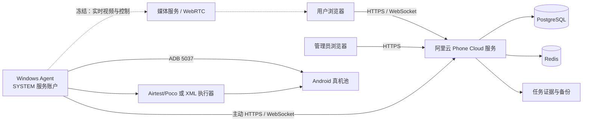
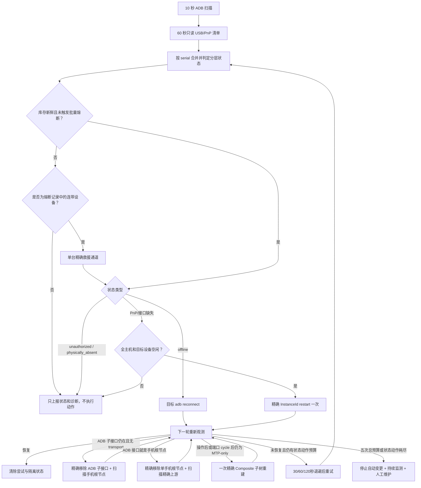
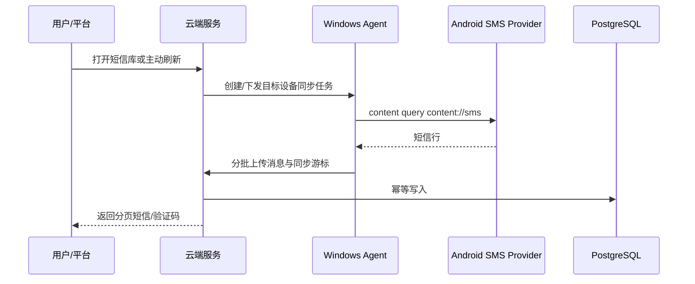

# Phone Cloud 项目开发主文档

- 文档状态：现行、必须维护
- 首次建立：2026-08-11
- 最后更新：2026-08-14
适用范围：云端服务、Web 前端、Windows Agent、Android 辅助组件、短信同步、小红书自动化、设备恢复和部署运维

> 本文是 Phone Cloud 项目的唯一事实来源（Single Source of Truth）。以后开始任何开发、排障或优化前，必须先阅读本文；完成重要变更后必须更新本文。专题文档用于补充细节，不能替代本文中的现状、决策和路线图。

---

## 1. 文档使用规则

### 1.1 信息分级

本文使用以下标签，避免把推断写成事实：

- **已验证事实**：有代码、数据库、日志或实际设备测试支持。
- **当前决策**：已经由项目负责人确认，后续开发必须遵守。
- **待验证假设**：存在迹象但尚无足够证据，不能直接据此修改生产环境。
- **历史信息**：曾经有效，但当前不再作为实现依据。

### 1.2 文档优先级

发生冲突时按以下顺序处理：

1. 当前生产运行证据与数据库事实。
2. 当前代码和实际部署配置。
3. 本文的现状、决策与不变量。
4. 专题设计、API、部署和上线文档。
5. 历史聊天记录、历史方案和归档审查。

发现本文与代码或生产事实不一致时，不得静默绕过；必须先记录差异，再更新本文。

### 1.3 方案连续性要求

提出新方案时必须回答：

1. 它解决本文中的哪个已知问题？
2. 它延续、替换还是否决了哪个既有决策？
3. 有什么新证据支持变化？
4. 如何本地验证、灰度、观测和回滚？

没有新证据时，不得因为换了一次对话就重新设计整个链路。

---

## 2. 项目目标与当前业务范围

Phone Cloud 是“云端平台 + Windows 设备管理器 + Android 真机”的设备业务平台。

当前核心能力：

- Windows Agent 通过 ADB 发现、维护和上报 Android 真机。
- 管理员完成设备命名、SIM、账号槽位和上架配置。
- 用户查询设备短信库并获取验证码。
- 用户提交二维码，小红书 App 在真机上完成扫码登录流程。
- 用户按需建立实时投屏和控制会话。
- 系统保存任务状态、操作轨迹、失败截图和元素树。

当前规模基线：

- 一台 Windows 主机可连接数十台 Android 设备。
- 历史全量短信核对覆盖 104 台可查询设备。
- 小红书自动化需要覆盖不同品牌、系统版本、单开和双开环境。
- 投屏生产会话上限已于 2026-08-13 从 7 台提升到 15 台；该变更只扩展会话/媒体槽位容量，不代表 15 路媒体性能已经完成压力验收。

不在当前主路线中的内容：

- iOS WDA/MJPEG 仍位于实验目录，不属于 Android 生产主链路。
- 旧 Android Agent APK 只作为兼容能力，不是设备管理主入口。
- Appium 不是当前小红书自动化主执行器。

---

## 3. 当前不可违反的决策

### D-001：实时投屏与控制链路冻结

状态：**当前决策，生效中**
确认日期：2026-08-11

当前实时控制总体可用，为避免重新引入历史卡死、断连、首帧和坐标问题，未经项目负责人明确解除冻结，不得修改：

- scrcpy server、视频源生命周期和控制通道。
- 分辨率、帧率、编码码率、编码模式、IDR 间隔。
- WHIP、WHEP、direct WebRTC、MediaMTX 和 ICE 逻辑。
- RTP 分包、pacing、实时队列和丢帧恢复策略。
- 浏览器播放器、首帧、断线重连、呈现看门狗。
- 点击、滑动、旋转和坐标映射。

允许但需回归验证的外围修改：

- 日志轮转和日志采样。
- 版本号与构建信息上报。
- 非投屏任务的合并和错峰。
- 明确排除正在投屏设备的 PnP、短信和自动化任务。

冻结不代表现有链路完美，只表示当前阶段不继续改变它。

### D-002：小红书自动化采用 Poco 主路径、XML 专用路径

状态：**当前决策，生效中**

- 默认设备使用 Airtest/Poco。
- 151 号等已确认 Poco 长时间卡住的设备使用 XML UIAutomator 专用路径。
- PocoService 与 UIAutomator 不得同时控制同一设备。
- 正常路径优先查找目标元素；只有目标缺失时才检查弹窗。
- 每次任务冷启动小红书，避免继承上次残留页面。
- 默认前提是手机内小红书账号已登录；账号掉线不属于当前自动化覆盖范围。
- 能使用元素定位的步骤必须使用元素定位，不以固定坐标作为主路径。

### D-003：设备恢复只允许精确到目标设备

状态：**当前决策，生效中**

- 不重启 USB Hub，不允许为了恢复一台手机导致同 Hub 其他手机掉线。
- 不在设备被投屏、扫码或执行用户主动短信刷新时恢复它。
- Windows Agent 的常驻 ADB daemon 由服务账户统一管理，不能临时以另一个 Windows 账户启动第二套 ADB 会话。
- 全局 ADB 重启和全局 PnP 扫描只能作为明确授权的维护动作，不能作为普通自动恢复手段。

### D-004：生产数据变更必须可恢复

状态：**当前决策，生效中**

- 不直接删除生产数据。
- 迁移前必须备份并生成影响预览。
- 数据清理、批量删除、不可逆迁移必须取得明确授权。
- 回填任务只能写入服务器确认缺失的数据，不能盲目全量重放。

### D-008：Windows DeviceInstall 是整机共享资源，自动恢复必须熔断

状态：**历史决策；并发度与重试次数已由 D-011 更新**
确认日期：2026-08-12

- `pnputil`/DrvInst/PnP 重挂载在同一 Windows 主机上只允许一个动作，不再按不同 Hub 并发。
- 自动恢复只允许精确目标动作；禁止自动 `remove-device`、上游 Hub 扫描、全局 PnP 扫描和全局 ADB 重启。
- 同时出现 4 台异常，或小设备池中至少 2 台且异常比例达到 8%，立即熔断；此前在线设备同时丢失 4 台也立即熔断。
- PnP 超时打开 3 分钟整机熔断；普通目标命令失败按 D-009 继续有界重试，不再一次失败就隔离。
- 全主机每小时最多 20 次自动恢复动作，所有动作仍严格串行。
- USB 物理清单失败或陈旧时禁止恢复，不能依据旧拓扑执行 PnP 动作。

### D-009：单设备自动恢复最多重试五次

状态：**历史决策；重试次数已由 D-011 更新**
确认日期：2026-08-12

- 同一恢复周期最多执行 5 次真实恢复动作；普通失败不能在第一次就放弃设备。
- 重试间隔依次约为 30 秒、60 秒、120 秒、240 秒，最终上限为 300 秒；通常在首次确认异常后的约 8 分钟内完成五次尝试。
- 每轮都重新读取当前状态：`offline` 使用目标 ADB reconnect，PnP/接口缺失使用当前精确 InstanceId restart。
- 没有精确 InstanceId 时不消耗五次动作额度，只每 60 秒重新读取物理清单。
- 手机真实拔出后清空本轮计数；重新插入视为新的恢复周期。
- 第五次仍未恢复才进入隔离；隔离仅停止破坏性动作，监测和自动上线判断继续运行。
- 批量掉线、库存失效、设备忙碌或 Windows DeviceInstall 未结束时，安全熔断仍优先于单设备重试。

### D-010：恢复机制必须提供逐设备可解释遥测

状态：**当前决策，已于 2026-08-12 发布**
确认日期：2026-08-12

- 管理界面不能只展示“在线/离线”或聚合异常数；必须展示设备卡在哪一层、当前动作、已用尝试次数、下一次复查时间和最后失败证据。
- Windows Agent 保存有界恢复事件记录，至少覆盖异常发现、状态变化、动作开始、动作完成、动作失败、安全暂缓、熔断开关、恢复验证和最终隔离。
- “动作完成”不等于“设备已恢复”；只有后续重新观测到 `adb_device` 才能标记为恢复成功。
- 隔离只停止自动破坏性动作，管理页仍持续显示设备和后续状态变化。
- 第一版管理控制台保持只读，不提供手工强制 PnP/Hub/全局 ADB 操作，避免可视化页面绕过 D-003 和 D-008 的安全边界。

### D-011：精确恢复采用最多八路并发和八次有界重试

状态：**历史决策；单设备动作预算已由 D-012 更新**
确认日期：2026-08-12

- 经用户明确接受同一 Windows 共享 USB/PnP 栈可能影响其他设备的风险，精确恢复从整机串行调整为每批最多 8 台并发；仍禁止 Hub reset、全局 PnP 扫描、自动全局 ADB 重建和 `remove-device`。
- 连续 2 轮只读清单确认物理存在但 ADB 异常后进入首批恢复；扫描周期为 30 秒，因此首批目标约 1 分钟内开始。
- 同一设备最多执行 8 次真实动作，退避为 30、60、120 秒并封顶 120 秒；第 8 次仍失败才停止破坏性动作并进入隔离，监测与自动上线判断继续。
- 投屏中或前台自动化任务占用的目标设备从恢复候选中排除；其他设备被占用不再阻塞本机其余精确目标。
- 每批动作结束等待 5 秒重新采集 ADB；若批外原在线设备消失，立即打开突发丢失熔断，停止下一批。
- 生产首批 8 台在约 0.8 秒内全部发起、5 秒后完成验证，ADB 在线数前后均为 103，`collateralLosses=[]`；第二批 4 台结果相同。该证据只证明并发调度和批外保护正常，不代表异常手机已经恢复。

### D-012：按故障层级执行有界动作，不以八次重复命令充数

状态：**历史决策；精确重建阶梯已由 D-014 更新**
确认日期：2026-08-12

- 先识别真实 ADB/WinUSB 子接口；通用 WinUSB ADB 签名也必须进入 ADB 子接口路径，不能误判为 MTP-only。
- `adb_offline` 最多 3 次目标 reconnect，必要时再执行 2 次精确 ADB 子接口 restart；ADB 子接口存在但 transport 缺失时最多执行 5 次精确子接口 restart。
- `usb_root_pnp_error` 最多 2 次精确根节点 restart、2 次精确下游端口 cycle；健康根节点但只暴露 MTP/File-CD 时不再 restart 根节点，只允许最多 3 次精确端口 cycle。
- 单设备总动作预算回到 5 次，30/60/120 秒退避并封顶 120 秒；命令执行失败不算“动作已完成”，保留该安全动作的后续重试资格。
- 每次动作后必须重新观察 ADB；重新出现后持续至少 90 秒且至少 3 次扫描，才从恢复状态删除。
- 精确端口/子接口映射暂时不可用时每 60 秒只读复查，不消耗动作次数；旧生产配置中的 1800 秒等待不再生效。
- 自动动作中禁止 `remove-device`、根节点 disable/enable、Hub reset、全局 PnP 扫描和全局 ADB restart；终态遥测不能占住可运行设备的调度位置。
- 精确 ADB 子接口 restart 可最多 8 台并发；下游端口 cycle 每批最多 1 台，批外 ADB 丢失立即熔断。

### D-013：投屏生产会话上限提升为十五路

状态：**当前决策，已于 2026-08-13 发布**
确认日期：2026-08-13

- 阿里云服务端 `SCREEN_MAX_CONCURRENT_SESSIONS` 与 `SCREEN_MEDIA_SLOT_COUNT` 同步从 7 调整为 15，Windows Agent 的 `screenMaxConcurrentSessions` 同步从 7 调整为 15，防止任一侧继续形成较小上限。
- 本次只调整准入容量和固定媒体槽位数；不修改 scrcpy、分辨率、40fps、1Mbps、编码器、WHIP/WebRTC、RTP、队列、播放器和控制逻辑，D-001 的媒体链路冻结继续生效。
- 15 是会话准入上限，不等同于已经证明 15 路在所有画面动态程度下都满足稳定帧率；后续只读观察 Windows、云端和单路播放指标，出现问题先收集证据，不自动改媒体参数。
- 回滚方式：将云端两个环境变量和 Windows Agent 配置同时恢复为 7，并分别最小重启 `phone-cloud` 服务和 `PhoneCloud Windows Agent` 计划任务。

### D-014：把生产实测有效的精确重建纳入自动恢复阶梯

状态：**当前决策，已于 2026-08-13 发布**
确认日期：2026-08-13

- ADB/WinUSB 子接口存在但 transport 缺失时，先执行 1 次精确子接口 restart；仍未恢复则最多 2 次精确 remove 该 ADB 子接口，并只扫描它所属的手机 USB 根节点。
- 只有同一恢复周期已经观察并操作过 ADB 子接口、随后退化为 MTP/Composite-only 时，才允许 1 次精确 remove 该手机 Composite 根节点子树，并只扫描它的精确上游节点；长期纯 MTP 设备不能直接进入此动作。
- 普通精确子接口动作仍可每批最多 8 台；Composite 根节点重建属于高级动作，每批最多 1 台。任何动作前重新读取 ADB，投屏/前台任务占用目标继续排除，动作后检查批外在线集合，出现连带掉线立即熔断。
- 继续禁止 Hub reset、Hub remove、全局 PnP scan、自动全局 ADB restart 和无法证明目标/父子关系的 `remove-device`；D-014 只放开有精确目标、精确扫描父节点和有界次数的单手机重建。
- 策略状态升级为 v3：只折叠 v2 中同一 ADB 子接口的重复 restart 历史并解除由此造成的旧隔离，端口循环、人工条件和其他恢复历史全部保留，不进行全局状态清空。
- 人工生产验证：109、163 通过“移除精确 ADB 子接口 + 扫描手机根节点”恢复，111 在子接口消失后通过“移除精确手机 Composite 子树 + 扫描精确上游”恢复；三次均未重置 Hub。
- 自动生产验证：99（`10AEBX38XB00719`）和 112（`10AF541TGN00BTR`）在同一批次执行精确 ADB 子接口重建，ADB `onlineBefore=116`、`onlineAfter=118`、`collateralLosses=[]`；两台随后均通过 90 秒、5 次扫描稳定确认。此前 116→114 的变化已确认来自人工插拔，不计为恢复动作副作用。

### D-017：小红书账号以 ID 为稳定身份，名称只用于展示

状态：**本地候选，待生产数据迁移与发布**
确认日期：2026-08-13

- 每个已配置的小红书槽位必须同时保存 `xhsId` 和 `accountName`；`xhsId` 是稳定身份，`accountName` 可以随业务改名。
- 同一个 `xhsId` 不允许绑定到同一手机的两个槽位，也不允许跨手机重复绑定；改名不能绕过唯一性校验。
- 扫码任务创建时同时快照账号 ID、名称、槽位和设备，保证历史任务在账号改名后仍可准确追溯。
- 生产发布前必须先按最新账号表生成迁移预览，要求所有现网已配置槽位无遗漏、无歧义、无重复 ID；迁移与代码发布必须共用可回滚维护窗口。

### D-018：熔断保留单台救援通道，并补齐根节点型 ADB 与纯 MTP 恢复

状态：**当前决策，本地实现中，未发布**
确认日期：2026-08-14

- D-014 的精确目标、忙碌设备排除、批外在线集合校验以及 Hub/global 禁令继续生效；本决策只补齐生产实测暴露的状态机缺口，不恢复宽泛或全局操作。
- `mass_outage`/`burst_outage` 熔断期间，普通恢复队列继续停止；但若熔断记录的批外连带掉线设备本身成为可恢复异常，允许其中一台进入“连带设备救援通道”。该通道仍要求库存新鲜、目标空闲、精确拓扑、DeviceInstall 空闲和小时预算可用，并在动作后重新比较全量 ADB 在线集合。
- ADB/WinUSB 接口与手机 USB 根节点是同一个 InstanceId 时，先精确 restart 一次；仍无 transport 且可证明精确上游节点时，允许一次精确 remove 该单手机根节点并扫描精确上游。不能再因为“接口等于根节点、无法移除子接口”直接进入永久人工隔离。
- 长期只暴露 MTP/Composite、没有 ADB 子接口的设备，精确端口 cycle 一次仍无效后，若手机根节点、精确上游和端口映射均完整，允许一次精确 Composite 子树重建；仍未暴露 ADB 才进入 `usb_gadget_adb_not_exposed`。该变化替代 D-014 中“长期纯 MTP 设备禁止直接重建 Composite”的限制。
- 普通 ADB 子接口动作仍可每批最多 8 台；根节点、Composite 和端口 cycle 属于高级动作，同一精确上游每批最多 1 台，不同上游可在总并发 8 台内执行。未知上游统一进入一个保守通道。
- 恢复批次必须区分“选入批次、实际动作、延期、跳过、失败”。`attempted` 只统计已经开始执行命令的目标；批外连带掉线集合只排除真实执行过动作的 serial，不能再把选中但被熔断拦截的设备计为“已尝试”。
- 隔离不是停止观察。设备以任何方式重新进入 `adb_device` 后继续执行 90 秒/至少 3 次扫描的稳定验证，成功后清除隔离、尝试次数和动作历史。

### D-019：全量设备短信库采用 Provider 主源与默认短信应用通知补全

状态：**当前决策，本地实现与回归已完成，未发布**
确认日期：2026-08-14

- 所有在线 Android 设备使用同一套双源框架，不按 OPPO、vivo 或具体型号写死分支：标准 `content://sms` 仍是可恢复历史、卡槽和稳定 `_id` 的主数据源；默认短信应用的活动通知与通知历史只补齐 Provider 没有暴露的新短信。
- Windows Agent 先从 `dumpsys role` 的 `android.app.role.SMS` holder 发现默认短信包，旧系统回退到 `settings get secure sms_default_application`。152 实机已证明 ColorOS 13 的 `cmd role` 没有查询 holder 子命令，不能依赖不存在的 `cmd role holders`。通知读取必须使用包级过滤 `dumpsys notification --noredact --package <package>`，禁止无差别保存或上传系统全部通知。
- 通知正文只在 Agent 进程内解析 `android.messages`、`android.bigText`、`android.text` 和 `android.title`；原始通知 dump 不落盘、不写日志、不上传。云端只接收结构化短信候选，并继续遵守短信正文现有访问权限和审计边界。
- 全量空闲设备采用错峰低频采集，目标默认 30 秒、全局并发 2；用户主动刷新时立即执行一次 Provider 全量对账和通知补全。验证码实时等待可在后续以设备级 1 秒临时加速实现，不能让百台设备永久 1 秒轮询，也不能占用前台自动化或投屏任务。
- Provider 与通知候选必须做跨源语义去重：设备、标准化发件人、标准化正文及两分钟时间窗一致视为同一短信；Provider 后到时补齐 `_id`、卡槽和时间等权威字段，但保持既有平台消息 ID 稳定。通知中没有可信卡槽时保持未知，禁止猜测 SIM1/SIM2。
- 无默认短信包、通知无正文、ROM 不支持包级过滤或 ADB 短暂失败时，只把通知补全标记为不可用/退化，不能让 Provider 同步失败；单设备能力和耗时必须可观测。
- 第一阶段功能开关默认关闭，只做本地测试与 152 单机隔离验证；灰度时必须同时配置设备序列号白名单，只允许 152 进入通知补全，空白名单仅用于后续明确批准的全量发布。基线回退点为 Git 提交 `c776694`，本决策实现单独提交，禁止夹带投屏、控制、USB/PnP 或共享 ADB 重启变更。

---

## 4. 系统架构



### 4.1 云端服务

主要目录：

- `server/index.mjs`：HTTP API、鉴权、任务、设备状态和兼容持久化入口。
- `server/postgres-repositories.mjs`：结构化 PostgreSQL 写入与 overlay 加载。
- `server/screen-relay.mjs`：实时控制信令和浏览器/Agent 会话转发，当前冻结。
- `server/realtime-metrics.mjs`：实时会话指标，当前只允许外围观测修改。
- `public/`：用户端和管理端静态前端。
- `screen-client/`：投屏播放和控制客户端，当前冻结。

云端职责：

- 用户、管理员和机器身份鉴权。
- 设备目录、上架状态和设备锁。
- Windows 任务与小红书任务状态机。
- 短信库、验证码订单和匹配。
- 证据存储、审计、诊断和运维接口。
- 投屏会话的授权与信令；不在服务端解码手机画面。

### 4.2 Windows Agent

主要目录：

- `windows-agent/src/index.mjs`：设备扫描、心跳、任务领取、短信同步、自动化编排和恢复协调。
- `windows-agent/src/config.mjs`：配置解析、默认值和设备 profile。
- `windows-agent/src/device-actor.mjs`：设备级任务串行化基础。
- `windows-agent/src/adb-priority-queue.mjs`：ADB 优先级执行基础。
- `windows-agent/src/pnp-missing-device-recovery.mjs`：物理存在但 ADB 缺失的恢复计划。
- `windows-agent/scripts/xhs_airtest_poco.py`：Poco 主执行器。
- `windows-agent/scripts/xhs_xml_uiautomator.py`：XML UIAutomator 专用执行器。
- `windows-agent/src/screen-stream.mjs`、`windows-agent/whip-publisher/`：投屏链路，当前冻结。

Windows Agent 职责：

- 使用固定 ADB 二进制和单一 ADB daemon 管理设备。
- 扫描设备、读取静态信息、电池、SIM 和自动化能力。
- 领取属于本 Agent 的任务并串行操作目标设备。
- 读取系统短信 Provider 并批量同步。
- 运行 Poco 或 XML 自动化并回传证据。
- 在设备空闲时执行安全的目标设备 PnP 恢复。

### 4.3 Android 侧

Android 侧包含：

- 系统 ADB USB 接口。
- `content://sms` 系统短信 Provider。
- 小红书主应用和可能存在的厂商双开入口。
- PocoService，仅在 Poco 路径使用。
- scrcpy server 与唤醒辅助组件，属于冻结链路。
- `android-agent/SmsRelay` 兼容组件，不作为所有短信正确性的唯一来源。

---

## 5. 部署拓扑与配置来源

### 5.1 生产角色

- 阿里云 ECS：Nginx、Phone Cloud Node 服务、PostgreSQL、Redis、备份任务。
- Windows 设备主机：Windows Agent、ADB、Python、Airtest/Poco、XML 执行器和 Android 工具。
- Android 设备：通过 USB/Hub/PCIe USB 控制器连接 Windows。

真实 IP、密码、Token、Cookie 和私钥不得写入本文或提交 Git。它们应保存在受控密码管理器和生产环境变量中。

### 5.2 配置优先级

云端：

1. 生产 `.env`。
2. `docker-compose.yml` 显式环境变量。
3. `.env.example` 默认示例。

Windows Agent：

1. 生产 `windows-agent/config.json`。
2. 代码中的配置默认值。
3. `windows-agent/config.example.json` 示例。

注意：示例配置不代表当前生产实际值。排障前必须读取运行时配置，但输出时需要脱敏。

### 5.3 版本基线缺口

**已验证事实**：当前包版本和 Agent 心跳长期使用固定 `0.1.0`，无法识别实际部署代码。

目标版本标识必须包含：

- `releaseId`
- Git commit SHA
- 构建时间
- 配置哈希（不包含密钥）
- 数据库 schema 版本
- 自动化 workflow 版本
- Windows Agent、Poco/XML 执行器版本
- 投屏组件版本（只记录，不在冻结期修改）

---

## 6. 共享资源与任务优先级

所有 Windows 侧能力共享以下有限资源：

- ADB server 5037。
- USB Host Controller、Hub 和物理链路。
- 单台手机的 shell、文件传输、系统 Provider 和 UI 焦点。
- Windows CPU、内存、磁盘和进程句柄。

非投屏任务的目标优先级：

```text
用户主动短信刷新
> 正在执行的小红书扫码
> 后台短信增量同步
> 自动化预热
> 空闲设备 PnP 恢复
```

投屏设备继续由现有逻辑排除其他破坏性任务；冻结期内不重构投屏调度。

核心不变量：

- 同一设备同一时刻只允许一个会改变 UI 或连接状态的任务。
- 后台任务必须可合并，同一设备只保留一个待执行后台同步。
- 用户主动任务不能被后台刷新占用。
- 全局 ADB/PnP 动作不能在任一真实用户任务期间自动执行。

---

## 7. 设备发现、上线与恢复链路

### 7.1 标准状态模型

设备不能只表示为在线/离线。目标状态机：

```text
inventory_unavailable
physically_absent
usb_present_mtp_only
usb_composite_no_adb_interface
usb_root_pnp_error
adb_interface_pnp_error
adb_interface_ready_transport_missing
adb_unauthorized
adb_offline
adb_device
```

每个状态必须保存：

- 首次进入时间和最后更新时间。
- Windows PnP InstanceId、ContainerId、LocationPath。
- 最近一次已知 ADB serial 和平台设备 ID。
- PnP problem code、ADB state 和最后恢复动作。
- 下一次允许恢复时间、尝试次数和退避原因。

当前实现把平台上报视为状态的传播结果，不再把 `platform_reported` 当作 USB/ADB 层状态。状态判定顺序为：ADB transport 状态优先，其次是 Windows ADB 子接口、USB 根节点、MTP/File-CD，最后才是物理缺失。ADB serial 与平台设备匹配必须忽略大小写。

### 7.2 已知故障模式

- 手机显示“文件传输”，但 Windows 只枚举 MTP/File-CD，没有 ADB `MI_xx` 子接口。
- Windows 已出现 Android ADB 接口，但处于 PnP 异常或即将移除状态，`adb devices` 不显示。
- 设备先是 `unauthorized`，用户授权后因另一账户的 ADB daemon 被终止而消失。
- USB Hub 断电重上后，多台手机保留充电/MTP但 ADB 子接口没有恢复。
- 手机重启后暂时恢复，下一次插拔再次失效。

### 7.3 当前恢复原则

- 优先读取证据，不把 Hub、数据线、手机或 Windows 单独武断定为根因。
- ADB `offline` 只执行目标 transport 的 `adb -s <serial> reconnect`，不动 PnP。
- ADB `unauthorized` 只提示手机确认 SYSTEM 账户对应的 RSA 授权，不执行自动 PnP。
- ADB 子接口已存在时先重启一次该精确子接口；仍无 transport 时按 D-014 移除该子接口并扫描精确手机根节点。
- ADB/WinUSB 接口本身就是手机 USB 根节点时，按 D-018 在一次精确 restart 后升级为“移除该单手机根节点 + 扫描精确上游”，不能把无法执行子接口重建误判为只能人工维护。
- 纯 MTP/Composite 设备按 D-018 先执行一次精确端口 cycle；仍无 ADB 且精确根节点、上游和端口映射完整时，允许一次单手机 Composite 子树重建。
- 不重启 Hub。
- 只允许 D-014 定义的精确单手机 `remove-device` 和精确父节点扫描；禁止 Hub/控制器 remove、宽泛父节点扫描、全局 PnP 扫描或全局 ADB restart。
- 投屏或前台自动化占用的目标手机不进入恢复动作；其他手机被占用不再阻塞本机剩余精确目标。后台短信同步在存在恢复候选时让路。
- 自动动作按每批最多 8 台并发；单设备按 D-012 使用最多 5 次的状态化动作预算。每批后验证批外 ADB 在线集合，发现连带掉线立即熔断。
- 熔断时普通队列停止，但允许一台“熔断记录中的未恢复连带设备”走精确救援通道，避免连带设备必须先自行上线、熔断才允许恢复的循环等待。
- 平台要展示“物理存在但 ADB 未通”，不能把它误报成简单离线。

### 7.4 2026-08-12 生产证据与根因

**已验证事实**：

- 最近 120,005 行 Agent 日志中，目标恢复成功动作 197 次、失败 17 次；其中 63 次 restart、84 次 remove/re-enumerate，另有 19 次错误地针对了 `unauthorized` 设备。
- 101 个物理异常候选样本的中位数为 4 台、P95 为 16 台、最大 17 台；52 个样本至少 4 台，说明异常经常是批量事件而不是独立单机事件。
- 一次精确手机端口动作之后，同一 `VID_1A40` 设备组有 17 台从 ADB 同时消失。日志未发现 Hub reset 命令，但后续串行 `restart-device` 和 `remove + parent scan` 放大了 Windows DeviceInstall/DrvInst 积压，在线数从 109 降到 95，随后只恢复到约 99。
- `unauthorized`/`offline` 过去因“只有 `device` 才算在线”而进入缺失恢复队列，导致错误地修改 PnP。
- 原定“同 Hub 串行、跨 Hub 并发”仍会竞争 Windows 全局 DeviceInstall；`pnputil` 超时后底层 DrvInst 可能继续运行，旧 interval guard 又会释放，下一轮继续叠加动作。
- 服务端 serial 匹配曾区分大小写，可能把同一设备的大小写形式当成两条记录。

结论：主要缺陷不是恢复速度太慢，而是缺少准确分层、共享资源互斥、批量故障熔断和失败隔离。盲目增加并发会把单机问题升级为整组掉线。

### 7.5 本地实现的完整闭环



实现要点：

- `device-recovery-state.mjs` 统一状态判定；物理在线但 ADB 未通的设备也随心跳上报到平台。
- `pnp-recovery-safety.mjs` 负责批量故障、突发丢失、小时预算、熔断和稳定关闭。
- 熔断健康快照显式给出 `rescueSerials` 和 `rescueCanMutate`；只有未恢复的批外连带设备可绕过熔断进入单台救援，其他异常目标继续被阻止。
- `pnp-screen-coordinator.mjs` 提供 8 个精确目标通道，并对同 serial、投屏/前台自动化目标和全局维护动作互斥；不修改 scrcpy/WebRTC/控制代码。
- `guarded-task-runner.mjs` 在逻辑超时后继续持有 single-flight，直到真实底层任务结束，防止定时扫描重入。
- PnP 恢复状态持久化到 `data/pnp-recovery-state.json`，Agent 重启不会清空熔断、小时预算和设备隔离。
- Agent 健康信息上报物理数、ADB 在线数、各异常数、熔断原因、库存新鲜度、小时动作数和隔离数；设备 API 暴露 `connectionState`。
- 执行 PnP 前先清理已经离线设备的闲置 Poco/ADB worker，再确认 Windows 中没有仍在运行的 `pnputil.exe`/`drvinst.exe`。

自动动作决策表：

| 状态 | 自动动作 | 上限/结果 |
|---|---|---|
| `adb_device` | 无 | 正常上报 |
| `adb_unauthorized` | 无 | 提示手机确认 RSA 授权 |
| `adb_offline` | 目标 reconnect；仍失败且有 ADB 子接口时按子接口阶梯恢复 | reconnect 最多 3 次，子接口 restart 1 次、精确重建 1 次，总预算最多 5 次 |
| `adb_interface_ready_transport_missing` | 精确 ADB/WinUSB 子接口 restart 1 次；独立子接口仍失败则 remove 子接口并扫描手机根节点；接口即根节点时 remove 单手机根节点并扫描精确上游 | 子接口精确重建最多 2 次；根节点型 ADB 重建最多 1 次；总预算最多 5 次 |
| `adb_interface_pnp_error` | 精确 ADB/WinUSB 子接口 restart 1 次；独立子接口仍失败则 remove 子接口并扫描手机根节点；接口即根节点时 remove 单手机根节点并扫描精确上游 | 子接口精确重建最多 2 次；根节点型 ADB 重建最多 1 次；总预算最多 5 次 |
| `usb_root_pnp_error` | 精确手机 USB 根节点 restart，再做精确端口 cycle | 最多 2 + 2 次，总预算最多 5 次 |
| `usb_present_mtp_only` / `usb_composite_no_adb_interface` | 精确下游端口 cycle 1 次；仍无 ADB 且根节点、上游、端口映射完整时执行一次精确 Composite 子树重建 | 同一上游每批最多 1 个高级动作；无精确映射不消耗次数；重建后仍无 ADB 才隔离 |
| `physically_absent` / `inventory_unavailable` | 无 | 等待插入或恢复只读探测 |

当前仍需持续验证的边界：Windows 能否在五次状态化动作预算内稳定重新暴露 OEM 的 ADB 子接口。软件机制可以保证有界重试、不盲目升级动作、批外连带掉线熔断和可诊断，不能对损坏的数据线、供电、Hub/控制器、手机未暴露 ADB 功能或 OEM 固件问题承诺 100% 自动恢复。

### 7.6 管理端恢复控制台

Windows 管理页增加只读的“USB · ADB 恢复控制台”，信息分为四层：

1. 主机态势：物理 USB 数、ADB 在线数、恢复队列、需人工数、小时动作预算和主机熔断状态。
2. 逐设备队列：数字名称、ADB serial、当前链路断点、尝试 `n/5`、精确动作类型、下一次复查倒计时和 PnP/命令失败证据。
3. 恢复飞行记录：按时间展示状态变化、自动动作、安全暂缓、熔断、验证恢复和隔离。
4. 状态解释：明确区分自动处理、安全等待和必须人工处理，避免把 `unauthorized`、物理拔出和自动恢复失败混为同一种离线。

遥测由 Windows Agent 随心跳上报：`deviceRecovery.queue` 最多 200 台，`deviceRecovery.recentEvents` 最多 80 条；Agent 本地 `pnp-recovery-state.json` 保存最近 160 条事件和设备状态，因此 Agent 重启后仍可解释上一次恢复过程。云端只接收经过长度、类型和数量约束的字段。事件记录采用去重窗口，设备状态不变化时不重复刷屏。

管理页支持 `?page=windows` 深链接，并每 30 秒刷新服务端状态；下一次动作倒计时由浏览器每秒更新，不额外请求服务器。此控制台未修改任何 scrcpy、WebRTC、投屏或控制链路。

### 7.7 2026-08-12 生产恢复事故复盘

**已验证事实**：

- 恢复控制台第一版上线后，Windows 的物理清单命令持续超过 30 秒，Agent 将大量历史设备标记为 `inventory_unavailable`；根因是清单实现对大量 PnP 节点逐项查询父节点属性，不能承受当前百台规模。
- 一次人工加速脚本复用了先前生成的 18 个候选，没有在每个动作前再次检查 serial 是否已经恢复为 `device`。这些设备当时多数已经在线，脚本仍连续执行精确 PnP restart；ADB 日志在同一时间记录对应 transport 的 `read failed` / `connection terminated`，在线数随后下降。
- 受控重建 SYSTEM ADB server 后，5037 的进程身份和密钥目录均正确，但稳定结果仍只有 67 台 `device`、1 台 `offline`、1 台 `unauthorized`；物理清单约 106 至 108 台，证明剩余缺口不在云端 TTL 或 Agent 上报层。
- 对一台当前确实缺失的设备依次验证精确 ADB 子接口 restart、精确手机 USB 根节点 restart、根节点 disable/enable，Windows 均返回成功，但 ADB 仍为 missing。继续重复同类 PnP 动作不能恢复当前批次，只会增加 USB 抖动风险。
- 旧版 PowerShell 清单把多段条件用 `; ` 拼接成 `}; elseif`，PowerShell 会把 `elseif` 当成命令，导致 ADB 子接口分支根本没有执行；通用 WinUSB ADB 设备因此长期被误报为 MTP-only。
- 一次自动根节点 disable/enable 后，批外在线设备 `10AF2G1GY7009QL` 和 `ORNB65LBA6IRXCIF` 短时掉出 ADB；熔断及时停止了后续动作，两台随后恢复。该生产证据确认根节点 disable/enable 不能进入自动策略。
- D-012 最终生产验证中，`4TBBB25730100808` 经一次精确 WinUSB ADB 子接口 restart 恢复，并通过 90 秒、4 次扫描的稳定窗口；`10HG1RF4NB000X7`、`AGQV023324018902`、`VEG0220A29011444` 跑完各自状态化预算后仍未出现 ADB，所有安全动作的 `collateralLosses=[]`，ADB 在线基线保持 107。
- D-014 生产验证中，人工先用精确子接口重建恢复 109、163，用精确手机 Composite 子树重建恢复 111；随后自动策略对 99、112 执行 `recreate_adb_interface`，5 秒验证窗口内 ADB 从 116 回到 118，`collateralLosses=[]`，两台又通过 90 秒、5 次扫描稳定确认。这证明重复 restart 应升级为精确重建，而不是继续消耗同一动作预算。
- `10AF4L05T900BDB` 在只读物理清单中反复出现、持续消失超过 120 秒后又出现，属于 USB 根节点本身不稳定；恢复器会在真实重新插入后开启新周期，但不会把物理消失伪装成 Windows 命令恢复成功。
- `20260812-recovery-console-v1-pnp-batch-hotfix` 已把物理清单改为批量 PnP 属性查询。上线后的首轮清单成功返回约 107 台物理设备、67 台 ADB device 和 40 个异常候选，不再把整批设备显示为 `inventory_unavailable`。

**事故结论和约束**：

- 任何人工或自动恢复波次都必须在执行动作的最后一刻重新读取 `adb devices`；已经恢复为 `device` 的 serial 必须跳过，禁止执行基于旧快照的 PnP 动作。
- 大规模异常时熔断本身是必要保护，不能为了让进度条移动而继续逐台重启。界面应把持续批量异常解释为“需要主机级维护”，而不是伪装成仍在推进的普通单机恢复。
- 当前批次已经超出普通目标 PnP 恢复能力；下一步维护选择是重启 Windows USB 主机栈，或逐台物理重插/重启手机。整机重启仍必须取得明确授权并确认正在运行的投屏、扫码和自动化任务会被中断。

### 7.8 2026-08-12 实测恢复方法矩阵

本节汇总同一台生产 Windows 上已经实际验证过的恢复动作。结论只按“故障状态 + 动作 + 持续验证”成立，不能把某台设备的一次成功泛化为所有 ADB 缺失状态。

| 故障状态 | 已验证动作 | 实测结果 | 自动化定位 |
|---|---|---|---|
| `adb_offline`，transport 仍在 | `adb -s <serial> reconnect` 后重新读取状态 | 只对真正的 `offline` 有意义；物理组合中已经没有 ADB 接口时无效 | 普通自动恢复一级动作 |
| Windows 已有明确 ADB 子接口，但 transport 缺失 | 精确重启该 ADB 子接口，再扫描手机 USB 根节点子树 | 对明确 ADB 子接口可恢复；必须验证重新出现 `adb_device` | 普通自动恢复一级动作 |
| Windows 已有通用 WinUSB 子接口，尚未显示为 `ADB Interface` | 识别 `Subclass_42&Prot_01`、`Class_ff&SubClass_42&Prot_01` 或 `USB\MS_COMP_WINUSB`，精确重启该 WinUSB 子接口，再扫描手机根节点 | `4TBBB25730100808` 在约 10 秒内从 ADB 缺失恢复为 `device`；子接口随后规范化为 `MI_02 / ADB Interface`，连续 4 分钟、8 次采样稳定。原 Agent 因只识别 AndroidUsbDeviceClass/名称含 ADB 而把它误判成 MTP-only | 必须补入普通自动恢复；优先级高于重启 USB 根节点 |
| ADB/WinUSB 节点存在，但被 `adb.exe` 持有导致移除失败 | 停 Agent，停止 SYSTEM ADB daemon，确认旧句柄退出，精确 remove 目标节点，扫描精确父节点，重新以 SYSTEM 启动 ADB 和 Agent | `NNC6HI65HUAQWKNF` 经该顺序恢复为 `device`；Kernel-PnP Event 225 曾明确记录 `adb.exe` 阻止移除 | 主机维护动作；多个目标合并成一次维护波次，禁止逐台反复停全局 ADB |
| ADB 子接口存在且状态正常，但 transport 缺失 | 精确 remove ADB 子接口并扫描手机根节点 | 人工恢复 109、163；自动恢复 99、112，自动批次 ADB 从 116 回到 118 且 `collateralLosses=[]` | D-014 普通自动恢复二级动作；必须经过稳定窗口，不能把瞬时上线记为最终成功 |
| ADB 子接口操作后退化为 MTP/Composite-only，且可证明精确手机根节点和上游 | 精确 remove 手机 Composite 根节点 `/subtree`，扫描精确上游节点 | 人工恢复 111，未重置 Hub、未发现批外掉线 | D-014/D-018 有条件高级动作；同一精确上游每批最多 1 台 |
| 手机 USB 根节点存在，但只暴露 MTP/存储，完全没有 ADB/WinUSB/HDB 子接口 | 先对目标 Hub 下游端口执行一次 `IOCTL_USB_HUB_CYCLE_PORT`；仍无 ADB 时精确重建单手机 Composite 子树并扫描上游 | 多轮端口 cycle 本身安全但常不恢复；142 在端口 cycle 无效后通过 Composite 重建恢复，ADB 118→119，`lost=[]` | D-018：端口 cycle 1 次后允许 Composite 重建 1 次；仍失败才升级到手机/OEM 侧 |
| 多台接口均存在但 SYSTEM ADB transport 大面积缺失或句柄陈旧 | 停 Agent，终止单一 SYSTEM ADB daemon，以计划任务身份重建 5037，再启动 Agent并等待 60–120 秒 | 历史上可恢复一批 transport；短时间内不一定全部返回 | 明确授权的整机维护动作，不是普通自动恢复 |
| 手机只暴露 MTP，Windows 从未枚举 ADB 函数 | 重启手机、切换 USB 调试/默认 USB 配置，或通过 OEM/HDB/预装高权限组件重建 `mtp,adb` USB gadget 组合 | 历史上手机重启曾恢复 120、176 等设备；能否由 Windows 侧无感触发取决于 OEM 是否仍暴露厂商管理接口 | 手机/OEM 侧恢复；标准 APK 无权直接重启 `adbd` 或修改 `sys.usb.config` |
| `unauthorized` | 在手机上确认 SYSTEM ADB 对应 RSA 授权 | 授权后可上线；用 Administrator 启动另一套 ADB 会因密钥/daemon 身份不同造成设备再次消失 | 人工前置条件，不执行 PnP |
| 平台离线但 `adb devices` 已为 `device` | 重新触发 Agent 扫描、心跳和平台上报 | 只修复上报层，不动 USB/PnP | 平台同步动作 |

已验证无效或有风险的做法：

- 对同一个手机 USB 根节点连续执行 8 次相同 `restart-device`，不能解决“手机未暴露 ADB USB 函数”，只会制造 DeviceInstall/DrvInst 压力。
- 对没有 ADB 子接口的设备反复执行 `adb reconnect`，不会创建 Windows 根本没有枚举到的接口。
- 以 Administrator 临时启动 ADB、而生产 Agent 继续以 SYSTEM 运行，会产生两套 daemon/RSA 身份；手机授权后设备可能立即从生产 ADB 列表消失。
- `remove-device` 返回需要重启 Windows 时必须停止升级，不得把命令返回成功或短时上线当成稳定恢复。
- 精确下游端口 cycle 不等于 Hub reset；前者已验证不会连带中断同 Hub ADB，但它仍不能替手机决定是否暴露 `adb` gadget function。

### 7.9 2026-08-13 恢复时延优化候选（本地完成，未发布）

183（`AGQV023324018902`）的生产时间轴表明：从首次端口动作到恢复为 `unauthorized` 约 12 分钟，实际 PnP 命令只占数秒；其余时间主要来自 Windows `drvinst.exe` 的真实安装过程、按设备总尝试数继承的 60/120 秒退避，以及安装器退出后等待下一轮 30 秒 Agent 扫描和 60 秒物理清单。

本地候选实现：

- 退避改为按“当前动作类型的已完成次数”计算；从端口 cycle 升级到 ADB 子接口 restart/recreate 时，新层级从 30 秒开始，不继承旧层级的 120 秒等待。同一动作的有界 30/60/120 秒退避和单设备五次总预算仍保留。
- PnP 动作完成 10 秒后安排一次只读验证；若下一动作尚未到期，再按持久化 `nextRetryAt` 精确唤醒，不等待固定 30 秒扫描碰巧到达。
- 检测到 `pnputil.exe`/`drvinst.exe` 时，每 5 秒只读取一次进程列表，不执行百台 USB 清单、不叠加 PnP；安装器一退出，立即触发一次强制只读拓扑刷新和受保护扫描。
- 多个设备的唤醒请求合并为整机最早一个定时器；如果已有扫描在运行，1 秒后再试。投屏/任务目标排除、精确目标校验、DeviceInstall single-flight、批外掉线熔断、Hub/global 禁令均未改变。

该候选只能消除软件空等，不能缩短 Windows/OEM 驱动本身正在运行的安装时间，也不能绕过手机 RSA 授权。当前只存在本地工作区，未复制到 Windows、未重启 Agent、未改变线上恢复行为；需要后续选择空闲窗口灰度。

以下是 2026-08-13 时的候选阶梯，已被 D-018 的 2026-08-14 生产证据更新；当前实现以 7.10 和 D-018 为准：

```text
只读确认两轮
→ offline：目标 adb reconnect
→ 明确 ADB/通用 WinUSB 子接口：精确子接口 restart
→ 子接口被 adb.exe 持有：合并进入一次 SYSTEM ADB 维护波次
→ 只有 MTP：目标端口 cycle 最多一次
→ 仍无 ADB 子接口：标记 usb_gadget_adb_not_exposed，进入 OEM/手机侧组合恢复
→ 每一步均重新采集；稳定观察通过后才记恢复成功
```

因此，D-011 的“最多八次”是历史总动作预算，不应再解释为“同一命令重复八次”。当前单设备采用 D-012/D-018 的五次状态化总预算；控制台必须以真实命令开始数显示尝试次数。

### 7.10 2026-08-14 熔断自锁与三类精确恢复实测

**已验证事实**：

- Windows 物理清单为 119 台、SYSTEM ADB 为 108 台，11 台属于可恢复异常；熔断状态仍为 `mass_outage`，其截止时间已经过去，但 `automaticActionsLastHour=0`。
- 熔断详情把 164（`10HFC6F1SU000T4`）记录为批外 `collateralLoss`，关闭条件要求所有连带设备先回到 ADB 并连续稳定扫描；与此同时 `recoverSelectedTarget()` 对所有 `circuitOpen` 目标直接返回。164 自身需要 PnP 恢复，却被熔断禁止恢复，形成“连带设备不上线就不关熔断、熔断不关就不能救连带设备”的循环等待。
- 控制台和日志中的 `attempted=7/8` 当时来自批次选中数量，不代表真实 PnP 命令；持久化小时动作数仍为 0。该指标会把安全拦截误报为恢复动作，掩盖队列没有推进的事实。
- 人工只对 164 的精确 ADB 子接口执行 restart，仍未进入 ADB；随后精确 remove 该子接口并扫描其手机根节点，ADB 108→109。连续稳定扫描后熔断关闭，现有自动阶梯继续恢复到 116，所有批次 `collateralLosses=[]`。
- 57（`10AEAQ1D7P00583`）和 67（`10AEAD2BRB00476`）的 `adbInterfaceInstanceId === rootInstanceId`。旧策略只能 restart 一次，因无法执行“移除子接口、扫描同一个根节点”而进入 `system_adb_maintenance_required`。逐台精确 remove 该单手机根节点并扫描各自精确上游后，ADB 116→117→118；每步集合校验均为 `lost=[]`。
- 142（`GYCIW4HEFAL7EAD6`）持续只暴露 MTP，三次精确端口 cycle 均未恢复；精确 remove 其 USB Composite 根节点 `/subtree` 并扫描精确上游后，ADB 118→119，仍为 `lost=[]`。
- 最终 Agent 健康为 `physicalCount=119`、`adbDeviceCount=119`、`actionableCount=0`、`circuitOpen=false`、`unauthorizedCount=0`。

**根因结论**：

1. 安全熔断缺少“只救回熔断自身连带设备”的窄通道，导致正确的保护条件与恢复前置条件互相锁死。
2. D-014 只覆盖“ADB 是 Composite 下的独立子接口”，没有覆盖部分 vivo 设备“ADB 接口本身就是 USB 根节点”的拓扑。
3. 长期纯 MTP 设备即使具备完整精确拓扑，也只能重复端口 cycle，不能升级到已经实测有效的单手机 Composite 重建。
4. 批次遥测把 selected 当成 attempted，无法判断命令是否真实执行。

**目标机制与回滚边界**：

- 熔断救援只允许 `circuit.detail.unresolvedCollateral` 中仍为自动恢复状态的单台设备；库存失效、DeviceInstall 忙、目标忙、小时预算耗尽或拓扑不精确时仍禁止动作。
- 根节点型 ADB 和纯 MTP 的升级动作都必须验证 `target !== scanParent`，只允许 `USB\\...` 精确 InstanceId；不允许 Hub remove/reset、全局 scan 或全局 ADB restart。
- 高级动作按精确上游隔离，同一上游每批最多一个；动作后以真实执行 serial 为批内集合，对比动作前后全量 ADB，出现任一批外 `lost` 立即熔断。
- 本轮只修改 Windows 设备恢复模块和恢复遥测；实时投屏与控制继续按 D-001 冻结。

### 7.11 SIM 号码字段所有权

2026-08-13 对 180 号设备的生产审计确认：管理员在 13:48、14:00、14:01 多次保存 SIM 号码，保存接口均成功；14:03 的 Windows 设备同步又把 Agent 缓存中的旧号码写回平台。该 vivo 设备的 ADB shell 无权读取 `SIMINFO`，Agent 因此更容易回退到本地扫描缓存。原服务端 `mergeAdbSims()` 使用“上报的非空号码优先”，且没有记录号码来源，所以把定时设备发现错误地当成了主数据写入。

SIM 数据必须采用字段级所有权，不能整体覆盖：

- 管理员保存的 `phoneNumber` 是权威值；Windows ADB 扫描和手机 Agent 只能填充平台当前为空且未被管理员锁定的号码。
- 管理员主动清空号码也必须保留，不能被旧缓存重新填回。
- `carrierName`、`subscriptionId`、卡槽等可观测元数据仍允许随设备上报刷新，不应因为号码锁定而全部停止更新。
- 历史非空号码没有来源标记时，兼容迁移为管理员所有，避免发布后的第一次同步再次改变现有资料。
- 真正更换 SIM 后，由管理员确认新号码；自动发现不能无提示替换业务主数据。
- 每个卡槽保存 `phoneNumberSource` 和 `phoneNumberUpdatedAt`，后续故障可区分管理员修改、ADB 填充和手机 Agent 填充。

服务端字段所有权规则已通过 `sim180-authority-20260813` 热修发布；管理页一次保存 SIM 时重复调用两个写接口的去重仍保留在本地工作区，未进入该最小热修。该修复不涉及 USB/ADB 恢复策略，也不涉及投屏链路。

---

## 8. 短信同步与验证码链路

### 8.1 当前标准流程



### 8.2 业务不变量

- 手机上的短信 `_id` 在同一设备内作为稳定业务键，标准化为 `messageKey=sms:<id>`。
- 云端逻辑唯一键必须是 `(device_id, message_key)`，不能使用随机 `message_id` 判断同一条短信。
- 游标只用于加速，不能作为完整性证明。
- 主动刷新必须能发现历史缺口，而不只是新增大 ID。
- 回填只发送云端缺少的短信。
- 平台展示数量必须按逻辑唯一短信计算。

### 8.3 已验证生产事实

2026-08-10 至 2026-08-11 全量检查：

- 104/104 台可查询设备完成手机端与云端 SMS ID 集合比对。
- 在关闭更多 OEM“验证码安全保护/智能信息识别”开关并回填后，当次检查没有剩余缺失 ID。
- 只有 6 台 OPPO 在关闭保护后明显暴露了历史验证码：146（+88）、55（+64）、149（+49）、152（+36）、51（+19）、52（+13）。154 此前已单独回填。
- 本轮共修复约 304 条历史验证码记录。
- 2026-08-13 对 152 号 OPPO PHJ110 实机核对：标准 `content://sms` 可读取 143 条，云端按 `messageKey` 去重后也是 143 条，最新一条为 2026-08-12 17:49；当天标准 Provider 只暴露 2 条且均未识别出验证码。手机短信应用中另外可见的验证码不在标准 Provider 中。
- 152 的 ColorOS 私有短信 Provider `mms-sms-local`、`message-external` 需要签名权限 `oppo.permission.OPPO_COMPONENT_SAFE`，其余消息 Provider 未导出；普通 ADB shell 无权直接查询。当前无 APK、无 root 路线不能用另一条 `content query` 绕过该访问控制。
- 2026-08-13 对 152 新到的小红书验证码做无 APK 单机探针：动态 shell 接收器已以 UID 2000 注册 `SMS_RECEIVED`，但没有收到事件，且同一时间窗口标准 `content://sms` 没有新行；ColorOS 短信应用却创建了带“复制验证码”动作的通知。Windows 内存内脱敏解析确认该通知的 `android.text` 与 `android.bigText` 内容长度均为 23、哈希一致并匹配 4 至 8 位验证码形态，未输出或落盘正文/验证码。这证明 152 的该类短信绕过公开 Provider/广播，但可由活动通知作为新到验证码兜底；通知会被清除或合并，因此不能据此承诺恢复全部历史私有短信。
- 同日第二条独立小红书验证码使用 152 专用常驻脱敏监听验证：监听器先记录现有通知基线，新通知创建后约 887ms 被识别，正文长度 23、验证码长度 6、带“复制验证码”动作，正文和验证码只在 Windows 进程内存中参与解析，对外仅输出哈希。该样本证明单设备 1 秒轮询可以实时捕获新的私有验证码通知；尚未接入生产 Agent，也未验证多设备调度、通知快速清除、通知合并和长期资源开销。
- 152 的真实订阅映射为 `subId 1 -> slot 0`、`subId 2 -> slot 1`；平台旧资料为 `0 -> slot 0`、`1 -> slot 1`。这会让 `sub_id=2` 的短信没有卡槽，并使 SIM1 筛选错误返回 0。

### 8.4 当前已确认缺陷

#### 游标不能发现中间缺口

Windows Agent 当前主要查询 `_id > lastSmsId`。游标只在云端数量极小时重置，因此 OEM 重新暴露的低 ID 历史短信不会自动出现。

本地候选修复把用户主动刷新定义为全量对账，不再沿用增量游标；后台同步仍保持增量。候选同时从 `dumpsys isub` 读取真实 `subscriptionId -> slotIndex`，覆盖服务器上可能过期的 SIM 订阅编号，并在切换设备时清空网页端遗留的搜索、SIM 和“仅验证码”筛选。该候选尚未发布，需在 152 空闲后单机验证。

#### 数据库唯一性与代码不一致

- `deploy/sql/phone-cloud-structured-schema.sql` 设计了 `(device_id, message_key)` 唯一约束。
- 当前生产兼容表仍以随机 `message_id` 为主键。
- `server/postgres-repositories.mjs` 的写入仍使用 `ON CONFLICT (message_id)`。
- 结果是内存层能按 `messageKey` 更新，但数据库会保留历史重复行。

已观察样例：

- 51号：2029 行，1041 条不同短信，重复 988 行。
- 52号：966 行，500 条不同短信，重复 466 行。
- 55号：1073 行，580 条不同短信，重复 493 行。
- 146号：480 行，241 条不同短信，重复 239 行。
- 149号：247 行，127 条不同短信，重复 120 行。
- 152号：220 行，140 条不同短信，重复 80 行。
- 154号：113 行，85 条不同短信，重复 28 行。

149号首次全量回填实验额外产生约 40 条重复。生产服务器已保存对应备份，但未取得删除授权，因此当前不删除。

### 8.5 目标实现

1. 保留快速增量查询。
2. 增加周期性 SMS ID 清单或分块哈希对账。
3. 云端计算差集并下发缺失 ID。
4. Windows Agent 只查询并上传缺失记录。
5. 数据库迁移到 `(device_id, message_key)` 唯一。
6. 所有仓储使用相同冲突键 UPSERT。
7. 数据迁移完成后再经授权清理历史重复。

#### 全量双源短信库候选

```text
标准 Provider ──稳定 ID/历史/卡槽──┐
                                  ├─ 语义去重与权威字段合并 ─> 平台短信库
默认短信应用通知 ──新短信补全──────┘
```

实施顺序：

1. Agent 按设备发现并缓存默认短信应用包名，只对该包执行过滤后的通知快照。
2. 解析活动通知和通知历史中的标准文本字段，生成不依赖短信订单的短信库候选；没有验证码也允许入库，短信订单只是后续消费者。
3. 空闲设备每 30 秒错峰采集，默认并发 2、配置上限 4；用户主动刷新立即采集一次。通知路径异常不阻塞 Provider 主路径。
4. 云端先按 `messageKey` 幂等，再用“设备 + 发件人 + 正文 + 两分钟时间窗”跨源合并；Provider 字段优先，通知只补缺失值。
5. 网页可区分“系统短信”和“通知补全”，但不重复显示同一条消息；通知来源没有可靠 SIM 信息时显示未知卡槽。
6. 先以关闭的功能开关合入并完成单元/全量本地回归，再对 152 做独立只读验证；未取得发布授权前不替换线上 Agent。

### 8.6 验收标准

- 手机 ID 集合与云端 distinct ID 集合一致率 100%。
- 相同数据连续同步 10 次，数据库逻辑行数和物理行数均不增加。
- 关闭 OEM 保护后，无需清空全部云端数据即可补齐历史短信。
- 同一短信先由通知补全、后由 Provider 暴露时，平台始终只显示一条，且最终拥有 Provider 的 `_id` 与卡槽字段。
- 一台设备通知解析失败时，该设备 Provider 同步和其他设备同步不受影响；百台空闲设备不会形成永久 1 秒轮询。
- 用户主动刷新 P95 目标 3 至 5 秒。
- 任何失败可定位到设备、查询、上传、持久化或读取阶段。

---

## 9. 小红书扫码自动化

### 9.1 业务前提

- 手机上的小红书账号保持登录。
- 任务开始时冷启动小红书。
- 二维码图片合法且已经成功导入目标手机相册。
- 单开/双开目标槽位由平台配置明确指定。
- 目标时间是控制在 60 秒内，不是超过 60 秒立即判定业务错误。

### 9.2 标准路径

```text
任务领取
→ 设备/执行器预检
→ 冷启动小红书
→ 必要时选择双开入口
→ 进入“我”或扫码入口
→ 打开扫一扫
→ 进入相册
→ 选择任务二维码
→ 识别二维码
→ 点击确认登录
→ 回传成功和完整阶段耗时
```

### 9.3 弹窗策略

- 正常路径不做全量弹窗扫描。
- 目标元素存在时立即执行。
- 目标元素缺失时才检查已知弹窗。
- 账号重新登录场景不覆盖。
- “未完成草稿/去编辑”不是当前必需覆盖的主场景，不能让它拖慢所有设备。
- 新增弹窗规则必须有失败截图和元素树证据。

### 9.4 执行器策略

- Poco 是默认路径，适合常驻 worker 和应用内元素树。
- XML UIAutomator 是专用替代路径，必须复用相同业务步骤和弹窗规则。
- 不能因为一次页面目标缺失就随意从 Poco 切 XML；只有执行器健康失败或设备 profile 明确指定时切换。
- 设备 profile 应保存执行器、品牌、Android 版本、双开模式、最近成功版本和失败分类。

### 9.5 失败证据包

第一次失败时必须保存：

- 任务 ID、设备 ID、ADB serial、workflow 版本和执行器版本。
- 每个阶段开始、完成和耗时。
- 当前 package/activity。
- 屏幕截图。
- XML 元素树。
- Poco selector 探针和 forward 状态（Poco 路径）。
- ADB 命令耗时和最后错误。
- 已执行弹窗规则和匹配结果。

不得在缺少证据时对同一设备持续盲测。

### 9.6 验收标准

- 登录状态正常的支持设备任务成功率达到约定门槛。
- P95 完整流程控制在 60 秒内。
- 至少 33 台设备逐台验证，而不是只验证少数样机。
- 每个失败都能归入页面状态、执行器、ADB、相册、账号前提或任务状态之一。

### 9.7 账号身份与改名规则

- 设备账号槽位包含：`appSlot`、`xhsId`、`accountName`、`label`、`enabled`。
- `xhsId` 用于唯一匹配、重复检测、任务快照和表格对账；`accountName` 只作为当前显示名称。
- 管理员保存时，名称与 ID 必须同时有值或同时为空。改名只修改 `accountName`，不改变原 `xhsId`。
- 管理页、用户设备详情、账号选择器和扫码任务记录都要显示 ID；设备搜索支持按 ID 查找。
- 历史无 ID 数据不能直接依赖名称长期运行，必须通过经过校验的迁移清单补齐。

---

## 10. 实时投屏与控制（冻结，仅记录现状）

本节只用于保持上下文，不授权修改。

当前链路概念：

```text
浏览器创建会话
→ 云端授权并下发 Windows Agent
→ Agent 启动 scrcpy 视频/控制通道
→ H.264 经发布器进入 WebRTC/媒体链路
→ 浏览器解码并呈现
→ 点击/滑动经控制通道回到 scrcpy
```

最近约 4.2 天日志抽样事实：

- 约 344 个投屏会话、90 个不同 serial。
- 发布队列延迟 P95 约 7ms。
- pacing 窗口 P95 约 59ms。
- Windows 到媒体服务 RTT P95 约 21.7ms。
- 抽样中常规 `queue_drop` 很少，不能把普通卡顿统一归因为队列积压。
- 输入注入到 Agent 收到下一 H.264 帧的 P95 约 85ms。
- 浏览器存在“已解码但未正常呈现”的历史现象；隐藏标签页会污染冻结统计。
- PLI 日志数量很大，但当前代码主要记录并等待源端 IDR，不能直接认定 PLI 会重启编码器。

这些结论保留用于未来解除冻结后的基线比较，不在当前路线图实施修改。

### 10.1 2026-08-11 五路并发只读诊断

诊断时平台存在 5 个活跃发布器，对应设备 6、91、115、125、147。本次只读取运行指标，没有改变投屏配置或代码。

已验证事实：

- Windows 总 CPU 五次采样约 3.2% 至 14.5%，可用内存约 28GB。
- Windows 网卡总流量约 0.08MB/s 至 0.67MB/s（约 0.65Mbps 至 5.4Mbps）。
- 云端 Phone Cloud 容器内存约 127MB/7GB；CPU 大部分约 2% 至 7%，短时采样峰值约 30%，没有持续饱和。
- 活跃流的 WHIP RTT 约 10ms 至 22ms，`discarded_packets=0`。
- RTP queue delay 约 6ms 至 7ms，未观察到该时段的 `queue_drop`；Agent relay buffer 通常为百字节至数KB。
- 当前多路源端 `capturedFps` 约 10 至 11fps，设备有连续画面变化时可升到约 23 至 27fps。
- 控制输入到 Agent 下一 H.264 帧多数约 2ms 至 91ms；样本中的控制到浏览器呈现约 54ms 至 124ms。

结论：当前证据不支持“5台并发触及Windows、云端CPU、内存、网卡或发布队列容量阈值”。卡顿更接近单路源端低帧率或浏览器页面呈现状态差异；是否存在具体代码缺陷仍需指定设备在连续滑动窗口内做源帧与呈现帧对比后才能确认。冻结期内不据此调整实时控制链路。

---

## 11. 数据存储与一致性

### 11.1 存储角色

- PostgreSQL：用户、会话、设备、短信、任务、锁和审计的持久事实。
- Redis：在线 TTL、短期锁、限流和实时状态，不作为长期事实来源。
- JSON snapshot/overlay：历史兼容与灾难恢复过渡，不应继续扩展为主查询模型。
- 文件系统：证据、发布包和备份。

### 11.2 数据不变量

- 所有业务实体必须有稳定业务唯一键。
- API 幂等、内存去重和数据库唯一约束必须使用相同的键。
- 任务终态不可被迟到回写覆盖。
- 设备锁必须可追溯到用户、任务、创建时间、过期时间和释放原因。
- 备份成功不等于可恢复；必须定期做恢复演练。

### 11.3 Schema 管理目标

当前缺少统一 schema 版本和迁移执行记录。目标：

- 新增 `schema_migrations` 表。
- 每个迁移有编号、校验和、执行时间和回滚说明。
- 服务启动时只执行明确允许的向前兼容迁移。
- 破坏性迁移独立运行，不在普通应用启动时自动执行。
- 迁移前后执行数量、唯一性、外键和业务抽样校验。

---

## 12. 日志、指标与故障分类

### 12.1 已验证问题

- Windows `agent.log` 曾增长到约 747MB，且为单文件。
- 日志实现对每条消息执行一次 `appendFile`。
- 最近 256MB 抽样约 89.8 万行。
- 高频内容包括关键帧请求、短信同步成功、发布器数据、投屏统计、完整设备列表和 PnP 推迟。
- 云端存在旧 Agent/客户端使用失效凭据持续产生 401 的情况。

### 12.2 目标日志规则

- Windows 日志轮转：建议 100MB × 5，旧文件压缩。
- 云端容器继续保留 Docker 日志轮转。
- 状态未变化时不重复打印完整设备列表。
- 高频成功事件改为分钟级聚合计数。
- 同签名错误在窗口内限流，但保留首次、最后一次和 suppressed 数量。
- 失败日志必须带 `requestId/taskId/sessionId/deviceId/adbSerial/releaseId` 中适用的关联键。
- 日志不得包含密码、Token、Cookie、完整短信正文、二维码 data URL 和签名密钥。

### 12.3 统一错误分类

错误不能只返回“失败”或“超时”，至少按以下领域分类：

- `auth_*`
- `device_usb_*`
- `device_adb_*`
- `sms_query_*`
- `sms_persist_*`
- `automation_runtime_*`
- `automation_page_*`
- `automation_account_precondition_*`
- `task_state_*`
- `storage_*`
- `deployment_version_*`
- `screen_*`（冻结期只记录）

---

## 13. 开发与变更流程

### 13.1 开始前

1. 阅读本文和相关专题文档。
2. 查看 `git status`，保护用户已有修改。
3. 确认当前生产 releaseId、代码版本和运行配置。
4. 收集与问题对应的日志、数据库和设备证据。
5. 写出本次变更范围及明确不改的范围。

### 13.2 实现中

- 小步修改，每次只解决一个有证据的问题。
- 配置变化必须有默认值、校验和兼容策略。
- 所有恢复逻辑必须幂等、有退避、有上限。
- 共享 ADB/USB 代码必须验证不会干扰忙碌设备。
- 新错误场景先补测试和证据分类，再实现恢复。

### 13.3 上线顺序

```text
静态检查与单元测试
→ 本地模拟
→ 单台空闲测试设备
→ 两台灰度
→ 观察 24 至 48 小时
→ 扩大到目标设备池
```

不得把正在被真实用户使用的设备作为首轮实验对象。

### 13.4 回滚要求

每次发布前必须准备：

- 上一版本完整安装包或容器镜像。
- Windows Agent 目录和配置备份。
- 数据库迁移前备份。
- 设备在线数、短信 distinct 数、任务成功率基线。
- 明确的回滚触发条件。

服务器、Windows Agent、自动化脚本和数据库有兼容依赖时，必须作为一个 release manifest 管理，不能只回退其中一部分。

---

## 14. 测试策略与验收矩阵

### 14.1 本地自动测试

基础命令：

```bash
npm run check
npm run test:smoke
```

实时控制测试在冻结期只作为共享代码变更后的回归保护，不用于调整参数：

```bash
npm run test:screen
```

### 14.2 短信测试

- 空库首次全量同步。
- 增量新增短信。
- 中间 ID 缺失后的定向补齐。
- OEM 保护关闭后历史短信重新可见。
- 同一批消息重复同步 10 次。
- 多 SIM、空正文、特殊字符和大短信。
- 手机查询成功但服务器写入失败时游标不能前进。

### 14.3 设备恢复测试

- 物理拔出和重新插入。
- MTP 存在但 ADB 接口缺失。
- ADB unauthorized、offline 和 device 状态变化。
- ADB `offline` 仅触发目标 reconnect，`unauthorized` 不触发 PnP。
- PnP 异常接口只重启精确 InstanceId，禁止 remove、父节点扫描和全局 scan。
- 正在扫码/短信任务的设备不得恢复。
- 恢复目标设备时其他设备保持在线。
- 同时异常 4 台或此前在线同时丢失 4 台时进入熔断，零 PnP 动作。
- 熔断记录中的未恢复连带设备允许单台精确救援；非连带异常仍为零动作，连带设备恢复稳定后熔断才能关闭。
- ADB 接口等于手机根节点时执行一次根节点重建并扫描精确上游；不允许把 scan target 与 remove target 设为同一节点。
- 纯 MTP 设备一次精确端口 cycle 后仍无 ADB 时，允许一次精确 Composite 子树重建；缺少精确根节点或上游时只读等待。
- 同一上游的高级动作不得并发；不同上游可在总并发预算内执行。
- 批次 `attempted` 必须等于真实开始命令数，选中但延期、熔断拦截或最后一刻已在线的设备分别计数。
- PnP 超时后 interval guard 继续占用，直到真实子进程结束。
- Agent 重启后仍保留隔离、熔断和小时动作预算。

### 14.4 自动化测试

- Poco 单开。
- Poco 双开选择器。
- XML 专用设备。
- 相册权限、扫一扫权限和常见已知弹窗。
- 目标缺失后弹窗恢复。
- 任务取消、超时、设备掉线和迟到回写。
- 33 台逐台真实流程回归并输出阶段耗时分布。

---

## 15. 当前优化路线图（实时控制除外）

### 阶段 A：文档、日志和版本治理

状态：**规划中**

- 建立本文和仓库协作规则。
- Windows 日志轮转、聚合和脱敏。
- 真实 releaseId/Git SHA/配置哈希上报。
- 401 客户端停止高频轮询，502 指数退避。

完成标准：能从一次故障准确找到运行版本，24 小时日志增长受控，不影响投屏。

### 阶段 B：短信正确性

状态：**D-019 双源短信库本地候选与回归已完成，尚未发布；全量缺失已临时补齐，数据库结构性修复未完成**

- SMS ID 清单/哈希对账。
- 缺失 ID 定向回填。
- 全设备默认短信应用通知补全，独立于验证码订单，并与 Provider 跨源去重。
- `(device_id, message_key)` 唯一迁移。
- 仓储和 overlay 使用统一业务键。
- 经授权后清理历史重复。

### 阶段 C：非投屏任务调度

状态：**规划中**

- 合并同设备后台短信任务。
- 主动刷新优先于后台同步。
- 自动化期间暂停该设备后台任务。
- 空闲设备才能进入 PnP 恢复。

### 阶段 D：设备状态和安全恢复

状态：**八路精确并发、五次状态化预算和熔断式安全恢复已发布；D-018 补强已完成本地实现与回归验证，尚未发布**

- 已完成分层状态模型、目标 transport/PnP 五次状态化动作预算、每批最多八台、批外掉线熔断、最终停止变更、持久化和健康上报。
- 正在补齐熔断连带设备救援、根节点型 ADB、纯 MTP 的单手机 Composite 升级和真实动作统计；完成本地测试前不发布。
- 生产首轮已验证 8 台同批调度和 103 台 ADB 前后稳定，尚需观察异常目标的最终恢复率。
- 待完成 24 至 48 小时观察：自动动作每小时不超过 160 次，无批量掉线放大，无 `pnputil`/DrvInst 残留叠加。
- ContainerId/LocationPath 的长期稳定映射仍需作为后续增强；当前使用精确 InstanceId 和 serial。

### 阶段 E：扫码能力画像与全量回归

状态：**Poco/XML 双路径已存在，治理未完成**

- 设备自动化 profile。
- 标准失败证据包。
- 阶段耗时和 60 秒目标。
- 33 台逐台回归和异常分类。

### 明确不在本轮范围

- 所有实时投屏和控制链路优化。
- 全局 Hub 重置。
- 未备份、未预览的生产数据删除。
- 没有失败证据支持的弹窗规则扩张。

---

## 16. 常见排障入口

### 设备插着但平台离线

按顺序检查：

1. Windows 是否物理枚举该 USB 设备。
2. 是否只有 MTP/File-CD。
3. 是否出现 Android Composite/ADB `MI_xx` 接口。
4. PnP problem code。
5. `adb devices -l` 状态。
6. ADB daemon 的账户、PID 和二进制路径。
7. Agent 最近一次扫描和上报结果。
8. 云端设备 TTL 和 agentId 归属。

### 手机有短信但平台没有

按顺序检查：

1. `content://sms` 是否能查询到该短信 ID。
2. 是否启用了 OEM 验证码保护。
3. ID 是否小于本地同步游标。
4. Windows 是否上传了该 ID。
5. 云端是否持久化失败。
6. 数据库 distinct `(device_id,message_key)` 是否存在。
7. API 查询是否被分页、过滤或设备 ID 映射影响。

### 扫码卡住

按顺序检查：

1. 任务使用 Poco 还是 XML profile。
2. 当前 package/activity。
3. 目标元素是否存在。
4. 只有目标缺失时再检查弹窗。
5. Poco selector probe/forward 或 XML dump 是否正常。
6. 失败截图、元素树和阶段耗时。
7. 账号是否满足“已登录”的业务前提。

### 投屏问题

实时控制当前冻结。先收集 sessionId、设备、时间和日志，不修改参数或链路；只有项目负责人明确解除冻结后才进入专项方案。

---

## 17. 相关文档索引

- `README.md`：项目入口和快速启动。
- `docs/API.md`：平台 API。
- `docs/OPEN_SMS_API.md`：第三方短信验证码 API。
- `docs/ALIYUN_DEPLOYMENT.md`：阿里云部署。
- `docs/LAUNCH_READINESS.md`：上线门禁。
- `docs/IMPLEMENTATION.md`：历史实施清单，其中部分现状可能已过期，以本文为准。
- `docs/PROJECT_OPTIMIZATION_AUDIT_2026-06-27.md`：历史 Appium 时期审查，仅作为归档。
- `docs/superpowers/specs/`：专题设计。
- `docs/superpowers/plans/`：历史实施计划。

---

## 18. 决策日志

| 日期 | 编号 | 决策 | 原因 | 状态 |
|---|---|---|---|---|
| 2026-08-11 | D-001 | 冻结实时投屏与控制链路 | 当前总体稳定，继续改动的回归风险高 | 生效 |
| 2026-08-11 | D-002 | Poco 默认、XML 专用设备分流 | Poco 在少量设备长期卡住，XML 已验证可作为专用路径 | 生效 |
| 2026-08-11 | D-003 | PnP 恢复只操作目标设备，不重启 Hub | Hub 级操作会让大量正常手机一起掉线 | 生效 |
| 2026-08-11 | D-004 | 生产数据删除必须备份、预览和明确授权 | 历史短信已有重复，直接删除存在不可逆风险 | 生效 |
| 2026-08-11 | D-005 | 短信完整性采用增量游标加集合对账 | 单纯最大 ID 游标无法发现 OEM 重新暴露的历史缺口 | 规划 |
| 2026-08-11 | D-006 | 本文作为项目唯一事实来源 | 避免不同对话重复提出互相冲突的新方案 | 生效 |
| 2026-08-11 | D-007 | 目标 PnP 恢复采用“同 Hub 串行、跨 Hub 有界并发” | 大批物理设备仍在但 ADB 缺失时，原全局串行恢复吞吐不足；同时必须避免同 Hub 并发导致整组波动 | 已被 D-008 替代，未发布 |
| 2026-08-12 | D-008 | PnP 改为整机串行，并增加批量熔断、一次尝试和失败隔离 | 生产证据表明不同 Hub 仍竞争全局 DeviceInstall，超时和 remove/parent scan 会放大批量掉线 | 生效；替代 D-007，已发布 |
| 2026-08-12 | D-009 | 单设备改为最多五次分级退避重试，第五次失败才隔离 | 一次失败即隔离恢复率不足；精确目标、全机串行和批量熔断可以限制多次重试的影响范围 | 生效；更新 D-008 的单设备次数，已发布 |
| 2026-08-12 | D-010 | 自动恢复必须在管理页提供逐设备队列和可解释事件记录 | 原有心跳只有聚合数字，尝试次数、下一动作和失败证据散落在 Windows 日志中，线上恢复过程不可见 | 已发布 |
| 2026-08-12 | D-011 | 同一 Windows 改为每批最多八台精确恢复，单设备最多八次 | 用户明确接受共享 USB/PnP 栈可能影响其他在线设备的风险，并要求提高恢复吞吐；用投屏/任务目标排除和批外掉线校验限制风险 | 生效；替代 D-008 的整机串行与 D-009 的五次上限，已发布 |
| 2026-08-12 | D-012 | 把八次动作上限改为五次状态化总预算，允许安全动作有界复试，禁止自动 remove/disable/Hub/global 动作 | 实测发现通用 WinUSB ADB 子接口被误判为 MTP-only；精确重启正确子接口可以恢复，而根节点 disable/enable 会导致批外设备掉线，MTP-only 端口 cycle 也不能替手机暴露 ADB function | 生效；已发布 |
| 2026-08-13 | D-013 | 投屏生产会话上限由 7 提升为 15 | 线上多人同时使用需要扩展会话准入；服务端槽位和 Agent 能力必须同步，避免单边配置继续限流 | 生效；已发布，媒体链路仍按 D-001 冻结 |
| 2026-08-13 | D-014 | 将精确 ADB 子接口 remove+手机根节点 scan，以及条件式单手机 Composite 子树重建纳入有界自动恢复 | 生产实测证明重复 restart 无效，而精确重建可恢复 109、111、163、99、112；以精确拓扑、单次高级动作、批外掉线熔断限制风险 | 生效；更新 D-012 的自动 remove 禁令，已发布 |
| 2026-08-13 | D-015 | 用户主动短信刷新执行全量对账，后台继续增量；短信卡槽优先采用 `dumpsys isub` 的实时映射 | 152 实测证明 OEM 重新暴露历史短信无法由最大 ID 游标发现，且过期 subscriptionId 会把真实短信过滤成 0 | 本地候选，待 152 单机灰度 |
| 2026-08-13 | D-016 | SIM 号码采用管理员优先的字段级所有权，设备上报只填空不覆盖 | 180 的生产审计证明保存成功后被 Windows 旧缓存反向覆盖；原合并规则没有来源和优先级 | 生效；已发布并完成 180 连续同步验证 |
| 2026-08-13 | D-017 | 小红书账号以 `xhsId` 为稳定身份、名称只用于展示 | 名称会变更，仅靠名称无法持续对应表格、设备槽位和历史任务 | 本地候选；待迁移和发布 |
| 2026-08-14 | D-018 | 熔断保留单台连带设备救援通道；补齐根节点型 ADB 和纯 MTP 的精确单机重建；批次只统计真实动作 | 119/108 事故证明熔断与连带恢复形成自锁；57、67、142 的逐台精确重建实测恢复到 119/119，三次均 `lost=[]` | 本地实现中；未发布 |
| 2026-08-14 | D-019 | 全量设备短信库采用标准 Provider 主源与默认短信应用通知补全，通知独立于短信订单入库并跨源去重 | 152 两次实测证明 ColorOS 可让验证码同时绕过公开 Provider 和 shell 广播，但默认短信应用通知可在约 887ms 捕获；同类 OEM 行为不能靠机型白名单完整覆盖 | 本地实现与回归已完成；功能开关默认关闭，未发布 |

## 19. 变更记录

| 日期 | 变更人 | releaseId/提交 | 变更内容 | 验证结果 |
|---|---|---|---|---|
| 2026-08-11 | Codex | 文档变更，未发布 | 建立项目开发主文档；整理架构、现状、冻结范围、已知问题和非投屏路线图 | 文档结构、相对链接、敏感信息和变更范围检查通过 |
| 2026-08-11 | Codex | 只读诊断，未发布 | 记录5路实时控制并发容量和单路帧率证据；未修改实时控制 | Windows、云端、队列、RTT和浏览器样本已核对 |
| 2026-08-11 | Codex | 本地变更，未发布 | 增加 Hub 感知的目标 PnP 恢复波次：每 Hub 一台、跨 Hub 最多三路、未知拓扑退回串行；未修改 scrcpy/WebRTC | 专项语法检查和19项 PnP/投屏协调单元测试通过；全量投屏回归的 socket/relay 用例通过，仅保留一个既有前端静态版本号断言不一致（测试期望 20260805、页面仍为 20260804），与本次恢复代码无关 |
| 2026-08-12 | Codex | 本地变更，未发布 | 建立 USB/PnP/ADB 分层状态与熔断式恢复：禁用自动全局 scan、remove/parent scan、全局 ADB restart 和跨 Hub 并发；`offline` 走目标 reconnect，`unauthorized` 不动作；状态与安全预算持久化并上报平台；未修改 scrcpy/WebRTC/控制链路 | `npm run check` 通过；32 项恢复专项测试通过；15 项 relay 端口回归通过；全量投屏测试仅保留 1 个既有静态版本断言不一致（期望 20260805、页面 20260804），与本次变更无关 |
| 2026-08-12 | Codex | 本地变更，未发布 | 按 D-009 将单设备恢复调整为五次重试；30/60/120/240 秒逐级退避、上限300秒，普通失败继续、PnP超时短时熔断、第五次失败隔离，真实拔插重置周期 | `npm run check` 和32项恢复专项测试通过；完整投屏回归的 relay/协调用例通过，仅保留既有静态资源版本断言不一致 |
| 2026-08-12 | Codex | 本地变更，未发布 | 增加恢复可观测遥测与 Windows 管理页恢复控制台：主机态势、逐设备 5 次尝试轨道、下一复查倒计时、人工/等待筛选和持久化恢复事件记录；保持只读，未修改实时投屏控制 | `npm run check` 通过；完整 `test:screen` 299 项全部通过；本地注入 96 台物理/92 台 ADB/4 台异常样本完成浏览器视觉验收 |
| 2026-08-12 | Codex | `20260812-recovery-console-v1` | 发布恢复状态机、整机串行熔断、五次有界重试、恢复遥测与只读管理控制台；未修改实时投屏控制链路 | 云端和 Windows Agent 启动正常；生产暴露百台规模 PnP 清单超时，随后进入热修 |
| 2026-08-12 | Codex | `20260812-recovery-console-v1-pnp-batch-hotfix` | 将 Windows 物理 USB/PnP 父节点查询改为批量读取，消除逐节点清单超时；记录人工旧候选恢复波次导致 transport 终止的事故根因 | `npm run check` 与完整 `test:screen` 299/299 通过；生产首轮返回约 107 物理、67 ADB device、40 异常候选，未修改或重启投屏链路与 Hub |
| 2026-08-12 | Codex | `20260812-recovery-8way-v2` | 将精确目标恢复提高到每批最多 8 台、每设备最多 8 次，首次确认缩短为两轮，30/60/120 秒退避并封顶 120 秒；仅排除正在投屏或执行前台任务的目标；管理页同步展示并发状态 | `npm run check` 与完整 `test:screen` 307/307 通过；生产首批 8 台和次批 4 台完成并发调度，ADB 在线前后均为 103，未检测到批外设备连带丢失；异常目标恢复率继续线上观察 |
| 2026-08-12 | Codex | 只读诊断与单设备验证，未发布 | 汇总状态驱动恢复矩阵；确认通用 WinUSB ADB 子接口漏检、SYSTEM ADB 句柄阻塞和手机未暴露 ADB gadget function 是三种不同断点；未修改实时投屏控制和生产恢复代码 | `4TBBB25730100808` 精确重启通用 WinUSB 子接口后约 10 秒恢复并连续 4 分钟稳定；两台 MTP-only 设备精确端口 cycle 均无连带掉线但未恢复，证明该状态需要升级到手机/OEM USB 组合恢复 |
| 2026-08-12 | Codex | `recovery-v2b-20260812-204550` | 发布 D-012：修复 PowerShell `}; elseif` 导致 ADB 子接口漏判；成功动作才计入动作历史；终态设备不再阻塞可运行队列；瞬时拓扑空窗每 60 秒复查且不计次数；ADB 子接口最多 5 次、MTP-only 精确端口最多 3 次；移除自动 remove 和根节点 disable/enable；未修改实时投屏控制 | `npm run check` 与完整 `test:screen` 324/324 通过；生产 `4TBBB25730100808` 经一次精确 WinUSB 子接口 restart 恢复并通过 90 秒/4 扫描稳定验证；`10HG1RF4NB000X7`、`AGQV023324018902`、`VEG0220A29011444` 跑完预算仍未暴露 ADB；全部后续安全动作 `collateralLosses=[]`，ADB 基线稳定 107 |
| 2026-08-13 | Codex | 生产配置 `screen-capacity-15` | 将阿里云会话/媒体槽位和 Windows Agent 并发能力从 7 同步提升到 15；未修改实时媒体或控制参数 | 云端容器 healthy、`/readyz` 正常且两个环境变量均为 15；Windows Agent 任务正常、单实例重新连接且配置为 15；容量/槽位相关单测 6/6 通过；已有用户会话重连后产生首个 H.264 包 |
| 2026-08-13 | Codex | `20260813-exact-reenumerate-v3` | 发布 D-014：ADB 子接口一次 restart 后升级为精确 remove+手机根节点 scan；仅在本周期观察过 ADB 子接口后允许一次精确手机 Composite 子树重建；加入 v2→v3 精确状态迁移和批外连带掉线持续熔断；未修改实时投屏链路 | `npm run check` 175/175、恢复专项 36/36、完整 `test:screen` 332/332 通过；生产自动恢复 99、112，ADB 116→118，`collateralLosses=[]`，两台均通过 90 秒/5 扫描稳定确认，Agent 单实例运行 |
| 2026-08-13 | Codex | 本地恢复时延候选，未发布 | 根据 183 的 12 分钟恢复时间轴，将退避改为动作层级内计算；增加 10 秒只读动作验证、按 `nextRetryAt` 精确唤醒、DeviceInstall 忙时 5 秒轻量进程探测和空闲后强制只读拓扑刷新；未修改线上 Windows、服务器或实时投屏链路 | Windows Agent `npm run check` 180/180、恢复时序专项 41/41、完整 `test:screen` 339/339 通过；尚未做生产灰度 |
| 2026-08-13 | Codex | 152 短信完整性候选，未发布 | 主动刷新改为强制全量；从 `dumpsys isub` 修正短信 `sub_id` 到物理卡槽映射；切换设备时清空遗留短信筛选；未使用或部署 APK，未修改投屏链路 | 152 只读实测确认 Provider/数据库均为 143 条、私有 Provider 被签名权限拒绝、真实映射为 1→槽0/2→槽1；完整 `test:screen` 342/342 通过；152 正在被用户实时控制，未进行前台设置或生产灰度 |
| 2026-08-13 | Codex | 152 通知兜底探针，未发布 | 新增无 APK 的 shell 广播与通知脱敏探针；仅在 Windows 内存中过滤 `com.android.mms`，输出字段长度、哈希和验证码形态，不输出正文；未接入 Agent、未修改投屏或共享 ADB | 152 新到小红书验证码未进入 `content://sms`，已注册的 `SMS_RECEIVED` shell 接收器也未收到事件；同一时刻 ColorOS 通知带“复制验证码”，`android.text`/`android.bigText` 长度 23、哈希一致且匹配验证码形态，确认活动通知可作为新到验证码兜底但不覆盖历史短信 |
| 2026-08-13 | Codex | `sim180-authority-20260813` | 发布服务端 SIM 字段所有权：管理员号码写入 `admin` 来源，ADB/手机 Agent 只填充未锁定空值并继续刷新卡槽元数据；将 180 的 SIM2 从旧值精确更新为用户确认的新值；前端重复写请求去重仍为本地候选；未修改投屏、Windows Agent 和设备恢复 | 发布前专项 6/6、`npm run check`、完整 `test:screen` 348/348 通过；生产数据库精确更新 1 行，三次连续同步观察均保持新值且 `updatedAt` 继续变化；容器、PostgreSQL、Redis 和 `/readyz` 健康；源码、旧镜像和设备表备份可回滚 |
| 2026-08-13 | Codex | 小红书账号稳定 ID，本地候选 | 设备账号槽位新增 `xhsId`；名称和 ID 成对校验；ID 跨手机唯一；扫码任务与 Windows 任务快照 ID；管理页可编辑/展示/搜索 ID；增加最新表格到现网绑定的可重复迁移校验脚本；未修改投屏、Windows Agent、恢复和短信链路 | `npm run check` 通过、完整 `test:screen` 359/359 通过；现网只读预演覆盖 139/139 个已配置槽位，0 未解析、0 歧义、0 重复 ID；尚未写生产数据或发布 |
| 2026-08-14 | Codex | D-018 文档与本地实现，未发布 | 记录 119/108 熔断自锁和 164、57、67、142 的生产证据；实现单台连带设备救援、根节点型 ADB 重建、纯 MTP Composite 升级、按上游隔离并发、真实动作统计和控制台可视化；未修改实时投屏控制 | 生产人工精确恢复已达到 119/119 且逐步集合校验 `lost=[]`；恢复专项 45/45、`npm run check`、完整 `test:screen` 367/367 通过 |
| 2026-08-14 | Codex | `c776694` 后续本地候选，未发布 | 先保存平台基线检查点，再按 D-019 开发全量双源短信库；只允许修改短信解析、同步、去重、配置、测试与本文，不改投屏、控制或 USB/PnP | 基线已提交到 `codex/sms-notification-library`；后续实现已独立完成，可回退到 `c776694` |
| 2026-08-14 | Codex | D-019 本地候选，未发布 | 全设备发现默认短信包，按包读取活动/历史通知并独立写入短信库；Provider/通知按正文、发件人和两分钟时间窗跨源合并；默认关闭、30 秒错峰、并发 2，投屏/自动化/PnP 优先；灰度增加设备序列号白名单；修正本地烟测缺失签名密钥和既有 `xhsId` 测试数据 | `npm run check`、短信专项与白名单 11/11、完整 `test:screen` 379/379、`test:smoke` 通过；额外验证通知先到再命中 Provider 只保留一条、两条一分钟内正文完全相同的真实短信仍保留两条、通知合并到时间最近的 Provider 记录；152 只读确认 ADB 在线且 `dumpsys role` 返回 `android.app.role.SMS -> com.android.mms`；未替换 Agent、未写生产短信库、未发布 |

## 20. 后续更新模板

每次重要开发完成后，在“变更记录”新增一行，并在相关章节更新：

```text
日期：
需求/故障：
已验证证据：
修改范围：
明确未修改范围：
代码与配置变化：
数据迁移：
本地测试：
灰度设备：
生产指标：
回滚方式：
最终结论：
```
